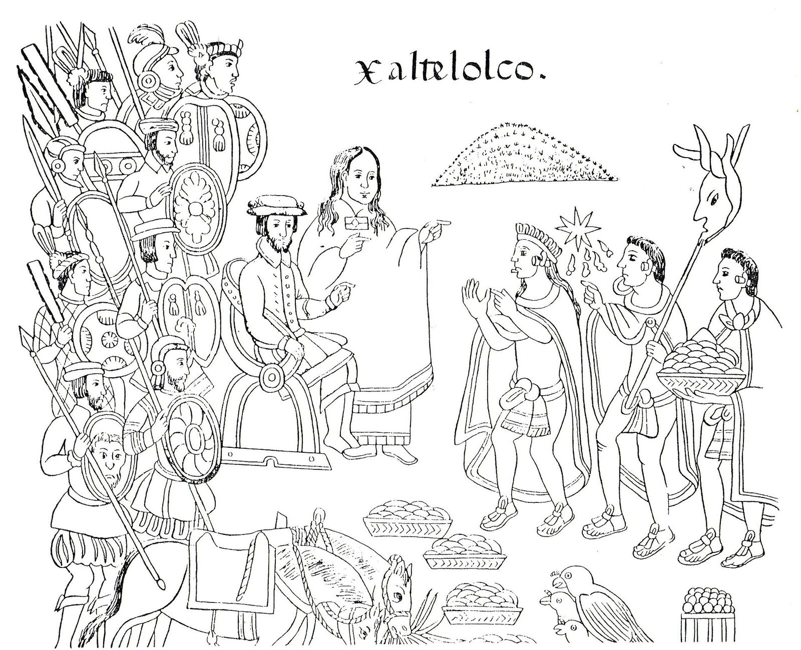
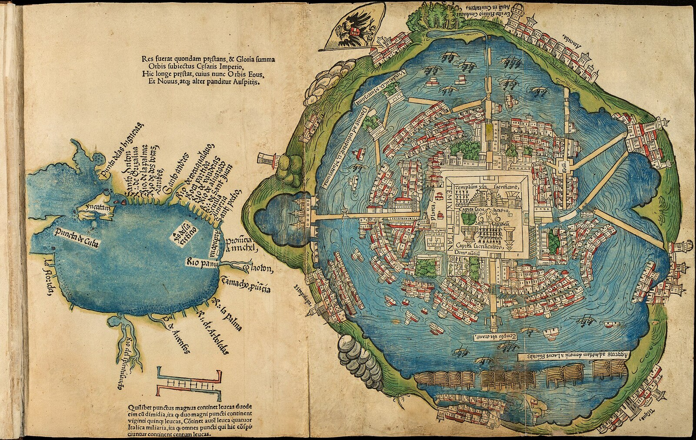
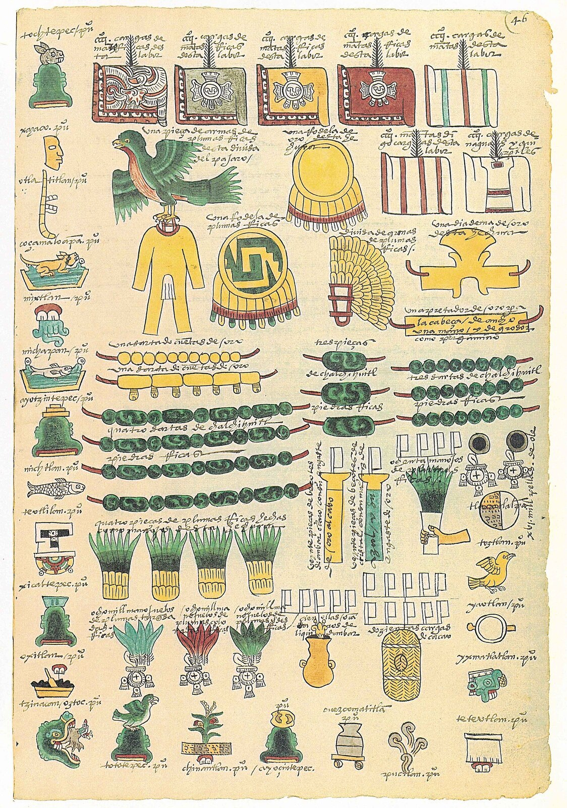
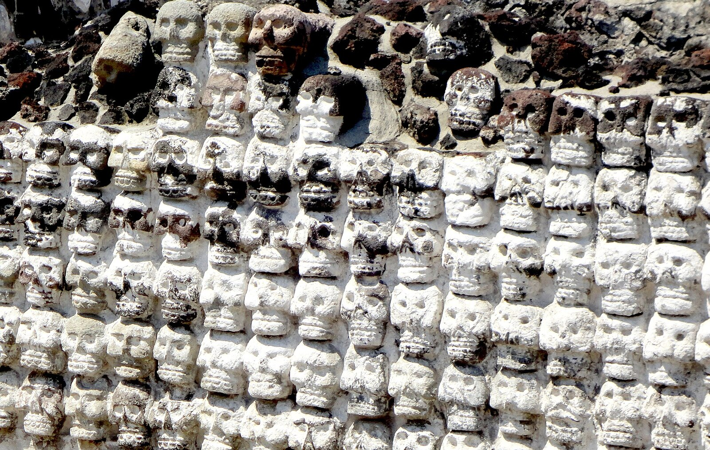
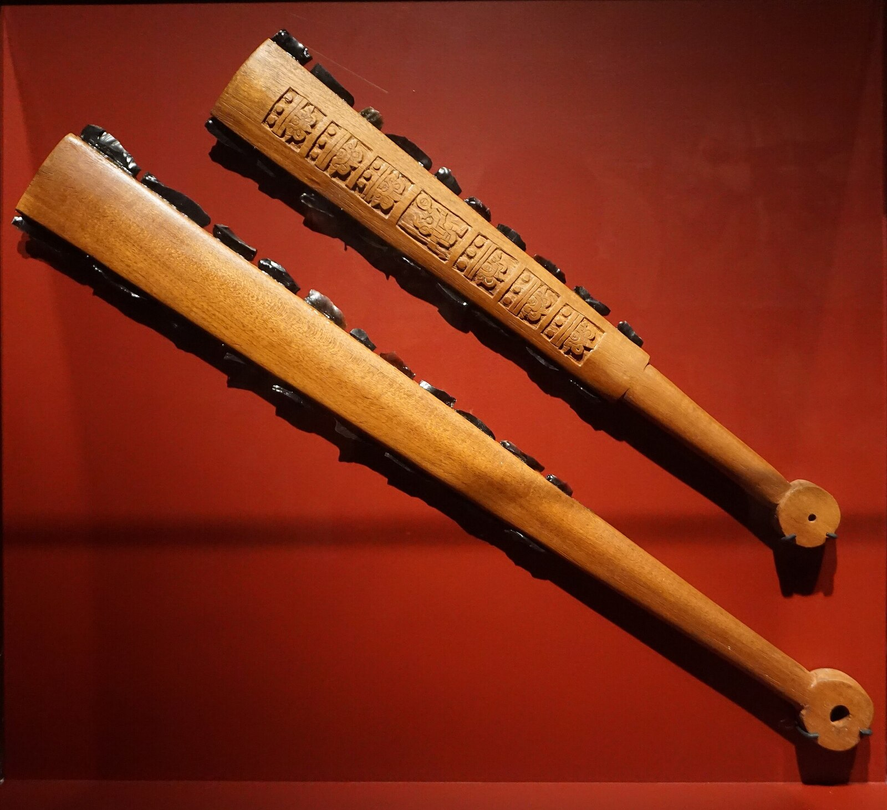
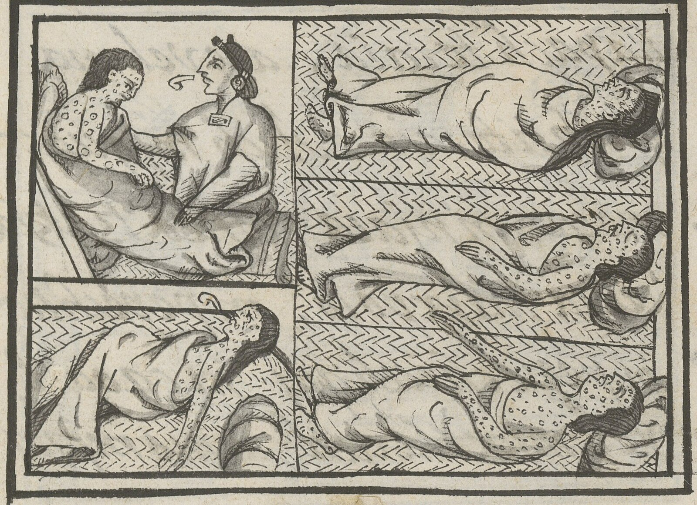
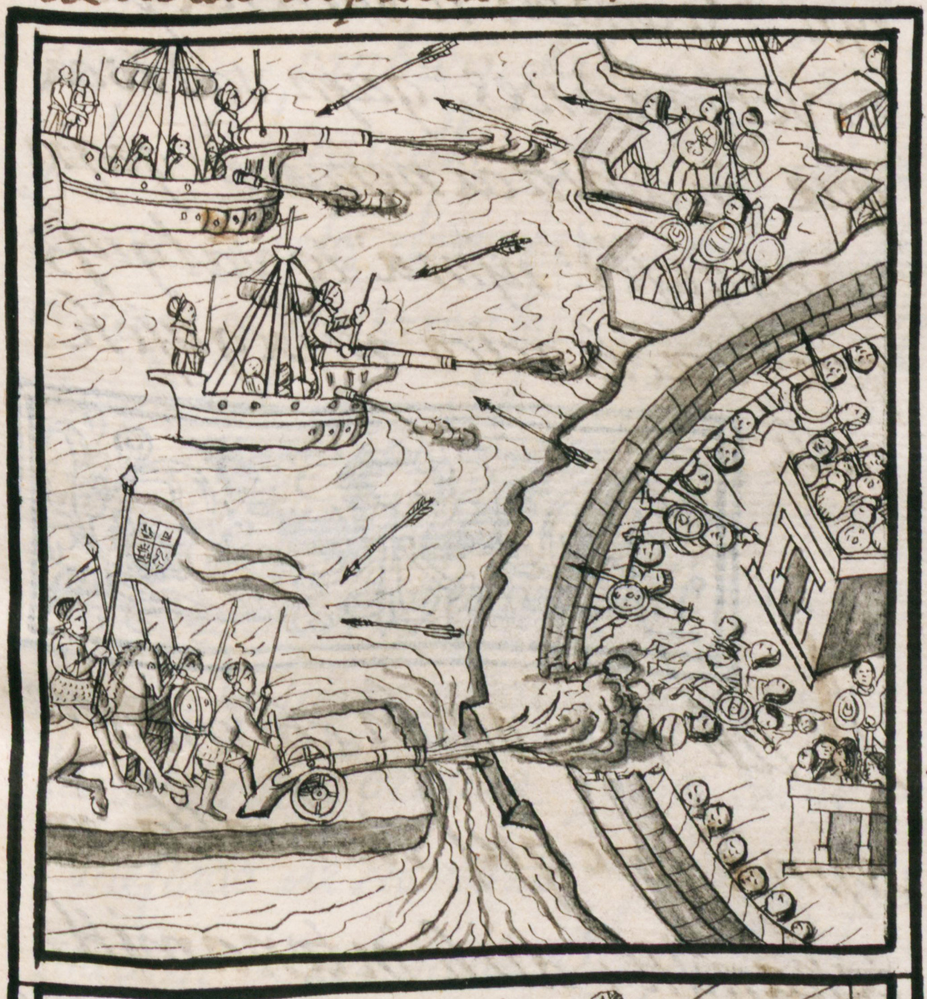
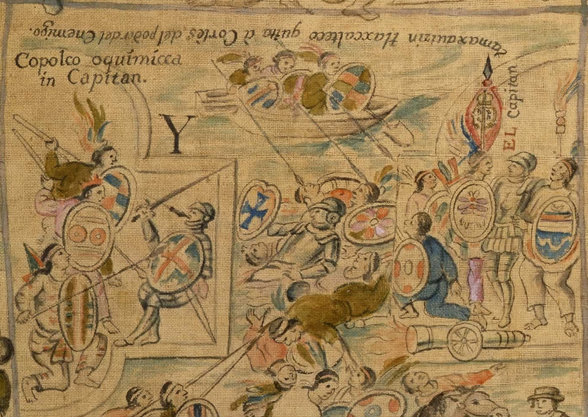

# 46. How did a few hundred Spaniards conquer the Aztecs?

*Central Mexico, from 1428 to about 1560*

They did not do it alone. The army that destroyed the Aztec capital was made up mostly of other Mexicans, who had their own reasons to want it destroyed, and an epidemic of smallpox had already killed a great part of the defenders.

Around 1552, the council of Tlaxcala, a city and small province in the highlands of central Mexico, paid for a painting. It was done on a sheet of cotton cloth about five metres high and two wide, and it was laid out like a comic strip, in more than eighty scenes. The councillors had three copies made. They kept one, sent one to the king's viceroy in Mexico City, and sent the third across the ocean to the king of Spain.

The painting told the story of the war, thirty years earlier, in which the great city of the Aztecs had fallen. In scene after scene, warriors in feathered suits and cotton armour charge the enemy with wooden swords. They carry the banners of Tlaxcala. The Spaniards in the picture are few. Here and there among the warriors rides a Spaniard on a horse. Beside the Spanish captain, in almost every scene where he appears, stands a woman in a native blouse, larger than he is, speaking for him.

*A scene from the Lienzo de Tlaxcala, redrawn in line: the Spanish captain sits while the woman beside him speaks to men bringing food. Drawing after the Lienzo de Tlaxcala, public domain.*

This was how the people of Tlaxcala remembered the conquest of Mexico. In their telling, the war had been theirs. They had fought a long war against an old enemy and they had won it, with the help of some useful foreigners. They sent the painting to the king to remind him of what he owed them.

## The city on the lake

The people we call Aztecs called themselves the Mexica. They had come into the Valley of Mexico as poor wanderers from the north, some two hundred years before the Spanish arrived, and found all the good land taken. As latecomers, they had to make do with what was left. They therefore settled where nobody else wanted to live, on a marshy island in the great shallow lake that then filled the middle of the valley.

The unwanted island did not stay poor. By 1500 it held one of the largest cities on earth. Tenochtitlan had around two hundred thousand people, which was four times as many as Seville, the biggest city in Spain.

A city on an island needs roads to the shore, and this one had three. It was joined to the shore by three raised roads, each wide enough for eight horsemen to ride abreast, with gaps crossed by wooden bridges that could be taken up. With the bridges lifted, each road became a dead end over open water. Fresh water came across the lake in a stone channel from springs on the mainland. Inside the city, canals served as streets, and the people grew maize and flowers on long garden plots built up from the mud of the lake bed.

*Plan of Tenochtitlan and a map of the Gulf of Mexico, printed in Nuremberg in 1524 with Cortés's letters to the emperor. Map: from Cortés's Praeclara narratio, public domain.*

Nothing in Spain had prepared the newcomers for such a place. The Spanish soldiers who first saw it wrote that they wondered whether they were dreaming. One of them, who had grown up in a Spanish market town, remembered the great market square above all. Some of his companions had been to Constantinople and to Rome, he wrote, and they said they had never seen a market so large, so orderly and so full of people.

A city of that size could not feed and clothe itself from garden plots. Instead, the city lived on tribute, which means goods that conquered peoples were made to hand over. Starting in 1428, the Mexica and two allied cities on the lake shore had conquered most of central Mexico, from the Gulf coast to the Pacific. For the most part they did not garrison these lands or govern them. Instead, they left each defeated town under its own lord and sent it a bill. A painted register of these bills survives, and it lists what several hundred towns had to deliver each year: bales of cotton cloaks by the thousand, sacks of cacao beans, jars of honey, bundles of bright feathers, warriors' costumes, live eagles. The bill was backed by a simple threat. A town that failed to pay received a visit from the army.

*A page of the Codex Mendoza, a painted register of the tribute that towns owed the Mexica. It lists cloaks, feather shields, gold and jade beads, with Spanish notes added. Codex Mendoza, public domain.*

An empire built this way was rich and brittle. It was rich because the goods of several hundred towns flowed into one city. It was brittle because little held those towns to the Mexica except fear of the army. The Mexica had perhaps five million subjects, and a great many of them were waiting for a chance to stop paying.

## Feeding the sun

Cloth and cacao were not all that the Mexica wanted from their neighbours. They also demanded captives, and the need for them shaped the way they made war.

The need came from their religion. They believed that the sun was not guaranteed to rise. In their account of the beginning of things, the gods had gathered in darkness and thrown themselves into a fire so that the sun could exist, and had then given their own blood to set it moving across the sky. Human beings had been paying off that debt ever since. The sun was fed with the most precious thing there was, which was human blood and human hearts, and if the feeding stopped, the world would end. The Mexica took this debt literally, and they paid it in public.

At the centre of Tenochtitlan stood a pyramid as tall as a twelve-storey building, with two temples on its summit. There, on the great festivals, priests stretched a living person over a stone, opened the chest with a flint knife and lifted the heart to the sun. The skulls of the dead were threaded on poles in a great rack at the foot of the steps.

Spanish writers described this rack, and for centuries some historians suspected them of exaggerating. Then, in 2015, archaeologists digging under a house in Mexico City found it. They have so far uncovered a tower built of several hundred human skulls set in lime, and the holes in the sides of the skulls show where the poles went through.

*A tzompantli, a skull rack carved in stone, at the Templo Mayor in Mexico City. Photo: Juan Carlos Fonseca Mata, CC BY-SA 4.0.*

Most of the people who died on the stone were prisoners of war. That fact changed what a battle was for. Only a living prisoner could be brought home to the pyramid. For that reason a Mexica warrior went into battle hoping above all to capture. His rank, his dress and even his haircut depended on how many prisoners he had taken alive. His weapon suited the purpose. It was a wooden club edged with blades of volcanic glass, sharp enough to cripple a man with a blow to the legs.

*Two macuahuitl, the wooden clubs edged with obsidian blades. They are recreations made in 2019 from pictures in the codices and Spanish descriptions. Photo: Arjuno3, CC BY-SA 4.0.*

Captives had to come from somewhere, and one source lay close at hand. About a hundred kilometres east of Tenochtitlan, in the middle of conquered territory, lay the small highland state of Tlaxcala, and the Mexica had never conquered it. They said this was deliberate. They kept Tlaxcala, they claimed, in the way a farmer keeps a fishpond, as a convenient place to send young warriors for practice and captives.

The Tlaxcalans told it differently. They were a proud people, four allied towns governed by a council of lords, and they said that they had fought off every army sent against them. What is certain is that they paid for their freedom. The Mexica, who held the land on every side of them, cut them off from trade. As a result, ordinary goods became rare. The Tlaxcalans remembered two generations in which cotton was a luxury, so that most people dressed in cloth made from the fibre of the agave plant, and salt was so scarce that they learned to eat without it. Many families had lost someone to the stone. Poverty and grief together did their work. There was no people in Mexico with better reason to hate Tenochtitlan.

## A woman who spoke three languages

In April 1519, eleven ships anchored off the Gulf coast. They carried about five hundred soldiers, sixteen horses and a few small cannon, under a commander named Hernán Cortés.

Cortés was thirty-four, a minor nobleman who had spent fifteen years in the Spanish colonies on the Caribbean islands. Those colonies were a disappointment. The gold had run out and the islanders, who had been put to forced labour, were dying fast. Spaniards had therefore begun to raid the mainland for slaves and to look for richer lands. The governor of Cuba had appointed Cortés to lead an expedition of trade and exploration, and had then changed his mind and tried to dismiss him. Cortés sailed anyway. That act of disobedience hung over everything he did afterwards. He was thus an outlaw from the start, and he could expect a pardon only if he sent the king something splendid.

Five hundred men were very few to set against an empire of millions. Nevertheless, Cortés had three advantages that mattered more than his guns. The first was steel. A Spanish sword could cut through cotton armour, and a Spanish breastplate could turn a blade of volcanic glass. The second was the horse, which no one in Mexico had seen, and which let a few riders break up a crowd of foot soldiers.

Steel and horses, however, were of little use to a commander who could not talk to the people of the country. The third advantage was a young woman who could. A few weeks before, a Maya town on the coast had made peace with Cortés and given him twenty slave women. One of them had been born far to the west, among people who spoke Nahuatl, the language of the Mexica, and had been sold as a child to the Maya. She therefore spoke both languages. Cortés had also picked up a Spaniard who had been shipwrecked years earlier and had learned Maya. Together the two of them made a chain across three languages. For the first months, Cortés spoke Spanish to this man, who spoke Maya to the woman, who spoke Nahuatl to the ambassadors of the emperor. Within the year she had learned Spanish and the chain was no longer needed.

The Spaniards called her Marina, and the Mexicans called her Malintzin. She was far more than an interpreter. She understood the politics of the country, and she could tell Cortés who hated whom. In an empire held together by fear, that knowledge was a weapon in itself. It is not an accident that the Tlaxcalan painters drew her so large.

On the coast, the local people complained to Cortés about the tax collectors of Tenochtitlan, and from them he learned how the empire worked: the towns paid because they were afraid, and they resented it. With that lesson in mind, he marched inland towards the capital, and his road led through Tlaxcala.

*Cortés's march from the coast to Tenochtitlan in 1519. Below, the Valley of Mexico, with the lake drawn roughly as it was in 1519, and the island city with its three raised roads. Map: drawn for this book; coastlines and rivers from Natural Earth, public domain.*

The Tlaxcalans attacked him. They fought the Spaniards for two weeks, by day and by night, and the Spaniards barely survived. Then the council of Tlaxcala stopped to think. On the one hand, these strangers were few, and they could be killed. On the other hand, they fought like nothing the Tlaxcalans had met before, they did not tire of saying that they were on their way to Tenochtitlan, and they were asking for peace. One of their commanders argued for finishing them off. The majority saw something better. Here was a weapon that could be pointed at the Mexica.

As a result, Tlaxcala made an alliance with Cortés. When he set out again, several thousand Tlaxcalan warriors went with him.

## Guests with a hostage

The ruler of the Mexica was Moctezuma, a man of about fifty who had held the throne for seventeen years. His messengers had been watching the strangers since they landed, and painters had brought him pictures of the ships, the horses and the guns. He had therefore had months to think about what to do with them.

A story grew up later that Moctezuma took Cortés for a returning god and was paralysed with dread. There is little sign of it in what he did. He behaved as the ruler of a great state would behave towards a small, dangerous and puzzling band of foreigners. He sent gifts and asked them to stay away. When they came on regardless, with his enemies the Tlaxcalans beside them, he decided to let them into the city, where he could watch them and where they would be surrounded by water. With the bridges taken up, the island would hold the guests as surely as it protected their host.

On 8 November 1519 the Spaniards walked in along the southern road. Moctezuma met them in person and lodged them in a palace beside his own. Within a week or so, Cortés did what Spanish captains in the Caribbean had learned to do. He seized the ruler. The idea was simple: whoever held the man at the top could give orders in his name. Accordingly, Moctezuma was moved into the Spanish quarters under guard, and for six months the Spaniards tried to rule the empire through him while they collected its gold.

It came apart the following spring. Cortés had to hurry to the coast to deal with a Spanish force that the governor of Cuba had sent to arrest him. He left a hot-headed officer in charge. On the coast he surprised the newcomers in a night attack and talked most of them into joining him, which more than doubled his numbers. Back in the city, meanwhile, matters were in the hands of the officer he had left behind. During a great festival, when the young nobles of the city were dancing unarmed in the temple courtyard, this officer blocked the gates and had them cut down. He said afterwards that he had feared a plot.

The city rose. The killing of the dancers had ended any pretence that the Spaniards were guests. When Cortés got back, he found his men besieged in their palace. Moctezuma was killed in the confusion. The Spanish said he was hit by stones thrown by his own people, and the Mexica said that the Spaniards murdered him.

By then the Spaniards could no longer hold out in the palace, and they decided to run. On a rainy night at the end of June 1520, the Spaniards and their Tlaxcalan allies tried to slip out along the western road. They were seen. The raised road, with water on either hand, now worked against them. Warriors in canoes closed in on both sides of the road, and the bridges had been taken up. Hundreds of Spaniards died that night, along with thousands of Tlaxcalans. Many of the Spaniards drowned in the gaps, dragged down by the gold they had tied around their bodies.

The survivors limped back to Tlaxcala. They arrived as beaten men, and their fate now lay in the hands of the council. This was the moment when the conquest could most easily have ended. The Tlaxcalans had only to close their gates, or to hand the battered strangers over to Tenochtitlan in exchange for peace, and ambassadors from the Mexica came to propose exactly that. The council debated it and refused. They had gone too far to trust any peace with their old enemy. They did, however, set a price for their help, and it was the price of a partner, not a servant. They asked for a share of everything taken, for a stronghold in the conquered city, and for freedom from tribute for ever. Cortés agreed.

## The great rash

While the Spaniards rested in Tlaxcala, their most effective ally was already at work in the valley, and they had not sent it.

One of the men who had landed with the second Spanish force had been carrying smallpox. The disease was old in Europe, Asia and Africa, where most people caught it as children and the survivors could not catch it again. Nobody on the American mainland had ever had it. That meant none of its peoples was protected, at any age. When it arrived, therefore, whole households fell ill together, the strong adults with the old and the young.

It reached Tenochtitlan in the autumn of 1520 and burned through the city for about two months. The Mexica later described it to a Spanish friar who wrote down their words. Sores covered people's faces, heads and chests, they said, so that the sick could not walk, or lie face down, or turn over. Because everyone in a house was ill at once, there was nobody to prepare food, and a great many of those who died were killed by hunger and not by the disease.

*Smallpox victims in 1520, drawn in Book 12 of the Florentine Codex, completed in 1577. Florentine Codex: Bernardino de Sahagún, public domain.*

Among the dead was the new emperor, Moctezuma's brother, who had driven the Spaniards out. He had ruled for eighty days. Much of the army's leadership died with him. The city thus lost many of its commanders months before the enemy returned. Nobody counted the victims, but in some towns of the valley half the people were gone by the end of the year.

The disease killed in Tlaxcala too, and among the dead was the old lord who had been Cortés's firmest friend there. In Tenochtitlan, however, it struck a crowded city that was about to be besieged. The Spaniards, who had met the disease as children, were hardly touched. A sickness that struck Mexicans and spared Spaniards seemed to need an explanation. Both sides noticed this, and both drew the same conclusion about which gods were stronger.

## Thirteen boats over the mountains

Cortés had learned from the night on the western road that the city could not be taken while the Mexica controlled the lake. On that night the canoes had done much of the killing, because whoever held the water held the roads that crossed it. He therefore ordered boats. In Tlaxcala, under a Spanish shipwright, native carpenters cut the timbers for thirteen small warships, each about twelve metres long, with a sail, oars and a cannon in the bow. Tlaxcala, however, lay in the highlands, far from the water. The ships were then taken apart. Eight thousand porters carried the pieces on their backs over the mountains to the lake, a march of some eighty kilometres, in a column ten kilometres long.

*Cortés's boats and a cannon on the shore attacking Tenochtitlan in 1521. Florentine Codex, completed in 1577: Bernardino de Sahagún, public domain.*

Meanwhile the alliance grew. The second city of the empire, Texcoco, on the eastern shore of the lake, had been the Mexica's partner from the beginning. Its royal family, however, was split by a quarrel over the throne, and one of the princes now brought his followers over to Cortés. With Texcoco came a harbour for the boats and tens of thousands more warriors. Town after town around the lake followed, each calculating that the Mexica were finished and that it was wise to be on the winning side early.

The siege began in May 1521. Cortés had about nine hundred Spaniards by then, since more ships had come in. His native allies numbered at least a hundred thousand, and by the end perhaps twice that. For every Spaniard in the attack there were more than a hundred Mexicans.

The first act was to break the stone channel that brought fresh water into the city. The boats then swept the canoes from the lake and cut off the food. After that the allies advanced along the three roads, and it was slow, murderous work. The Mexica fought for every bridge and every rooftop. What the attackers took by day was retaken at night. In the end Cortés adopted a method he said he regretted. As each block of houses was captured, the allies pulled it down and tipped the rubble into the canals, so that horses could cross and there was nothing left to defend. One of the most beautiful cities in the world was taken by being demolished.

*A battle of the siege of Tenochtitlan, in a copy made in 1773 of the Lienzo de Tlaxcala, which was first painted in the 1500s. Copy of the Lienzo de Tlaxcala, public domain.*

The defenders held out for nearly three months, eating lizards, weeds and the leather of their shields, and drinking the salt water of the lake. On 13 August 1521 the last emperor, a cousin of Moctezuma aged about twenty-five, was caught trying to leave by canoe. Tens of thousands had died, most of them from hunger and sickness. The Spaniards wrote that at the end one could not walk in the streets without stepping on the dead.

## Letters to the king

The Tlaxcalans and the other allies believed that they had won. From where they stood, the hated city was gone, its tribute had stopped, and they had fought beside the victors as partners. For some years it seemed so. Tlaxcalan warriors marched with Spanish captains to conquer Guatemala and the north, and they did it as allies who expected a share.

What they had not understood was that the Spaniards did not mean to go home, and that more would keep arriving. Cortés rebuilt Tenochtitlan as Mexico City, using the stones of the temples, and the Spaniards stepped into the place of the Mexica. The tribute that had gone to Moctezuma now went to them. Spanish settlers were granted whole towns whose people had to work for them. The old arrangement of local lords and yearly bills went on, with new people at the top.

The allies responded as subjects of a king could. They went to law, and they wrote. Their argument, again and again, was that they had served the king in the war, and the king owed them. Tlaxcala made the case most stubbornly. It sent its noblemen across the Atlantic to the Spanish court several times, and they did not come back empty-handed. The king confirmed that Tlaxcala would never be granted to any Spanish settler and would answer to the crown alone. He gave it a coat of arms and the title of Loyal City. The painting on cotton was part of this campaign, which continued for the rest of the century.

Other towns had less success. In 1560 the council of Huejotzingo, a neighbour of Tlaxcala, wrote to the king in Nahuatl. They reminded him that they too had joined the Spaniards at the beginning, had fed them and fought beside them, and had never once turned against them. They asked why, in that case, they were now taxed so heavily that they could not pay, and they complained that the Tlaxcalans had taken all the credit.

Even Tlaxcala could not keep all that it had won. Tlaxcala's privileges were whittled away as well. Within a few decades its people were paying tribute in maize like everyone else, and Spanish ranchers were grazing sheep on its fields. The councillors protested each loss in careful legal Spanish, and cited their services of 1521.

By then there were far fewer people on either side of the old quarrel. The cause was disease, which went on arriving long after the war was over. Smallpox was the first of the new diseases. Measles followed. Then, in 1545 and again in 1576, came two epidemics of fever and bleeding that the Mexicans called the great pestilence, and the first of them killed more than the smallpox had. A century after Cortés landed, the native population of central Mexico was perhaps a tenth of what it had been. The world that the allies had fought to win a place in had emptied out around them.

Tlaxcala is still on the map. It is the smallest of the states of modern Mexico, and its borders run close to where they ran when it was a besieged republic short of salt.
