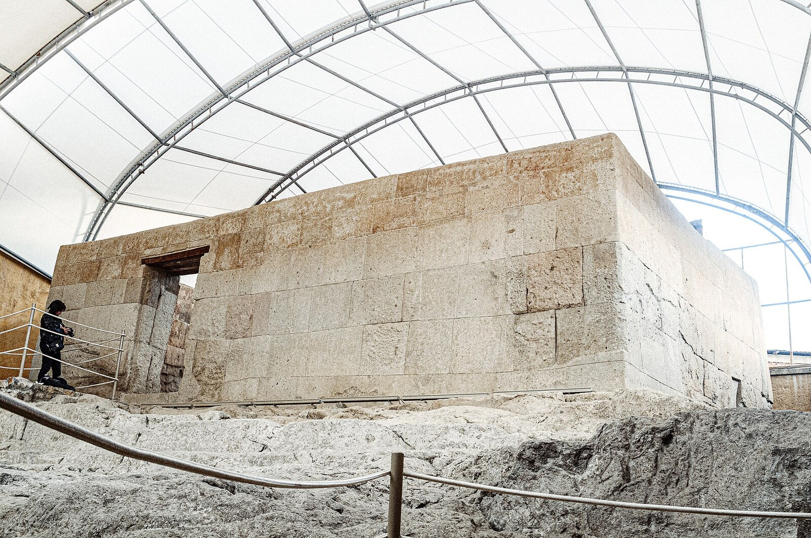
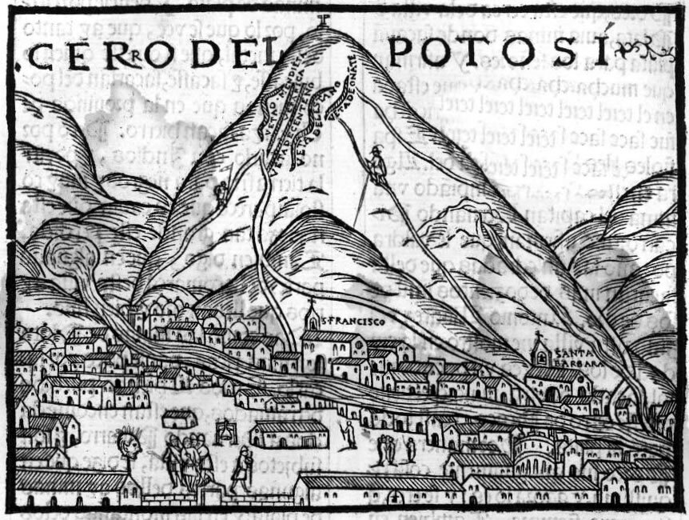
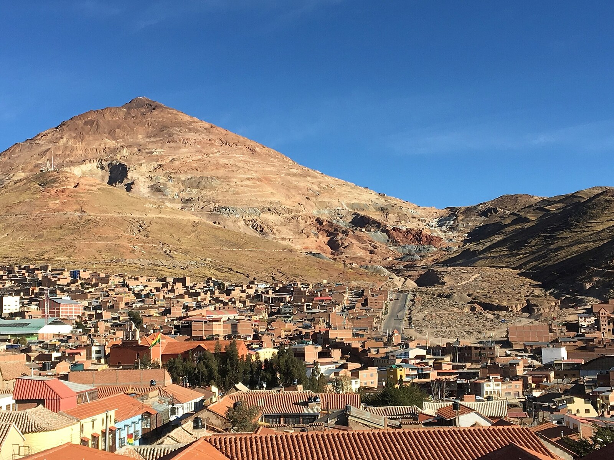
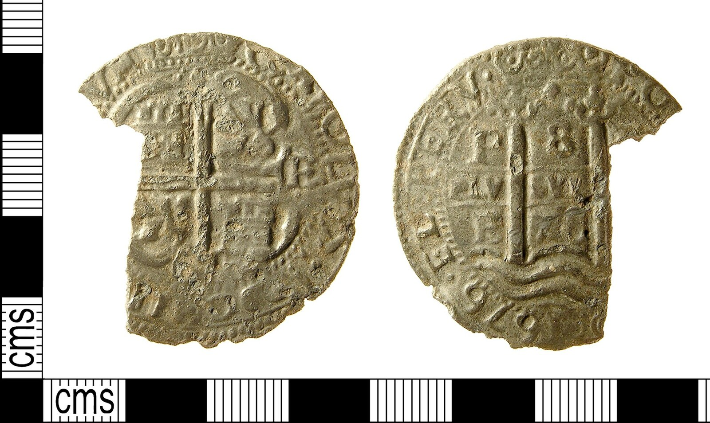
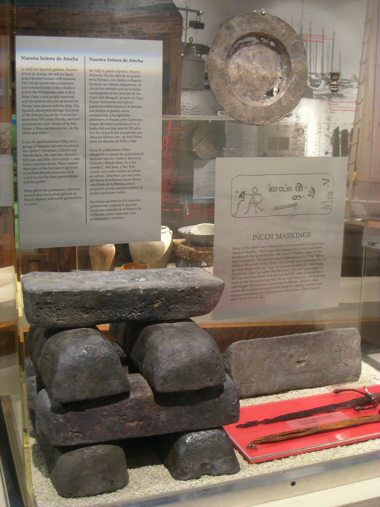
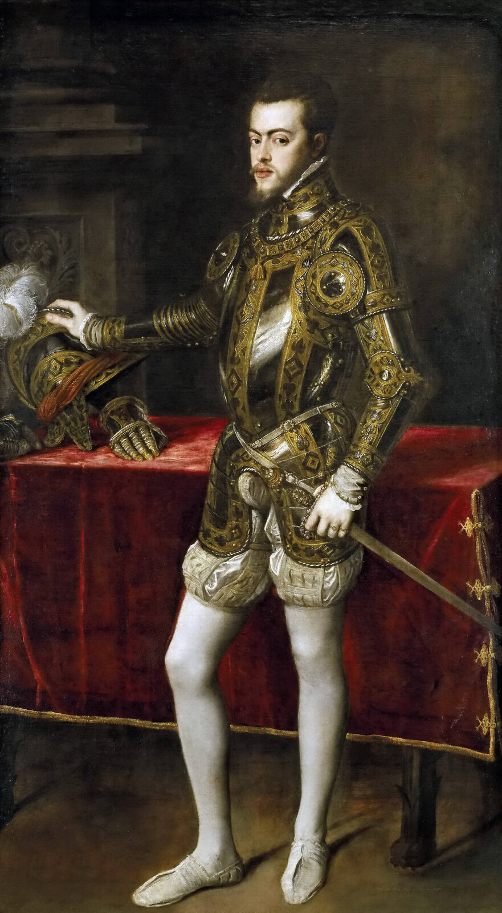
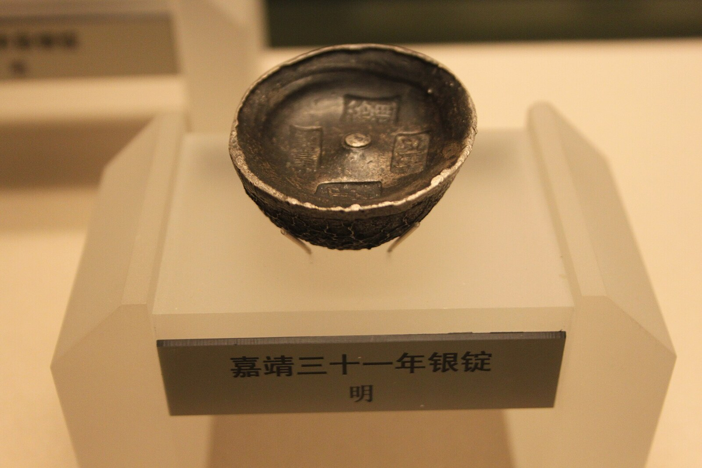
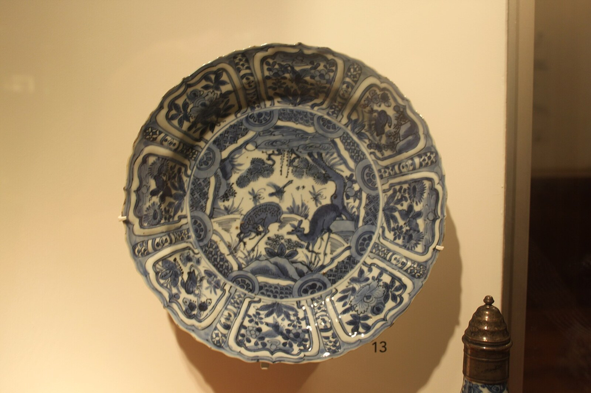

# 47. Why didn't American silver make Spain rich?

*Peru, Spain and China, from 1527 to about 1650*

Because the king of Spain had spent it before it arrived. He fought his wars on borrowed money and pledged each fleet of silver to his bankers in advance, while his subjects used the rest to buy what other countries made. The silver passed through Spain and kept going, and a large share of it ended in China.

In the town of Cajamarca, in the mountains of northern Peru, there is a stone room about seven metres long and five wide. In November 1532 a man was held prisoner in it. He noticed how his captors looked at gold, and he made them an offer. He stood against the wall, stretched his hand as high above his head as he could reach, and had a line drawn there. In exchange for his freedom, he said, he would fill the room with gold up to that line, and then fill it twice more with silver.

*The stone room at Cajamarca, Peru, where Atahualpa was held prisoner in 1532 and offered to fill it with gold. Photo: Miguel Francisco Rueda Ñañez, CC BY-SA 4.0.*

The prisoner was Atahualpa, ruler of the Inca empire. His captors were a hundred and sixty-eight Spaniards under a captain named Francisco Pizarro. The offer was accepted, and the empire set about paying. For the next eight months, strings of llamas and porters came down the mountain roads from every part of the empire, carrying cups, plates, statues, jewellery and sheets of gold stripped from the walls of temples.

The Spaniards kept very little of it as it was. To them the value lay in the metal and not in the workmanship. They therefore set up nine furnaces and melted nearly all of it into bars, which were easier to count and divide. It came to about six tonnes of gold and nearly twelve of silver. Each horseman received some forty kilograms of gold, which was more than a labourer in Spain could earn in several lifetimes. The ransom, however, did not buy the prisoner his freedom. When the melting was finished, the Spaniards put Atahualpa on trial for plotting against them, and strangled him.

It was the largest ransom ever paid. Within a few years the Spaniards found a far greater source of silver, and for two centuries they dug it out. Spain became the envy of Europe and remained, for most of its people, a poor country.

## An empire without money

The state that Pizarro walked into was the largest that the Americas had produced. It ran for four thousand kilometres along the Andes, from what is now Ecuador to the middle of Chile, and held about ten million people. A single family from the valley of Cuzco had put it together in less than a hundred years. It was a young empire, and some of its peoples had been conquered within living memory.

It was run on principles that a Spaniard found hard to grasp. The chief difference was that it did without coins. There was no money and there were almost no markets. Instead, people paid their taxes in work. Every household owed the state a certain number of days each year, which might be spent farming the ruler's fields, weaving cloth, building roads or serving in the army. In return the state fed its workers from storehouses that stood in rows on the hillsides above every town, stocked with maize, dried potatoes and cloth. A system like that needs careful records and fast messages, and the Inca had both. Officials kept the accounts on knotted cords, and relays of runners carried messages along tens of thousands of kilometres of road.

Gold and silver had no value as money in such a place. Nobody could buy much with them, because almost nothing was for sale. They were, instead, sacred materials, the sweat of the sun and the tears of the moon, and they were used to decorate temples and the bodies of rulers. Atahualpa could offer a room full of them because they were his to command, and because he could see that the strangers wanted them more than anything else he had.

The Spaniards had arrived at the worst possible moment for the Inca. The empire had just been through an epidemic and then a civil war. About five years earlier, a disease had come down from the north, passed from people to people ahead of any European. It was probably the smallpox that had struck Mexico. It killed the ruling Inca and his chosen heir within days of each other. With both of them dead, the succession was open. Two of his other sons, Atahualpa and his half-brother, then fought a civil war for the throne that tore the empire in half. Atahualpa had just won it, and his generals had just captured his brother, when word came that bearded strangers had landed on the coast.

He was not afraid of them, and the numbers explain why. He had an army of tens of thousands camped in the hills, and there were fewer than two hundred of the foreigners. He agreed to meet them in the square of Cajamarca and came in a litter carried by eighty lords, with several thousand attendants who had left their weapons behind. Pizarro, however, had prepared an ambush. He had hidden his horsemen and his few guns in the buildings around the square. At a signal they charged. The Spaniards killed for two hours without losing a man, and they pulled the ruler from his litter alive.

They had learned the method in Mexico: seize the man at the top. In a state where every order came down from one person, it worked better still. The prisoner in the stone room was that person, which is why the llamas came down the roads when he sent for gold. The Spaniards also found allies quickly, as Cortés had, among peoples whom the Inca had conquered only a generation or two before, and among the supporters of the defeated brother.

## The rich hill

The treasure of Cajamarca had been collected over centuries, and it could be taken only once. What the Spaniards wanted was a mine, which would go on giving year after year. In 1545 they found one, at a place called Potosí, in the high country of what is now Bolivia.

By the usual account, an Andean man named Diego Huallpa was climbing a bare, cone-shaped mountain when he came upon a ledge of silver ore at the surface. The find was far better than a single ledge. The mountain turned out to be the richest body of silver ore ever found. The Spaniards named it the Rich Hill.

*The mountain and town of Potosí, printed in Pedro Cieza de León's Chronicle of Peru in 1553, eight years after the silver was found. Source: Wikimedia Commons, public domain.*

It stood in one of the least welcoming places on earth. The trouble was its height. The foot of the mountain is four thousand metres above the sea, as high as the snowfields of the Alps, and the summit is eight hundred metres higher still. The air has about three-fifths of the oxygen of air at sea level. Little grows there but coarse grass, it freezes on most nights, and newcomers are sick for weeks. Almost everything the town needed had to be brought in. Every beam, every sack of flour and every jar of wine had to be carried up on the backs of llamas and mules.

*Cerro Rico, the Rich Hill, above the town of Potosí, Bolivia, where silver was found in 1545. Photo: Jbmurray, CC BY-SA 4.0.*

None of this kept people away. Within a generation there was a city there of more than a hundred thousand people, with dozens of churches, gambling houses and dancing schools. It was larger than Madrid or Rome. Across the Spanish world, to say that something "was worth a Potosí" meant that it was beyond price.

At first the silver was easy to get at. The first miners simply dug out the richest ore and smelted it in small clay furnaces that the local people set on the ridges to catch the wind. After twenty years the best ore was gone. Plenty of silver remained in the mountain, but it was scattered thinly through rock that the clay furnaces could not handle. What saved the mines was a chemical trick, brought to Potosí in the 1570s.

The trick used mercury, the liquid metal, which has the odd property of soaking up silver the way a sponge soaks up water. Poor ore was first crushed to powder under heavy iron hammers, driven by waterwheels. The powder was spread out, wetted with salty water and mixed with mercury, and workers trod the mud with their bare legs for weeks. Bit by bit the mercury found the specks of silver and joined with them into a soft, heavy paste. This was washed out and heated. The heat parted the two metals again. The mercury boiled away as a vapour, and pure silver was left behind.

With this method, rock that was far too poor to smelt was worth digging. What the miners needed now was power to crush it. The Spaniards therefore built a chain of reservoirs in the hills to turn more than a hundred crushing mills, and production quadrupled in ten years. The method also needed a steady supply of mercury. By great good luck, the largest mercury mine in the Americas lay in the same mountains, at a place called Huancavelica.

## One man in seven

Mines on this scale needed more workers than would come willingly to a freezing mountain. In 1573 the Spanish governor of Peru solved the problem by borrowing an institution from the Inca.

The Inca had taken their taxes in labour, by turns, and the word for a turn was *mita*. The governor announced a new mita, which kept the old name and put it to a new use. He marked out a region of the highlands some thirteen hundred kilometres long, and ordered that every village in it must send one in seven of its grown men to Potosí each year. This produced about thirteen thousand men at a time.

For one of those men, the journey alone turned his life over. His village might be two months' walk from the mine. He set out with his wife and children, because nobody would feed them if he left them, and with llamas loaded with dried potatoes for the journey. Whole families took the road together. A Spanish observer who watched the departure of one province counted seven thousand people and thirty thousand animals on the road.

At Potosí he worked one week in three. On Monday morning he went into the mountain, and he stayed inside until Saturday night, sleeping in the tunnels. The men who cut the ore worked by candlelight with iron bars. Others carried it out. A carrier loaded about twenty-five kilograms of rock into a blanket knotted across his chest, and climbed with it up a series of ladders made of leather and wood, some of them hundreds of metres from bottom to top, with a candle tied to his thumb. He came out of the hot shaft, soaked in sweat, into freezing air.

For this he was paid, but the wage was fixed well below what a free miner earned, and it did not cover his family's food at Potosí prices. During his two weeks off he therefore hired himself out, usually at the mills, for the market wage. Many men never went home, since at home they would only be drafted again. Their absence made matters worse for those who stayed. Villages emptied, and the survivors had to supply the same number of men from a shrinking population, or pay silver to be let off.

The mercury mine was worse, and the danger there was the mercury itself. The men at Huancavelica breathed poisoned dust and fumes, and those who came back shook, lost their teeth and died young. Mothers in the provinces that owed service there were said to have lamed their sons to keep them out of it.

## Pieces of eight

Before the silver could reach Spain, it had to be shaped, counted and shipped. Most of the silver left Potosí as coins. The mint there stamped them by hand, roughly, with a cross on one side and the king's arms on the other. The standard coin weighed about twenty-seven grams and was worth eight of the small Spanish coins called reales. English speakers called it a piece of eight, and Spaniards called it a peso.

*A piece of eight struck at Potosí in 1676, under Charles II, found on the Isle of Wight, England; part of the edge is missing. Photo: Isle of Wight Council, CC BY-SA 4.0.*

From Potosí the coins and bars went down to the Pacific on llamas, by ship to Panama, across the narrow neck of land on mules, and by ship again to Spain, together with silver from new mines in Mexico. The crossing of the Atlantic was made in convoy, with the ships sailing together for safety. Once or twice a year a fleet of fifty or more merchant ships, guarded by warships, sailed into the river at Seville, and the bars were counted into the royal warehouse.

*Silver ingots salvaged from the Spanish ship Nuestra Señora de Atocha, wrecked in a storm off Florida in 1622; the silver came mostly from present-day Bolivia. Photo: Daderot, public domain.*

A fifth of everything mined belonged to the king. What he did with his share did much to decide what the silver did for Spain. For most of this period the king was Philip II, who ruled from 1556 to 1598 and governed his empire with his own pen, reading and answering reports late into the night. Philip believed that God had given him this wealth for a purpose, which was to defend the Catholic faith. In practice that meant war after war. He fought the Ottoman Turks in the Mediterranean. He fought the Protestant Dutch, who had rebelled against him, for the last thirty years of his reign. He sent a fleet of a hundred and thirty ships against Protestant England and lost a third of it.

*Philip II of Spain, in armour, painted by Titian in 1551, five years before he became king. Painting: Titian, public domain.*

The trouble with paying for such wars was timing. Wars had to be paid for month by month, and the silver came once a year, if storms and pirates allowed. Philip's soldiers in the Netherlands, moreover, were at the far end of a road that ran from Italy over the Alps for a thousand kilometres. Shipping chests of coin to them was slow and dangerous. The king therefore turned to bankers, as his father had done before him. He needed two things from them: money now, and money in the right place.

The bankers' chief tool was a piece of paper. Suppose that a banking family from Genoa had an office in Spain and another in Antwerp, near the army. The king's treasurer handed the Spanish office a written promise of silver from the next fleet. In return the office wrote a short letter to its partners in Antwerp, instructing them to pay a stated sum, in local coin, to the army's paymaster on a stated day. The letter went north with a courier in two or three weeks. No chest of coin had to travel with it. The bankers in Antwerp paid out of money that merchants there had deposited with them. The army was thus paid in the north with money that was already in the north. When the fleet came in, the family collected its silver in Seville and put it to work there, and the books of the two offices balanced.

None of this was done as a favour. For this service, and for waiting to be repaid, the bankers charged heavily. Sometimes the charge was written into the contract, at one per cent a month. Sometimes it was hidden in the rate at which they changed Spanish money into Flemish money, since the church disapproved of interest on loans. It often came to fifteen or twenty per cent a year.

The taxes of Castile brought the king several times as much as the mines did, but most of that money was already promised as interest on older debts. The silver was the part that bankers would lend against.

In this way Philip spent each fleet's silver a year or two before it was mined. He was borrowing against metal that was still inside a mountain in Bolivia, to be dug out by men who had not yet been drafted. When a fleet was late, or a war went badly, he could not pay. Four times in his reign he announced that he was suspending payment on his debts, and forced the bankers to accept slower repayment at lower interest. Each time they came back, because nobody else in Europe had so much silver to pledge, and because lending to him paid well even after the losses. When Philip died, he owed about eight times what his whole empire brought in in a year.

## The Indies of the foreigner

The king's fifth, however, was only a fifth. The other four went to private owners, and might have been expected to enrich the country. In fact, the part of the silver that reached private hands did Spain little more good than the king's share.

The reason is that silver is not wealth in itself. It is a claim on things that people make, and a coin is worth what it will buy. When a great deal of new money pours into a country that is making no more cloth, iron or wheat than before, the money simply bids up the price of what there is. More coins chase the same goods, and so each coin buys less. Prices in Spain rose about fourfold in the course of the 1500s. People at the time had never seen anything like it, and they blamed greedy merchants.

As a result, much of what was made in Spain cost more than the same thing made in France, Italy or the Netherlands, where the silver arrived later and thinner. Higher prices at home made Spanish goods hard to sell. A Spanish weaver could not match the price of imported cloth, and Spanish merchants found it easier to buy foreign goods with silver than to make their own. The same thing happened in the trade with America. The colonists in America wanted linen, knives, paper and wine, and by law they could buy only through Seville. More and more of what Seville sent them had been made abroad. Spaniards put their names on the paperwork, and the profit went north.

Thoughtful Spaniards saw what was happening. Members of the parliament of Castile complained that the silver only passed through their country on its way to its enemies. Writers of the time said that Spain had become the Indies of the foreigners, who treated Spaniards the way Spaniards treated the Indians. One of them, in 1600, put it as a riddle: Spain had no wealth because it had so much gold and silver.

Events bore the riddle out. By 1650, the textile towns of Castile had shrunk, the countryside was losing people, and the coins in a Spaniard's pocket were made of copper. The silver had gone to Genoa and Antwerp, to pay for loans and for imports, and much of it had not stopped there.

## The galleon to Manila

On the other side of the world there was a country that had little use for anything foreigners made, and wanted their silver very much.

China under the Ming emperors had about a hundred and fifty million people, more than all of Europe, and the busiest markets on earth. Its need for silver had grown out of a failure. It had once used paper money, but the government had printed so much of it that people stopped trusting it. By the 1500s Chinese merchants, and then the Chinese tax office, had switched to silver, weighed out in lumps. Copper coins still served for small purchases, and some taxes were still paid in grain, but most large payments, and more and more of the taxes, were settled in silver.

The difficulty was that China's own mines were small. A vast economy was thus short of the metal it used for its serious money, and silver was valued accordingly. The price of gold shows by how much. In China in the late 1500s an ounce of gold could be had for about six ounces of silver. In Spain the same ounce of gold cost twelve.

*A silver ingot from China's Ming dynasty, labelled in the Shanghai Museum as dated to the 31st year of the Jiajing reign, 1552. Photo: Gary Lee Todd, CC0.*

That difference was one of the great business opportunities in history. Anyone who could carry silver to China would find it worth about twice as much on arrival. He could change it for gold, or, better still, spend it on silk and porcelain that sold in Europe and America for several times their cost.

Portuguese ships carried silver east around Africa. The Spaniards found a more direct way, across the Pacific from their own colonies in America. In 1571 they founded a town at Manila, in the Philippines, a few days' sail from the Chinese coast. Manila was of little use to them without a reliable way to reach it from America and to get back. A sailor-monk had already worked out how to cross the Pacific in both directions, by going west with the tropical winds and returning far to the north on the westerlies, which was the Portuguese turn of the sea on a larger ocean.

From then on, for two and a half centuries, one or two large ships left Acapulco in Mexico each year loaded with pieces of eight. The crossing took three months. At Manila a fleet of Chinese trading junks from the province of Fujian was waiting, and the cargoes changed hands on the beach. The silver went on to China, and Chinese goods took its place in the hold. The galleon turned back for Mexico with silk, porcelain and spices, on a voyage of six months that was the longest and deadliest regular crossing in the world.

*A blue-and-white kraak dish from Jingdezhen, China, made about 1580 to 1600, the kind of porcelain that Chinese merchants sold for silver. Photo: Faqscl, CC BY-SA 4.0.*

The profits were too large for the law to hold back. A merchant in Mexico City who sent ten thousand pesos on the galleon could expect to double his money when the silk came back, or better. The king's officials in Seville hated the trade, since it carried American silver straight to Asia without passing through Spain, and they set a legal limit on it. The merchants shipped several times the limit and bribed the inspectors. In some years, as much silver crossed the Pacific as crossed the Atlantic.

A single metal now tied four continents together. Villagers in the Andes dug it out. Africans, bought with goods that the silver had paid for, worked beside them in the mints and the lowland plantations. It paid German and Italian soldiers to fight in the Netherlands, and in China it paid a farmer's taxes and a weaver's wage. A bar cast in the Andes might be spent, a few years later, in a market on the south coast of China.

![A world map centred on the Americas, with Asia on the left and Europe on the right, showing the roads of the silver: from Potosí by sea to Panama, across to the Caribbean and by the treasure fleets to Seville, then on to Genoa and Antwerp; from Mexico by the galleon from Acapulco to Manila and on to Fujian in China, and the galleon's route home far to the north. Below, two closer maps: Mexico, with Zacatecas, Mexico City and Acapulco, and the Andes, with Cajamarca, Lima, Huancavelica, Cuzco and Potosí](images/map_silver_routes.png)
*The roads of the silver about 1600. From Potosí it went down to the Pacific and by sea to Panama, across to the Caribbean, and in the fleets to Seville, and from there to the bankers of Genoa and Antwerp. From the mines of Mexico it went to Acapulco and by the galleon to Manila, where junks from Fujian took it to China. The galleon came home far to the north (dashed). Below, Mexico and the Andes closer; the routes are simplified. Map: drawn for this book; coastlines and rivers from Natural Earth, public domain.*

The coin outlived the empire that made it. The piece of eight circulated from Boston to Beijing for three hundred years, and merchants called it the Spanish dollar. When the United States came to choose a currency of its own, it copied the coin's weight and took its name. Clerks keeping accounts in pesos had long shortened the word to a P with a small s above it, and by most accounts that hurried scribble, written thousands of times a day, became the sign $.
