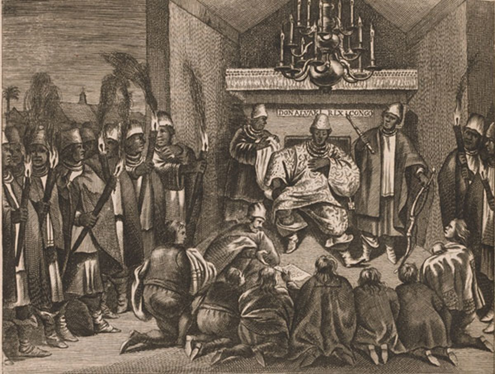
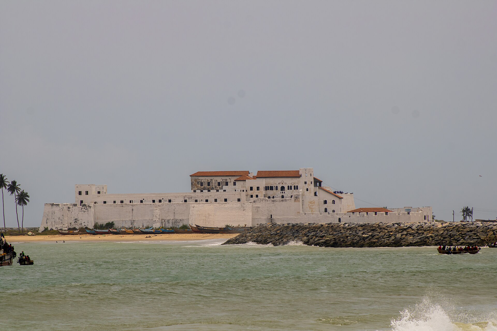
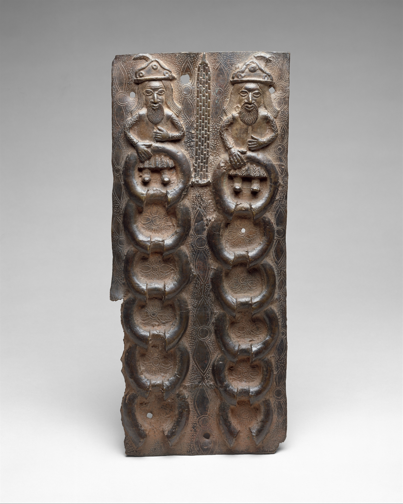
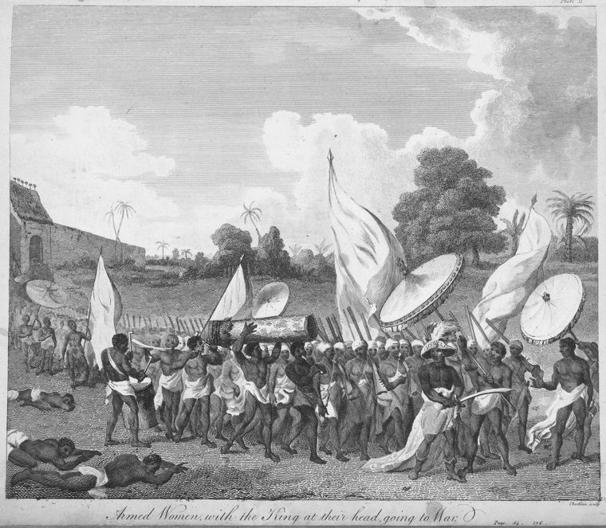
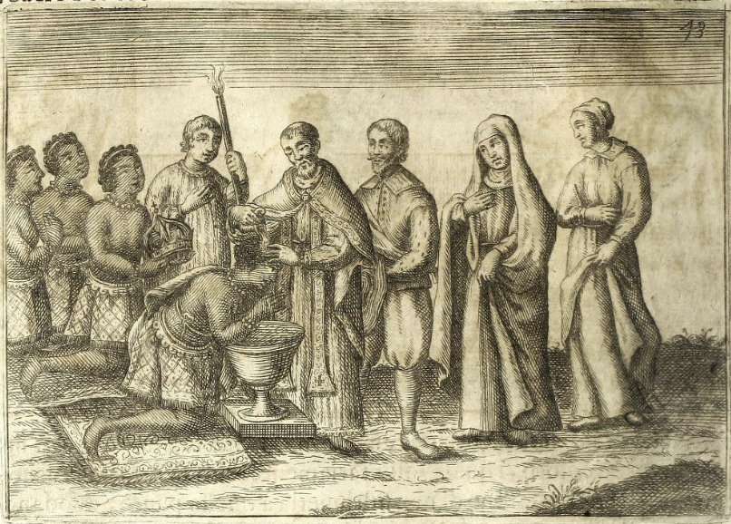
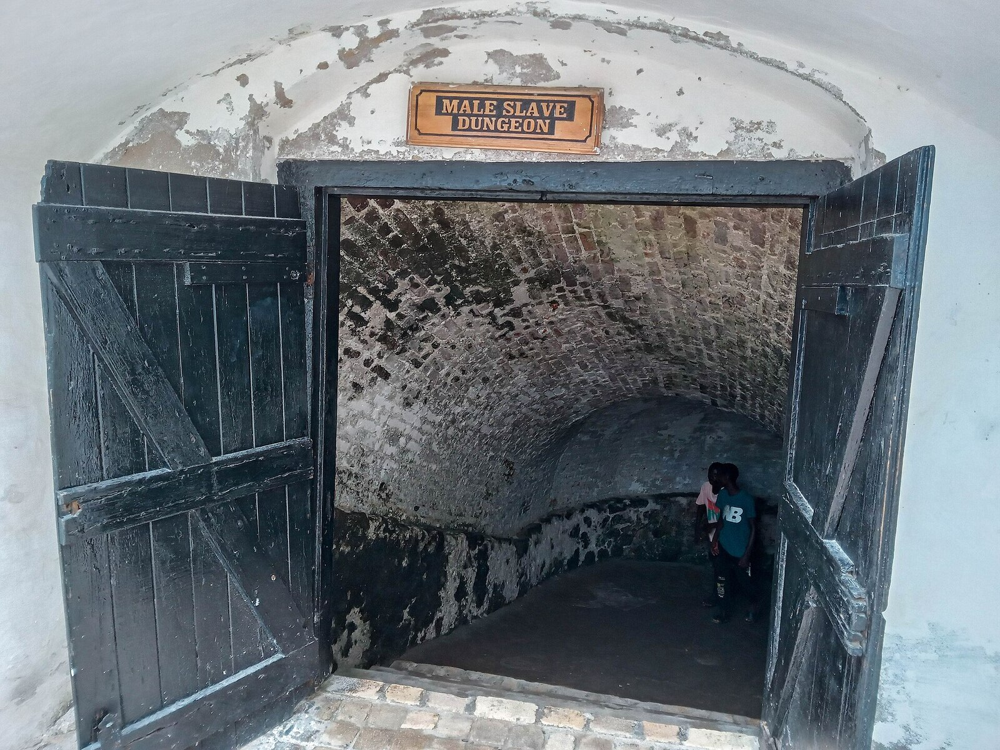
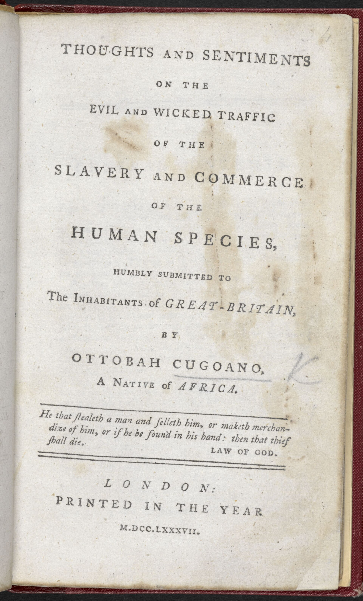
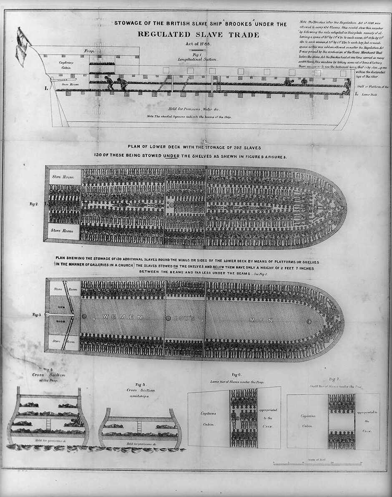

# 52. Why were Africans enslaved in the Americas?

*The Atlantic coast of Africa, from 1482 to about 1800*

Because the plantations of the Americas needed workers by the million, and Africa was the one place where European ships could buy people in such numbers. The native peoples of the Americas were dying of imported diseases, and Europeans would not come in such numbers and died when they did. In Africa, by contrast, selling war captives was an old business, and the kings and merchants of the coast were willing to sell.

In 1526 the king of Kongo wrote a letter to the king of Portugal, whom he called his brother, because both were Christian monarchs. The king of Kongo had been baptised thirty-five years earlier, when the first Portuguese ships arrived, and had taken the name Afonso. For seventeen years he had ruled a kingdom about the size of England on the Atlantic coast of central Africa. He read and wrote Portuguese. One of his sons was a bishop.

*A king of Kongo receives Dutch envoys. Engraving from Olfert Dapper's book on Africa, published in 1668, about 140 years after Afonso's letter. Image: Olfert Dapper, public domain.*

The letter was a complaint. Portuguese merchants, he wrote, were everywhere in his kingdom, and they were buying people. Every day his subjects were being kidnapped and sold, and the victims included the sons of his own nobles and members of his own family. The country was being emptied. He therefore asked the king of Portugal to send him priests, schoolteachers, and wine and flour for the Mass, and to send no more merchants.

It would be easy to read this as a protest against slavery itself. However, Afonso was not against slavery. His kingdom had slaves, as nearly every kingdom on Earth did, and he had sold captives to the Portuguese himself. His objection was a narrower one: the trade had escaped his control and was eating his own people. To bring it back under his control, he set up an office to inspect every person the foreigners bought and to check that each had been lawfully enslaved.

The king of Portugal did not stop the ships. The business that Afonso was trying to manage would last another three hundred and forty years, and it would carry twelve and a half million people out of Africa.

## Who would cut the cane

The ships came because of a problem on the other side of the ocean.

The Europeans who seized the islands and coasts of the Americas found that the land would grow crops worth a fortune in Europe, above all sugar. They also found that nobody was available to do the work. Growing sugar is brutal labour in tropical heat, and no free person would do it for the wages a planter cared to pay. The planters therefore needed people who could be made to do it, and they began with the people nearest to hand.

In the Caribbean and Brazil, the conquerors at first forced the native people to work. The native people died. They had no resistance to smallpox, measles and the other diseases that the newcomers carried. As a result, on the Caribbean islands, where the first plantations were laid out, almost the whole population was gone within two generations. A plantation could not be run on a workforce that was disappearing.

On the English and French islands, the planters also tried poor Europeans. These came as servants bound by contract for a fixed number of years, in return for their passage and the promise of land afterwards. From the planter's point of view, however, such servants were a poor answer. There were never enough of them. They could not be held beyond their term, so that a planter had each of them only for a few years. Moreover, they had the legal rights of Christians and subjects.

They also died. The warm, wet lowlands of the Americas soon swarmed with two diseases carried by mosquitoes, malaria and yellow fever, and a European landed in the Caribbean had a poor chance of seeing out his contract.

Those two diseases also pointed the planters towards Africa. Yellow fever and the deadliest kind of malaria had come from Africa in the ships. For that reason, people who had grown up in West Africa were the ones most likely to survive them. Many had lived through yellow fever in childhood, which protects for life, and many carried in their blood an inherited defence against the worst kinds of malaria. They also knew how to farm in the tropics. In a place where native workers and European servants were both dying, West Africans were the workers most likely to live.

What remained was the question of how to get them, and here the Portuguese already had a source. For half a century before Columbus, their ships had been working down the African coast, buying gold, pepper and people, and they had used African slaves to grow sugar on islands off that coast. The whole arrangement, in other words, existed before the Americas were found. When the plantations moved across the Atlantic, the slave ships followed.

## The white man's grave

A reader who knows what Europeans did in Mexico and Peru might expect that they did the same in Africa: marched inland, overthrew the kings and took what they wanted. With one exception, they did nothing of the kind. For three hundred years they stayed on the beach.

One reason was disease, which in Africa worked in the other direction. In the Americas the newcomers' diseases had killed the people who lived there. In Africa it was the newcomers who died. The fevers that Africans had some defence against killed Europeans at a terrible rate. Of every hundred men whom the English trading company sent out to its forts on the West African coast, between a third and a half were dead within the year. Sailors called it the white man's grave. An army could not be kept alive there for long, and without an army there could be no conquest.

The other reason was that the African kingdoms were strong. They had iron weapons, cavalry in the grasslands, war canoes on the rivers, and soldiers in tens of thousands. Against forces like these, a shipload of sailors counted for very little. A ship's crew that tried raiding for captives, as the first Portuguese did, was likely to be cut to pieces. The Portuguese learned quickly that it was safer and cheaper to buy.

So the Europeans built forts, and they built them by permission. Since they had come to buy, they needed a fixed place on the shore where goods could be stored and sellers could find them. In 1482 the Portuguese put up a stone castle at a place on the coast of what is now Ghana, where gold was traded, and called it Elmina, "the mine". It stands today. Over the following centuries the Dutch, the English, the Danes, the Swedes and others built dozens more along the same five hundred kilometres of shore.

*Elmina Castle on the coast of Ghana, first built by the Portuguese in 1482. Photo: JojoYaeger, CC BY-SA 4.0.*

These forts look like the bases of conquerors, but they were closer to warehouses. Their cannon pointed out to sea, at rival Europeans. The ground they stood on was rented from the local ruler, who was paid every year. The garrison, meanwhile, bought its food in his markets and depended on his goodwill. Inside the walls was a storeroom for trade goods and a prison for people waiting to be shipped. A fort, in short, was a shop that its landlord allowed to stay open.

## Wealth in people

The Europeans, then, could buy people on the African coast only if somebody there chose to sell them. Why African rulers did so begins with a difference in what it meant to be rich.

In Europe, a rich man was one who owned land. In most of Africa south of the Sahara, land was plentiful and belonged to the community or the king, and nobody could buy a field. What was scarce was people to work it. Wealth and power were therefore counted in dependants: wives, children, clients and slaves. A great man was one with many people. A ruler who wanted to grow stronger needed more people, and war was one way to get them.

Slaves were one kind of dependant among these, and they were mostly outsiders. Some had been condemned by a court for a crime, and some had been handed over for a debt. Most were prisoners taken in war. Their position was not the one that waited across the ocean. They worked in the fields and households of their owners, served as soldiers and officials, and in many societies their children or grandchildren became ordinary members of the family that held them.

A trade in such captives already existed. For centuries, caravans had taken slaves north across the Sahara to the markets of North Africa. The rulers of the coast therefore did not need to be taught the business. When European ships appeared, they saw another customer for the prisoners that their wars produced.

What the ships offered in return was manufactured goods. The largest item by far was cloth, most of it cotton from India, in bright prints that African buyers chose with care and rejected when the pattern was out of fashion. After cloth came bars of iron, basins and bracelets of brass, liquor and tobacco.

One of the oddest cargoes was shells. Small white cowrie shells were used as money in much of West Africa, and they came from islands in the Indian Ocean. European ships carried them to Africa by the billion. In effect, the ships were bringing in cash as well as goods.

The ships also brought guns. By the late 1700s, several hundred thousand muskets a year were being unloaded in West Africa, along with the powder to fire them. Guns differed from cloth and brass in one important way. A kingdom that bought them could use them to take more captives, and so to buy more guns.

None of this was a simple swap on a beach. A slave ship might spend four or five months on the coast, anchored off one town after another, filling its hold a few people at a time. Throughout those months the captain was dealing with equals, and often with people who had the upper hand. He bargained with African brokers who knew the prices in London as well as he did. He paid customs to the king before he was allowed to open trade, and gave presents to the king's officials.

He also had to trust his suppliers. He advanced goods on credit to merchants who went inland to buy, and those merchants sometimes left their own relatives aboard as a pledge that they would return. On parts of the coast, the trade produced a class of its own. Families descended from European traders and African wives grew rich as go-betweens, sending their sons to school in Liverpool and their captives to Jamaica.

## The kings' choice

Faced with these customers, African rulers did not respond alike.

The kingdom of Benin, in what is now southern Nigeria, was one of the first that the Portuguese visited. Its craftsmen cast brass plaques for the royal palace, and some of them show the long-nosed foreigners with their guns. Benin was happy to trade, and it sold the Portuguese pepper, ivory and cloth. People were another matter. Early in the 1500s its king forbade the export of male slaves, and the ban held for about two centuries. In a land where power was counted in people, selling men abroad meant giving strength away. Benin kept its people because it wanted them.

*A brass plaque from the kingdom of Benin, about 400 years old, showing two Portuguese men. Each holds a manilla, a brass bracelet that European ships brought to the coast and that was used as money. Photo: Metropolitan Museum of Art, CC0.*

Dahomey, a little to the west, made the opposite choice. It was a new kingdom, built for war. In 1727 its king marched to the coast and conquered the port of Whydah, the busiest slave harbour on that stretch of coast. After that the king was the largest seller in his own port, and private merchants paid him for leave to trade beside him. War and trade then fed each other. Each year the army went out to raid its neighbours, and each year the prisoners were marched to the sea.

*The king of Dahomey going to war with armed women at his head, among drums, banners and umbrellas. Engraving from Archibald Dalzel's history of Dahomey, published in 1793. Image: Archibald Dalzel, public domain.*

Between and behind these lay others. The Asante, in the forests of what is now Ghana, built an empire on gold and on the captives of their wars, and received European envoys in a capital with broad, swept streets. The horsemen of Oyo, further east, raided the grasslands and sold south to the sea. These were organised states, and none of them sold people without rules. Each had its own laws about who could be enslaved and who could not, and each bent those laws as the price of a captive rose.

In the lands south of Kongo, a queen named Njinga spent forty years doing both: she resisted the Europeans and she supplied them. The Portuguese had planted a colony on her coast. It was the one place on the Atlantic side of Africa where they tried to conquer the interior, and they wanted her kingdom for the captives it could yield. Njinga fought them, made peace with them, allied with the Dutch against them, and fought them again. She signed a final treaty at the age of about seventy-three and died seven years later, still a queen. Her wars, however, had to be paid for, and she paid for them by selling prisoners to the same ships.

*Njinga being baptised in Luanda. Engraving from the book of the Italian priest Giovanni Antonio Cavazzi, published in 1687. Image: Giovanni Antonio Cavazzi, public domain.*

Her case shows the trap in which many rulers stood. A king who refused to sell did not thereby make his people safe. If his neighbour sold, and was paid in muskets, the neighbour might come for him. A ruler who kept out of the business could find his own people in the next shipment. Staying out of the trade was therefore a choice that only some could afford. A strong, well-armed kingdom such as Benin could stay out. A weaker one often judged that the safest course was to be the side that took captives. In that way a ruler with no wish to sell people could end up selling them.

The result, over wide regions, was that war paid, and kidnapping paid, in a way they never had before. Once a captive could be turned into cloth and guns at the coast, there was a reason to make captives of people who would once have been left alone. Courts began to punish small offences with enslavement. Gangs seized travellers on the roads.

## A boy in a field

About 1770 a boy of thirteen named Ottobah Cugoano was playing in the fields with other children, some days' walk from the coast of what is now Ghana. A group of men came up and accused the children of an offence against their lord. They said the children must come and answer for it. The men were Africans, and they were armed.

The children were marched for days, and passed from one set of hands to another. Cugoano was told that he would soon see his family. He realised what was happening only when he reached a town near the sea and saw white men, whom he had been raised to fear as people who ate children. He was sold for a gun, a piece of cloth and some lead.

He was held in one of the forts for three days and then put aboard a ship that sailed from Cape Coast, where the chief English castle stood. That castle shows what the prison inside a fort was like. Under its courtyard were vaulted cellars where as many as a thousand people at a time waited in the dark for a ship. Directly above the men's dungeon the English had built their chapel.

*The doorway to the men's dungeon at Cape Coast Castle in Ghana, a vaulted brick cellar where captives waited for a ship. Photo: Antorsu10, CC BY-SA 4.0.*

Cugoano never forgot the rattle of chains and the groans and cries when the prisoners were taken out to the boats. He was landed on the island of Grenada and put to work in a gang cutting cane. After two years a new owner took him to England, where he gained his freedom, and in 1787, as a servant in London, he published a book against the trade.

In that book he did not spare his own countrymen, who had kidnapped and sold him. However, he added, if there had been no buyers there would have been no sellers.

*The title page of Ottobah Cugoano's book against the slave trade, printed in London in 1787. He signs himself "a native of Africa". Image: public domain.*

Of everything that a captive went through between the field and the plantation, the ship was the worst of it. A typical slave ship of the 1700s was no longer than a tennis court, and it carried three or four hundred people below deck on wooden shelves, with less room for each than a coffin gives. The men were chained in pairs at the ankle.

One drawing made this plain to people who had never seen such a ship. In 1788 opponents of the trade published a plan of one Liverpool ship, the *Brookes*, showing how four hundred and fifty-four bodies could be fitted into her hold according to the rules. That was the lawful number. On earlier voyages she had carried more than six hundred.

*The Liverpool slave ship Brookes in plan and section, from a print of 1788 published by opponents of the trade. Image: Library of Congress, public domain.*

The crossing took six to ten weeks. On average about one captive in seven died on the way, of dysentery, of thirst, or of despair. The captives did not accept this quietly. On roughly one voyage in ten they rose against the crew, and nets were rigged along the sides of the ships to stop people from throwing themselves into the sea.

## The count

The trade was a business, and businesses keep records. Captains kept logs, port officials collected duties, and insurers wrote policies. A great deal of that paper has survived. Historians have gathered these papers for about thirty-six thousand separate voyages, and the totals are now known about as well as anything in that age can be.

Between 1501 and 1866, about twelve and a half million people were put aboard ships on the coast of Africa. About ten million seven hundred thousand were alive when the ships arrived. The difference between the two figures is the number who died at sea. The trade was not spread evenly over those centuries. More than half of the captives crossed in a single century, the 1700s.

Fewer than four in a hundred were landed in North America. Almost half went to Brazil, and most of the rest to the islands of the Caribbean. Some went to mines, to tobacco and rice fields and to city households. The great majority, however, were sent where sugar grew, because that was where labour was used up fastest. A sugar planter wore out his workers and bought more, and the ships brought them.

*The Atlantic slave trade. The arrows show roughly how many people were landed in each region between 1501 and 1866; below, the coast of West Africa and of Kongo and Ndongo, with the states roughly as they were in the early 1700s. Map: drawn for this book; coastlines and rivers from Natural Earth, public domain.*

For the same reason, the numbers rose with the demand for sugar. In the 1500s a few thousand people a year were shipped. By the 1780s it was about eighty thousand a year, and a ship left the coast of Africa with a human cargo on most days of the year.

No single nation did this. The captives were carried under every flag in western Europe. The Portuguese, and the Brazilians after them, shipped the most, followed by the British, the French, the Spanish and the Dutch. Nor was the trade the work of outcasts. It built the fortunes of Liverpool, Bristol and Nantes, and it was financed and insured by respectable men who never saw a ship.

## What it did

Counting the effect on Africa is harder than counting the ships, and historians disagree about how deep the damage went.

The first loss is the missing people. The ships' records understate it, because they begin at the water's edge. For every person sold on the coast, others had died in the raid that took them or on the march to the sea. Meanwhile, during the 1700s, the population of Europe grew by half and went on growing. Along the coasts of West and Central Africa that fed the ships, by contrast, the best estimates show the number of people falling from about 1730 for more than a century.

The second is who was taken. The planters wanted young men, and the ships carried nearly two males for every female. In the regions that lost most, there were villages of women, children and the old.

The third is what the sale of people did to the societies that sold them. The profit went to kings, to warlords and to the merchants of the coast, in the form of cloth, liquor and guns. Cloth wears out and liquor is drunk, and little of what came in was the kind of wealth that grows. In the same centuries that Europe was building mills and banks with the proceeds of the plantations, the African kingdoms that supplied the labour were spending their income on the means of capturing more.

Kongo is the clearest case. A hundred and twenty years after Afonso's death the kingdom fell into civil war between rival branches of the royal family, and the war lasted, on and off, for forty years. Each side sold its prisoners to the ships to pay for muskets. The capital was abandoned to the forest.

Many of those prisoners were soldiers, and the wars went on producing them for generations. They had been trained in the Kongo fashion, to fight in loose order with firearms, and many were Catholics who spoke some Portuguese.

In 1739, in the British colony of South Carolina, a band of enslaved men from that part of Africa broke into a store of guns, raised a banner and marched south with drums beating. They were heading for Spanish Florida, where the governor had promised freedom to any slave of the British who reached him. It was the largest slave rising that Britain's mainland colonies ever saw, and the way the rebels handled their weapons suggests that some of them had done it before. The planters who bought them had thought that they were buying field hands.
