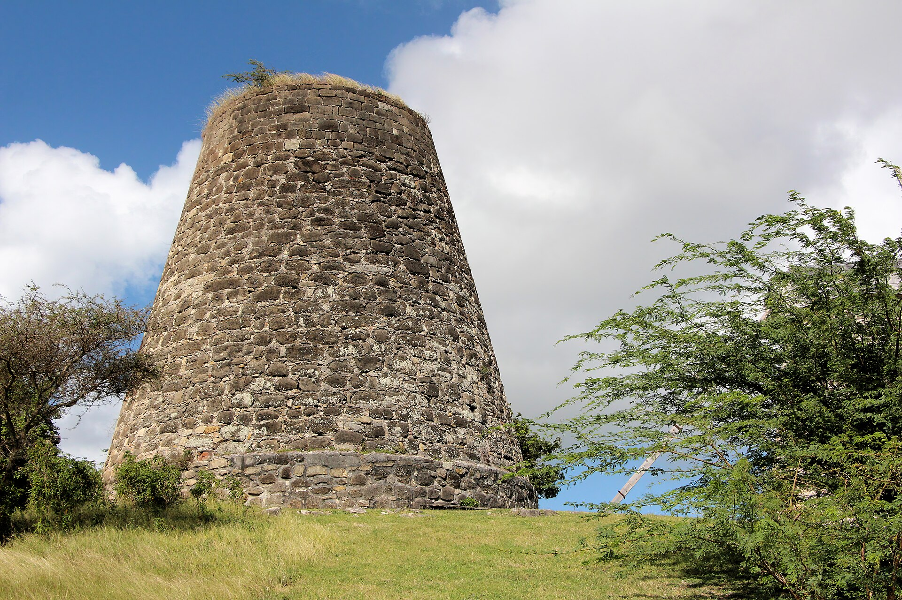
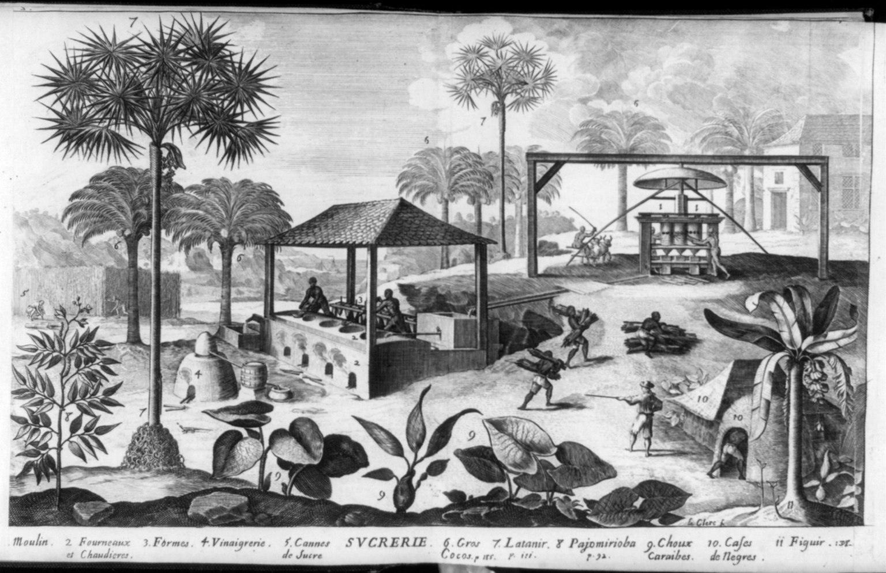
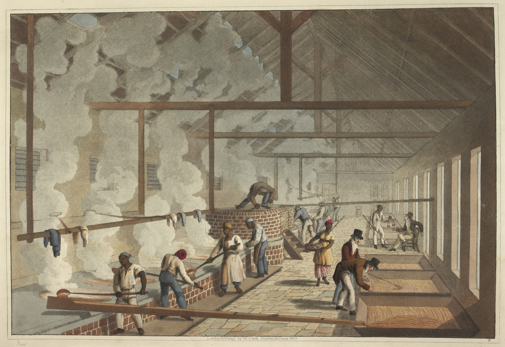
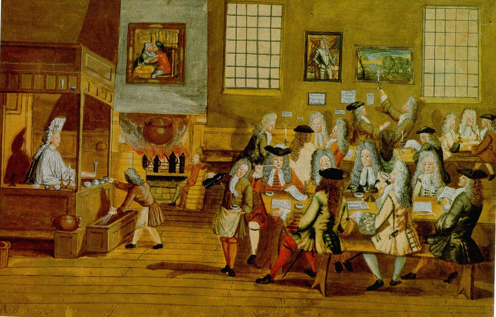
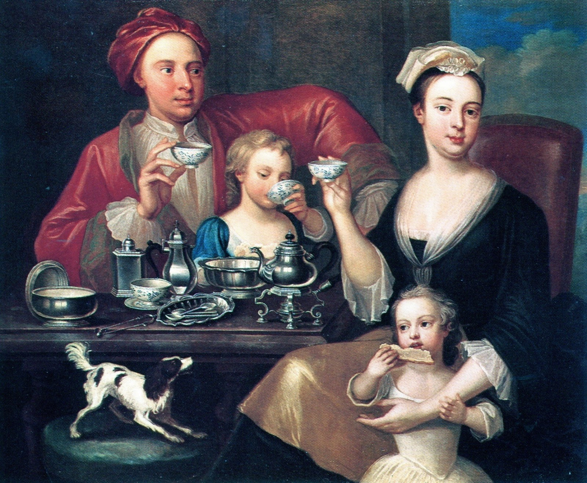
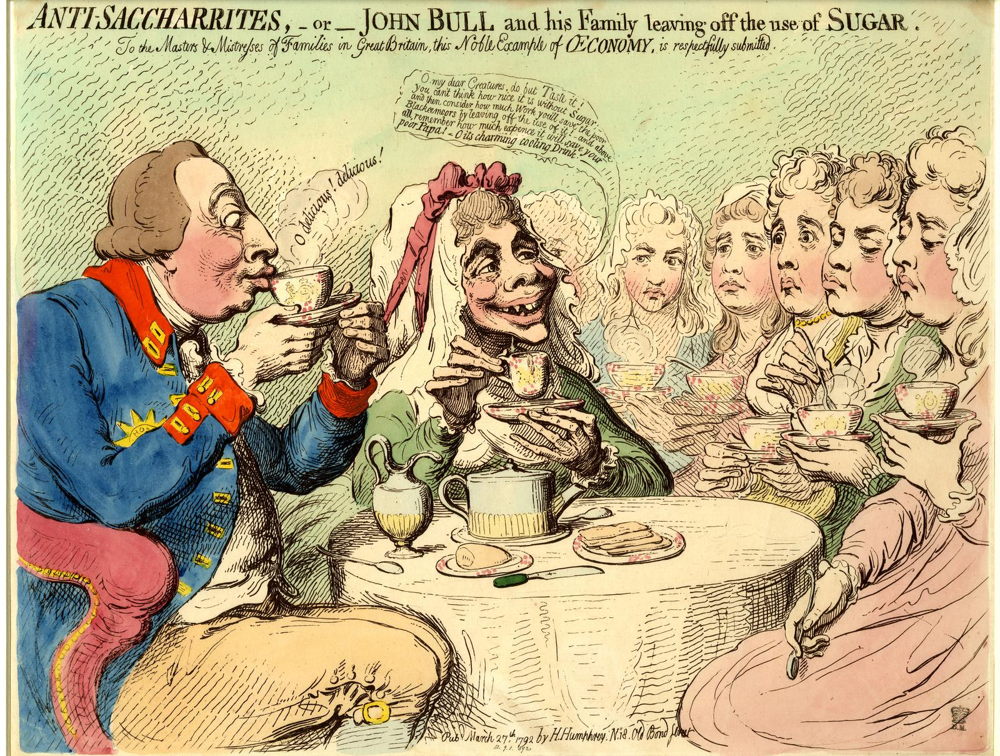
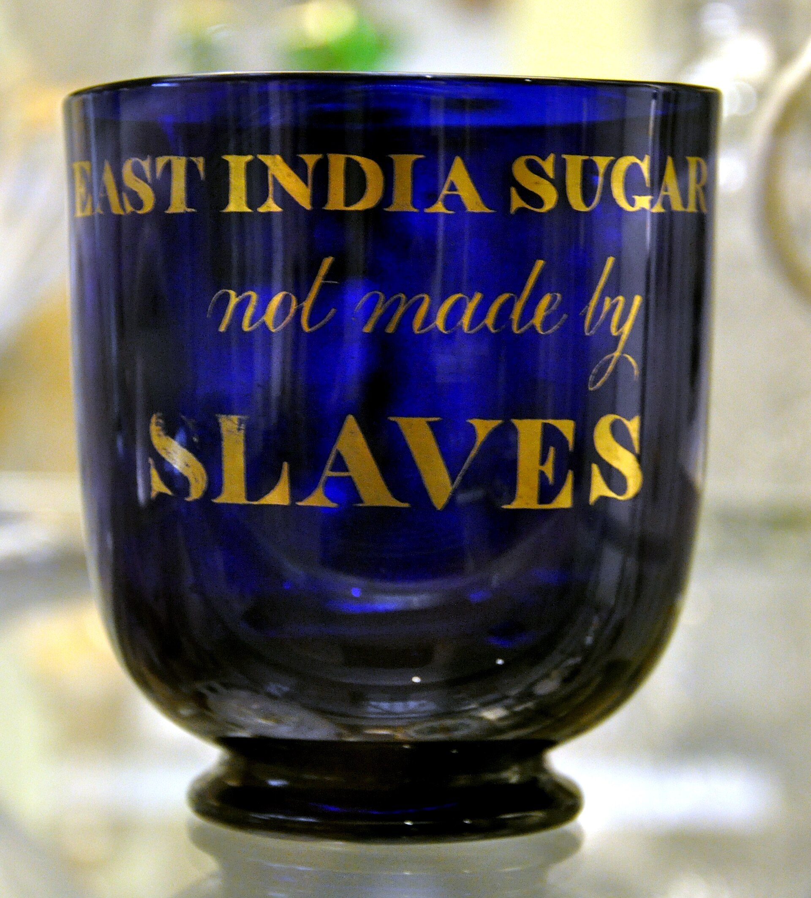

# 53. Why do we eat so much sugar?

*The Caribbean and the tables of Europe, from about 1450 to 1800*

We eat so much sugar because, between about 1450 and 1700, Europeans found a way to make a rare spice in enormous quantities. They grew it on tropical islands with the labour of enslaved Africans, and they drove the price down until working people in Britain, and later everywhere, could afford it every day. Humans have always craved sweetness. The plantation was the first thing that could satisfy the craving.

In the summer of 1574 the young king of France passed through Venice, and the city gave a banquet in his honour. When the king sat down and picked up his napkin, it broke in his hands. The napkin was made of sugar. So were the tablecloth, the plates, the knives and forks, and the bread. Along the table stood about three hundred sugar statues of popes, kings, gods and animals, cast in moulds from the workshop of the city's leading sculptor.

The Venetians were showing off, and they had chosen their material with care. Sugar in 1574 was among the most expensive foods in Europe. It was sold by apothecaries in small quantities, as a medicine and a spice, alongside pepper and cinnamon. Ordinary people sweetened their food with honey, when they sweetened it at all, and most of them went through life without tasting sugar.

Two hundred years later, English farm labourers were stirring it into their tea every morning. By then it was the most valuable thing that Britain imported. In six generations it had gone from the table of a king to the cupboard of a pauper.

## The reed that gives honey

Sugar cane is a giant grass. It was first grown for chewing on the island of New Guinea, and it was in India, in ancient times, that people learned to boil its juice down into hard crystals. The word "sugar" comes from the Indian word for those crystals, by way of Persian and Arabic, and so does the word "candy".

The Arabs carried the plant west after their conquests and grew it in Egypt, Sicily and southern Spain. The crusaders tasted it in Syria and were delighted. A chronicler of the crusade called it a reed that gives honey. Venetian merchants then sold it to the rest of Europe, at a price that kept it a treat for the rich.

It was costly for good reasons. Cane will only grow where it is hot and wet for most of the year, which rules out nearly all of Europe. A new planting takes well over a year to ripen. Above all, turning it into sugar takes a prodigious amount of hard labour and firewood. The cane must be cut by hand, crushed, and the juice boiled for hours, and every stage has to be done in a hurry.

It also shows how the craving works. The human tongue is built to seek out sweetness, because for an ape living on fruit a sweet taste meant ripe food and safe calories. In nature the supply is small and seasonal. Sugar is the taste with nothing else attached, and nobody who has tried it has ever needed to be persuaded to want more. A visitor to the English court in 1598 noted that the queen's teeth were black, and put it down to the great quantity of sugar that the English ate.

Whoever could find enough warm land, enough fuel and enough workers would be able to sell as much sugar as he could make. In the 1400s the Portuguese found the first two on the islands of the Atlantic, off the coast of Africa. They found the third on the African mainland, where captives could be bought.

## The island

The method was worked out on those Portuguese islands and then carried across the ocean to Brazil. By 1600 the north-east coast of Brazil was the largest sugar producer in the world, with more than a hundred mills worked by enslaved Africans. The Dutch learned the business by seizing part of that coast for a generation, and it was probably from the Dutch that an English island learned it in turn.

Barbados is the most easterly island of the Caribbean, and it is small, about thirty-four kilometres from end to end. The English settled it in 1627. For the first fifteen years it was a colony of small farms where English owners and their English servants grew tobacco of poor quality, and nobody made much money.

In the 1640s a few planters began to grow cane. What followed was one of the fastest transformations that any society has undergone. Sugar was so profitable that land on Barbados rose in price many times over within a decade. The men who could afford mills bought out their neighbours. The small farmers left, and the English servants, when their terms ran out, left too, since there was no land for them.

In their place came Africans. In 1640 enslaved people were a small minority on Barbados. Forty years later there were about forty thousand of them, twice the number of whites, on an island smaller than many cities. By then Barbados was the richest colony in English America. Its trade was worth more than that of all the other English colonies put together.

Every other power with an island copied it. The English took Jamaica from Spain and planted it. The French did the same on Martinique, Guadeloupe and, most productive of all, Saint-Domingue, the western end of the island of Hispaniola, where Columbus had planted the first Spanish colony. The Caribbean, which had been a Spanish backwater on the route to the silver mines, became the most valuable farmland on Earth.

## Before the juice sours

A sugar estate was unlike any farm in Europe, and the reason lay in the plant.

Once a stalk of cane is cut, its juice begins to spoil. Within about a day the sugar in it has started to turn into something that will not crystallise. Cane therefore cannot be harvested, stored and processed at leisure, as wheat can. It has to be crushed almost at once and the juice boiled straight away. The mill and the boiling house had to stand in the middle of the fields, and during the harvest, which lasted about five months, they could not stop.

*The tower of a windmill that crushed cane at Betty's Hope, a sugar estate on Antigua. Photo: Paul Harrison, CC BY-SA 4.0.*

The work began in the field, and it began long before the harvest. To plant a field, the strongest workers dug it over by hand into a grid of square holes, each wide enough for a person to stand in, and each worker was expected to dig sixty to a hundred of them in a day under the tropical sun. Planters regarded this as the hardest labour on the estate. Then came months of weeding and manuring, carrying dung to the fields in baskets on the head.

At harvest, gangs of men and women cut the cane with heavy knives, stripped the leaves, and loaded it onto carts. Behind each gang walked a driver with a whip. Children of six and seven worked in a gang of their own, gathering grass for the cattle.

*Enslaved men and women cutting cane on Antigua, in a print of 1823. The driver and the overseer on horseback stand at the right. Print: William Clark, CC0.*

At the mill, the canes were fed by hand between three upright rollers sheathed in iron and turned by wind, water or cattle. This was the most dangerous job on the estate. A tired worker whose fingers were caught was pulled in up to the shoulder, and visitors to the islands reported that a hatchet was kept beside the rollers so that the arm could be cut off before the body followed.

*A sugar works in the French West Indies, in an engraving of 1667. On the right, oxen turn the rollers of the mill; in the middle, the boiling house with its furnace and kettles. Print: Le Clerc, public domain.*

The juice ran down a gutter into the boiling house. There it passed through a row of copper kettles, each smaller and hotter than the last, set over a furnace. Men stood over the kettles skimming off the scum and ladling the thickening syrup from one to the next. The head boiler, who was himself enslaved and was valued above anyone else on the property, judged the moment when the last kettle was ready by drawing a thread of syrup between his finger and thumb. A mistake of a minute ruined the batch. The syrup was then run into shallow troughs and stirred as it cooled, until it turned into a mass of brown crystals. This was packed into barrels with holes in the bottom, and over several weeks a dark liquid called molasses drained out of it. The molasses was distilled into rum.

During the harvest the mill and the boilers ran through the night. The workers were divided into shifts, and those who had cut cane all day took their turn in the boiling house for half the night as well. Sixteen or eighteen hours of work in the twenty-four was common.

*Inside a boiling house on Antigua, in a print of 1823. The syrup is ladled from kettle to kettle over the furnace, and the cooling troughs stand at the right. Print: William Clark, CC0.*

Europe had very little like this. A plantation brought two or three hundred workers together under one owner, split the work into separate tasks, tied each task to the pace of the machinery, and ran the whole thing by the clock. That is a description of a factory. The sugar islands had factories a hundred years before the first cotton mill was built in England, and they stood in fields and were worked by slaves.

## Cheaper to buy

A sugar estate was also a very large investment. The planter needed the land, the mill, the coppers, the cattle and, most expensive of all, the people. Few men had that kind of money. They borrowed it from merchants in London, Bristol or Bordeaux, who took the sugar in repayment and sold it. The richest planters did not live on their estates at all. They hired managers and went home to build country houses, and in England "as wealthy as a West Indian" became a common phrase.

Borrowed money has to earn its interest, and the managers were judged on the size of the crop. The result was a way of working people that used them up.

On most of the sugar islands, for as long as the slave trade lasted, deaths outnumbered births year after year. A large share of the Africans landed there were dead within three years, from overwork, hunger and disease. Women worked in the cane gangs beside the men and bore few children who lived. Planters knew all this, and many reckoned that it was cheaper to buy a new adult from a ship than to feed a child for fifteen years.

The managers kept careful books. A plantation's ledger listed its people in the same columns as its cattle and mules, each with a name, an age, an occupation and a value in pounds, and beside some names a note such as "old" or "runaway". One overseer in Jamaica kept a private diary for thirty-six years in which he recorded, in a flat and unembarrassed hand, every flogging he ordered and every enslaved woman he forced. He was not thought an especially cruel man by his neighbours, and he died a respected landowner.

The mainland colonies to the north offer a comparison. About four hundred thousand Africans were landed in what became the United States, where the main crops were tobacco and later cotton. By 1860 the enslaved population there numbered four million. Jamaica alone received about a million people from the ships. When slavery ended there, there were just over three hundred thousand.

## Sunday market

The people who lived through this were not only victims of it. In the hours that the estate left them, they made a world of their own.

Planters did not want to pay for food, so most of them gave their workers plots of rough ground on the edge of the estate and one day a week to tend them. On these plots people grew yams, plantains and beans, and kept pigs and chickens. What they did not eat, they carried to market on Sundays. Over time the enslaved became the islands' main suppliers of fresh food. A planter who wrote a history of Jamaica in the 1770s reckoned that a fifth of all the coin on the island was in their hands.

They had arrived speaking dozens of different African languages, and on any one estate people from many nations were thrown together. Out of the meeting of their languages with English, French and Spanish they made new ones, which their descendants still speak. They kept and blended their religions and their music. On Barbados the planters banned drums, having learned that drums could carry a signal from one estate to the next.

Some of them fought. Every island had its conspiracies and risings, and for a century and a half each was put down with torture and public executions. The planters lived in fear nevertheless, outnumbered on some islands ten to one.

Others simply left. In the mountains of Jamaica, people who had escaped from the estates built villages of their own, farmed, raided the plantations below, and beat off the soldiers sent to catch them. They were called Maroons. After decades of failure the British governor gave up, and in 1739 he signed a treaty with them as though with a foreign power. It recognised their freedom and their land. In return the Maroons agreed to send back any future runaways, and for the most part they did.

*Leonard Parkinson, a captain of the Jamaican Maroons, in an engraving published in London in 1796. Print: Abraham Raimbach, public domain.*

## The bitter cup

The sugar poured into Europe, and it arrived together with a group of other new tastes.

In the 1600s, the English acquired three hot drinks within a single lifetime. Chocolate came from Mexico, by way of Spain. Coffee came from Arabia, by way of the Turks. Tea came from China. All three contain mild drugs that sharpen the mind, and all three are bitter. Europeans found that they liked them a great deal better with sugar stirred in.

Rum went the other way. The molasses that drained from the barrels, which the first planters had treated as waste, turned out to make a fierce and cheap spirit. It became the daily ration of the British navy, the wage of fishermen, and one of the goods that slave ships carried to Africa to pay for the people who would make more of it.

The first coffee house in London opened in 1652, and within fifty years the city had hundreds. For the price of a cup, a man could sit all day, read the newspapers and talk business. Merchants and ship owners met at one kept by a man named Lloyd, and the insurance market that grew up at his tables still carries his name.

*The inside of a London coffee house in the 1600s: customers at long tables with pipes, cups and newspapers, and the hostess at her bar. Painting: anonymous, public domain.*

A fourth new habit came from the Americas, and it was smoked. Tobacco saved the first English colony in Virginia, which had been starving until it found a crop that would sell. The king of England hated the stuff, and wrote a pamphlet calling smoking loathsome to the eye and harmful to the brain. His subjects ignored him.

These were the first goods from other continents that ordinary Europeans bought week after week. Silk and pepper had been for the rich. A pipe of tobacco and a cup of sweet tea were within reach of a servant. They were also habit-forming, which made them a wonderful thing to sell and, for governments, a wonderful thing to tax.

Sugar bound them together, and the amount of it kept climbing. In 1700 the average person in England ate about two kilograms of sugar a year. By 1800 the figure was eight kilograms, and by 1900 it was forty.

The poor took to it hardest. By the late 1700s, the breakfast of an English labouring family was bread and tea with sugar, where their grandparents had had porridge and weak beer. It was a worse diet in most respects. However, it was hot, it was quick, it needed no cooking, and the sugar gave a jolt of energy to someone facing a long day's work. The cane fields of the Caribbean had become part of what kept the working people of Europe on their feet.

*An English family at tea, painted by Joseph van Aken about 1720. The sugar tongs lie on the table at the left. Painting: Joseph van Aken, public domain.*

## Two ounces

Very few of those people gave any thought to where it came from. That was one of the plantation's achievements. The work was done four thousand miles away, by people the customer would never meet, and the brown sugar from the barrels was boiled again in a refinery in London or Bristol, so that what arrived in the shop was a clean white cone wrapped in blue paper.

In 1791 a London bookseller published a short pamphlet that set out to close the distance. He asked his readers to do some arithmetic about how many people died to make a given quantity of sugar. So necessarily connected were the eating of the produce and the misery of the slave, he concluded, that in every pound of sugar a person could be considered as consuming two ounces of human flesh.

*A cartoon of 1792 by James Gillray, mocking the sugar boycott: the king and queen sip tea without sugar while the princesses look on. Print: James Gillray, public domain.*

The pamphlet sold faster than anything of its kind had sold before. Over the next few years, about three hundred thousand people in Britain stopped buying sugar from the West Indies. Grocers advertised sugar from India instead. When the campaign was revived a generation later, potters sold sugar bowls with a message painted on the side to say that the contents had not been made by slaves.

*A blue glass sugar bowl in the British Museum, made in England in the 1820s, lettered "East India sugar not made by slaves". Photo: Andreas Praefcke, public domain.*

It was the first time that a great number of shoppers refused to buy something because of how it was produced. The boycott did not end slavery, which had forty more years to run in the British islands. What it showed was that the people at the far end of the chain could be made to look back along it, and that some of them, when they did, lost their appetite.
