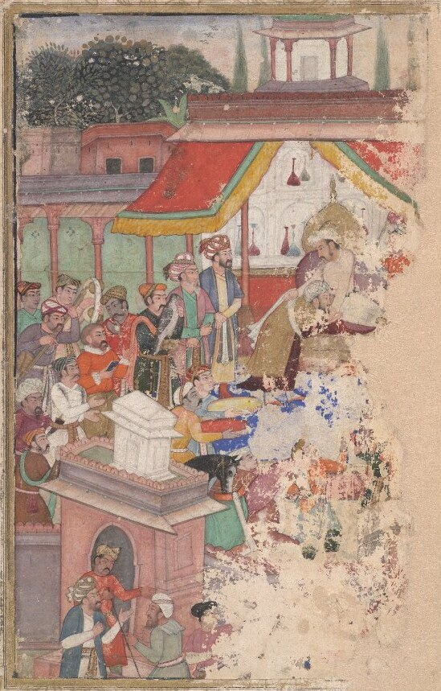
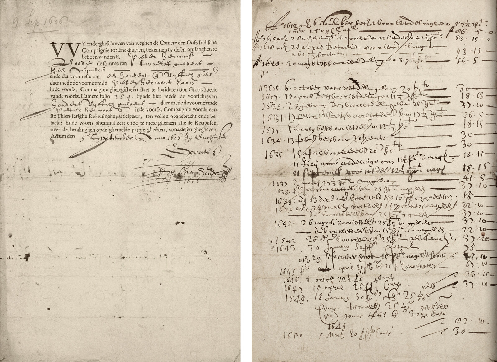
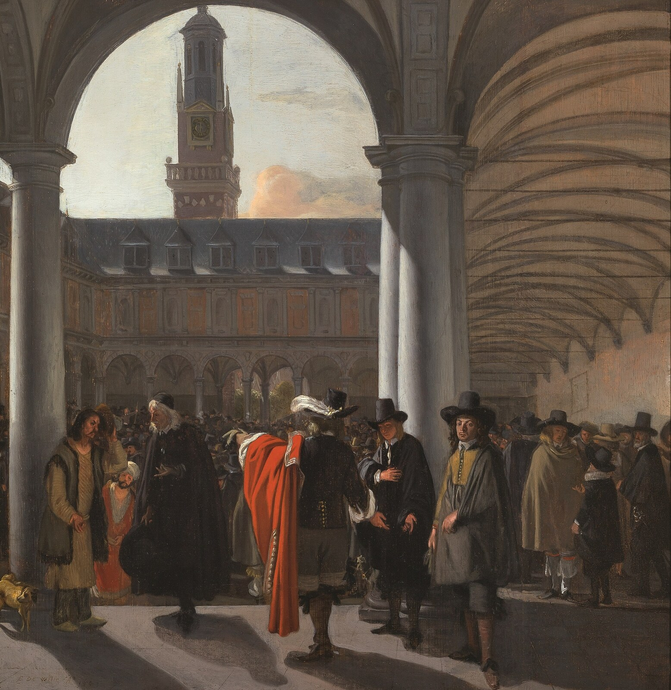
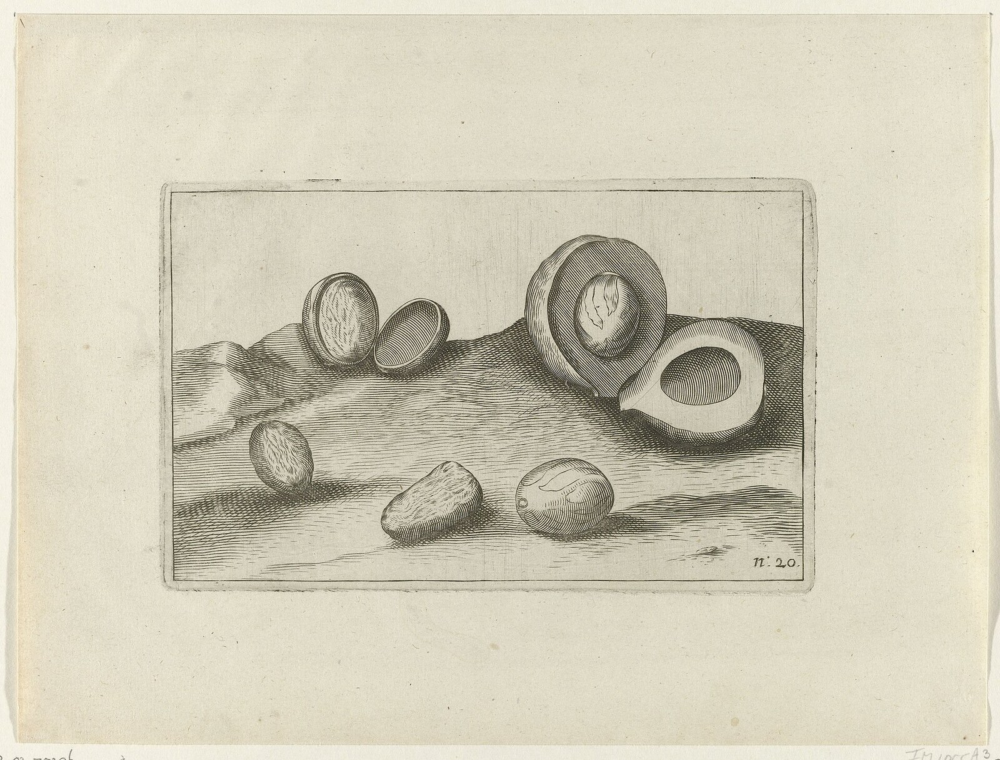
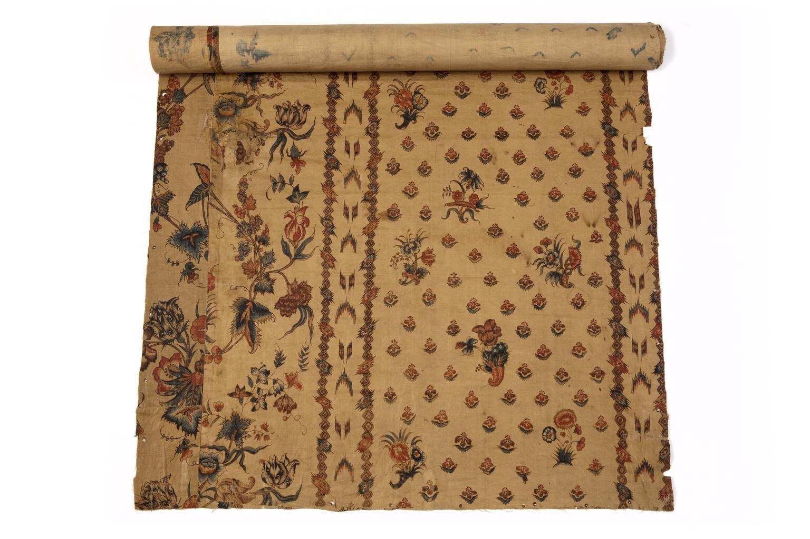
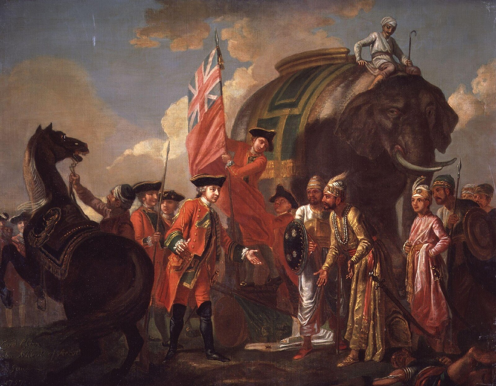
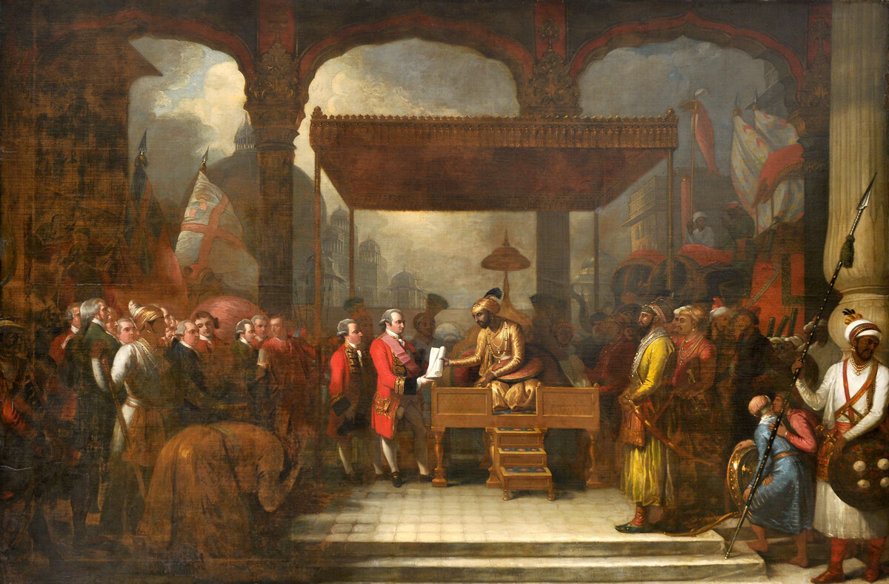
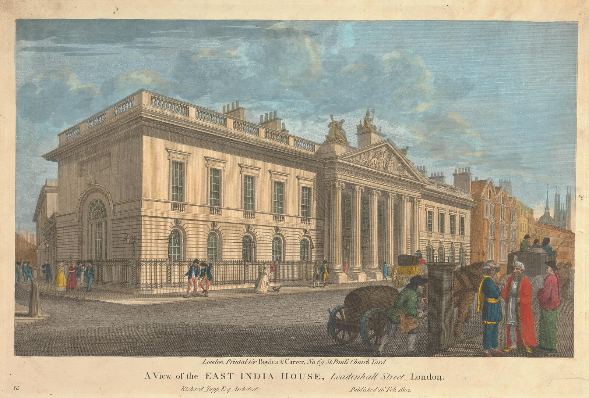
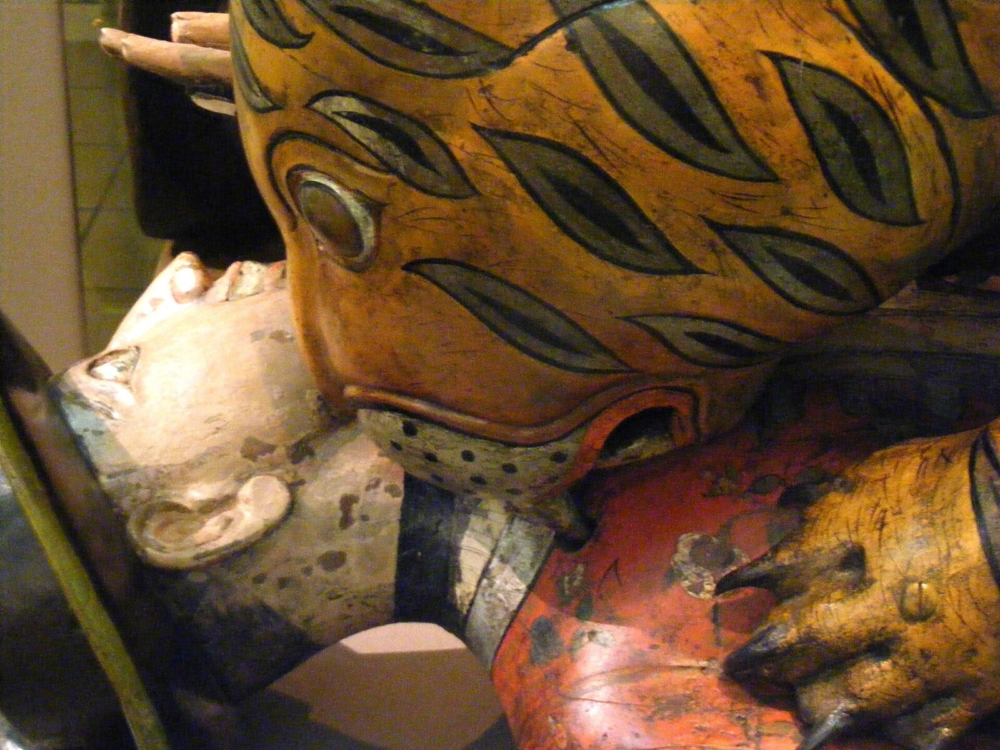
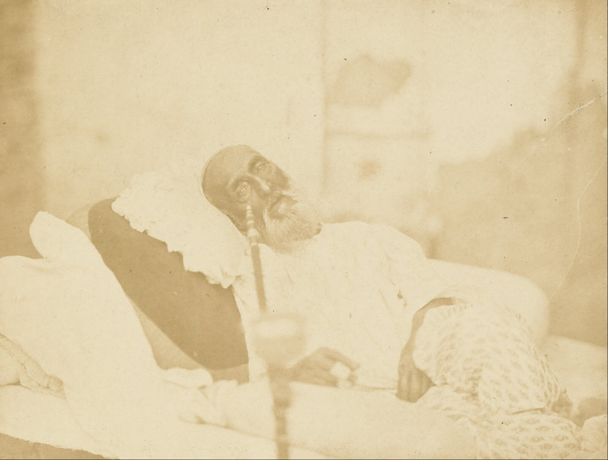

# 54. How did a company conquer India?

*Amsterdam, the Spice Islands, Bengal and London, from 1600 to 1858*

The East India Company conquered India with Indian soldiers, paid out of Indian taxes, at a time when the empire that had ruled the country was falling to pieces. The Company itself supplied two things. The first was a new way of gathering money, by selling shares to the public. The second was a sharper way of fighting, with foot soldiers drilled to load and fire muskets together, in ranks, on command.

In 1615 an English gentleman named Sir Thomas Roe arrived at the court of the Mughal emperor Jahangir, who ruled well over a hundred million people from the richest throne in the world. Roe had been sent by the king of England on behalf of a group of London merchants. His task was to ask the emperor's permission for them to trade.

*A Mughal court painting of about 1616, catalogued by the British Museum as showing the emperor Jahangir presenting a robe of honour to a courtier while Sir Thomas Roe, the English envoy, looks on. The paint has flaked badly. Photo: British Museum, public domain.*

It did not go smoothly. The presents he had brought were looked over and found shabby. The best of them was an English coach, which the emperor had refitted in richer cloth and then copied by his own craftsmen in about a week. Roe spent nearly three years trailing after the court as it moved about northern India, waiting weeks for an audience, and paying bribes to officials. For all that effort, he went home with leave for the English to keep a trading house in one port.

The embassy had filled three years of Roe's life. It made a smaller impression on his host. The emperor's memoirs, which describe those years in detail, do not mention him.

A hundred and fifty years later, the positions were reversed. The company that Roe had represented was collecting the taxes of the richest province in India, and the Mughal emperor was living on a pension that it paid him. No English army of conquest had been sent to bring this about. The Company had done it with a few thousand men of its own, as a business decision.

## A maid's hundred guilders

The story starts with the Dutch, who invented the kind of company that could do such a thing.

A trading voyage from Europe to Asia in 1600 was a frightening way to invest money. To begin with, it was slow. A ship took a year to sail to the spice islands of Indonesia and a year to come back. It was also dangerous. Storms, rocks, scurvy and pirates took a steady share of the ships. Meanwhile the investor's money was gone, and if he needed it he could not get it out, since it had been turned into a hull, a cargo and the wages of a crew on the far side of the world. For two years or more he could only wait and hope.

Merchants had always handled this by forming a partnership for each voyage and dividing everything up when the ship returned. That worked for single ships. However, it could not pay for what the Asian trade really required, which was forts, warehouses and a fleet kept in distant waters for decades. Those things needed money that stayed put.

In 1602 the Dutch government pushed its rival merchants into a single body, the United East India Company, and the company tried something new. Anyone at all could put money in, in any amount. The money would stay in the company for ten years, and when the ten years were up the directors did not pay it back, so that the capital became permanent. In return each investor got a share: a right to a slice of whatever profits were paid out, in proportion to what he had put in.

The response showed how much money had been waiting for such an offer. More than eleven hundred people signed up in Amsterdam alone, and across the country the company raised more than six million guilders, about nine times what the English company had started with two years before. The Amsterdam list survives. It includes great merchants, and it includes bakers, clergymen and a housemaid, who invested a hundred guilders. Ordinary people, in other words, now owned part of a fleet.

*The oldest surviving share in the Dutch East India Company, issued in 1606 by its Enkhuizen branch, with the record of payments on the second page. Photo: Westfries Archief, public domain.*

The maid could not ask for her hundred guilders back. However, if she needed money, she could sell her share to somebody else, at whatever price the two of them agreed. The company kept the money, and only the owner of the share changed.

A regular trade in shares soon grew up. Within a few years, dealers were gathering every day on a bridge in Amsterdam, and later in a purpose-built courtyard, to buy and sell these shares. The price followed the news. It went up when a fleet came home and down on a rumour of shipwreck. It was the first stock market of the modern kind.

*Dealers and merchants in the courtyard of the Amsterdam exchange, painted by Emanuel de Witte in 1653. Painting: Emanuel de Witte, public domain.*

This arrangement solved the investor's problem. A person could own a small piece of a very risky business, could own pieces of several, and could get out at any time without the business having to stop. As a result, money that had been sitting in chests all over the country flowed into one enterprise. The Dutch company soon had more ships than most navies.

## Nutmeg

It needed them, because its charter gave it the powers of a state. In all the seas east of Africa, the company was allowed to build forts, raise soldiers, sign treaties and make war in the name of the Dutch republic. It was a business with an army, and its directors, sitting in Amsterdam, were open about what the army was for. It was there to make the trade pay.

In 1600 every nutmeg in the world grew on the Banda Islands, ten specks of land in eastern Indonesia with about fifteen thousand people. Whoever controlled those islands would be the only seller of nutmeg on Earth and could name the price. The islanders, however, sold to anyone who came. The company wanted them to sell only to the company, at the company's price, and the islanders went on dealing with others. From their side this made sense, since more buyers meant a better price.

*Nutmegs from the Banda Islands, whole and shelled, in a Dutch engraving of 1619 copied from the illustration in the report of a voyage of 1598 to 1600. Photo: Rijksmuseum, CC0.*

The company settled the matter by force. In 1621 its governor in Asia arrived with a fleet. His soldiers killed the leading men, burned the villages and hunted the rest of the population through the hills. Some were shipped off as slaves and many starved. When it was over, about a thousand of the fifteen thousand islanders were left.

After that, the company had the nutmeg to itself. It divided the land into plantations and brought in slaves to pick the nutmegs. For the investors at home, this way of doing business paid very well. Over its two centuries of life the company paid its shareholders a dividend that averaged eighteen per cent a year.

The English, who had set up their own East India Company in 1600, could not compete with this. Their company had far less money behind it, and the Dutch pushed them out of the spice islands by force. The last English foothold was a tiny nutmeg island called Run, and in 1667 England gave it up by treaty. In exchange the Dutch let England keep a town that the English had seized from them on the coast of North America. Its name had been New Amsterdam, and the English had renamed it New York.

## Calico

Shut out of the spices, the English company turned to the place where it had a second business already. It had been buying in India since Roe's time, at first to get cloth that it could swap for spices. As the Dutch closed the spice islands to it, India became its main business.

India was a good place to be a buyer, because India in the 1600s was the workshop of the world. Its weavers made cotton cloth that was lighter, brighter and cheaper than anything woven in Europe, in colours that did not wash out. The English language still carries the cargo lists: chintz, bandanna, dungaree, khaki and pyjamas are all Indian words, and calico is named after an Indian port. The Company shipped this cloth home by the million pieces, and sold it across Europe and to the slave traders, who used it to buy people on the African coast.

*A length of Indian chintz, cotton printed and painted with vines of flowers and fruit, made in the 1700s for sale abroad. Photo: Science Museum Group, CC BY-SA 4.0.*

There was one difficulty. Trade normally runs in both directions, with each side selling something that the other wants. Indians, however, wanted almost nothing that England made. The Company therefore had to pay in silver, and every year its ships carried chests of coin out to India, to the annoyance of English writers who thought the country was being drained. The cloth came west and the silver went east.

In these years the Company's position in India was that of a tenant. It held a few plots on the coast by grant or lease from Indian rulers, and one island that the king of England had received as part of a Portuguese bride's dowry. On them it built fortified warehouses, which grew into the towns of Madras, Calcutta and Bombay. It paid customs and gave presents to the local governors.

Once, in the 1680s, its directors lost their heads and declared war on the Mughal empire. The emperor's forces swept up its trading posts. After four years its envoys had to lie face down before the throne and beg for pardon, and pay a large fine, before they were allowed to trade again. The landlord had reminded the tenant who owned the house.

## The drill

A company that had been beaten so easily did not look like a future ruler of India. Two changes in the next half century turned the tenant into a landlord.

The first was the collapse of the empire. The emperor who had humbled the English died in 1707, after wearing out his treasury in twenty-six years of war. His successors could not hold the provinces. One after another, governors stopped sending taxes to Delhi and founded dynasties of their own. In 1739 a Persian army sacked the capital and carried off the imperial throne.

India did not become poorer or weaker. It became divided, into a dozen states at war with one another, and each of them was in the market for allies. A foreigner with soldiers to offer now had many possible customers.

The second change had happened in Europe. Over the 1600s, European armies had learned to fight in a new way. It began with the weapon. Foot soldiers were armed with a musket that fired by a flint and could carry a blade on its muzzle. They were trained for months to do one thing: to stand in a line three deep, load in a fixed sequence of movements, and fire all together on the word of command, again and again, without flinching.

The effect on a battlefield was out of all proportion to the numbers. A line of such men produced a wall of lead every half minute. Cavalry that charged it was shot down, and the horses would not run onto the blades.

The drill was the important part, and there was nothing European about the men who could learn it. In the 1740s the French trading company in south India acted on this. It began to hire Indian soldiers, dress them in uniform, and train them in the European manner under European officers. They were called sepoys, from a Persian word for a soldier.

Their first test stunned everyone who heard of it. In 1746, beside a river near Madras, about a thousand of these troops, most of them Indian, met an army of ten thousand sent by the local ruler, much of it cavalry. The thousand fired their volleys, advanced, and drove the ten thousand from the field. On that day, numbers and horses had counted for less than drill.

After that, every Indian prince wanted such troops on his side, and the French and English companies hired them out. The companies had gone into the business of deciding who would rule.

## A mango grove

The richest of the new states was Bengal, on the delta of the Ganges. Its cloth was the finest in India, and Calcutta, the English company's main post, stood on its river.

In 1756 a new ruler of Bengal, a young man of twenty-three, quarrelled with the English over the fortifications they were adding to Calcutta, and took the town. The Company sent a force from Madras to get it back. Its commander was Robert Clive, who had come out to India as a junior clerk, lonely and miserable, and had found that he had a talent for war.

Clive recovered Calcutta. That might have been the end of the matter. He then learned something useful, however. The young ruler had made enemies at his own court. His chief general wanted the throne. The great banking family of Bengal, who lent to the government and handled its revenues, had been insulted and wanted him gone.

These men approached the English, and a bargain was struck. An agreement was drawn up in secret: the general would hold his troops back, the English would fight, and the general would become ruler and pay the Company and its officers handsomely.

The two armies met in June 1757 beside a mango grove at a village called Plassey. Clive had about three thousand men, two thirds of them sepoys. Facing him were fifty thousand. A cloudburst at midday soaked the Bengali army's gunpowder, while the English, who had covered theirs, kept firing. Most of the fifty thousand never moved, because their commander had been bought. By evening the ruler had fled on a camel. The English had lost twenty-two men.

*Robert Clive meets Mir Jafar after Plassey, painted by Francis Hayman in London about 1760, a few years after the battle: an imagined scene. Painting: Francis Hayman, public domain.*

Both sides then kept the bargain. The general was installed, and he paid. Clive's personal share made him one of the richest men in Britain. Years afterwards, questioned in Parliament about the sums he had taken, he described walking through a treasury piled on either hand with gold and jewels, and said that he stood astonished at his own moderation.

## The right to collect

Plassey made the Company the power behind the throne of Bengal. Eight years later it took the next step, which mattered more.

The new ruler soon fell out with his masters, and in 1764 an alliance of northern princes, with the Mughal emperor himself among them, tried to drive the Company out of Bengal. The Company's sepoys beat them.

In 1765 Clive met the emperor, who by then was a wanderer without a capital or an army. The emperor still had one thing to give, which was legitimacy. He had no power left to enforce a grant, but his name still made one lawful. He signed a decree appointing the East India Company as the collector of the land tax for Bengal and two neighbouring provinces. The Company would keep the revenue, and would pay him a fixed allowance out of it. The emperor got an income, and the Company got the right to tax in his name.

*The emperor Shah Alam hands the grant of 1765 to Clive, painted by Benjamin West in 1818, more than fifty years later: a later imagining, not an eyewitness view. Painting: Benjamin West, public domain.*

A trading firm had become the treasury of some thirty million people.

The first consequence was that the Company no longer needed to send silver to Bengal. It now bought its cloth with the taxes it collected from the people who wove it. Bengal was paying for its own exports and receiving nothing in return.

The second was the army. The land tax of Bengal brought in more each year than the Company had ever earned by trade, and that money hired sepoys. From there the process fed itself. The sepoys conquered the next province, whose taxes hired more sepoys. Indian bankers, seeing where power lay, lent the Company what it needed between harvests. Each conquest supplied the revenue, and the credit, for the next. The conquest of India was paid for, step by step, by the parts of India already conquered.

*India about 1765, with the lands taxed by the Company from that year, and the Maratha lands and Mysore, roughly. The inset shows the Spice Islands, from Batavia to the Banda Islands. Map: drawn for this book; coastlines and rivers from Natural Earth, public domain.*

The third consequence fell on Bengal. The Company's servants, who were paid little, had come out to make their fortunes and go home, and they now had a province in their hands. They squeezed it. In 1769 the rains failed. The Company went on collecting the tax in full, and in some districts raised it. Its own governor estimated afterwards that a third of the people of Bengal had died.

The men who came home rich were disliked in England, where they bought country estates and seats in Parliament. They brought a word with them from Hindi, which entered the English language at about this time. The word was "loot".

## An office in Leadenhall Street

All of this was directed from a very ordinary place. The Company was run from a building in Leadenhall Street in the City of London. Its clerks sat there writing letters that took six months to reach India. Its shareholders met to vote on dividends. In most respects it still looked like a firm of merchants. By 1805, however, this office commanded an army of more than a hundred and fifty thousand men, larger than the regular British army, and ruled more people than lived in Britain and France together.

*The East India Company headquarters in Leadenhall Street, London, in a print published in 1802. Photo: Yale Center for British Art, CC0.*

Parliament was uneasy about it from the start, and the famine in Bengal gave it an opening. After the famine, the Company's finances collapsed and it had to be rescued with a loan from the government. The loan came with conditions. In return the government began to appoint the Company's senior officials and to supervise its decisions. From then on it was a strange hybrid, part business and part department of state. Still, the shareholders went on receiving their dividends, paid out of Indian taxes.

In India it did not stop. One by one it broke the states that might have checked it. The ruler of Mysore in the south, who fought it with rockets and kept a mechanical tiger that mauled a wooden Englishman, was killed in the storming of his capital in 1799. The Maratha princes of the centre were beaten by 1818. The Sikh kingdom of the Punjab fell in 1849. The pattern set in Bengal held to the end. In each case most of the men who did the fighting for the Company were Indian.

*Tipu's Tiger, a mechanical toy made for the ruler of Mysore, showing a tiger mauling a European soldier; it is now in the Victoria and Albert Museum in London. Photo: John, CC BY 2.0.*

## The cartridge

An empire won by Indian soldiers depended on those soldiers being willing to serve. The sepoys served for the reasons that soldiers usually serve. The pay was regular, which was more than Indian princes could promise. There was a pension. Many came from families of high caste in the north, who saw soldiering as an honourable trade. For men like these the Company's army was a good career.

The Company, for its part, had learned to be careful about their religion, and it had learned the hard way. A mutiny in the south in 1806 had begun over an order to shave beards and wear a new hat. To the men, such orders touched the outward signs of their faith.

By the 1850s that care had slipped. In 1856 the Company annexed Awadh, the kingdom in the north where a large part of its soldiers had their homes and their family land. Meanwhile, missionaries were preaching in the camps. Then, in 1857, the army issued a new rifle.

The trouble lay in how the rifle was loaded. Its cartridge was a paper tube of powder with a greased bullet, and the soldier had to bite the end off before loading. Word went round the barracks that the grease was made from the fat of cows and pigs. A cow is sacred to Hindus and a pig is unclean to Muslims. A soldier of either faith who put that grease in his mouth would be polluted. To the sepoys, it looked like a plan to defile them all and force them to become Christians.

In May, at a garrison town north of Delhi, eighty-five soldiers who refused the cartridge were stripped of their uniforms and put in irons before the whole parade. Their comrades were made to stand and watch. The punishment was meant as a warning, and it had the opposite effect. The next day their regiments rose, killed their officers, and marched on Delhi. There they found the last heir of the Mughal emperors, a poet of eighty-one living in the old palace on a Company pension, and proclaimed him their sovereign. A mutiny over a cartridge had become a war to restore the empire that the Company had replaced.

The rebellion spread across northern India and lasted more than a year. It was fought without mercy. Both sides murdered prisoners, women and children. The British retook Delhi street by street, and their revenge was savage: whole villages were hanged, and captured sepoys were tied across the mouths of cannon. The old emperor was tried, exiled to Burma, and buried there in an unmarked grave.

*Bahadur Shah Zafar, the last Mughal emperor, photographed in 1858 after the rebellion, by Robert Tytler and Charles Shepherd. Photo: Robert Tytler and Charles Shepherd, public domain.*

The British government concluded that a country could not be left to a company. In 1858 it took India for the Crown, and the East India Company, after two and a half centuries, was left with nothing to do. Its headquarters in Leadenhall Street was pulled down three years later. The site is now occupied by the offices of Lloyd's, the insurance market that began in a coffee house.
