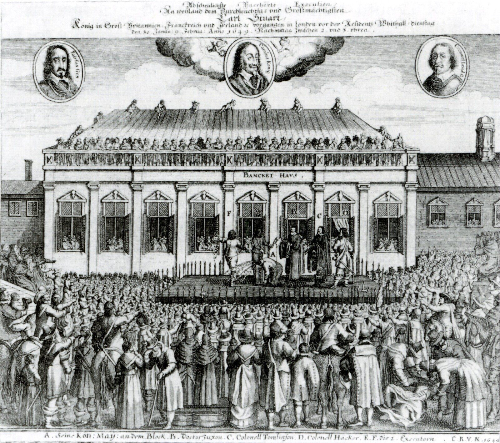
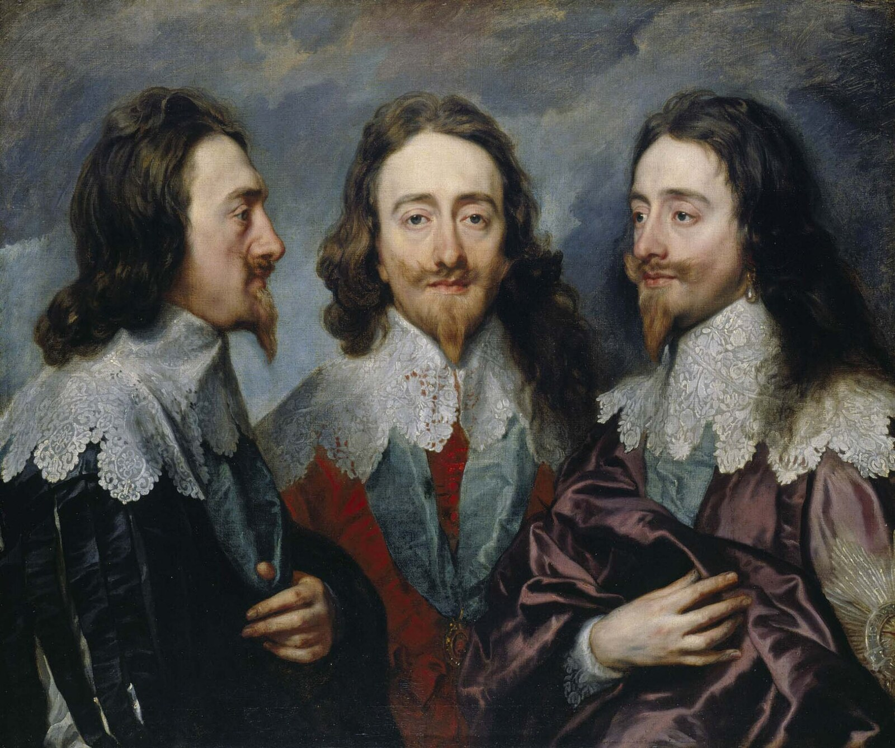
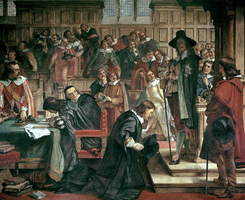
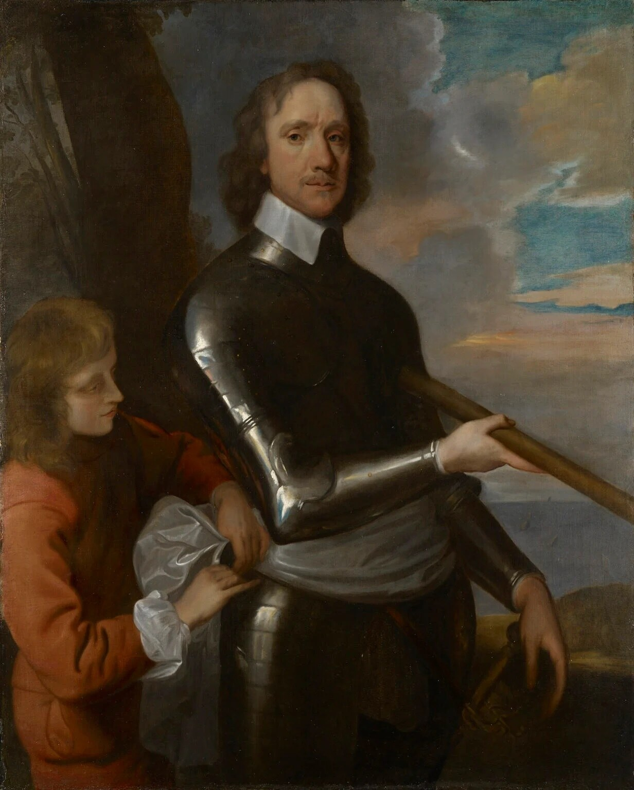
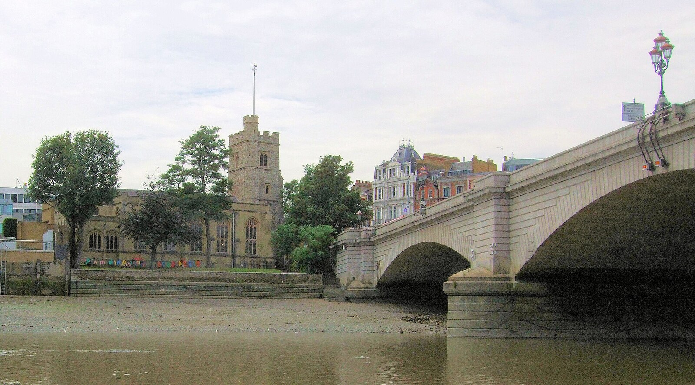
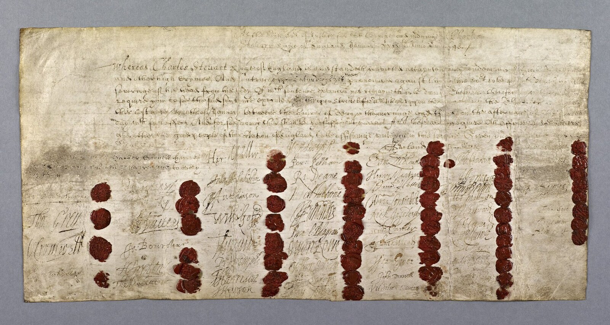
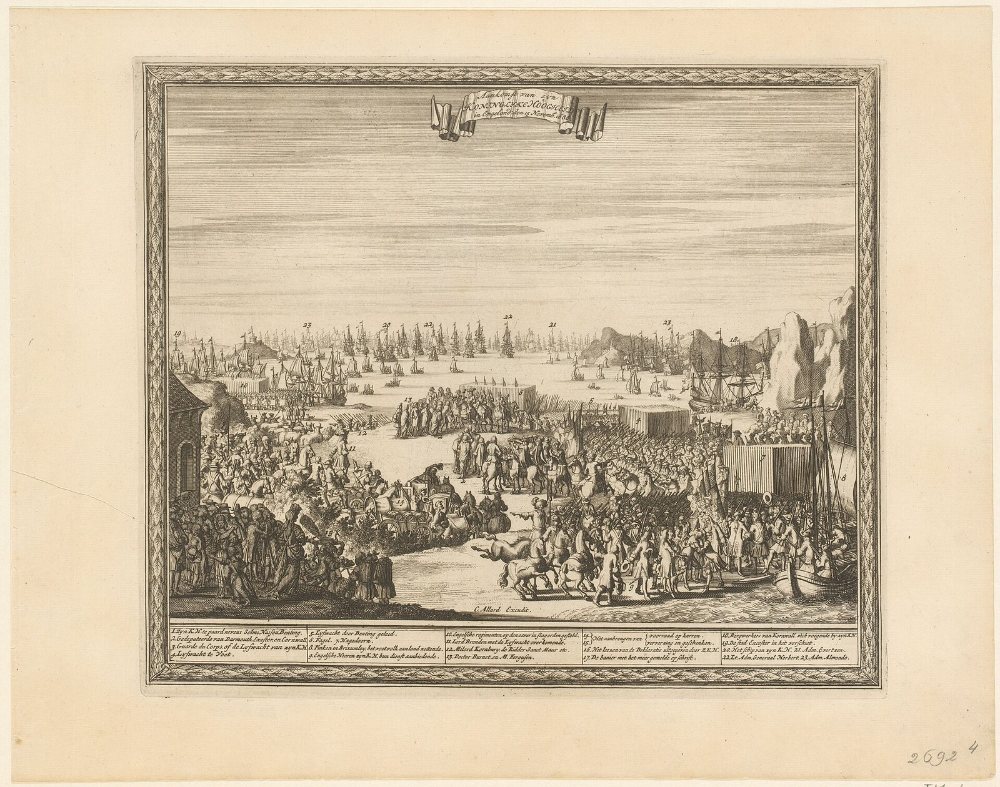
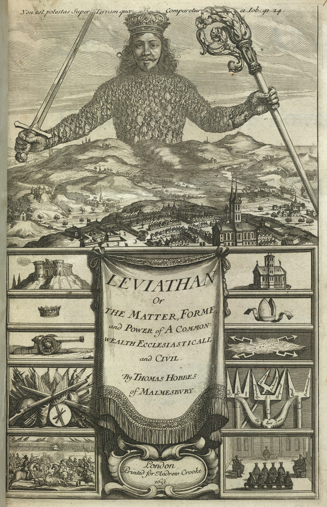
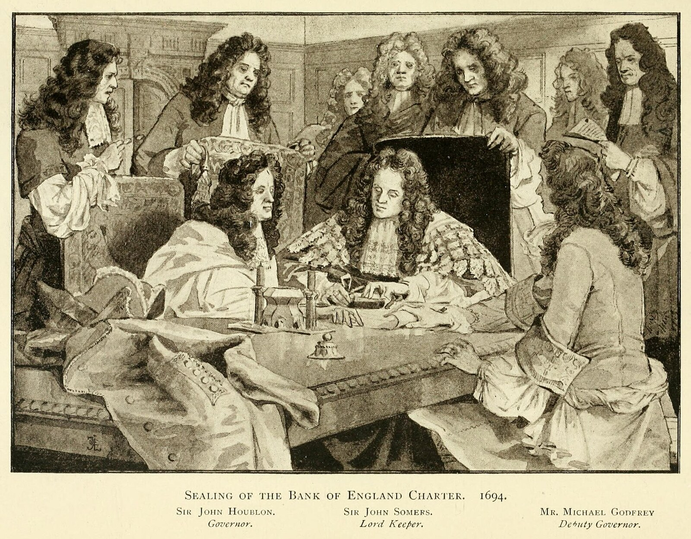

# 55. Why did the English cut off their king's head?

*England, Scotland and Ireland, from 1625 to 1694*

King Charles I was beheaded because he fought a war against his own Parliament over which of them had the last word, lost it, and then started it again. The army that had beaten him twice decided that there would be no peace in England while he was alive. It put him on trial in the name of the people, which nobody had done to a king before.

The morning of 30 January 1649 was bitterly cold. Before he left his room, the king asked for a second shirt to wear under his doublet. If he shivered on the scaffold, he explained, the crowd might think that he was afraid, and he was not.

He was led through his own palace in London, through the great banqueting hall whose ceiling he had commissioned, and out of a window onto a wooden platform draped in black. Soldiers on foot and on horseback ringed it, so that the crowd in the street could see him and could not hear him. He spoke for a few minutes anyway to the men on the scaffold. A subject and a sovereign, he told them, were clean different things, and the people had no business sharing in government.

Then he lay down and put his neck on the block. The executioner, who wore a mask and a false beard so that he would not be known afterwards, took off the head with one stroke. A boy of seventeen in the crowd remembered for the rest of his life the sound that came from the thousands of people watching. It was a groan, he said, such as he had never heard before and hoped never to hear again.

*A German print of 1649 showing the execution of Charles I on a scaffold outside the Banqueting House in Whitehall, with soldiers and a crowd below. Print: unknown artist, public domain.*

Kings had been killed before, in battle, in dungeons and in their beds. This was different. Charles had been charged in open court with a crime, tried by a panel of his subjects, and condemned to death as a tyrant and a traitor to his own people. The men who did it were saying that a king could commit a crime against his subjects and be punished for it like anyone else. That idea ran against what kings then believed about themselves.

## Called gods

Kings in the 1600s had a theory about themselves, called the divine right of kings. A king, it held, was chosen by God, through the accident of birth, and answered to God alone. His subjects owed him obedience as children owe it to a father. If he ruled badly, that was a matter between him and his maker, and to resist him was a sin. Charles's father had explained the point to his Parliament without embarrassment. Kings, he said, are justly called gods, for they exercise a manner of divine power upon Earth.

Across the Channel, the kings of France and Spain were making this theory real. A theory of that kind means little until a king has the tools to act on it, and they were acquiring the tools. They were building standing armies, collecting taxes through their own officials, and letting the old assemblies of nobles and townsmen wither away. A king with his own soldiers and his own tax collectors had far less need to ask for anyone's consent, and an assembly that is not asked has little reason to meet. France's assembly met in 1614 and was not called again for a hundred and seventy-five years.

England was the odd one out. Its assembly, the Parliament, had two houses. The lords and bishops sat in one. In the other, the House of Commons, sat about five hundred gentlemen and lawyers elected by the better-off men of each county and town.

On the face of it, this Parliament was a weak body. It met only when the king summoned it, and he could send it home whenever he liked. However, the king of England had one weakness that his French cousin had escaped. By a custom four hundred years old, he could not impose a new tax without Parliament's agreement. The custom also left plenty of room for a quarrel. Where exactly his own ancient rights ended and a new tax began was a question that lawyers could argue either way.

In quiet times that hardly mattered, since the king had lands and customs duties of his own to live on. In a war it mattered a great deal. A war cost far more than the king's own income could cover, and so he had to summon Parliament and ask. Each time the king needed money, the Commons had a chance to raise its complaints first. Money was the one hold it had over him, and it knew how to use it.

## Twenty shillings

Charles came to the throne in 1625. He was a small, shy, stubborn man with a stammer, a faithful husband and a discerning collector of paintings, and he believed in the divine right of kings with his whole heart. A man who thought that he answered to God alone was badly suited to bargaining with five hundred gentlemen over money. Within four years he had quarrelled with three Parliaments over money and religion. In 1629 he sent the third one home and resolved to manage without. That meant managing without any new tax as well.

*Charles I seen from three sides, painted by Anthony van Dyck in 1635 and 1636 for a sculptor to work from. Painting: Anthony van Dyck, public domain.*

He managed for eleven years. To do it, he needed money that did not count as a new tax. His lawyers therefore combed through old records for forgotten rights that could be turned into cash.

The most productive was called ship money. In time of danger, the king had always been able to order the port towns to supply ships for the navy, or pay for them. That much was old custom. Charles stretched it in three directions. He demanded the payment every year, in peacetime, and from the inland counties as well. In everything except its name, ship money had become a regular tax that Parliament had never voted.

A wealthy landowner named John Hampden refused to pay his share, which came to twenty shillings. He could afford it many times over. His point was one of principle: if the king could take twenty shillings without consent, he could take everything. The case was argued before all twelve of the king's judges, and seven of them found for the king. On paper Charles had won. However, five of his own judges had declined to back him, and the whole country could see that his right to the money was open to doubt. So narrow a win, on such a question, did Charles more harm than a defeat.

The other grievance was religion. England was a Protestant country, and a large part of the Commons were Puritans, strict Protestants who wanted plain churches, long sermons and no bishops. Charles liked ceremony, and here too he pressed his own preference on the country. His archbishop put back altar rails, candles and vestments, and punished preachers who objected. To the Puritans this looked like the old Catholic religion creeping back, and the fact that the queen was a French Catholic who heard Mass in the palace did not calm them.

It was religion, in the end, that broke the eleven years of rule without Parliament. In 1637 Charles ordered his other kingdom, Scotland, to use a new prayer book on the English pattern. When it was first read in the great church of Edinburgh, the congregation rioted and threw stools at the clergyman. The Scots raised an army against him.

Charles now needed an army of his own, and an army costs more than old records can supply. To keep one in the field he needed a new tax, and only Parliament could grant a new tax. In the spring of 1640, after eleven years, he called a Parliament. It asked for its grievances to be heard first, as the Commons had learned to do, and he dismissed it within a month.

Sending Parliament home did nothing about the Scots, however. Their army then marched into England, occupied the north and demanded to be paid for their trouble. That autumn the king had to call Parliament again, and this time he could not afford to dismiss it.

## The birds have flown

The Parliament that met in November 1640 knew that it had the king in its grip, and it did not mean to let go. As long as the Scots were waiting for their money, he needed Parliament far more than it needed him. In a few months it abolished ship money, sent the archbishop to prison and the king's chief minister to the block, and passed a law that it could not be dismissed without its own consent. With that law the king gave up the power that had let him rule alone for eleven years.

Charles signed these measures, and waited. He regarded concessions made under pressure as not binding on a king, so in his own mind he had given nothing away for good. For their part, the leaders of the Commons did not trust him to keep his word. Each side was therefore watching the other, and a rebellion in Ireland brought the question to a point. An army had to be raised to put it down. However, an army raised against the Irish could just as easily be used at home. Whoever commanded that army would be master of England, and neither side would let the other have it.

On 4 January 1642 the king acted. He came down to the House of Commons in person, with about four hundred armed men at his back, to arrest five of its leading members for treason. No king had ever come there to seize a member. He walked up the floor, sat down in the Speaker's chair, and looked along the benches for the five. They had been warned, and had left by the river a few minutes earlier.

*Charles I in the House of Commons in 1642, painted in the 1860s by Charles West Cope for the Houses of Parliament, more than two hundred years later: a later imagining. Painting: Charles West Cope, public domain.*

"I see all my birds have flown," the king said. He asked the Speaker where they were. The Speaker went down on his knees and answered that he had neither eyes to see nor tongue to speak in that place, except as the House was pleased to direct him. It was a courteous way of telling the king, to his face, that the Speaker served the House and not him.

Charles left empty-handed, to shouts of "Privilege!" from the members. He had shown that he was ready to use force against Parliament, and he had failed. After that there was little left to negotiate. Within a week he had left London, which he did not see again until he was brought back to it as a prisoner. By the summer, both king and Parliament were raising troops.

## Plain captains

The civil war lasted four years in its first round. It divided counties, towns and families, and it was fought in every part of England as well as in Scotland and Ireland. By the time the fighting finally ended, about one person in twenty-five in England had died of it, from wounds or from the diseases that followed the armies, which is a greater share than the country lost in the First World War. In Ireland it was far worse.

For the first two years neither side could win. Each had something that the other lacked. The king had the better cavalry, led by dashing noblemen. Parliament had London, the navy and most of the money, and in a long war those ought to have told. What Parliament lacked was generals who really wanted to beat the king, since most of them were great lords who shrank from the thought of what would follow.

*England, Scotland and Ireland in the 1640s. The shading shows roughly the areas held firmly for the king and for Parliament at the end of 1642; the rest of England was contested. Map: drawn for this book; coastlines and rivers from Natural Earth, public domain.*

A member of Parliament from the eastern farmlands, a country gentleman of forty-three with no military training, changed that. Oliver Cromwell raised a regiment of cavalry from among his neighbours and picked his officers for their zeal and ability, whatever their birth. Birth was the usual test for an officer, and Cromwell set it aside. He would rather have a plain captain in a rough brown coat who knew what he fought for, he wrote, than what people called a gentleman and was nothing else.

*Oliver Cromwell in armour, painted by Robert Walker about 1649. Painting: Robert Walker, public domain.*

In 1645 Parliament rebuilt its whole army on that principle. The New Model Army was drilled hard, promoted on merit and, at first, paid on time. Many of its soldiers were fervent Puritans who carried Bibles in their packs, sang psalms on the march, and believed that they were doing God's work. It destroyed the king's main army in a single afternoon that June.

The victory brought a second prize. In the baggage, the victors found the king's private letters, which showed that he had been trying to bring Irish Catholic and foreign troops into England. Parliament had them printed. Anyone who could read could now see for himself what the king had been arranging behind the country's back.

## The poorest he

The army had won the war, and it found that it had opinions about the peace. It also had a grievance. As soon as the fighting stopped, Parliament tried to send the soldiers home without the months of back pay that it owed them. Men who had been cheated of their wages by the body they had fought for were ready to ask who ought to be governing the country.

The soldiers were tradesmen and farmers' sons who had spent four years risking their lives, and they had been reading. A group in London known as the Levellers was publishing pamphlets that asked why, if the king's power came from the people, the people should not choose who governed them. They proposed that Parliament should be elected by nearly all men, and that there should be a written agreement setting out rights that no government could touch. The Commons of the day was chosen by the better-off men, so this was a very large demand.

In the autumn of 1647 the army's leaders met representatives of the common soldiers in a church at Putney, just outside London, to argue it out. A clerk took down the debate in shorthand, and his notes survive.

*St Mary's church at Putney, on the Thames beside Putney Bridge, where the army debates were held in 1647. Photo: Jim Linwood, CC BY 2.0.*

A colonel spoke for the soldiers. The poorest man in England, he said, had a life to live just as the greatest had, and every man who was to live under a government ought first to give his own consent to it. Cromwell's son-in-law answered for the generals, and his objection was a practical one. Only men who owned property had a permanent stake in the kingdom, he said. If those with nothing were given the vote, what would stop them from voting to take the property of everyone else?

Neither man persuaded the other. Between them, however, they had set out the two sides of the argument over who should have a vote. The generals closed the meeting, and saw to it that the proposal was never put into effect. Still, the argument had been made out loud by serving soldiers, and it has not gone away since.

## A man of blood

The king, meanwhile, was a prisoner, and he was negotiating with everybody. He talked to Parliament, to the army and to the Scots at the same time, and promised each of them something different. He did not think it wrong, since he was the king and they were rebels. A promise made to a rebel, in his view, bound him no more than a concession made under pressure.

At the end of 1647 he made a secret agreement with a party among the Scots. He promised to set up their kind of church in England for a trial period, and they promised him an army. In other words, the king was arranging a second war from his prison. In the spring of 1648, as royalist risings broke out across England, the officers of the army held a prayer meeting and resolved that if God gave them victory again they would call "that man of blood" to account. The Scots invaded that summer, and Cromwell crushed them in a few weeks.

For the army, this second war settled the matter. These soldiers believed that they were doing God's work, and to them the first war had been a verdict. Charles had caused fresh bloodshed after God had plainly given judgement against him. A man who would do that could not be bound by any treaty, and as long as he lived he would try again.

Most of Parliament still wanted a treaty. The army therefore dealt with Parliament first. In December 1648 a colonel stood at the door of the House of Commons with a list and a file of musketeers, and turned away or arrested every member thought likely to vote for one. The two hundred or so who were left set up a special court to try the king.

Charles refused to plead. He asked the court, again and again, by what authority it had brought him there, and it had no good answer, because there was no law under which a king could be tried. He was right about that, and it did not help him. The court had the army behind it, and that was enough to pass sentence. Even so, the unease reached the judges themselves. Of the hundred and thirty-five men named as his judges, only about half ever took their seats, and fifty-nine signed the warrant for his death.

*The death warrant of Charles I, dated 1649, with the signatures and red wax seals of the men who signed it. Photo: Parliamentary Archives, public domain.*

## No Christmas

England was now a republic, a state with no king at all. Parliament, which had already declared that the people were the source of all just power, abolished the monarchy and the House of Lords.

In practice, power lay with the army, and it soon lay with Cromwell. He took the army to Ireland, where his soldiers stormed towns that would not surrender and killed the garrisons and many of the townspeople. Afterwards the republic confiscated most of the land owned by Irish Catholics and gave it to English soldiers and investors.

In 1653 Cromwell lost patience with what remained of Parliament, marched in with a squad of musketeers, and cleared the chamber. The king had come with soldiers for five members; Cromwell sent them all home.

He ruled for five years under the title of Lord Protector, with more power than Charles had ever held and a standing army to enforce it. A war fought to limit a king had produced a ruler stronger than the king. For a time the country was divided into districts under major-generals. The Puritans had already closed the theatres and forbidden the celebration of Christmas, and soldiers went through the streets of London on Christmas Day seizing the meat that people were cooking.

The republic depended on one man, and that was its weakness. When Cromwell died in 1658, his son lasted eight months. The generals fell out among themselves, and in 1660 one of them marched to London and invited the dead king's son home from exile. The crowds that welcomed Charles II were as large as any the city had seen.

The new king pardoned nearly everyone except the men who had condemned his father. Thirteen were hanged and cut in pieces, and others died in prison or in hiding abroad. Cromwell's body was dug out of its tomb and hanged, and his head was set on a pole on the roof of the hall where the trial had been held. It stayed there for about twenty-five years.

## An invitation

It looked as though nothing had changed. The king was back, and so were the bishops and the lords. The question of who had the last word had been put off and not answered. It would come back as soon as a king chose to press it.

Charles II was an easy-going man who avoided a showdown, and in his last years he too managed without Parliament. His brother James, who followed him in 1685, was not. James was a Catholic, in a country where most people had been brought up to regard the Catholic church as a foreign tyranny. He set aside the laws that kept Catholics out of office, appointed them to command his army, and kept that army camped outside London. Taken together, these steps looked to his subjects like the work of a king who meant to rule by force and to bring the old religion back with him.

For three years the English put up with it, because James was in his fifties and his heirs were two Protestant daughters. The problem, they could tell themselves, would die with him. Then, in June 1688, his queen gave birth to a son, who would be raised a Catholic. A Catholic dynasty now stretched ahead without end, and waiting was no longer a plan.

Within three weeks, seven of the most prominent men in England sent a letter to Holland. It was addressed to William of Orange, the Dutch head of state, who was a Protestant and was married to James's elder daughter Mary. It invited him to come over with an army. In plain terms, some of the king's leading subjects were asking a foreign ruler to invade their own country.

William landed in the south-west of England in November with more than four hundred ships, a fleet three times the size of the Spanish Armada. In England hardly a shot was fired, though it took two years of war to make Ireland accept the change. James's officers, and then his other daughter, went over to the invader. James lost his nerve, got rid of the great seal of England, by his enemies' account into the Thames, and fled to France.

*William of Orange's fleet and troops arriving at Torbay in November 1688, in a Dutch print of 1691. Photo: Rijksmuseum, CC0.*

Parliament then did something more careful than cutting off a head. This time it kept the monarchy and changed the terms. It declared that James, by running away, had left the throne empty. It offered the crown to William and Mary jointly, and it attached a document, which they accepted before they were crowned. Parliament was handing over the crown, and Parliament was setting out what went with it.

## Three per cent

The document became law as the Bill of Rights. It is a list of things that the king of England may not do. He may not suspend a law. He may not raise a tax without Parliament. He may not keep an army in peacetime without Parliament's consent. Each of those three answered something that Charles I or James had done. Elections are to be free, and so is speech in Parliament. Courts may not demand excessive bail or inflict "cruel and unusual punishments", a phrase that Americans would borrow a century later.

A list of rules is only as good as the means of enforcing it, and Charles I had signed away powers before. In addition, therefore, Parliament began voting the money for the army for one year at a time. From 1689 onwards it had to meet every year, or the soldiers would go unpaid. No king could again send it home for eleven years. It has met every year since.

Nobody had made England a democracy. Perhaps one man in five could vote, and Parliament was a club of landowners.

What had been settled was the question that Charles I died for. That the king was under the law had been said since the barons met King John in a meadow. Now there was a way to make it true every year, because the money and the army were both in Parliament's hands, and the last word belonged to an assembly that the king could not do without.

Two philosophers who lived through these events drew opposite conclusions from them. Thomas Hobbes, writing just after the execution, argued that the civil war showed what happens without an all-powerful ruler: a war of every man against every man, in which life is "solitary, poor, nasty, brutish, and short". For Hobbes, in other words, the danger lay in having too little government, and a harsh ruler was better than none.

John Locke, whose book came out just after the Dutch invasion, argued that governments exist to protect the lives, liberty and property of the people who set them up, and that a ruler who breaks that trust may be removed. On that view, the removal of James had been within the people's rights. The next century would read Locke.

*The title page of Thomas Hobbes's Leviathan, printed in 1651, with a giant crowned figure made of tiny people rising over a town. Photo: British Library, CC0.*

The most practical result was financial, and it turned on trust. A king who answers to no one can refuse to repay his debts, and kings often did, so lenders charged them heavily to cover the risk. After 1689 the English government's debts were guaranteed by Parliament, and Parliament was full of the people who had lent the money. Such men were not going to vote to cheat themselves. A loan to the government therefore became a safer loan, and in time a cheaper one.

In 1694 a group of London merchants founded the Bank of England to lend to the government. The change took a generation to work through. In the 1690s the government was paying up to fourteen per cent for its loans. By the 1750s it was paying three.

*The sealing of the Bank of England's charter in 1694, as imagined in a drawing of 1905. Drawing: Lady Jane Lindsay, public domain.*

That difference won wars. Wars were fought on borrowed money, and the side that could borrow more cheaply could keep fighting for longer. France had three times Britain's population, but by the middle of the 1700s its kings, who answered to nobody and had defaulted more than once, were paying a good deal more. For the rest of the century Britain was able to outspend it.

One ceremony is said to preserve the memory of the day it all began. Whenever the monarch comes to open a new session of Parliament, a royal messenger walks to the House of Commons to summon the members. As he approaches, the door of the chamber is slammed in his face. He has to knock three times before he is let in.
