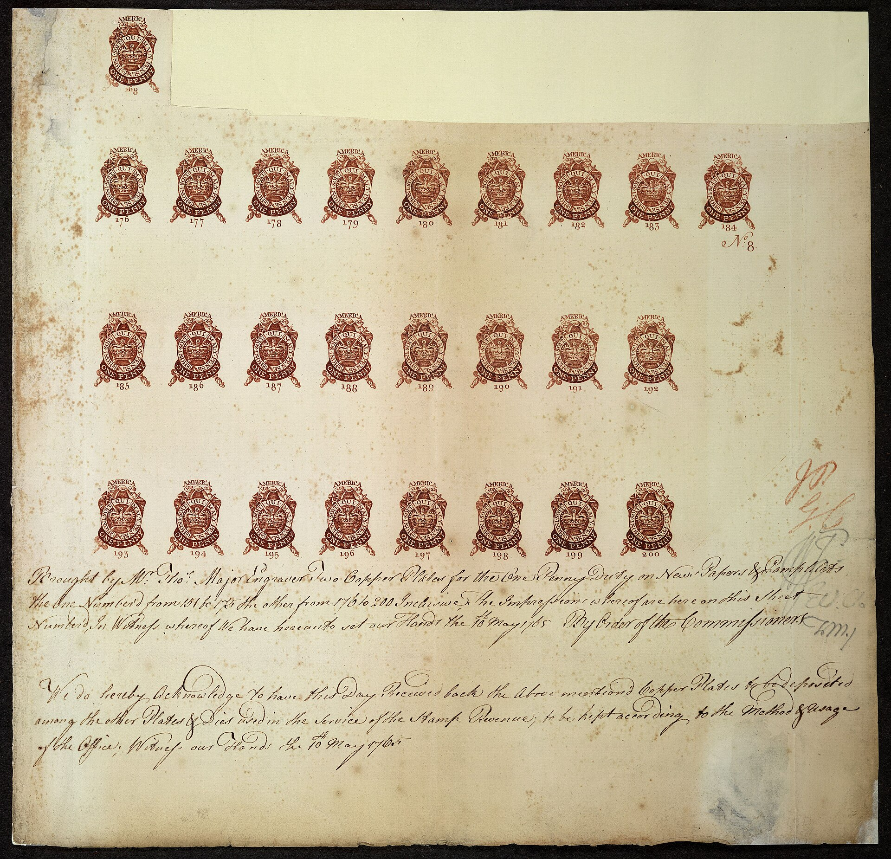
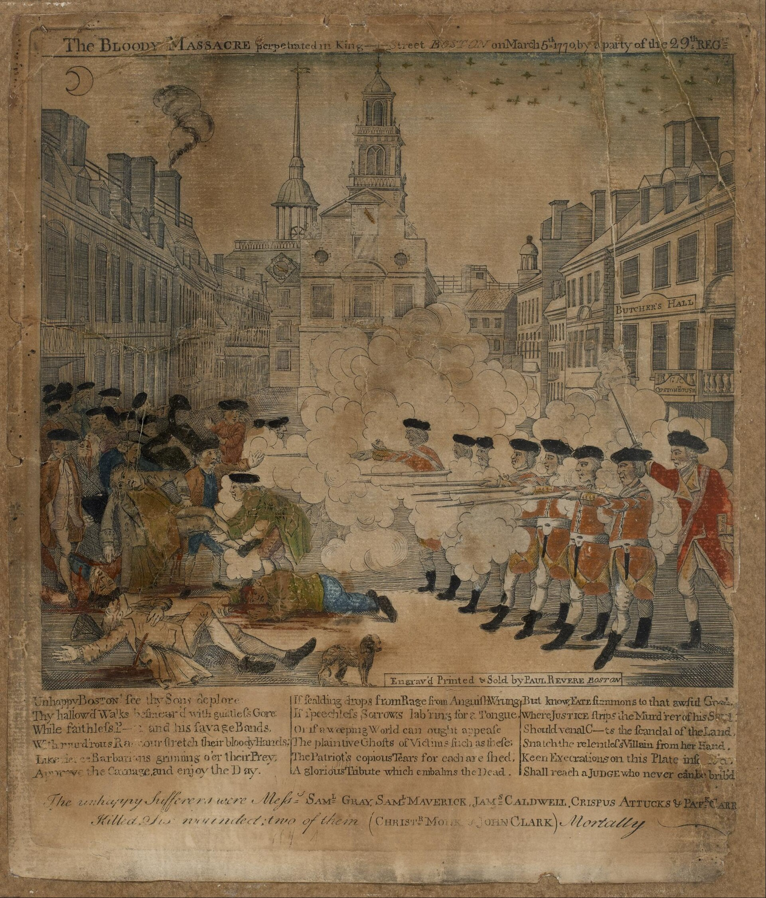
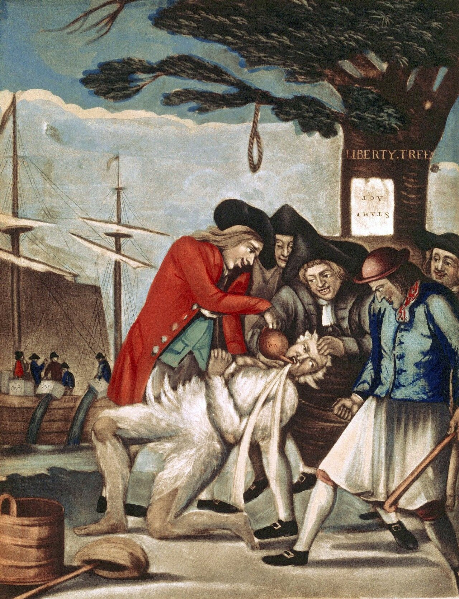
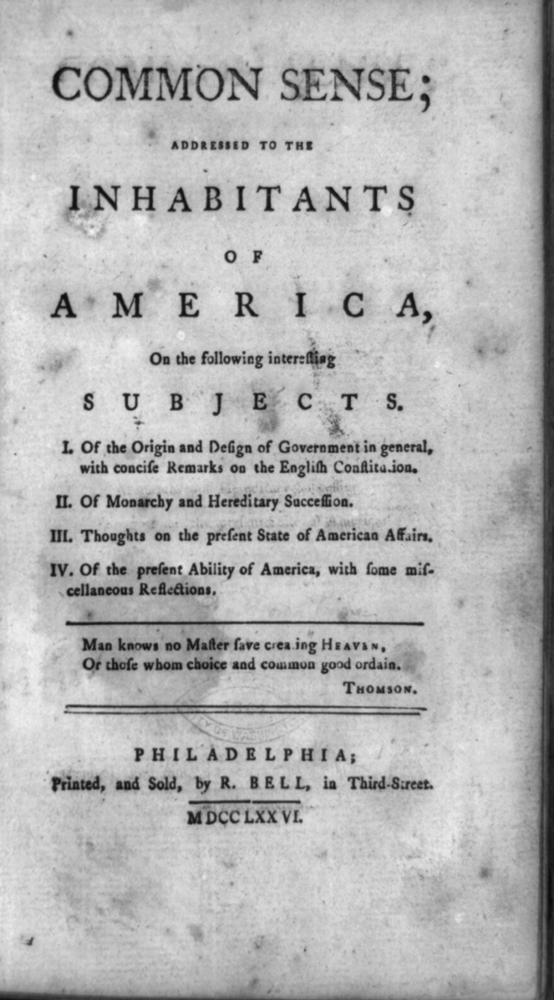
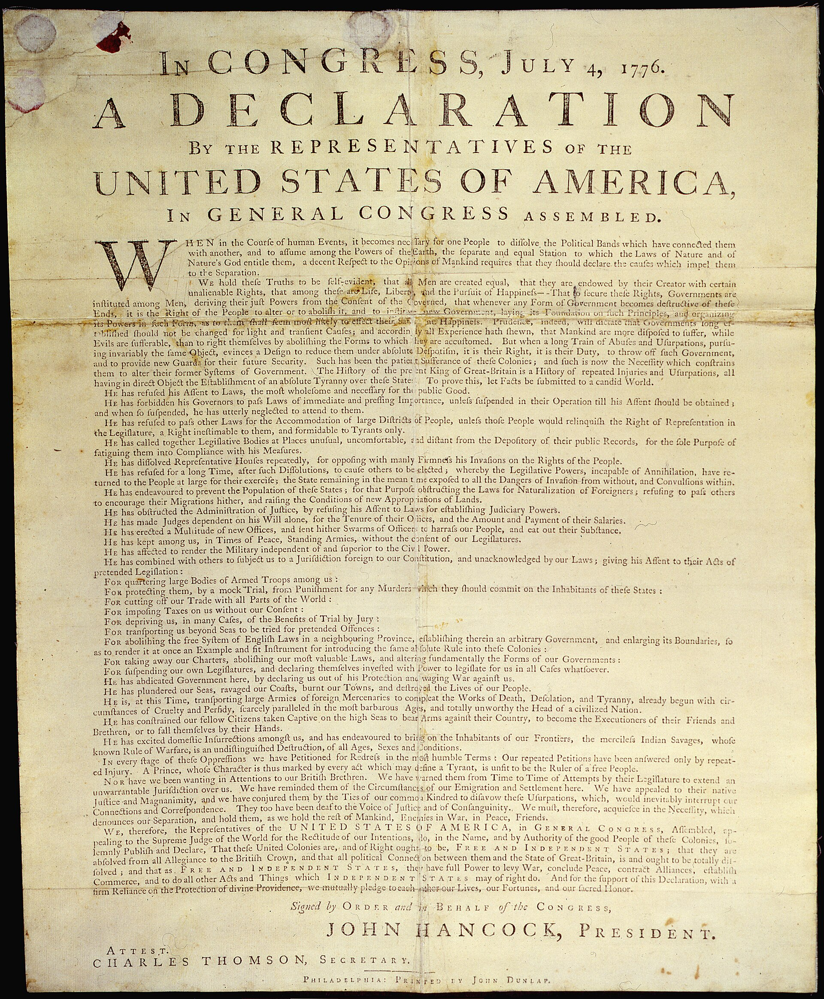
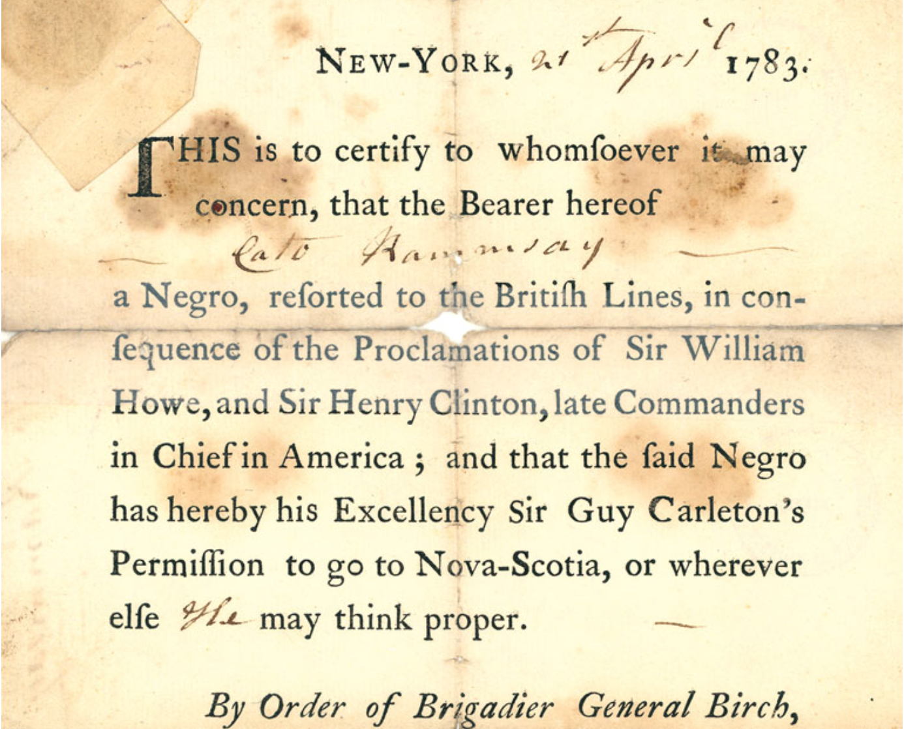
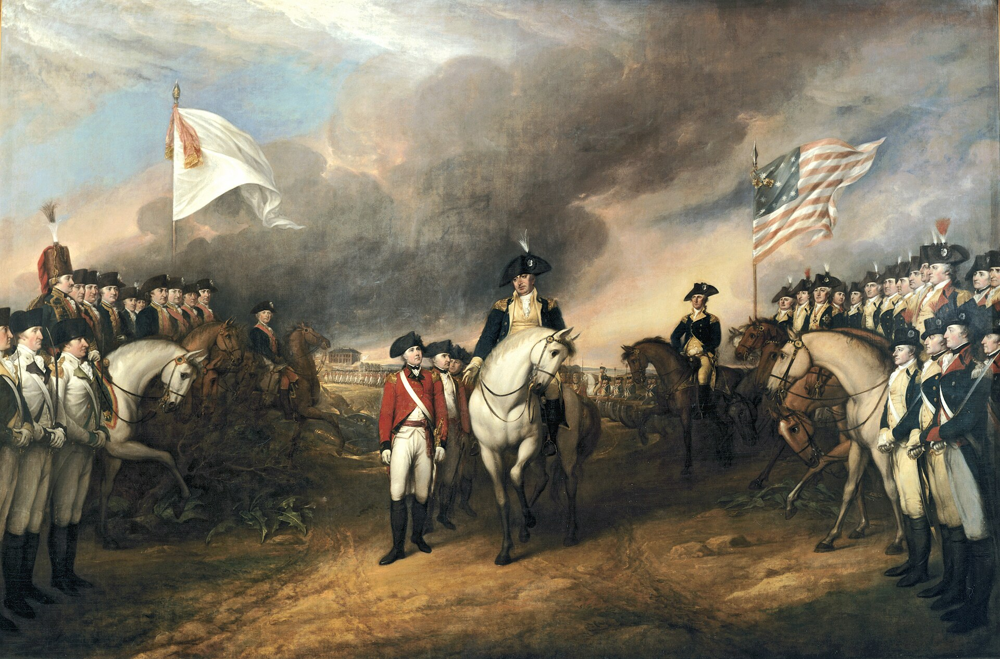
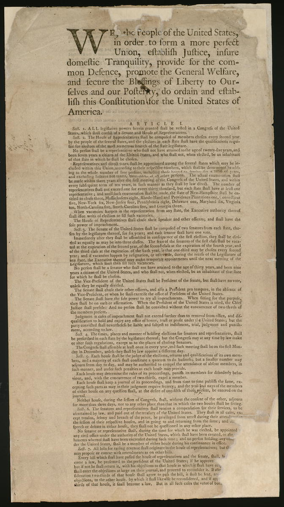
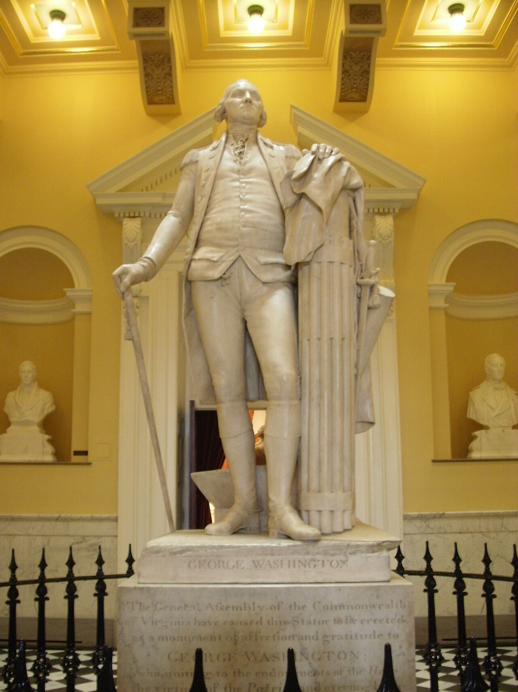

# 56. Why did the American colonies rebel?

*British North America, from 1754 to 1791*

The colonies rebelled because Britain tried to tax them, and they had come to believe that only their own elected assemblies had the right to do that. The sums were small. The principle was the one the English themselves had fought two revolutions for, and when Britain answered the colonists' protests with soldiers, an argument about tax became a war for independence.

On the evening of 16 December 1773, about a hundred men walked down to the wharves of Boston, in the colony of Massachusetts. Some had smeared their faces with soot and wrapped themselves in blankets, to look like Mohawk Indians. They boarded three merchant ships, hoisted the cargo out of the holds, split open the chests with hatchets and tipped the contents over the side. It took three hours. By the end, more than forty tonnes of tea were floating in the harbour.

The men were oddly careful. They harmed nothing on the ships except the tea. When one of them was caught stuffing some into his pockets, the others stripped off his coat and kicked him ashore. A padlock belonging to one of the captains had been broken, and the next day somebody sent him a new one.

The tea belonged to the East India Company, and the strangest thing about the affair is that it was a bargain. A new law had just allowed the Company to ship its tea directly to America, which made it cheaper than the smuggled Dutch tea that most colonists drank. A crowd that simply wanted cheap tea would have welcomed the ships. The men of Boston destroyed it for that reason. It was cheap, so people would be tempted to buy, and buying it carried a cost of another kind. The price included a small tax, laid on by the Parliament in London, and anyone who bought the tea would be admitting that Parliament had the right to tax him. They preferred to throw away a fortune in tea than to concede three pennies a pound.

## A volley in the backwoods

The quarrel had begun with a war, and the war had begun in America.

In 1754 the British colonies were a strip of settlements along the Atlantic coast. Behind them, across the mountains, lay the valley of the Ohio river, which both Britain and France claimed, and where neither had many people. That spring the governor of Virginia sent a small force of militia into the valley to warn the French off.

Its commander was a tall, ambitious landowner of twenty-two named George Washington. He found a party of French soldiers camped in a wooded hollow, surrounded them early in the morning, and opened fire. Ten Frenchmen were killed, among them an officer who had been carrying a diplomatic message.

The shots in the forest grew into a war fought around the whole world. The two countries were rivals on several continents, and a fight between them in one place soon spread to the others. Britain and France fought in Europe, in the Caribbean, in West Africa, in India and at sea. An English writer who lived through it looked back and wrote that a volley fired by a young Virginian in the backwoods of America had set the world on fire.

Britain won nearly everywhere. When peace was made in 1763, France had lost Canada and all its claims east of the Mississippi river, and the East India Company had become the strongest power in Bengal. Britain had never stood so high.

It had also never owed so much. Victory on that scale had been expensive. The government had paid for the war by borrowing, and its debt had nearly doubled. Half of every pound collected in taxes now went to pay the interest. The obvious remedy, which was to raise taxes at home, was hardly open. The British at home were already among the most heavily taxed people in Europe, and there had been riots over a new tax on cider.

To the ministers in London, the next step seemed plain. If the British at home could pay no more, somebody else in the empire would have to. A large part of the war had been fought to protect the American colonists from the French. An army of ten thousand men would have to stay in America to guard the new territory. It was only fair that the Americans should pay part of the cost.

## The lightest taxes in the empire

By the standards of the age, the colonists were fortunate people. There were about two million of them, in thirteen colonies, and their numbers doubled every twenty-five years. Land was cheap, food was plentiful, and wages were high. American-born soldiers were several centimetres taller than soldiers born in Britain, which is a reliable sign of who had eaten better as a child.

They were also used to running their own affairs. Most colonies had a governor appointed in London, and every one had an assembly elected by its own property owners. On paper the governor was in charge. In practice the assembly held the purse. The governor's salary was usually voted by the assembly, which gave it the same hold over him that Parliament had over the king. For a century and a half London had mostly left them alone.

One result was that the colonists sent very little money to London. They paid taxes to their own assemblies and duties on their trade. To the government in London the average colonist paid about one twenty-fifth of what a person in Britain paid. After so long, the colonists no longer thought of this arrangement as a favour. They thought of it as the way things rightly were.

It was into this settled arrangement that the new tax arrived. In 1765 Parliament passed the Stamp Act. From then on, every legal document, newspaper, pamphlet, licence and pack of playing cards in the colonies had to carry an official stamp, which cost money. Britain had had such a tax for seventy years, so in London it looked like an ordinary measure.

*Proof sheet of the one-penny stamps printed for the Stamp Act, 1765.*

The ministers could hardly have chosen worse. The tax fell hardest on lawyers, printers, merchants and tavern keepers, who were the most articulate and best-connected people in America. In other words, it angered exactly the people best placed to stir up everyone else. Within months, crowds had burned the stamp distributors in effigy and pulled down their houses, and nearly all of them had resigned before the tax came into force.

The colonists' argument was a simple one, and they had it from England. In 1689 the English had settled that the king could not take his subjects' money without the consent of their representatives in Parliament. The colonists considered themselves English subjects with all the same rights. However, they elected nobody to Parliament. Their representatives sat in their own assemblies, and those assemblies alone could tax them. It followed that a tax voted in London was money taken without consent, which was the definition of tyranny. The phrase that summed it up was "no taxation without representation".

Parliament's answer was that it represented every subject of the Crown, whether he voted or not, as it represented the great majority of Englishmen who had no vote either. To the colonists this was nonsense. A member of Parliament who lived three thousand miles away, and whom no American had voted for, could not be said to speak for them.

Still, the British position had its own logic. In the British system, Parliament was supreme. If it could not make laws for the colonies, they were not really part of the country. Each side, in short, was defending a principle that it could not give up without giving up a great deal more. That is why such small sums caused so large a quarrel.

## Cheaper tea

For the next ten years the two sides repeated this argument, and each round left them further apart. Each time, Parliament imposed a tax, the colonists resisted, and Parliament then gave way on the money while holding on to the principle.

The first round was the stamp tax. Parliament repealed it, and at the same time declared that it had the right to make laws for the colonies in every case. In the second round it put duties on glass, paper, paint and tea. The colonists organised a boycott of British goods, and women gave up imported cloth and held spinning parties in public. Once again Parliament retreated. It withdrew all the duties except the one on tea, which it kept to make the point. That surviving duty was the small tax that would one day go into Boston harbour with the tea.

Meanwhile soldiers had been sent to Boston to keep order, and they were about as welcome as an occupying army anywhere. On a snowy night in 1770 a squad of them, cornered by a crowd throwing ice and oyster shells, fired their muskets and killed five men. Boston's printers turned it into a massacre, and engravings of the scene went up in taverns across the colonies. People who had never seen Boston now had a picture in their heads of the king's soldiers shooting down Americans.

*Paul Revere's engraving of the Boston shooting of 1770, made to turn the event into a cause. It is propaganda, and shows the crowd as peaceful.*

Then came the tea. The government treated its destruction as the last straw. It closed the port of Boston until the tea was paid for, rewrote the colony's charter so that its council was appointed by the king and its town meetings were restricted, and sent a general to govern. In effect, one colony had been stripped of much of its power to run its own affairs.

This was the mistake that united the colonies. Men in Virginia and Pennsylvania who had thought the Bostonians hot-headed now saw a government tearing up a colony's constitution by an act passed three thousand miles away. What could be done to Massachusetts could be done to them. Delegates from twelve colonies met in Philadelphia, in a body they called the Continental Congress, to concert their response, and across New England farmers began to drill on village greens.

*A London print of 1774 attacking Boston's protests. A customs man is tarred, feathered and forced to drink tea, while tea is thrown from a ship behind.*

With soldiers in Boston and armed farmers drilling all around it, a collision was a matter of time. In April 1775 the general in Boston sent seven hundred soldiers out by night to seize a store of gunpowder in a village twenty miles away. Riders went ahead of them to raise the alarm. At dawn the soldiers found about seventy armed farmers drawn up on the green of a village on their road. Somebody fired. When the smoke cleared, eight Americans were dead. By the time the column got back to Boston that evening, militiamen firing from behind walls and trees along the whole route had killed or wounded about two hundred and fifty of the king's troops. The argument about tax had become a war.

## Common sense

Even then, most colonists did not want independence. Fighting the king's soldiers and rejecting the king were, to them, two different things. They saw themselves as loyal subjects defending their rights against a bad set of ministers, and their leaders went on sending respectful petitions to the king.

What changed their minds was forty-seven pages of print. In January 1776 a pamphlet called *Common Sense* appeared in Philadelphia. Its author, Thomas Paine, was an Englishman who had landed in America barely a year before, after failing as a corset maker, a tax collector and a husband. He wrote in the language of the tavern and the pulpit, with no Latin in it. As a result, a reader with little schooling, or a listener with none, could follow him.

*The title page of Common Sense, Philadelphia, 1776.*

Paine said what the politicians had been too cautious to say. The quarrel was not with ministers. It was with the king, and with the whole notion of kings. Hereditary monarchy was an absurdity, since nature would not so often give mankind an ass for a lion. It was equally absurd for a continent to be governed for ever by an island. America had a chance that came to few peoples in history, to begin the world over again.

The pamphlet sold something like a hundred thousand copies in a few months, in a country with fewer free adults than a large modern city. It was read aloud to Washington's soldiers. An idea that the politicians had not dared to voice was now common talk.

That July the Congress in Philadelphia voted for independence, and published a declaration to explain themselves. Most of it is a list of complaints against the king. The second paragraph is the part the world remembers, because it sets out why any people might do what the Americans were doing. It states, as truths that need no proof, that all men are created equal, that they are born with rights that cannot be taken away, among them life, liberty and the pursuit of happiness, and that governments get their just powers from the consent of the governed. When a government destroys those rights, the people may abolish it.

*The first printed copy of the Declaration of Independence, run off by John Dunlap in Philadelphia on 4 July 1776.*

The ideas were not new. They came from the English philosopher who had justified the removal of a king in 1689, and from a generation of French and Scottish writers who had argued that human affairs could be set in order by reason, as Newton had set in order the planets. The English had acted on them twice and each time ended up with a king. What was new in 1776 was the size of the ambition. The Americans proposed to build a whole country on them and nothing else.

## The loudest yelps

The man who drafted those sentences, Thomas Jefferson of Virginia, owned nearly two hundred human beings at the time, and over his life he owned six hundred.

One person in five in the thirteen colonies was enslaved. A declaration that all men are created equal had come from a society that held so many of its people as property. The contradiction was obvious, and the colonists' enemies enjoyed pointing it out. How is it, asked the English writer Samuel Johnson, that we hear the loudest yelps for liberty among the drivers of negroes? Jefferson's draft had included a passage blaming the king for the slave trade. The delegates cut it, at the insistence of the colonies that lived by slavery and those whose ships carried the slaves.

Enslaved people drew their own conclusions about which side stood for liberty. In 1775 the royal governor of Virginia offered freedom to any slave of a rebel master who reached the British lines and would fight. Over the course of the war, tens of thousands tried. Many died of smallpox in the British camps.

Some did get away. When the British finally sailed away, they took about three thousand of these men and women with them to Nova Scotia as free people, their names entered one by one in a ledger so that their former owners could claim compensation. Several of those named had belonged to George Washington.

*A British certificate of April 1783, allowing a Black man who had reached British lines to go to Nova Scotia, from the evacuation of New York.*

The Native nations of the interior made the same calculation, and for them the thing at stake was land. The British government had drawn a line along the mountains in 1763 and forbidden the colonists to settle beyond it. That line was one of the colonists' grievances, which told the peoples living beyond it what an American victory would mean. Most Native peoples therefore judged that the king was the lesser danger. They were right, and it did them no good.

Nor were the white colonists of one mind. About a fifth of them stayed loyal to the king. The war was fought between neighbours as well as between armies, and when it ended, some sixty thousand loyalists left the country for good.

*Eastern North America in 1775: the thirteen colonies, the line of 1763 beyond which settlers were forbidden to go, and some of the Native nations whose lands lay beyond it. The colonies and the line are drawn roughly. Map: drawn for this book; coastlines and rivers from Natural Earth, public domain.*

## Three thousand miles

On paper Britain could not lose. It had the best navy in the world, a professional army and several times the colonies' population. It rented thirty thousand trained soldiers from German princes to add to its own.

Its problem was distance. Most of its soldiers, muskets and flour had to cross three thousand miles of ocean, and an order from London took two months to arrive and was often out of date when it did.

There was a second difficulty. The colonies had no capital whose capture would end the war. The British took New York, and then Philadelphia, and each time found that taking a city did not end the rebellion. The moment a British army marched into the countryside, the countryside rose behind it.

Washington, who commanded the American army, understood this better than anyone. He lost more battles than he won, and he was not a brilliant general. What he saw was that he did not need to win. He needed to keep an army in being, and as long as it existed, the rebellion existed. He kept it together through defeats, desertion, and a winter camp in which nearly two thousand of his men died of disease while Congress failed to send food and shoes.

The war was decided by a third party. France had not forgiven its defeat of 1763, and a rebellion in Britain's colonies was a chance to repay it. In 1777 an entire British army, cut off in the forests north of New York, surrendered to the Americans. The French court concluded that the rebels might win, and joined them, with money, soldiers and above all a fleet. The fleet mattered most because a British army in America lived on what reached it by sea.

In 1781 the main British army in the south marched to the coast of Virginia, to a small tobacco port called Yorktown, expecting the navy to supply it. A French fleet arrived first and shut the bay. The British were now cut off from the sea that was supposed to feed them. Washington marched south with an army half of which was French. After a siege of three weeks the British general surrendered, and more than seven thousand soldiers marched out between the French and American lines and laid down their muskets. Two years later Britain recognised the United States as an independent country.

*The surrender at Yorktown in 1781, painted by John Trumbull in 1820, a later imagining.*

## A machine on paper

The Americans now had to govern themselves, and their first attempt was a failure. They were in rebellion against a distant government that claimed the power to tax them, and they had taken care not to build another one. The thirteen states had bound themselves in a loose league, with a Congress that could neither tax nor enforce its decisions. A government that cannot raise its own money can do very little. It could not pay the soldiers or the interest on the war debt. By 1786 farmers in Massachusetts, crushed by taxes and debts, had taken up arms against their own state government.

Something stronger was plainly needed. In the summer of 1787, fifty-five men met in Philadelphia, in the room where independence had been declared, and kept the windows shut so that nobody could listen. In four months they wrote a constitution.

It is a short document, and it reads like the plan for a machine. Its authors had studied the republics of Greece and Rome and had noticed that they all ended in tyranny or chaos. Their own experience had taught them to fear two things: a ruler with too much power, and a majority with too much power. The puzzle, then, was to build a government strong enough to tax and to enforce its decisions, and yet unable to turn into a tyranny.

Their solution was to divide the government into parts and set the parts against one another. A president would carry out the laws, a Congress of two houses would make them, and judges would interpret them. Each could block the others. The president can refuse to sign a law, for example, and Congress can pass it over his refusal only if two thirds of both houses agree. Ambition, one of the authors explained, must be made to counteract ambition. The design did not depend on finding good men to run it. It assumed that men would reach for power, and it used the reaching of one to hold back the reaching of another.

*The first page of the Constitution as printed in Philadelphia in September 1787.*

Nothing in it came from God or from birth. There was to be no king, no nobility and no national church. The first three words, written large, are "We the People".

The people it had in mind were not everyone. The word "slave" appears nowhere in the document, but slavery is written into it in several places. Each time it appears under other words, and each time the slave owners gain. States were allowed to count three fifths of their slaves when working out how many seats they got in Congress, which gave slave owners extra votes. Congress was forbidden to stop the import of slaves from abroad for twenty years. A slave who escaped to another state had to be sent back.

Who could vote was left to each state, and nearly all of them restricted the vote to men with some property. Even so, about two thirds of white men qualified, which was nearly three times the share in England. In one state, New Jersey, the law said "inhabitants", and for thirty years women who owned property voted too, until the men of both parties agreed in 1807 to stop it.

To get the constitution accepted, its supporters promised a list of rights that the new government could never infringe. The division of powers set one part of the government against another. This list, by contrast, set limits on the government as a whole. It was added in 1791 as ten amendments, known as the Bill of Rights. They guarantee free speech, a free press, freedom of worship and trial by jury, and one of them forbids "cruel and unusual punishments", in the words that the English Parliament had used a century earlier.

## The key

When the war ended, Washington was the most powerful man in America, at the head of an unpaid and angry army. One of his colonels had written to suggest that he make himself king, and had received a furious reply. When a group of officers began to talk of marching on Congress to get their pay, he called them together and shamed them out of it. A few months later he rode to where Congress was sitting, handed back his commission, and went home to his farm.

*George Washington in marble, by the French sculptor Jean-Antoine Houdon, begun in 1785. Photo: AlbertHerring, CC BY 3.0.*

King George, when he was told what Washington meant to do, is reported to have said that if he did it he would be the greatest man in the world. Generals who win revolutions do not usually give the power back.

He returned in 1789, elected as the first president, and served eight years and went home again. In the hall of his house in Virginia, in a small glass case on the wall, hangs a large iron key. It was sent to him in 1790 by a young French nobleman who had served on his staff during the war and had gone home full of American ideas. It is the key to the main gate of the Bastille, the royal prison in Paris.
