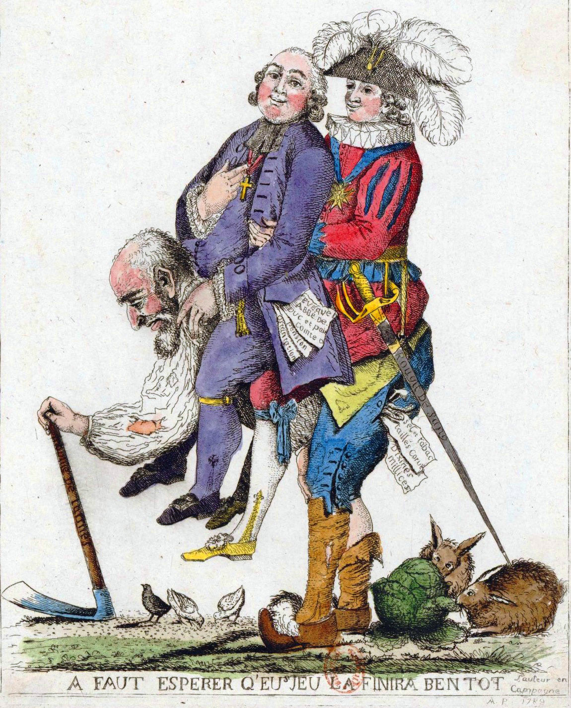
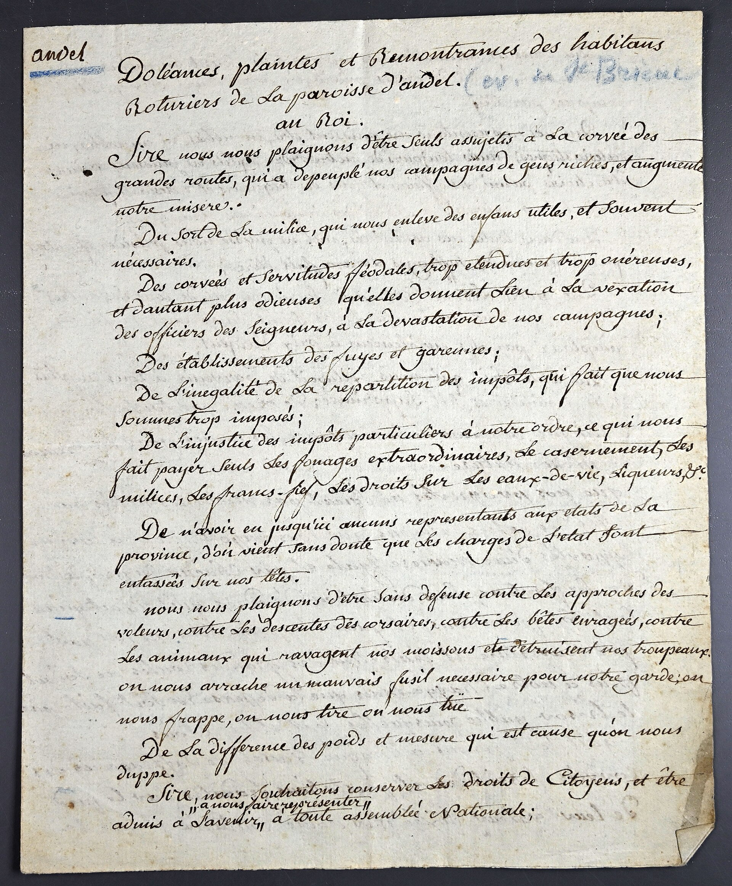
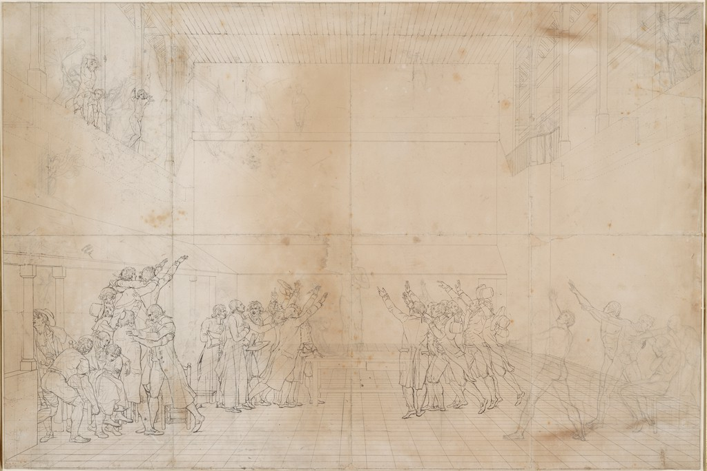
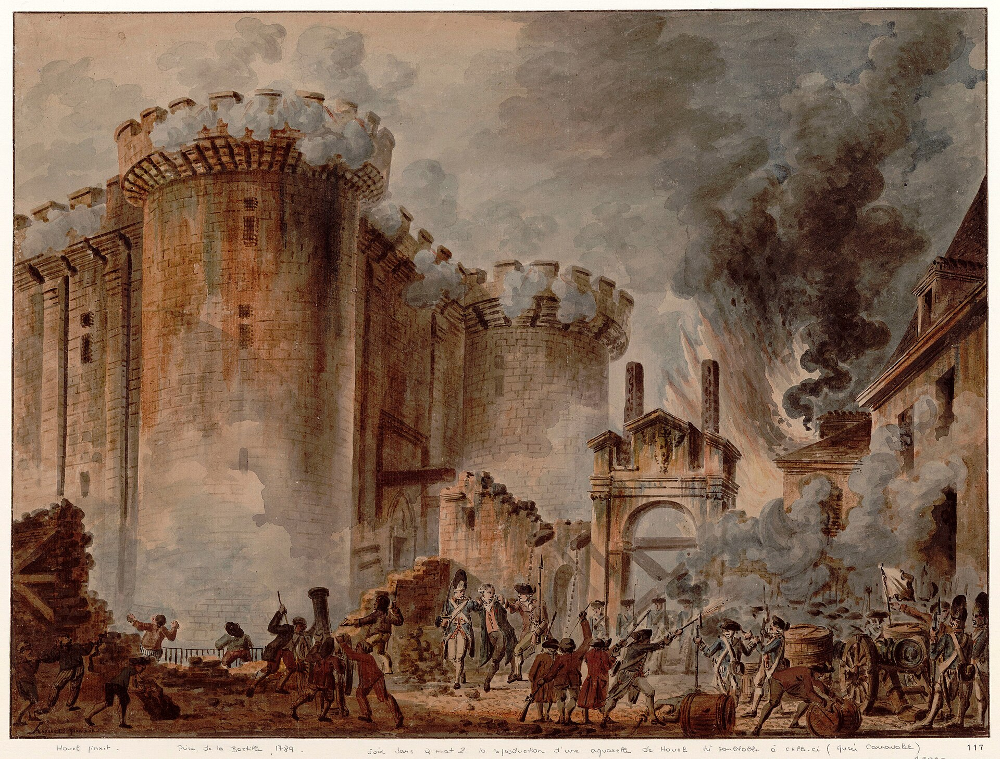
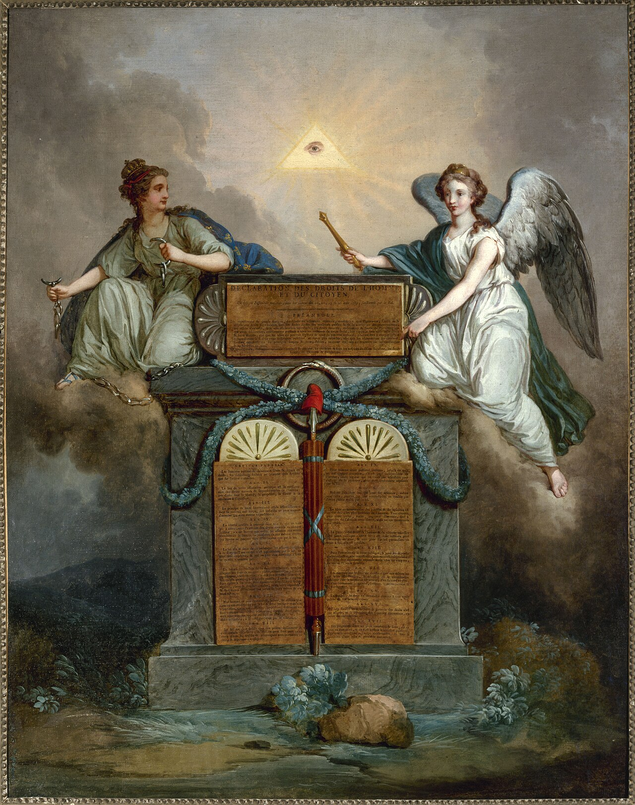
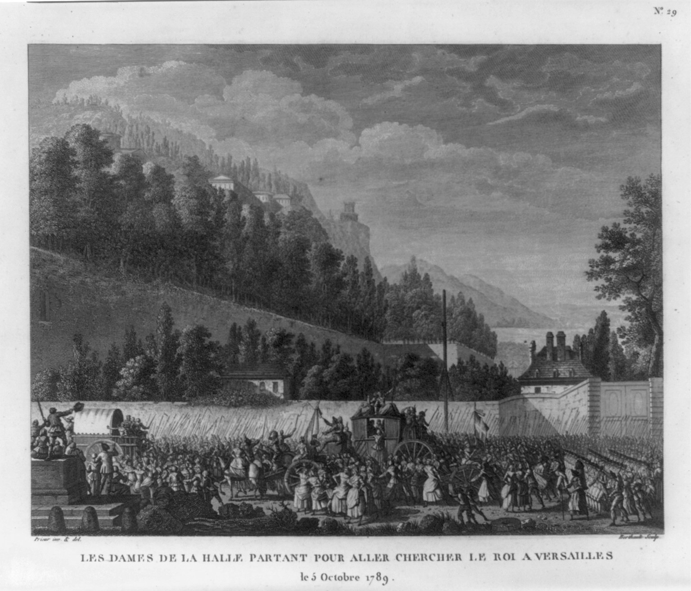
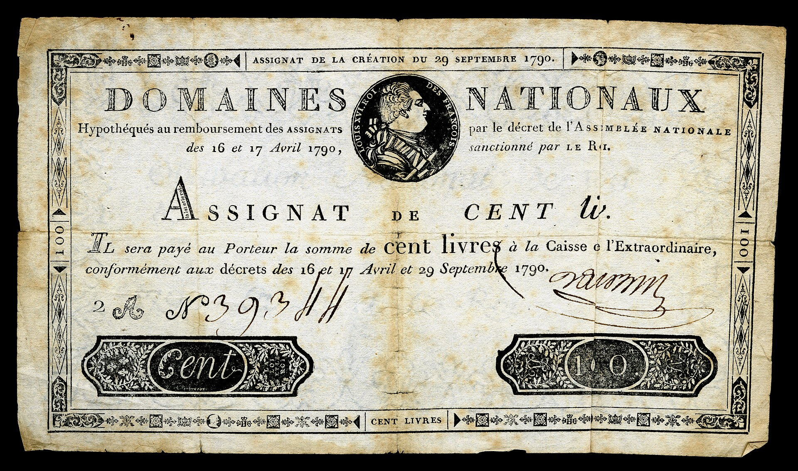
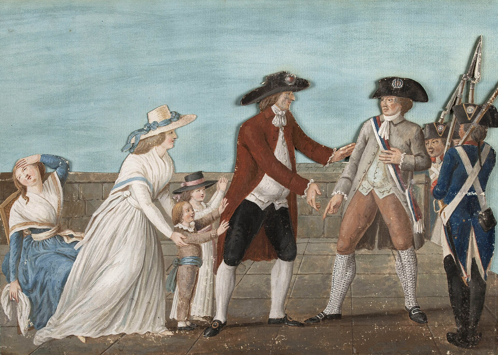
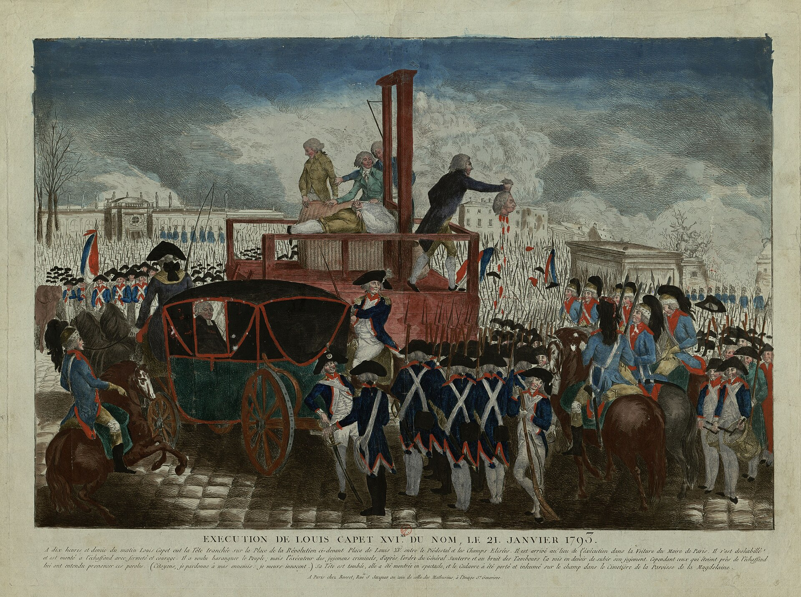
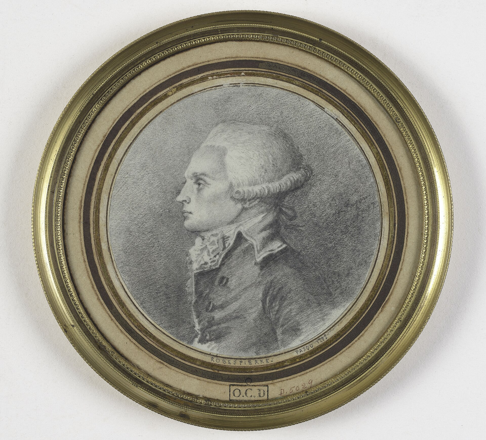

# 57. Why did the French Revolution turn to terror?

*France, from 1788 to 1794*

The revolution turned to terror because, within four years of beginning, its leaders were at war with most of Europe and with half of their own country at once. They had swept away the old rules about who held power and why, and they had no new rules that their opponents accepted. In those conditions anyone who disagreed looked like a traitor, and the government began to kill people for what they were suspected of thinking.

King Louis XVI of France kept a diary. It was a brief record, mostly of his hunting, in which he noted each day how many stags or boars had been killed. On days when there was no hunt, or nothing was killed, he wrote one word. The entry for Tuesday, 14 July 1789, reads "*Rien*": nothing.

That afternoon, twenty kilometres away, a crowd of Parisians had stormed the royal fortress of the Bastille, killed its governor, and carried his head through the streets on a pike. A duke rode out to the palace that night and had the king woken to tell him.

"Is it a revolt?" Louis is said to have asked.

"No, sire," said the duke. "It is a revolution."

Four years later the king was dead on a scaffold, France was a republic, the churches were closed, and the calendar had been restarted from the year one. The men who governed the country had declared that all human beings were born free and equal. They were also sending their fellow citizens to be beheaded at a rate of several dozen a day.

## Twenty-eight million

France in 1789 was the giant of Europe. It had twenty-eight million people, nearly three times as many as Britain, and its language, its fashions and its writers set the tone for the continent. Its king ruled, in theory, by the will of God alone.

In law, his subjects were divided into three orders, called estates. The first was the clergy. The second was the nobility, about one person in a hundred. The third was everybody else, from bankers to beggars. The orders were unequal by design. The law did not treat a noble and a commoner as the same kind of person. A noble could not be flogged or hanged like a commoner. The best posts in the army, the church and the courts were kept for nobles. Above all, the nobility and the clergy were excused from the main direct tax, which fell on the peasants. The heaviest load thus rested on the people least able to carry it.

*A French print of 1789: the peasant of the Third Estate carries the priest and the noble on his back.*

A French peasant therefore paid the king's tax, paid a share of his harvest to the church, and paid a tangle of dues to the local lord, for the use of the lord's mill and oven and for the right to sell his own land. The lord's pigeons ate his seed, and he was forbidden to shoot them.

The system could have lasted a good while longer if the government had not run out of money. For a century the kings of France had fought their wars on credit. Because a king who answered to nobody could cancel his debts at will, lenders charged him dearly. Borrowing was therefore an expensive way for a French king to pay for anything, and war was the most expensive thing he did. The last war, in support of the American rebels, had been a triumph and had cost more than a billion livres. By 1788 half of everything the king collected went on interest. A government in that position has to find new money or stop paying its debts.

The only untapped wealth in the country belonged to the people who were exempt. The king's ministers therefore proposed a tax on all land, noble or not. The high courts, which were staffed by nobles, refused to register it, and declared that a new tax needed the consent of the nation. It was a fine principle, and it also protected the judges' own purses. The only body that could give such consent was the Estates-General, an assembly of the three orders that had last met in 1614. No one alive had ever seen one.

In the summer of 1788, with the treasury empty and nobody willing to lend, the king gave in. He summoned the Estates-General to meet at his palace of Versailles the following May. He had set out to raise a tax. He had ended by agreeing to ask the country what it thought.

## The price of bread

The timing was terrible. A few weeks before, a hailstorm had flattened the wheat across northern France, and the harvest was the worst in forty years. The winter that followed froze the rivers, so that the mills could not grind what grain there was.

Bread was most of what ordinary French people ate, so the price of a loaf decided how much a family had left for everything else. In a normal year a labourer in Paris spent about half his wages on it. By the summer of 1789 he was spending nearly nine tenths, which left almost nothing over. Crowds attacked bakers and grain wagons, and it was widely believed that the nobles were hoarding flour to starve the people into obedience. Hunger and politics had become the same subject.

Meanwhile the government revived an old custom on a scale that nobody had imagined. In preparation for the Estates-General, it asked every parish and every guild in France to hold a meeting and write down its complaints. Tens of thousands of these lists were compiled. Villagers who had never been asked their opinion about anything gathered in churches and argued over the lord's pigeons and the salt tax. Having been asked what was wrong, a whole country began to expect that it would be put right.

*A list of grievances from the commoners of the parish of Andel, in Brittany, 1788 to 1789. It complains of forced road labour, feudal dues and unequal taxes.*

One question hung over the meeting, and it was a question about how to count. By tradition the three orders voted separately, one vote each, so that the clergy and the nobles could always outvote the commoners two to one. Under that rule the Third Estate could talk for as long as it liked and still lose whenever it mattered. The commoners, who were ninety-eight people in every hundred, wanted the delegates to sit together and vote as individuals.

A pamphlet by a clergyman put their case in three questions and answers. What is the Third Estate? Everything. What has it been until now in the political order? Nothing. What does it ask? To become something.

The Estates-General met in May and at once stuck on this point. After six weeks of deadlock, the delegates of the Third Estate stopped waiting. They declared that they alone represented the nation, and renamed themselves the National Assembly. It was a bold claim. A body that the king had summoned was announcing that its authority came from the nation and not from him.

Three days later they found the doors of their hall locked. Instead of dispersing, they moved to an indoor tennis court nearby and swore, with their arms raised, not to go home until they had given France a written constitution.

*Jacques-Louis David's drawing for a painting of the Tennis Court Oath of 1789. The painting was never finished.*

## Seven prisoners

The king hesitated, and then began to move troops towards Paris. The city, hungry and frightened, expected a massacre. People began to look for the means to defend themselves.

On the morning of 14 July a crowd broke into a military hospital and seized thirty thousand muskets. It had guns now, and no powder, and a musket without gunpowder is only a club. The powder was stored in the Bastille, a medieval fortress with eight towers that loomed over the working-class districts in the east of the city and served as a prison for people locked up on the king's personal order.

The crowd marched there and demanded that the governor hand it over. The governor stalled, then panicked, and his men fired. About a hundred of the besiegers were killed before soldiers who had joined the crowd brought up cannon and the drawbridge came down.

Inside, the victors found seven prisoners: four forgers, two madmen and a nobleman locked up at his family's request. That did not matter. The Bastille had stood for the king's power to imprison anyone without trial, and the people of Paris had taken it with their own hands. A contractor was hired to pull it down, and he made a business of turning the stones into souvenirs.

*The taking of the Bastille on 14 July 1789, as shown in a watercolour by Jean-Pierre Houel.*

The news ran through the countryside, mixed with rumours that nobles were sending brigands to burn the crops. Peasants armed themselves. Finding no brigands, they marched on the manor houses and burned the records in which their dues were written down, and sometimes the house as well. Without the records, a lord would find it much harder to show what he was owed.

To stop this, the National Assembly did something extraordinary. It set out to remove the cause of the anger. On the night of 4 August, in a session that lasted until two in the morning, noble after noble stood up to renounce his own privileges. Tithes, tax exemptions, the hunting rights and the pigeons were all given up, and the dues were to be bought out, which meant that the peasants would pay the lords a sum to be rid of them. Men wept and embraced. By dawn the legal order of centuries had been voted out of existence. The peasants, for their part, simply stopped paying, and four years later the dues were cancelled without compensation.

Three weeks later the Assembly published the principles of the new one. The Declaration of the Rights of Man and of the Citizen begins: "Men are born and remain free and equal in rights." It goes on to say that all power comes from the nation, that the law must be the same for everyone, and that no one may be troubled for his opinions so long as he does not disturb public order. Each of those clauses turned the old France upside down. Power there had come from God through the king, and the law had been different for each of the three orders.

The Americans had a hand in it. The first draft was put forward by the nobleman who would send Washington the key to the Bastille, and the American ambassador in Paris, Thomas Jefferson, had looked it over for him.

*The Declaration of the Rights of Man and of the Citizen, painted as two tablets by Jean-Jacques Le Barbier in 1789.*

The king put off signing it. His delay and the hunger of Paris then came together. In October several thousand market women of Paris, furious at the price of bread, walked the twenty kilometres to Versailles in the rain, dragging cannon. Early the next morning they broke into the palace, and that afternoon they escorted the royal family back to Paris, where it would be under the eyes of the people. They sang as they went that they were bringing the baker, the baker's wife and the baker's boy.

*The women of Paris setting out for Versailles on 5 October 1789, in an engraving by Berthault after Prieur.*

## Left and right

For the next two years the Assembly rebuilt France, and much of what it built is still standing.

It wiped away the old provinces, each with its own laws and tolls, and divided the country into departments of roughly equal size. It opened every career to anyone with the ability. It gave full citizenship to Protestants and Jews. The idea behind each of these changes was the same: one set of rules for the whole country and for everyone in it.

The same idea was carried into measurement. The Assembly asked scientists to replace the country's hundreds of local weights and measures with a single system based on nature, and they proposed a unit of length equal to one ten-millionth of the distance from the North Pole to the equator. They called it the metre.

The Assembly also gave politics two of its most useful words. In its debates, the members who wanted to keep a strong king took to sitting together on the chairman's right, and those who wanted to go further sat on his left.

There was still the debt, which had started everything and had not gone away. The Assembly's answer was to take over all the land owned by the church, somewhere between a twentieth and a tenth of France, and to sell it. Selling so much land would take time, however, and the money was needed at once. In the meantime it printed paper notes backed by the land. The land behind them gave people a reason to accept the notes as money. The notes solved the problem for a year, then the government printed more of them, and more, and prices began to climb.

The seizure of the church's land had a second consequence, and it proved the more dangerous. Having taken the church's property, the state had to pay the priests, and it decided to reorganise them too. If the nation was paying the priests, the reasoning went, the nation should choose them and have their loyalty. Bishops and priests would be elected by the citizens and would swear an oath of loyalty to the new order. The pope condemned the scheme. Every priest in France now had to choose between the pope and the revolution. About half the clergy of France refused the oath, and millions of their parishioners sided with them.

This was the first deep split. Until then a French peasant could welcome the end of dues and still go to Mass. Now he was asked to choose between the revolution and his priest, and in the west of France especially, a great many chose the priest.

## The king's profile

The second split was caused by the king. Louis had sworn to uphold the new constitution, and he hated it. On a night in June 1791 he and his family slipped out of Paris in disguise, in a large coach, heading for a fortress on the eastern frontier, where a loyal general was waiting, with the lands of the queen's brother, the emperor of Austria, a few kilometres beyond.

*A 100-livre assignat of 1790, the revolution's paper money, with the king's portrait at the top.*

They were a day's drive from safety when they stopped to change horses in a small town. The postmaster looked at the stout traveller dressed as a servant, and then at the portrait printed on the paper money in his hand. He rode ahead by a short cut and had the bridge blocked. The royal family was brought back to Paris through silent crowds.

*The royal family stopped at Varennes in June 1791, in a painted scene made in 1791 or 1792 by Jean-Baptiste Lesueur.*

After that, nobody could believe that the king accepted the revolution. A constitution with a king at its head was unworkable if the king was waiting to be rescued from it by foreigners.

The foreign kings were alarmed, and they said so. Many of the revolutionaries, for their part, wanted a war. Some hoped to spread liberty, and some hoped that war would force the king to show which side he was on. In April 1792 France declared war on Austria, and Prussia came in on Austria's side.

The war went badly, and the enemy commander announced that if the royal family were harmed, Paris would be destroyed. This had the opposite effect to the one intended. The threat was meant to protect the king. To Parisians, however, it looked like proof that the king and the invaders were on the same side. In August a crowd stormed the palace and slaughtered the king's guards.

The fear then turned on enemies closer to hand. In September, as the invaders drew near and a rumour spread that the prisons were full of traitors ready to break out, mobs went from prison to prison and butchered more than a thousand inmates, most of them ordinary criminals.

A new assembly, elected by nearly all men, abolished the monarchy that same month and put the king on trial for treason. He was guillotined in January 1793 in the largest square in Paris.

*A Paris print of 1793 showing the execution of Louis XVI on 21 January.*

## The whole nation

By that spring the republic was fighting for its life. It had declared war on Britain, Holland and Spain as well, so that France faced enemies on every frontier. Its best general went over to the Austrians. The paper money had lost half its value, and Paris was hungry again.

Then the west exploded. When the government tried to conscript three hundred thousand men, the peasants of the region south of the river Loire, who had already lost their priests, refused to be marched off to die for a republic of city lawyers. They formed an army with holy emblems sewn to their coats. The civil war that followed was fought without mercy on either side and killed about two hundred thousand people.

Then the revolutionaries turned on each other. In June the radicals of Paris, backed by an armed crowd, had the moderate republican leaders expelled from the assembly and arrested. The great cities of the south, which had elected those men, rose against the rule of Paris, and the naval base at Toulon handed itself over to the British fleet. The government in Paris was now fighting foreign armies on the frontiers, the peasants of the west and the cities of the south, all at the same time.

*France in 1793: the revolt in the west, roughly, and the enemies who came in on every frontier. The arrows show roughly where the invading armies entered. Map: drawn for this book; coastlines and rivers from Natural Earth, public domain.*

In the spring the assembly had given emergency powers to a committee of its members, the Committee of Public Safety, and by the autumn its twelve men ruled France. Its most influential member was a small, neat lawyer of thirty-five named Maximilien Robespierre. He was known as the Incorruptible, because he could not be bought. Two years earlier he had argued for abolishing the death penalty.

In August 1793, at the Committee's urging, the assembly passed a decree unlike any before it. Until the enemy was driven from the soil of the republic, it said, every French person was in permanent service to the armies. The young men would fight. The married men would forge weapons. The women would make tents and serve in hospitals, the children would turn old linen into bandages, and the old men would be carried to the public squares to rouse the courage of the soldiers.

Kings had fought their wars with long-serving professionals and whatever men could be pressed into the ranks. France now put the nation into the field. Within a year it had about eight hundred thousand men under arms, the largest army Europe had ever seen, led by officers in their twenties who had been sergeants or students when the revolution began. By the summer of 1794 they had thrown the invaders out.

## A humane machine

The same emergency government ran the Terror. Its reasoning was that a republic fighting for its life could not afford enemies behind its own lines, and it drew the definition of an enemy very wide. A law passed in September 1793 ordered the arrest of all "suspects", a category that included former nobles, relatives of people who had left the country, and anyone who by conduct, connections, speech or writing had shown himself an enemy of liberty. Wording that loose could be stretched to fit almost anyone. About three hundred thousand people were locked up. Special courts tried them.

The instrument was new, and it had been devised as a kindness. Before the revolution, a condemned noble had been beheaded with a sword and a commoner had been hanged, or broken on a wheel. In 1789 a doctor in the Assembly had proposed that executions should be the same for everyone and as painless as possible, by means of a simple machine. Equality before the law was to reach as far as the scaffold. The condemned person lay face down on a plank with his neck between two tall posts, and a heavy slanted blade, released by a cord, fell down grooves in the posts and took off the head in an instant. The doctor was an opponent of the death penalty, and he lived to see his name attached to the device. His family later asked permission to change theirs.

In about a year the courts sentenced some seventeen thousand people to death. Perhaps twice as many again died in prison or were killed without trial, most of them in the rebel west. The victims were not, for the most part, aristocrats. Fewer than one in ten was a noble. Most were peasants and working people from the regions that had rebelled. The Terror was, above all, a weapon in the civil war.

However, it went on after the danger had passed. In the spring of 1794 the Committee turned on its own allies. Among those it executed was Danton, the big, loud orator who had rallied Paris against the invaders in 1792, and who had begun to say that the killing should slow down. If such a man could be executed for urging restraint, a record of service to the revolution protected no one. In June a new law took away the right to a defence lawyer and left the court two choices, acquittal or death. In the seven weeks that followed, about fourteen hundred people were beheaded in Paris alone.

The men who did this were not cynics. They believed that they were building a republic of virtue, in which citizens would love the public good more than themselves. Everything was to be made new. The assembly started a new calendar, with twelve months named after the seasons and their work and a week of ten days. The most zealous revolutionaries closed the churches and renamed the cathedral of Paris the Temple of Reason, which was too much even for Robespierre.

Their belief in a republic of virtue is what made them dangerous. Since the people's will was by definition good, they reasoned, whoever opposed it was wicked. A disagreement about policy thus became a question of guilt, and the guilty had no place in a republic of virtue. Robespierre said so plainly. Terror, he told the assembly, was nothing other than justice, prompt, severe and inflexible. It was an outpouring of virtue.

On 26 July 1794 he rose to speak and hinted that there were more traitors to be unmasked among the members. He did not say who. It was a fatal mistake. Every man in the hall had reason to think it might be him, and the next day they shouted Robespierre down and voted for his arrest. Fear had kept the assembly obedient, and now fear united it against him. He was guillotined the evening after that, with a hundred of his followers in the days that followed. Within weeks the prisons were being emptied, and the Terror was over.

*Maximilien Robespierre in profile, in a chalk drawing dated 1797, three years after his death.*

## What was left

Americans and French had made revolutions within a few years of each other, in the name of the same ideas, and only one had turned the machinery of the state on its own citizens by the tens of thousands. The difference lay less in the ideas than in the situation. The Americans had thrown off a government three thousand miles away and kept their own assemblies, courts and leading families, so that the day after the revolution most of life went on under familiar rules. The French had pulled down the whole of their society at once, king, church, law and rank, in the middle of the continent, with the losers still in the country and every neighbouring power at the gate.

A good deal survived the wreck. The peasants kept the land and never paid a due to a lord again. The law remained the same for everyone. Careers stayed open to talent. Thirty million people who had been subjects of a king now thought of themselves as citizens of a nation, and an army built on that feeling was about to march across Europe.

The Declaration survived too, and it travelled. Its first words were that men are born and remain free and equal in rights. It did not say which men. France's richest colony lay in the Caribbean, where half a million Africans grew sugar and coffee for Paris under the whip, and the ships that carried the sugar home carried the newspapers out.
