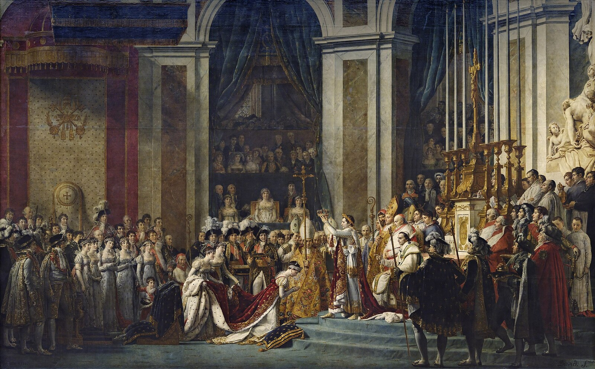
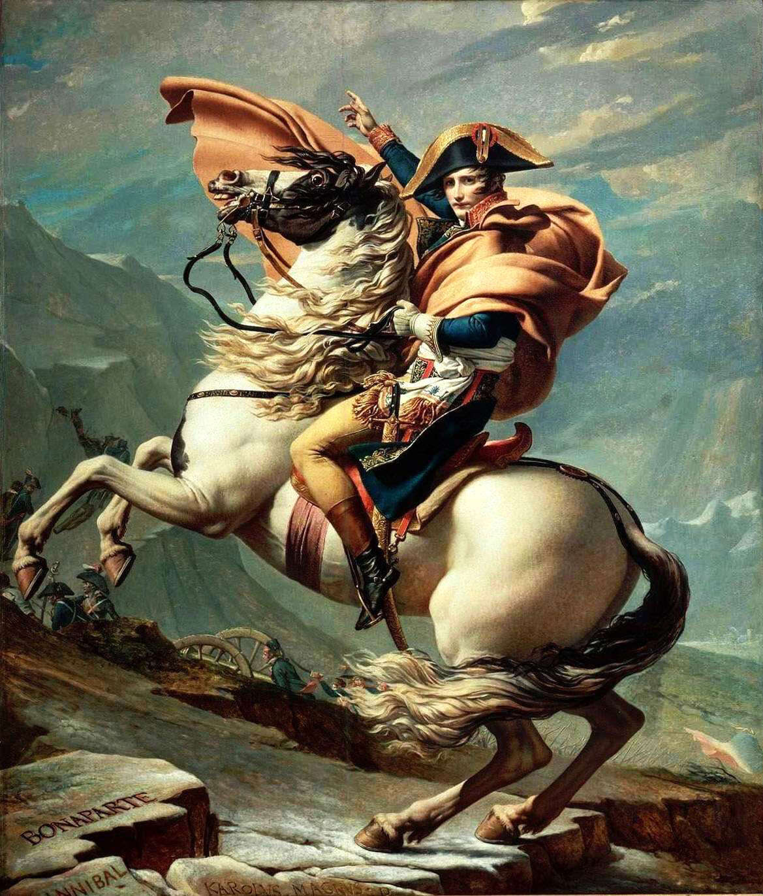
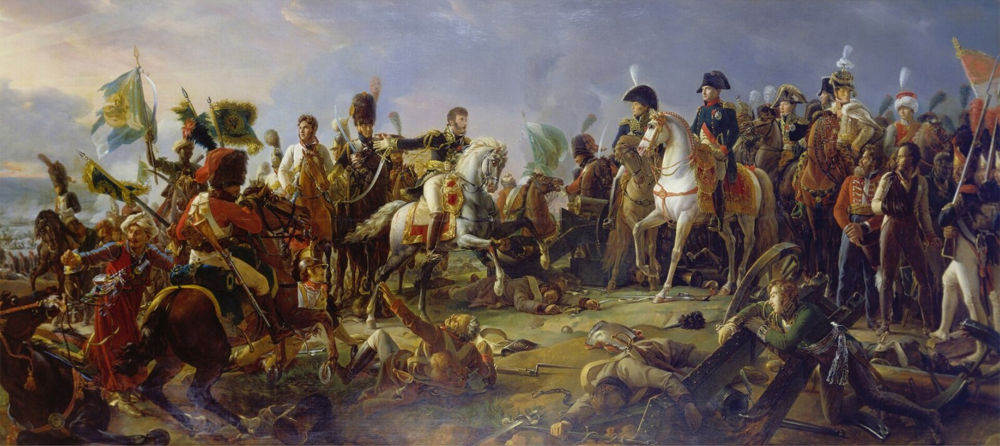
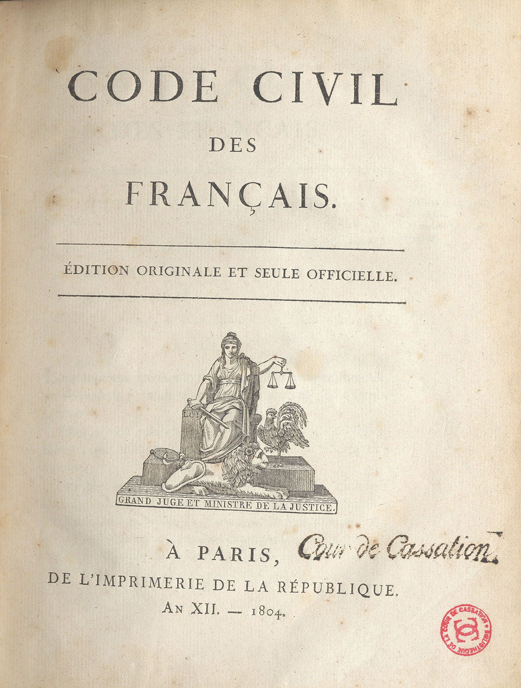
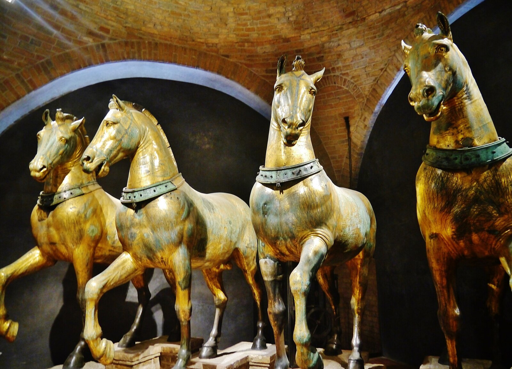
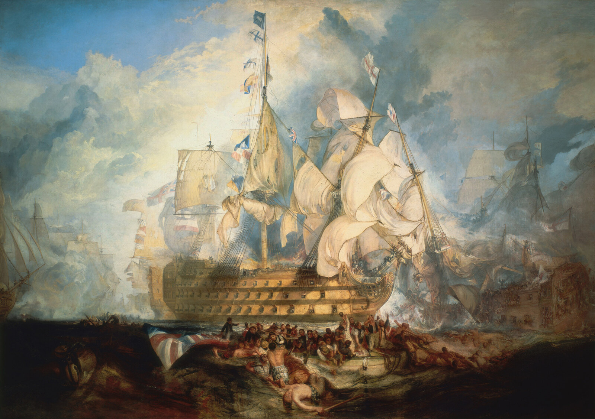
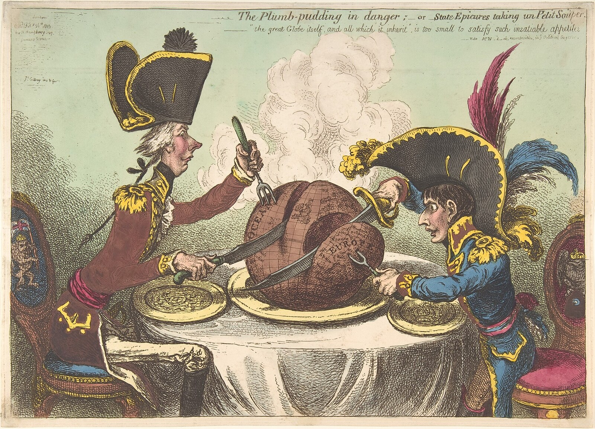
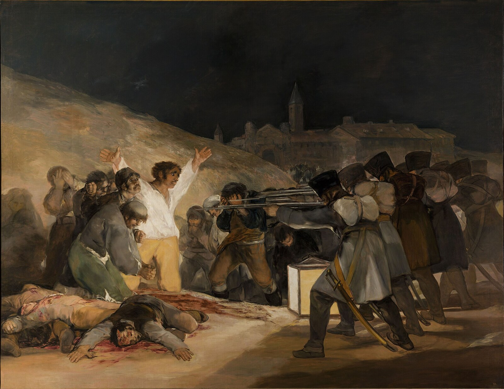
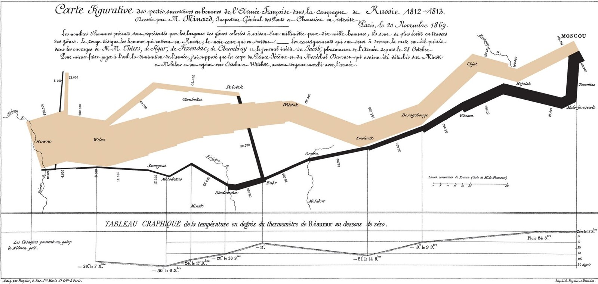
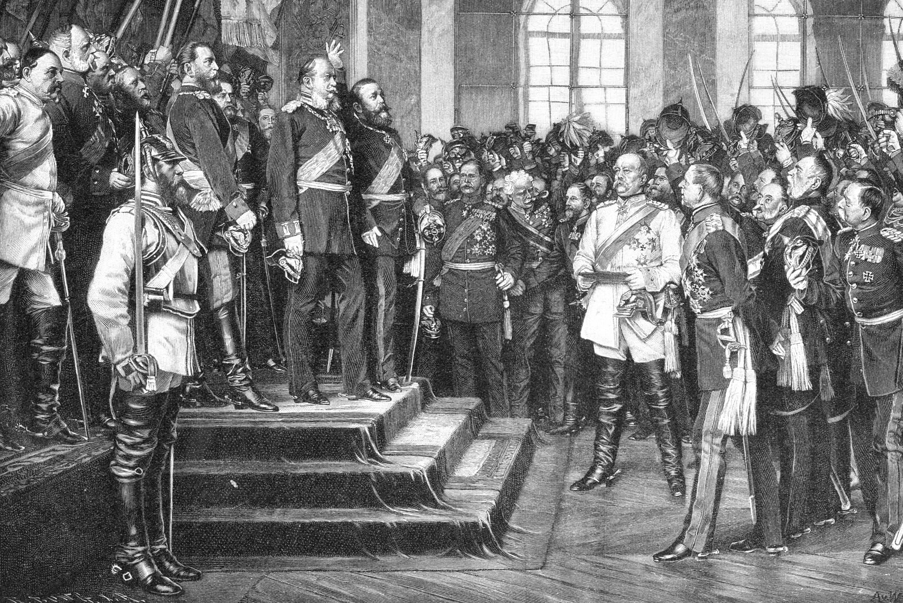

# 59. How did Napoleon conquer Europe?

*Europe, from 1793 to 1815*

Napoleon conquered Europe with the army that the French Revolution had made. It was far larger than any king's army, because a whole nation had been conscripted into it, and it was led by men who had been promoted for ability. Napoleon's own contribution was speed. He moved that army faster than his enemies thought possible, and struck before they had finished gathering.

In the autumn of 1793 the great French naval base of Toulon, on the Mediterranean, was in the hands of the British. Royalists in the town had let them in. A British and Spanish fleet lay in the harbour, and a republican army, sent to take the place back, sat outside it getting nowhere under a general who had been a painter.

The officer in charge of the army's few cannon was a captain of twenty-four, thin and sallow, with a strong Corsican accent. He studied the map and saw what his seniors had missed. They had been looking at the town, and the town itself did not matter. The British were there because of their ships, and ships need a safe place to anchor. What mattered, therefore, was a single fort on a headland across the bay, from which guns could reach the anchorage. If the French took that, the fleet would have to leave, and the town would fall by itself.

He nagged his superiors until they let him try. He collected a hundred guns from up and down the coast, built batteries closer and closer to the fort, and led the final assault on foot, taking a bayonet wound in the thigh. The fort fell in the night. Two days later the British fleet sailed away, exactly as he had predicted. Within the week the young officer was a general. His name was Napoleon Bonaparte.

## A Corsican

He had been born in 1769 on the island of Corsica, which France had bought from the Italian city of Genoa the year before. He was French by a margin of one year. His family were minor nobles with little money, and he grew up speaking the Italian dialect of the island. At nine he was sent to France on a scholarship to a military school, where the other boys laughed at his name and his accent. He was good at mathematics, and so he went into the artillery, the one branch of the old royal army in which a clever boy without connections could get on.

Under the king, the highest ranks of the army had been kept for the great noble families. The Revolution removed everything that stood in his way. Most of the old noble officers fled abroad, which left their places empty. The republic, meanwhile, was fighting all of Europe at once, and it could not afford to care who a general's father was. It promoted whoever won.

Toulon had shown that he could win, and his rise after it was quick. At twenty-six he was given command of the ragged army on the Italian frontier. In a year he drove the Austrians out of northern Italy, and sent back to Paris wagonloads of gold and paintings.

He was as good at politics as at war. A popular general is a dangerous neighbour for a weak government, and in 1799 the republic's government was despised and bankrupt. He joined a plot to overthrow it and came out of the plot as the head of state. Five years later he had himself made emperor, and the voters were asked to approve an empire that would pass to his heirs. More than three and a half million Frenchmen voted in favour, and a few thousand against.

The coronation was held in the cathedral of Paris, and the pope was brought from Rome to bless the crown. Napoleon then picked it up and put it on his own head. The gesture said that he owed the crown to no one but himself.

*The coronation of Napoleon in Notre-Dame in 1804, painted by Jacques-Louis David in 1807 as an official picture of the new empire. Napoleon holds the crown over the kneeling Josephine. Painting: Jacques-Louis David, public domain.*

He is remembered as a very short man, and he was not. He stood about one metre sixty-eight, which was a little above the average for a Frenchman of his day. The British cartoonists drew him as a tiny figure in an enormous hat, and the cartoons have outlasted the measurements.

*Napoleon crossing the Alps, painted by Jacques-Louis David about 1800 as official propaganda. The rocks in the corner are carved with the names of Hannibal and Charlemagne beside his own. Painting: Jacques-Louis David, public domain.*

## March divided

A general is only as good as the army he is given, and Napoleon was given a remarkable one. The army he inherited was the one that the emergency government had created in 1793, when it declared the whole French people in permanent service. A law of 1798 made the arrangement regular, and from then on every year a new class of young men was called up.

The result was a matter of numbers. France could put half a million soldiers in the field, and when they were killed it could replace its losses. No king could do that with hired professionals.

The army's second strength was its leadership. Its officers had risen by merit, and Napoleon kept it that way. Of the marshals who commanded his armies, one was the son of a barrel maker, one the son of an innkeeper, and one had been apprenticed to a dyer. Every private was encouraged to believe that he might do the same. In the armies of the kings, where rank went with birth, a private had little reason to believe anything of the kind.

What Napoleon added was a way of moving this mass. An army of the old kind mostly marched together, tied to a train of wagons carrying its bread. A column like that crawls, and it could cover perhaps fifteen kilometres a day.

French generals had been experimenting for decades with splitting an army up on the march. Napoleon made a system of it. He divided his army into separate bodies of twenty or thirty thousand men, called corps. Each corps was a small army in itself. It had its own infantry, cavalry and guns, and could fight alone for a day if it had to. A day was enough, because that was how long its neighbours needed to reach it.

The corps marched along different roads, a day's march apart, so that they did not clog one another. They carried little food and took what they needed from the country they passed through, and so they were free of the slow wagons that tied an old army down. In this way the whole army could move thirty kilometres a day and more, about twice the pace of an army of the old kind.

To the enemy, such an army was hard to read. It was spread across a hundred kilometres, apparently aimed at nothing in particular. A general facing it could not tell where the blow would fall. Then, on the day Napoleon chose, the corps turned inward and arrived together on the same field.

The system had its great trial in the autumn of 1805, when Austria and Russia went to war against him. An Austrian army advanced into southern Germany and waited for the Russians to come up. It seemed to have plenty of time, because Napoleon's army was on the coast of the English Channel, eight hundred kilometres away.

It did not have the time it thought. Napoleon marched his army across France and Germany in a few weeks, swung his corps in a wide arc round the Austrians, and appeared behind them, across their road home. The Austrian general, cut off, surrendered with twenty-three thousand men. The French soldiers joked that the emperor had found a new way of making war, with their legs instead of their bayonets.

Six weeks later, on 2 December, he met the main Russian and Austrian armies near a village called Austerlitz, in what is now the Czech Republic. He was outnumbered, and so he set a trap. He deliberately left one end of his line looking weak, and let the enemy see it. The weakness was an invitation. The enemy took the bait. When they marched off the high ground in the centre to attack the weak end, they weakened the middle of their own line. He then sent two divisions up the hill through the morning fog and cut their army in half. By the afternoon a third of it was dead, wounded or captured, and the rest was in flight.

*Napoleon at the battle of Austerlitz, 2 December 1805, in a painting by François Gérard made in the 19th century, a later imagining. Painting: François Gérard, public domain.*

The other powers fared no better. The following year he destroyed in a single day the army of Prussia, the strong military kingdom that ruled northern Germany from Berlin. The year after that he beat the Russians again. By 1807 every great power on the continent had either been defeated by him or had made itself his ally.

## One law

His victories redrew the map. He abolished the Holy Roman Empire, the loose federation of German states that traced itself back to the crowning of Charlemagne a thousand and six years earlier. He made himself king of northern Italy. He gave Holland to one brother, a new kingdom in western Germany to another, and Naples to a brother-in-law, and he bound the remaining German princes to France as allies.

*Europe in 1812, at the height of Napoleon's power, with the march to Moscow and the battles of 1805 to 1815. By then Holland, the North Sea coast and much of Italy had been joined to France itself. The borders are drawn roughly. Map: drawn for this book; coastlines and rivers from Natural Earth, public domain.*

The conquests changed more than borders and thrones. Wherever the French went, they brought the Revolution's reforms in their baggage. Nobles lost their legal privileges. In most places peasants were released from their dues to the lord. Church lands were sold, guilds were dissolved, and Jews were let out of the ghettos in which German and Italian cities had confined them for centuries.

Above all he brought a book. French law on property, contracts and the family had been a tangle. By 1804 four lawyers, with Napoleon himself in the chair for many of the discussions, had boiled the whole of it down into a single code, short enough to carry in a pocket and written in French that a farmer could read.

It said that all men were equal before the law, that a man's property was his own, that a job was open to anyone qualified, and that a contract was binding. It also said that a wife owed obedience to her husband. Napoleon considered it his greatest achievement, and it was imposed from Amsterdam to Naples and Warsaw. A merchant in any of those cities now lived under the same rules as a merchant in Paris.

*The title page of the Civil Code of the French, the "original and only official edition", printed in Paris in 1804. Book: Imprimerie de la République, public domain.*

For a merchant in the Rhineland or a lawyer in Milan, these were large gains, and many welcomed the French at first. The welcome wore off, however, because the gifts came with a bill. The conquered lands paid heavy taxes to support the French army. Their young men were conscripted into it.

Their treasures went the same way as their money and their sons. Churches and palaces were stripped of their paintings and statues, which went to fill the new museum in Paris. From Venice the French took the four bronze horses that had stood over the door of the great church since crusaders stole them from Constantinople, and set them on top of an arch in front of Napoleon's palace.

*The four bronze horses of Saint Mark's in Venice, ancient statues that crusaders carried from Constantinople. The French took them from Venice and set them up in Paris, and they were returned to Venice after Napoleon's fall. Photo: Zairon, public domain.*

## The whale

One enemy remained out of reach, because it lay behind the sea. In October 1805, the day after the Austrians surrendered in Germany, a British fleet under Admiral Nelson caught the combined French and Spanish fleets off Cape Trafalgar, on the coast of Spain. It captured or wrecked more than half of their ships and lost none of its own. Nelson was killed by a sharpshooter in the hour of victory.

*The battle of Trafalgar, 21 October 1805, painted by J. M. W. Turner in 1822 to 1824, many years later. It shows Nelson's flagship Victory, and combines moments from several hours of the fight. Painting: J. M. W. Turner, public domain.*

After Trafalgar, Napoleon could not cross the Channel, and Britain could not land an army big enough to face him. People at the time compared it to a fight between an elephant and a whale. Each was supreme in its own element, and neither could get at the other.

So each tried to starve the other. Napoleon forbade the whole of Europe to trade with Britain, so as to ruin what the French called a nation of shopkeepers. A country that lived by selling would be beaten, he reasoned, if nobody was allowed to buy. The ban leaked from the start. Europeans wanted sugar, coffee and cotton cloth, and smugglers supplied them. His own officials issued licences to break it when France ran short.

Britain's weapon was money. Thanks to its Parliament and its bank, the British government could borrow almost without limit at low interest, and it had invented a new tax on incomes to pay for the war. It used the money to hire allies. As a result, every time Napoleon knocked Austria, Prussia or Russia out of the war, British gold helped to bring it back in.

*"The Plumb-pudding in danger", a British cartoon of 26 February 1805. William Pitt, the British prime minister, and Napoleon carve up the globe between them, and Napoleon is drawn small. Print: James Gillray, Metropolitan Museum of Art, CC0.*

## The little war

In 1808 Napoleon made the first of his two great mistakes. Spain was his ally, and badly governed. He decided to take charge of it himself. He moved troops into the country and lured its royal family across the border into France.

On 2 May, as the last of the princes were being driven away, the people of Madrid attacked the French garrison with knives and paving stones. The French shot hundreds of prisoners the next day. Napoleon was not deterred. He forced the king to abdicate and gave the Spanish throne to his own brother Joseph. He had expected the Spaniards to be grateful for a modern government, as some Germans and Italians had been at first. Instead the revolt spread to the whole country.

*The Third of May 1808, painted by Francisco de Goya in 1814: French soldiers shoot Spanish prisoners in Madrid the day after the rising. Painting: Francisco de Goya, Prado Museum, public domain.*

The war that followed was fought in two ways at once. The Spanish regular armies won one startling victory and were then beaten again and again, without ever quite giving up. Meanwhile, bands of peasants, smugglers and priests ambushed French convoys, cut the throats of sentries and stragglers, and vanished into the hills.

Against the bands, the French had no good answer. They burned villages in reprisal, which produced more recruits for the bands. An army built to win great battles could not find the bands to fight them. The Spanish called this kind of fighting the *guerrilla*, the "little war", and the word has been used for it ever since.

Britain landed an army in Portugal to help. For six years, Spain tied down more than two hundred thousand French soldiers who were needed elsewhere. Napoleon called it his ulcer.

## A nation of Germans

Spain showed something that the rulers of Europe were slow to grasp. The French had beaten the armies of kings because French soldiers believed that they were fighting for their own country. Occupation by the French was now teaching the same feeling to everyone else. The weapon that had won the French their empire was passing into the hands of their subjects.

This was a newer idea than it sounds. Before the Revolution, a peasant in Saxony or Castile thought of himself as belonging to his village, his church and his lord. He might be handed from one king to another by a treaty or a marriage without much caring, and it would not have occurred to him that he owed his life to something called Germany or Spain. Men had fought with passion for their religion. Wars between states, by contrast, were mostly the business of kings and their paid soldiers.

The French Revolution had replaced the king with the nation: the whole people, bound together by language and history, the true owner of the country. That idea had made France strong, and it did not stay in France. A foreign army living in one's house, taking one's sons and one's horses, turned out to be a quick way of learning who was not part of one's nation.

The lesson was drawn most clearly in Germany. In the winter of 1807, in Berlin, with French troops patrolling the streets, a philosopher gave a series of public lectures addressed to "the German nation". There was no such country, only three dozen states. Nevertheless he told his audience that Germans were one people with one language and a destiny of their own, and that they must educate their children to live and die for it.

The king of Prussia, whose army had been wiped out in a day, drew the practical conclusion. If the French fought better because they were citizens, his own subjects would have to be given something to fight for. His ministers freed the serfs and opened the officer corps to commoners.

They also found a way round their conqueror. The French had limited Prussia's army by treaty, so the ministers passed recruits through the ranks in quick rotation. A man was trained and sent home, and another took his place. In this way the army stayed small while a trained reserve built up behind it, and when the moment came in 1813 they called the whole male population to arms. If the French owed their strength to being a nation of citizens, the kings would have to make nations too.

## Moscow

The second mistake was Russia, and it grew out of the ban on British trade. The tsar had made peace in 1807 and promised to join the ban. By 1811 Russian ports were open to British goods again, and Napoleon decided to force him back into line.

In June 1812 he crossed the Russian frontier with the largest single army that Europe had ever seen. Counting the reserves that followed, about six hundred thousand men went in. Little more than half were French. The rest were Germans, Poles, Italians, Dutchmen and others, conscripts of the lands he ruled. It was the army of an empire, not of a nation.

His method depended on two things: a quick, decisive battle, and feeding the army from the country. The Russians gave him neither. Apart from one fight for a burning city on the way, they retreated for a thousand kilometres, destroying the crops and villages as they went. The great army, too large to feed in an empty land, began to fall apart from hunger and typhus within weeks.

In September the Russians turned and offered battle at a village outside Moscow, in the bloodiest single day of the whole twenty years of war. About seventy thousand men were killed or wounded. It was a battle, but it was not decisive. The Russians withdrew in good order, which meant that the tsar still had an army. A week later Napoleon rode into Moscow.

The city was empty, and that night it began to burn. Napoleon sat in the Kremlin for five weeks, waiting for the tsar to ask for terms. The tsar did not answer his letters. Napoleon had taken the enemy's capital, and the enemy had simply declined to stop fighting. In the middle of October, with winter coming and no peace in sight, the army turned for home.

The retreat is one of the great catastrophes of military history. The snow came early in November. Men froze at night around their fires, horses died by tens of thousands, and Russian horsemen picked off the stragglers. Of the six hundred thousand who had gone in, about a hundred thousand came out.

*Charles Minard's chart of 1869 of the army in Russia. The tan band is the army marching to Moscow and its width shows its numbers. The black band is the retreat, and the line beneath is the temperature. Chart: Charles Minard, public domain.*

## The hundred days

Most of Europe now turned on him. Prussia, with its new citizen army, changed sides, and Austria followed. The method that France had invented was now being used against it. In October 1813, near the German city of Leipzig, half a million men fought for four days in what was called the battle of the nations, and Napoleon was beaten. The allies entered Paris the next spring. His own marshals told him that it was over.

The victors sent him to rule the small Italian island of Elba, and put a brother of the guillotined king on the throne of France. Ten months later Napoleon slipped away with a thousand men and landed on the French coast. The regiments sent to arrest him went over to him one after another, and he reached Paris without firing a shot.

His second reign lasted a hundred days. The powers that had beaten him were gathering their armies again, and his best hope was to deal with them separately. In June 1815, therefore, he marched into Belgium to strike the British and Prussian armies before the Russians and Austrians could arrive.

On the eighteenth he attacked the Duke of Wellington's army of British, Dutch and German troops on a ridge near the village of Waterloo. Wellington's line held all afternoon against his cavalry, and meanwhile the Prussians arrived and struck the French on their flank. The French army broke and ran. Four days later Napoleon gave up his throne for the second time, and soon afterwards he surrendered to the captain of a British warship.

This time the British took no chances. They shipped him to Saint Helena, a rock in the South Atlantic nearly two thousand kilometres from the coast of Africa, and he died there six years later, dictating his memoirs. The wars that carry his name had killed about a million French soldiers and at least two million other people.

## What stayed

The kings and ministers who met in Vienna to put Europe back together wanted the old world restored. They returned the Bourbons to France, the pope to Rome and the four horses to Venice. They arranged the powers in a careful balance, and the balance held well enough that there was no general European war for ninety-nine years.

Thrones and statues could be put back. What people had learned could not. The code stayed in force in France, Belgium and the Rhineland, where the people who lived under it would not give it up, and the Dutch and the Italians, after a spell under the old laws, wrote new codes on its model. It was later borrowed from as far afield as Egypt and Japan.

The idea of the nation spread further still. Greeks, Belgians, Poles, Italians and Hungarians all rose in its name over the following decades. The new kind of army spread with it. The great powers of the continent all adopted conscription sooner or later, since a land army of paid volunteers could no longer face a nation in arms.

Prussia learned the lesson best. In the summer of 1870 its conscript army, moved by railway, destroyed the main French armies in six weeks. The following January the king of Prussia was proclaimed emperor of a united Germany in the palace of the French kings at Versailles, in the Hall of Mirrors, while his guns were still shelling Paris.

*The proclamation of the German Empire in the Hall of Mirrors at Versailles on 18 January 1871, in a printed copy of a painting by Anton von Werner, made later. Print: after Anton von Werner, public domain.*
