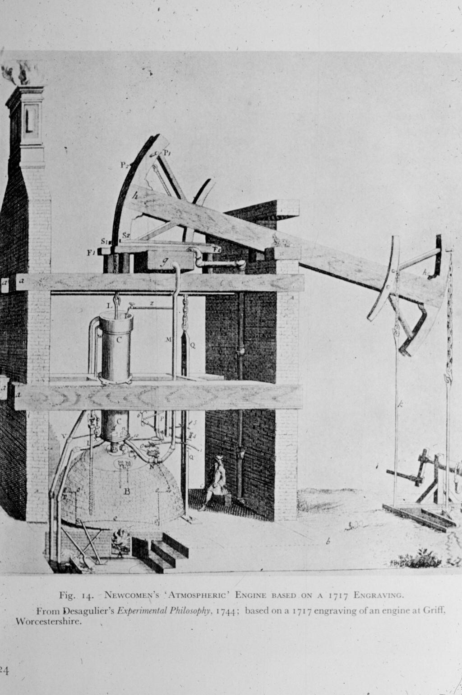
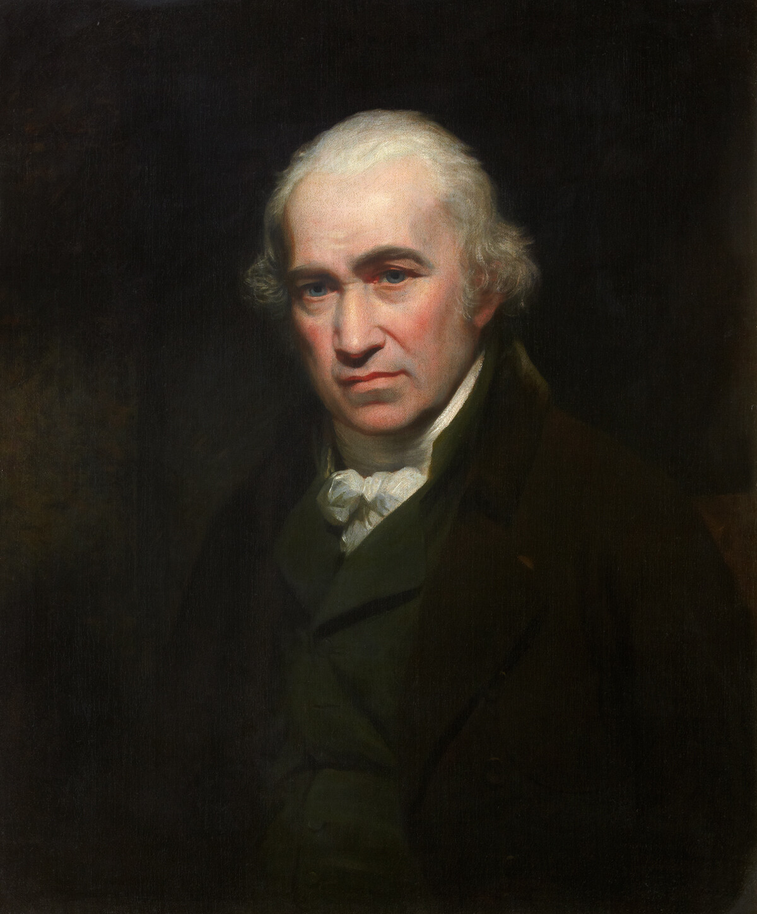
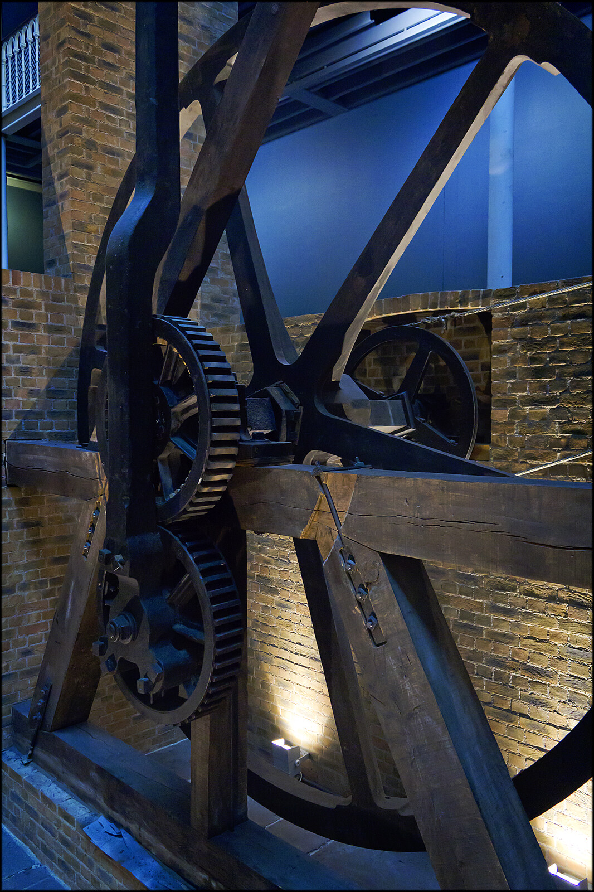
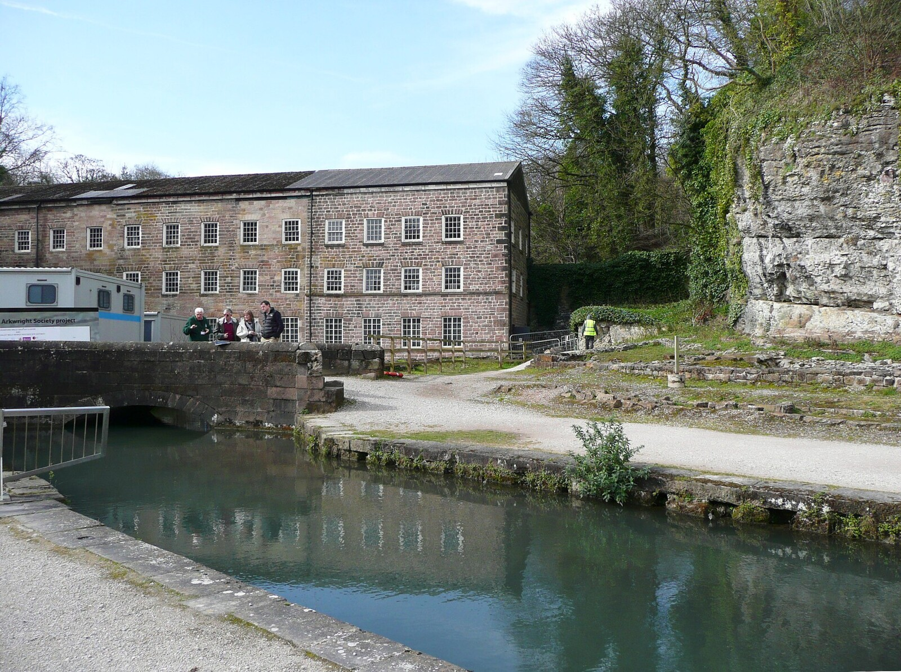
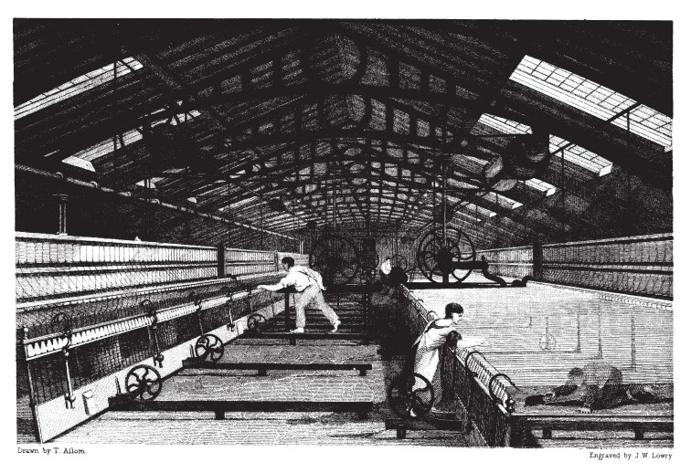
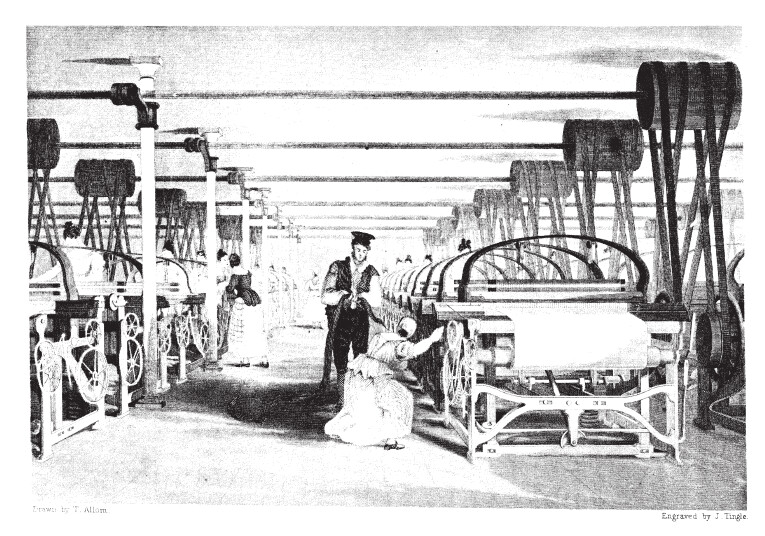
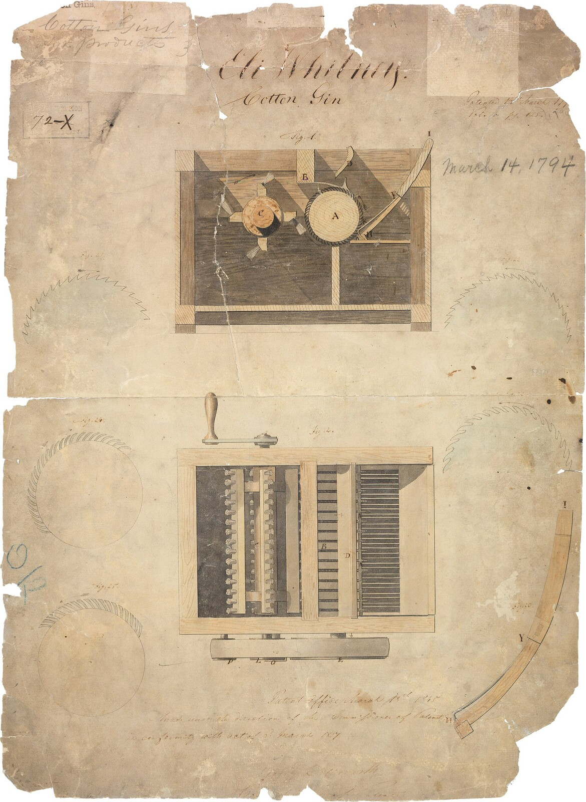
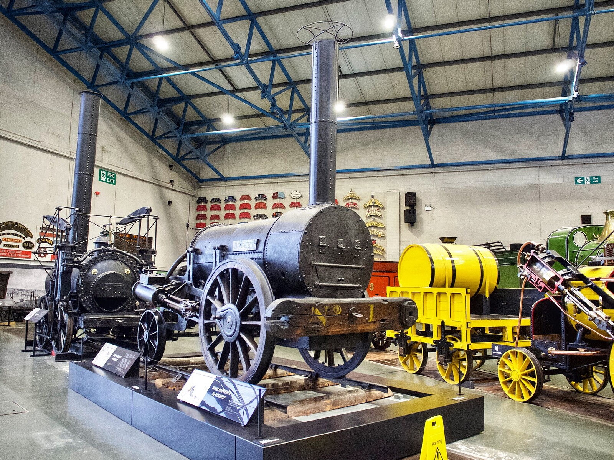
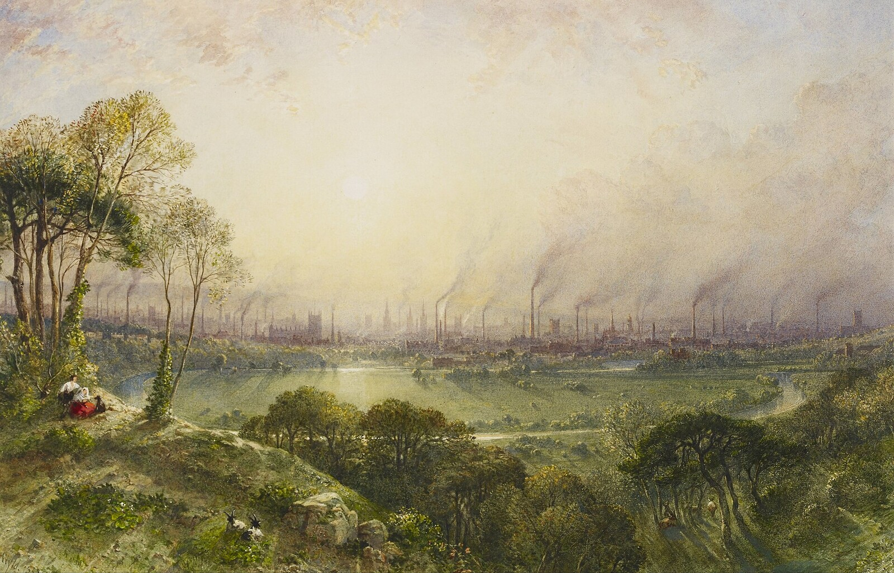

# 61. Why did the Industrial Revolution begin in Britain?

*Britain, from about 1700 to 1850, with links to the American South and India*

It began in Britain because several things met there in one place: coal that was cheap and close at hand, wages high enough to make a machine worth building, a crowd of skilled mechanics, and an empire's worth of cotton and customers. Other countries had one or two of these. Historians still argue about which mattered most.

In 1712 an ironmonger named Thomas Newcomen built a machine beside a coal mine near Dudley Castle, in the English Midlands. It was the size of a house. It boiled water, and used the steam to rock a huge wooden beam up and down, about a dozen times a minute, pumping water out of the mine.

By any sensible measure it was a terrible machine. Of every hundred shovelfuls of coal fed into the early engines, ninety-nine did nothing but warm the sky. Almost anywhere else on Earth it would have been a joke. At a coal mine it was a bargain, because a mine is surrounded by heaps of small, broken coal that is hard to sell to anyone.

That is how the age of steam began: with a machine so wasteful that it was mostly useful to the people digging up its fuel. For more than a century afterwards, waterwheels still did more of Britain's work than steam did. And yet the clanking pump beside Dudley Castle marks the moment when one small corner of humanity began to slip out from under a limit that had held human societies since the first farmers.

## Ninety-nine shovelfuls

The mine needed the engine because mines fill with water. Rain soaks into the ground and seeps down through the rock, and a pit is a hole for it to collect in. As the easy coal near the surface was used up, miners dug deeper. Deeper meant more water to lift, and further to lift it.

The usual answer was horses. A horse walked round and round in a circle, harnessed to a beam that turned a drum, and the drum wound up chains of buckets from the bottom of the shaft. It worked, but it was costly. A horse has to be bought, fed, housed and replaced, and it eats every day whether the water is high or low. A big mine might keep dozens of them plodding in circles.

Notice what a horse is. It is a machine for turning grass and oats into pulling. And grass and oats are sunlight, caught by leaves in a field over the last year or two.

Step back from the mine, and that is true of almost everything people did before Newcomen. For nearly all of history, humans lived on recent sunlight. Bread is sunlight that wheat stored last summer. A carthorse runs on hay and oats. Firewood is sunlight a tree has packed away over a few decades. Even wind and falling water are the sun's work, since the sun heats the air into wind and lifts the rain that fills the rivers. The muscles of a farmer, the fire in a blacksmith's forge, the sails of a windmill: all of it was powered by plants and weather of the recent past.

This put a ceiling over every society. The sunlight that falls on a country each year is fixed, and most of it can only be caught by plants growing on land. A field could grow wheat for people, or oats for horses, or trees for fuel. It could not grow all three at once. When a country grew richer and more crowded, its needs began to fight over the same acres. More bread meant fewer forests. More iron, smelted with charcoal, meant cutting more forests. Sooner or later food and fuel grew dear, and growth slowed. However rich a society became, this invisible roof was somewhere above it.

England had already started to cheat. Under its fields lay coal, which is sunlight too, but very old sunlight: the remains of swamp forests that grew unimaginably long ago, long before there were people, and were squashed into rock. Burning a ton of coal releases the stored energy of a large patch of ancient forest, without using an acre of today's land.

By 1700 London was heating itself with coal shipped down the coast from Newcastle, and coal already supplied about half of all the energy used in England and Wales. The country was digging roughly three million tons a year. So by the time Newcomen came along there was a large coal industry, and it had a water problem.

The engine served a business that already existed. What was new was what it did with the coal. People had burned coal for centuries to warm rooms and feed furnaces. Heat could cook a meal or melt a metal. Making heat lift and push, steadily, all day and all night, was something almost no one had managed.

Newcomen's engine managed it in a roundabout way. A boiler at the bottom, rather like a giant copper kettle, makes steam. The steam rises into a tall upright cylinder, a bit like a huge bicycle pump standing on end, and fills the space under a piston. Then a jet of cold water is sprayed inside. The steam turns back into a few drops of water, and since water takes up far less room than steam, it leaves almost nothing behind it. There is now a partial vacuum under the piston.

*A Newcomen engine: boiler below, cylinder above it, and the great rocking beam on the right. From a 1744 book, after an engraving of 1717 of an engine at Griff, Warwickshire. Public domain.*

Above the piston is the ordinary air of the engine house, and air is heavy. We do not notice its weight because it presses on us from every side. But with almost nothing pushing back from below, the weight of the air shoves the piston down hard. The piston is chained to one end of a great wooden beam balanced in the middle like a seesaw. As that end comes down, the other end rises, lifting the long rods that work the pumps at the bottom of the mine. Then steam is let in again, the heavy pump rods pull their end of the beam back down and the piston back up, and the whole thing repeats.

The point to hold on to is that the steam does not push. The atmosphere does. Steam is used only to make an empty space, and the sky does the work.

The flaw is built into the design. Every stroke, the cold spray chills the whole iron cylinder. The next puff of steam has to heat it up again before it can fill it, and most of that steam simply turns back into water on the cold metal. The engine spends nearly all its fuel warming and cooling itself.

Newcomen was not a scholar. He was a dealer in iron goods from Dartmouth in Devon, who worked with a partner, a plumber and glazier. Neither was a member of any learned society.

The learned societies had, in fact, been busy with the right questions. In the 1640s an Italian experimenter showed with a tube of mercury that air has weight. "We live submerged at the bottom of an ocean of air," he wrote. A German experimenter fitted two metal half-spheres together, pumped the air out from between them, and showed off that teams of horses could not pull them apart. A French scientist built a small model in 1690 in which condensing steam made a vacuum under a piston.

Did Newcomen know any of this? Nobody can say. He may have read about the experiments, or heard of them, or worked it out with his hands. The engine runs on air pressure whether its builder understood air pressure or not.

What is clear is that the science of heat as a source of work came afterwards. The rule for how much work heat can possibly do, which depends on how hot an engine runs and how cool its exhaust is, was worked out in the following century, by people studying steam engines that were already running. The usual picture has scientists discovering a law and engineers applying it. Here it went the other way. The machine came first, and the theory followed, trying to explain why it worked so badly.

## What all the world desires

Badly or not, it sold. Around a hundred Newcomen engines were built in the first twenty years, and about six hundred by 1775. Most of them stood at coal mines, where their appetite cost little, because they ate the small coal that the miners could not easily sell.

But there was one place where the waste really hurt. In Cornwall, at the far south-western tip of Britain, men dug for tin and copper. These mines flooded too, and they were deep. Cornwall, however, has no coal. Every ton the engines burned had to come by sea from Wales. A machine that threw away ninety-nine parts of its fuel was a heavy bill there, and the Cornish mine owners would have paid well for a better one.

The better one began with a toy. In the early 1760s the University of Glasgow gave a model Newcomen engine to the instrument maker who looked after its scientific equipment, and asked him to repair it. His name was James Watt.

*James Watt, painted by William Beechey. Public domain.*

Watt got the model going, and was struck by how much steam it swallowed. A small engine could barely keep itself running. He worked out why. Every stroke, the spray of cold water cooled the cylinder, and the next charge of steam wasted itself heating the cylinder back up. It was like warming an oven, throwing a bucket of cold water into it, and warming it again, for every single loaf.

In 1765 he saw the answer. Do the cooling somewhere else. Watt added a second, separate chamber, joined to the cylinder by a pipe and kept cold all the time. When the steam had filled the cylinder, a valve opened, the steam rushed into the cold chamber, and it condensed there. The vacuum still formed under the piston, and the piston was still driven down into it. But the cylinder itself was never chilled. It could be kept hot, even wrapped to keep the heat in, and fresh steam no longer had to warm it up each time.

Making the idea work took about ten years. Watt patented his condenser in 1769, but his engines would not hold their vacuum. A piston has to fit its cylinder closely, and the craftsmen of the day could not bore a large iron cylinder truly round. Steam and air slipped through the gaps.

The cure came from war. Cannon-makers had long bored out the barrels of guns, and in 1774 an ironmaster who made cannon built a new boring machine whose cutting tool was held firmly at both ends instead of poking in from one side. It cut a cylinder round and straight along its whole length. Watt's pistons at last fitted their cylinders.

By then Watt had found a partner. Matthew Boulton was a Birmingham manufacturer with money, a large works and a salesman's gift. In 1775 they went into business together. When James Boswell, the biographer of Samuel Johnson, visited Boulton's works, Boulton told him: "I sell here, Sir, what all the world desires to have—POWER."

What he actually sold was savings. Boulton and Watt engines used roughly a quarter to a third of the coal of an ordinary Newcomen engine doing the same work. So instead of simply charging for the machine, the partners asked for a share of the difference: each year, a third of the value of the coal the customer had not burned. It was a fee measured in fuel that never went into the fire. A mine owner who burned little coal had little reason to sign. A Cornish mine owner, buying coal by the shipload, had every reason, and Cornwall became Watt's first big market.

Watt had reduced the waste greatly. He had not ended it. His engine still turned only about two parts in a hundred of the coal's energy into work. But it was enough to make steam worth paying for in places that had to buy their fuel.

There was still one strange limit. For seventy years after Dudley Castle, the steam engine did one thing: it rocked a beam up and down. That suits a pump perfectly, and almost nothing else. A few mill owners found a roundabout way to use it. They set an engine to pump water from below their waterwheel back up to the millpond above it, so that the same water could fall over the wheel again. The engine did not drive the mill. It refilled the river.

In the early 1780s, pushed by Boulton, who could see a much bigger market, Watt adapted his engine to turn a shaft round and round, the way a pedal turns a bicycle wheel. Now a steam engine could drive machinery directly.

*The sun-and-planet gear that Watt patented in 1781, which turned the beam's up-and-down rocking into a spinning shaft, in the National Museum of Scotland. Photo: dun_deagh, CC BY-SA 2.0.*

But what machinery? Wheels had been turning in Britain for centuries, in corn mills and forges, driven by water, wind and horses. One new kind of machine was about to want more turning than all of them, and it came from a quite different direction: a fashion for Indian cloth.

## A river in a valley

For a long time, the finest cotton cloth in the world came from India. Indian spinners could draw cotton into thread so fine that muslin from Bengal could be almost transparent, and Indian printers could stamp bright, washable patterns onto calico that held their colour. When this cloth began to reach Britain in large amounts, Britons went mad for it. It was lighter than wool, cheaper than silk, and far more cheerful than either.

The wool and silk trades were not cheerful at all. They lobbied Parliament, and in the early 1700s Parliament banned most printed cotton cloth. Lancashire's mixed cloth, made of linen and cotton woven together, stayed legal.

The ban did not kill the taste for cotton. Instead, with the printed cloth banned and the customers still wanting it, the ban gave British makers a reason to try to produce it themselves. They set out to copy a product that India made better, and for a long time cheaper.

The hard part was thread. Raw cotton is a fluffy mass of short fibres. To turn it into thread you draw the fibres out into a thin strand and twist it, so that the fibres grip one another. For thousands of years this was done by hand, one thread at a time, on a spindle or a spinning wheel, mostly by women in their homes. It was slow, and weaving waited on it.

In the 1760s and 1770s a run of inventions broke the bottleneck. The first, the spinning jenny, let one person at a hand-turned frame spin several threads at once. The most important was built by Richard Arkwright, a man with a sharp eye for a business. His machine drew the cotton through pairs of rollers, each pair turning faster than the one before, so the strand was stretched thinner at every step, the way you might pull a piece of soft toffee between your hands. A turning spindle then twisted the strand into thread and wound it on. The machine needed no skilled fingers. It needed a source of power and someone to mend the threads that broke.

Arkwright found his power in water. In 1771 and 1772 he built a mill at Cromford, in a steep valley in Derbyshire, where a stream turned a waterwheel. The wheel drove hundreds of spindles at once, through shafts and belts that ran up through the building. The mill worked day and night in two twelve-hour shifts. Many of the workers were children, hired because they were cheap, and everyone worked to the clock and to the speed of the wheel.

*Arkwright's first mill at Cromford in Derbyshire, built in 1771, beside the stream that turned its waterwheel. Photo: Humphrey Bolton, CC BY-SA 2.0.*

Cromford was not the first factory of any kind. A silk mill at Derby had used water power to drive machines decades earlier. But Cromford set the pattern for cotton: one big building, one power source, many machines, and many workers kept to a timetable. Arkwright built more mills, was widely copied, and grew very rich.

A few years later came the spinning mule, which combined ideas from the jenny and Arkwright's machine and could make finer thread. Unlike Arkwright's machine, however, the early mules were still run by skilled spinners.

*A mule-spinning room, engraved for Edward Baines's History of the Cotton Manufacture in 1835. A spinner walks beside the carriage while a small figure crawls on the floor at the right. Public domain.*

The result, over the next two generations, was astonishing. In 1780 it took about 2,000 hours of a worker's time to spin a hundred pounds of fine cotton thread. By 1825 it took about 135. That is the difference between a year of full-time work and three or four weeks.

So the cotton factory was invented, and it was invented without steam. It ran on a river.

## Leaving the river

Around 1800 most mills in Britain still turned on water. Steam engines supplied only about a fifth of the power installed in British mines and workshops. Steam did not catch up with water until about 1830, and it did not become the normal source of power across the economy until the 1840s.

There was a simple reason for this. Water was often the cheaper of the two. A waterwheel eats nothing. Once the dam and the channel were built, the river did the work for free, while a steam engine burned money every hour it ran.

But a river is where it is. It runs through a valley, usually in hilly country, usually far from any town. A mill owner who wanted to use it had to build there, and then find workers there, which often meant building cottages, a shop and a chapel, and bringing in families, or children, from far away. The river was low in a dry summer and frozen in a hard winter, and the wheel slowed or stopped. And it was shared. The mill upstream could hold back water, and the mill downstream could quarrel about it.

A steam engine had few of these problems. It needed coal, and some water for its boiler and for cooling, and with those it could be set down almost anywhere. That included the middle of a town full of people who needed work. It ran in August and in January. It ran when the owner chose, as fast as the owner chose, for as long as the owner chose.

All of this depended on getting coal to the engine. Coal could now be brought almost anywhere. In 1761 a duke with coal mines near Manchester opened a canal to carry his coal into the town, and within a year the price of coal in Manchester fell by about half. Canals spread across northern England. A barge pulled by a single horse could carry what dozens of packhorses had carried, and coal travelled cheaply to wherever the engines were.

Manchester shows how it came together. It was already a cloth town long before steam, the trading centre for the spinners and weavers of the surrounding countryside. But the land around it was poor in good water sites. When the cotton boom came, Manchester's mill owners turned to engines, and from about 1820 the steam engine became the normal power source for cotton mills in general. The town grew from about 23,000 people in the 1770s to about 300,000 by 1851. Its mills stood many storeys high in rows along the canals, each with a tall chimney, and the smoke hung over it so thickly that visitors came from all over the world to stare.

Was there another way? Engineers thought so. A Scottish engineer who ran a water-powered cotton mill showed what could be done. In the 1820s he built a great reservoir in the hills above the port of Greenock, on the Clyde, with an aqueduct several miles long to bring its water down. The water turned wheels that drove a paper mill, cotton and woollen mills, sugar refineries and an iron foundry. James Watt himself had once said such a scheme was impractical.

Similar plans were drawn up for the rivers around Manchester, with reservoirs to store winter rain and release it steadily through the summer. The largest were never built. They would have required mill owners to cooperate, plan together, share the cost and share the water. One historian has argued that this was exactly what they did not want. Steam cost more, but with an engine of his own each owner could do as he pleased.

Imagine that the reservoirs had been built. Water could almost certainly have carried cotton further than it did. Britain's hills are wet, and there was more water power to be had than anyone used. Lancashire might have become a land of mills in valleys, linked by canals, for decades longer. But a waterwheel cannot be put on wheels. It cannot pull a train or drive a ship across an ocean. Engines can burn wood, and iron can be smelted with charcoal, but only by eating forests, which leads straight back to the old ceiling. A world of railways and ironworks on any scale was going to want what was in the coal. The mill owners only took that road sooner.

## One thread, four lives

Follow a single thread of cotton around 1850, and it runs across half the world.

It begins as a white boll in a field in the American South. It is picked, cleaned of its seeds, pressed into a bale, and shipped across the Atlantic to Liverpool. From there it goes by rail or canal to a mill in or near Manchester, where it is spun into thread and woven into cloth. Then much of that cloth is shipped out again, to Europe, to the Americas, to Africa, and to India.

*The thread of cotton about 1850: raw cotton from the American South to Liverpool, and cloth from the mills around Manchester out again to the world. The cotton fields are drawn roughly, and the sea routes show where the goods went, not the ships' tracks. Map: drawn for this book; coastlines and rivers from Natural Earth, public domain.*

Four people stand along that thread. They would never meet. Each lived the way they did partly because of the others.

The first is a child in a mill. Matthew Crabtree started work at the age of eight, a little before 1820, in a woollen mill in Yorkshire that made blankets. It was not a cotton mill, but the hours and the discipline were of the same kind. He lived two miles from the mill. In ordinary times he worked from six in the morning until eight at night, with an hour off at noon. When trade was brisk, he worked from five in the morning until nine.

The machines set the pace. The overseer in charge of a group of children had to keep up with the machine or be blamed himself, so he kept the children up to the machine too, and when they grew drowsy towards the end of the day he used a strap. Asked what happened when he arrived late, Crabtree said: "I was most commonly beaten."

He told this in 1832, as a young man of twenty-two, to a committee of Parliament that had been assembled to make the case for a shorter working day. The questions were chosen to bring out stories like his. That does not make the stories false. It means they were selected, as evidence in politics usually is.

The second is a handloom weaver. He is a skilled man who works at home, with a wooden loom that fills most of his cottage, and his wife and children wind the thread and help with the work. At first the spinning machines were wonderful for him. Suddenly there was more thread than there had ever been, and it all needed weaving. Around 1800 a good weaver could earn far more than a labourer, and people later called those years the weavers' golden age.

Good pay drew people in. By about 1820 there were around 240,000 handloom weavers working in cotton. That was the problem. Too many weavers, and years of bad trade, drove the price of weaving down. A weaver who earned about twenty shillings a week in 1806 earned about six by 1830, while a factory hand earned about ten.

The power loom, which had been invented in the 1780s but did not work well until the 1820s, finished the job. By 1850 only forty or fifty thousand handloom weavers were left. They had not been beaten by a machine in a single blow. They had been starved by a crowd of other weavers first, and the machine came to clear away what remained.

*A power-loom weaving shed, engraved for Edward Baines's History of the Cotton Manufacture in 1835. Belts from overhead shafts drive every loom. Public domain.*

The third person is enslaved. In 1793 an American named Eli Whitney built the cotton gin, a hand-cranked machine that tore the fibre away from the sticky seeds of the kind of cotton that grew well across the inland South. Cleaning that cotton by hand had been so slow that it hardly paid to grow it. With the gin, it paid enormously.

As a result, the mills' hunger for raw cotton was felt in the fields of another continent. American cotton output rose about a thousandfold between 1790 and 1860, and planters moved west, onto new land, taking enslaved people with them. By 1830 about four-fifths of the raw cotton reaching Britain came from the United States. Most of the cotton Lancashire spun by the middle of the century was grown by enslaved people.

*Eli Whitney's patent drawing of the cotton gin, dated 14 March 1794. Public domain.*

Solomon Northup was a free Black man from New York who was kidnapped and sold into slavery, and spent twelve years on plantations in the South. He described cotton picking in a book published after he won his freedom. Each picker had a sack hung from the neck and a basket at the end of the row. At night the cotton was carried to the gin-house, the building where it was cleaned, and weighed. An ordinary day's work was two hundred pounds, and a picker who brought in less was whipped. One who brought in more was likely to find the next day's quota raised to match. He wrote that "a slave never approaches the gin-house with his basket of cotton but with fear."

The fourth stands in India, and is really two people: a spinner, perhaps a woman spinning at home in Bengal, and a weaver, whose family had made cloth for generations. Their trade had once dressed much of the world. The British machines turned it around within a few decades. In the 1790s India sent Britain more than two million pieces of cotton cloth a year. By the 1830s it was sending fewer than 300,000. Bengal's export trade to Britain all but vanished.

The losses spread to India's home market more slowly. Indian weavers kept supplying most of India's own cloth until at least the 1860s. But British machine-made thread and cloth took a growing share, about a third of the market by the late 1850s, and the hand spinners, whose work was easiest for machines to replace, felt it first. India, which had taught the world to love cotton, became a customer for the cloth made from it.

Taken all together, Britain's own workers, the ones the factories were supposed to enrich, had to wait a long time.

For the first two generations of the factory age, ordinary British workers did not clearly gain. Between 1780 and 1840 the output of the average British worker rose by nearly half. Over the same years real wages, meaning what a day's pay could actually buy, rose by about an eighth. The extra wealth went mostly to profits. Factory owners, merchants and landlords grew rich. The workers who tended the machines found that each of them was making much more, while being paid little more. One economic historian named this long stall "Engels' pause", after Friedrich Engels, the young German who wrote a famous and furious description of working-class life in Manchester in the 1840s.

The bodies of the people tell the same story. In the crowded core of Manchester around 1840, a newborn baby could expect, on average, to live only between twenty-five and twenty-eight years. That average counts every child who died in its first years, and there were a great many. The towns were filthy, overcrowded and full of disease. Average heights in Britain fell for children born from about the 1820s and 1830s, a sign of too little food and too much sickness, and they did not recover until after the middle of the century.

Some historians think wages rose faster than these figures suggest. But the heights and the deaths point the same way as the wage numbers. The gains came, and they were real. Between 1840 and 1900 real wages more than doubled. But they came to the grandchildren of the people who had worked the first mills.

## Coal was not enough

Why did all this happen in Britain? It is one of the great puzzles of history, because Britain was not the obvious candidate.

Song China, seven centuries earlier, had coal and iron, printing and great markets. Its ironworks, by some estimates, turned out iron on a scale England would not reach for centuries. India made the best cotton cloth in the world. France was larger than Britain, and full of scientists. The Netherlands was the richest and most commercial country in Europe in the 1600s. Any of them might have gone first. None did.

Historians do not agree on why. There are several big answers, each with something to it.

The first is about prices. In eighteenth-century Britain, labour was expensive and coal was cheap. A machine that swapped coal for human work therefore paid in Britain before it paid in most other places. In China or India, where labour was cheap, an engine or a spinning mill would have cost more than the people it replaced. And building any new machine takes years of costly trial and error, which only makes sense where the finished machine will pay. The objection is that the people the spinning machines replaced were not well-paid men but women and children, who were paid very little. Defenders of the idea reply that nobody really knows how many hours those spinners worked, so nobody can be sure what their time was worth.

The second is about people. Britain was full of tinkerers: smiths, clockmakers, millwrights, instrument makers, men who could file a valve, mend a gear and turn a rough idea into something that ran. Many of them shared a confident belief, spread through books, lectures and clubs, that nature could be understood and put to use. Newcomen and Watt were both of this type. The objection is that the new science was found all over Europe, and most of the cotton inventors had little to do with it.

The third is luck of geography. Britain's coal lay close to its industry and close to the sea and rivers, so it was cheap to move. Its wet mines gave it a reason to invent the steam engine in the first place. China's largest coalfields lay in the far north and west, a long way from its richest region around the mouth of the Yangzi.

Geography helped in a second way, because Britain could draw on land overseas. The cotton from America, the sugar from the Caribbean, and the timber from Canada would have taken millions of acres of British land to replace. If Lancashire's mills of 1830 had had to use wool instead of cotton, Britain would have needed some twenty million more acres of sheep pasture, which is more than all its farmland in crops.

The fourth is about rules. After a revolution in 1688, Parliament put firm limits on the king. Property was fairly safe from seizure, and over the next half century the government came to borrow cheaply, because lenders trusted it to pay. A country like that encouraged people to invest and build. The objection is that the Dutch had much of this earlier, and they did not build the first factories. More than eighty years also passed between 1688 and Cromford.

The fifth is empire and slavery. Britain's empire, and the Atlantic slave economy it traded with, brought profits from sugar plantations, captive markets for British goods, a flood of slave-grown cotton, a navy to protect the trade, and tariffs to keep Indian cloth out of Britain. The objection is that the profits were modest beside the whole British economy, a few percent of the national income. Supporters answer that they were large beside the amount actually invested in industry, which is what matters for building mills. A second objection is that other empires had colonies without factories. Spain ruled a vast empire and did not industrialise first.

Each of these ideas explains something, and none of them explains everything. Coal was necessary, but plainly not sufficient, since China had coal and did not build steam engines. Cheap coal and dear labour gave a reason to build the machines, but someone had to be able to build them. Tinkerers needed a market for what they made, and the market was an empire's worth of cotton and customers. Britain had all of these, in the same place, at the same time. That combination was rare.

People sometimes argue about whether history is driven by what lies in the ground or by what goes on in human heads. Britain's case suggests the question is badly put. Without the coal, the tinkerers would have had only wood to burn, and not enough of it. Without the tinkerers, the coal would have gone on warming houses and feeding furnaces, as it did in China, and never turned a wheel.

## The burning that did not stop

Once the engine could turn a wheel, it was only a matter of time before someone put it on wheels. The early locomotives were built for coal. A railway opened in the north-east of England in 1825 to carry coal from the pits to the river, with steam engines pulling the wagons. Five years later, in 1830, the Liverpool and Manchester Railway became the first line to link two cities with steam trains running to a timetable. It carried goods and passengers between the port and the mills.

*Stephenson's Rocket, built in 1829, in the National Railway Museum at York. The Liverpool and Manchester Railway opened in 1830. Photo: Malcolmxl5, CC0.*

From then on, coal multiplied. Britain dug roughly three million tons in 1700. By 1850 it was digging somewhere between forty and fifty million, and the curve was still climbing. Coal ran the mills, the trains, the steamships and the ironworks. Cotton cloth became Britain's largest export, close to half of everything the country sold abroad.

Something deeper had changed. For the first time in history, a society's growth was no longer held down by the amount of land it could plant. Food and fibre still needed fields, and the cotton still came from American soil. But energy, the thing that lets people move and make, now came mostly from underground. And it kept coming. The British economy grew year after year, and then decade after decade, without hitting the old ceiling. Other countries would follow.

Not everything changed at once. In 1851 farming was still the largest single occupation in Britain, and far more people worked in small workshops and on farms than in factories. Handloom weavers, blacksmiths and dressmakers carried on alongside the great mills. The new world grew up in the middle of the old one, and for a long time it was the smaller part.

And there was something no one at the time was looking for. All that stored sunlight, released in the furnaces of Manchester and the boilers of the engines, went up the chimneys as smoke and gas. Some of it was carbon dioxide, made from carbon that had been locked away underground since long before there were people. The amount of it in the air, which had held steady for a very long time, began to climb in the 1800s. It has not stopped climbing since.

Stand in Manchester around 1850 and look up. The chimneys rise above the roofs in their hundreds, most of them marking a mill where engines drive thousands of spindles, and all of them breathing out the ancient forests of the coal. The machines are making more cloth than the world has ever seen. The question hanging in the smoke is one the machines cannot answer: who would get the wealth they made, and who would decide the price of a day's work.

*Manchester from Kersal Moor, a watercolour by William Wyld, 1852, with the chimneys of the mills smoking on the horizon. Public domain.*