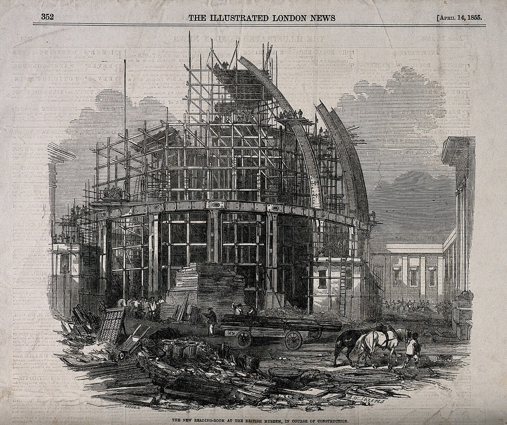
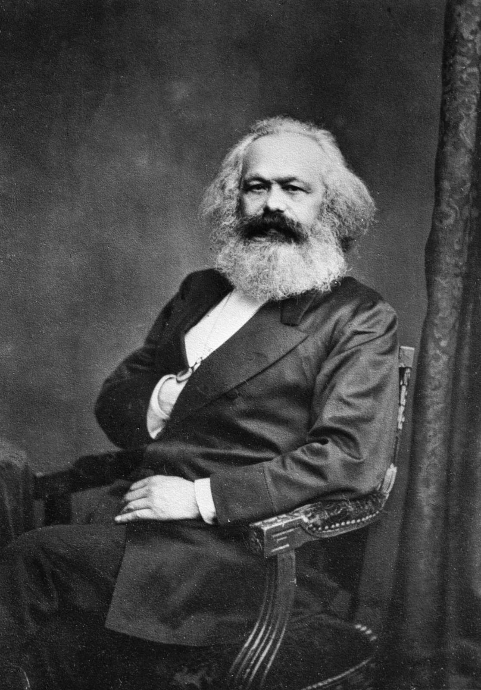
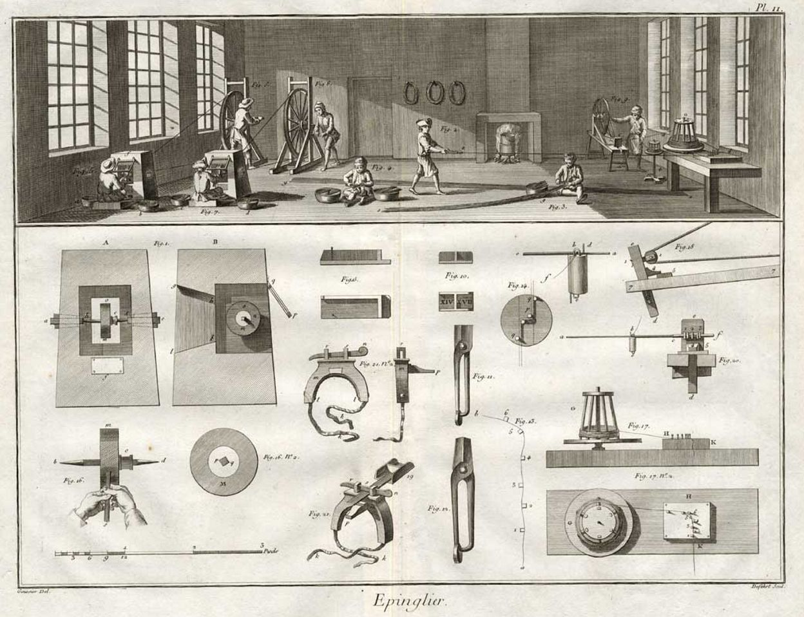
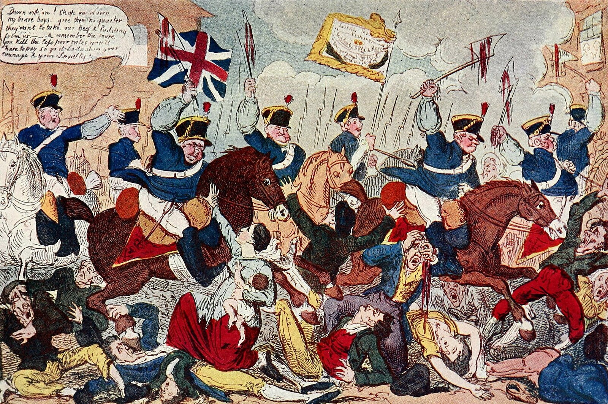
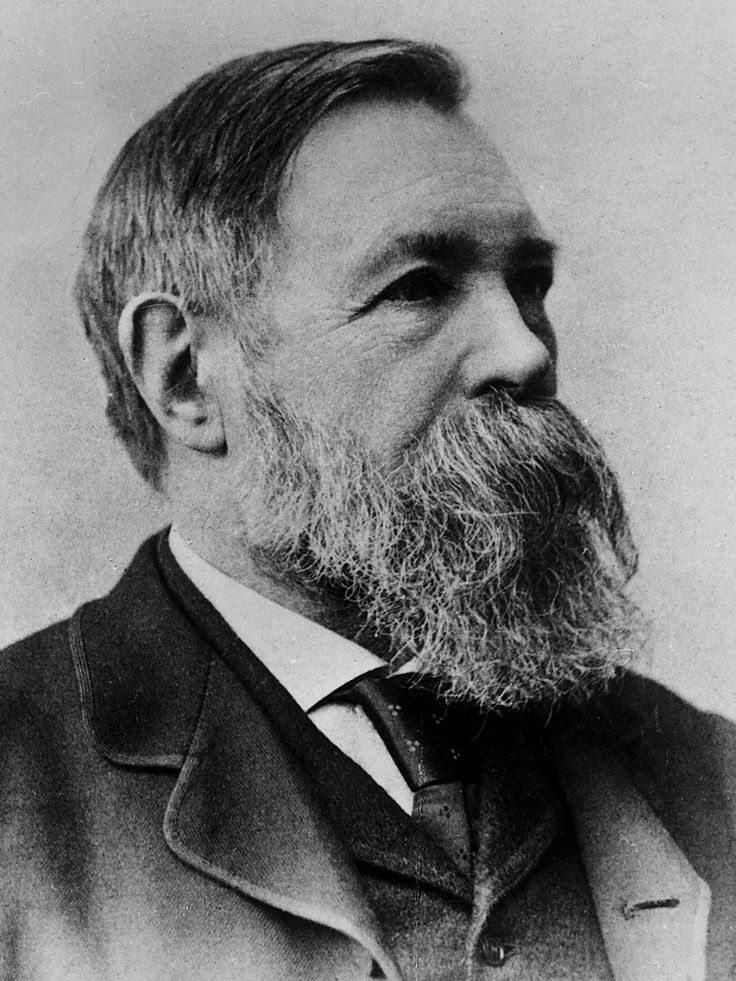
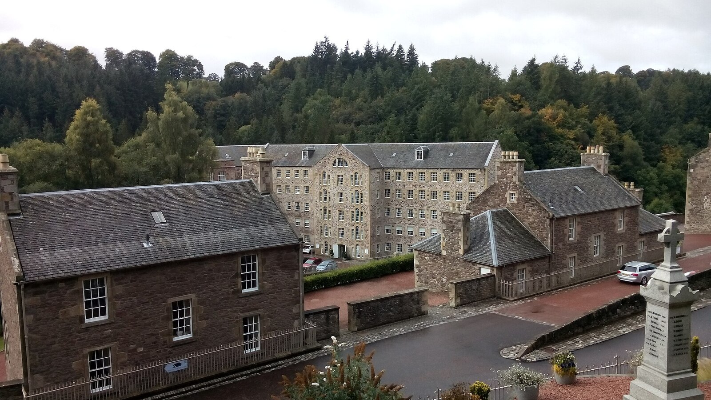
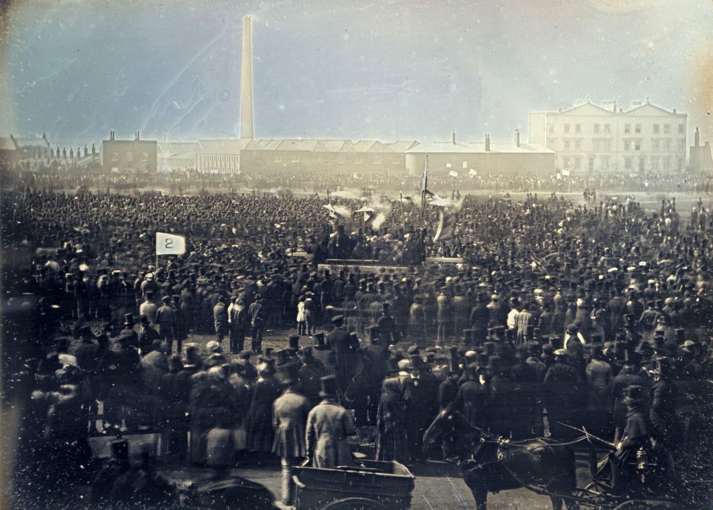
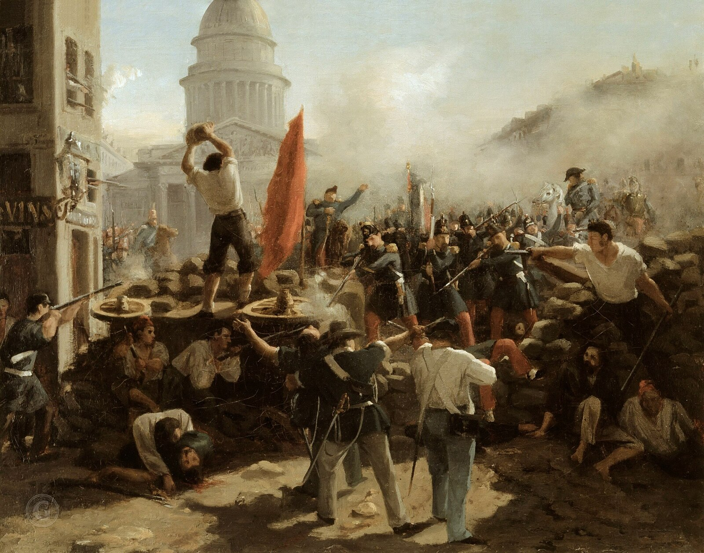
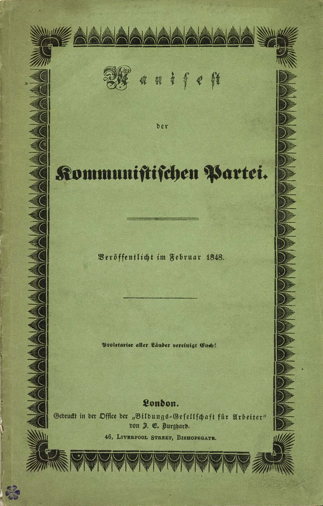
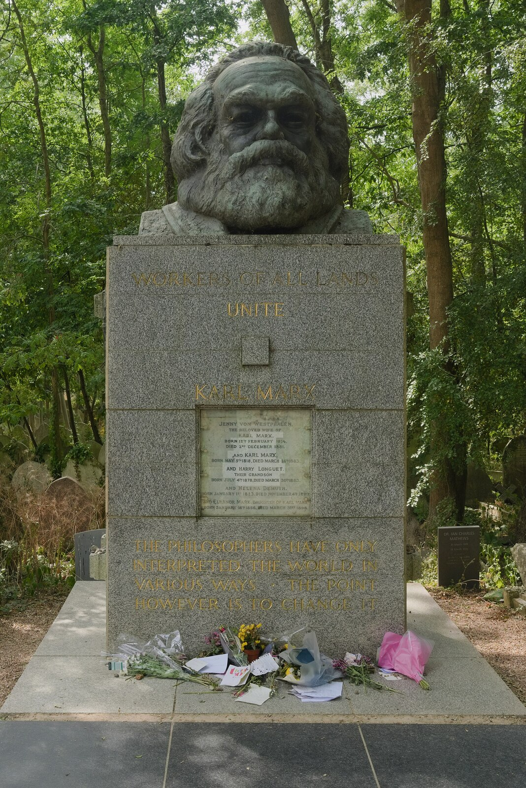

# 62. What did Karl Marx want?

*Britain and Europe, from 1776 to 1883*

Karl Marx wanted the factories, the mines and the land to belong to everyone in common, in place of the few owners who lived off the work of others. He believed that the factory system itself would bring this about. It was herding people who owned nothing into great towns, and sooner or later, he argued, they would take the machines for themselves.

In the 1850s a German exile lived with his wife, his children and a housekeeper in two rented rooms above a shop in Soho, a crowded and dirty quarter of London. A Prussian police spy who talked his way in reported to Berlin that there was not one clean or solid piece of furniture in the place. Everything was broken, covered in dust, tobacco ash and manuscripts, and the visitor was offered a chair with three legs.

The exile was a doctor of philosophy who had been thrown out of Germany, France and Belgium for his journalism. What he earned by writing for an American newspaper did not cover the rent. The family pawned their coats and lived for days on bread and potatoes. Two of the children died in those rooms, and for one of them there was no money for a coffin until a neighbour lent it.

Poverty did not keep him from his work. Most mornings he walked to the library of the British Museum, sat at a desk in the reading room, and worked until it closed. He was reading the reports of the British government's factory inspectors, shelf after shelf of them, and the works of every economist he could find. What kept the family alive, meanwhile, was money sent by a friend who managed a cotton mill in Manchester.

*The new reading room of the British Museum under construction, in a wood engraving of 1855. The reading room where Marx worked opened in 1857. Print: J. Brown after C. W. Sheeres, Wellcome Collection, CC BY 4.0.*

His name was Karl Marx. The book he was writing argued that the system which produced the cotton mill was doomed, and it would be read, within a lifetime of his death, as holy writ by the rulers of a third of the world.

*Karl Marx, in a photograph made before 1875. Photo: John Jabez Edwin Mayall, public domain.*

## Eighteen operations

The argument that Marx set out to demolish had been made eighty years earlier by a Scottish professor, and it started with a pin.

In 1776 Adam Smith published a book on what makes a country rich. In its opening pages he took his readers to a workshop where pins were made. A man working by himself, Smith said, could scarcely make one pin in a day, and certainly not twenty. The workshop did things differently. There, the job was split into about eighteen separate operations. One man drew out the wire, another straightened it, a third cut it, a fourth sharpened the point, and so on. Ten men working in this way made forty-eight thousand pins a day. That comes to four thousand eight hundred pins for each man, from workers who could not have made twenty apiece on their own.

*Pin-making, from a French encyclopedia of 1762, fourteen years before Smith's book. The workshop at the top shows the work divided among several hands. Engraving: Goussier and Defehrt, public domain.*

From this small example Smith drew a large conclusion. Wealth comes from dividing up work, so that each person does one thing and does it well.

Dividing up work also makes people need one another. A man who spends his whole day sharpening pins grows no food and sews no clothes. As a result, everybody depends on strangers for nearly everything they use. What makes those strangers serve one another? Smith's answer was their own advantage. It is not from the kindness of the butcher, the brewer or the baker that we expect our dinner, Smith wrote, but from their regard to their own interest. Each of them is trying to make a living. In an open market, where customers can go elsewhere, the way to make a living is to offer people what they want at a price they will pay. Nobody has to plan the arrangement, and nobody in it has to be kind. Self-interest does the organising.

The idea sounds ordinary now. In 1776 it was new, and it contradicted what governments had believed for two hundred years. The older view was that a country grew rich by selling more than it bought, piling up gold, and guarding its trade with tariffs, monopolies and warships. The East India Company was that view in action. Smith thought the whole apparatus was a conspiracy of merchants against their customers. The tariffs and monopolies, in his view, did not make the country rich. They made the protected merchants rich, and everyone else paid higher prices. His own proposal was simpler. Let people buy and sell freely, he argued, at home and across borders, and prices will find their own level and everyone will be better off.

He was not the simple cheerleader for business that he is sometimes taken for. For one thing, he did not trust businessmen. He wrote that people of the same trade seldom meet, even for amusement, without the conversation ending in some scheme to raise prices. Nor did he think the market could supply everything. He wanted the state to provide defence, justice, roads and schools for the poor, since private profit would never supply enough of them. Still, the heart of his message was that the market could be trusted to do most of what governments had been trying to do by decree, and to do it better.

## General Ludd

Smith was writing when the first cotton mills were a few years old. If goods were to be bought and sold freely, however, then so was work, and a machine that let an unskilled hand do a craftsman's job lowered the price of that work. Within a generation, the people who lived by skilled handwork found out what a free market in labour could mean for them.

In the spring of 1811, in the hosiery villages around Nottingham, bands of masked men began breaking into workshops at night. They carried sledgehammers, and they smashed one particular kind of machine: wide knitting frames that turned out cheap, shoddy stockings and were worked by unskilled hands at low pay. Notes left behind were signed by a "General Ludd", who did not exist. The following year the movement spread north, to the men who finished woollen cloth in Yorkshire and the cotton weavers of Lancashire.

The Luddites, as they came to be called, were not stupid about machinery, though their name has become a word for people who are. Most of them worked machines themselves. What they objected to was the use of new machines to break their trades, cut their wages and replace trained men with children. Their quarrel, in other words, was with the masters and not with the iron.

Nor had they begun with hammers. They had first asked Parliament to enforce the old laws that regulated their crafts. Parliament answered by repealing the laws.

The government then treated the unrest as a rebellion. It made the breaking of a frame a crime punishable by death, and it sent twelve thousand soldiers into the northern counties, a larger force than it had first sent against Napoleon's armies in Portugal. The courts did the rest. In January 1813, seventeen men were hanged at York in the space of nine days.

Peaceful organising fared little better. From 1799 a law forbade workers to combine in order to press for higher wages or shorter hours. In effect, a trade union was a crime. The law was not applied evenly, however. It was known that masters met to agree on wages, and they were not prosecuted.

Asking for the vote was no safer than asking for better pay. In 1819 some sixty thousand people gathered in a field in Manchester to hear speeches calling for ordinary men to have the vote. The magistrates sent in cavalry with drawn sabres. About eighteen people were killed and several hundred hurt. Nor did the danger pass quickly. Fifteen years later, six farm labourers in a village in the south of England were shipped to Australia in chains for swearing an oath to a union.

*The Manchester meeting of 1819 as a London satirist drew it, in a print published that year. The yeomanry are shown as butchers. Print: George Cruikshank, public domain.*

## A free bargain

The men who owned the new mills had a clear conscience, and Smith's book, read selectively, supplied it.

A wage, they said, was a bargain between two free people. The master offered what he chose, the worker took it or went elsewhere, and nobody was forced. From this it followed that the law had no business stepping in. If Parliament interfered, by fixing hours or wages, it would only raise the cost of British goods, lose the foreign customers, and throw the same workers out onto the street. The kindest policy was to let the market alone. Seen this way, low wages were nobody's fault, and a law meant to help the worker would end by hurting him.

The same belief gave the mill owners a great cause of their own, which was cheap bread. Since 1815 Britain had kept out foreign grain, at first by banning it whenever the home price was low and later by heavy duties, to protect the incomes of the landowners who filled Parliament. Less foreign grain came in, and so the price of a loaf stayed up. The manufacturers campaigned for years against these corn laws, with real passion and for mixed reasons. On the one hand, dear bread starved the poor. On the other, it also meant that wages had to be higher than they would otherwise need to be, since a worker must at least be able to eat, and those wages were paid by the manufacturers. In 1846 they won, and Britain became the first great country to throw its markets open to the world.

What finished the grain tax was a catastrophe that showed the creed at its harshest. In 1845 a disease destroyed much of the potato crop in Ireland, where three million people ate almost nothing else. For them, losing the potato meant losing food itself. The disease came back in the following years. About a million people died of hunger and fever, and another million emigrated. Through the worst of it, ships loaded with Irish grain and cattle sailed for England, because their owners could get a better price there. Nothing in the creed said that they should not. Grain, like labour, went to whoever paid most for it, and the starving had no money.

The same reasoning governed the help that was sent. The officials in London who ran the relief effort believed that to give away food would upset the market and teach the Irish to depend on charity. In 1847 the government did set up soup kitchens, which fed millions. The kitchens did not last, however. The government closed them after a few months and handed the burden to the Irish landowners.

The creed could also be judged closer to home, in the streets around the mills. In the same decade a young German arrived in Manchester to learn the family business. Friedrich Engels was twenty-two, tall, cheerful and fond of fox hunting, and his father was part owner of a cotton-thread mill there. By day he worked in the office. In the evenings an Irish mill girl named Mary Burns, with whom he lived for the next twenty years, took him through the districts where the mill hands lived.

*Friedrich Engels in later life, long after his years in the Manchester mill. Photo: unknown, public domain.*

What he found there was the other end of the free bargain. He saw cellars where families slept on dirty straw, courts where more than a hundred people shared one privy, and a river that ran black between the factories. On his way home to Germany he stopped in Paris, where he met Marx in a café, and the two talked for ten days. After that he went home and wrote a furious book about what he had seen, full of the British government's own statistics.

## A mill with a school

Not everyone who disliked what the factories were doing concluded that the system must go. Some thought that it could be run decently, and one man proved it.

Robert Owen was a Welsh shop assistant who had risen to manage a great cotton mill before he was thirty. In 1800 he took over a large mill beside a waterfall in Scotland, with two thousand workers, many of them orphans supplied by the poorhouses. Owen ran it differently. He stopped employing children under ten and sent them to a school that he built, where there was no beating. He cut the working day, opened a shop that sold good food at cost, and paid wages during a slump when the mill stood idle.

By the reasoning of his fellow mill owners, all this should have ruined him. Instead, the mill went on making handsome profits. A factory that was both kind and profitable was a curiosity, and princes and bishops came to look.

*The mill and mill village at New Lanark in Scotland, where Robert Owen began running the works in 1800. The buildings stand today. Photo: Phil Barker, CC BY-SA 4.0.*

From his success Owen drew the conclusion that people are made by their surroundings. Give them clean houses, schooling and fair treatment, and they will be healthy and honest. Crowd them into slums and work them like animals, and nobody should be surprised by the result.

At first he assumed that others only needed to be shown. He tried for years to persuade his fellow manufacturers and Parliament to follow his example. When they would not, he changed his mind about where the fault lay. He decided that competition itself was the evil, and that people should live in villages where everything was owned and shared in common.

He then set out to build such a village himself. In 1825 he bought a town in the American state of Indiana and invited the world to join him. About eight hundred people came. They included scientists, teachers and a good many who liked the idea of sharing other people's work. The community lasted two years and swallowed most of Owen's fortune. A village of sharing had turned out to be much harder to run than a mill.

The word that was coined for ideas like his was "socialism". Its one lasting success in those years was modest. It needed no new town and no rich man's fortune. In 1844 a group of weavers in a town near Manchester pooled their savings and opened a shop, owned by its customers, which sold honest goods and shared out its profits among them. Since the customers were also the owners, the shop had little reason to cheat them. Shops on that model spread across the world.

## Six points

Villages of sharing were a dream for a few. Most working people put their hopes in something simpler. If Parliament made the laws, and the laws were against them, then they needed votes.

In 1838 a group of London craftsmen drew up a document that they called the People's Charter. It made six demands: a vote for every man, voting in secret, pay for members of Parliament so that a poor man could serve, no property requirement for members, districts of equal size, and an election every year. The other five were there to make the first one count, because a vote is worth little if it must be cast in the open, or if only men of property can sit in Parliament. Nothing in the list asked for higher wages or shorter hours. It asked for a say in making the laws.

Parliament was not ready to give it. Three times, in 1839, 1842 and 1848, enormous petitions in support of it were carried to Parliament. The second had more than three million signatures. Each time the House of Commons declined to act.

*The Chartist meeting on Kennington Common in south London, 10 April 1848, photographed by William Kilburn. Photo: William Edward Kilburn, public domain.*

The third petition was presented in the spring of 1848, and Europe was on fire that spring. For a few months it looked as though the old order might fall everywhere at once. In February the people of Paris had thrown out their king and declared a republic. Within weeks there were barricades in Vienna, Berlin, Milan and Budapest, and half the monarchs of the continent were promising constitutions. The hope was short. In Paris the new government set up public workshops for the unemployed, and when it closed them in June, the workers of the eastern districts rose. The army killed several thousand of them in four days. A republic, it turned out, could shoot workers as readily as a king.

*A barricade in the rue Soufflot, Paris, on 25 June 1848, during the workers' rising, painted by Horace Vernet in 1848 or 1849. Painting: Horace Vernet, public domain.*

By the end of the following year the revolutionaries had been beaten almost everywhere. The kings took back most of what they had promised.

A few days before the first shots were fired in Paris, a pamphlet of twenty-three pages had been printed in German on a hand press in London. It had been commissioned by a tiny society of exiled German craftsmen, and written in a hurry by Marx, with Engels's help. It was called the *Manifesto of the Communist Party*. Hardly anyone noticed it at the time.

*The cover of the first edition of the Manifesto, printed in London in February 1848, in German. Cover: Marx and Engels, public domain.*

## Nothing to lose

The pamphlet opens with the sentence "A spectre is haunting Europe", and it sets out, in a few pages, the idea that Marx spent the rest of his life trying to prove.

All history, he said, is the history of struggles between classes. The names change from one age to the next, but the arrangement stays the same. In every age, one class owns the things that are needed to produce wealth, and another does the work. In ancient Rome there were masters and slaves. In the Middle Ages there were lords and serfs. The modern age, he argued, has simplified the contest. Now there are two classes that matter: the owners of factories, mines and banks, whom he called the bourgeoisie, and the people who own nothing except their ability to work, whom he called the proletariat.

For all that, Marx did not despise the owners' achievements. In barely a century, he wrote, they had created greater productive forces than all earlier generations together, and wonders far surpassing the pyramids and the cathedrals. No one before them had even suspected that such power lay asleep in human labour.

The trouble lay in how the gains were divided. Marx began with the worker's position. A worker, having no land or tools of his own, must sell his working day to an owner or starve. In that day his work adds more value to the cotton or the iron than the wage he is paid. The difference goes to the owner, and Marx argued that this difference, taken from millions of workers, is where all profit comes from.

From there Marx turned on the mill owners' talk of a bargain between equals. The "free bargain" between master and man was therefore a polite fiction, since one party could wait and the other could not. An owner could manage without one worker far longer than a worker could manage without wages.

He believed that the system would be destroyed by its own workings, with each step leading to the next. The first step is competition, which forces every owner to cut costs, which means installing machines and holding down wages. Next comes the glut. Each owner produces as much as he can, with no idea how much the others are producing, and every few years the warehouses fill with goods that nobody can pay for and the economy lurches into a slump. The slumps, in turn, thin out the owners. In every slump the weaker firms are swallowed by the stronger, so that wealth gathers in fewer and fewer hands.

Meanwhile, the same process is building the force that will end it. The workers, packed together in vast factories, learn to act as one. The owners, in other words, cannot help assembling the army that will defeat them. At last the workers rise and take the factories, the land and the banks into common ownership. After that there will be no classes, since nobody will own what another person needs in order to live.

The pamphlet ends with the best-known call to arms ever written. The proletarians have nothing to lose but their chains. They have a world to win. Working men of all countries, unite.

About what the new society would look like, and how it would be run, Marx said remarkably little. The pamphlet is far clearer about the fall of the old world than about the working of the new one. He said later that he was not in the business of writing recipes for the cook-shops of the future.

## A dozen mourners

For the next thirty-five years he waited in London for the revolution. Every slump raised his hopes, since a slump was how he expected the end to begin. He published the first volume of his great book, *Capital*, in 1867 and never finished the rest.

During those years, the country he lived in confounded him. Year by year the lot of the workers slowly improved, and much of the improvement came through the same Parliament that had once sent soldiers against them.

Pay was one part of it. From about 1850 the wages of British workers at last began to rise, and by the end of the century they bought roughly twice what they had bought at the beginning of his exile. The law of the workplace changed as well. Parliament had already limited the hours of women and children in the mills and banned women and small boys from the mines, and Marx himself called the ten-hour day a victory for the workers.

Workers also won the right to organise, and then to vote. The ban on unions had been lifted in 1824, and in the 1870s they were given full protection in law. In 1867 and again in 1884, afraid of what refusal might bring, Parliament extended the vote until about two men in three had it. Five of the six points of the Charter eventually became law.

In Germany, where a socialist party that honoured Marx was winning seats, the response was more deliberate. The chancellor of the new German empire was a conservative landowner who loathed socialists and banned their meetings. He also saw that a worker with something to lose makes a poor revolutionary. The pamphlet had said that the workers had nothing to lose but their chains, and so he set out to give them something. In the 1880s he set up compulsory insurance for German industrial workers against sickness, against accidents, and against poverty in old age, paid for by workers, employers and, for the pensions, the state. No government had done such a thing before. He said openly that his purpose was to make the workers loyal.

Capitalism had bent where Marx had expected it to break, and one of the things that bent it was the fear he inspired. Governments that might have ignored the mill hands could not ignore the prospect of a revolution.

He had been right about a good deal all the same. The slumps came as he said they would, the giant firms grew, and the search for markets and materials drove the factory system into every corner of the Earth. He had been wrong about the end of the story in the lands of the factory. When a revolution was finally made in his name, it happened in Russia, a country of peasants.

He died in his armchair in March 1883 and was buried in a cemetery in north London. About a dozen people attended. Engels gave the address, and told them that his friend's name and work would endure through the ages.

*Marx's grave in Highgate Cemetery, north London. He died in 1883. Photo: Satdeep Gill, CC BY-SA 4.0.*