# 63. How did the United States get so big?

*North America, from 1803 to 1890*

The United States crossed the continent in three ways. It bought the claims of France, Spain and Russia. It took half of Mexico in a war. In addition, it removed the Native nations who actually lived on the land, by treaty where it could and by force where it could not. What made all this stick was the number of Americans, which doubled every generation, and a government that gave them the land almost for nothing.

In December 1831 a young French nobleman, travelling in America to study its prisons and its democracy, reached the town of Memphis on the east bank of the Mississippi. The cold was severe, and ice was coming down the river.

While he waited for a steamboat, a large party of Choctaw arrived at the landing. They were one of the Native nations of the south-east, farmers who had lived for centuries in what is now the state of Mississippi, and the United States government was moving them across the river to make room for cotton planters. The Frenchman watched them board. There were wounded and sick among them, newborn babies, and old people close to death. They had no tents and no wagons, only some food and a few weapons.

Nobody cried out, he wrote, and nobody wept. They went aboard in silence. Their dogs had been left on the bank, and when the animals understood that they were being abandoned, they set up a terrible howling and plunged into the icy water to swim after the boat.

The Frenchman was Alexis de Tocqueville, and the book he wrote about America is still read. The scene stayed with him. The Spaniards, he observed, had not managed to wipe out the Indian peoples with all their atrocities. The Americans were doing it calmly and legally, without shedding blood, and without violating a single great principle of morality in the eyes of the world.

## Three cents an acre

When Britain recognised its independence in 1783, the United States reached from the Atlantic to the Mississippi. Twenty years later it doubled in a single afternoon.

Napoleon held the title to Louisiana, an immense block of the continent between the Mississippi and the Rocky Mountains, which France had recently got back from Spain. He had meant it to feed his sugar colony in the Caribbean. When the army he sent to that colony was being destroyed by the former slaves of Haiti and by yellow fever, the plan collapsed. The American envoys in Paris had come to ask whether they might buy one city, New Orleans, at the river's mouth. They were asked instead what they would give for the whole territory.

They paid fifteen million dollars for about two million square kilometres, which works out at roughly three cents an acre.

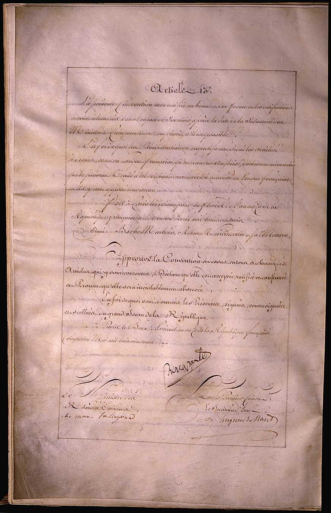
*A page of the Louisiana Purchase treaty, signed in 1803, in French, with the signature of Napoleon Bonaparte near the foot. Document: U.S. National Archives, public domain.*

France did not control Louisiana. Some sixty thousand colonists and slaves lived along the lower river. The rest belonged to the people who lived there, in dozens of nations, who had not been consulted and mostly never heard of the sale. What changed hands in Paris was a claim: the right, as against other European powers, to be the one that dealt with those nations.

The government in Washington had only rumours and a few traders' maps of what the territory contained. The president sent two army captains with about forty men to find out. They went up the Missouri river by boat, crossed the Rockies on horses bought from the Shoshone, and reached the Pacific after eighteen months. They survived because Native peoples fed them along the way, and because a Shoshone woman of about seventeen, travelling with them with a baby on her back, could interpret and showed every nation they met that this was not a war party.

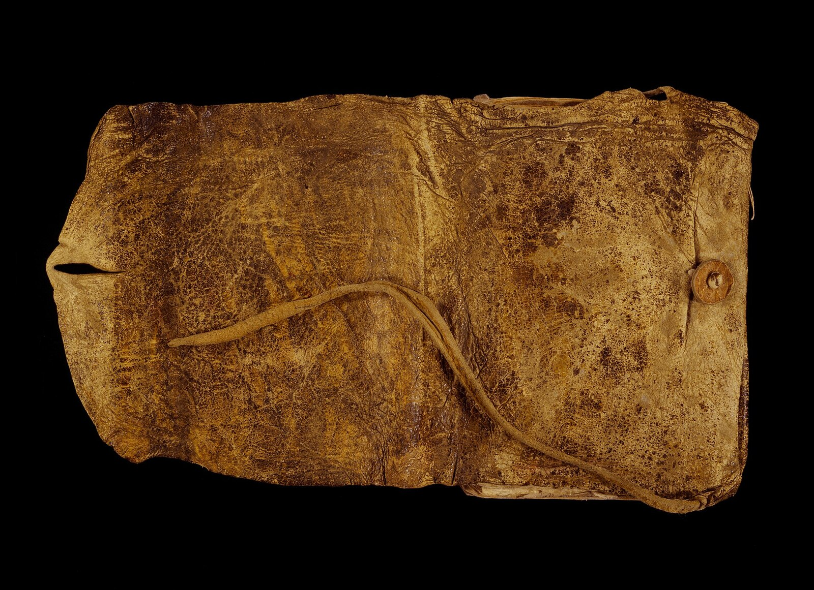
*The elkskin cover of the field journal William Clark kept from September to December 1805, as the expedition reached the Pacific. Photo: Missouri History Museum, public domain.*

## The grid

The United States had a method for digesting land, and it had been worked out before the purchase.

Under a law of the 1780s, government surveyors went ahead of the settlers and ruled the country into squares. Each square was six miles on a side and was called a township. Each township was divided into thirty-six numbered sections of one square mile, and the sections were sold at auction, at first for a dollar or two an acre. One section in every township was set aside to pay for a school. Anyone who flies over the middle of the United States today can look down and see the result, a chessboard of fields and straight roads running to the horizon.

The squares made land into a thing that could be bought by somebody who had never seen it, described on a slip of paper, and sold again without dispute. They suited small farmers, and they suited speculators even better.

The same laws settled a political question in a way that no empire had tried before. Britain had treated its American settlements as colonies, subordinate for ever to the mother country. The United States decided that it would have no colonies of its own people. A new territory would be governed from Washington only until it had enough inhabitants, at first set at sixty thousand free people. After that it could apply to enter the Union as a state, on an equal footing with the original thirteen in every respect.

There was no shortage of inhabitants. In 1790 the United States had four million people. By 1860 it had thirty-one million, more than Britain. American families were large, food was cheap, and in the 1840s the trickle of immigrants from Europe became a flood, led by Irish fleeing the famine and Germans fleeing failed harvests and failed revolutions. A great many of them wanted a farm.

## A newspaper in two languages

The land they wanted was occupied. East of the Mississippi alone there were tens of thousands of Native people, and the most numerous nations lived in the south, on the soil best suited to cotton.

American policy, for the first decades, was that Native peoples should become "civilised", by which was meant that they should farm like whites, hold land as private property and become Christians, and that they would then be left in peace. The Cherokee of the southern mountains took the Americans at their word.

By the 1820s the Cherokee lived in log houses and frame houses, grew corn and cotton, ran mills and ferries, and in some cases owned plantations and slaves. A Cherokee silversmith who could not read English spent twelve years inventing a way of writing his own language, with eighty-five signs, one for each syllable. It was so easy to learn that within a few years most of the nation could read. In 1827 the Cherokee adopted a written constitution modelled on that of the United States, with a chief, a two-house legislature and a supreme court. The next year they began publishing a newspaper, printed in Cherokee and English in parallel columns.

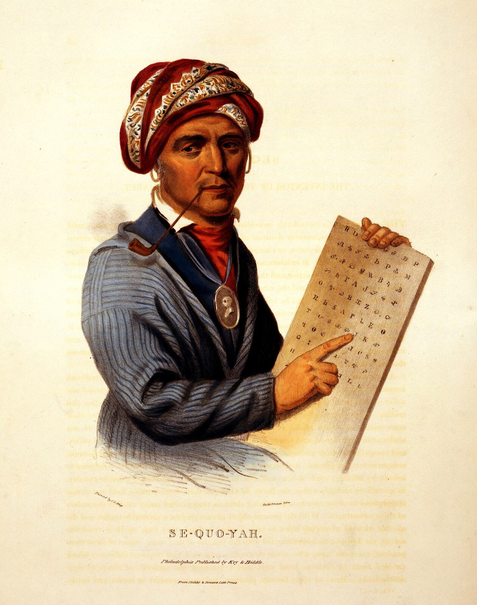
*Sequoyah holding the Cherokee syllabary, in a hand-coloured print of 1836 after a painting by Charles Bird King. Print: Charles Bird King, public domain.*

None of it helped. The state of Georgia claimed the Cherokee country as its own, and in 1829 gold was found there. Georgia declared Cherokee laws void, forbade Cherokees to testify against whites in court, and held a lottery to give their farms away. In 1830 Congress passed, by a handful of votes, a law enabling the president to move every Native nation in the east to land beyond the Mississippi.

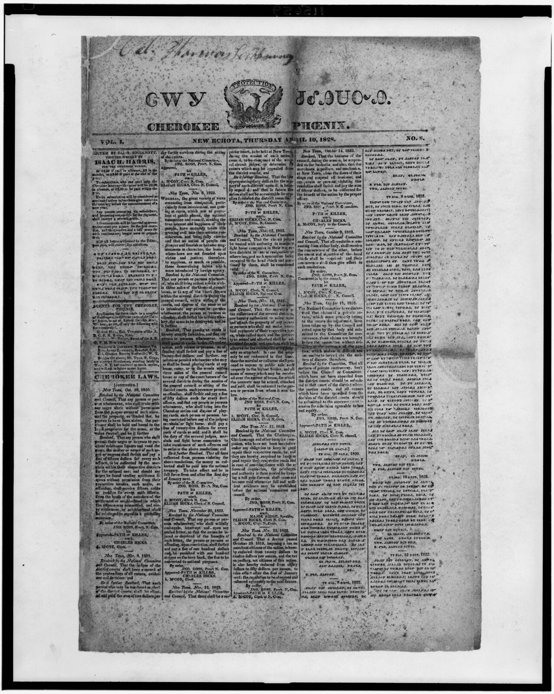
*The front page of the Cherokee Phoenix of 10 April 1828, printed at New Echota in English and Cherokee, with the laws of the Cherokee nation in its columns. Newspaper: Cherokee Phoenix, Library of Congress, public domain.*

The Cherokee did what a law-abiding nation would do. They hired lawyers and went to court. Their own suit was turned away on a technical point. In 1832, in the case of a missionary whom Georgia had jailed for living among them, the Supreme Court of the United States ruled in their favour. The Cherokee nation, said the chief justice, was a distinct community occupying its own territory, in which the laws of Georgia could have no force.

The president, Andrew Jackson, was a Tennessee planter who had made his name fighting Native nations, and he simply declined to enforce the ruling. Georgia carried on. In 1835 federal agents signed a treaty of removal with a small group of Cherokees who had no authority to speak for the nation. Nearly sixteen thousand Cherokees signed a petition against it, and the Senate ratified it by a single vote.

In the spring of 1838 seven thousand soldiers arrived. They went from farm to farm, taking families from their dinner tables at the point of the bayonet and herding them into stockades, while white neighbours waited to move into the houses. That autumn and winter the Cherokee were marched and shipped thirteen hundred kilometres to what is now Oklahoma. About four thousand of them died in the camps and on the road. They remember it as the trail where they cried.

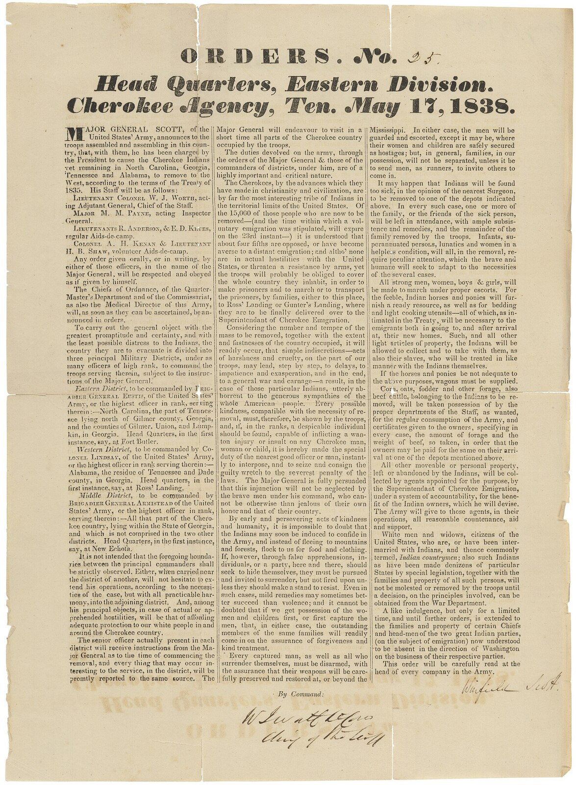
*General Winfield Scott's Orders No. 25 of 17 May 1838, telling the troops how to remove the Cherokee to the West. Document: U.S. National Archives, public domain.*

## The horse nations

West of the Mississippi the United States met Native powers of a different kind, and for half a century they were stronger than it was.

The horse had come to North America with the Spanish. In 1680 the Pueblo peoples of New Mexico rose and drove the Spanish out for a dozen years, and the horses left behind passed from nation to nation across the plains. Within a few generations, peoples who had hunted bison on foot were among the finest riders in the world.

The Comanche used the horse to build something very like an empire. From about 1750 they dominated the southern plains, an area larger than France. They owned enormous herds of horses. They took tribute from Spanish towns, traded captives and stolen stock at great fairs, and absorbed or drove out rival nations. Spanish New Mexico and Texas survived at their pleasure.

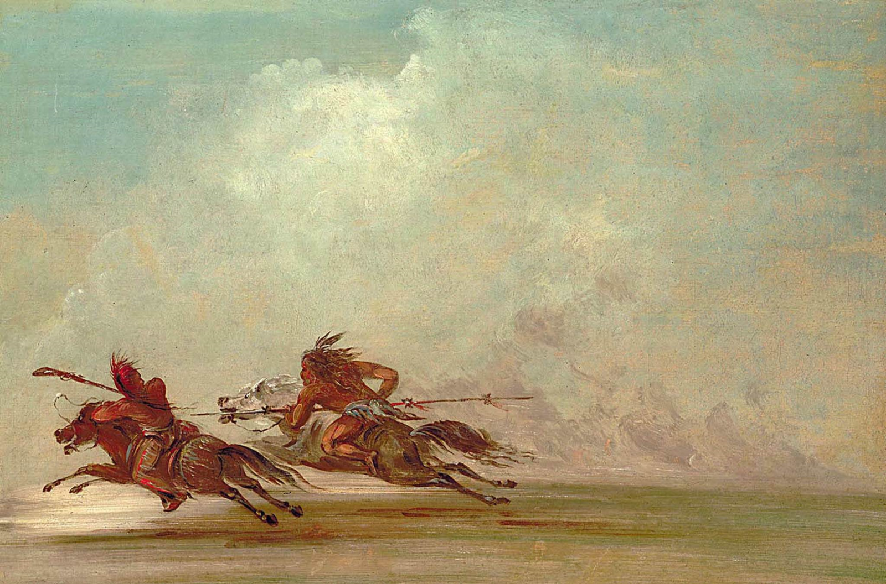
*A Comanche lancer and an Osage warrior in a running fight on the plains, painted by the American artist George Catlin in 1834. Painting: George Catlin, public domain.*

When Mexico became independent, the raids went deeper. Each autumn, war parties of several hundred men rode south for hundreds of kilometres, burning ranches, killing the men and driving off horses, mules and captive women and children. By the 1840s much of northern Mexico was a wasteland of abandoned farms. A Mexican official wrote that the raiders had made a thousand deserts.

In the north the Lakota, moving west out of the lakes country with horses and guns, did the same thing on a smaller scale. They pushed other nations off the best bison ranges and held the centre of the northern plains.

American settlers thought of the West as wild and empty land. It was a patchwork of territories, with borders, alliances and wars of its own, and the United States walked into the middle of it.

## American blood

Mexico's weakness in the north was the opening. In the 1820s the Mexican government, hoping for a buffer against the Comanche, had invited American farmers to settle in its province of Texas. They came in such numbers that by 1835 there were thirty thousand of them, far more than the Mexicans there. Most were from the cotton states, and they brought slaves, in a country that had abolished slavery and had let Texas keep it only on sufferance. In 1836 they rebelled, defeated a Mexican army, and set up a republic.

Nine years later the United States took Texas in as a state. The American president of the day wanted more. He had campaigned on expansion, and he had his eye on California and its harbours. He sent troops into a strip of land that both countries claimed, and when Mexican cavalry attacked them, he told Congress that Mexico had shed American blood upon American soil.

Not everyone believed him. A young congressman from Illinois named Abraham Lincoln demanded to be shown the exact spot. A lieutenant who fought in the war, Ulysses Grant, wrote at the end of his life that he regarded it as one of the most unjust ever waged by a stronger nation against a weaker one.

It was also one-sided. American forces occupied New Mexico and California after a few small fights, landed an army on the Gulf coast, and marched inland by the road that Cortés had used. In September 1847 the American flag went up over Mexico City. By the peace treaty, signed the following February, Mexico gave up the northern half of its territory, from Texas to the Pacific. The United States paid fifteen million dollars, the same price as for Louisiana. About eighty thousand Mexicans found that the border had crossed them.

Nine days before the treaty was signed, a carpenter building a sawmill on a river in California had noticed something shining in the channel. In 1849 alone, ninety thousand gold seekers arrived from every continent. For the Native peoples of California it was a catastrophe. Miners and militias hunted them like animals, and the state paid the militias' expenses. There had been about a hundred and fifty thousand of them when the gold was found. Twenty-two years later there were thirty thousand.

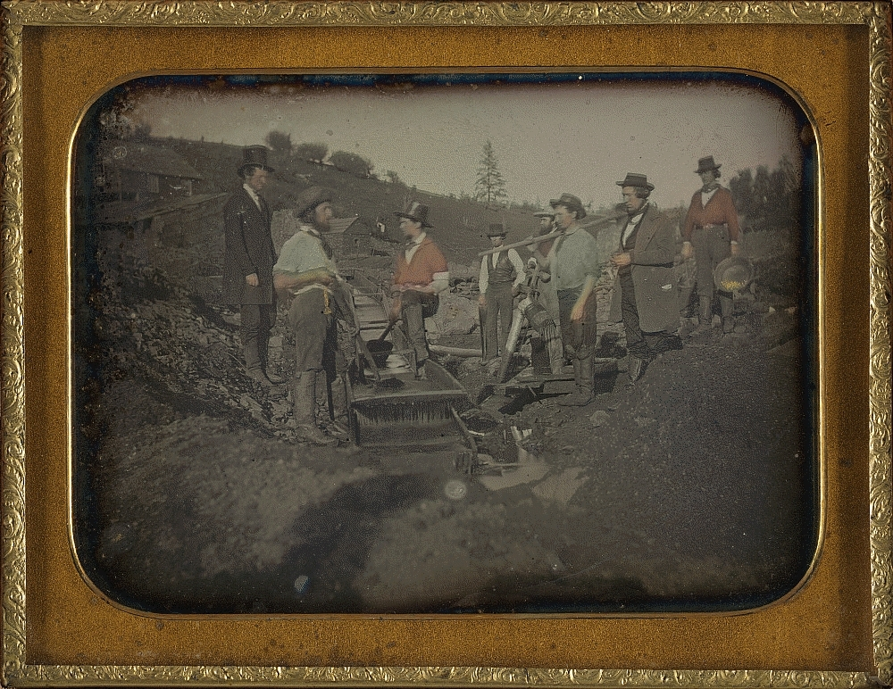
*Gold miners at their claim in California with a sluice called a long tom, in a daguerreotype from about 1850 to 1852. Photo: George H. Johnson, Nelson-Atkins Museum of Art, public domain.*

Americans had a phrase for what was happening. A New York journalist wrote in 1845 that it was the nation's "manifest destiny" to overspread the whole continent, which Providence had given it for the great experiment of liberty.

Each new territory raised a question about that liberty, however. The states were divided into those that allowed slavery and those that had ended it, and the two groups were evenly balanced in the Senate, where every state, large or small, has two votes. Every time a territory applied to become a state, somebody had to decide which kind it would be. In 1820 Congress had admitted Missouri as a slave state and drawn a line westward from its southern border across the rest of the Louisiana lands, with slavery permitted south of the line and forbidden to the north. The conquests from Mexico lay outside that bargain. The argument over them began before the war was over, and in 1861 it broke the country in two.

## Seven days

A treaty with Britain in 1846 had already divided the Oregon country in the north-west, so that by 1848 the United States held the Pacific coast from San Diego to the edge of Canada. In practice, California was further from New York than London was. The journey took four to six months by ox wagon across the plains and mountains, or by ship round the tip of South America.

The answer was a railway, and in 1862, in the middle of the civil war, Congress chartered two companies to build one, the first starting west from the Missouri river and the second starting east from California. The government lent them money and paid them in land. For every mile of track, a company received a strip of sections in a chessboard pattern on either side of the line, which it could sell to settlers. Over the following decades the railways were given an area larger than California.

The company building from California had to cross the Sierra Nevada, a wall of granite with snow nine metres deep in winter. It could not find enough workers, and it hired, at first as an experiment, fifty men from China. By the time the line was finished, about twelve thousand Chinese labourers made up most of its workforce. They cut ledges into cliffs, and bored more than a dozen tunnels through the mountains with hand drills and black powder, gaining about thirty centimetres a day.

The two lines met in the desert of Utah on 10 May 1869. A telegraph wire had been attached to the last spike and another to the hammer, so that the blow would close the circuit, and the signal reached the cities of both coasts at the same moment. The journey from coast to coast now took seven days.

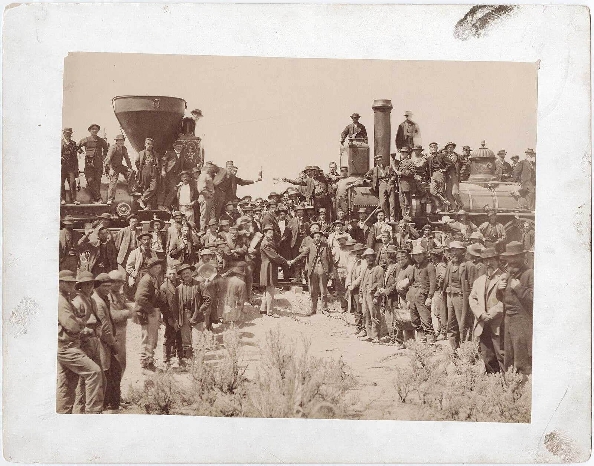
*The meeting of the rails at Promontory Summit, Utah, on 10 May 1869. The engineers of the two railways shake hands between the locomotives. Photo: Andrew J. Russell, public domain.*

The railways changed more than travel. A farmer on the plains could now ship wheat to Europe, and the plains filled with farmers. Under a law of 1862, any citizen, or any immigrant who meant to become one, could settle on a quarter of a section, work it for five years and have it for the price of a filing fee, and more than a million and a half families eventually did. The railways even reorganised time. Each town had kept its own clock by the sun, which made timetables a nightmare, and in 1883 the railway companies divided the country into four time zones by their own authority. The government made it official thirty-five years later.

## Hides

The plains nations had held off the United States for decades, and what broke them in the end was the loss of the animal they lived on.

In 1800 tens of millions of bison grazed the plains. They gave the Lakota, the Cheyenne and the Comanche their food, their tents, their clothes and their tools. The railway cut the herds in two. Then, in the early 1870s, tanners in Europe found a way to turn bison hide into good leather, much of which went to make the driving belts for factory machines. The price of a hide rose to as much as three dollars, several days' wages.

Professional hunters with heavy rifles descended on the herds. A good shot could kill a hundred animals in a morning from one position. The hunters took the skins and left the meat to rot, and travellers on the trains rode for hours through the stench. The army could have stopped it and chose otherwise, since its generals understood exactly what the killing meant. By 1889 about a thousand bison were left alive.

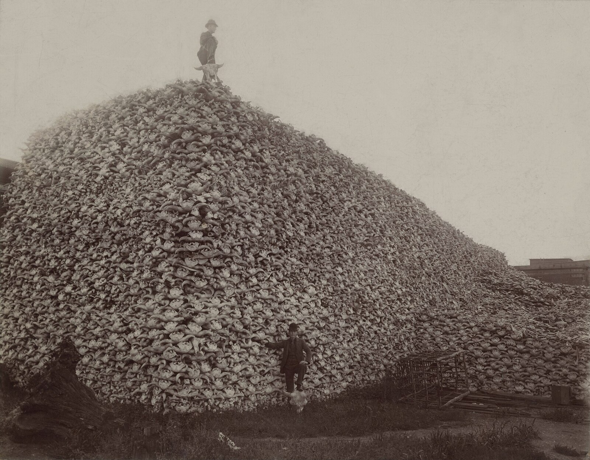
*A pile of bison skulls in Detroit in 1892, waiting to be ground up for fertilizer or charcoal. Photo: unknown, public domain.*

The plains nations fought, and sometimes won. In June 1876 a force of Lakota and Cheyenne destroyed a column of American cavalry beside a river in Montana, killing its commander and every man with him. However, a people cannot stay in the field without food. Within a year most of the victors had come in to the government posts and given up their guns and horses.

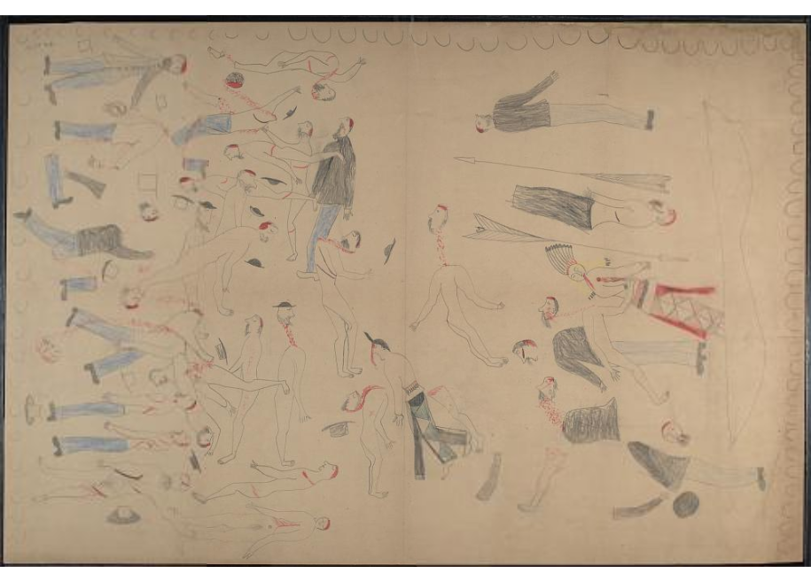
*A drawing of the Battle of the Little Bighorn of June 1876, made in 1881 by the Lakota artist Red Horse. Drawing: Red Horse, Smithsonian, public domain.*

They were confined to reservations, a fraction of their old lands, and fed on government rations. In 1887 Congress decided that even the reservations should be broken up into private plots, with the "surplus" sold to settlers, and within fifty years the Native nations had lost two thirds of what they had left. Their children were taken to boarding schools, sometimes a thousand kilometres from home, where their hair was cut and they were beaten for speaking their own languages. The army officer who founded the best known of these schools explained that the aim was to kill the Indian in him and save the man.

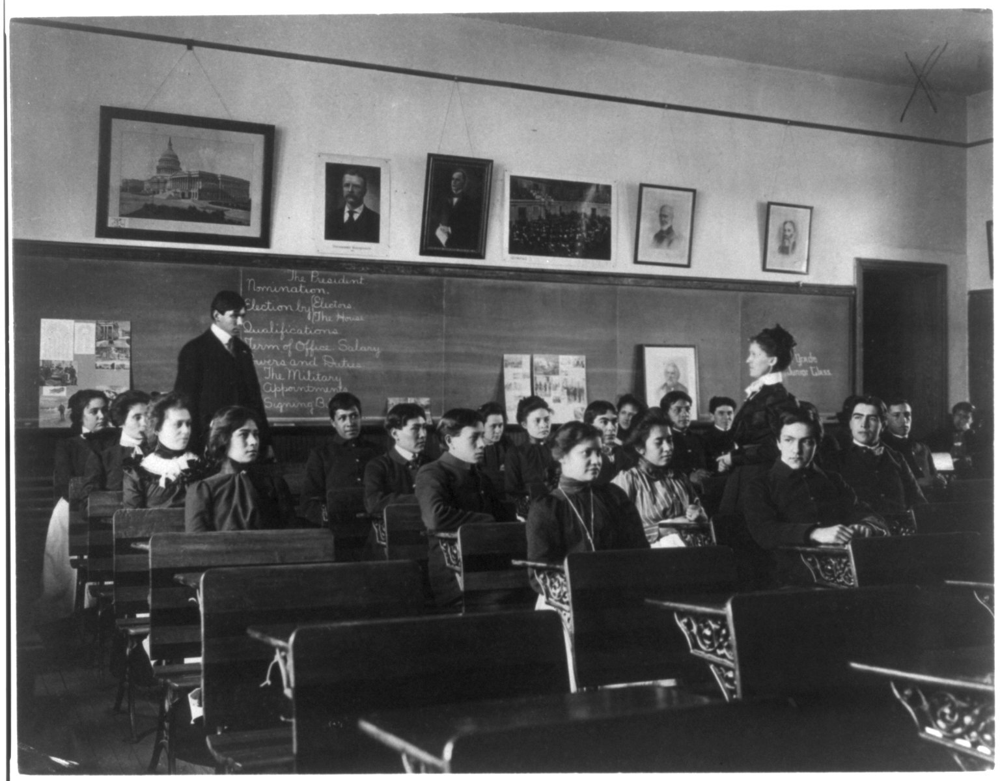
*A class in government at the Carlisle Indian School in Pennsylvania, photographed in 1901. The students are not named. Photo: Frances Benjamin Johnston, Library of Congress, public domain.*

## 1890

In 1890 the officials who ran the American census announced that they could no longer draw a frontier line on the map. There had always been a boundary between the country that settlers had filled and the country that they had not yet reached. Now the settlements were scattered everywhere.

In the last days of that year, on a frozen creek called Wounded Knee in South Dakota, a regiment of cavalry surrounded a band of about three hundred and fifty Lakota who had been following a new religion that promised the return of the bison and the dead. The soldiers set up four quick-firing cannon on the hill and began to disarm the men. A rifle went off. When the firing stopped, about two hundred and fifty Lakota were dead, more than half of them women and children.

The country that had started as thirteen colonies on the Atlantic coast now held three million square miles and sixty-three million people. In 1800 perhaps six hundred thousand Native people had lived within those borders. In 1900 the census counted two hundred and thirty-seven thousand.
