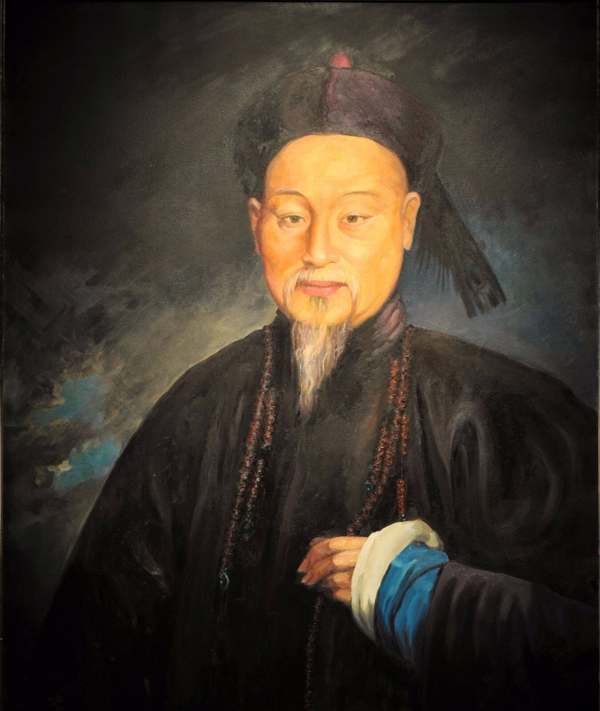
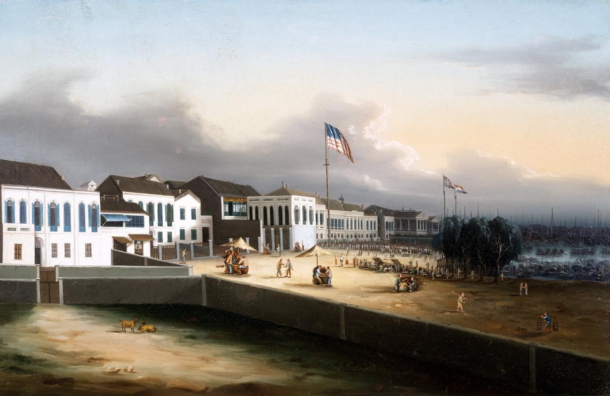
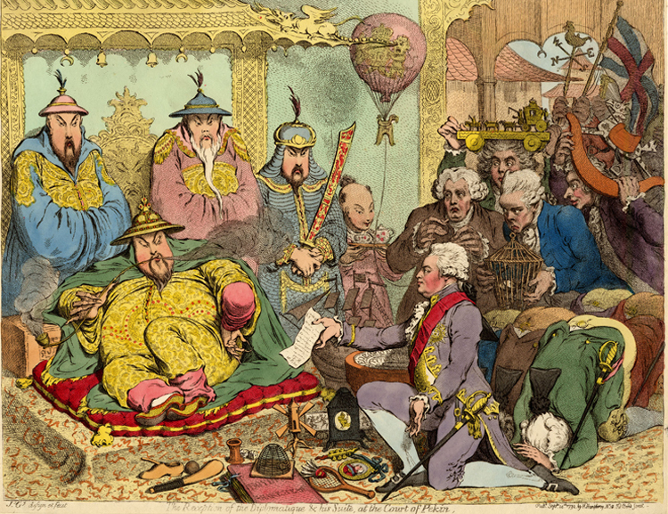
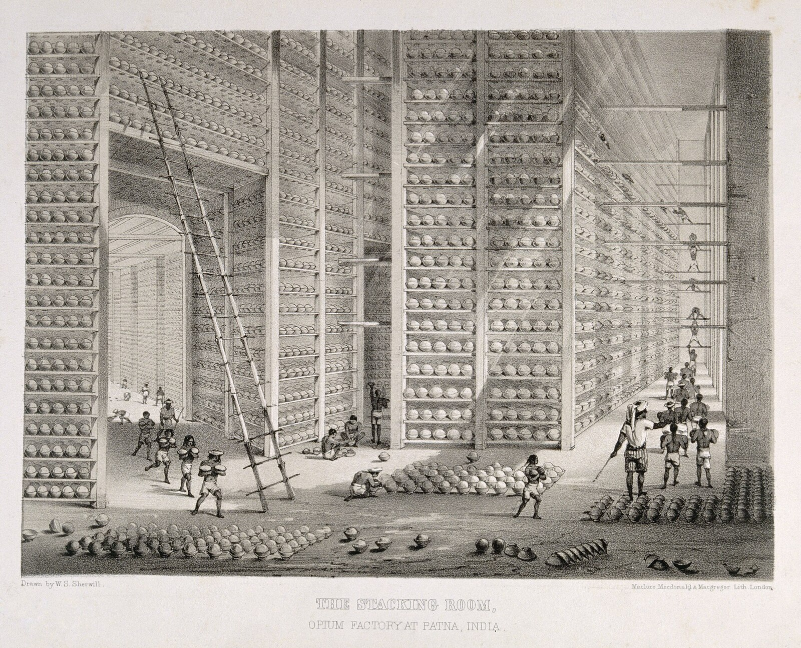
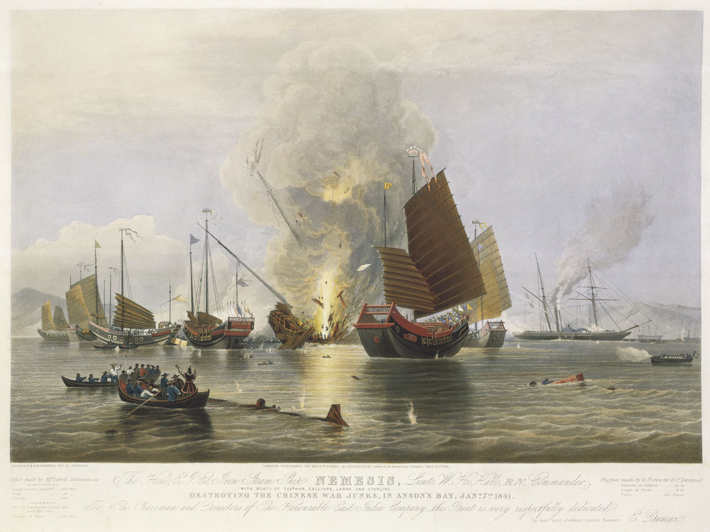
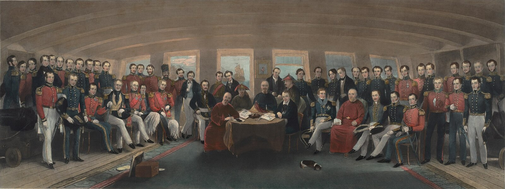
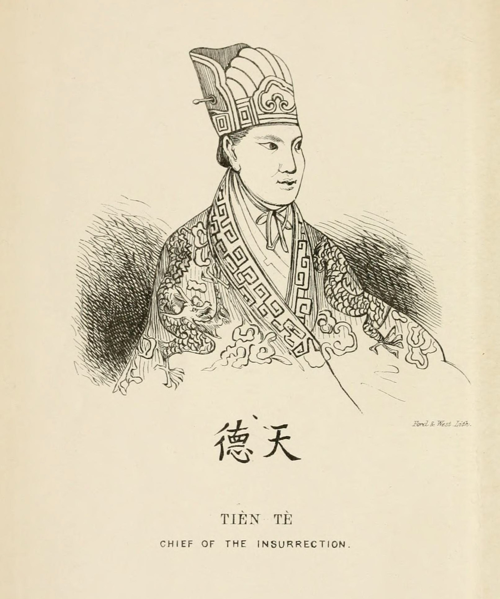
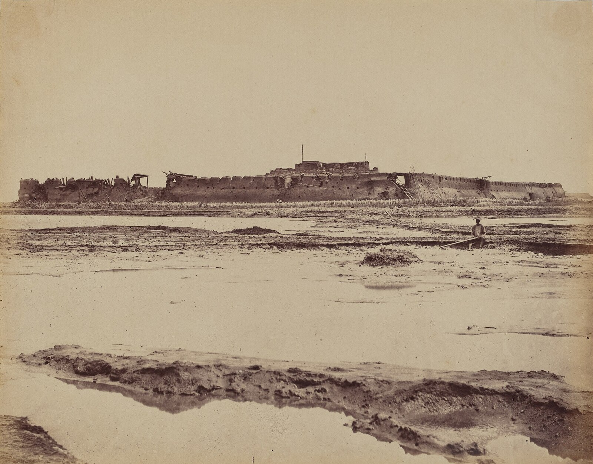
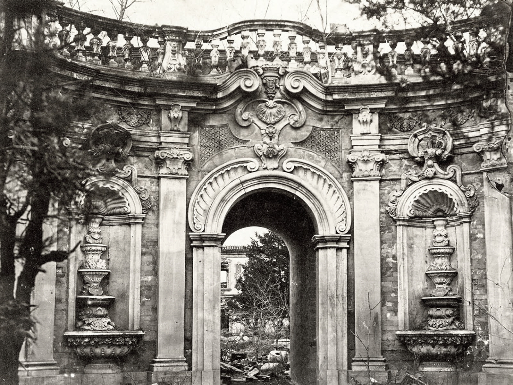

# 65. Why did China lose the Opium Wars?

*China, from 1793 to 1864*

China lost because its army and navy had fallen generations behind those of Europe, and its government was too small, and too sure of itself, to see the danger in time. It had never faced a great naval power. When one came, with steamships and modern guns, a few thousand British and Indian soldiers were able to sail up China's rivers and cut off the food supply of its capital.

In June 1839, on the shore of the river that leads to the city of Canton, five hundred labourers spent three weeks destroying a mountain of opium. There were twenty thousand chests of it, more than a thousand tonnes, half a year's supply for several million smokers. It belonged to British and American merchants, who had been made to surrender it.

The man in charge had worked out the method himself. Burning would leave a residue that could be scraped up and smoked. Instead he had three trenches dug, each the size of a large swimming pool, and lined with timber. The opium balls were broken up and thrown in, covered with water, salt and lime, and stirred until they dissolved. Then the sluices were opened and the tide carried the sludge out to sea. Guards searched the labourers each evening as they left.

Before the work began, the official composed a prayer to the spirit of the Southern Sea. He apologised for the filth that he was about to pour into its waters, and advised the fish to move away for a while.

His name was Lin Zexu, and he was one of the ablest and most honest servants the emperor had. He believed that he had just solved a problem. He had in fact started a war, and it would show that the largest and richest empire on Earth could not defend itself against a few British gunboats.

*Lin Zexu, the official who destroyed the opium at Canton in 1839, in a portrait painted in the 19th century. Painting: Lam Qua, public domain.*

## We possess all things

For three hundred years Europeans had come to China as customers. They wanted its silk, its porcelain and, more and more, its tea, and they had never been able to offer much that the Chinese wanted in return.

The Qing emperors, who ruled about three hundred million people, kept this trade on a short leash. Foreign ships could call at one port, Canton, in the far south. They could deal only with a dozen merchant houses licensed by the government. Their crews lived for the trading season in a row of warehouses on the waterfront, forbidden to enter the city, to bring their wives, or to learn Chinese. Any message for the authorities had to go through the merchants and be headed with the word "petition".

*The foreign factories on the waterfront at Canton, in a Chinese export painting made between 1825 and 1835. Painting: attributed to Lam Qua, public domain.*

In 1793 the British government sent an ambassador to Beijing to ask for something better: more ports, fixed duties, and a permanent embassy. He travelled with ninety wagons of gifts, chosen to show what British industry could do. There were telescopes, clocks, a planetarium, cannon and fine pottery.

*"The Reception of the Diplomatique and his Suite at the Court of Pekin", a cartoon by James Gillray, published in London on 14 September 1792, mocking the British embassy to China. Print: James Gillray, public domain.*

The emperor, who was eighty-one and had reigned for nearly sixty years, received him politely. The court expected every envoy to kneel three times and touch his forehead to the ground nine times, and after long negotiation the ambassador was allowed to go down on one knee, as he would to his own king. He was then sent home with a letter for King George. China, the emperor wrote, possessed all things in abundance. He set no value on strange or ingenious objects and had no use for Britain's manufactures. The king was advised to obey in future and tremble.

For Britain this was an expensive attitude. By the 1820s the British were drinking some thirty million pounds of Chinese tea a year. The tax on it brought in about a tenth of the government's income. Since the Chinese would take little else, almost all of it had to be paid for in silver.

## Forty thousand chests

There was one product for which China would pay silver in any quantity, and the East India Company controlled the best of the supply.

Opium is the dried sap of a poppy. It had been used in China for centuries as a medicine. In the 1700s people there began to smoke it for pleasure, and the emperors banned it. The poppy grew well in Bengal, and when the Company took over that province, it took over the poppy fields. It made opium a monopoly. Peasants were advanced money to grow the crop and were required to sell it to the Company, which processed it in two enormous factories, packed it in mango-wood chests, and sold it at auction in Calcutta.

*The stacking room of the opium factory at Patna, India, where balls of opium were dried and stored on shelves, in a lithograph of about 1850. Print: W. S. Sherwill, Wellcome Collection, public domain.*

The Company was careful not to carry the drug to China itself, since that might cost it the right to buy tea. Private merchants bought the chests at the auction and shipped them to the Chinese coast. There they were unloaded onto armed hulks moored offshore, and Chinese smugglers in fast rowing boats ran them in at night, paying off the coastguard as they went.

In the 1790s about four thousand chests a year entered China. By 1838 it was forty thousand. Several million Chinese were regular smokers, among them soldiers, clerks and officials of the court.

The effect on the trade was all that the British could have wished. Opium paid for the tea, and more. From the 1820s more silver was flowing out of China than came in, a reversal of the tide that had run since the Spanish opened their mines in the Andes. That hurt people who had never seen a pipe. A Chinese peasant earned copper coins and had to pay his taxes in silver, and as silver grew scarce its price in copper climbed steeply. His taxes rose with it, though no official had raised them.

## A letter to the queen

The emperor asked his officials what should be done. Some advised legalising the drug and taxing it. He chose suppression, and sent Lin to Canton to carry it out.

Lin went at the problem from both ends. He arrested Chinese dealers by the hundred and set up clinics for smokers who wanted to stop. Then he turned to the suppliers. He demanded that the foreign merchants hand over every chest they held and sign a bond never to bring more, on pain of death. When they stalled, he surrounded their warehouses with soldiers, withdrew their Chinese servants and cut off their food. Within days the senior British official on the spot told the merchants to give in, and promised, with no authority to do so, that the British government would pay them for their losses. Handing over the chests took seven more weeks.

Lin also wrote to Queen Victoria. He understood, he said, that opium was strictly forbidden in her own country, because the harm it did was well known there. How then could she let her subjects carry it to another country, in order to profit from the ruin of its people? Where was their conscience? The letter was never delivered. He was also mistaken about Britain, where opium was sold freely by any grocer.

The merchants sailed home and demanded their money, and the government, which had no wish to find two million pounds, decided that China should pay. An expedition was sent. The opposition in Parliament moved to condemn the war, and a young member named William Gladstone, whose own sister was an addict, said that he did not know of a war more unjust in its origin, or more calculated to cover the country with permanent disgrace. The government survived the vote by nine.

## Nemesis

The British force that arrived off the Chinese coast in 1840 was small. In three years it brought fewer than twenty thousand men to China, a large share of them Indian sepoys. China had armies of several hundred thousand.

They were armies from another age. The Qing soldier carried a bow, a spear, or a matchlock musket of a pattern that Europe had given up a century and a half before, fired by lowering a smouldering cord into the powder. The coastal forts had heavy cannon, some of them two hundred years old, set in fixed stone mountings so that they could fire in one direction only. The war junks were built of wood and moved by sail and oar.

Against these the British brought muskets that fired faster and in the rain, artillery on wheels, and one weapon that was new even to them. The *Nemesis* was a steamship built of iron for the East India Company. She was driven by paddle wheels, carried two large guns on swivels, and floated in less than two metres of water. Sailing warships could not go far up a river, where the wind is fickle and the current strong. The *Nemesis* could go anywhere there was water to float her, against wind and tide, and she could tow the sailing ships behind her.

In January 1841, in the approaches to Canton, she steamed into a shallow bay where a fleet of war junks had taken shelter, and with the boats of the fleet destroyed eleven of them in a morning. One of her first rockets hit a large junk and blew it to pieces. Chinese sailors called her the devil ship.

*The iron steamship Nemesis and British boats destroying Chinese war junks in Anson's Bay on 7 January 1841, in a print published in 1843. Print: Edward Duncan, public domain.*

The British made no attempt to conquer China. They did not have the men. Instead they used their ships to strike where it would hurt most. In the summer of 1842 the fleet entered the Yangzi, the great river of central China, and steamed more than two hundred kilometres upstream to the point where it is crossed by the Grand Canal. For twelve centuries the barges on that canal had carried the rice of the south to the capital in the north. The British took the city at the crossing and closed the canal.

*Eastern China about 1860: the ports opened in 1842, the Grand Canal and the city at its crossing with the Yangzi, the Taiping lands around Nanjing, and the lands taken by Russia in 1858 and 1860. The Taiping lands are drawn roughly; they changed from year to year. Map: drawn for this book; coastlines and rivers from Natural Earth, public domain.*

The emperor sued for peace within weeks. By the treaty signed that August on the deck of a British warship, China handed over the island of Hong Kong, opened five ports to British trade and residence, and paid twenty-one million silver dollars. Further agreements the next year fixed its duties on imports at a low rate, written into the treaty, and provided that a British subject accused of a crime in China would be tried by a British consul under British law. The treaty said nothing about the opium trade. It simply went on, and over the next twenty-five years it nearly doubled.

*The signing of the treaty of Nanking on a British warship in August 1842, in a print published in 1846. Print: after Captain John Platt, public domain.*

## Twenty thousand officials

The speed of the defeat astonished the Chinese. China had invented gunpowder and the gun. Two centuries earlier its firearms had been as good as Europe's. The Qing themselves had been formidable soldiers, who conquered Mongolia, Tibet and the far west with cannon and supply trains.

That success was part of the trouble. By 1760 the Qing had destroyed the last enemy capable of threatening them. For eighty years after that they fought border wars and rebels, and against those the old weapons were good enough. The states of Europe, in the same years, were fighting one another almost without a break. Each war produced better muskets, better cannon and better ships, since any king who fell behind lost. By 1840 the gap was very wide, and nobody at the Chinese court had measured it.

The threat also came from the wrong direction. The great dangers to China, for two thousand years, had come on horseback from the north and west. The coast was where merchants and pirates were. The court took the British for pirates of an unusually persistent kind, and could not imagine that a small island on the far side of the world was a great power.

Finally, the Qing state was thin. It governed four hundred million people with a few tens of thousands of officials, and it collected a smaller share of the country's wealth in tax than any state in Europe. That had been a point of pride, the mark of a light and benevolent rule. It also meant that the government had no large reserve of money, no means of raising one quickly, and no machinery for building a modern fleet even if it had wanted one.

## God's Chinese son

The defeat cost the dynasty its reputation at home, at a moment when the countryside was already close to breaking. The population had doubled in a century, and the farmland had not. The opium trade moved north to the newly opened ports, and the porters and boatmen who had lived by the old route through Canton were thrown out of work by the tens of thousands.

In a village a day's walk from Canton lived a schoolteacher named Hong Xiuquan. He was a farmer's son of unusual promise, and his family had staked everything on his passing the state examinations and becoming an official. He failed four times. After the third failure he collapsed, and lay in a delirium for days. He dreamed that he was taken up to heaven, where an old man with a golden beard gave him a sword and told him to slay the demons that were leading the world astray, and a middle-aged man whom he called Elder Brother showed him how.

Six years later he happened to read a Christian pamphlet that a missionary had pressed on him in the street. It explained his dream. The old man was God. The elder brother was Jesus. He himself was therefore God's second son, sent to cast the demons out of China, and he soon understood that the demons were the Qing.

He began to preach, and found his hearers among the poorest people of the hills to the west: charcoal burners, miners, landless farmers and the boatmen thrown out of work. His congregations armed themselves against bandits and landlords' militias, and when the government sent troops to disperse them, they became an army. In 1851 he proclaimed the Heavenly Kingdom of Great Peace, in Chinese *Taiping*, with himself as Heavenly King. Two years later his followers, by then a host of half a million men, women and children, fought their way to the Yangzi and took Nanjing, the old southern capital. They held it for eleven years.

*An engraving published in 1853 and labelled "Chief of the Insurrection". It is said to show Hong Xiuquan, but nobody can be sure of the likeness. Print: Ford & West, public domain.*

The Taiping programme was the most radical that China had seen. All land was to be shared equally. Opium, alcohol, tobacco and gambling were forbidden. Women received equal shares of land. They were forbidden to bind their feet, and served as soldiers and officials. Temples and Confucian shrines were smashed. Men stopped shaving their foreheads and let their hair grow, in defiance of the pigtail that the Qing required every Chinese man to wear as a sign of submission.

The war that followed was fought across the richest provinces of China for more than a decade, with no quarter given by either side. Cities changed hands several times, and again and again their people were massacred. Famine and plague followed the armies. The best estimates put the dead at twenty million or more, which makes it the bloodiest civil war in history. It was happening at the same time as the American one, and it killed about thirty times as many people.

The dynasty's own armies proved useless. The Taiping were finally worn down by new forces raised and paid for by scholar-officials in the provinces, men who defended the Confucian order because it was their whole world. In 1864 they retook Nanjing. Hong had died a few weeks before, and they slaughtered the defenders and a great part of the people of the city.

## The garden of perfect brightness

While the Qing were fighting for their lives in the south, the British came back. The treaty of 1842 had disappointed them. China was buying far less British cloth than they had hoped, and Chinese officials were dragging their feet. In 1856 Britain found a pretext, and France joined in.

This time the allies went for the capital. A first treaty, signed under their guns in 1858, was not carried out, and the next year the Qing beat off an allied squadron at the forts that guard the river to Beijing. In 1860 an army of British, Indian and French troops landed in the north, broke the Qing cavalry with artillery, and marched into Beijing. The emperor fled.

*The north Taku fort on the river to Beijing after its capture on 21 August 1860, photographed by Felice Beato. Photo: Felice Beato, CC0.*

Outside the city lay his summer palace, a park of several square kilometres filled with lakes, pavilions, libraries and art collected over a hundred and fifty years. Its Chinese name means the Garden of Perfect Brightness. The soldiers looted it for days. Then the British envoy, to punish the emperor for the torture and death of a party of envoys, ordered it burned. It took three and a half thousand men two days. One officer brought home a small dog that he had found in the palace and presented it to Queen Victoria, who named it Looty.

*The ruined stonework of the summer palace outside Beijing, burned in 1860, photographed by Thomas Child in the 1870s. Photo: Thomas Child, public domain.*

The new treaties made opium legal, opened ten more ports, let foreign merchants and missionaries travel through the interior, and placed foreign ambassadors in Beijing. Russia, which had not fired a shot, moved troops to the border, offered its services as a mediator, and in two treaties came away with a million square kilometres of Qing territory north of the Amur and along the Pacific coast, where it founded a port and named it Vladivostok, "ruler of the east".

## What China remembers

The Qing survived for another half century. Some of their officials built arsenals and shipyards and sent students abroad. The court was divided, and never committed itself fully to the effort. Its aim was to borrow the foreigners' guns while keeping everything else as it was, and that turned out to be impossible.

In China, the period that opened with Lin's trenches is known as the century of humiliation, and schoolchildren learn its dates. The ruins of the summer palace have been left as ruins, as a reminder.

The island that Britain took in 1842 grew into one of the great trading cities of the world. It was handed back at midnight on 30 June 1997, at the end of a day of pouring rain, a hundred and fifty-five years after the treaty.
