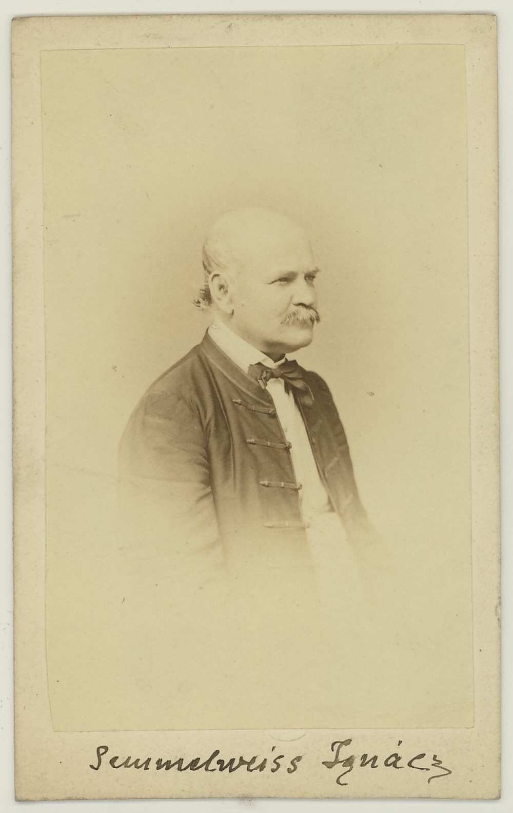
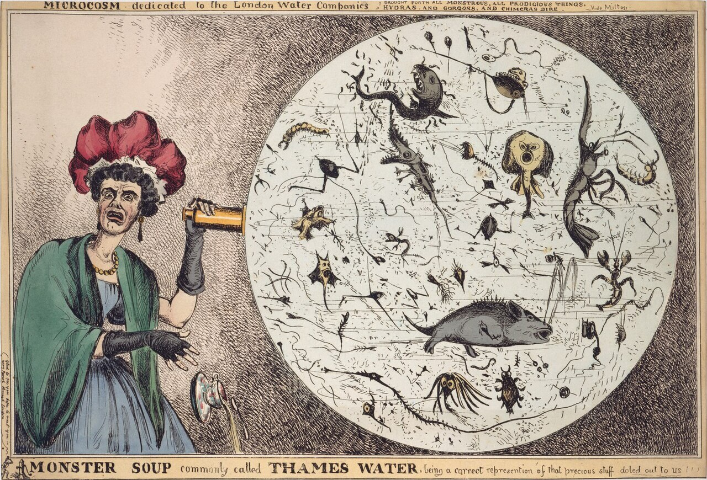
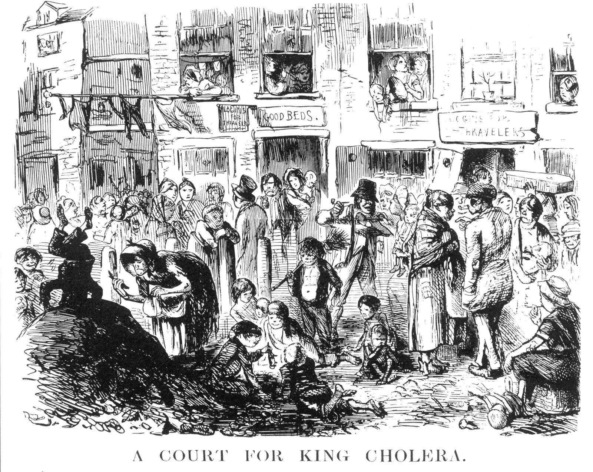
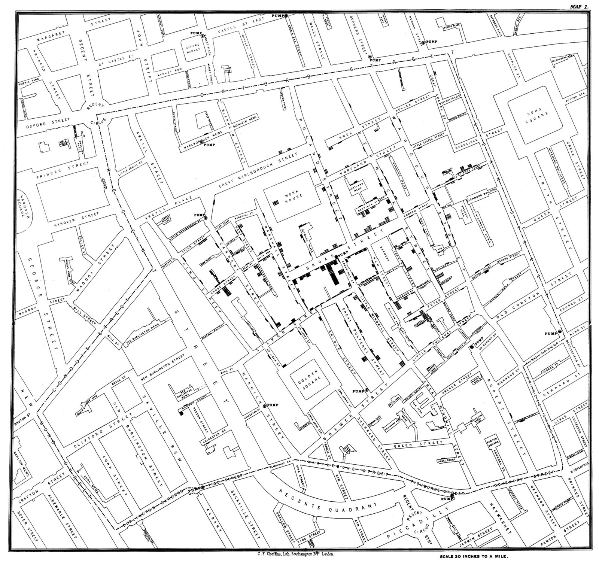
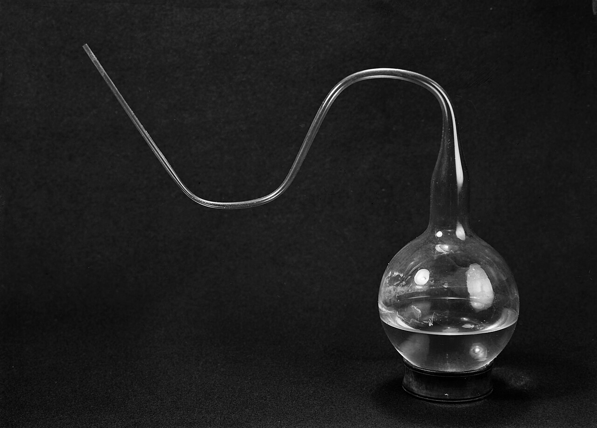
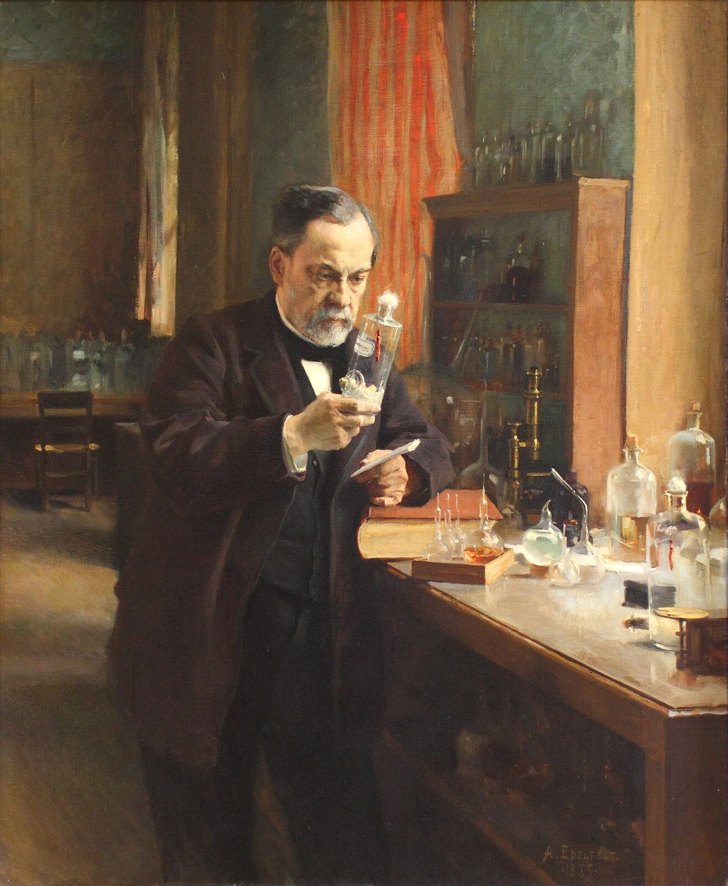
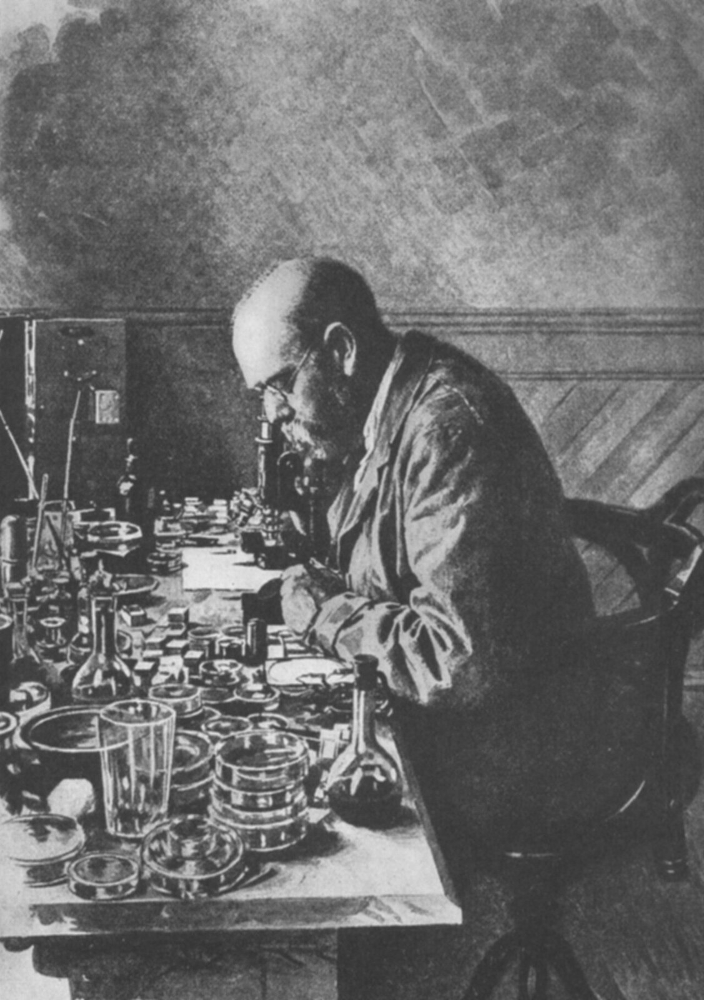
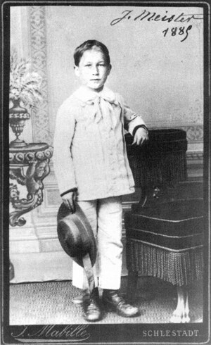
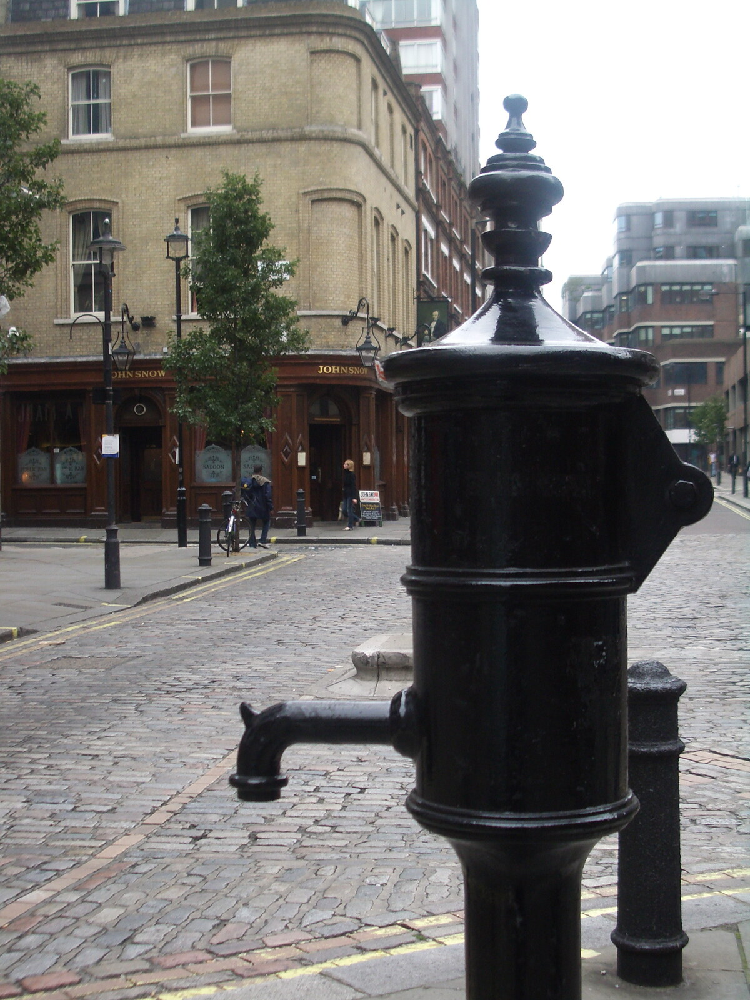

# 67. How did we learn that germs cause disease?

*Europe, from 1847 to 1900*

We learned it in two steps. In the 1840s and 1850s, two doctors showed by careful counting that disease was being carried on unwashed hands and in dirty water, and most of their profession would not believe them. Then, between 1860 and 1885, a French chemist and a German country doctor saw the culprits under the microscope and proved that particular tiny living things cause particular diseases.

In the 1840s the General Hospital of Vienna had one of the largest maternity departments in the world, and it was divided into two clinics. They stood side by side and admitted patients on alternate days. Which clinic a woman entered depended on the day she happened to arrive.

That accident of the calendar mattered a great deal. In the first clinic, about one mother in ten died after giving birth, of a fever that began on the third day, swelled the belly and killed within the week. In the second clinic the figure was about one in twenty-five.

The women of Vienna knew this very well. Those who arrived on a first-clinic day went down on their knees and begged to be sent to the other. Some chose to give birth in the street on the way and be carried in afterwards, since those who did so seldom caught the fever. A woman who had her baby on the pavement was safer than one who had it in the care of the doctors.

A young Hungarian doctor named Ignaz Semmelweis, an assistant in the first clinic, could not stop thinking about the difference. The two clinics had the same food, the same linen, the same air. He checked each of the accepted explanations and found that none fitted.

In the end he found that the difference that mattered lay in the staff. The second clinic was staffed by midwives. The first was staffed by doctors and medical students, and they came to the wards each morning straight from the dissecting room, where they had been cutting up the bodies of women who had died the day before.

*Ignaz Semmelweis, photographed in 1860, five years before he died. Photo: Borsos és Doctor, public domain.*

What turned that difference into an explanation was a death. In 1847 a friend of his, a professor, was nicked on the finger by a student's knife during a dissection. He died within days, with the same symptoms as the mothers. The professor had not given birth, and he had not been a patient in either clinic. What he shared with the dead women was contact with a corpse.

Semmelweis therefore concluded that something from the corpses was being carried into the wards on the doctors' hands. If that was so, the remedy was simple. He put a basin of chlorine solution at the door of the clinic and made everyone scrub until the smell of the dissecting room was gone.

Within a few months the death rate in the first clinic had fallen below that of the second.

His colleagues were not grateful. He was telling the most eminent physicians in Europe that they had been killing their patients with their own hands, and he could not say what the deadly substance was. He had numbers, and nothing that anybody could see. As a result, his contract was not renewed. He went home to Budapest, wrote increasingly abusive letters to the professors of Europe, calling them murderers, and in 1865 was lured into a lunatic asylum, where he died two weeks later at forty-seven, of an infected wound.

## Bad air

The doctors who dismissed him were not fools. They had a theory, and it was two thousand years old and fitted most of what they saw.

Disease, they held, was caused by bad air. Rotting matter gave off a poisonous vapour, which they called a miasma, and people who breathed it fell ill. The idea is preserved in a word we still use: "malaria" is Italian for bad air.

It was a good theory in two ways. First, it explained why fevers haunted marshes and slums, and why sickness came in hot weather, when everything stank. Wherever people fell ill in large numbers, there was usually a bad smell close by. Second, it was a call to action. If filth caused disease, the remedy was to clean the streets, drain the swamps and ventilate the houses, and reformers who believed in miasma did a great deal of good.

The cities of the factory age, however, tested the theory hard. London in 1850 had two and a half million people and no sewage system worth the name. Instead, the waste of each house drained into a pit in the cellar or the yard, and there were two hundred thousand of these.

Then a convenience made matters worse. When the new flushing lavatory became fashionable, it sent far more water into the pits than they could hold, and the pits overflowed. To relieve them, the authorities allowed them to be connected to the street drains, which emptied into the Thames. The same river supplied much of the city's drinking water. In effect, Londoners were now drinking what their neighbours had flushed away.

*"Monster Soup commonly called Thames Water", a cartoon of 1828 by William Heath. A woman looks through a microscope at her drinking water and sees it swarming with monsters. Print: William Heath, public domain.*

Into these cities came a new disease. Cholera had long been at home in the delta of the Ganges. From 1817 it began to travel along the trade routes, with the armies and the steamships, and in 1831 it reached Britain.

It was a frightening disease even by the standards of the time, because it killed so fast. A healthy person could wake up well, be seized by cramps and uncontrollable diarrhoea, turn blue and shrivelled as the water drained from the body, and be dead by nightfall. It came back in 1848 and killed fifty thousand people in England.

*"A Court for King Cholera", a cartoon from Punch in 1852, showing a crowded London court of the kind where the disease took hold. Image: Punch, public domain.*

## The pump

Most doctors took it for granted that cholera, like other fevers, came from bad air. A London doctor named John Snow doubted that it could be breathed in at all. His reason was the path the disease took through the body. It attacked the gut and left the lungs alone, which is an odd thing for a poison in the air to do. He suspected, instead, that people swallowed it.

A suspicion of that kind needed a test, and in 1854 one arrived on his doorstep. At the end of August the disease broke out in Soho, a few streets from the rooms where Karl Marx was living. More than five hundred people died within ten days, almost all of them inside a circle a few hundred metres across.

Snow did what Semmelweis had done, and looked for the one thing the victims had in common. He went from house to house asking where each of them had got their water. Afterwards he marked the deaths on a street map, as small black bars stacked against each address.

*John Snow's own map of the cholera deaths in Soho in 1854. Each black bar marks a death at an address, and they cluster around the pump in Broad Street. Map: John Snow, public domain.*

The bars clustered around a public pump in Broad Street, whose water was popular because it tasted clean. A cluster alone, however, proved little, since bad air could also hang over a few streets. What made the case was the people who did not fit the pattern.

Some of them lived beside the pump and stayed well. A workhouse on the next street, with five hundred inmates, had only a handful of deaths. It had its own well. The seventy men at a brewery in Broad Street itself did not fall ill at all. They were given free beer and never touched the pump. All of these people breathed the same air as their dying neighbours. What they did not share was the water.

Others lived far away and died all the same. A widow who had moved to a village miles away died of cholera that week, and so did her niece. She had breathed none of the air of Soho. She had, however, liked the Broad Street water so much that she had a bottle of it brought to her by cart every day.

Snow took his findings to the parish officials, and on 8 September they removed the handle of the pump, so that nobody could draw water from it. It was found later that a leaking cesspit lay a metre from the well.

He then produced something stronger still. Soho was a single outbreak around a single pump, and a sceptic could call it a coincidence. South London offered a comparison on a far larger scale. It was supplied by two rival water companies, whose pipes ran down the same streets, so that next-door neighbours often drank different water. They lived in the same air, on the same ground, in the same kind of house. The great difference between them was the water.

The two supplies were not alike. One company drew from the Thames within the city, among the sewer outlets. The other had recently moved its intake upstream. Snow counted the cholera deaths house by house. The customers of the first company were dying at more than eight times the rate of the customers of the second.

It was as near to proof as counting could come. Even so, the medical authorities still preferred bad air, since Snow, like Semmelweis, could not produce the poison. He could show where it travelled, and he could not show what it was.

London got its sewers a few years later, and it got them for the wrong reason. In the hot summer of 1858 the stench of the Thames became so appalling that Parliament, which sits on the riverbank, soaked its curtains in chloride of lime and voted the money in eighteen days. The members were acting on the theory of bad air: they wanted the smell gone. Over the next few years an engineer built eighty miles of great brick tunnels to carry the city's filth downstream.

The smell went away, and with the filth carried downstream, far less of it reached the drinking water. Cholera struck once more, in 1866, in the east of the city, where the system was not yet finished and a water company's reservoir was fouled, and never returned.

## Swan necks

Snow and Semmelweis had both been stopped by the same question: what, exactly, was the poison? It was answered by a man from outside medicine altogether.

Louis Pasteur was not a doctor. He was a French chemist, the son of a tanner, who taught at a university in an industrial town. In 1856 a local manufacturer who made alcohol from beet juice came to him for help, because some of his vats were going sour and nobody could say why. Pasteur put samples under his microscope and compared them. In the healthy vats he saw round globules of yeast. In the sour ones he saw, as well, a swarm of much smaller rod-shaped specks.

The specks mattered because of what chemists then believed. They thought of fermentation, the process by which sugary juice turns into alcohol, as a purely chemical event, in which the yeast was a by-product. Pasteur showed that it was the other way round. Fermentation was the work of living things. Yeast is a microscopic fungus that feeds on sugar and gives off alcohol. Other microbes feed in other ways and give off acid. A vat goes sour, therefore, when the wrong ones get in.

Where did they come from? Many scientists believed that such tiny creatures simply arose, by themselves, out of decaying matter. If they were right, there was no keeping microbes out of anything, since any broth or juice would breed its own.

Pasteur settled the question with an experiment of great elegance. He put broth into glass flasks and then heated and drew out the neck of each flask into a long, thin S-shaped curve, like the neck of a swan, open at the end. He boiled the broth to kill whatever was in it. The point of the odd shape was to let one thing through and stop another. Air could pass freely in and out. Dust, however, settled in the bend of the neck and could not reach the liquid.

*A swan-necked flask used by Pasteur in his experiments to disprove the doctrine of spontaneous generation. Photo: Wellcome Collection, CC BY 4.0.*

If life arose by itself from broth and air, the broth in these flasks should soon have clouded over, since it had plenty of both. Instead, the broth stayed clear, for months and then for years. Yet when he tipped a flask so that the liquid touched the dust in the bend and ran back, it was cloudy with life within a day or two. Microbes did not arise from nothing. They rode on the dust in the air, and they were everywhere.

Pasteur put the discovery to work at once. He showed France's wine makers that heating their wine gently, to a temperature well below boiling, killed the microbes that spoiled it without harming the taste. The process, later applied to milk, is called pasteurisation.

Then he drew the larger conclusion. If microbes could turn a vat of beet juice sour, they might equally be what turned a wound septic and a healthy body sick.

*Louis Pasteur in his laboratory, painted by Albert Edelfelt in 1885. Painting: Albert Edelfelt, public domain.*

## Carbolic

The first person to act on that thought was a surgeon in Glasgow named Joseph Lister.

Surgery in the 1860s was in a strange position. Twenty years earlier, dentists and surgeons in America had discovered that a patient who breathed ether felt no pain, and for the first time a surgeon could work slowly and carefully. More operations were being done than ever before, and nearly half of those who had a limb cut off died afterwards.

Most of those deaths came some days later, in the ward. The wound turned red and hot, then foul, and the patient died of fever. Surgeons called it hospital disease and blamed the air of the wards. Since they blamed the air, they saw no reason to worry about their hands or their clothes. They operated in old coats stiff with dried blood, which they wore with pride as a mark of experience, and probed wounds with unwashed fingers.

A colleague showed Lister the reports of Pasteur's work, and he saw what they implied. If the rot in a wound was caused by living things arriving from outside, the remedy was to kill them before they got in. For that he needed something that destroyed microbes without destroying flesh. As it happened, he had heard that a nearby town had been using carbolic acid, a chemical made from coal tar, to take the stink out of its sewage.

His chance to try it came in August 1865, when an eleven-year-old boy was brought to his hospital with a leg broken by a cart wheel, the bone sticking out through the skin. An injury of that kind usually ended in amputation or death, because the open wound went bad. Lister set the bone, dressed the wound with lint soaked in carbolic acid, and kept it covered. Six weeks later the boy walked out.

After that, Lister extended the method to everything. Instruments, dressings and the surgeon's hands were all washed in carbolic, and a pump filled the air of the operating room with a fine spray of it. In his wards, deaths after amputation fell from nearly one in two to about one in seven.

Nevertheless, it took a generation for the rest of his profession to follow, and many of the old surgeons mocked his invisible enemies until they retired.

## A country doctor's microscope

Pasteur and Lister had shown that microbes cause decay and infection. That was a general claim. It had still to be proved, for any human disease, that one particular microbe was the cause. That was done by a district doctor in a small town in eastern Germany.

Robert Koch was in his early thirties, with a busy country practice and a microscope that his wife had given him for his birthday. The farmers around him were losing sheep and cattle to anthrax, a disease that could also kill the people who handled the hides. Others had noticed tiny rods in the blood of animals that died of it. To trace their part in the disease, Koch set up a laboratory behind a curtain in his consulting room and worked there in the evenings for three years.

*Robert Koch at his microscope, in a photograph of about 1885, with glass dishes and flasks of the kind he used for growing germs. Photo: unknown, public domain.*

He built his proof in three steps. First, he took blood from a dead sheep and injected it into a mouse, which died, with the rods in its blood. That showed the disease could be passed on with the blood, but something else in the blood might have been to blame. Second, therefore, he grew the rods outside any animal, in a drop of fluid from an ox's eye, watching them through the microscope for hours as they lengthened into threads and formed hard little seeds that could survive for years in the soil. Third, he gave mice the rods grown in the dish, many generations removed from any sick animal, and they died of anthrax. Nothing had come from the sheep to those mice except the descendants of the rods.

In 1876 he published the complete life story of the organism. It was the first complete proof that a specific bacterium caused a specific disease.

What Koch did next was to invent the tools that made hunting germs a routine. The first difficulty was seeing them. Bacteria are nearly transparent, so he stained them with the new chemical dyes, which different kinds of microbe soak up differently. The second difficulty was telling them apart, since a sample from a sick body could hold many kinds mixed together. To separate one kind from another, he needed to grow them on something solid, where each would form its own visible spot. The wife of one of his assistants suggested the seaweed jelly that she used for setting jam, which stays firm when warm. A few years later another assistant, whose name was Petri, designed a flat glass dish with a lid to hold it.

Meanwhile, Koch had gone after a far bigger target than anthrax. On 24 March 1882, he stood up at a meeting of doctors in Berlin and announced that he had found the cause of tuberculosis. This was the great killer of the age, responsible for one death in seven in Europe, and thought by many to be inherited. If a germ caused it, then it was caught and not inherited. He had brought his specimens and set them out under a row of microscopes, so that nobody had to take his word for it. His audience, one of those present recalled, sat in silence when he finished, and then came forward to look.

The twenty years from 1880 were the most fruitful in the history of medicine. Using methods like his, researchers pinned down the germs of typhoid, cholera, diphtheria, tetanus, pneumonia and plague, at the rate of about one a year. Others found that malaria and yellow fever were carried by mosquitoes.

## Mauve

The dyes that Koch used were themselves new, and they had come into the world by accident. In 1856 an eighteen-year-old chemistry student in London, working at home in the Easter holidays, was trying to make quinine, the medicine for malaria, out of a waste product of coal gas. He failed, and was left with a black sludge at the bottom of his flask. When he rinsed it out with alcohol, however, it turned a brilliant purple, and he found that it would dye silk. He called the colour mauve, opened a factory at nineteen, and retired a rich man at thirty-six.

The discovery mattered far beyond one young man's fortune. Until then almost every dye had come from a plant, an insect or a shellfish. Mauve was the first laboratory dye to be made and sold on a large scale, and it launched an industry.

Although mauve was found in London, that industry grew up in Germany. Making new dyes required trained chemists in large numbers, and Germany had them. German universities had led the world in turning their professors' laboratories into training schools, where students learned by doing original experiments and earned a degree for a piece of new research. By the 1870s they were producing trained chemists by the hundred.

The German dye firms hired them, and did something that no business had done before. They set up laboratories of their own, in which salaried scientists were paid to invent new products, year after year. Discovery had been the work of gifted individuals with private means or patient employers. Now it was a department of the company.

It paid handsomely. By 1900 Germany made more than four fifths of the world's dyes, and its dye laboratories had begun to turn out medicines, of which the first great success was aspirin. Medicine was moving the same way. Koch had begun behind a curtain in his consulting room, and he ended as the director of a state institute in Berlin with dozens of salaried researchers.

The same idea took hold across the Atlantic. In 1876 an American inventor, Thomas Edison, built a workshop in the countryside outside New York, staffed it with machinists, chemists and mathematicians, and announced that it would produce a minor invention every few weeks and a big thing every six months or so. Three years later it produced a practical electric lamp.

## Fourteen bites

Knowing the cause of a disease is not the same as curing it. The first rewards of the germ theory came, instead, in prevention.

One method of prevention already existed. It had been known since the 1790s that a person deliberately infected with cowpox, a mild disease of cattle, was protected from smallpox. Nobody knew why, and the trick worked for that one disease alone. It gave no method for protecting against anything else. Pasteur found out how to do it on purpose.

He found it, as it happened, partly by luck himself. In 1879 he was studying a disease of chickens, growing its germ in flasks of broth. He found that broth which had stood for weeks lost its power to kill. Hens injected with it barely sickened. Pasteur did not stop there. He gave the same hens a fresh, deadly dose, and they lived. The stale germs had been too weak to kill, but strong enough to teach the body how to resist. Chance, he liked to say, favours only the prepared mind.

Here, then, was a general recipe: weaken a germ, and give it to a healthy animal before the real disease arrives. He applied the idea of a weakened germ to anthrax, and in 1881 he accepted a challenge to prove it in public. On a farm outside Paris, before a crowd of vets, farmers and journalists, he vaccinated twenty-five sheep and left twenty-five alone. Two weeks later all fifty were given a deadly dose of anthrax. When the crowd came back two days after that, the unvaccinated sheep were dead or dying in the field, and the vaccinated ones were grazing.

Sheep were one thing. A human patient was another. In July 1885 a woman came to his laboratory from Alsace with her nine-year-old son, Joseph Meister, who had been bitten fourteen times by a rabid dog.

Rabies has a peculiarity that gave Pasteur an opening. It takes weeks to develop after a bite, and once its symptoms appear it is almost always fatal. Pasteur had been working on a treatment made from the dried spinal cords of infected rabbits, meant to build up resistance in that interval, and had tested it thoroughly only on dogs.

The decision was a hard one. He was not a doctor and had no licence to treat anyone. On the other hand, if the disease took hold in the boy, nothing could save him. Pasteur consulted two medical colleagues, and one of them gave the first injection that evening. The boy was given thirteen injections over ten days, each stronger than the last, and went home well.

*Joseph Meister, the boy bitten by a rabid dog, in a studio photograph inscribed 1885. Photo: unknown, public domain.*

The news travelled fast. People bitten by mad dogs came to Paris from as far as Russia and the United States. Donations poured in from all over the world, the emperor of Brazil among the givers, and with the money Pasteur built an institute for research and treatment, which bears his name.

## The handle

The largest effects were quieter than any of this. Cities had begun cleaning themselves up in the name of bad air, and for that reason they had been cleaning half blind, chasing smells. Once it was known that disease travelled in water, milk and filth as living particles that could be filtered out or killed, they knew what they were aiming at. They built sewers, piped in clean water and passed it through sand, inspected dairies, and taught mothers to boil the baby's bottle. Surgeons stopped operating in their street clothes.

No single discovery has changed the human condition more. Through most of history, in most places for which there are records, about a quarter of all babies died before their first birthday and nearly half of all children before they grew up, in the palaces of kings as well as in hovels. In the countries that adopted these measures, the deaths of children fell steeply from the late 1800s, and they have kept falling. Life expectancy at birth in England was about forty when John Snow drew his map. A century later it was nearly seventy.

In Soho, a pump stands on the pavement near the spot where the old one stood in Broad Street. It was put up as a memorial, and it has no handle.

*The memorial pump in Broadwick Street in Soho, a replica with no handle, with the John Snow pub behind it. Photo: Justinc, CC BY-SA 2.0.*
