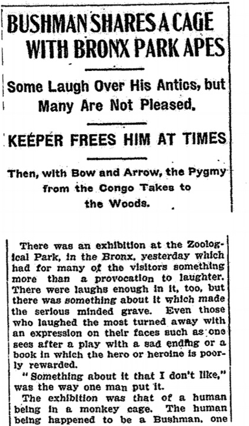
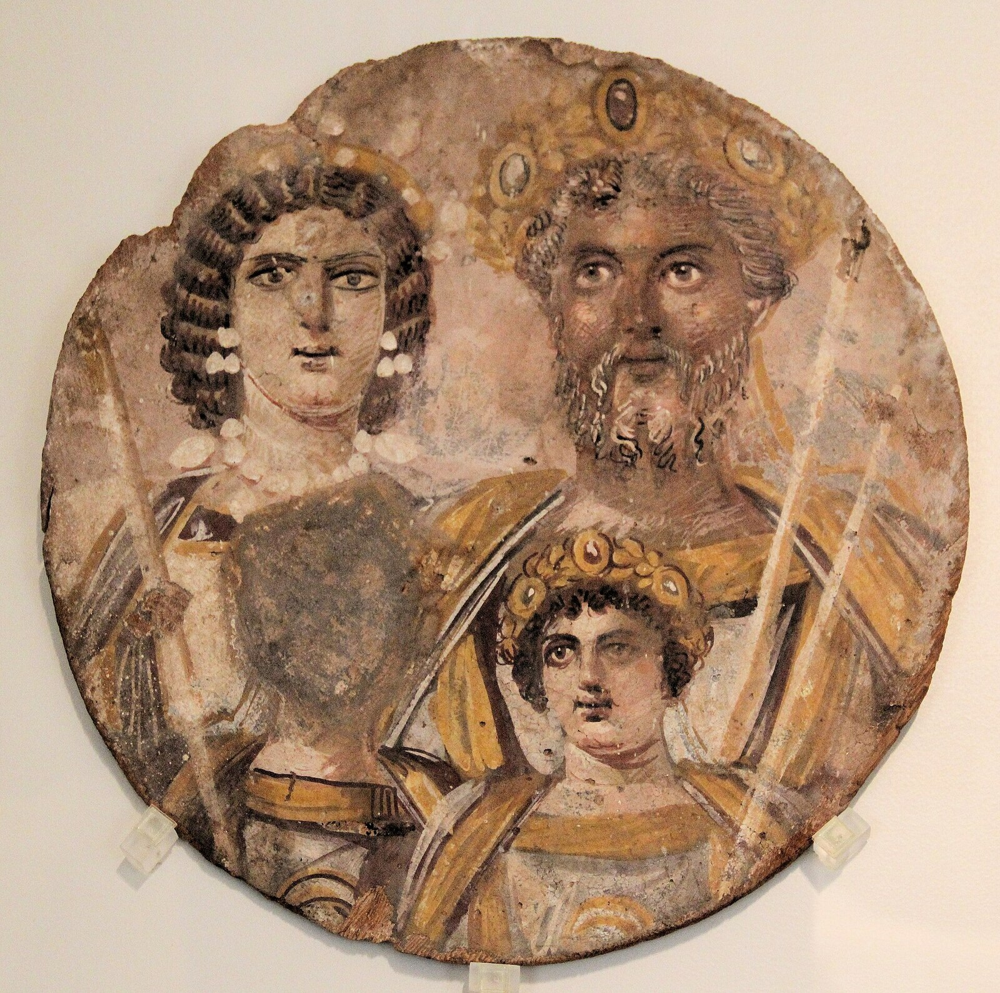
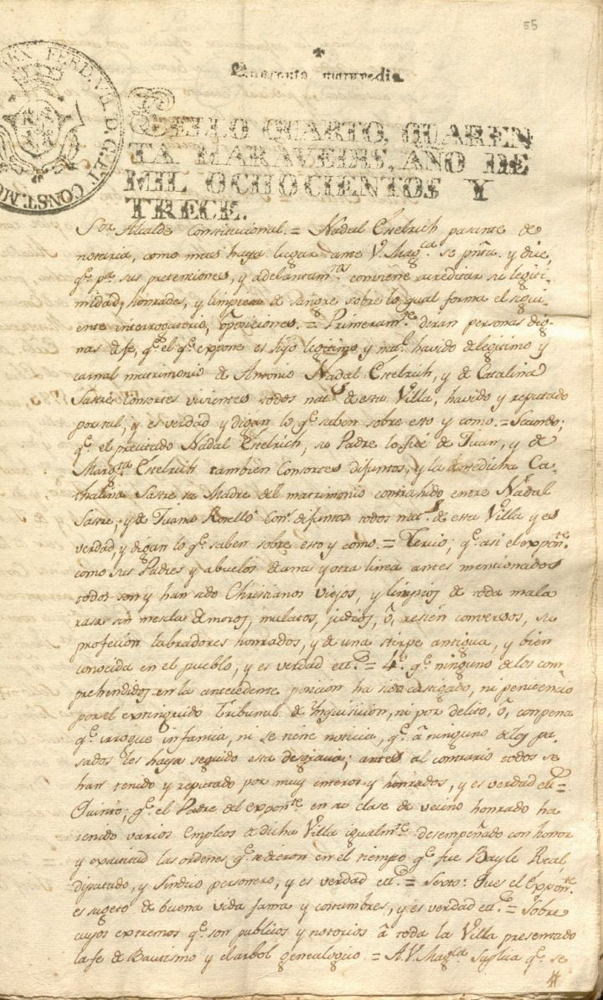
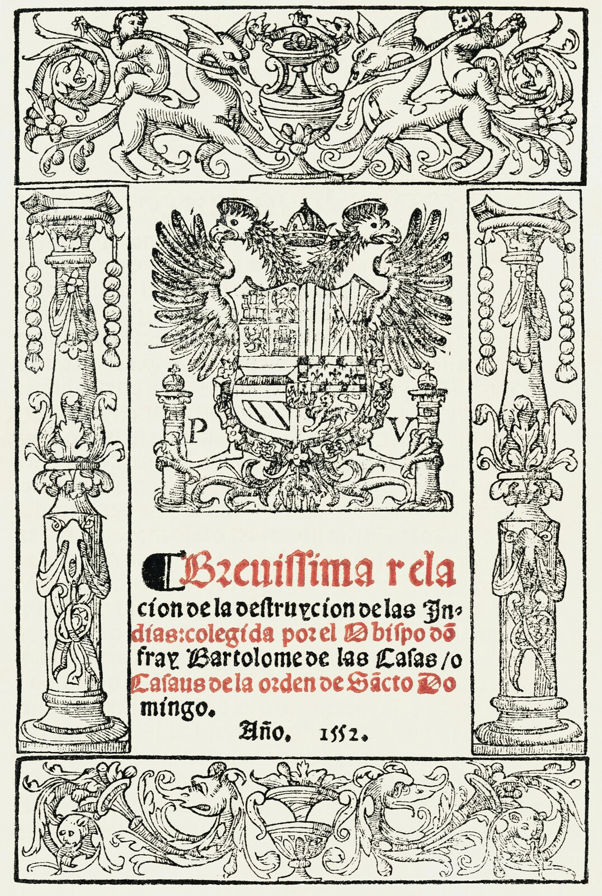
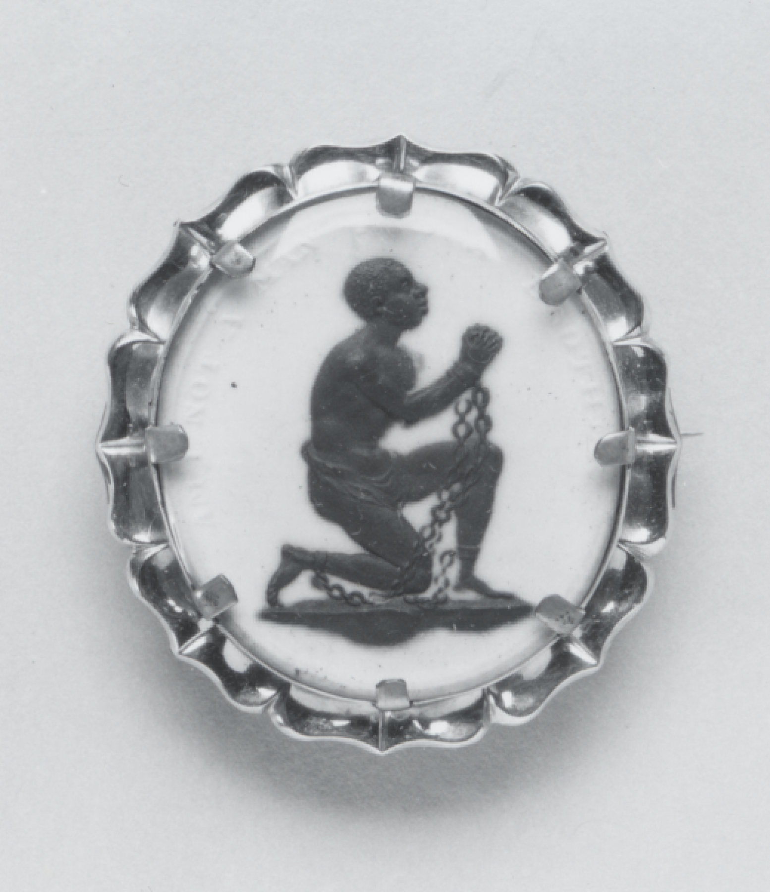
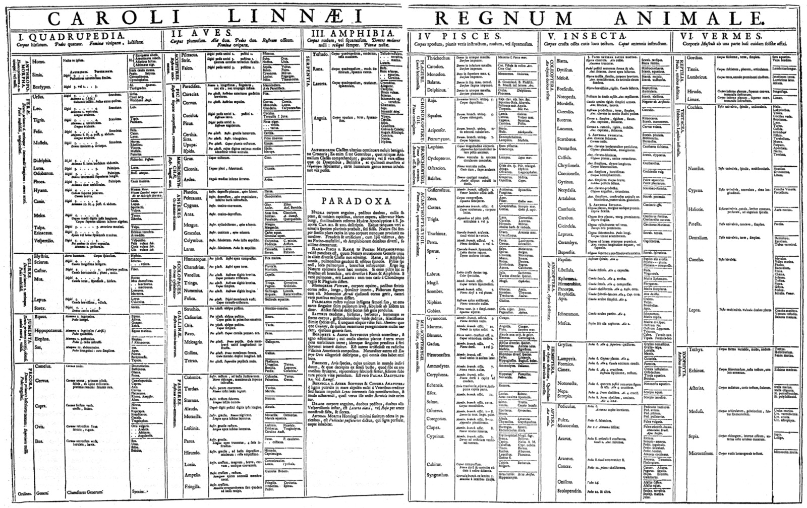
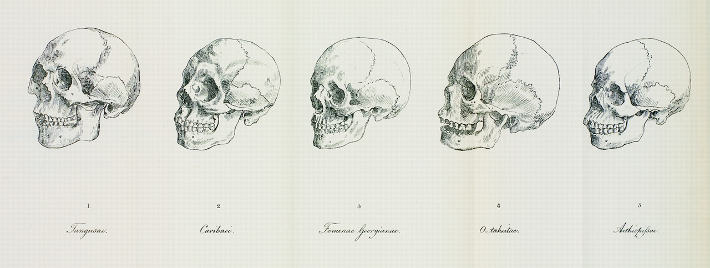
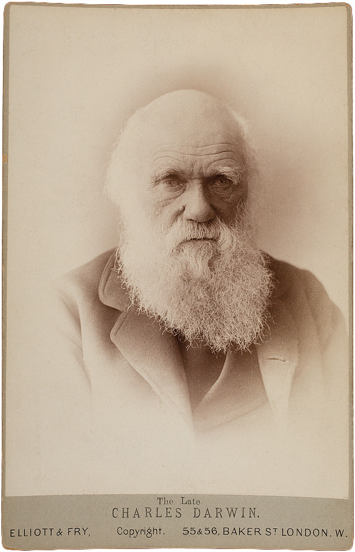
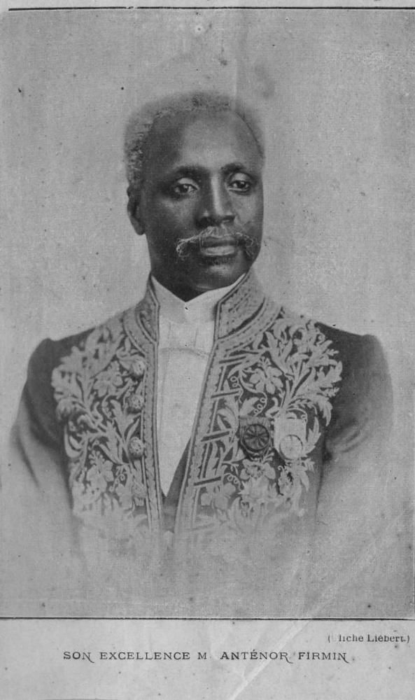
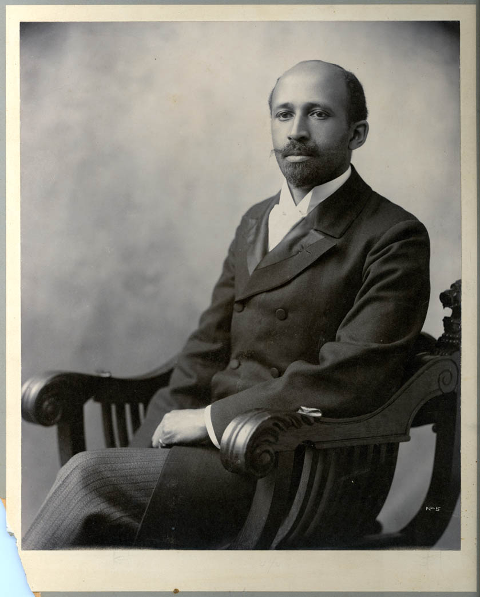

# 68. Where did racism come from?

*Europe and the Americas, from 1449 to 1927*

Distrust of strangers is as old as humanity. The belief that mankind is divided by nature into a few "races", ranked from higher to lower, is only three or four hundred years old. It grew up around the Atlantic slave trade, among people who needed a reason why some human beings could be owned, and it was later dressed in the language of science.

In September 1906, visitors to the zoo in the Bronx, in New York City, found a new exhibit in the monkey house. Sharing a cage with an orangutan was a young man. He was a little under a metre and a half tall, and his teeth had been filed to points in the fashion of his people. A sign on the cage gave his name, Ota Benga, his height, his weight, and the place where he had been obtained, the Kasai river in the Congo. It added that he would be exhibited each afternoon.

The exhibit was a great success. On the second Sunday, forty thousand people came. Crowds followed him round the grounds, howling and jeering and poking him to see what he would do.

What is striking is how few of the people in charge were troubled by this. The zoo's director, a respected scientist, saw nothing wrong. He called it an ethnological exhibit, meaning a display of one of the peoples of the world. The city's leading newspaper agreed that the man was probably enjoying himself, and observed that people of his kind were very low in the human scale.

*The New York Times of 9 September 1906 reported on the exhibit. The headline uses the ugly label of the day and the report itself says that many visitors found it more than a provocation to laughter. Clipping: The New York Times, 1906, public domain.*

The objection came from elsewhere. A group of Black clergymen, with one white minister, protested to the mayor. Their race, one of them said, was depressed enough without being exhibited with the apes. After three weeks Ota Benga was released into their care.

He tried to make a life in America. He learned English, had his teeth capped, and worked in a tobacco factory in Virginia. All the same, he wanted to go home. The war that began in 1914 closed the sea routes, and in 1916 he shot himself.

The men who put him in the cage were not ignorant. They were educated people at one of the great scientific institutions of a modern city, and they believed that they were illustrating a fact of nature.

## Barbarians

People have always divided the world into us and them. A foraging band feared the band over the hill. The Greeks called everyone who did not speak Greek a barbarian, because foreign speech sounded to them like "bar-bar". The Chinese spoke of raw and cooked peoples, according to how far each had adopted Chinese ways. In most of these cases the insult was aimed at how the stranger spoke and lived.

These divisions were contemptuous, and they could be lethal. They were different in kind, however, from what came later, and the difference lay in what a person could do about them. A barbarian was someone with the wrong language, the wrong gods or the wrong customs, and all of those can be changed.

Rome shows how far this could go. The grandson of a Gaul whom Caesar had conquered could be a Roman senator. One Roman emperor was born in North Africa and spoke Latin with an African accent, and it was no bar to the throne.

*The emperor Septimius Severus, born in North Africa, with his wife Julia Domna and their son Caracalla, painted about the year 200 and found in Egypt. The face of the other son, Geta, was scrubbed out after his death. Now in Berlin. Photo: Gary Todd, CC0.*

Even slavery followed no line of ancestry. Slavery in the ancient world had nothing to do with colour. Romans enslaved Greeks, Germans, Britons, Syrians and Africans without distinction, and a freed slave's children were citizens. The word "slave" itself is a reminder of this. It comes from the Slavs of eastern Europe, who were sold in such numbers in the Middle Ages that their name became the word for the condition.

In medieval Europe the line that mattered was religion. Christians persecuted Jews and fought Muslims. This line, too, could be crossed. The remedy the church offered was baptism, and in principle a convert became a full member of the community.

Some of the materials of racism were already lying about. Nobles everywhere prided themselves on their birth, and philosophers had argued that some peoples were born to be slaves. What was missing was a rule that shut a whole community out for ever on account of its ancestry, whatever its members believed or did. One of the first appeared in Spain.

## Clean blood

Medieval Spain had the largest Jewish population in Europe. In the late 1300s, after a wave of massacres, tens of thousands of Spanish Jews accepted baptism, and they and their children prospered. Freed from the old restrictions, they became bishops, judges, tax officials and royal counsellors.

Their success was resented, and the resentment fastened on their ancestry. In 1449, during a riot over taxes, the rebels who had seized Toledo passed a decree that no one of Jewish descent could hold public office in the city, however sincere a Christian he was.

The pope condemned it. It spread anyway. Over the following century, cathedral chapters, universities, religious orders and guilds across Spain adopted rules requiring an applicant to prove that he had no Jewish or Muslim ancestor. The quality being certified was called purity of blood. To get a post, a man now had to answer for his ancestors as well as for himself.

This was something new, and it ran against the church's own teaching. Baptism was supposed to make a new person. Now there was a stain that no sacrament removed, which passed from parent to child in the blood. A man could change his faith, but he could not change his grandparents. In 1492, the year Columbus sailed, the Spanish crown expelled every Jew who would not convert, and the suspicion of those who stayed lasted three hundred years.

*The first page of a proof of clean blood from Mallorca, written in the early 1800s, more than three centuries after the first such rules. Witnesses swear that the applicant's ancestors were old Christians, free of any mixture of Moors, mulattos, Jews or recent converts. Photo: Mollasmac, CC BY 4.0.*

Spain's conquests in America then raised a question on a far larger scale. By what right did Spaniards make war on the people of the new lands and put them to forced labour? The question troubled the Spanish court enough for it to be put to a formal debate. In 1550 the king of Spain suspended all further conquests and summoned a panel of theologians to hear the matter argued.

Two men spoke, and they gave opposite answers. A scholar who had never been to America maintained, from the writings of Aristotle, that the Indians were slaves by nature, born to be ruled by their betters. Against him stood a friar, Bartolomé de las Casas, who had spent forty years in the colonies. All the peoples of the world are human, he said, and there is only one definition of a human being. The panel never gave a verdict, and the conquests resumed. The question of whether some peoples were born to serve was left open.

*The title page of A Short Account of the Destruction of the Indies by Bartolome de las Casas, printed in Seville in 1552. Scan: Wikimedia Commons, public domain.*

## The word "white"

The clearest view of race being made comes from the English colony of Virginia, because the process was written into its laws. The laws can be read in order, and they show a line being drawn where there had not been one.

In its first half century Virginia grew tobacco with bound labour of two kinds. Most of the workers were poor English men and women serving terms of four to seven years. From 1619 there were also Africans.

In those early decades the line between the two was blurred. Black and white servants worked in the same fields, drank together, ran away together and had children together. Nor was an African certain to stay in bondage. Some Africans served out their time and went free. One of them, a man named Anthony Johnson, owned a farm of a hundred hectares on the coast and held servants of his own.

For the planters, this mixed labouring class was dangerous. Servants who worked, drank and ran away together might also fight together. In 1676 the danger became real. A discontented gentleman raised a rebellion against the governor, and landless former servants and enslaved Africans flocked to him together. They burned the colony's capital to the ground. Among the last rebels to give up was a mixed band of Black men and English servants.

The planters drew the lesson, and they acted on it in two ways. First, they changed their workforce. Over the next generation they bought fewer English servants and many more Africans, who served for life. A servant for life never became a landless free man with a grievance. Second, they set out to make sure that the poor of the two kinds would not combine again. The colony's laws had already begun to draw a line that had not been there, and now they finished the job.

The earlier laws had dealt with birth and religion. Since the 1660s a child had been slave or free according to the condition of the mother, so that slavery passed down by birth, and baptism had ceased to be a ground for claiming freedom. The door that the church had held open in Europe was thereby closed in Virginia.

The new laws went further and cut the two groups off from each other. Now marriage across the line was banned, and so was the freeing of slaves unless they left the colony. Meanwhile the poorest Englishman received small privileges that a Black man could not have: the right to carry a gun, to testify in court, to be whipped only with his shirt on. They gave the poor Englishman, however, a reason to feel that he stood on the planters' side of the line.

In these laws, from 1691, a new word appears. People who had been called English or Christian begin to be called "white".

## Five varieties

The 1700s presented slave owners with a difficulty that their grandfathers had not faced. It was the age that announced, in Paris and Philadelphia, that all men are born free and equal. Yet the same nations were shipping Africans across the Atlantic at a rate of eighty thousand a year. The two things could not both be right.

There were two ways out of the contradiction. One was to end slavery. The other was to decide that the word "men" did not cover everyone. The second was far cheaper for those who owned slaves, and many of them took it.

The man who wrote that all men are created equal owned six hundred people in the course of his life. He set down, in a book about his home state, his "suspicion" that Black people were inferior to whites in mind and body. A suspicion of that kind made the contradiction easier to live with.

*The anti-slavery medallion made by Josiah Wedgwood in 1787 for the campaign to end the slave trade. Its motto, "Am I not a man and a brother?", is almost hidden by the setting. Photo: Walters Art Museum, public domain.*

The naturalists of the age, meanwhile, were sorting the living world into classes and species, and they sorted humanity with the rest. To them it was all one task: a species was described, divided into varieties and given its place in the table. The great Swedish classifier of plants divided mankind into four varieties, one for each continent, and described each by colour and by character. The European, he wrote, was white, inventive and governed by laws. The African was black, lazy and governed by whim. In that one line, a prejudice about behaviour was set down beside a fact about skin, as if both were equally matters of observation.

*The table of the animal kingdom in the first edition of Linnaeus's Systema Naturae, 1735. Homo, with its human varieties, heads the list of four-footed animals, above the apes. Scan: Wikimedia Commons, public domain.*

A German professor refined the scheme a generation later. He owned a famous collection of human skulls, and from it he proposed five varieties. One of his names has lasted to this day, and it rests on a matter of taste. He thought the most beautiful skull in his cabinet was that of a woman from the Caucasus mountains, and so he named the European variety after it. That is the reason people of European descent are still called "Caucasian" on official forms.

*Five skulls from the collection of Johann Friedrich Blumenbach, drawn for his book of 1795. The third, labelled as a woman of Georgia, is the one that gave the Caucasian variety its name. Plate: Blumenbach, 1795, public domain.*

The professor himself believed that the varieties shaded into one another without a break and that none was superior. His categories outlived his cautions.

## A thousand skulls

In the 1800s the sorting hardened into a science, with instruments and tables. Description gave way, more and more, to measurement.

Its capital was the United States, where the question of what Black people were had become the question of whether the country would survive. A physician in Philadelphia gathered a thousand skulls from all over the world, filled each with seed and later with lead shot to measure its capacity, and published the averages. Europeans came out on top and Africans at the bottom.

The figures looked impressive, and that was their power. His readers concluded that the ranking of the races had been established with the precision of physics. In fact, his method could not show what he claimed. A larger skull mostly indicates a larger body, and the size of a person's brain is a very poor guide to what that person can do.

Others went further and denied that mankind was one family at all. The most famous scientist in America, a Swiss professor at Harvard, taught that the races had been created separately, as distinct species, each in its own region. If that were true, Africans and Europeans shared no ancestors at all. Slave owners quoted him with gratitude.

In Europe a French count gave the idea its most sweeping form. In four volumes published in the 1850s he argued that race was the key to all history. According to him, civilisations rose when a superior race conquered, and fell when it mixed its blood with that of its subjects. The noblest of all were the tall, fair people of the north, whom he called Aryans. The book sold poorly in France. It was read with great attention in Germany.

## The fittest

Into this argument came the most important scientific idea of the century. In 1859 Charles Darwin published his theory that species change over time, by the survival and breeding of the individuals best suited to their surroundings. He said almost nothing in that book about human beings. Readers were left to work out for themselves where mankind fitted in.

When he did turn to them, twelve years later, he gave no comfort to those who thought the races were separate creations. His conclusion was that all humans were a single species, descended from common ancestors, and more alike in mind than they were different. Darwin came from a family of campaigners against slavery, and he hated it. He also shared the assumptions of his class, and wrote calmly of the day when the civilised races would replace the savage ones.

*Charles Darwin, photographed in London in 1874 by Elliott and Fry. Photo: Elliott & Fry, public domain.*

His theory was put to uses that went far beyond that. If nature advanced by a struggle in which the weak died out, it seemed to follow that the same law held among human groups. An English philosopher coined the phrase "survival of the fittest" and applied it to society. On this view, rich nations and rich people had won the struggle and were therefore the fittest. The poor, and the peoples whom Europeans were conquering, had lost, and for the state to prop them up was to work against nature. A theory about plants and animals had been turned into an argument against helping the weak.

A cousin of Darwin's took the next step, from explaining the world to changing it. If the quality of a people was a matter of inheritance, he argued, it could be improved as farmers improve cattle. The able should be encouraged to have large families, and the unfit prevented from having any. In 1883 he gave this programme a name, eugenics, from the Greek for "well born".

Eugenics was not the creed of a few cranks. It was taken very seriously by progressive and scientific opinion on both sides of the Atlantic, and it was soon written into law. In 1907 the American state of Indiana passed a law permitting the state to sterilise criminals and the "feeble-minded", a loose label for anyone judged dull or troublesome, by an operation that left them unable to have children. Some thirty more states followed, and about sixty thousand Americans were sterilised under such laws. In 1927 the Supreme Court upheld them, in a judgement which declared that three generations of imbeciles were enough.

The same thinking was applied to people who had not yet arrived. Three years before that judgement, Congress had rewritten the immigration law to cut to a trickle the entry of the peoples of southern and eastern Europe, whom the experts classed as inferior stock.

## The burden

Abroad, race gave empire a mission. In the last decades of the 1800s the European powers and the United States took control of most of Africa and much of Asia. Conquest on that scale needed a justification, and race supplied one. The conquerors told themselves that they were doing it for the good of the conquered, who belonged to races not yet able to govern themselves.

An English poet put the idea into a phrase in 1899. He urged the Americans, who had just seized the Philippines, to take up the white man's burden, and to send their best sons to serve their new subjects, whom he described as half devil and half child. Empire, in other words, was a duty that the higher race owed to the lower.

The public at home was shown what those subjects looked like. At the world's fair held in Paris in 1889, under the newly built Eiffel Tower, more than four hundred Africans and Asians were housed in mock villages for visitors to stare at. Such "human zoos" toured Europe and America for fifty years and were seen by millions of people. Ota Benga himself had first been brought to America for one of them. By the time he stood in the monkey house, the crowds had been taught for a generation what they were supposed to see.

The same way of thinking transformed an older hatred. For centuries, Christians had despised Jews for their religion, and a Jew who was baptised was, at least in theory, no longer a Jew. In 1879 a German journalist argued that this missed the point. The Jews, he said, were a race, alien in blood, and conversion changed nothing. On this view, even the theoretical escape that baptism had offered was closed. He made famous a scientific-sounding word for his position: antisemitism. It was the old Spanish doctrine of clean blood, with a laboratory coat on.

One man who watched the new hatred at work drew a far-reaching conclusion from it. In 1895 a Jewish journalist from Vienna named Theodor Herzl stood in the courtyard of the military academy in Paris and watched a French army captain, a Jew falsely convicted of spying, have his sword broken while a crowd howled for the death of the Jews. The scene was all the more alarming for where it took place. France was the country that had first given Jews equal rights. If Jews were hated there, equal rights were no protection.

Herzl had been brooding for years on the new hatred in his own city, and he came to believe that Jews would not be safe anywhere as a minority. The following year he published a pamphlet proposing that they found a state of their own, and in 1897 he called a congress to begin the work. The movement was called Zionism, after a hill in Jerusalem, and the land it had in view was Palestine, then part of the Ottoman empire.

## The colour line

The whole structure was attacked from the beginning by the people it was aimed at. A former slave, Frederick Douglass, told an audience of American students in 1854 that pride and selfishness never want for a theory to justify them. His point was that the science had been found because it was needed. A Haitian lawyer answered the French count in a book of six hundred pages called *The Equality of the Human Races*.

Some of the attack came from measurement itself. In New York, an anthropologist measured the heads of thousands of immigrants and their American-born children, and found that the children's skulls differed in shape from their parents'. The race scientists had treated the shape of the skull as something handed down unchanged. The supposedly fixed mark of race, he concluded, could change in one generation with new surroundings.

*Anténor Firmin, the Haitian lawyer who answered the French count in The Equality of the Human Races (1885), photographed in 1889. Photo: C. Liebert, public domain.*

The decisive evidence came a century later, when it became possible to read human DNA, the chemical code that each person inherits from their parents. It showed that the human species is unusually uniform. The reason is that we are a young family. All living people descend from ancestors who lived in Africa within the last few hundred thousand years, which is a short time as species go.

As a result, there has been little time for differences to build up. Any two humans, chosen from anywhere on Earth, are alike in more than nine hundred and ninety-five of every thousand letters of their genetic code. Moreover, the differences do not fall where the race scientists expected. Of the small differences that exist, by far the greater part is found between individuals within any one group, and only a sliver separates the groups from one another.

The features by which the race scientists set such store turn out to be the shallowest of all. Skin colour is an adjustment to sunlight. It has darkened and lightened several times in different branches of the human family, and it has nothing to do with what lies behind the forehead. Nor has it always matched the map that the classifiers drew. A man who lived in the south of England ten thousand years ago, whose skeleton was found in a cave, had dark skin and blue eyes.

Race was a human invention. Its effects, however, were as real as those of any other institution, and they did not end when the science behind them collapsed. Long before that collapse, in 1903, a Black American scholar named W. E. B. Du Bois, who had studied in Berlin and at Harvard, opened a book of essays with a prediction. The problem of the twentieth century, he wrote, would be the problem of the colour line.

*W. E. B. Du Bois in the summer of 1907, four years after The Souls of Black Folk. Photo: unknown, public domain.*
