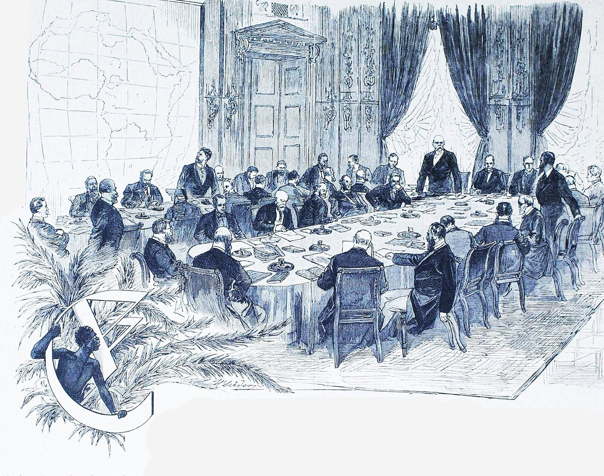
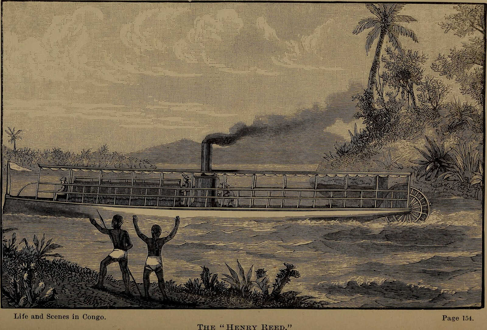
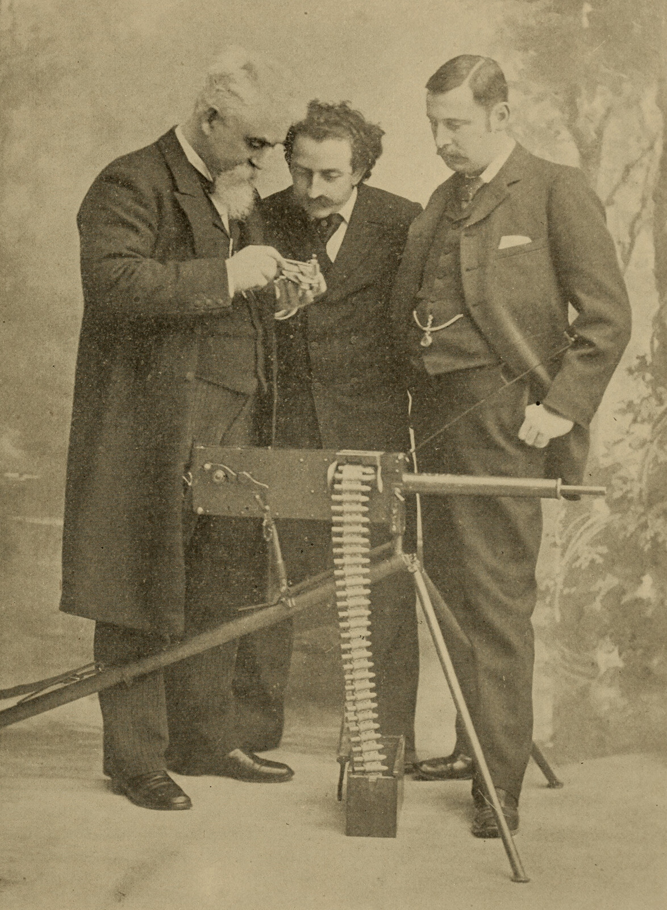
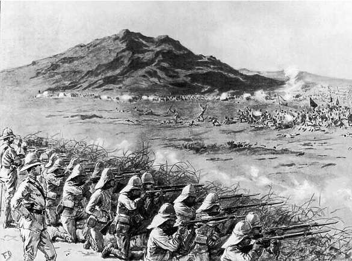
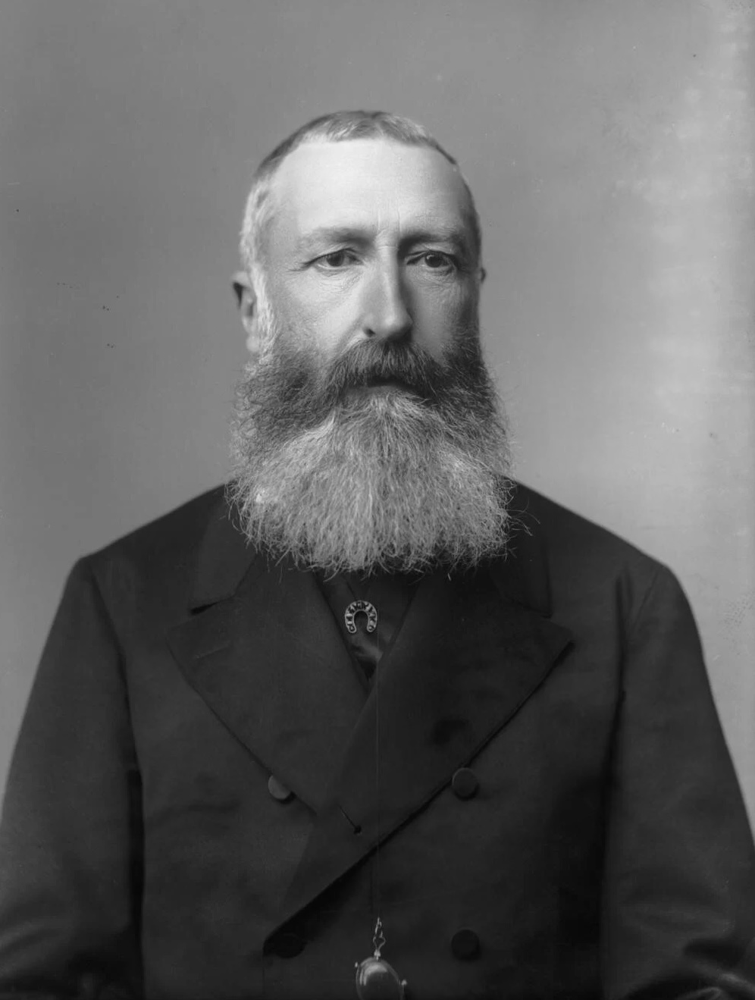
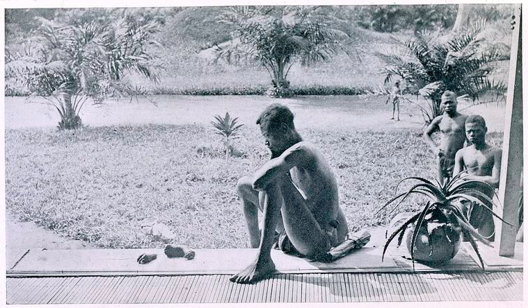
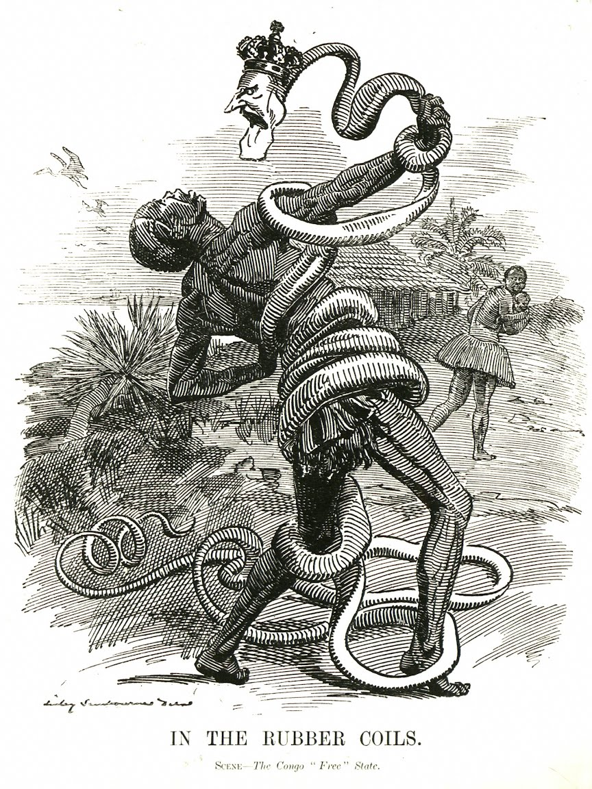
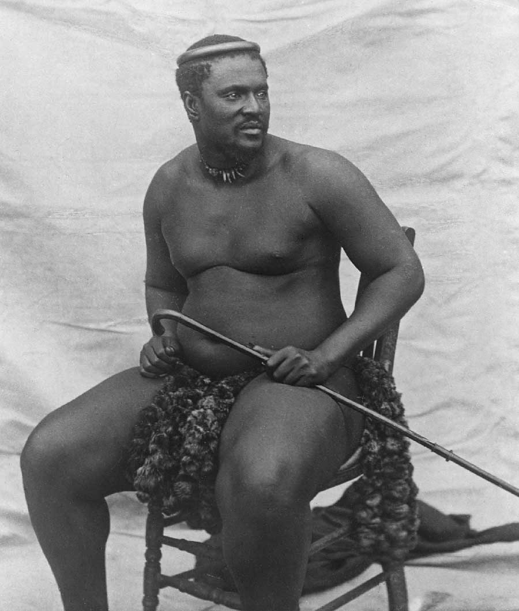
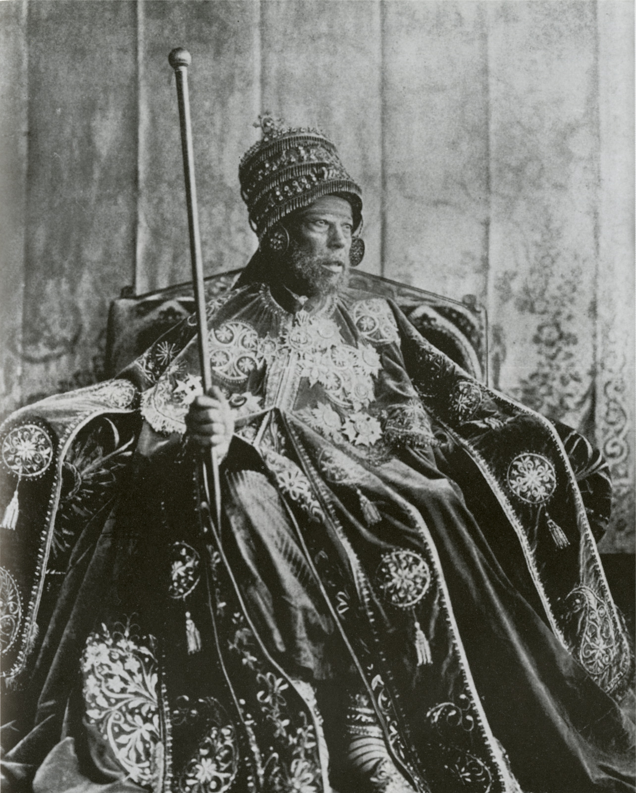
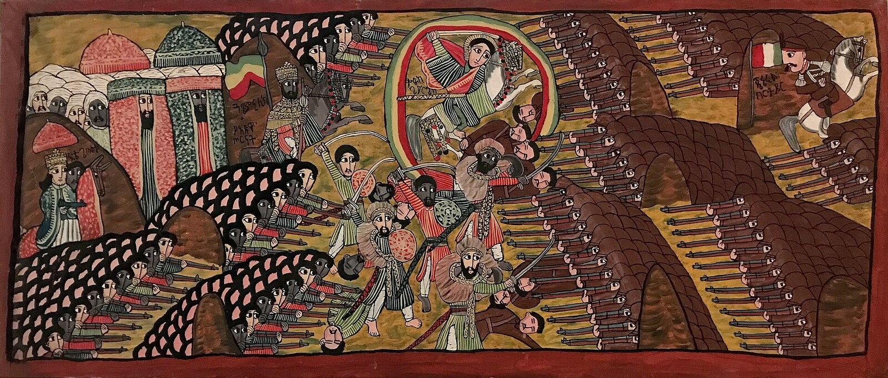

# 69. How did Europe take over Africa?

*Africa, from 1870 to 1914*

Europe took Africa with three inventions that it had lacked before: a drug against malaria, steamboats that could travel up rivers, and guns that fired hundreds of bullets a minute. For four centuries, fever and African armies had kept Europeans, with few exceptions, on the coast. Once those barriers were gone, the governments of Europe divided almost the whole continent among themselves in about thirty years, each hurrying for fear of being left out.

On 15 November 1884, the representatives of fourteen governments sat down at a horseshoe-shaped table in the official residence of the German chancellor in Berlin. On the wall behind them hung a large map of Africa. Most of its interior was blank.

*The conference in session in Berlin, engraved for the German magazine Die Gartenlaube in 1884. A large map of Africa hangs on the wall behind the delegates. Engraving: Die Gartenlaube, 1884, public domain.*

They had been invited to settle a quarrel over who should control the mouth of the river Congo, and to agree on rules for the future. All the great powers of Europe were there, with the United States and the Ottoman empire. The people whose land was under discussion were not. No African had been asked. Of the diplomats round the table, few had ever set foot on the continent, and the man who knew it best was an explorer attached to the American delegation as an adviser.

The conference sat for three months. It did not carve up Africa, as is sometimes said. Instead, it laid down how the carving was to be done. Any power that claimed a stretch of coast must notify the others, and a claim would count only if the claimant actually occupied the place.

That last rule was meant to keep order among the claimants. In practice it had the effect of a starting pistol. Governments took it to mean that a territory would go to whoever planted a flag and a garrison on it first, and so each of them hurried to get there before the others.

What followed was fast. When the delegates met, Europeans ruled about a tenth of Africa. Thirty years later they ruled all of it except Ethiopia and Liberia, a small republic on the west coast founded by freed American slaves.

*Africa in 1870 and in 1914, coloured by the European power that ruled each part. The holdings of 1870 are drawn roughly, and those of 1914 approximately, from the borders of the countries that grew out of them; Egypt, occupied by Britain from 1882, is shown as British. Map: drawn for this book; coastlines and rivers from Natural Earth, public domain.*

## The barrier

The old map explains what a change this was. In 1870 the European presence in Africa was a scatter of footholds on the edge. The French held the coast of Algeria and some forts in Senegal. The British had a colony at the southern tip and a few trading posts in the west. The Portuguese clung to harbours that they had held since the 1500s. Behind these footholds lay almost everything. The interior, a land mass three times the size of Europe, belonged to African kingdoms, empires and village federations, most of which no European had seen.

Europeans had been sailing along this coast for four hundred years, and yet with few exceptions they had stayed on it. Two things had kept it that way. The first was that African states could defend themselves, and the muskets that Europeans sold on the coast had armed them as well as their visitors.

The second was malaria. On the west coast, the fevers of tropical Africa killed between a third and a half of the Europeans who went there within a year. A few coastal posts could be kept going by sending out replacements. A march inland was another matter. The British government learned this in 1841, when it sent three steamships up the river Niger to open trade and suppress slaving. Of a hundred and forty-five Europeans aboard, about forty were dead within two months, and the expedition turned back.

The cure had been known for two centuries without being understood. The bark of a tree from the Andes, ground to a bitter powder, would break a malarial fever. In 1820 French chemists extracted the active substance from the bark and called it quinine. Even then, doctors gave it to people who were already sick. It took another generation to discover the important thing about it, which was that it works best when taken every day before the fever starts.

The proof came on the same river that had defeated the earlier expedition. In 1854 another steamer went up the Niger, under a naval surgeon who made every European on board take quinine daily. It stayed on the river for four months. Nobody died.

## Steam and the Maxim

The surgeon's ship was itself the second invention. To see why it mattered, picture the African coast from the deck of a sailing ship. Africa has few natural harbours and its great rivers are broken by rapids and choked with sandbars, so that sailing ships had never been able to use them as roads. A steamboat with a flat bottom could. It floated over the sandbars, and it did not need the wind.

The rapids were dealt with in a different way. A steamboat could be built in sections in Britain, shipped to the coast, carried piece by piece past the rapids on the heads of porters, and bolted together on the upper river. From the 1870s such boats were at work on the Niger, the Congo and the Nile, carrying soldiers and towing barges of supplies into the heart of the continent.

*The paddle steamer Henry Reed on the Congo, from a book published in 1889. Engraving: Life and Scenes in Congo, 1889, public domain.*

Quinine kept the invaders alive, and steamboats carried them inland. They still had to win when they got there, and that was the work of the third invention, the gun.

Until the 1860s the firearms of European armies and of African ones were of the same family: muskets loaded down the muzzle, good for two or three shots a minute. Then the armies of Europe changed their weapons three times in thirty years.

First, they adopted rifles loaded from the rear end of the barrel, which a man could do lying down. Next came rifles that held a dozen cartridges in a spring-loaded box and fired them one after another. Finally, in 1884 an American inventor in London, Hiram Maxim, demonstrated a gun that used the kick of each shot to load and fire the next. The soldier no longer had to do anything between shots. As long as the trigger was held down, it fired ten bullets a second.

*Hiram Maxim, the publisher Louis Cassier and the writer J. Bucknall Smith with a Maxim gun, photographed about 1895. Photo: London Stereoscopic and Photographic Company, public domain.*

The old muskets had been sold freely to African rulers. The new weapons were not. In 1890 the European powers agreed among themselves to stop the sale of these weapons to Africans across the whole middle belt of the continent. Now one side had weapons of a different family from the other, and meant to keep it that way.

The result was seen most plainly on 2 September 1898, on a plain beside the Nile outside the city of Omdurman in Sudan. A British and Egyptian army, with gunboats on the river and forty-four Maxim guns, faced an army of the Sudanese state that was twice its size. The Sudanese were brave and disciplined, and they attacked at dawn across open ground. Courage and numbers had decided battles for thousands of years. Here they decided nothing. By half past eleven about ten thousand of the Sudanese were dead and at least as many wounded. The British and Egyptians had lost forty-eight killed.

*The opening of the battle of Omdurman on 2 September 1898, drawn for The Graphic by Frank Dadd. The British line fires from behind a thorn fence while the Sudanese attack across open ground. Drawing: Frank Dadd, 1898, public domain.*

The victors knew exactly what had won it for them. A young cavalry officer named Winston Churchill, who was there, wrote that it was the most signal triumph ever gained by the arms of science over barbarians. An English writer put it more shortly that year, in two lines of verse. Whatever happens, he wrote, we have got the Maxim gun, and they have not.

## The king's company

The means were now to hand. The motives had been gathering for some time, and there were several of them.

The first was trade. Europe's factories wanted things that grew or lay in Africa: palm oil for soap and for greasing machinery, cotton, copper and rubber. In 1867 diamonds were found in the south of the continent, and in 1886 the largest goldfield in the world. Manufacturers, for their part, were looking for new customers.

The second was strategy, in which one acquisition led to another. Britain had bought a large share in the new canal through Egypt because it was the short road to India. To keep the canal safe, it occupied Egypt itself in 1882. Having done that, it felt obliged to secure the Nile behind it, since Egypt lives on the water of the Nile.

More than anything, however, the powers were watching each other. Germany and Italy were new nations and wanted the trappings of great ones. France had been humiliated by Germany and wanted glory elsewhere. In this mood, colonies were prizes in a contest among Europeans, whatever they were worth in themselves.

None of the powers was sure that a given stretch of Africa was worth having. Each was sure that it could not afford to let a rival have it, since a territory once taken might be closed to everyone else's trade. As a result, much of the continent was claimed defensively, just in case.

The man who set off the rush was not a great power at all. Leopold II was king of Belgium, a small, new country whose parliament had no interest in colonies. He wanted one for himself, and since his country would not get it for him, he set about getting it privately. In the 1870s he founded a society for the exploration and civilisation of central Africa, with himself as chairman, and spoke movingly of ending the slave trade. He then hired the most famous explorer of the day, Henry Stanley, who had just traced the river Congo to the sea.

*Leopold II, king of the Belgians, photographed in 1889. Photo: Alexander Bassano, public domain.*

Stanley spent five years on the river for the king, and what he built there was the skeleton of a colony. He built a road round the rapids, launched steamers on the upper river, and persuaded chiefs by the hundred to put their marks on treaties. The documents, which they could not read, handed over their land and the labour of their people to the king's society for ever, in exchange for a few bales of cloth.

These pieces of paper were the basis of Leopold's case at the conference. At Berlin, by playing the powers against one another, he had these claims recognised. Each of the great powers preferred that the Congo should go to a harmless king than to one of its rivals. He became the personal owner of a territory seventy-six times the size of Belgium. He never went there.

After the conference the other borders were settled in the same spirit, in the foreign ministries of Europe. The men who drew them had never seen the country, and it showed. Diplomats drew lines on maps along rivers that turned out to be elsewhere, or simply along lines of latitude. The British prime minister joked about it in 1890. We have been giving away mountains and rivers and lakes to each other, he said, only hindered by the small impediment that we never knew exactly where they were.

For the people on the ground it was no joke. Nearly half of the borders of Africa are straight lines. They cut through the lands of nearly two hundred peoples, and joined others who had been enemies for generations.

## Red rubber

Leopold's colony showed what the new arrangement could mean at its worst.

For some years the Congo lost money, and the king was close to ruin. He was saved by the bicycle. In 1888 a Scottish vet made the air-filled rubber tyre a practical thing, and within a decade the factories of the world wanted all the rubber they could get. The king happened to own a great deal of it. The forests of the Congo were full of wild rubber vines.

The difficulty was getting it out of the forest, and the king's officials solved it by force. They did not buy the rubber. Instead, they declared the forests state property and demanded the rubber as a tax. Every village was given a quota.

Meeting the quota was hard and miserable work. To collect the sap, a man had to go deep into the forest for days at a time, cut the vines, and smear the latex on his body to dry. Few men would do this willingly for nothing. To make sure that he went, therefore, the king's soldiers held his wife and children in a stockade until he came back with the full weight.

Villages that fell short were punished, and the manner of the punishment produced a horror of its own. The soldiers were Africans from distant regions under European officers, and the officers, fearing that cartridges would be wasted on hunting, required proof that each one issued had been used to kill a person. The proof was a severed right hand. The rule was meant to save ammunition. Its effect was that hands became a kind of currency. Soldiers who had missed, or had used a bullet on an animal, made up the count by cutting the hands from the living. Baskets of smoked hands were delivered to the district posts.

The Congolese knew what was being done to them, and a few missionaries and travellers had tried to tell the world. Their reports could be dismissed as stories. The man who proved it had never been to the Congo, and he did it with arithmetic.

Edmund Morel was a clerk for a Liverpool shipping line, which sent him regularly to the Belgian port of Antwerp. Checking the cargo lists there in about 1900, he noticed that the ships coming from the Congo were full of rubber and ivory worth a fortune. Yet the ships going out carried almost nothing with which to pay for it. They carried rifles, ammunition and chains. There was no trade, and the only explanation was slave labour on a gigantic scale.

Morel resigned and started a campaign. Others supplied the evidence that cargo lists could not. A British consul travelled up the river and confirmed everything. A missionary's wife with a box camera photographed the maimed and the bereaved. Mass meetings were held across Britain and America, and famous writers lent their pens. It was the first great international campaign for human rights of the twentieth century, and it worked. In 1908 the king was made to hand his colony to the Belgian state, and he spent a week burning his archives.

*Nsala, of the Nsongo district of the Congo, photographed in 1904 by the missionaries John and Alice Seeley Harris. In front of him lie the hand and foot of his five-year-old daughter, all that was left after rubber sentries killed her, her mother and her brother. Published in Morel's King Leopold's Rule in Africa. Photo: Alice Seeley Harris and John Harris, public domain.*

Nobody counted the dead. Murder, starvation, flight and disease emptied whole districts, and the population of the Congo is thought to have fallen by several million in twenty years.

*"In the Rubber Coils", a cartoon in Punch on 28 November 1906. King Leopold appears as a snake crushing a Congolese rubber collector while a woman and child flee. Cartoon: Linley Sambourne, public domain.*

## Spears, water and rifles

Africans fought the conquest in nearly every region, and sometimes they won battles.

The most famous of those victories came early. In January 1879 a British army invaded the kingdom of the Zulu, the strongest military power in southern Africa. The Zulu army, twenty thousand men trained to run fifty kilometres in a day and fight at the end of it, caught the main British camp unprepared under a hill called Isandlwana. It attacked in a great curve, like the horns of a bull, and overran the camp with stabbing spears. More than thirteen hundred of the invaders were killed.

The victory did not save the kingdom. Britain sent reinforcements, and six months later the Zulu capital was burned.

*Cetshwayo, king of the Zulu, in a photograph of about 1875, a few years before the war of 1879. Photo: unknown, public domain.*

That was the usual pattern. An African army could win when it surprised the enemy at close quarters, where rifles counted for less. It could not replace its losses or match the invaders' weapons, and the next column was always on its way. Winning a battle, in other words, was not the same as winning the war.

Since ordinary weapons were not enough, some turned to other sources of strength. In 1905, in German East Africa, people from many different ethnic groups rose against forced labour on the cotton plantations. A prophet had given them a sacred water, which was to turn German bullets into water as they left the gun. The belief brought separate peoples into a single rising. The bullets did not turn to water. The Germans answered by burning the villages and the crops across the whole region, and the famine that followed killed perhaps two hundred thousand people.

The worst came in the German colony in the south-west, now Namibia. In 1904 the Herero people, cattle herders who were losing their land and stock to settlers, rose and killed about a hundred and fifty Germans. The general sent to restore order went beyond victory. He defeated them and drove the survivors, with their families and herds, into a waterless desert. He then sealed the edge of it with guard posts and issued a written proclamation. Every Herero found inside the German border, with or without a gun, would be shot.

The aim was no longer to end a rising. It was to be rid of a people. Those who survived the desert were put in labour camps, where half of them died. Of about eighty thousand Herero, some fifteen thousand were left. Germany acknowledged in 2021 that it had been genocide.

## Adwa

One African state came through by defeating its invader, and the reason is instructive.

Ethiopia is a highland kingdom in the east of the continent. It had been Christian since the time of the Roman empire, with its own script, its own church and a line of emperors who claimed descent from King Solomon. In the 1880s its emperor, Menelik, watched the Europeans closing in. The Italians had taken the coast to his north.

Menelik understood what the Maxim meant, and he had something to bargain with. The European powers were rivals, and each was happy to make trouble for the others. That rivalry, which had hurried the conquest elsewhere, could be turned to his advantage. He bought rifles from the French, from the Russians, and from the Italians themselves, who hoped to make him their client. By 1895 he had some eighty thousand modern rifles and forty cannon.

*Menelik II, emperor of Ethiopia, in coronation robes, photographed some time between the 1890s and 1900s. Photo: unknown, public domain.*

The quarrel that brought him to war began with a single word. In 1889 he had signed a treaty of friendship with Italy. It existed in two languages, and the two did not say the same thing. The version in his own language said that he might use the Italians as a channel for dealing with other powers if he wished. The Italian version said that he must.

One version made him an ally, the other a subject. On the strength of that one verb, Italy informed the world that Ethiopia was its protectorate, a state whose dealings with the outside world it now controlled. When Menelik found out, he denounced the treaty, and Italy sent an army.

The two forces met on 1 March 1896 among the mountains near the town of Adwa. This time the usual advantages lay on the African side. The Italian general had about eighteen thousand men, and his maps were wrong. Menelik had a hundred thousand, armed as well as their enemies. The Italian columns lost touch with one another in the dark and were destroyed one at a time. About six thousand of the invaders were killed, and several thousand taken prisoner. The government in Rome fell within ten days, and Italy signed a treaty recognising Ethiopia as an independent state.

*The battle of Adwa, 1896, in an undated Ethiopian painting. Ethiopian riflemen and the imperial flag are on the left, the Italian lines and their tricolour on the right. Photo: AralGuillaume, CC0.*

Adwa was celebrated by Black people from Jamaica to South Africa. It showed that a European army could be beaten, and it also showed what that took. Menelik had led a united kingdom, played the powers against each other, and bought the same weapons as his enemies in time and in quantity. Hardly any other African ruler had been given the chance to do all three.

## On the cheap

Having taken Africa, the powers discovered that most of it did not pay. Many of the territories had been grabbed just in case, and their parliaments were unwilling to spend money on them. The colonies therefore had to be run for almost nothing, and that shaped everything about them.

To begin with, there were never many Europeans. In the 1930s Britain governed twenty million people in Nigeria with fewer than five hundred administrators. Rule on that scale was possible only through Africans. In much of the continent, the colonial government picked out chiefs, or appointed them where none existed, and made them responsible for keeping order, supplying labourers and collecting tax. The chief was paid, and soldiers stood behind him if his people refused.

Of the chief's three duties, the tax was the engine. It looked like a small demand. Every household was required to pay a few shillings a year, in the colony's money. The money was the hard part. A family that had lived by growing its own food had no coins, and now had to earn them. It could do so, for instance, by growing a crop that Europe wanted, such as cocoa, cotton or groundnuts, or by sending its young men to work for wages in a mine or on a settler's farm. Either way, the colony got what it wanted. In this way a tax of a few shillings rearranged the working lives of millions.

The railways tell the same story. Nearly all of them ran from a mine or a plantation district to the nearest port, and few linked one colony with the next. Their routes were set by the cargo. They had been built to take things out.

One other group of Europeans came, without any thought of profit. Christian missionaries opened schools across the continent, because converts needed to read the Bible. Reading, however, does not stop at one book. Their pupils learned English or French, arithmetic and European history, including the parts about liberty and the rights of nations. The colonial governments needed these young people as clerks and interpreters, and distrusted them. They were right to.

## One lifetime

For all its violence, the colonial period was brief, and one way to measure it is against a single life. A child born in a West African village in 1885, the year the diplomats went home from Berlin, could have seen the first soldiers arrive as a teenager and, at seventy-two, have watched the British flag come down as the Gold Coast, under the name of Ghana, became the first colony south of the Sahara to win independence.

The lines on the map lasted longer. When the new African states met in 1964, they considered redrawing the borders that Europe had left them. They concluded that to open the question would mean war in every direction, and they pledged to keep them.
