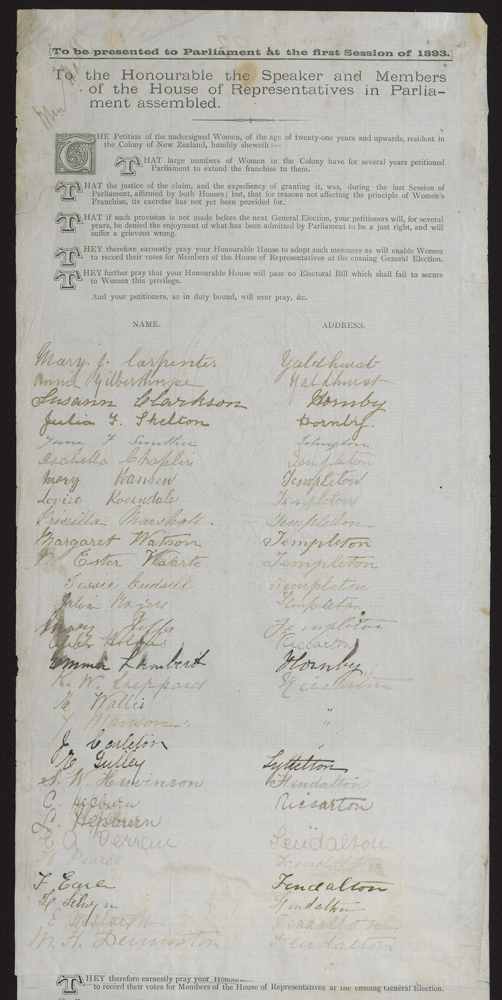
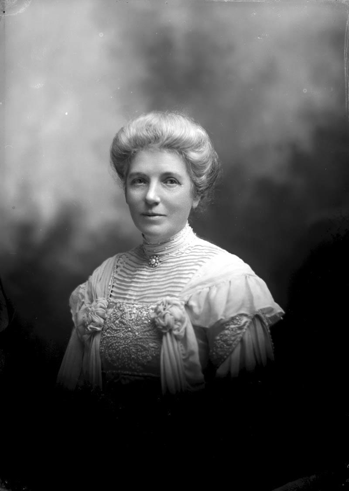
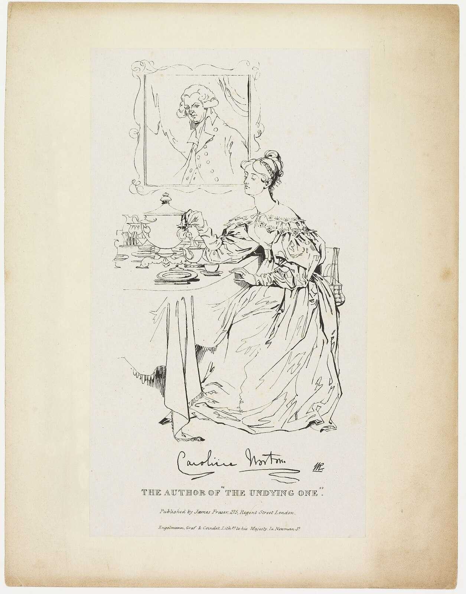
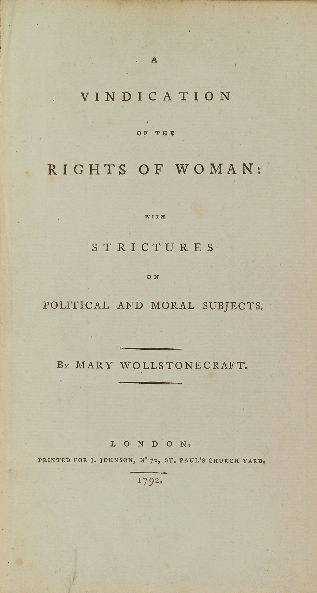
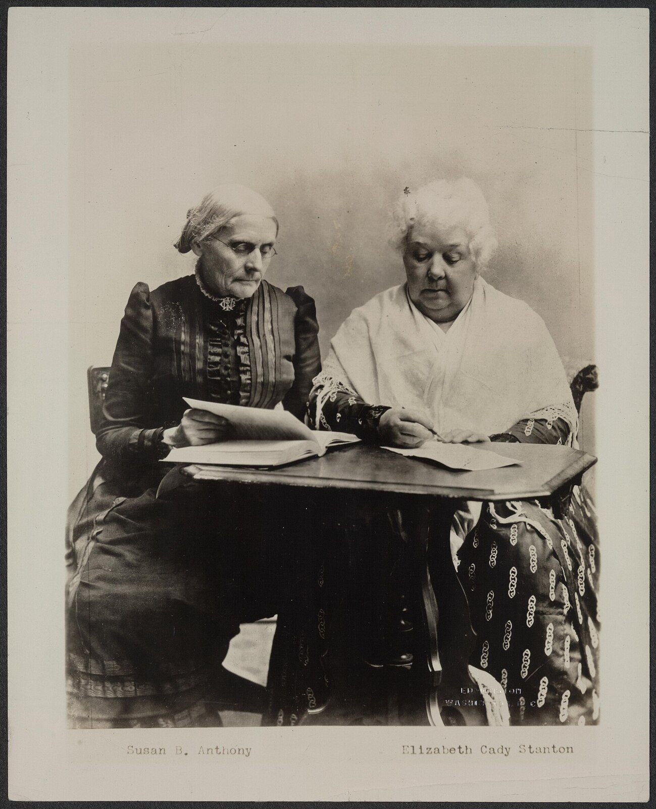
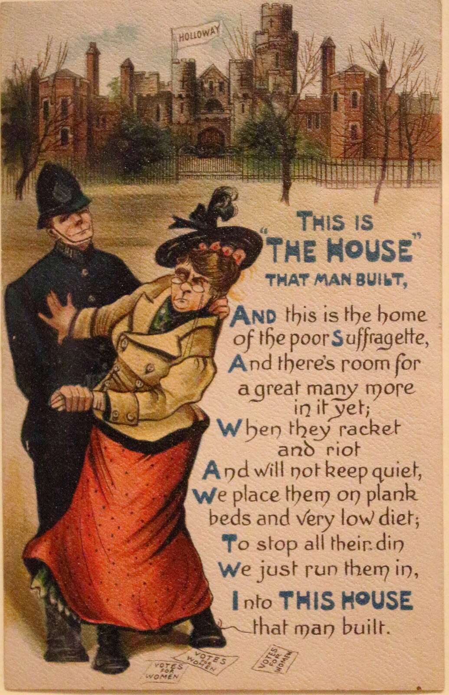
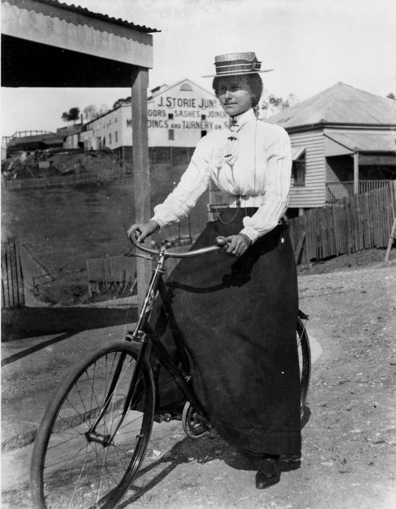
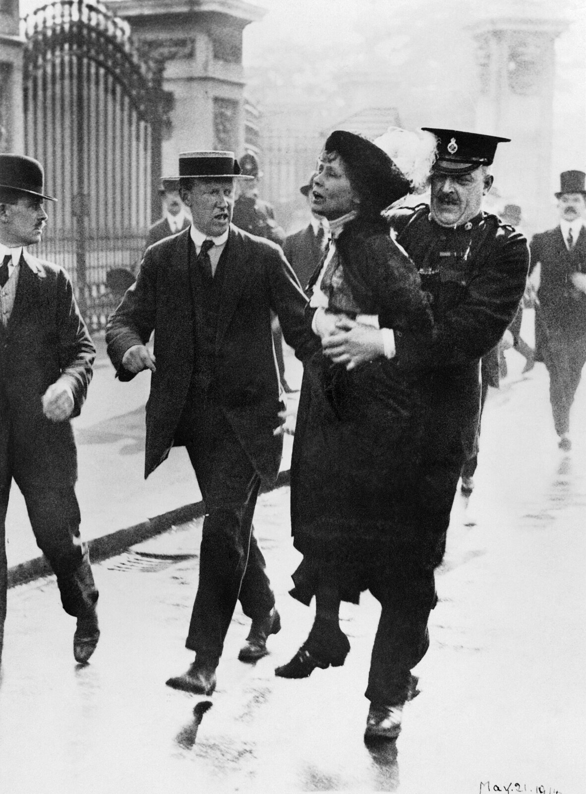
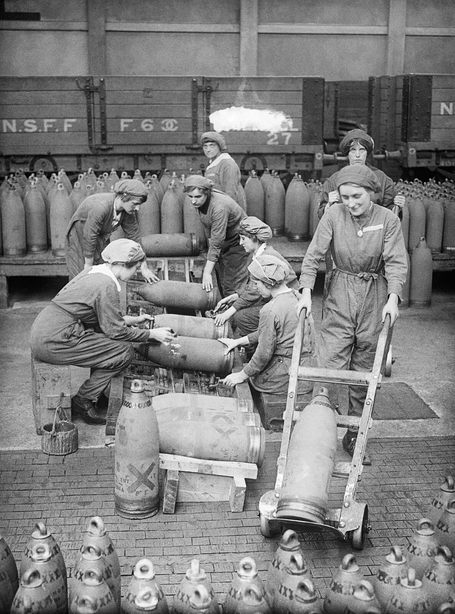

# 70. When did women get the vote?

*New Zealand, Britain and the United States, from 1792 to 1920*

The first country to give all its women the vote was New Zealand, in 1893. Australia, Finland and Norway followed, and most of Europe and North America between 1917 and 1920. France waited until 1944, and Switzerland until 1971. In the same decades, married women were winning the right to own property, to keep their own wages, and to be treated by the law as persons at all.

![World map with Europe enlarged below, countries shaded in five bands by when women won the national vote on equal terms with men: before 1915 (New Zealand 1893, Australia 1902, Finland 1906, Norway 1913), 1915 to 1929 (Russia 1917, Germany, Poland and Canada 1918, United States 1920, Sweden 1921, Britain 1928), 1930 to 1949 (Brazil, Spain, Turkey, France 1944, Italy and Japan 1945, China 1949), 1950 to 1969 (India 1950, Mexico 1953, and most of Africa) and 1970 and later (Switzerland 1971, Portugal, Nigeria, the Central African Republic, much of southern Africa, Iraq and the Gulf states), with Saudi Arabia and Eritrea left unshaded](images/map_vote.png)
*The decade in which women won the vote in national elections on the same terms as men, country by country, with the year for some. Countries are drawn with their modern borders. Votes granted under colonial rule are counted. Countries left unshaded hold no national elections, or are still colonies. Map: drawn for this book; coastlines and borders from Natural Earth, public domain.*

In July 1893 a member of the New Zealand parliament had an enormous roll of paper carried into the chamber in Wellington. It was a petition, made of more than five hundred sheets glued end to end and wound onto a section of broom handle. He had it unrolled down the central aisle of the house, past the benches on either side, until it hit the far wall with a thud.

The roll was meant to be seen, and its size made the argument. It was two hundred and seventy metres long. With a dozen smaller petitions handed in beside it, it carried the signatures of nearly thirty-two thousand women, about a quarter of all the adult women of European descent in the colony. It asked that they be allowed to vote for the men who made their laws.

*One sheet of the 1893 petition, with the printed appeal at the top and the handwritten names and addresses of the women who signed below. Image: Archives New Zealand, public domain.*

It was not the first attempt. The woman who had organised it, Kate Sheppard, had already sent Parliament two smaller petitions and had been refused twice. This time the effort was greater. For months her volunteers had carried the sheets to farms, sheep stations and mining camps.

The effort was enough, though only just. The upper house passed the bill that September by two votes. Ten weeks later, on a fine spring day, two thirds of the women of New Zealand turned out to vote in a general election. Reporters noted with some surprise that the polling places were more orderly than usual.

*Kate Sheppard, who organised the petition, photographed about 1905 by H. H. Clifford. Photo: H. H. Clifford, public domain.*

It was the first time that all the women of a country had been free to vote for its parliament. That it came so late is the puzzle. A century had passed since the revolutions that declared all men equal.

## Covered

Those revolutions had meant men, and the word was chosen with care. Women were not simply left out of politics. In the eyes of the law, a married woman barely existed.

Under the common law of England, which also applied in the United States and the British colonies, a woman who married ceased to exist as a legal person. The great authority on that law, writing in 1765, explained that the very being of the woman was suspended during the marriage, and absorbed into that of her husband. Lawyers called her condition "coverture": she was covered by him.

The consequences were exact, and they reached into every part of her life. Her property came first. Unless her family had been rich enough to tie her property up in a trust, a wife's money and goods became her husband's on the wedding day, and he took the income from her land. Anything that she later earned was his. She could not sign a contract, make a will or go to court in her own name.

Her children and her person were in his power as well. Her children belonged to their father, and he could remove them from her and forbid her to see them. He could confine her to the house, and by old custom he could beat her, in moderation. Nor could she easily leave. She could not divorce him without a private act of Parliament, which cost a fortune.

In 1836 a London society beauty named Caroline Norton, who was also a successful novelist, left her violent husband. He took their three sons, the youngest still a small child, and sent them to relatives in Scotland. He then claimed the money that her publishers owed her, since her writings, like everything else of hers, were his property. She discovered that she had no legal remedy for either.

*Caroline Norton, drawn by Daniel Maclise and published in London by James Fraser, labelled as the author of The Undying One. Lithograph: Daniel Maclise, public domain.*

Norton was not a radical. She had no interest in equality, and said so. She merely thought that the law was monstrous. Nevertheless, she fought it with the tools she had. She wrote pamphlets, lobbied her friends in Parliament, and three years later won a small change that let a judge grant a mother access to her young children.

Change after that came slowly. It took until 1870 for a married woman in England to gain the right to keep what she earned, and until 1882 to own property on the same terms as a single woman.

## All men and women

A few people had seen from the first that the new talk of rights could not logically stop at men. If rights belonged to human beings as such, then women had them too.

In 1792, just after the French had written a constitution that gave women no part, an Englishwoman named Mary Wollstonecraft published a reply to those who had left them out. Her argument began with a surprising concession. Women, she agreed, were often frivolous, ignorant and weak, exactly as their critics said.

The concession was a trap. They had been raised to be. Denied any education beyond dancing and needlework, and taught that their one business was to please, they were no more a fair sample of their sex than a caged bird was of birds. Educate girls like boys, she argued, and then see what they can do. Five years later she died of an infection after giving birth to a daughter.

*The title page of the first edition of Mary Wollstonecraft's A Vindication of the Rights of Woman, 1792. Scan: Wikimedia Commons, public domain.*

Her book was an argument, not yet a movement. The organised movement began half a century afterwards, and it grew out of the campaign against slavery. Women had done much of the work of that campaign in Britain and America. They had gathered petitions, raised money and learned to speak in public. In doing so, they had also learned how a campaign is run.

The lesson in their own position came in 1840. That year a world convention against slavery met in London, and the American delegation included several women. The convention voted not to seat them. Instead, they were shown to a gallery at the side, where they could listen in silence.

One of the women turned away was a Quaker preacher from Philadelphia. Walking back to her lodgings that evening with a young bride who had come along on her honeymoon, Elizabeth Cady Stanton, she agreed that something must be done about the condition of women as well. Eight years later, in July 1848, they called a meeting in a chapel in Seneca Falls, a small mill town in the state of New York. About three hundred people came.

*Susan B. Anthony (left) and Elizabeth Cady Stanton, photographed about 1891. Photo: David B. Edmonston, public domain.*

Stanton had written a declaration for the meeting to adopt, and she chose its model with care. She took the most sacred text in American politics and changed it by two words. We hold these truths to be self-evident, it began, that all men and women are created equal. A list of grievances followed, modelled on the list against King George. The borrowing made a point of its own: the complaints of women against men were of the same kind as the complaints of the colonists against the king.

Even at that meeting, one demand went too far for many. The meeting passed every resolution unanimously except one, the demand for the vote, which many thought too extreme and likely to make the whole movement ridiculous. It passed narrowly after a speech in its favour by Frederick Douglass, the escaped slave, who was the only Black person present.

The road from that chapel was a long one. Of the hundred people who signed the declaration, one was still alive when the vote was finally secured for American women everywhere, seventy-two years later.

Part of the delay came from a broken alliance. The alliance with the anti-slavery cause did not survive victory. After the Civil War, the Constitution was amended to forbid denying the vote on grounds of race. Women asked that sex be added. Their old allies told them that this was the Negro's hour, and that they must wait.

The refusal left a bitterness that did the movement lasting harm. Stanton, in her anger, said ugly things about giving the vote to ignorant former slaves and immigrants before educated women, and the movement split for a generation.

## The word "person"

In Britain the question reached Parliament in 1867. A bill was going through to extend the vote to working men in the towns, and a member proposed a small amendment. It was small in wording and enormous in effect. He moved that the word "man" in the bill be replaced by the word "person".

The mover was John Stuart Mill, the most celebrated philosopher in the country, who had been persuaded by his wife that the subjection of women was the last great injustice left over from the past. He argued the case at length. The amendment was lost by a hundred and ninety-six votes to seventy-three, amid a good deal of laughter.

The laughter is a measure of how the case against looked to those who made it. It seemed too obvious to need defending. The arguments against were repeated, with little change, for the next fifty years.

The first argument was that women did not need the vote because their husbands and fathers represented them. The second appealed to nature. Nature had made the sexes for different spheres, his the world and hers the home, and politics would coarsen her and break up the family. The third was that women were too emotional for public affairs.

Medicine then lent its authority to the case. Doctors added that mental effort drew blood from the organs of reproduction, and a former Harvard professor of medicine published a much-reprinted book to show that a girl who studied as hard as a boy would damage her ability to bear children.

*An anti-suffrage postcard of about 1908. It mocks a suffragette arrested by a policeman outside Holloway prison. Postcard: People's History Museum, public domain.*

The opposition was not only male. Some of the firmest opponents were women, and the most famous of them sat on the throne. Queen Victoria, who ruled a quarter of the world, wrote in 1870 that she was most anxious to enlist everyone who could speak or write to join in checking "this mad, wicked folly of 'Woman's Rights'", and that one titled lady who had spoken for it ought to get a good whipping.

## The edge of the world

The breakthrough came from the margins. Nearly all the first places to give women the vote were new societies, far from the old centres of power.

The pioneer was the territory of Wyoming, in the American West, in 1869. It had six men for every woman, and its legislators hoped, among other things, to attract more women. Having done it, Wyoming held firm. When Wyoming applied to become a state twenty years later and Congress objected to its female voters, the legislature replied by telegram that it would stay out of the Union a hundred years before it came in without the women.

Other places followed. After New Zealand came South Australia in 1894 and the new Australian federation in 1902. The first European country was Finland, in 1906, in the course of a revolt against its Russian rulers, and then Norway in 1913.

In the settler colonies there was no ancient aristocracy to defend the old order, and men had seen women work beside them to build a farm or a town from nothing. A man who had watched his wife clear land and raise a homestead found it hard to believe that she belonged only in the parlour.

There was also a particular alliance at work. The strongest women's organisation of the age was the movement against alcohol. Kate Sheppard's petitions had been collected by its New Zealand branch.

To a modern reader this can seem an odd partner for a campaign of liberation. It was a natural one, and the reason lay in the household budget. A working man was paid in cash on a Saturday, and the public house stood between the factory gate and his home. A wife had no claim on his wages and no escape if he drank them or came home violent.

For many women, therefore, the vote was first of all a means of closing the bars. The brewers understood this perfectly, and paid for much of the opposition.

The same alliance had a darker side. In Australia, the law that gave white women the national vote in 1902 shut out nearly all Aboriginal people of both sexes.

## The typewriter and the bicycle

While the argument went on, the lives of women in the industrial countries were changing in ways that made the old case harder to believe.

The first change was that girls were going to school. By the 1880s elementary education was compulsory for both sexes across most of western Europe and North America. Colleges for women opened from the 1860s, at first against fierce resistance from the universities, and their graduates became teachers, doctors and scientists.

Women were reaching the top of science as well. In 1903 a Polish-born physicist working in Paris, Marie Curie, shared the Nobel prize for physics, and eight years later she won the prize for chemistry by herself.

The second change was in work. New kinds of work appeared that were neither domestic service nor the factory. The typewriter, sold from the 1870s, and the telephone exchange multiplied the number of office jobs, and employers filled the new posts with young women, who were cheaper than male clerks. The employers' motive was thrift, but the result was independence. By 1900 several million women in Europe and America were earning a salary of their own before they married.

The third change was the bicycle. In the 1890s the modern safety bicycle, with two wheels of equal size and air-filled tyres, became cheap enough for a shop assistant.

A machine of that kind changed two things at once. A young woman who owned one could go where she pleased, without a chaperone or a carriage. At the same time, she could not comfortably ride it in a floor-length skirt and a tight corset, and so the bicycle began to change her clothes as well. The American campaigner Susan Anthony, who had been arrested in 1872 for casting a vote, said that the bicycle had done more to emancipate women than anything else in the world.

*A woman cycling in Brisbane, Australia, between 1890 and 1900. Photo: State Library of Queensland, public domain.*

## Deeds, not words

In Britain, however, the change in women's lives had not yet reached Parliament. Forty years of polite petitioning had won women a vote in local elections and nothing more. The main suffrage society had tens of thousands of members and friends in every party.

Support of that kind, however, could be politely ignored. Bills to give women the vote were introduced almost every year, praised in debate, and allowed to lapse.

Some women concluded that politeness was the problem. In 1903 a widow in Manchester named Emmeline Pankhurst, with her daughters, founded a new organisation with a new approach. Its motto was "Deeds, not words". Its members interrupted ministers at public meetings, chained themselves to the railings of government buildings, and marched on Parliament. A newspaper sneeringly called them "suffragettes", and they adopted the name.

*Emmeline Pankhurst arrested outside Buckingham Palace on 21 May 1914, while trying to present a petition to the king. Photo: unknown, public domain.*

When that failed they turned to violence against property. On one afternoon in 1912, well-dressed women walked down the main shopping streets of London, took out hammers that they had hidden in their muffs, the fur tubes that kept their hands warm, and smashed hundreds of plate-glass windows.

The attacks spread from there. Others poured acid into letter boxes, cut telegraph wires, and burned down empty houses, a railway station and the tea pavilion at a botanical garden. There was a limit, all the same. Their rule was that nobody was to be hurt, and with a few exceptions nobody was.

About a thousand went to prison over the years of the campaign, and there the struggle took another form. They demanded to be treated as political prisoners, and when that was refused they stopped eating. This put the government in a difficult position. A woman who starved to death in prison would become a martyr to her cause. To prevent that, it ordered them to be fed by force.

The procedure was brutal. A woman was held down by wardresses while a doctor pushed a rubber tube up her nostril and down into her stomach, and poured in a mixture of milk and eggs. Some endured it more than two hundred times.

When the public recoiled, the government needed another answer. Parliament passed a law allowing a starving prisoner to be released until she had recovered, and then arrested again.

The campaign's best-remembered death came at a racecourse. On 4 June 1913, at the most famous horse race in England, a forty-year-old suffragette named Emily Davison ducked under the rail as the field came round the final bend, and stepped in front of the horse owned by the king. She was struck at full gallop and died four days later without waking.

In her pocket were two flags in the movement's colours and the return half of her railway ticket, and nobody has ever been sure whether she meant to die or only to stop the race. Whatever her aim, her funeral became a demonstration. Five thousand women, many in white, walked behind her coffin through London.

## Canaries

Whether the militants helped their cause or hurt it is still argued. They had made it impossible to ignore, and they had hardened many against it. The deadlock was broken by something else.

In August 1914 the great powers of Europe went to war. Pankhurst called off her campaign the same week and told her followers to serve their country. As millions of men left for the trenches, women took their places. They drove buses and ambulances, worked the farms, and staffed the offices.

The most dangerous of the new jobs were in the arms industry. Nearly a million women went into the munitions factories, where they filled artillery shells with high explosive. The chemicals turned their skin and hair bright yellow, and they were nicknamed canaries. Several hundred were killed by explosions and by the poison.

*Women workers at the Chilwell shell-filling factory in Nottinghamshire, 1917. Photo: Horace Nicholls, public domain.*

After that, it was difficult to argue that women had no stake in the nation's affairs. They had worked, and some had died, for the nation's war.

A practical problem also forced Parliament's hand. The voting registers had to be redrawn in any case, since millions of soldiers had lost their qualification by leaving home. Once the law had to be rewritten for the men, it could be rewritten for women too. In 1918 Parliament gave the vote to women of thirty and over who occupied a home or other property, or were married to a man who did, about eight and a half million of them.

Women were not the only people without the vote. Until 1918, two British men in every five had no vote either, because they did not own or rent a home of their own, or had not lived in one place long enough to be registered. Most of the soldiers in the trenches were fighting for a country in whose government they had no say. The act of 1918 gave the vote to virtually every man of twenty-one and over.

Women, by contrast, had to wait longer. The age limit for women was set at thirty for a frank reason. So many young men had been killed that, on equal terms, women would have been the majority. Ten years later the difference was removed.

Britain was not alone. Much of the Western world moved in the same two years. Russia's revolutionaries gave women the vote in 1917. Germany, Austria, Poland and Canada did so in 1918.

## A letter from his mother

In the United States the last step was harder, because of the way the country changes its founding law. A change to the Constitution has to be approved by three quarters of the states. By the summer of 1920 the amendment giving women the vote had been accepted by thirty-five. One more was needed, and the last state where it had any chance that year was Tennessee.

Everything therefore came down to a single legislature. The vote in the Tennessee legislature, on 18 August, was expected to be a tie, which would have killed it. In a vote that close, one man could decide it.

The man turned out to be the youngest member of the house, a Republican of twenty-four named Harry Burn. He came from a conservative district and wore in his buttonhole the red rose of the amendment's opponents. By that sign, he was a vote against. That morning, however, he had received a letter from his widowed mother, who ran the family farm. She told him to hurrah and vote for suffrage, and not to keep them in doubt, and to be a good boy.

When his name was called, he said "aye". The amendment passed by the narrowest of margins. He explained afterwards that a mother's advice was always safest for a boy to follow.

Twenty-six million American women could now vote. For many of them, however, the right remained on paper. In the Southern states, the tests and taxes that kept Black men from the polls kept Black women out as well, and did so for another forty-five years.

Elsewhere the old order held on for a surprisingly long time. French women first voted in 1945, and Italian and Japanese women a year later.

Switzerland shows how a democracy could keep women out by democratic means. In Switzerland, where every change to the constitution had to be approved by a majority of the voters, and the voters were men, women did not gain the vote in national elections until 1971. Even then, some corners of the country resisted. One small mountain canton, as the member states of Switzerland are called, still decided its local affairs at an open-air meeting in the town square, to which each citizen carried his sword as proof of his right to take part. In 1990 its men voted once more to keep the women out, and the country's highest court overruled them.
