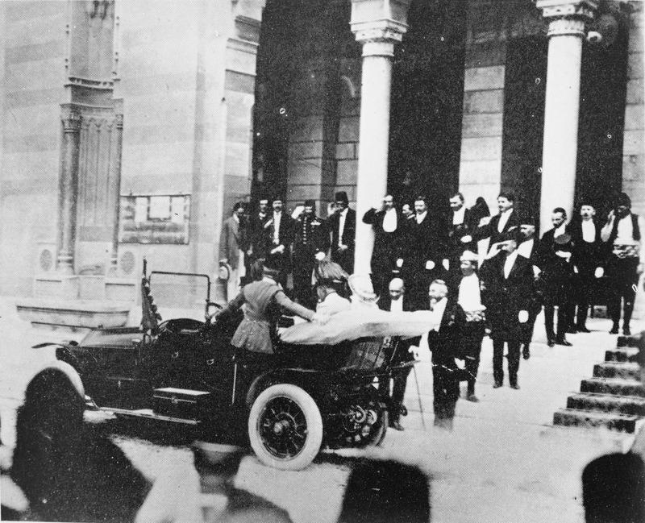
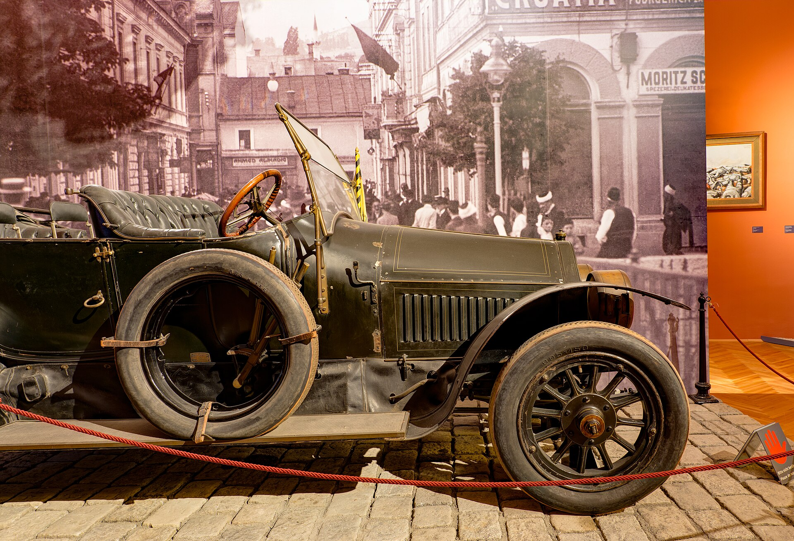
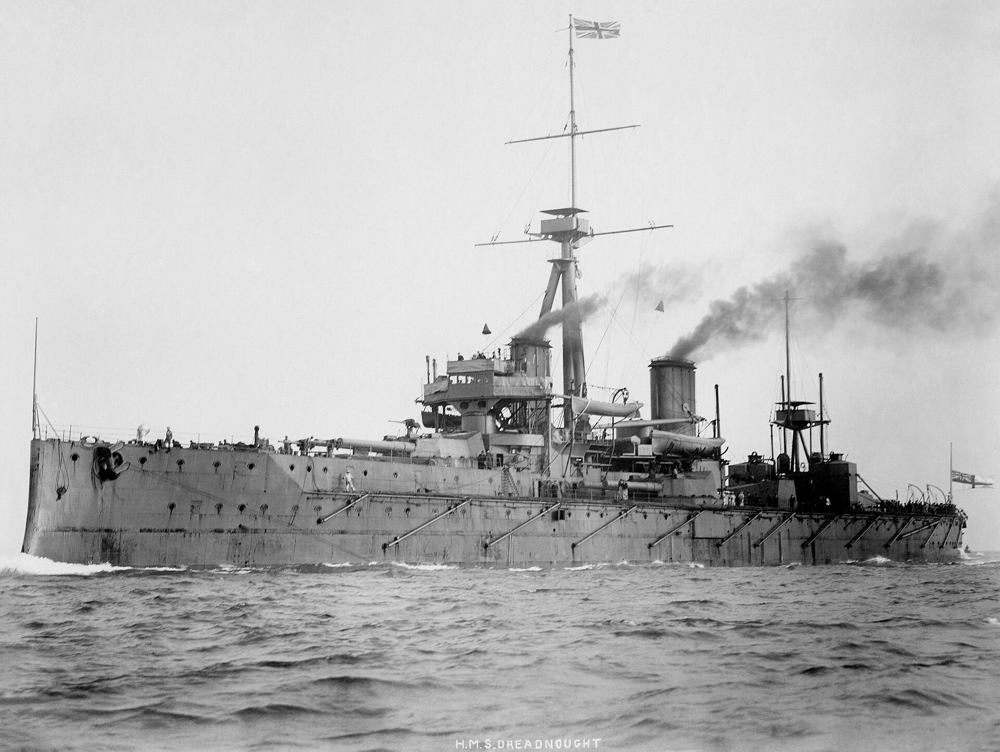
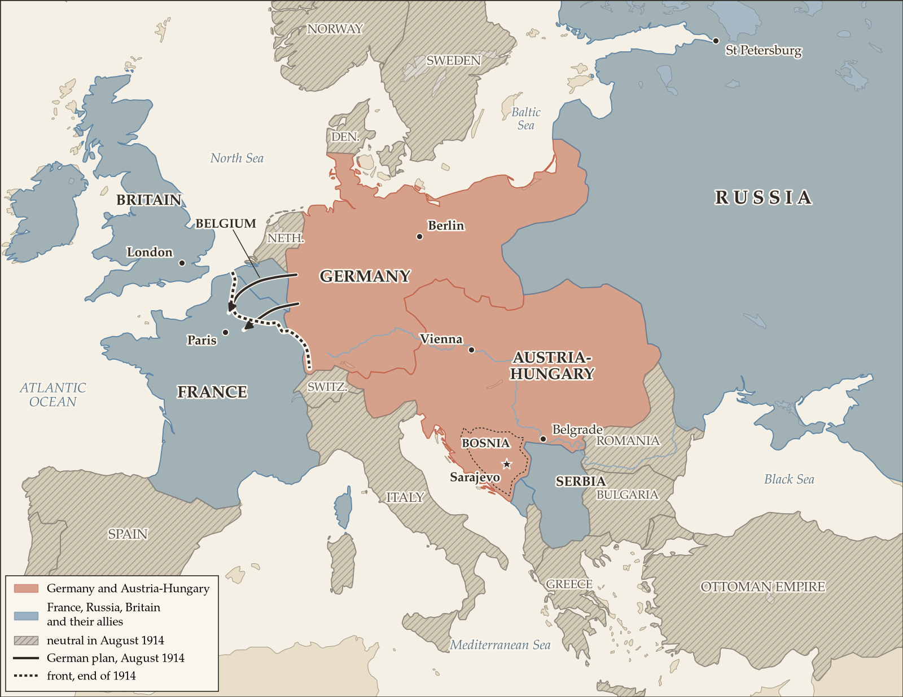
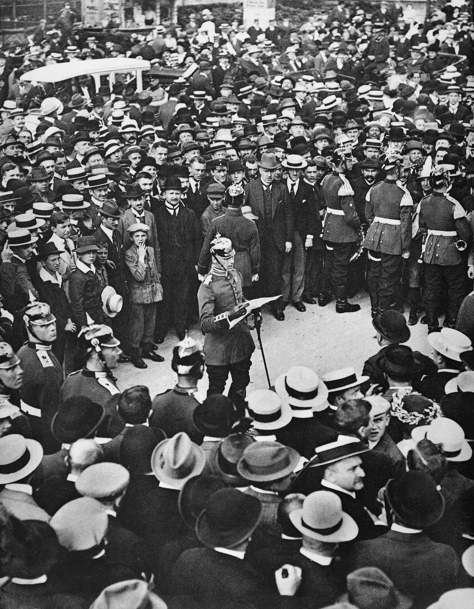
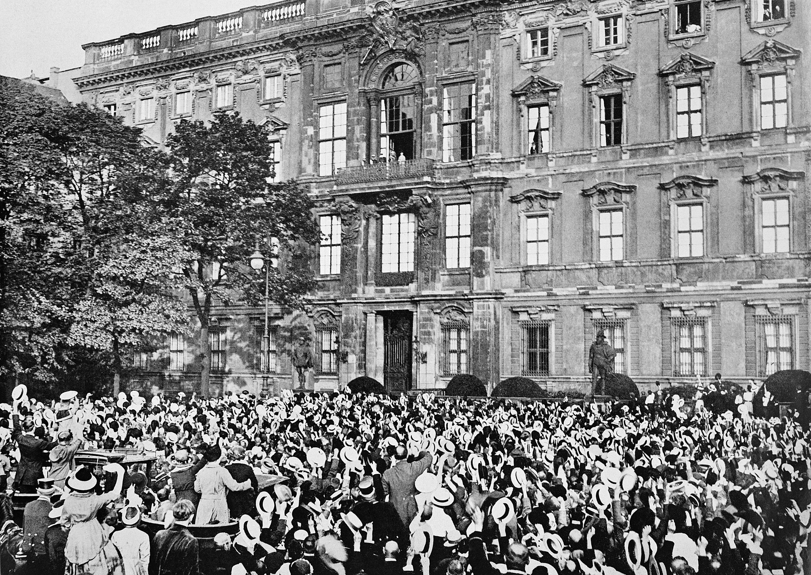
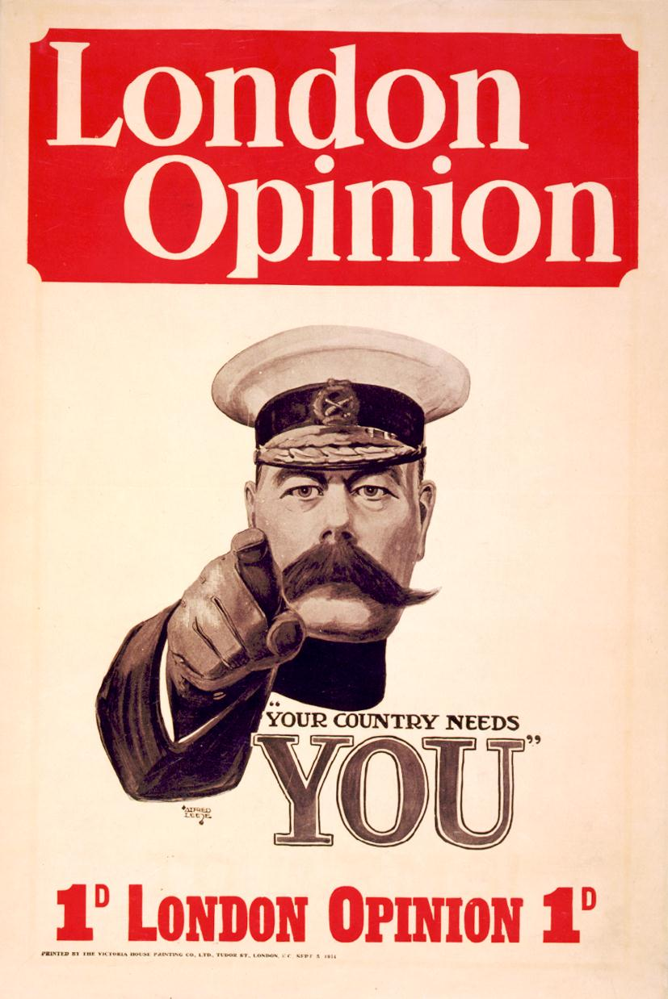
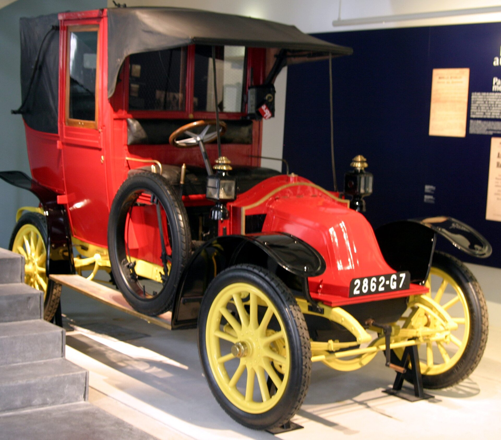
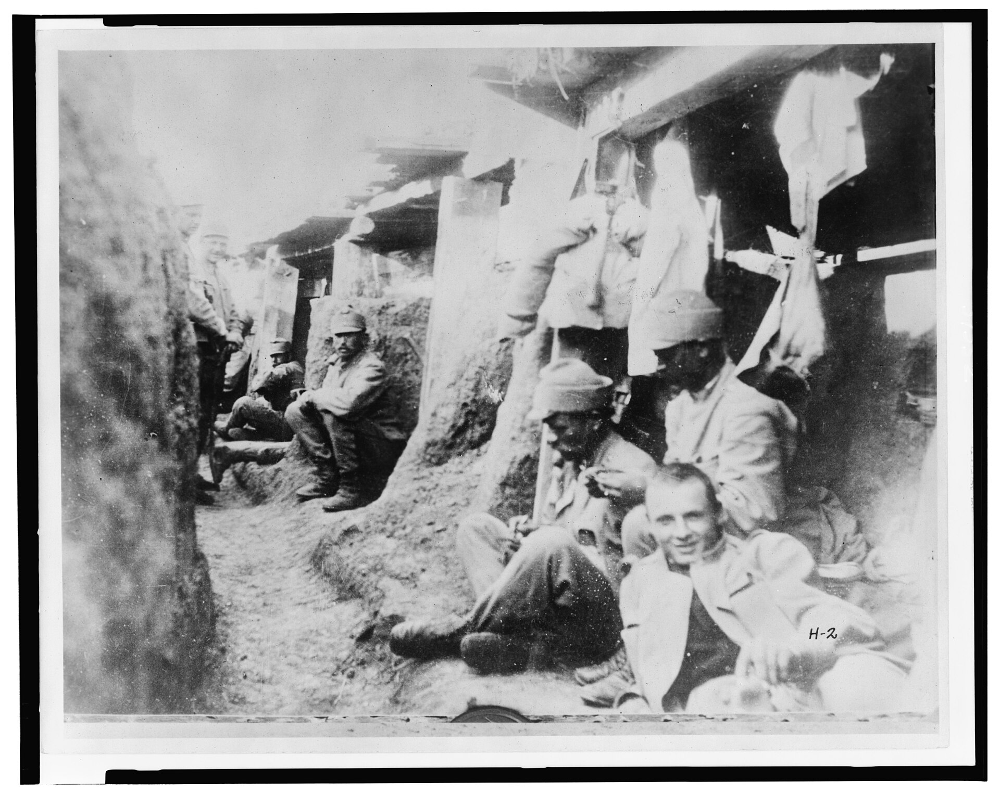

# 71. Why did the First World War start?

*Europe, from 1871 to the end of 1914*

The war started because the great powers of Europe had bound themselves into two armed camps, and the strongest of them had a war plan that worked only if it struck first. When a young Serb nationalist shot the heir to the throne of Austria, the governments of Austria and Germany decided to risk a great war in order to crush Serbia, and the government of Russia decided to risk one in order to protect it. Each side expected the other to back down. Five weeks later, all of them were at war.

On the morning of 28 June 1914, the Archduke Franz Ferdinand, heir to the empire of Austria-Hungary, drove into the Bosnian city of Sarajevo in an open car with his wife Sophie beside him. It was a Sunday, three days short of their wedding anniversary. Six young men were waiting along the route with bombs and pistols.

The first two lost their nerve as the car went by. The third threw his bomb. It bounced off the folded roof of the archduke's car and blew up under the car behind, wounding two officers. The thrower then tried to make sure that he would not be taken alive. He swallowed a capsule of poison, but the poison was old and only made him sick. Next he jumped into the river, which at that season was a few centimetres deep. The police pulled him out.

The archduke drove on to the town hall, in no mood for speeches. He interrupted the mayor's welcome: he had come on a friendly visit, he said, and had been greeted with bombs. Then he recovered his temper. After the ceremony he announced that he wished to go to the hospital to see the wounded officers. That meant a change of route, and nobody told the driver.

*The archduke and his wife getting into their car outside the town hall in Sarajevo, 28 June 1914, shortly before they were shot. Photo: unknown, Imperial War Museums, public domain.*

A few minutes later the car turned off the riverside road into a side street, following the original plan. A general in the front seat shouted that this was the wrong way. The driver braked and began, slowly, to back the heavy car out, and for a few moments it stood almost still. It had stopped in front of a delicatessen. Standing on the pavement outside, a metre and a half away, was one of the conspirators, a nineteen-year-old named Gavrilo Princip, who had missed his chance on the riverside road earlier that morning. Now the target had come to him.

He fired twice. The first bullet hit the archduke in the neck and the second hit Sophie in the stomach. The archduke was heard to beg his wife to live for their children. Both were dead within half an hour.

*The car in which the archduke was shot, on display in the military museum in Vienna. Photo: Hubertl, CC BY-SA 4.0.*

## Two camps

A murder in a provincial town does not ordinarily lead to the deaths of sixteen million people. This one did because of how Europe had arranged itself over the previous forty years.

There were five great powers on the continent, and the newest was the strongest. Germany had been made in 1871, when Prussia defeated France and united the German states under its king. It grew quickly. By 1914 it had sixty-seven million people and the best army in Europe. Its industry produced more steel than Britain, France and Russia put together, and steel was what guns, shells and railways were made of.

The chancellor who created it understood the danger in that strength. So powerful a newcomer, he saw, would frighten its neighbours into combining against it. He spent twenty years preventing this with a web of treaties. Above all, they kept France, which burned to recover its lost provinces, without a single ally.

Then, in 1890, a new, young emperor, Wilhelm II, dismissed him. Wilhelm was impulsive and vain, with a withered left arm that he hid in photographs, and he wanted Germany to have its "place in the sun". He let the treaty with Russia lapse. That one decision undid much of the old chancellor's work, because it left Russia free to look for another partner.

France seized the chance. In 1894 the French republic and the Russian tsar became allies. They had nothing in common except fear of Germany, but that was enough. From then on the German general staff lived with a nightmare. If war came, Germany would have to fight on two fronts at once, against France in the west and the endless manpower of Russia in the east.

Wilhelm then made an enemy of Britain as well. He set out to build a battle fleet to rival the Royal Navy. To the British this was a direct threat, because they regarded their navy as the one thing that kept their island and their empire safe. Britain outbuilt him, at vast expense. It also settled its old quarrels with France and Russia, and so drew closer to the two powers that Germany already feared.

*HMS Dreadnought, the British battleship of 1906 whose all-big-gun design sharpened the naval race with Germany, at sea about 1906. Photo: unknown, public domain.*

So by 1914 the powers stood in two groups. Germany was allied with Austria-Hungary, and on paper with Italy, which in the event stayed out and later joined the other side. Facing them were France and Russia, with Britain attached by understandings that stopped short of a promise. The alliances had been made for safety, since each member hoped that a strong partner would discourage an attack. In practice they worked differently. A quarrel between any two members could pull in all the rest.

## Eleven nations under one crown

The weakest of the five was Germany's ally, and it was where the trouble started.

Austria-Hungary was an empire of an old-fashioned kind. It had fifty million people who spoke a dozen languages, among them German, Hungarian, Czech, Polish, Croatian and Serbian. What held them together was not a common language. It was an army, a civil service and an emperor, Franz Joseph, who was eighty-three and had been on the throne since 1848.

In an age when every people was coming to believe that it ought to have a country of its own, such a state was an awkward survival. Its rulers knew where that belief could lead. If one of its nations broke away, the others would follow, and the empire would come apart.

The nation that worried them most lay just across the southern border. Serbia was a small, poor kingdom of peasants, which had won its independence from the Turks. It dreamed of uniting all the South Slavs in one state: the Serbs, Croats and Slovenes, peoples of closely related speech. For Austria-Hungary that dream was a direct threat, because millions of those people lived inside the empire.

The two countries had already clashed. In 1908 the empire had annexed Bosnia, where many of the people were Serbs, and Serbia had been forced to swallow it. Since then, in two short wars against the Turks and its neighbours, Serbia had doubled in size. Seen from Vienna, a small troublemaker was turning into a dangerous one.

The young men in Sarajevo were Bosnian subjects of the emperor. Their pistols and bombs, however, had come from Serbia, supplied by a secret society run by the head of Serbian military intelligence. The Serbian government had not ordered the killing, and had some idea that a plot was afoot. It was not guilty of the murder, but it was not wholly innocent of it either.

For the generals and ministers in Vienna, this was the moment they had been waiting for. Serbia had to be destroyed as a power, they believed, or the empire would be picked apart, and the murder gave them their reason. There was one obstacle. Serbia had a protector. Russia saw itself as the guardian of the Slavs, and it had been humiliated in 1908 when it failed to stand by Serbia. Its ministers had sworn that it would not happen again.

An attack on Serbia, then, was likely to bring in Russia. If Russia came in, the alliances could bring in everyone else.

## The timetable

The plans in the generals' desks left the diplomats very little time.

The wars of the 1800s had taught every army the same lesson. The side that got its men to the frontier first usually won. All the continental powers now had conscription, which meant that young men served a spell in the army and then went home as trained reservists. As a result, each power could call several million of them back to the colours.

Calling them up, equipping them and moving them by rail to the border was known as mobilisation. It was an enormous clockwork operation, planned to the minute years in advance. Once it started it could hardly be stopped or altered, since changing one part would throw the rest into confusion.

Germany's plan was the most rigid of all, because of the two-front nightmare. The general staff reckoned that Russia, with its huge distances and few railways, would need about six weeks to bring its full strength to the border. That delay was Germany's opportunity. It had six weeks in which to knock out France. It would then turn its armies round, send them east by train, and deal with the Russians.

France, however, could not be beaten in six weeks by a head-on attack, since its frontier with Germany was a wall of fortresses. The plan was therefore to go round. Seven eighths of the German army would be sent west. The strongest part of it would wheel through neutral Belgium, like a door swinging on its hinge, sweep down towards Paris, and pin the French armies against their own forts. The railway schedule alone ran to eleven thousand trains.

*Europe in August 1914, with the states of the time drawn roughly: Germany and Austria-Hungary; France, Russia and Britain with their allies Serbia, Montenegro and Belgium; and the neutral states, Italy and the Ottoman Empire among them. Arrows show the German sweep through Belgium towards Paris, and a dotted line the front at the end of 1914. Map: drawn for this book; coastlines and rivers from Natural Earth, public domain.*

The plan had a consequence that few civilian ministers had thought through. For Germany, there could be no pause between calling up the army and starting the war, because every day of waiting ate into the six weeks. If Russia began to mobilise, the six weeks began to run. Germany then had to attack France at once, through Belgium, whatever the quarrel was about and whether or not France had done anything. In effect, a crisis in the east would become an invasion in the west.

## The blank cheque

A week after the murders, an Austrian envoy arrived in Berlin with a question. Vienna did not want to move without knowing where its ally stood. If Austria-Hungary went to war with Serbia, and Russia intervened, would Germany stand by its ally?

The emperor Wilhelm gave his answer over lunch on 5 July, and his chancellor confirmed it the next day. Austria should act as it thought best, and Germany would support it, come what may. Historians call this promise the blank cheque, because it left Austria free to fill in whatever it chose.

The men who gave it knew that it might mean war with Russia and France. They gave it anyway. They thought, on balance, that Russia would not fight. They also believed that if it did, it was better to have the war now than later. Russia was laying railways and expanding its army with French money. Those railways would shorten the six weeks on which everything depended, and the German generals calculated that by 1917 their plan would no longer work.

Vienna then took nearly three weeks to prepare. The delay was costly, because it wasted whatever sympathy the murders had earned it. On 23 July it handed Serbia a list of ten demands, with forty-eight hours to accept them all. They included the suppression of every anti-Austrian newspaper and society, and the admission of Austrian officials into Serbia to direct the hunt for the plotters. The second was the hardest for any independent state to swallow, since it meant foreign officials giving orders on its own soil. In fact the note had been written to be refused. The British foreign secretary called it the most formidable document that one state had ever addressed to another.

Serbia's reply was a masterpiece. It accepted nearly everything, humbly, and declined only to let Austrian officials sit in judgement inside Serbia. The answer was so mild that it disarmed even the German emperor. When Wilhelm read it, he wrote in the margin that every reason for war had now disappeared. It was too late, because Vienna had already made up its mind. Austria-Hungary declared the answer unsatisfactory, and on 28 July it declared war. The next day its gunboats on the Danube shelled Belgrade, the Serbian capital.

## Willy and Nicky

What followed took one week. In that week, a local war between Austria and Serbia became the general war that the alliances and the timetables had made possible.

The emperor of Germany and the tsar of Russia were cousins, as each of them was of the king of England. They wrote to each other in English, signing themselves Willy and Nicky. In the last days of July they exchanged a series of telegrams, each begging the other to stop what was coming. They were sincere. Nevertheless, each of them, in the end, signed what his generals put in front of him.

The tsar's generals told him that Russia must mobilise to deter Austria. He tried at first to limit the danger. He ordered a partial call-up, against Austria alone, and was told that the plans did not allow for one. On 30 July, after cancelling the order once, he signed the decree for general mobilisation.

In Berlin, the clock had started. A Russian mobilisation was exactly what the German plan could not afford to wait out. Germany demanded that Russia stop within twelve hours, received no answer, and declared war on 1 August. It declared war on France two days later, on a pretext. The real reason was that the plan required France to be attacked. On the morning of 4 August the first German troops crossed into Belgium.

*A Berlin crowd listens as an officer reads the emperor's order for mobilisation, 1 August 1914. Photo: unknown, public domain.*

That settled the question for Britain. Until then its cabinet had been divided over whether a quarrel in the Balkans was any of its business. However, Britain had signed a treaty in 1839 guaranteeing Belgian neutrality. It had also always held that no great power could be allowed to control the coast facing its own, and Belgium's shore looked straight across the narrow sea at England. So it sent an ultimatum to Berlin. The German chancellor could not believe that Britain would go to war for what he called a scrap of paper, meaning the old treaty. At eleven that night, Britain did.

The evening before, the British foreign secretary had stood at his office window watching the street lamps being lit below. The lamps are going out all over Europe, he said to a friend. We shall not see them lit again in our lifetime.

## Why they went

The governments had made the war. It could be fought only if millions of ordinary men agreed to turn up, and the remarkable fact is that they did.

Every government had worried about this, and with some reason. The socialist parties of Europe, which spoke for the factory workers, had sworn for years that the working men of one country would never fire on those of another. They had even threatened a general strike if war came. The French army, for its part, expected that one conscript in eight would fail to report.

In the event, almost all of the French conscripts reported. In Germany, the socialists fell into line. They were the largest party in parliament, and they voted for the war credits, the money to pay for the war, to a man. The emperor announced that he no longer recognised parties, only Germans.

Each people believed it had been attacked. Germans were told that the Russian hordes were mobilising against them, which was true. The French saw a German army cross their border. The British saw a small neutral country invaded. In every case the government could say, with some justice, that it was defending the homeland. After a century of schools, newspapers and military service, the homeland was something that men were prepared to die for. The nation proved a far stronger tie than class.

There were cheering crowds in Berlin, Paris, Vienna and St Petersburg, and photographs of them are famous. However, the photographs show only part of the picture. The crowds were mostly students and clerks. In the villages, where the horses were being requisitioned in the middle of the harvest, the mood was grim and silent.

Britain was a different case. It had no conscription, so its army had to grow by volunteers, and its war minister asked for a hundred thousand of them. In eight weeks he had seven hundred and fifty thousand.

*Crowds cheer the emperor on the balcony of the Berlin Palace after the order to mobilise, 1 August 1914. Photo: unknown, public domain.*

Most people hoped, and many believed, that it would be short. The German emperor told departing troops that they would be home before the leaves had fallen from the trees. Bankers assured the governments that no country could afford to fight for more than a few months.

*Alfred Leete's drawing of the war minister, Lord Kitchener, on the cover of the magazine London Opinion, September 1914; it was soon turned into a recruiting poster. Image: Alfred Leete, public domain.*

## Before the leaves fall

The generals of 1914 had been trained to believe in attack. Their soldiers went forward in the open, in dense lines, with bands playing and officers on horseback. The French infantry wore blue coats and bright red trousers, as their grandfathers had, and the colours could be seen from far away.

They met weapons whose effect most of their generals had only read about, in reports from colonial wars and from Japan's war with Russia. A machine gun fired ten bullets a second, enough to sweep away a line of advancing men. A modern field gun could put fifteen shells a minute onto a target several kilometres away, and the commonest kind of shell burst in the air and sprayed the ground with metal balls. Men in the open simply could not live under that fire.

The result was slaughter. On a single day, 22 August, in a string of clashes along the Belgian border, twenty-seven thousand French soldiers were killed. It remains the bloodiest day in the history of France. By the end of the month a quarter of a million French soldiers were dead, wounded or missing, and the rest were in full retreat.

The German plan came close to working, and then it failed. Its weakness was the strain it put on the men who had to carry it out. The great wheel through Belgium had asked them to march thirty kilometres a day for a month, while their supplies fell further and further behind. In the first week of September, with the Germans in sight of Paris, the French had gathered a new army north-east of the city, and some of its reinforcements were rushed to the front in the taxis of the capital. With it, the French struck the exhausted invaders in the flank along the river Marne. The Germans fell back sixty kilometres, to the first line of high ground, and dug.

*A Paris taxi of 1914, a Renault of the type that carried French troops to the Marne. Photo: Rama, CC BY-SA 2.0 FR.*

That digging changed the war. A man standing in a trench two metres deep is almost safe from bullets and shell splinters, and he can shoot down anyone who walks towards him. All along the front, the defender now had the advantage.

Since neither side could break through, each tried instead to get round the end of the other's trenches. Each time, the other extended its line to block the move. By November the two lines of ditches ran, without a break, for seven hundred kilometres, from the border of Switzerland to the North Sea. In the west, the war of movement was over, and on all the fronts together about a million men were already dead.

*German soldiers in a trench, 1914 or 1915. Photo: unknown, Library of Congress, public domain.*

## Whose fault

The question of who was to blame has been argued for a century. The victors wrote into the peace treaty that Germany and its allies were responsible. Germans resented this bitterly, and for a time most historians agreed that Europe had stumbled into war together, with no one government much more to blame than the rest. Then German historians, working in their own archives, showed how deliberately Berlin had run the risk in July.

The evidence supports a verdict somewhere between the two. Austria-Hungary chose to start a war. Germany encouraged it, and then turned it into a general one by attacking France and Belgium. The others were not blameless either. Russia was the first great power to call up its whole army. France urged Russia on, and Britain left everyone guessing until the last day. No government planned the war that happened. However, every one of them, when the choice came, preferred to fight than to climb down.

Gavrilo Princip was too young to be hanged under Austrian law. He was sentenced to twenty years, and died of tuberculosis in a prison cell in April 1918, while the war that his two shots had begun was still going on.
