# 72. Why did the First World War last so long?

*The Western Front and the world, from 1914 to 1919*

The war lasted four years because the weapons of the time made defending a trench far easier than attacking one, and because the industrial nations that fought it were able to replace their dead for years on end. Neither side could break through, and after such losses hardly any government dared to accept less than victory. It ended when one side's strength gave out.

On Christmas Eve 1914, the British soldiers in the trenches near the Belgian town of Ypres noticed lights along the German line opposite. The Germans had set small fir trees on the edge of their trench, with candles on them. Then they began to sing a carol, and the British recognised the tune of "Silent Night". When it ended, the British sang one back.

The next morning a German walked out into the open with his hands empty, and nobody fired. By noon, along much of the British part of the front, thousands of men from both armies were standing in the frozen mud between the lines. They shook hands, and swapped cigarettes, buttons and tins of jam. They buried the dead who had been lying out there for weeks. A British machine-gunner who had been a hairdresser cut the hair of a German who knelt on the ground in front of him. In a few places somebody produced a ball.

It was a fine thing, and it could not last. The generals on both sides were appalled. Orders went out forbidding any such contact with the enemy, and the following Christmas the artillery was told to fire all day. The men went back to their trenches. They would be in them, or in others like them a few kilometres away, for four more years.

## The ditch

The line that had frozen in the autumn of 1914 was not a single ditch. It was a belt of fortification several kilometres deep, and it grew more elaborate every month.

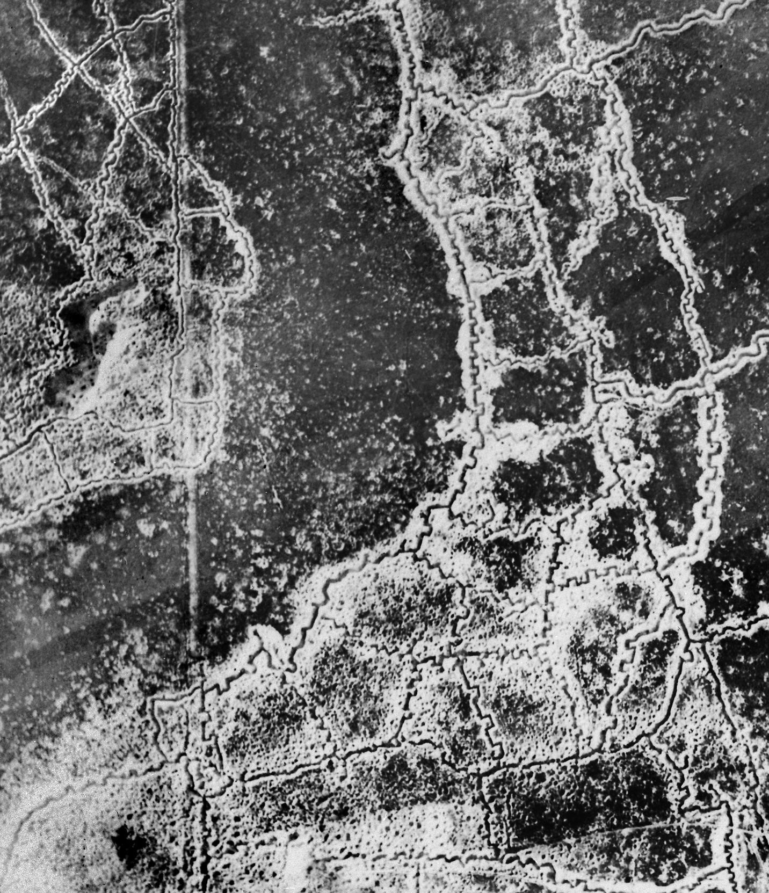
*A trench system seen from the air near Loos, France, 1917: the zigzag lines are trenches, with the German lines at right and bottom and the British at top left, and the pitted ground between is no man's land. Photo: unknown, Imperial War Museums, public domain.*

At the front was a trench about two metres deep, dug in a zigzag so that a shell bursting in one stretch would not kill everyone along it. Two or three hundred metres behind was a second trench, and behind that a third, all joined by passages. Underground, sometimes ten metres down, were shelters where the men waited out the shelling. In front of everything lay belts of barbed wire as thick as a hedge, a kind of fencing that had been invented to keep cattle in on the American plains.

Between the two armies was a strip of open ground, in places only fifty metres wide. The soldiers called it no man's land.

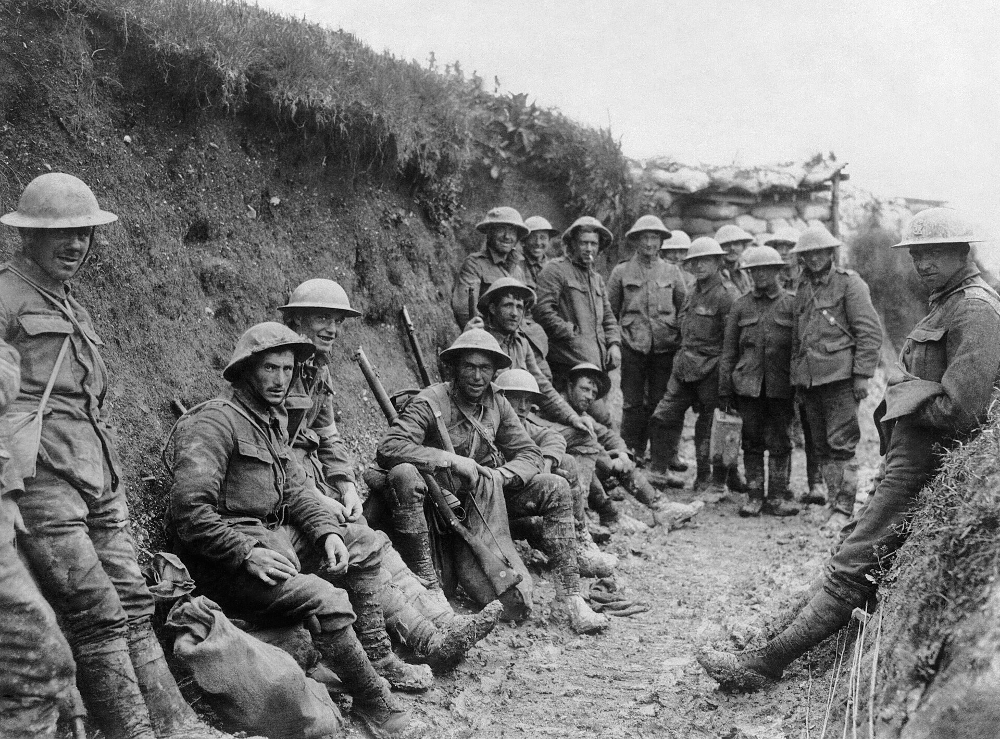
*Men of the Royal Irish Rifles in a communication trench on the Somme, July 1916. Photo: Royal Engineers No 1 Printing Company, public domain.*

The trouble with this arrangement, from a general's point of view, was that it was nearly impossible to attack. Men who climbed out of a trench and walked forward were in the open, in front of machine guns that fired ten bullets a second. If the wire in front of the enemy had not been cut, they died against it.

Suppose that an attack did take the enemy's front trench, as many did. The attackers were now exhausted, in a wrecked position, with the enemy's second line in front of them and no man's land, torn up by their own guns, behind. Their general, kilometres to the rear, did not know where they were. There was no radio that a man could carry, and the telephone wires had been cut by shellfire. Meanwhile the defender brought up fresh troops by railway, a hundred times faster than the attackers could advance on foot. The hole closed. This happened again and again for three years.

## Seven days of shells

The generals' answer was more guns. If enough shells were fired at a stretch of trench, they reasoned, nothing could be left alive in it, and the infantry would only have to walk over and take possession.

In February 1916 the Germans tried this against the French fortress town of Verdun. Their commander wrote afterwards that his aim had not been to capture ground at all. He had meant to attack a place that France could not bear to lose, and to kill Frenchmen there until France gave up. The battle lasted ten months. The French held Verdun by sending three quarters of their army through it in turn, supplied mainly along a single road on which a lorry passed every fourteen seconds, day and night. When it was over, some three hundred thousand men were dead, about equally divided between the two sides, and the line had moved a few kilometres.

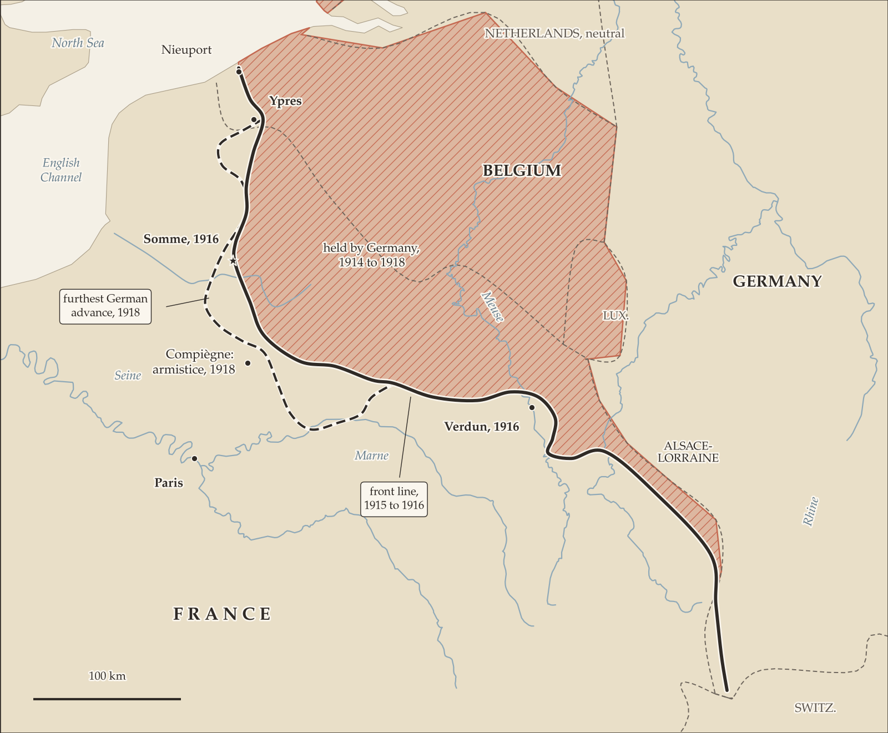
*The Western Front: the trench line as it stood through most of 1915 and 1916, with the ground Germany held behind it, and the furthest German advance of 1918, which reached the Marne; all simplified. Map: drawn for this book; coastlines and rivers from Natural Earth, public domain.*

That summer the British, with the French on their right, made their own great attack beside the river Somme, partly to draw the Germans away from Verdun. The soldiers were mostly the volunteers of 1914, who had joined up with their workmates and neighbours and had been allowed to serve together. For seven days, fifteen hundred British guns fired a million and a half shells at the German lines. The men were told that they would be able to cross with their rifles on their shoulders.

At half past seven on the morning of 1 July the guns lifted their fire onto targets further back, whistles blew, and a hundred thousand men climbed out and went forward, most of them walking in lines. The Germans had sat through the week in shelters dug deep into the chalk. They came up, set their machine guns on the edge of the trench, and found the wire in front of them largely uncut.

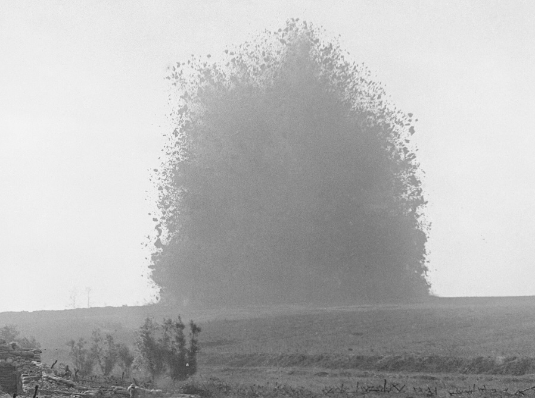
*A mine under the German lines at Hawthorn Ridge explodes at 7.20 on the morning of 1 July 1916, ten minutes before the infantry attack. Photo: Ernest Brooks, public domain.*

By nightfall nearly twenty thousand British soldiers were dead and more than thirty-five thousand wounded. It was the worst day in the history of the British army. A battalion raised in one Lancashire mill town went into the attack about seven hundred strong, and in half an hour nearly six hundred of them had been killed or wounded. The battle went on for another four and a half months, cost the three armies more than a million casualties, and advanced the British line about ten kilometres.

## Clouds

Both sides hunted for a device that would break the deadlock, and the war became a contest of inventors.

On an April evening in 1915, French soldiers near Ypres saw a greenish-yellow cloud drifting towards them along the ground. It was chlorine, released from six thousand steel cylinders. Men who breathed it choked as their lungs filled with fluid, and the line broke for several kilometres. The Germans had not expected such success and had no reserves ready to exploit it. Within months both sides had gas, and gas masks, and the weapon became one more misery of the trenches.

The man who had organised the attack was Fritz Haber, one of the leading chemists in Germany. A few years before the war he had made a discovery of the first importance, a way of combining the nitrogen of the air with hydrogen to make ammonia. Ammonia can be turned into fertiliser, and it can equally be turned into explosives. Until then, the makers of modern explosives had depended on nitrate dug from the deserts of Chile, and when the war began, the British navy cut Germany off from Chile. Without Haber's process, Germany would have run out of shells within a year. With it, the war could go on. Ten days after the gas attack, Haber's wife, who was a chemist too, shot herself with his army pistol.

The British answer to the trench was a machine. In September 1916, on the Somme, the Germans saw armoured steel boxes crawling towards them on moving tracks, crushing the wire and spitting bullets. The British had built them in secret, calling them water tanks to disguise their purpose. Most of the first ones broke down or stuck in the mud, and it was two more years before there were enough of them, used properly, to help decide a campaign.

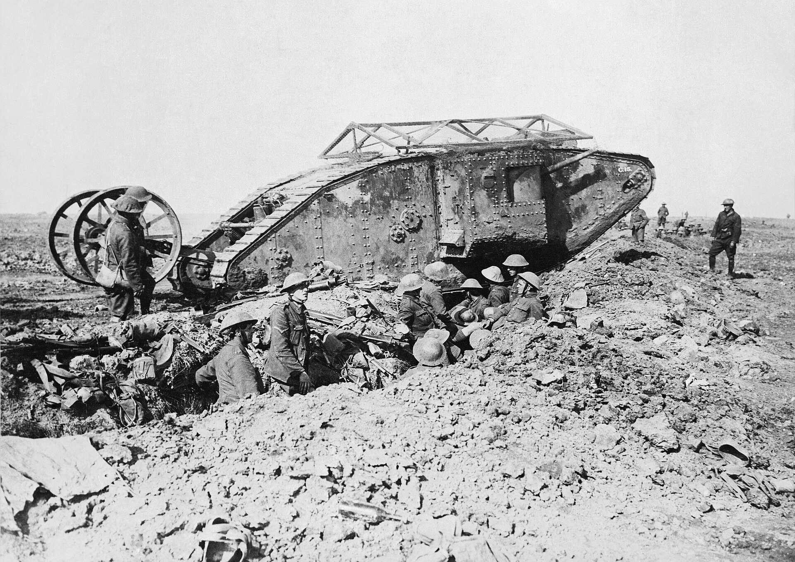
*A British Mark I tank near Thiepval on the Somme, 25 September 1916, with infantry sheltering in a shell hole beside it. Photo: Ernest Brooks, public domain.*

Meanwhile the aeroplane, which was eleven years old when the war began, went from a scout to a weapon. Pilots began by photographing the enemy's trenches, then shot at one another with pistols, then carried machine guns and bombs. German airships crossed the North Sea by night and bombed London, and for the first time civilians far from any army were killed in their beds.

## The whole nation

No single invention broke the deadlock. What decided the war was production, and that drew in everyone.

Hardly anyone had planned for a long war. In the first months, every army fired its whole stock of shells and found that its factories could not make more than a fraction of what the guns consumed. The governments took charge. They built hundreds of new arms works, told industry what to make, fixed prices and wages, and rationed coal and food. With the men gone to the front, they recruited women to fill shells, drive trams and plough fields. They paid for most of it by borrowing, above all from their own citizens, who were told on every wall that to lend was a patriotic duty.

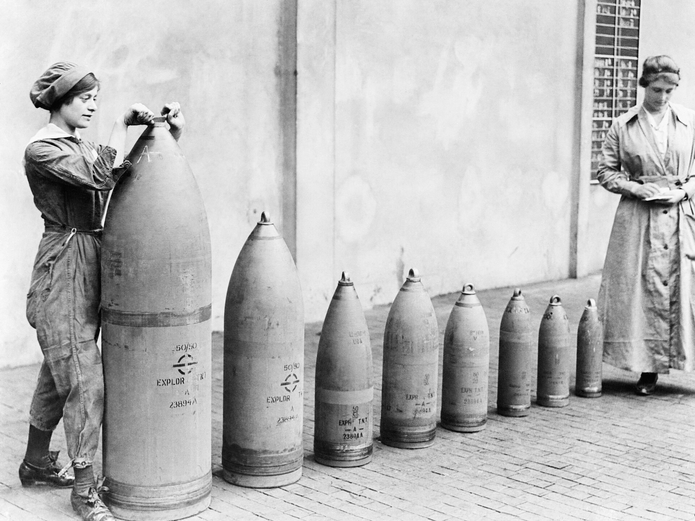
*Women beside shells of every size at the national shell-filling factory at Chilwell, Nottinghamshire, 1917. Photo: Horace Nicholls, public domain.*

A new phrase was coined for this: the home front. Civilians had suffered in every war. What was new was that a whole economy was organised for the fighting. Now the factory worker and the farmer's wife were part of the fighting machine, and it followed that they were targets. Britain used its navy to stop all goods, food included, from reaching German ports. Germany grew most of its own grain, but it had lost its imported fertiliser and its farm labourers. By the winter of 1916 the bread was half potato, and when the potato crop failed, Germans lived on turnips that had been grown for cattle. Several hundred thousand German civilians died of hunger and the illnesses that go with it.

This is also why nobody could stop. By the end of 1916 every one of the great powers had lost hundreds of thousands of its young men. A government that proposed to make peace on the terms of 1914, with nothing gained, would have had to explain what they had died for. Each therefore clung to its aims, or raised them, as the cost rose. France must have its lost provinces back. Germany must keep Belgium and rule the east. The more the war cost, the less possible it became to end it short of victory.

## A world war

Britain and France brought their empires into it, and Germany's colonies and allies carried the fighting far beyond Europe.

More than a million Indian soldiers served, in France, in East Africa and above all in the Middle East. France shipped half a million men from its colonies in Africa and Asia to the Western Front. A hundred and forty thousand Chinese labourers were hired to dig trenches and unload ships behind the British and French lines.

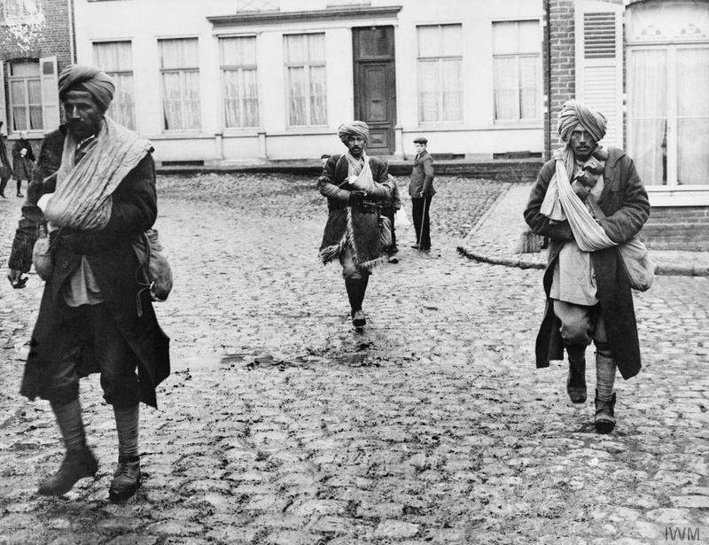
*Wounded Indian soldiers walking through a French village, late 1914. Photo: unknown, Imperial War Museums, public domain.*

In East Africa, where a small German force led the British a chase for four years through country with few roads and where the tsetse fly killed horses and oxen, most supplies had to be carried on human heads. About a million African porters were conscripted for the work, and about a hundred thousand of them died of disease and exhaustion. Hardly anyone in Europe noticed.

The Ottoman empire had joined Germany in the autumn of 1914, which opened fronts in the Caucasus, in Iraq, in Palestine and at the straits near Constantinople. Italy came in on the side of Britain and France in 1915 and attacked eleven times along the same Alpine river against the Austrians. On the Eastern Front, where the distances were too great for continuous trenches, the armies moved back and forth across Poland, and Russia lost nearly two million dead.

## The gamble

By the end of 1916 the German high command had concluded that it could not win on land before the blockade strangled it. It turned to the sea.

Britain imported most of its food. Germany had a new weapon, the submarine, which could sink merchant ships without warning. It had tried this in 1915, and had drawn back after a submarine torpedoed the British liner *Lusitania* off Ireland, drowning nearly twelve hundred people, among them a hundred and twenty-eight Americans. The United States was the richest neutral country, and it had made its anger plain.

In January 1917 the German admirals presented a calculation. If their submarines were allowed to sink every ship approaching Britain, of any nation, they would destroy six hundred thousand tons of shipping a month. Within six months Britain would be starving and would sue for peace. America would certainly declare war, but it had almost no army, and could not train and ship one in time. The emperor signed the order.

For three months the admirals were right. In April 1917 one ship in four that left a British port did not come back, and the country was down to six weeks' supply of wheat. Then the British navy began gathering merchant ships into large groups guarded by warships. A submarine that attacked a convoy revealed itself to the escorts, and the losses fell steeply.

America, meanwhile, had come in. What turned American opinion was the sinking of American ships, together with a secret telegram from the German foreign minister to his ambassador in Mexico, which British codebreakers intercepted and passed to Washington. It proposed that if the United States entered the war, Mexico should attack it, and receive in return its lost territories of Texas, New Mexico and Arizona. The American newspapers printed it on 1 March. After German submarines had sunk several more American ships, Congress declared war.

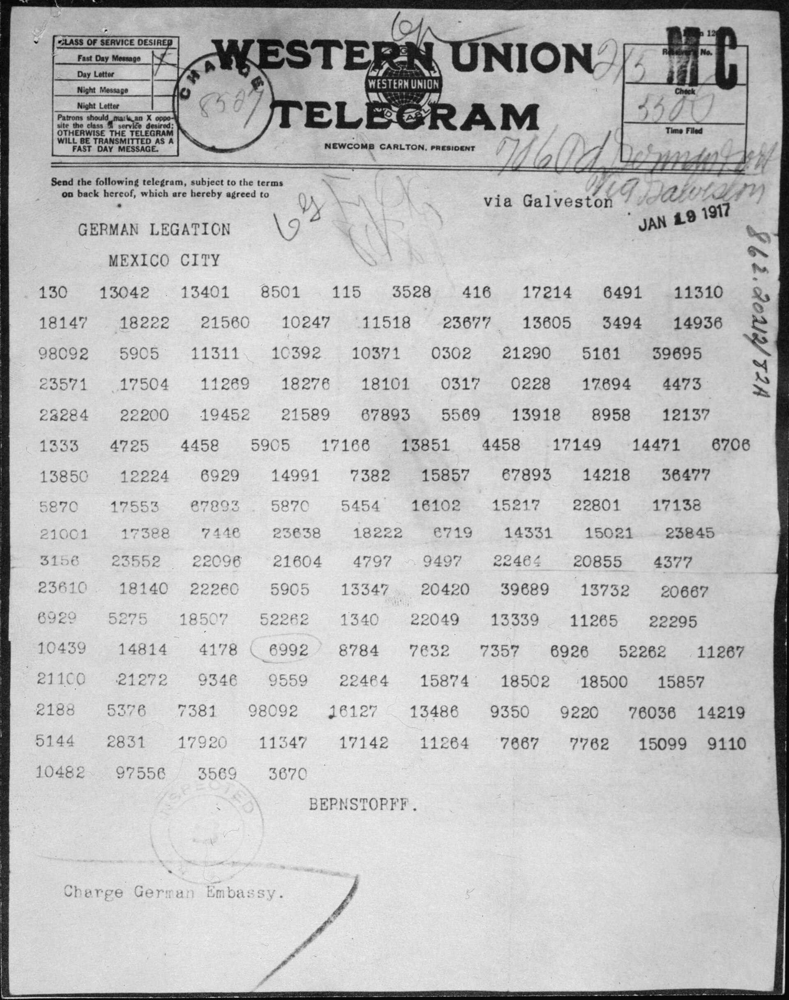
*The Zimmermann telegram as it reached the German embassy in Washington for passing on to Mexico, January 1917. It is in a numerical code, which British codebreakers read. Photo: US National Archives, public domain.*

## The black day

The United States had a regular army of about a hundred and thirty thousand men when it declared war. It would take a year to build a real one. In that year, Germany had one more chance.

In 1917 Russia fell into revolution, and early in 1918 its new rulers left the war, signing away a third of the old empire's population as the price of peace. Germany was now fighting on one front only. That winter it moved half a million men from the east to the west by rail, and its commanders prepared a final offensive to win the war before the Americans arrived in force.

It opened on 21 March 1918, in fog, with the heaviest bombardment yet seen, more than a million shells in five hours. Specially trained assault troops slipped through the weak points of the British line and kept going. For the first time since 1914 the front was torn open. In a few days the Germans advanced sixty kilometres, and by the end of May, after further blows, they stood again on the Marne.

They could not finish it. The assault troops were the best men Germany had left, and they were being used up. The horses were dying of hunger and the supply lorries ran on steel tyres, since there was no rubber. When the famished soldiers overran British supply dumps and found white bread, tinned meat and wine, whole units stopped to eat and drink, and they understood for the first time how much better fed their enemies were.

By the summer, ten thousand American soldiers were landing in France every day. On 8 August, British, Australian and Canadian troops attacked near the Somme with five hundred tanks, hundreds of aircraft and guns that had been aimed by calculation, without the usual warning shots. They advanced eleven kilometres by evening. What shocked the German commander was not the ground lost. It was that whole battalions had surrendered to a handful of men. He called it the black day of the German army.

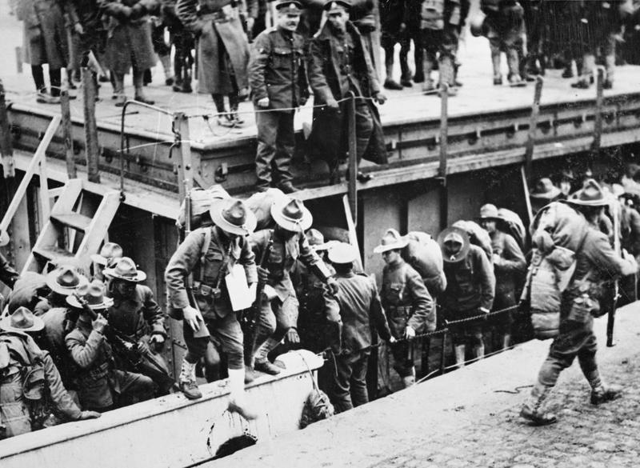
*American infantrymen disembarking at Brest, France, 18 April 1918. Photo: American official photographer, Imperial War Museums, public domain.*

After that the Allies attacked somewhere every few days, and the Germans fell back steadily. Their allies gave up one by one. At the end of October the sailors of the German fleet, ordered out for a last suicidal battle, mutinied and raised red flags. The revolt spread to the cities. On 9 November the emperor's abdication was announced. He fled to Holland the next morning, and the day after that, in a railway carriage in a forest north of Paris, a German delegation signed an armistice. It was five in the morning. The guns were to stop at eleven.

On that last day nearly three thousand more men were killed.

## The mirrors

Between nine and ten million soldiers had died, and at least six million civilians. France had lost one in four of its men between eighteen and twenty-seven.

The war's last gift was a disease. In 1918 a new and vicious strain of influenza appeared in the army camps, and the troopships and trains carried it round the world. It was known as the Spanish flu, because Spain was neutral and its newspapers, unlike those of the countries at war, were free to report it. Unusually, it killed young adults. Within two years it had killed about fifty million people, several times as many as the fighting, with the worst losses in India.

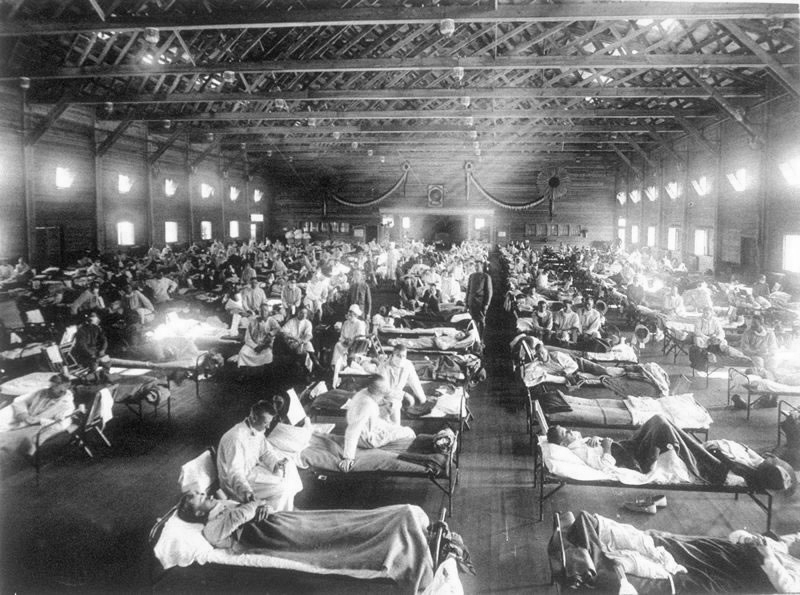
*An emergency hospital for influenza patients at Camp Funston, Kansas, 1918. Photo: US Army, public domain.*

The victors met in Paris in 1919 to make the peace. The American president had promised a settlement based on the wishes of the peoples concerned, and a league of nations to keep the peace. The French, who had been invaded twice in fifty years, wanted Germany made harmless.

The treaty was signed on 28 June 1919, five years to the day after the shots in Sarajevo. The place chosen was the Hall of Mirrors at Versailles, where the German empire had been proclaimed in 1871. Germany lost a tenth of its people and all its colonies. Its army was limited to a hundred thousand men, with no tanks or aircraft. It was required to pay for the damage of the war, and to sign a clause accepting that it and its allies had caused it.

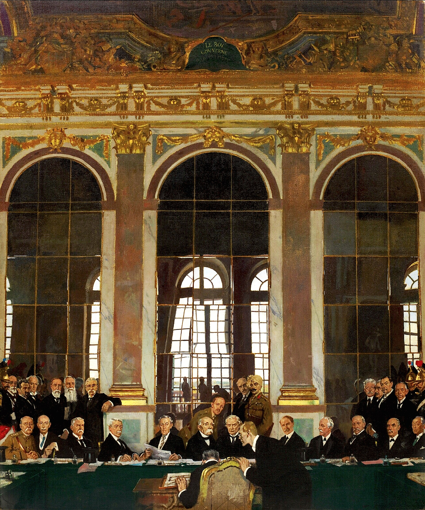
*The signing of the treaty in the Hall of Mirrors at Versailles, 28 June 1919, painted by William Orpen, who was present. Painting: William Orpen, public domain.*

To Germans the terms were an outrage. Their army had still been standing on foreign soil when the fighting stopped, and many of them never believed that it had been beaten. To the French marshal who had commanded the Allied armies, the terms were far too mild, since they left Germany united and larger than France. This is not a peace, he said when he read them. It is an armistice for twenty years.

The next war began on 1 September 1939. He was out by sixty-five days.
