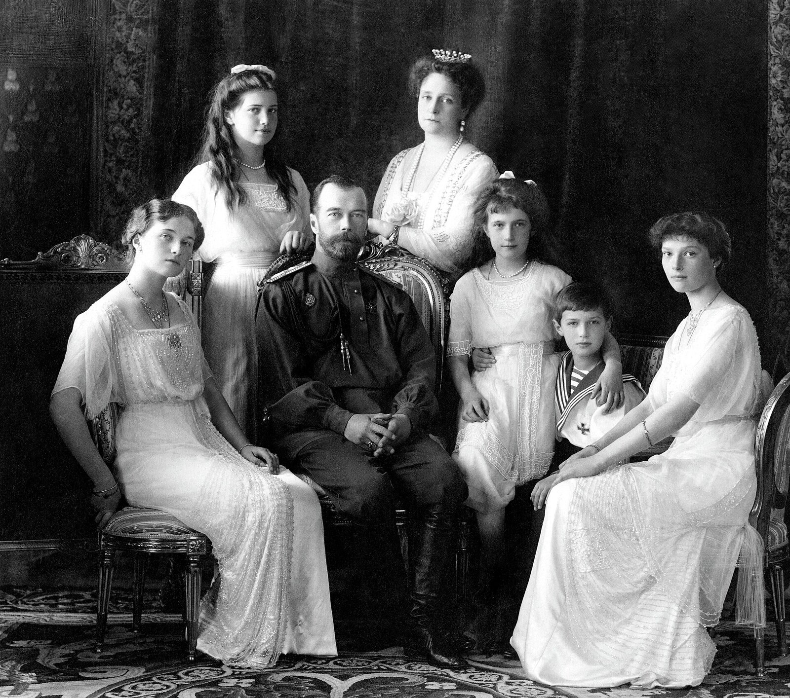
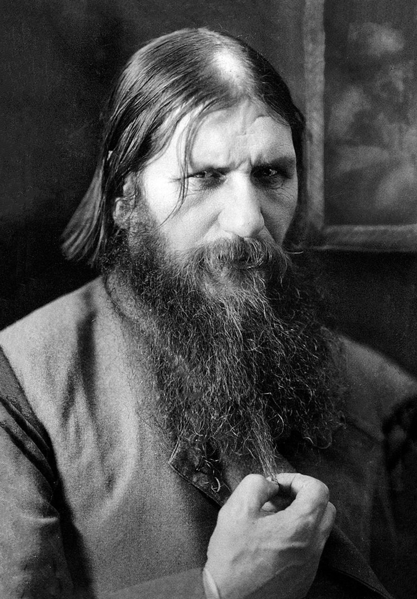
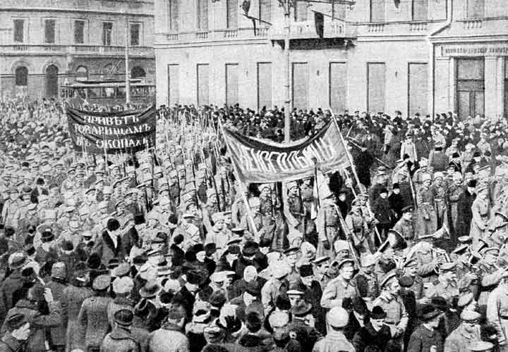
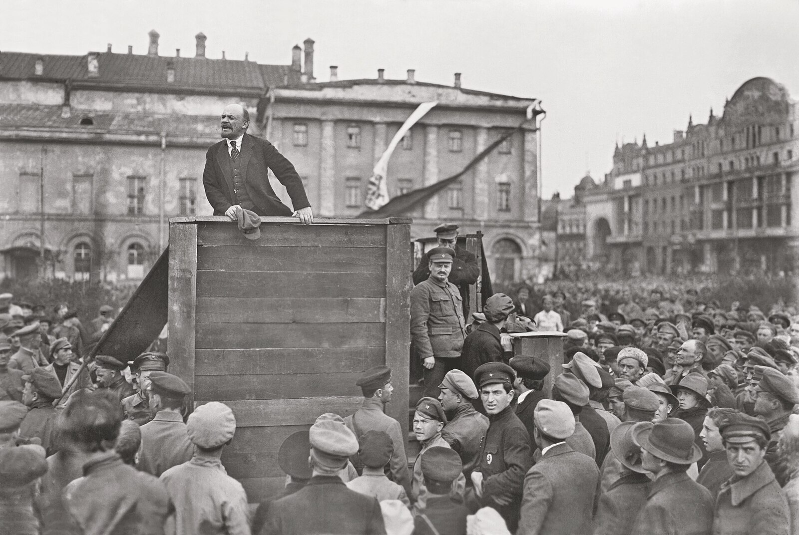
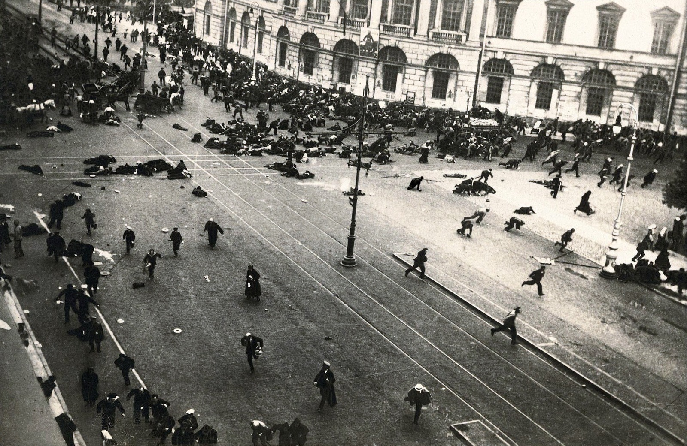
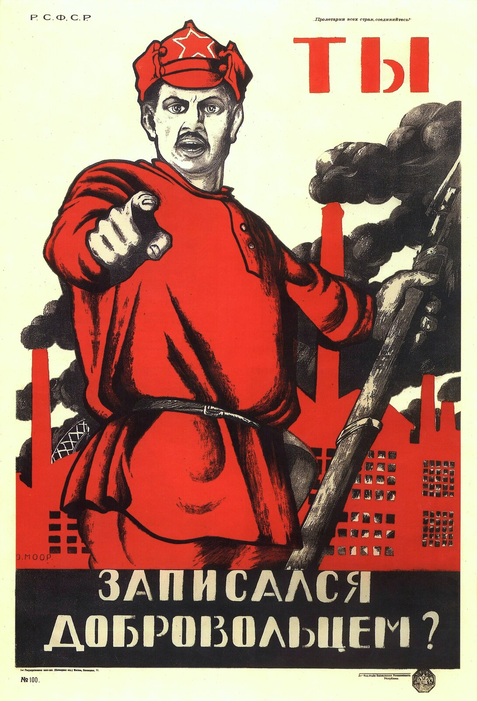
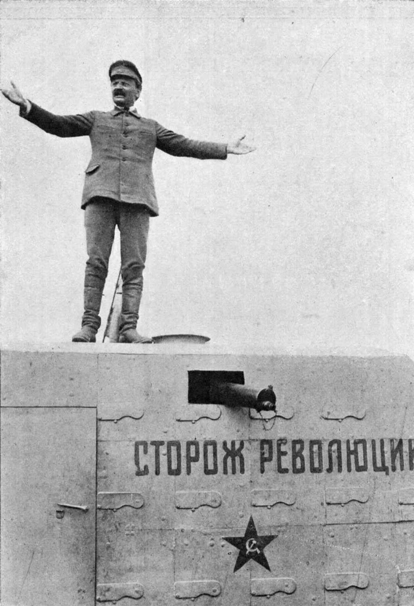
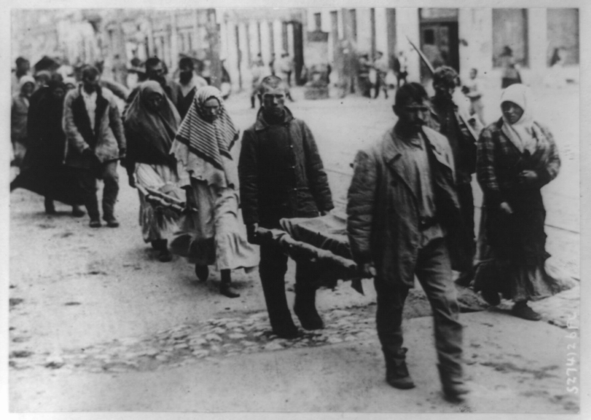
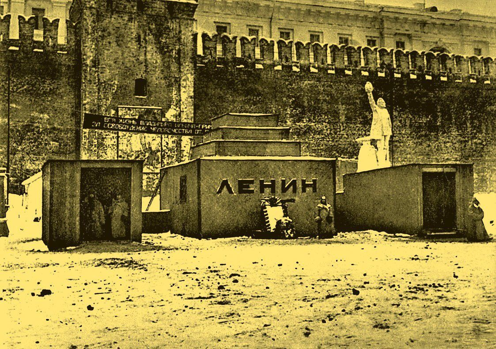

# 73. Why was there a revolution in Russia?

*Russia, from 1905 to 1924*

Russia had two revolutions in one year. The first happened because three years of a losing war had broken the army, emptied the bread shops and destroyed the authority of the tsar. The second happened because the government that replaced him went on with the war and would not give the peasants the land, and a small, determined party that promised both peace and land was able to take power from it.

On the morning of 23 February 1917, in the Russian capital, Petrograd, the women who worked in the textile mills of the northern factory district did not go to their looms. It was International Women's Day, a socialist holiday. It was also the end of a winter in which they had been getting up at four, standing for hours in the dark at twenty degrees below zero outside a baker's shop, and often reaching the counter to find that the bread was gone.

They walked out into the street and went from factory to factory, throwing snowballs at the windows and calling to the men inside to come out. Many did, and the march grew as it went. By the afternoon about a hundred thousand people were marching towards the centre of the city, and the cry that they took up was the simplest one possible: bread.

The revolutionaries were caught by surprise. The socialist parties had not planned this, and their leaders had advised the women to stay calm, since the time was not ripe. The most famous Russian revolutionary, a balding exile of forty-six who called himself Lenin, was in Switzerland. A few weeks earlier he had told an audience of young workers that the old men of his generation might not live to see the decisive battles of the coming revolution.

A week later the tsar had given up his throne, and a dynasty that had ruled for three hundred years was finished.

Russia still used an old calendar that ran thirteen days behind the one used in western Europe, so that 23 February in Petrograd was 8 March in Paris. Russians have always named the two revolutions of 1917 by their own months, February and October, though by the western calendar they fell in March and November.

## Father Tsar

Russia in 1914 was the largest country in the world and one of the strangest. It had a hundred and seventy million people, and four out of five were peasants.

About half of them had been serfs until 1861, the property of their landlords. The tsar who freed them did so on hard terms. He made them pay for the land they received, in instalments spread over forty-nine years, and he left the best of it with the nobles.

Half a century later the villages were overcrowded, and the peasants were certain of one thing, which was that the land ought to belong to those who worked it. In the meantime they farmed the lord's fields for a share of the crop and waited for the day when they could take them.

Beside this old Russia, a new one had sprung up in a single generation. Foreign loans and government orders had built railways, coal mines, oilfields and steelworks, and the factories were enormous. The largest engineering works in Petrograd employed tens of thousands of people on one site.

Life for the people inside them was hard. The workers lived in barracks and cellars and laboured eleven hours a day or more. They had hardly any legal way to complain, since strikers were routinely arrested and the few unions were watched and closed at will. They were packed together, and they were angry. That was a dangerous combination, because a workforce of that kind can be brought out onto the streets in a single day.

Over both Russias stood the tsar. Nicholas II was a gentle, dutiful, limited man, devoted to his wife and children. He believed that God had entrusted the Russian people to his personal care. In his eyes, to share his power with elected politicians would be a betrayal of that trust.

*The tsar and his family, photographed in 1913. Photo: Boasson and Eggler, St Petersburg, public domain.*

His people had already put that belief to the test once. In January 1905 a priest led a procession of workers, in their Sunday clothes, carrying holy pictures and portraits of the tsar, to the Winter Palace in the capital. They had a petition asking their father the tsar for an eight-hour day and a parliament. The tsar was not there. The troops opened fire, and about two hundred people were killed in the snow.

The massacre set off a year of strikes, mutinies and burning manor houses. In the factory towns, workers elected councils to run the strikes, and the Russian word for a council is *soviet*. The tsar saved his throne by granting a parliament, and then spent the next ten years cutting down its powers. However, the bond between the tsar and his people, which was supposed to be the foundation of the state, never recovered.

## One rifle among three

Then came the war, and it pressed on every one of these weaknesses at once. Russia called up fifteen million men, more than any other country, and sent them against the German army, the best equipped in the world.

Its industry could not arm them. In 1915 there were units in which only one soldier in three had a rifle, and the others waited to pick one up from the dead. The artillery was rationed to a few shells a day. Such an army could not hold its ground for long. That year the Germans drove the Russian armies out of Poland in a retreat that cost a million men. By the end of 1916 Russia had lost nearly two million dead, and several million more were prisoners.

The tsar made things worse by an act of duty. In 1915 he went to the front to take command of the army himself. It was a brave choice and a foolish one, because every defeat thereafter was his own. Meanwhile the government in the capital was left to the empress, a German princess by birth, who was disliked and widely suspected of treason.

The empress, in turn, relied on a Siberian peasant named Rasputin, who had a reputation as a holy man and a much better founded one as a drunkard. Her only son suffered from a disease that prevented his blood from clotting, so that any bruise could kill him, and Rasputin seemed able to stop the bleeding when the doctors could not. She believed that he had been sent by God. As a result, ministers were appointed and dismissed on his word.

To loyal monarchists this was a disgrace that endangered the throne itself. In December 1916 a group of noblemen, hoping to save the monarchy from itself, shot him and pushed his body under the ice of the river.

*Rasputin, the Siberian peasant the empress trusted, photographed in 1916. Photo: unknown author, public domain.*

Meanwhile the country was coming apart for a more ordinary reason. The railways had been given over to the army and were wearing out. There was grain in the south, but the trains to bring it north did not run. Prices in the cities had risen fourfold since the start of the war, and wages had not. In Petrograd, in that last winter, the bakeries had flour for a few days at a time. That was the winter in which the women of the mills stood in the dark outside the bakers' shops.

## Eight days

The women's march on 23 February did not look, at first, like the end of anything. The capital had seen bread riots before.

The next day twice as many people came out, and the day after that the whole city was on strike. The crowds filled the main avenue. The mounted police were sent to clear it, and the Cossacks, the army's mounted troops, were supposed to help them. Instead the police found the Cossacks letting the marchers duck under their horses' bellies. It was a small thing, but it showed that the men meant to protect the regime no longer wished to.

On the third evening the tsar, from his headquarters nearly seven hundred kilometres away, telegraphed the order to end the disorders by force. The next afternoon soldiers fired into the crowds and killed several dozen people.

That order asked a great deal of these particular soldiers. The men who did the shooting were not hardened troops. The old army lay dead in Poland, and the garrison of Petrograd was made up of raw conscripts, peasants and workers in uniform, who had been dreading the day they would be sent to the front. In effect, they had been told to shoot people very like themselves.

That night the soldiers of one regiment sat up in their barracks arguing about what they had been made to do. In the morning they shot their commanding officer, took their rifles, and marched to the next barracks to bring out the men there. The mutiny spread from one barracks to the next. By evening half the garrison, some seventy thousand armed soldiers, had gone over to the people. With the soldiers on their side, the crowds opened the prisons and burned the police stations.

*Soldiers demonstrating in Petrograd, February 1917. Photo: unknown author, public domain.*

The tsar set out for the capital by train, and never reached it. Railway workers shunted him onto a side line. In a siding at a provincial station, the general commanding that front came to his carriage with telegrams from the other army commanders. All of them advised him to go. Without the generals, he had nothing left to stand on. On 2 March he signed a paper giving up the throne, on behalf of himself and his sick son. He wrote in his diary that evening that all around him was treason, cowardice and deceit.

## Two governments

Power had fallen into the street, and two bodies picked it up at the same moment, in opposite wings of the Tauride Palace, where the parliament met.

In one wing, the leading members of the parliament formed what they called a Provisional Government. Its task was to run the country until an assembly could be elected to write a constitution. They were mostly liberals: lawyers, professors and landowners who wanted Russia to become a country like France or Britain. Moderate socialists joined them within weeks, and by the summer one of these, a lawyer named Kerensky, was prime minister.

The new government began boldly. It announced freedom of speech, of the press and of religion, an end to the death penalty, and equal rights for everyone including Jews. For a few months Russia was, on paper, the freest country in the world.

In the other wing sat the Petrograd Soviet, a council of delegates elected by the factories and the regiments, of the kind the strikers had first set up in 1905. It did not claim to be the government. However, the workers and soldiers obeyed it, and they did not obey anybody else. Its first order told the soldiers of the capital's garrison to elect committees, which would control the weapons, and to obey the government's military orders only where the Soviet agreed. With that order, the soldiers of the capital looked to the Soviet before the government.

The Provisional Government therefore had the responsibility and no power. In that position it made two decisions, each of them honourable, which together destroyed it.

The first was to continue the war. Russia had given its word to its allies, and the liberals feared that a separate peace would leave the country at Germany's mercy.

The second was to postpone the land question. To hand out the estates was too large a matter for a temporary government, they reasoned, and must wait for the elected assembly. There was a practical fear as well. If the land were divided while the army was at the front, every peasant soldier would walk home to claim his share.

The soldiers wanted the war to stop, and the peasants wanted the land at once. The government was asking both to wait, and they did not wait. Through the summer of 1917, villagers took the estates on their own account, and soldiers left the trenches by the hundred thousand to join them.

## The sealed train

Among the parties of any size, one was prepared to tell them to go ahead at once.

Its leader had been born Vladimir Ulyanov, the son of a school inspector in a town on the Volga. When he was seventeen, his adored elder brother was hanged for his part in a plot to kill the tsar. He became a lawyer and a follower of Marx, was exiled to Siberia, and from 1900 lived mostly abroad, in Munich, London, Geneva and Zurich, writing under the name Lenin.

Lenin added one thing to the teaching of Marx, and it changed the history of the century. Marx had expected the workers to make the revolution themselves, once the growth of industry had made them the majority. Lenin did not believe that they would. Left to themselves, he argued, workers would settle for higher wages. A revolution therefore needed a party of full-time revolutionaries, small, secret and under strict discipline, which would lead the working class and act in its name.

In 1903 the Russian Marxists split over who should be allowed to join, and Lenin's faction, which had won one vote at the congress, took the name Bolsheviks, "those of the majority". At the start of 1917 they had about twenty-four thousand members in a country of a hundred and seventy million.

*Lenin speaking to troops in Sverdlov Square, Moscow, on 5 May 1920, with Trotsky on the steps beside the platform. Photo: Grigory Goldstein, public domain.*

When the tsar fell, Lenin was stuck in Switzerland, with Germany between him and home. The German government solved his problem for him, for reasons of its own. It was looking for any means to knock Russia out of the war, and it calculated that Lenin would do more damage than an army. It agreed to carry him and thirty companions in a railway carriage that was treated as foreign soil, with a chalk line on the floor between them and their German escort. The train took them across Germany to the Baltic coast. A British politician said later that they had transported him like a plague bacillus in a sealed truck.

He arrived in Petrograd in April and shocked even his own party. There would be no support for the Provisional Government, he announced, and no waiting for an assembly. The soviets should take all power now. To the war-weary and the hungry he offered a programme of three words: peace, land, bread. Two of the three were exactly what the government was asking people to wait for.

*Nevsky Prospekt in Petrograd on 4 July 1917 (17 July in the Western calendar), just after government troops opened fire on a demonstration. Photo: Viktor Bulla, public domain.*

All summer, as the government's promises wore thin, those three words did their work. In June the government ordered a great offensive, which collapsed within days. In July the government blamed the Bolsheviks for an armed demonstration, and Lenin went into hiding.

In August a general tried to march on the capital and restore order. The government, in panic, handed out rifles to the Bolsheviks' own militia to stop him, and so armed the party that would soon overthrow it. By September the Bolsheviks had a majority in the Petrograd Soviet.

## A quiet night

The second revolution was nothing like the first. There were no great crowds in the streets. It was planned by a committee and carried out in little more than a day.

On the evening of 24 October, small squads of soldiers, sailors and armed workers, directed by Lenin's ablest colleague, Leon Trotsky, went out across Petrograd. They took over the bridges, the railway stations, the power station, the telephone exchange and the state bank, in most cases by walking in and telling the guards to go home. Life in the city carried on around them. The trams went on running, and the theatres and restaurants were full. Most of the city went to bed without knowing that anything had happened.

That left only the government itself. The ministers of the Provisional Government sat in the Winter Palace, defended by some military cadets and a battalion of women soldiers. Kerensky had slipped away in a car borrowed from the American embassy to look for loyal troops, and found only a few hundred Cossacks.

The end, when it came, was nearly comic. Late on the 25th a warship in the river fired a blank round as a signal. In the early hours a crowd of Red Guards, the Bolsheviks' armed workers, wandered in through an unlocked door, lost their way in the corridors, and eventually found the ministers and arrested them. Hardly anyone had been killed.

A congress of delegates from soviets all over Russia happened to be meeting in the city, and Lenin came out of hiding to announce to it that power had passed into its hands. Within hours he had issued two decrees, one for each of the first two words of his programme. The first proposed an immediate peace to all the warring nations. The second abolished the private ownership of land, without compensation, and handed the estates to the peasants. Since the peasants had already taken them, the decree cost him nothing. It approved what had already happened, and it made the villages his, for the moment.

There remained the assembly that every government since February had promised. The elections for it were held a few weeks later, and they were the freest that Russia would have for seventy years. The result went against Lenin. The Bolsheviks won a quarter of the votes. The largest share went to a rival socialist party that had spoken for the peasants for a generation.

Lenin did not accept the verdict. The assembly met for one day in January 1918. In the small hours, the sailor commanding the guard told the chairman that the guard was tired, and the delegates were turned out. They were not allowed back in.

## Reds and Whites

Lenin had always said that a revolution in backward Russia could not survive alone. It was to be the spark that set off the workers of Germany, France and Britain. With that hope in mind, he made peace with Germany in March 1918 at a terrible price, giving up Poland, the Baltic lands and Ukraine. Then he waited for Europe to catch fire.

*Russia in the civil war, roughly as it stood in October 1919: the Reds in the centre, the Whites round the edge, and the ports where foreign troops landed in 1918. The hatched lands in the west were given up by the treaty of March 1918. Map: drawn for this book; coastlines and rivers from Natural Earth, public domain.*

The fire never spread far. Revolutions did break out in Germany and Hungary at the end of the war. Germany became a republic, and the communists who tried to go further were crushed within months; the soviet republic in Hungary lasted four months. Russia, meanwhile, had fallen into civil war.

On one side, former tsarist officers raised armies in the south, in Siberia and on the Baltic. They were called the Whites. Britain, France, the United States and Japan landed troops at the ports to help them. On the other side, the Bolsheviks, who now called themselves Communists, held the middle of the country: Moscow, Petrograd and the railways that ran out from them.

*A Red Army recruiting poster of 1920 by Dmitry Moor. The words ask, "Have you volunteered?" Poster: Dmitry Moor, public domain.*

Trotsky built a Red Army of five million men out of nothing. He conscripted peasants and hired thousands of the tsar's officers to command them. To keep the officers loyal, he held their families hostage. He himself lived for two and a half years on an armoured train, rushing from front to front.

The Reds won because they had the centre and the railways, while their enemies were scattered round the edge and hated one another. They also won because most of the White generals made little secret of meaning to bring back the landlords. That mattered in a country of peasants. The peasants disliked the Communists, who seized their grain at gunpoint to feed the towns. They disliked the old masters more.

*Trotsky speaking from the roof of an armoured train in the civil war. The words on the side read "Guardian of the Revolution." Photo: unknown author, public domain.*

It was a war of extraordinary cruelty on both sides. The new government had set up a political police within weeks of taking power, and it shot hostages by the thousand. The Whites massacred Jews.

The family of the last tsar were among the dead. In July 1918, as a White army approached the town in the Ural mountains where the former tsar was being held, his guards woke the family in the night and took them down to a cellar. Nicholas, his wife, their four daughters, their thirteen-year-old son, their doctor and three servants were shot and bayoneted, and the bodies were burned with acid and buried in a forest. The main grave was found sixty years later, and the last two bodies in 2007.

By the time the main fighting ended, in 1921, some eight million people had died, most of them from hunger and typhus rather than in battle. Then came a further disaster. The harvest failed along the Volga, in a countryside already stripped of its seed grain, and five million more starved. An American relief mission fed ten million Russians a day through the worst of it.

*Two children's coffins carried to a cemetery in the Volga famine district, 1921. Photo: Library of Congress collection, public domain.*

## The glass case

The state that came out of all this was not what anyone had marched for in February. The women of the bread queues had asked for bread, and the soldiers had wanted to go home. What came of their revolution was the rule of a single party.

The soviets still met, and they voted as the party told them. Every other party had been banned, and so, in 1921, were organised disagreements inside the Communist party itself.

That same year a protest came from an unexpected quarter. The sailors of the naval base outside Petrograd, who had been the pride of the revolution, rose and demanded soviets that were freely elected. They were asking for what the revolution had promised. The government sent the Red Army across the ice. Thousands of the sailors fled to Finland, and of those who were captured, some two thousand were shot.

Lenin retreated on one point. With the economy in ruins, he let peasants sell their grain again and allowed small private businesses, as a breathing space. On the question of power he gave nothing.

He did not live to see what was done with what he had built. A series of strokes left him speechless, and he died in January 1924, at fifty-three. His successors renamed Petrograd in his honour. Then, against the wishes of his widow, they had his body embalmed and laid it in a glass case in a tomb beside the Kremlin wall, where the citizens of the first state founded on the denial of religion could file past and look at it. It is still there.

*Lenin's first tomb, a temporary wooden building beside the Kremlin wall, 1924. Photo: unknown author, public domain.*
