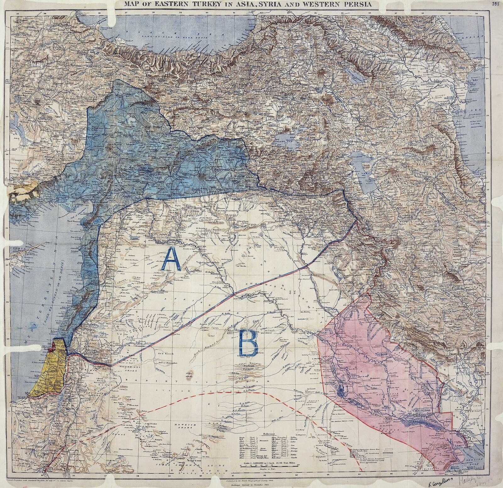
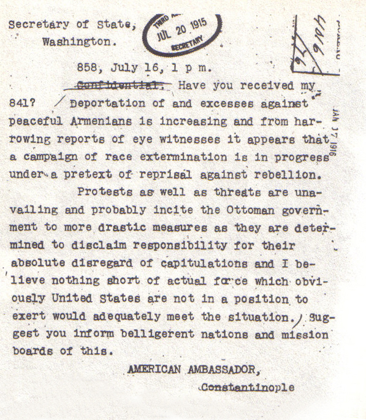
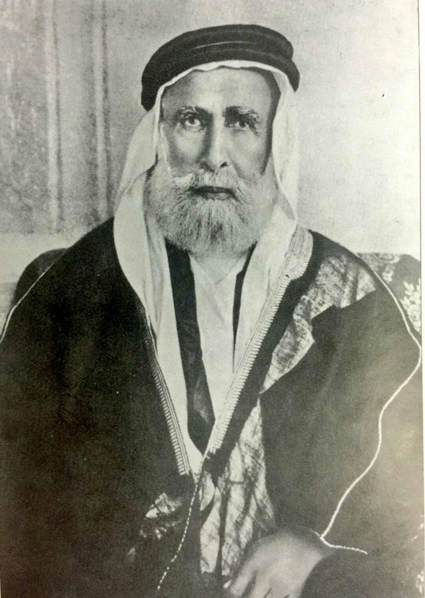
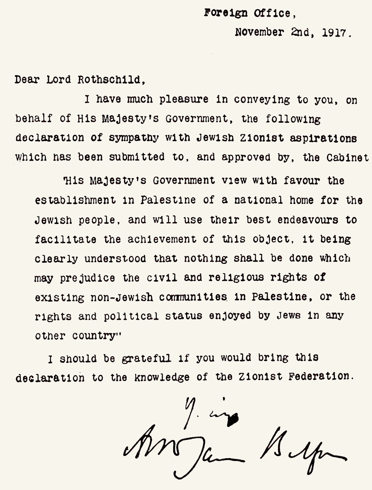
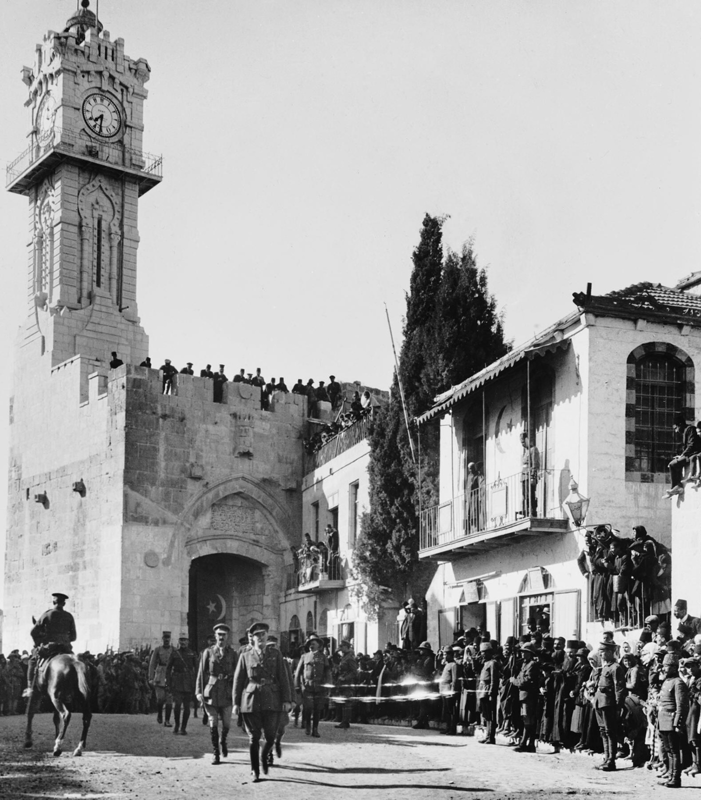
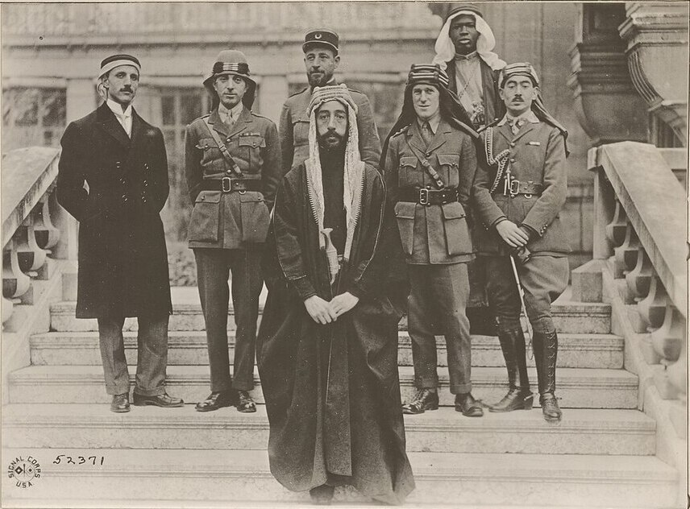
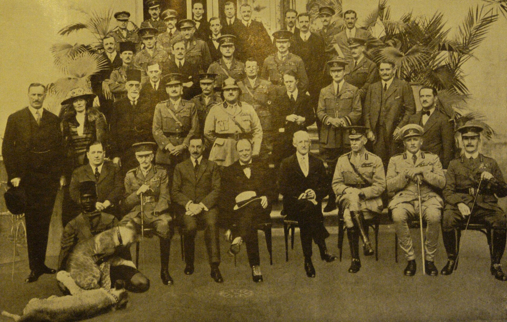
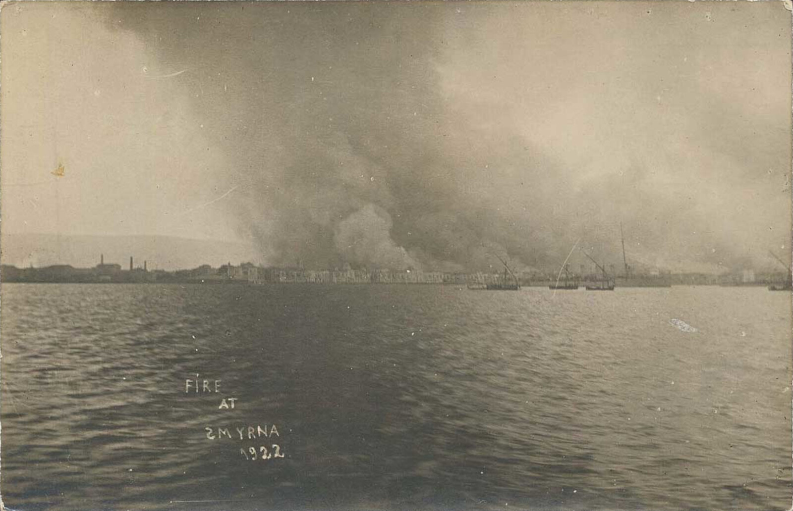
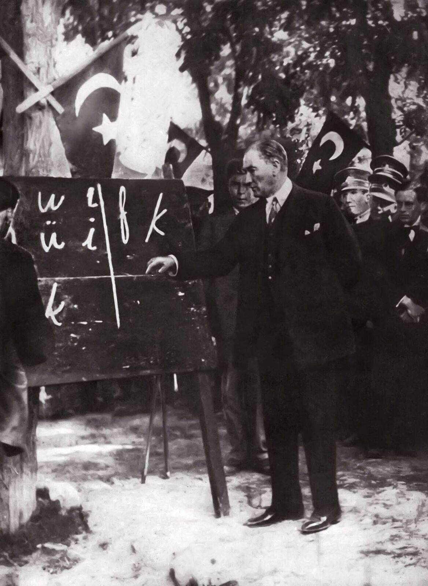
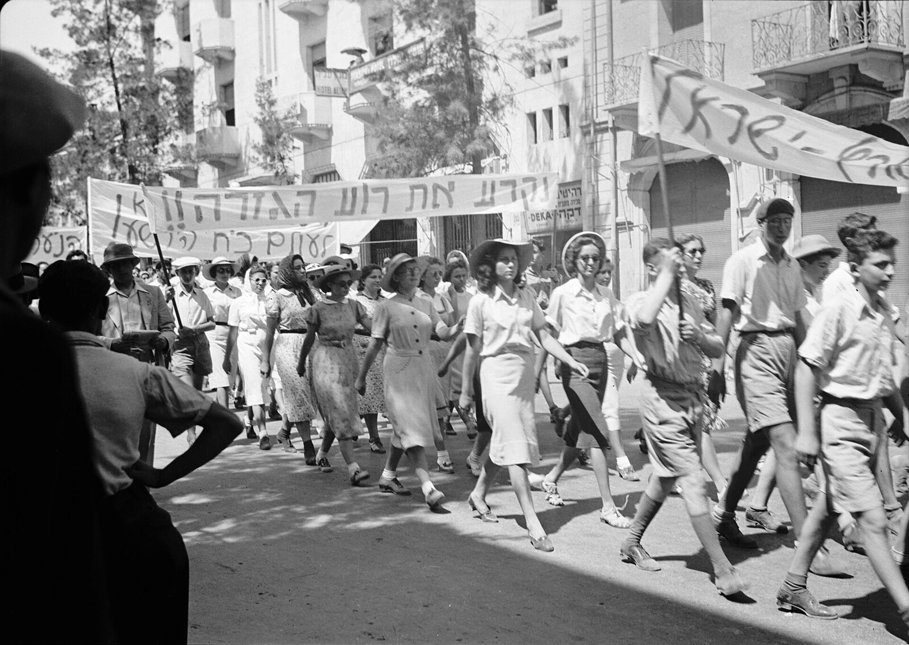

# 74. Who drew the borders of the Middle East?

*The Ottoman lands, from 1914 to 1939*

Most of them were drawn by British and French officials between 1916 and 1923, when the two powers divided the Arab provinces of the defeated Ottoman empire between themselves. During the war Britain had promised the same lands, in different words, to the Arabs, to the French and to the Jewish people. The borders are what was left when those promises collided. The Turks, who fought for it, drew their own frontier.

On a December morning in 1915, a committee of British ministers met at the prime minister's house in London to decide what should be done with the Middle East after the war. The war itself was still being fought, yet the ministers were already planning how to share out what they hoped to win. The man they had summoned to advise them was Sir Mark Sykes, a member of Parliament of thirty-six who had travelled widely in the Ottoman empire and talked about it with great confidence.

A map was spread on the table. One of the ministers asked Sykes what arrangement he had in mind with the French, who also had claims in the region. Sykes ran his finger across the map. He would like, he said, to draw a line from the "e" in Acre to the last "k" in Kirkuk. It was a neat answer, of the kind that suits a map on a table.

Acre is a port on the coast of Palestine, and Kirkuk is a town in the hills of northern Iraq, nine hundred kilometres away. The line between them crossed deserts, rivers, and the lands of Arabs, Kurds, Christians and Jews, none of whom had been asked. In other words, one movement of a finger was meant to settle the future of several peoples who had no voice in the room. France would be the leading power north of the line, and Britain south of it.

Within five months a version of that line had been agreed in secret with a French diplomat. The speed is remarkable, because the empire being divided had not yet been defeated. In fact, it fought on for another two and a half years.

*The map agreed in secret by Britain and France in 1916. Area A was to be under French influence and area B under British. Map: Royal Geographical Society, public domain.*

## The sick man

The empire on Sykes's map was an old one. It had once reached from the gates of Vienna to the Persian Gulf. By 1914, however, it had been shrinking for two centuries, and the diplomats of Europe called it the sick man, as if it were a patient whose death was only a matter of time. Piece by piece, it had lost its Balkan provinces to nationalist risings, North Africa to France and Italy, and Egypt, in all but name, to Britain.

Even so, it was still very large. Its heartland was Anatolia, the land that is now Turkey. Beyond that, it ruled the whole Arab east: Syria, Lebanon, Palestine, Iraq, and the Red Sea coast of Arabia with the holy cities of Mecca and Medina. Its sultan was also the caliph, the successor of the Prophet. That title gave him a standing far beyond his own borders, and Muslims as far away as India honoured his name in their Friday prayers.

The people of the empire were as varied as its lands. About twenty million people lived in it. Turks were the largest group, and Arabs the next. There were also Kurds in the eastern mountains, Greeks along the coasts, and some two million Armenians, an ancient Christian people of the east.

What held such different peoples together was a light hand. For centuries each religious community had run its own affairs under its own leaders, and the empire had asked for taxes and loyalty and little more.

That easy arrangement was already breaking down before the war. In 1908 a movement of young army officers had forced the sultan to restore a parliament, and in 1913 three of the movement's leaders seized power outright. They wanted a modern, centralised state, more Turkish in character. A state of that kind had less room for communities that ran their own affairs.

In 1914 the officers made a fatal choice. Russia was the empire's oldest enemy. Russia, in turn, was allied with Britain and France. The officers therefore signed a secret treaty with Germany, and in the autumn their fleet shelled the Russian coast. With that, the empire was at war with the very powers that would later divide it.

## Deportation

The war began with a catastrophe. In the winter of 1914 the minister of war led an army into the mountains on the Russian border, in deep snow, without winter clothing. The result was what such a march invites. The army was destroyed, and tens of thousands of its men froze to death.

A defeat on that scale called for an explanation, and the government needed someone to blame. Armenians lived on both sides of that border, and some had volunteered for the Russian army. From those facts the ruling officers made a leap. They decided that the Armenians of the empire, as a people, were a danger behind the lines, and that the solution was to remove them. The leap turned the acts of some into the guilt of a whole people.

In the capital, the blow fell on the community's leaders. On the night of 24 April 1915, the police in Constantinople arrested about two hundred and fifty Armenian writers, clergymen, teachers and members of parliament. Most were killed. At a stroke, the Armenians had lost many of the people who might have spoken for them.

In the following months, orders went to the provinces, and what happened there followed a pattern. In town after town, the Armenian men were marched out and shot. The women, the children and the old were set on the road, on foot, towards the Syrian desert six hundred kilometres to the south. They were given no food or water. Few could be expected to survive a journey like that. Along the way, guards and local bands robbed, raped and killed them, and those who reached the desert were left there.

About a million Armenians died. The killing did not go unseen. The ambassador of the United States, which was then neutral, received reports from his consuls all over the country and cabled Washington that a campaign of race extermination was in progress.

Thirty years later, a Polish lawyer who had studied these events invented a word for the attempt to destroy a whole people. The word was genocide. The quarrel over that word continues. The Turkish republic has always rejected its use for what happened in 1915, and maintains that the deaths were the result of wartime disorder.

*The American ambassador's telegram to Washington, 16 July 1915. Document: US State Department, public domain.*

## Three promises

Britain, meanwhile, was looking for ways to bring the Ottoman empire down, and the coin it chose to pay with was the promise. In two years it made three sets of commitments, to three different parties, about much the same land.

The first was to the Arabs. The governor of Mecca, Hussein, was a descendant of the Prophet and the head of the most respected family in Arabia. That made him the natural man to call Arabs to arms against the sultan. In 1915 the senior British official in Egypt began an exchange of letters with him.

The terms were generous. If Hussein would raise the Arabs in revolt against the Turks, Britain undertook to recognise and support the independence of the Arabs across almost the whole area he asked for, from Syria to the Gulf. However, one sentence excluded a strip of land in the west, along the coast of Syria. It was vaguely worded. As a result, the two sides argued for decades afterwards about whether it included Palestine.

*Hussein, the governor of Mecca, photographed in 1916. Photo: unknown author, public domain.*

The second was to France. This was the agreement that began with Sykes's finger on the map. It was kept secret, with good reason, since it gave to Britain and France much of what had just been promised to Hussein.

Its terms worked by degrees of control. France was to govern the Syrian coast directly. Further inland there would be an Arab state in name, in which only France could supply advisers, and France would have first claim to lend it money. Such a state would be independent on paper and French in practice. Britain was to have southern Iraq to govern as it chose, and a zone of its own beyond it. Palestine, with its holy places, was treated as a special case. It was to be placed under an international administration.

The third was the shortest, and it has been argued over more than the other two together. On 2 November 1917 the British foreign secretary, Arthur Balfour, sent a letter to Lord Rothschild, a leader of the Jewish community in Britain. Its key sentence is sixty-seven words long. The government, it said, viewed with favour the establishment in Palestine of a national home for the Jewish people, and would do its best to bring this about, "it being clearly understood that nothing shall be done which may prejudice the civil and religious rights of existing non-Jewish communities in Palestine".

The sentence made two promises in one breath. It offered one people a home, and it assured the people already living there that nothing would harm their civil and religious rights. It did not say what should happen if the two could not both be kept.

*The Balfour letter, 2 November 1917. Document: British government, public domain.*

The letter gave a powerful backer to a young movement. The movement to which it was addressed, Zionism, was then twenty years old. It held, first, that the Jews were a nation. Second, centuries of persecution had shown that they would never be safe as a minority. It followed that they should rebuild a home of their own in the land where their history had begun.

Settlement had in fact begun before the movement took shape. Since the 1880s, Jews escaping the massacres in Russia had been settling in Palestine, buying land and founding farms and a new town on the coast.

Why, then, would a British government make such a promise? Its ministers had several motives. Some hoped to win the support of Jews in America and Russia for the war. Some had been raised on the Bible and were moved by the idea of the return. Others were thinking of strategy, and wanted a friendly population beside the Suez Canal.

There was also a personal link. The movement's leader in Britain was a chemist who had solved a critical problem in the making of explosives for the navy, and he had the ear of the cabinet.

What the letter mostly left aside was the people already living in the country. When it was written, about seven hundred thousand people lived in Palestine. About six hundred and forty thousand of them were Arabs, Muslim and Christian, whose families had farmed its villages and lived in its towns for many centuries. They were the "non-Jewish communities" of the letter. They were nine tenths of the population, and nobody had consulted them. The letter, in other words, named the great majority of the country only by what they were not.

## The revolt in the desert

Whatever was being written in London, Hussein kept his side of the bargain. In June 1916 he fired a rifle from the window of his palace in Mecca as the signal for revolt. His sons led a force of desert tribesmen north along the railway that linked Arabia to Syria. Every cut in the line made the Turkish garrisons along it harder to supply, so the raiders blew up trains and pinned those garrisons down.

The British sent gold, guns and a few advisers. One of them was a small, intense archaeologist of twenty-eight named T. E. Lawrence, who spoke Arabic, wore Arab robes, and rode with Hussein's son Faisal.

Lawrence was in an awkward position. He knew about the secret agreement with France, and so he knew that the men he rode with had been promised more than his own government meant to give. He wrote later that he had been continually and bitterly ashamed. His hope was that if the Arabs reached Damascus first, their claim would be too strong to deny.

They did reach Damascus, in October 1918, alongside a British army that had taken Jerusalem the winter before. Faisal set up a government there. For a moment it looked as if Lawrence's hope might come true.

By then, however, the secret was out, and it had leaked from an unexpected place. When the Bolsheviks seized power in Russia, they had found the texts of the wartime agreements in the tsar's foreign ministry, and to embarrass their enemies they had published the lot. The Arabs read in the newspapers how their country had been shared out, by the same ally that had sent them gold and guns.

*General Allenby entering Jerusalem on foot through the Jaffa Gate, 11 December 1917. Photo: Underwood and Underwood, public domain.*

## Mandates

With the fighting over, the argument moved to the peace conference in Paris. The American president had already declared that peoples should no longer be handed about from one ruler to another like property. That principle seemed to be on the Arabs' side. Faisal came to the conference in his robes, with Lawrence as his interpreter, to ask that the promise of independence be kept.

The Americans tried to find out for themselves. They sent a commission to Syria and Palestine to ask what the inhabitants wanted. It reported that they wanted independence, and that they were strongly opposed to the Zionist programme. The report was filed and forgotten.

*Faisal, in front, with members of his delegation at the Paris peace conference, 1919. T. E. Lawrence is second from the right. Photo: US Army Signal Corps, public domain.*

Britain and France settled matters between themselves in 1920. They faced a problem of appearances. Outright colonies were no longer respectable, so a new device was used. The Arab lands were declared to be "mandates". Each was a territory entrusted by the new League of Nations to an advanced power, which would govern it until its people were able to stand alone. The name suggested a duty carried out on someone else's behalf, and it let the powers present themselves as guardians rather than owners. In practice, the division looked much like the secret map. France received Syria and Lebanon. Britain received Iraq and Palestine.

The Syrians, however, had already proclaimed Faisal their king. France did not mean to share Syria with him. That July a French army marched on Damascus, scattered his volunteers in a morning, and expelled him.

France then went further. It cut the coastal mountains and the lands around them away from Syria to make a separate state, Lebanon, in which its allies the local Christians would be the largest group. A border drawn that way was meant to give France a small state that it could count on.

Britain's trouble came in Iraq. There the news of the mandate set off a rising along the Euphrates that took the British four months and forty million pounds to put down. Aircraft bombed rebellious villages, and several thousand Iraqis were killed.

The bombing also gave the air force an argument. It persuaded the government that it could police the whole country in this way, far more cheaply than soldiers could.

After that, Britain wanted a cheaper way of running things. Its answer was to rule through friendly local rulers. In March 1921 the minister for the colonies, Winston Churchill, gathered forty British officials at a hotel in Cairo. In under three weeks they redesigned the region.

The first decision concerned Iraq. It would be a kingdom, made by joining three former Ottoman provinces, each with a different population: one in the north with many Kurds, one in the centre dominated by Sunni Arabs, and one in the south whose people were mostly Shia. Sunni and Shia are the two main branches of Islam. Faisal, who was out of work, would be its king. Having lost one throne in Damascus, he was given another in Baghdad.

The second decision concerned the land east of the river Jordan. It was separated from Palestine and given to his brother, as the emirate of Transjordan. British advisers, bases and aircraft would remain in both.

*The British officials at the Cairo conference, March 1921, with Winston Churchill seated in the centre of the front row. Photo: unknown author, public domain.*

It was quick work, and it lasted. Syria, Lebanon, Iraq and Jordan are still on the map in very nearly the shapes that they were given in those years, and every one of their borders has since been fought over.

Hussein's family thus received two thrones, and lost the one they started with. A few years later a rival chief from the interior of Arabia, Ibn Saud, conquered Mecca and gave the country his family's name.

One large people came away with nothing. The Kurds, who live in the mountains where Turkey, Iraq, Syria and Iran now meet, had been offered self-rule, and the prospect of a state, in the first peace treaty with the Ottomans. The offer was dropped from the final one. They number more than thirty million today, divided among four countries.

![Two maps side by side. Left, 1916: the Ottoman empire of 1914 with a French-ruled zone on the Syrian coast and in south-eastern Anatolia, a British-ruled zone in southern Iraq, an international zone in Palestine, and areas A and B of French and British influence divided by a dashed line from Acre to Kirkuk. Right, 1923: Turkey, the French mandates of Syria and Lebanon, the British mandates of Iraq, Palestine and Transjordan, the Hejaz, Nejd and Persia, with the land of the Kurds cross-hatched across the borders of Turkey, Syria, Iraq and Persia](images/map_mandates.png)
*Left, the Ottoman empire of 1914 with the zones agreed in secret by Britain and France in 1916, and the line from Acre to Kirkuk between them. Right, the same lands in 1923, with the area where Kurds live hatched; zones and areas are drawn roughly. Map: drawn for this book; coastlines and rivers from Natural Earth, public domain.*

## The father of the Turks

The Arab provinces were not the only lands on the table. The victors had meant to carve up Turkey itself in the same way. A treaty signed by the sultan's government in 1920 put the great port of Smyrna and the country around it under Greek administration, and set aside zones for France and Italy. It left the Turks a rump state, a leftover piece of their own country, without control of its own straits or finances.

One Ottoman general refused to accept it. Mustafa Kemal had made his name defending the straits against the British in 1915, so he had a soldier's reputation to build on. He slipped away to the interior, set up a rival government in the small town of Ankara, and raised an army from the wreckage of the old one.

The war that followed was a long one. In three years of fighting he drove out the Greek army that had landed on the coast, and the great port city of Smyrna burned behind it. Victory gave him the authority to change the state itself. Within weeks his assembly had abolished the sultanate.

The Allies now had to deal with him. In 1923 they signed a new treaty with him as an equal. It fixed, with small later changes, the borders that Turkey has today. Here, unlike in the mandates, the frontier was settled by the people who had fought for it.

*The burning of Smyrna seen from the sea, September 1922. Photo: unknown author, public domain.*

With the treaty came an agreement of a kind never before made on such a scale. Its logic was simple and harsh. Minorities were seen as a cause of war, so the way to prevent future conflict was to remove them. Greece and Turkey would therefore exchange their minorities, compulsorily.

About one million two hundred thousand Orthodox Christians, most of whom had already fled in the war, lost the right to live in Turkey, and about three hundred and fifty thousand Muslims were removed from Greece. The test of who had to go was religion, not language. Many of the "Greeks" spoke only Turkish, and many of the "Turks" only Greek, and none of them had a choice.

Kemal then remade what was left, and one change followed hard on another. He declared a republic. In 1924 he abolished the caliphate, an office that had existed, in one form or another, since the death of Muhammad. With it went the title that had once made Muslims as far away as India pray for the sultan.

The rest of the old order followed. He closed the religious courts and schools, adopted European law, and gave women the vote. Even dress changed. He banned the fez, the brimless red hat that had been the mark of an Ottoman gentleman, and required men to wear hats with brims.

The deepest change was to writing itself. In 1928 he replaced the Arabic script with the Latin alphabet, and toured the country with a blackboard teaching it himself. When Turks were required to take surnames, the parliament gave him one that means "father of the Turks": Atatürk.

*Mustafa Kemal teaching the new Latin alphabet at a blackboard in Kayseri, 20 September 1928. Photo: Presidency of the Republic of Turkey, public domain.*

## A national home

In Palestine, Britain had made itself responsible for carrying out the Balfour letter, both halves of it.

The two halves pulled in opposite directions from the first day, because each side read the words "national home" in its own way. To Zionists, a national home meant a place where Jews could come freely, buy land, speak Hebrew, govern themselves and, in time, become a majority. To the Arabs of Palestine, it meant that a foreign power was settling newcomers on their country, at the very moment when the Arabs of Iraq and Transjordan were getting governments of their own. Each side held a British promise, and each was sure that the other's promise was the invalid one.

The numbers made the quarrel more urgent every year. In 1922 there were about eighty-four thousand Jews in Palestine, one person in nine. The numbers grew steadily through the 1920s.

Then, in 1933, Hitler came to power in Germany, and the Jews of central Europe began to look for somewhere to go. Most countries, including the United States, kept their doors nearly shut. By 1939 there were about four hundred and fifty thousand Jews in Palestine, close to a third of the population.

The growth showed on the land as well as in the figures. The newcomers built towns, schools, a university and farms on land bought from Arab landlords, many of whom lived in Beirut or Damascus. The landlords were paid, but the cost fell on the people who actually lived there. The tenant farmers who had worked that land were turned off it.

Violence had come early, long before the arrivals from Germany. There were riots in 1920 and 1921, and worse in 1929, when Arab mobs killed a hundred and thirty-three Jews, sixty-seven of them in the old religious community of Hebron, which was then abandoned. About as many Arabs were killed, mostly by British police.

In 1936 the Arabs of Palestine rose in a general revolt against British rule and Jewish immigration. It lasted three years. Britain put it down hard, with twenty thousand troops, collective fines, the dynamiting of houses, and executions, and about five thousand Arabs were killed.

The revolt left the two communities in very different shape. The Arabs' leaders were exiled or dead, and their community was left disarmed and divided. The Jewish community, which had cooperated with the British, came out of those years with a trained militia.

In the middle of the revolt, a British commission of inquiry reached a new conclusion. The two peoples had irreconcilable claims, and so the country should be divided between them.

The proposal pleased neither side as it stood. The Zionist leaders accepted the idea of partition and disliked the map. The Arab leaders rejected it outright, since they did not see why they should give up any part of their country.

## The door

In May 1939, with another European war coming, Britain changed course. It needed the goodwill of the Arab world, which held the oil and the canal. A statement of policy, known as the White Paper, announced that Jewish immigration to Palestine would be limited to seventy-five thousand people over the next five years, after which there would be no more without Arab consent.

*A march in Jerusalem against the White Paper, 18 May 1939. Photo: Matson Photo Service, public domain.*

It was issued less than four months before the German army entered Poland, where three million Jews lived.
