# 75. What happened to the last emperor of China?

*China, from 1895 to 1935*

He gave up the throne in 1912, when he was six years old, and died in 1967 as an ordinary citizen of Communist China who had worked as a gardener. His dynasty fell because, after sixty years of defeats, it had lost the support of the educated families who ran the provinces and of the army it had built to save itself. Nothing strong enough to rule the country took its place for nearly forty years.

On a freezing morning in December 1908, in the largest hall of the Forbidden City in Beijing, a boy not quite three years old was lifted onto the dragon throne. His name was Puyi. He had been taken from his mother three weeks earlier, on the orders of a dying empress, and he had been crying on and off ever since.

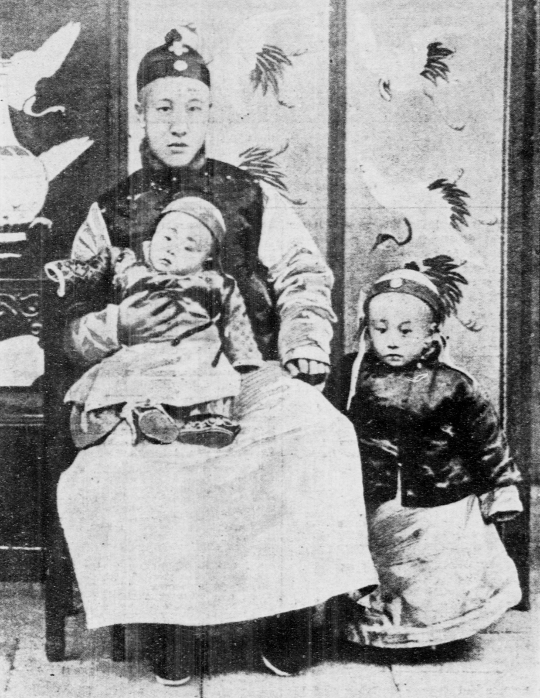
*Puyi, aged three, standing at right, with his father Prince Chun, who ruled for him as regent, and his baby brother, in 1909. Photo: unknown, public domain.*

The ceremony was long, and for a small child it was frightening. Hundreds of officials and generals knelt in rows and knocked their foreheads on the stone floor nine times, while drums and bells sounded. The child struggled and screamed that he did not like it there and wanted to go home. His father, who was kneeling beside the throne to hold him steady, was sweating with embarrassment. Don't cry, he said, loudly enough for those nearby to hear. It will soon be over.

The officials who heard him exchanged looks. They were men who took omens seriously, and a father telling a new emperor that it would soon be over sounded very much like one.

It was over in three years and two months. In February 1912 the boy's guardians issued an edict in his name, handing the government of China to a republic. The dynasty had ruled for two hundred and sixty-eight years. Emperors of one house or another had ruled China for more than two thousand. The causes of so sudden a fall had been gathering long before the boy was born.

## Fists

The dynasty, the Qing, had been failing in front of the whole world since the British gunboats came up its rivers in the 1840s. There had been many defeats since then. The blow that broke its confidence, however, came in 1895, when China was beaten in under a year by Japan, a country that the Chinese had always regarded as a small and backward pupil. Losing to a pupil was worse than losing to a stranger.

The foreign powers drew their own conclusion from the war. They decided that China was finished, and moved in to claim their shares. Within three years Germany, Russia, Britain and France had each forced the court to lease them a port and to grant them the right to build railways and open mines in the country behind it. Each port gave a foreign power a foothold, and each railway carried its reach further inland. Cartoonists in Europe drew China as a cake being sliced.

In 1898 the young emperor of the day tried to answer as Japan had, by modernising from the top. Advised by a group of reforming scholars, he issued a flood of decrees in a hundred days, ordering modern schools, a modern army, railways and a free press.

However, he had not reckoned with his aunt. The Empress Dowager Cixi had been the real ruler of China for almost forty years, governing from behind a silk screen on behalf of one child emperor after another. Her answer to the reforms was swift. She had six of the reformers beheaded and the emperor shut up on an island in the palace lake.

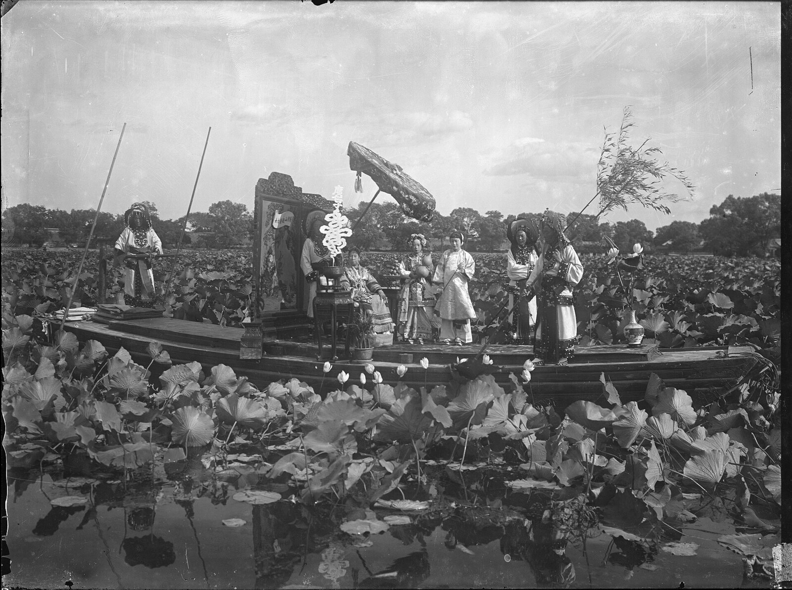
*The Empress Dowager Cixi, seated on a barge among lotus plants on a lake in Beijing, with her attendants, in a photograph taken between 1903 and 1905. Photo: John Yu Shuinling, public domain.*

Two years later the anger in the country found its own outlet, among the peasants of the north. Several troubles had piled up at once. Drought had ruined the harvest. Foreign missionaries were building churches in the villages. Worse, in the eyes of their neighbours, the converts could call on foreign consuls in any lawsuit, so a quarrel with a Christian villager could become a quarrel with a foreign power.

Out of that anger, a movement spread from village to village, combining martial arts with spirit possession. Its members called themselves the Fists of Righteous Harmony, and foreigners called them the Boxers. They believed that a hundred days of training and the right charms made a man's body proof against bullets.

In the summer of 1900 Boxer bands poured into Beijing, burning churches and killing Chinese Christians wherever they found them. The Empress Dowager now had to decide what to do with them. After hesitating, she decided to use them, and declared war on all the foreign powers at once. For fifty-five days the diplomats, missionaries and their families were besieged in the embassy quarter of the capital.

They were rescued by an army of twenty thousand men from eight nations, the largest part of them Japanese. The charms did not work.

Revenge followed the rescue. The foreign troops looted Beijing, from the palaces down to the pawnshops, and punitive columns shot and beheaded suspected Boxers across the northern countryside. The court fled a thousand kilometres inland disguised as peasants. The rulers of China had been driven out of their own capital by the foreigners they had tried to expel.

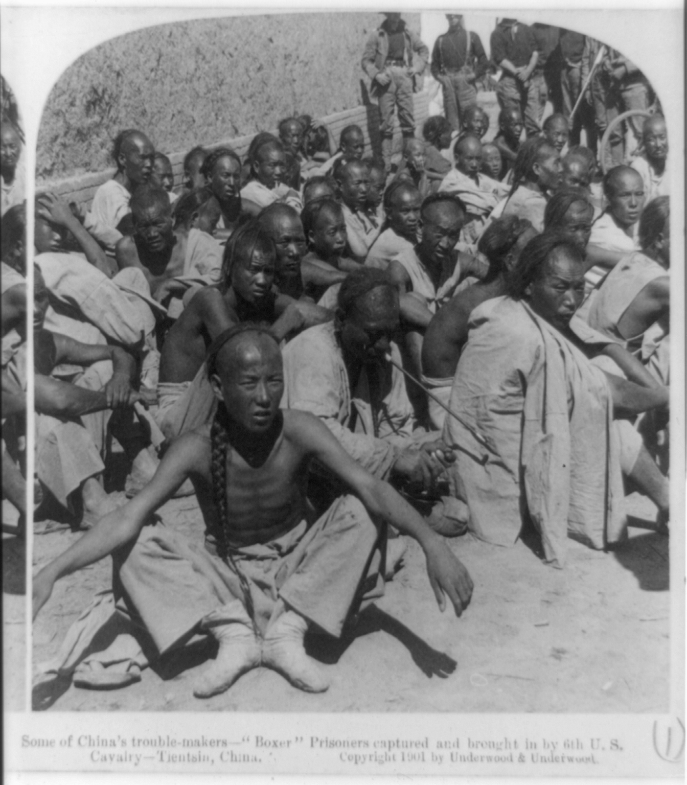
*Boxer prisoners captured by American cavalry at Tientsin, in a photograph of 1900 or 1901. Photo: Underwood & Underwood, Library of Congress, public domain.*

The bill came afterwards. The peace terms required China to pay the foreign powers a sum in silver that came to about one coin's weight for every person in the country, with interest, over thirty-nine years. It was several times the government's annual income. In effect, China would go on paying for the summer of 1900 for decades.

## The end of the examinations

After that even the Empress Dowager accepted that the old ways could not continue. In a striking reversal, she spent her last years ordering most of the reforms for which she had executed men in 1898.

The changes came quickly. Students were sent abroad, above all to Japan, where some eight thousand of them were studying by 1905. A new army was formed, drilled by foreign instructors and armed with modern rifles. Government itself was to change as well. Each province was to elect an assembly, and the court promised a constitution and a national parliament within nine years.

One reform went deeper than the court understood. For thirteen hundred years, China had chosen its officials by examination in the Confucian classics. The system was the cement of the empire, and it worked in a simple way. In every district, the families of landowners and merchants had their sons spend twenty years memorising the old books, because that was the high road to office, honour and wealth. As a result, whoever sat on the throne, those families had a stake in him.

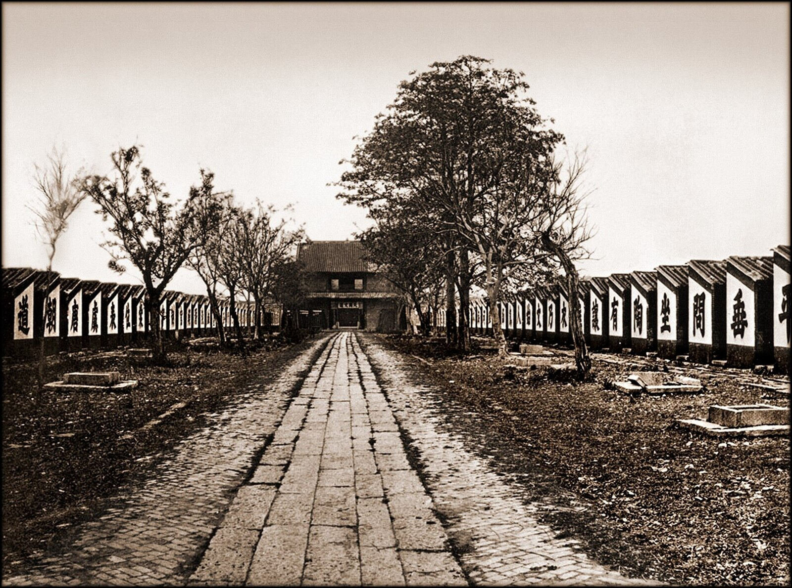
*The examination hall at Canton, said to hold 7,500 cells for candidates, in a photograph of 1873, thirty-two years before the examinations were abolished. Photo: unknown, restored by ralph repo, CC BY 2.0.*

In 1905 the examinations were abolished, at a stroke, to make way for modern schools. Imagine a family that had spent twenty years preparing a son for them. At a single decree, his learning, and the learning of millions of men like him, lost most of its value. With it, the educated class lost its strongest reason for loyalty.

Their sons took a different road. The clever young no longer studied for the emperor's service. They went to the new schools, or to Tokyo, and came back with foreign books and no attachment to the dynasty whatever. The new army, meanwhile, was officered by exactly such young men. The court had built a modern army and placed it in the hands of the very class it had just cut loose.

Then, in the middle of these changes, the dynasty lost both of its rulers. In November 1908 the imprisoned emperor died, at thirty-seven. The Empress Dowager died the next day. Tests on his remains a century later found that he had been poisoned with a massive dose of arsenic.

On her deathbed she had named his successor, and she chose her great-nephew, the toddler Puyi. As a result, at the most dangerous moment in its history the dynasty was left in the hands of a small child and his nervous father.

## A doctor from the south

The best-known enemy of the dynasty had been working to bring it down for fifteen years, with no success at all.

Sun Yat-sen was a farmer's son from the far south, near the Portuguese colony of Macau. Much of his education came from abroad. An elder brother who had emigrated to Hawaii sent for him at thirteen and put him in a missionary school, where he learned English and was drawn to Christianity. He later qualified as a doctor in Hong Kong.

Having seen how things were done elsewhere, he reached a blunt conclusion. China's weakness, he decided, was the fault of its rulers, a foreign dynasty from Manchuria. It was too corrupt to be reformed, and so it would have to be overthrown.

From 1895 he organised one rising after another, ten in all. The money came from Chinese living overseas, shopkeepers and laundrymen in Honolulu, San Francisco and Singapore. Each rising was betrayed or crushed, and he spent sixteen years in exile with a price on his head.

In 1896 he was lured into the Chinese legation in London by its officials, who locked him in an upstairs room and planned to ship him home to be executed. He got a note out by a servant, and the newspapers took up the story. He was released a famous man.

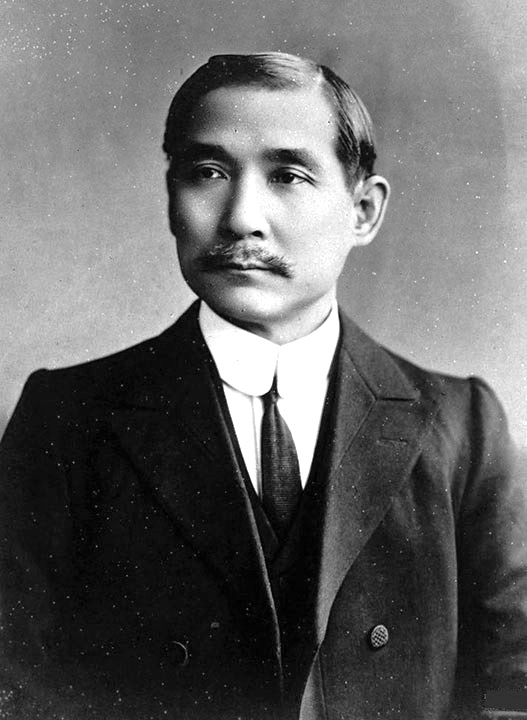
*Sun Yat-sen, who spent sixteen years in exile working for revolution, photographed in Shanghai on 25 December 1911, a few days before he became president of the republic. Photo: Tongsheng Photo Studio, public domain.*

He summed up his programme as three principles. The first was nationalism: China should belong to the Chinese, free of the Manchus and of foreign control. The second was democracy, in the form of a republic. The third he called the people's livelihood, by which he meant that the land and its wealth should be shared more fairly.

All three ideas owed a great deal to the West. The same was true of most of the remedies that young Chinese were now discussing, and it gave their cause a paradox at its heart. They wanted to learn from the foreigners in order to be rid of them.

## Double Ten

When the revolution came, Sun was in the American city of Denver, and read about it in a newspaper.

It began with an accident. On 9 October 1911, in a city on the middle Yangzi, a group of revolutionaries who had been recruiting in the local garrison were making bombs in a rented house. One went off. The explosion brought the police, and the police found the membership lists.

Those lists put every man named on them in danger. The soldiers named there now had a choice between being arrested and executed or acting first. On the evening of 10 October, the tenth day of the tenth month, they shot their officers and seized the arsenal. They had no leader, so they dragged their brigade commander out of the house where he was hiding and told him, at gunpoint, that he was now in charge of the revolution. He turned out to be quite good at it.

The court sent its best troops, and they retook part of the city. It made no difference, because the revolt had already spread beyond that city. Province after province simply declared that it no longer recognised the dynasty. The new assemblies and the new army units took over the provincial capitals. The very bodies that the court had created to strengthen itself had turned against it. Within two months some fifteen provinces had left.

Sun came home, and on 1 January 1912 he was sworn in as president of a Chinese republic, elected by the delegates of the rebel provinces. He had a title and no soldiers of his own. That was a serious weakness, because in China at that moment soldiers decided who ruled. The strongest army in China was the northern one, and it obeyed a general named Yuan Shikai, whom the court had just called out of retirement to save it.

Yuan therefore held the balance. He looked the situation over and negotiated with both sides. To the court he said that the dynasty could not be saved. To the republicans he offered a bargain. He would arrange for the emperor to step down without a fight, and in return he, Yuan, would be president. Sun, who cared more for the republic than for his own position, agreed.

The six-year-old emperor's abdication was issued on 12 February. The terms were generous. He kept his title, his palace and an enormous allowance. For years nobody told him that anything had changed, and inside the palace walls he went on living as an emperor.

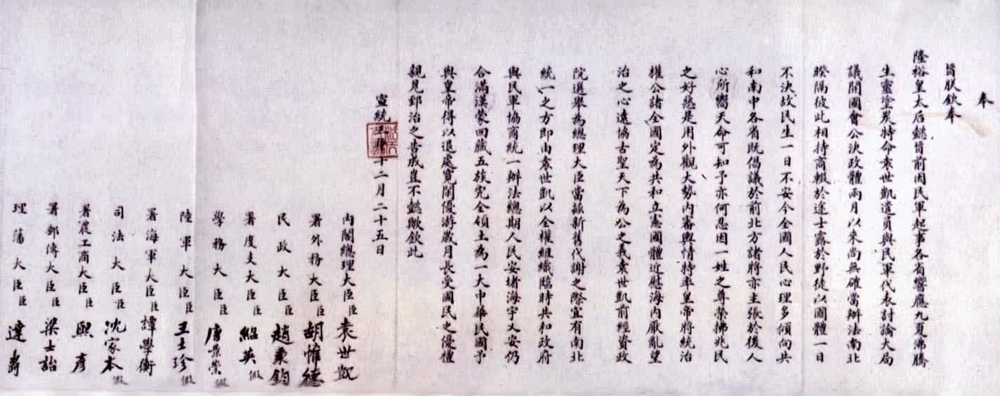
*The edict of 12 February 1912 in which the six-year-old emperor handed the government to a republic. The ministers' names at the foot begin with Yuan Shikai. Document: Qing court, public domain.*

## Eighty-three days

The republic was a disappointment almost from its first month. At first it went through the forms of democracy. In the winter of 1912 China held an election, with about forty million men entitled to vote, and Sun's party won.

Its leader in parliament, a brilliant organiser of thirty, was about to become prime minister. Before he could take office, he was shot on a railway platform in Shanghai and died of his wounds. The trail led to Yuan's office.

With his rival gone, Yuan then outlawed the party, dissolved parliament, and ruled by decree. At the end of 1915 he took the last step and announced that he would become emperor, the founder of a new dynasty.

However, he had misjudged the mood. His own generals refused to follow him, provinces rose in revolt, and after eighty-three days he cancelled the monarchy. He died a few months later, of kidney failure and humiliation.

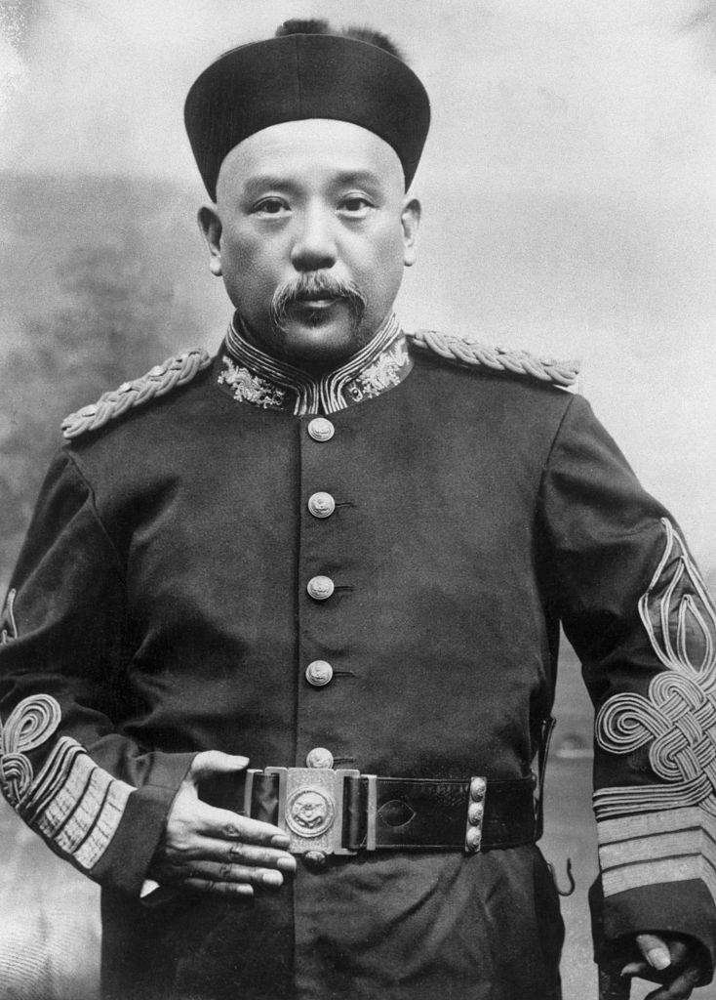
*Yuan Shikai, the general who arranged the abdication and then made himself dictator, in uniform, in a photograph published in 1913. Photo: unknown, public domain.*

With him went the last authority strong enough to hold the whole country together. His generals each took a province or two and ruled it as private property. These were the warlords: commanders who governed for themselves, answerable to no government. For the next twelve years China was a patchwork of them, and they fought one another almost without pause, made and broke alliances, and passed the capital from hand to hand.

Some were former bandits and some were scholars. One had himself and his troops baptised as Christians. Another was said not to know how many soldiers, how much money or how many wives he had.

Whatever their origins, they all needed money for their armies, and the peasants paid. The warlords taxed them, sometimes collecting the land tax years in advance, and forced them to grow opium. Ordinary Chinese came to say that under the emperors there had been one tyrant, and now there was one in every county.

## Mr Science and Mr Democracy

Abroad, China was as weak as ever, and the foreign powers went on helping themselves. During the world war, Japan took the opportunity to seize Germany's leased territory in the province of Shandong. It then presented China with a list of demands that would have made it a Japanese protectorate, a country that kept its own government but took its orders from Tokyo.

China hoped that the war would at least bring it some justice. It had joined the Allies and sent a hundred and forty thousand labourers to the Western Front, and so it expected to get Shandong back at the peace conference. Instead, in the spring of 1919 the news reached Beijing that the victors had awarded Germany's port, railway and mines in Shandong to Japan.

On the afternoon of 4 May, three thousand students from the capital's universities gathered in front of the Gate of Heavenly Peace. They marched on the embassy quarter, and then to the house of a minister who was thought to have sold out to Japan, which they burned. The police arrested dozens.

The protest did not stay in Beijing. Within weeks there were student strikes in cities across the country, merchants were boycotting Japanese goods, and workers in Shanghai had walked out. The pressure worked. The government gave way, and China's delegates in Paris refused to sign the treaty.

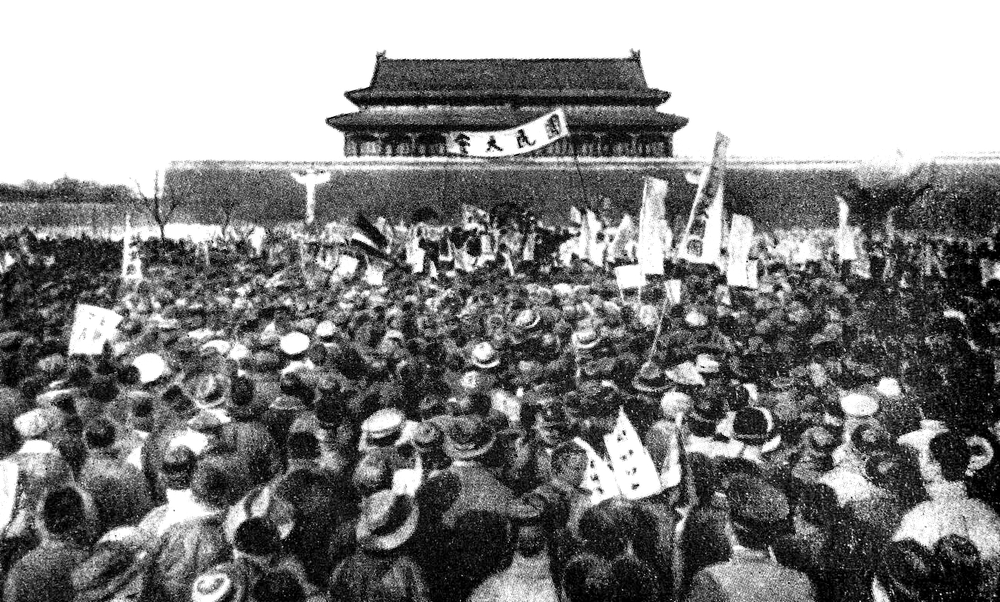
*Students gathered in front of the Gate of Heavenly Peace in Beijing on 4 May 1919, to protest against the award of Shandong to Japan. Photo: unknown, public domain.*

The date gave its name to a movement that went far beyond one province. The students and their teachers had decided that China's sickness lay in its whole inherited culture. Confucian respect for elders and rulers, they said, had made the Chinese a nation of slaves.

One writer put the charge into fiction. A short story of 1918 imagined a madman who reads the classic books of virtue and finds, between the lines, two words repeated on every page: eat people.

In place of Confucius they proposed two foreign gentlemen, whom one professor named Mr Science and Mr Democracy. They also changed the way they wrote. Until then, essays, laws and learned books had always been written in a classical style as remote from speech as Latin. The reformers began to write in the language that people actually spoke. They attacked arranged marriage and the binding of girls' feet.

Some of them, however, were impatient with liberal democracy, which seemed to have produced only the treaty of Versailles. They looked instead to a newer foreign model. Russia had just shown that a backward country could have a revolution, and its new rulers had offered to give up the tsar's privileges in China. Among all the powers, that offer stood out.

In July 1921 thirteen young men met in a house in the French quarter of Shanghai to found a Chinese Communist party. When a police spy looked in, they moved to a hired boat on a lake outside the city and finished the meeting there. They represented about fifty members. One of the thirteen was a tall schoolteacher of twenty-seven from the inland province of Hunan, named Mao Zedong.

## The academy

Sun Yat-sen had spent these years in the south, trying and failing to get a foothold. He had appealed to Britain and America for help and been ignored. In 1923 he turned to the one government that offered it.

Soviet Russia sent him money, rifles and advisers. The help came with a method. On their instructions he rebuilt his Nationalist party on the Bolshevik pattern, with cells, which were small local groups of members, and with discipline and a party army. The Soviets also told the tiny Communist party to join the Nationalists and work inside them. For the moment, the two parties were partners.

A party army needed officers of its own. In 1924 a military academy was opened on an island in the river below Canton, to train officers who would be loyal to the party. Its commandant was Sun's young military aide, Chiang Kai-shek. The head of its political department was a Communist named Zhou Enlai.

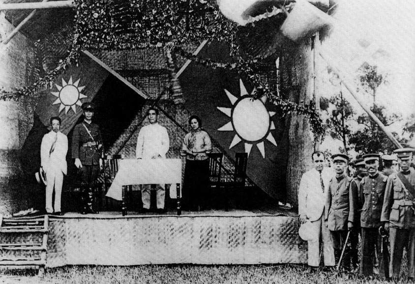
*The opening of the military academy at Whampoa, near Canton, on 16 June 1924. Sun Yat-sen stands at the centre of the platform, with Chiang Kai-shek, in uniform, at left. Photo: unknown, public domain.*

Sun died of cancer the next year. In 1926 Chiang led the new army north against the warlords. It was better trained and far better motivated than the warlords' troops. Ahead of it, moreover, went Communist organisers, who roused the peasants and called the workers of the cities out on strike. In three months it had reached the Yangzi, and by the following spring it was at the gates of Shanghai.

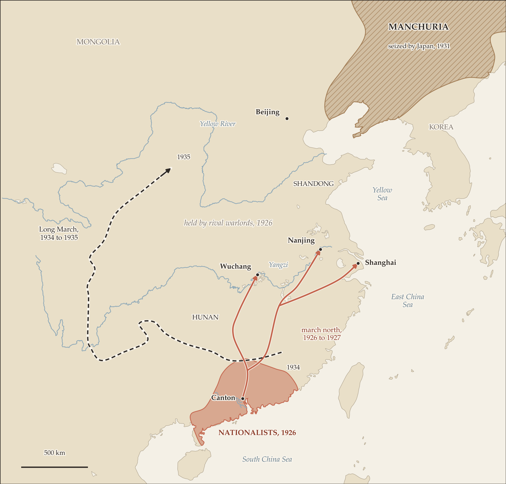
*China about 1926: the Nationalist base round Canton, drawn roughly, the march north of 1926 and 1927 to Wuchang, Nanjing and Shanghai, and Manchuria, seized by Japan in 1931. The dashed line is the Long March of 1934 and 1935, simplified. Map: drawn for this book; coastlines and rivers from Natural Earth, public domain.*

Then the alliance broke. Chiang feared the Communists, and so did the bankers and factory owners of Shanghai who were paying his army. Before dawn on 12 April 1927, gangsters of the Shanghai underworld, armed and uniformed by Chiang, attacked the offices of the city's trade unions. In the following days thousands of Communists and union members were shot or beheaded in the streets, and the killing spread to other cities. In a year the party lost four fifths of its members.

Chiang went on to bring most of China under a Nationalist government in Nanjing. The surviving Communists fled to the mountains of the interior, and defeat forced them to think again. Mao, who was among them, drew a conclusion that went against everything the Russian advisers had taught. The Russians looked to the workers of the cities to make the revolution. In China, Mao decided, the revolution would not begin in the cities at all. Instead, it would be made by peasants, from bases in the remote countryside, and it would surround the cities and take them last.

In the hills of the south they put the idea into practice. They shared out the landlords' fields, built an army of peasants, and governed several million people. In 1934 Chiang's armies drove them out, and after a walk of nine thousand kilometres across rivers, mountains and swamps, fewer than one in ten of those who set out reached a remote region in the north-west. Mao was by then their dominant figure.

## The gardener

Puyi, meanwhile, had grown up inside the palace walls among a thousand eunuchs, forbidden to go out. Within those walls he found what amusements he could. A Scottish tutor taught him English and gave him a bicycle, and he had the high wooden thresholds of the palace doorways sawn off so that he could ride from courtyard to courtyard. He had a telephone installed and rang up strangers. That small world ended in 1924, when a warlord's soldiers gave him three hours to leave.

The Japanese took him in, and they found a use for him. When their army seized Manchuria, the homeland of his ancestors, in 1931, they soon set up a puppet state there, a country with a ruler of its own and Japanese officers in control. They put him at its head, and from 1934 he was once more an emperor. For eleven years he signed whatever was put in front of him.

Japan's defeat ended that role as well. Soviet troops captured him at an airfield in 1945 and later handed him to the Chinese Communists, who put him in a prison for war criminals and spent nearly ten years re-educating him. He learned, for the first time in his life, to tie his own shoelaces.

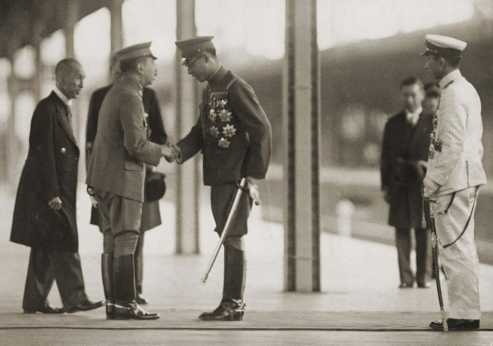
*Puyi, as emperor of the Japanese puppet state of Manchukuo, being greeted at Tokyo railway station on 26 June 1940. Photo: unknown, public domain.*

They released him in 1959. The boy who had been lifted onto the dragon throne now had to earn a living. He was given a job in the botanical garden in Beijing, and later in a government office, where he wrote his memoirs. He married a nurse, queued for buses, and was by all accounts hopeless at housework. Visitors to the Forbidden City, which had become a museum, sometimes found themselves standing beside a thin, stooping man in spectacles who had bought a ticket at the gate like everyone else.
