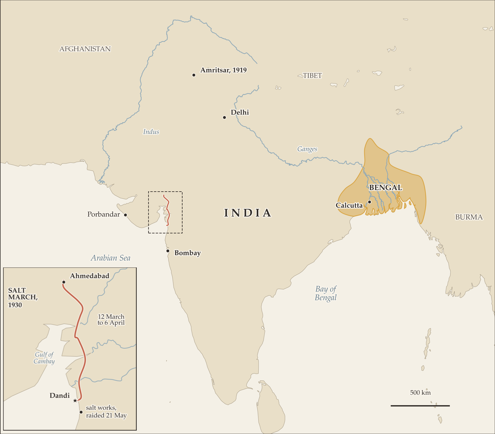
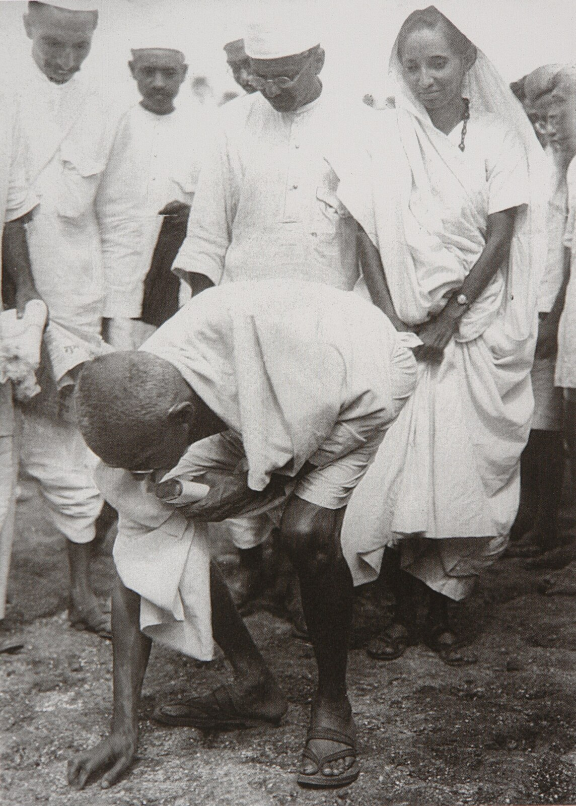
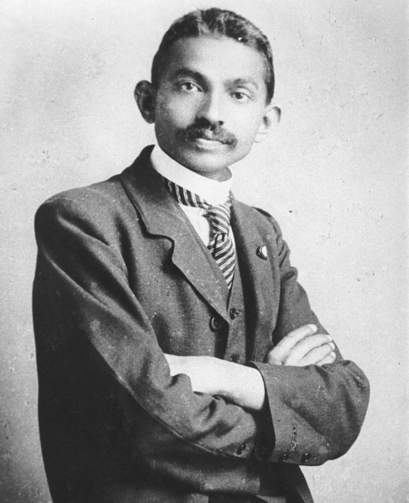
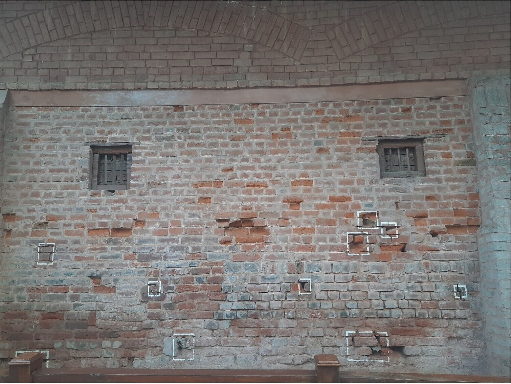
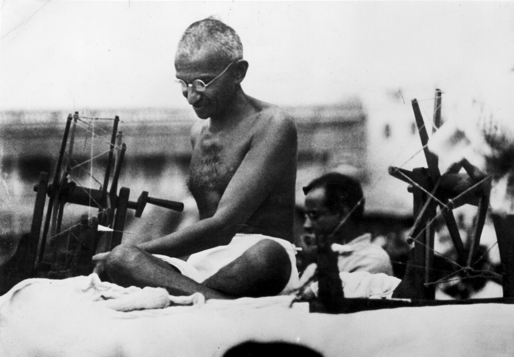
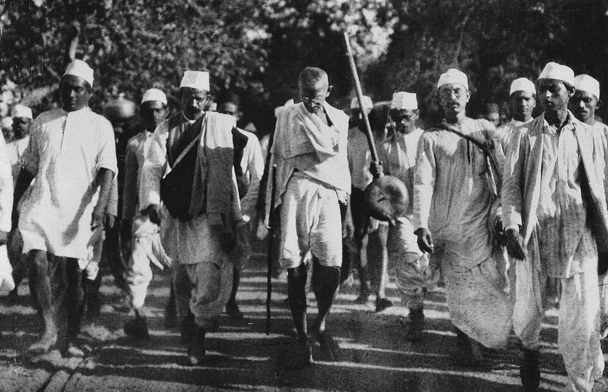
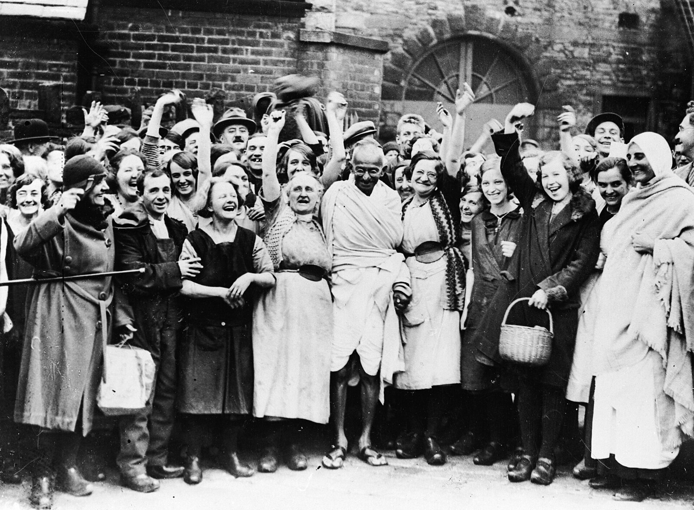
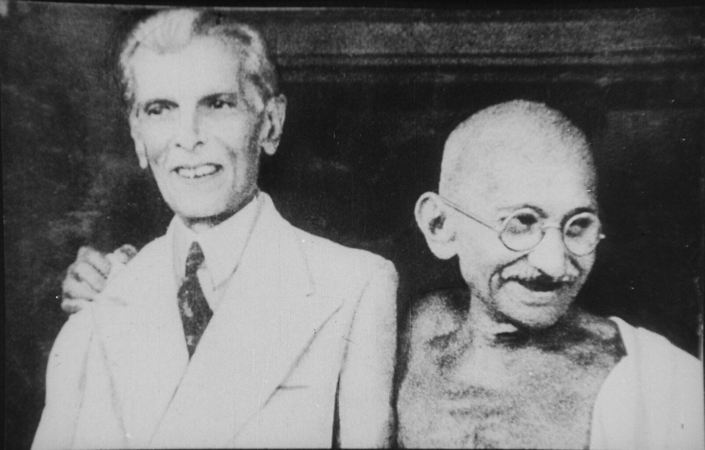
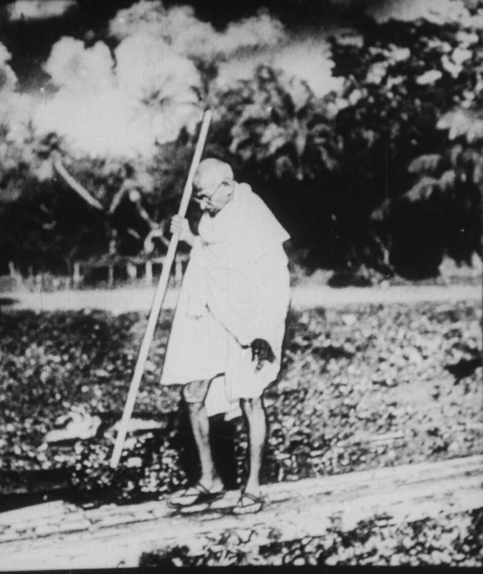

# 76. How did Gandhi fight an empire without weapons?

*India and South Africa, from 1893 to 1947*

Gandhi fought by getting Indians to stop cooperating with the people who ruled them. He had seen that a few thousand British officials could govern three hundred million Indians only with Indian help. His followers broke unjust laws in the open, took the beatings and prison sentences that followed without striking back, and made it plain to the world, and to the British themselves, that the empire rested on force.

Early on the morning of 6 April 1930, a thin, bald man of sixty in a loincloth walked down a beach on the west coast of India, bent over, and picked up a lump of mud and salt that the tide had left behind.

He had walked for twenty-four days to get there, nearly four hundred kilometres, with seventy-eight companions. They had set out from his religious community near the city of Ahmedabad and gone from village to village along the dusty roads. As they went, the march grew. By the time they reached the sea, a crowd of several thousand was walking with them, and reporters from three continents were filing daily stories.

*India in 1930, with Bengal drawn roughly. The inset shows the salt march from Ahmedabad to the beach at Dandi, 12 March to 6 April 1930, simplified, and the salt works raided on 21 May. Map: drawn for this book; coastlines and rivers from Natural Earth, public domain.*

What he did on the beach was a crime. The British government of India held a monopoly on salt, which meant that the government controlled and taxed the whole trade. It was illegal for an Indian to make salt or to collect it from the shore without a licence, and every grain that was sold carried a government tax.

The tax was small. However, everyone paid it, since nobody can live without salt. In a hot country, moreover, a labourer who sweats all day needs more of it than a rich man. With this, the man on the beach said, holding up the lump, I am shaking the foundations of the British empire.

It sounded absurd. A lump of mud seemed a poor weapon against an empire. Yet within weeks, all over India, people were boiling sea water in pans and selling illegal salt in the streets, and before the year was out the prisons held sixty thousand of them.

*Gandhi bends to pick up salt on the beach at Dandi at the end of the salt march, April 1930. Photo: unknown, public domain.*

## A thousand officials

The empire that he proposed to shake was the largest in the world, and India was the heart of it. Nearly a fifth of the human race lived there.

Yet the British governed it with remarkably few people. At the top was a civil service of about a thousand men, mostly British. Each of them might be the judge, tax collector and police chief of a district of a million people. Behind them stood about sixty thousand British soldiers. In all of India there was roughly one Briton for every two or three thousand Indians.

Nearly everything else was done by Indians. Indians were the clerks who kept the files and the policemen who made the arrests. More than two thirds of the army was Indian. Indian landowners collected the rent, Indian lawyers argued in the courts, and Indian peasants paid the taxes that supported the whole structure. As long as they went on doing these things, the empire was secure, and not much force was needed. If they stopped, a thousand officials could not do the work in their place.

Educated Indians had been asking for a share in their own government since 1885, when a group of lawyers and journalists founded the Indian National Congress. For its first twenty years it met once a year, in English, passed respectful resolutions, and was ignored. A fiercer wing appeared after 1905, with boycotts and bombs, and the movement split.

Even so, it remained a movement of the educated, in suits, and most Indians had never heard of it.

## The train at Pietermaritzburg

The man who changed that had been, as a young man, exactly that kind of lawyer.

Mohandas Gandhi was born in 1869 in a small princely state on the west coast, the son of its chief minister. He was married at thirteen. At eighteen his family sent him to London to study law, and he spent three years there in a top hat and striped trousers, taking dancing lessons and trying to become an English gentleman.

He came home qualified, and proved too shy to speak in court. In his first case he stood up to question a witness, found that he could not utter a word, and sat down again. Nothing about him yet suggested a leader of crowds.

In 1893 he took a job that nobody else wanted, handling a lawsuit for an Indian merchant in South Africa. About a week after he landed, he learned how South Africa treated a man of his colour. He was travelling by night train with a first-class ticket when a white passenger objected to sharing a compartment with him. A railway official told him to move to the baggage van. He refused, and a policeman threw him and his luggage onto the platform of a station called Pietermaritzburg. He sat in the unlit waiting room all night, shivering, and thought about whether to go home.

He stayed for twenty-one years, and he found plenty to fight. South Africa had about a hundred thousand Indians, brought over to work on the sugar plantations, and the law treated them as an inferior race. They had to carry passes and pay special taxes, and their marriages were not recognised. Gandhi organised them. In the course of doing so, he worked out a way of fighting that he had not found in any book, though books had helped.

*Gandhi as a lawyer in South Africa, in 1906, aged thirty-six. Photo: unknown, public domain.*

The method had several roots. Part of it came from home. The region where he grew up was full of Jains, followers of an ancient Indian religion who hold that it is wrong to harm any living thing.

Part came from his reading in London and in South African jails. He read the Sermon on the Mount. He read the essays of an American who had gone to prison sooner than pay taxes to a government that upheld slavery. He also read the late writings of the Russian novelist Tolstoy, with whom he exchanged letters. Each of them, in its own way, showed him how a person might resist a wrong without doing one.

He needed a name for the result, and held a competition in his newspaper to find one. The word he settled on was *satyagraha*, which means, roughly, "holding firmly to the truth".

When a law is unjust, do not obey it and do not hide. Break it in public, say that you are doing so, and accept the penalty without resistance and without hatred. The aim is not to defeat the opponent. It is to make him see what he is doing, and to make everyone watching see it too.

It was not a method for the timid. It required people who were prepared to be beaten, jailed and possibly killed, and who would not raise a hand in return. Gandhi himself went to prison four times in South Africa. In 1915, at forty-five, he went home to India with the method tried and tested.

## Ten minutes at Amritsar

He arrived as a loyal subject of the empire. During the world war he even recruited soldiers for the British army, believing that India would be rewarded with self-government. More than a million Indians served.

The reward, when the war ended, was not self-government. Instead, it was a set of laws allowing the government to imprison Indians without trial. Gandhi called for a day of protest. It did not stay peaceful, and there were riots in several cities. In Amritsar, the holy city of the Sikhs, a mob killed five Europeans.

The city was still tense when, on 13 April 1919, a crowd of perhaps fifteen thousand people gathered in a public garden in the middle of Amritsar. Some had come to hear speeches against the new laws. Many were villagers in town for a religious festival, who did not know that public meetings had been banned that morning.

The shape of the place made what followed worse. The garden was a patch of bare ground enclosed by the backs of houses, with a few narrow lanes leading in. Anyone inside had very few ways out.

The British general in command of the district marched fifty riflemen in through the main lane and lined them up on a bank. He gave no warning. He ordered them to fire into the thickest part of the crowd, and to keep firing. People ran for the exits and were shot there. Some jumped into a well. The soldiers fired for ten minutes, until they had used sixteen hundred and fifty rounds, and then marched away, leaving the wounded where they lay under a curfew.

*A wall in the Jallianwala Bagh in Amritsar, today. The white outlines mark bullet holes left by the firing of 13 April 1919. Photo: Ahoun Xinjitsu, CC BY-SA 4.0, cropped.*

The official count was three hundred and seventy-nine dead. Indian estimates were about a thousand.

The general defended what he had done. He told the inquiry that he had gone there to produce a moral effect, and that he would have used his machine guns if the lane had been wide enough for the armoured cars. He was relieved of his command. However, the House of Lords passed a motion in his favour, and readers of a London newspaper subscribed twenty-six thousand pounds to reward him. To many in Britain, the man who had ordered the firing was a hero.

Gandhi had believed in the good intentions of the British. After Amritsar, and after the cheering, he concluded that their rule in India was an evil that had to be ended. The loyal subject had become the empire's opponent.

## The spinning wheel

In 1920 he persuaded Congress to adopt his method, and he rebuilt Congress to carry it. Three changes turned it from a gathering of lawyers into a party of the whole country. Membership was opened to anyone for a tiny fee, business was done in the languages of the country, and branches were set up in the villages.

Gandhi made himself the face of that change. He had long since given up his suits. He dressed as a poor peasant, travelled third class, and spoke to village crowds in terms of religion and right conduct that they understood. They began to call him Mahatma, the "great soul".

The campaign was called non-cooperation, and the name described exactly what it asked. Lawyers were to leave the courts, students the government colleges, and officials their posts. Each of those steps would withdraw some of the Indian hands on which the empire depended. Above all, Indians were to stop buying British cloth.

Cloth was at the centre of it, for a reason that went back a century. India had once clothed the world. The machine-made cottons of Lancashire, however, had put its hand spinners out of work and then, more slowly, most of its weavers.

Gandhi's answer was to turn that history around in every home. He asked every Indian to spin thread for half an hour a day and to wear only cloth woven by hand. Bonfires of imported fabric burned in the cities. Homespun white cotton became the uniform of the movement, and the spinning wheel its emblem.

Economists pointed out that hand spinning could never compete with a mill. Gandhi believed that it would give idle villagers an income. Whatever the economics, it certainly gave millions of people who could not read, vote or fight something that they could do every day against the empire.

*Gandhi at a spinning wheel during a demonstration of homespun cloth at Mirzapur, 9 June 1925. Photo: unknown, public domain.*

For a year the movement shook British India as nothing had since the great rebellion of 1857. Then, in February 1922, the campaign broke its own first rule. In a small town in the north, police fired on a procession, and the crowd chased them into their station, set it on fire, and burned twenty-two policemen to death.

Gandhi called off the entire national campaign at once. His colleagues, many of them in prison, were aghast, because victory had seemed close. He would not be moved. For him the means could not be separated from the end. A movement that had killed could not, he said, claim to be holding to the truth, and the people were not yet ready.

A month later he was put on trial for stirring up disaffection, which meant turning people against the government. He pleaded guilty. Even in the dock he kept to his method. He told the English judge that non-cooperation with evil was a duty, and that the judge must either resign his post or give him the heaviest penalty the law allowed. The judge, who was plainly moved, sentenced him to six years, and said that if the government later saw fit to shorten the term, nobody would be better pleased than he.

## Like ninepins

Gandhi served two years, and spent most of the 1920s in his community, spinning and writing. When he returned to the fight, in 1930, he chose salt.

The choice puzzled his colleagues, as the spinning wheel had. He understood something that they did not. A demand for independence meant little to a villager. A tax on salt, by contrast, touched every household in India, Hindu and Muslim, and it was indefensible. That made it the ideal target. A government that made it a crime to pick up salt from the seashore could be made to look both cruel and ridiculous by one old man with a walking stick.

The march to the sea filled the newspapers of the world for three weeks, and the longer it went on, the more helpless the government looked. The British, not knowing what to do, left him alone until a month after he reached the beach, and then arrested him in the night.

*Gandhi, at the centre with a staff, leading marchers on the road to the sea during the salt march, March 1930. Photo: unknown, public domain.*

Before his arrest he had announced the next step, a raid on a government salt works north of Bombay. It went ahead without him on 21 May, led by a woman poet. About two and a half thousand volunteers in white homespun approached the works, which was guarded by four hundred police armed with long clubs tipped with steel. An American reporter watched what happened.

The volunteers walked forward in columns. As each column reached the fence, the police struck the men on the head. Not one of the marchers, the reporter wrote, even raised an arm to fend off the blows. They went down like ninepins. From where he stood he could hear the sickening whacks of the clubs on unprotected skulls. Stretcher bearers carried the injured away, and the next column walked up. It went on for hours. Two men died and three hundred and twenty were taken to hospital.

His report was printed in more than a thousand newspapers. It did what Gandhi had always said the method would do, which was to make everyone watching see what was being done. The British public had been told for a century that its rule in India was a benefit kindly conferred, and the pictures from the salt works were hard to square with that.

The pressure told. The following year the viceroy, the king's representative in India, released Gandhi and invited him to the palace to negotiate, as one leader with another.

Not everyone in Britain could stomach the sight. In London a politician out of office named Winston Churchill said that it was nauseating to see a seditious lawyer, posing as a holy beggar, striding half-naked up the steps of the viceroy's palace to parley on equal terms with the representative of the king.

Gandhi went to London that autumn. He visited the cotton towns whose trade his boycott had hurt, and even there he was cheered by the mill girls. He took tea with the king in his loincloth and shawl. Asked afterwards whether he had felt underdressed, he said that the king had been wearing enough for both of them.

*Gandhi greeted by cheering cotton workers at Darwen, in Lancashire, on 26 September 1931, during his visit to England. Photo: Keystone, public domain.*

## Who is the nation?

Gandhi claimed to speak for all of India. Two men in particular denied it, and each spoke for tens of millions.

The first was Bhimrao Ambedkar, a brilliant lawyer with doctorates from New York and London. He had been born into one of the castes that Hindus called untouchable, whose members were forbidden to enter temples, draw water from the village well, or let their shadow fall on a person of higher caste.

The two men differed about how to end it. Gandhi condemned untouchability and campaigned against it. However, he wished to reform the Hindu order from within and keep it whole. Ambedkar wanted it broken.

The quarrel came to a head over voting. When the British offered his people the right to elect their own representatives separately from other Hindus, Gandhi, in prison, announced that he would starve himself to death unless the offer was withdrawn. That left Ambedkar with a cruel choice. He gave way, bitterly, to save Gandhi's life, in exchange for a larger number of seats reserved for his people within the general vote.

The second was Muhammad Ali Jinnah, a wealthy, elegant Bombay lawyer who led the Muslim League. A quarter of Indians were Muslims. Many Muslims had marched with Gandhi in the 1920s. To Jinnah and a growing number of others, however, his movement, with its Hindu hymns, its holy man and its talk of the rule of the god Rama, looked very much like a Hindu revival.

They feared what the numbers meant. If the British left and India became a democracy, the Hindu majority would rule for ever. In 1940 Jinnah's party drew its conclusion. It declared that the Muslims of India were a separate nation and must have independent states of their own in the regions where they were the majority.

*Muhammad Ali Jinnah and Gandhi in Bombay, in September 1944, during their talks. Photo: unknown, public domain, cropped.*

The method had another limit, which Gandhi never fully accepted. It depended on the opponent. It worked on the British because the British were divided about their empire, had a free press, and cared how they appeared.

In 1939 he wrote a letter to Adolf Hitler, addressing him as "Dear friend" and asking him to refrain from war. He advised the Jews of Germany to offer themselves up without resistance. That advice shows where the method ran out. Against a government that was willing to kill everyone who disobeyed, and to do so in secret, his way of fighting had no purchase.

## Quit India

When the next war came, the viceroy declared India to be at war with Germany without consulting a single Indian. Two and a half million Indians volunteered for the army all the same, the largest volunteer force in history.

In 1942, with Japanese armies on India's eastern border, Gandhi launched his last campaign. Its demand was two words: quit India. To his followers he gave a slogan of three: do or die.

The British response was swift. They arrested the leaders of Congress within hours and held most of them for the rest of the war. A hundred thousand people were jailed. This time, the discipline did not hold, and there was a great deal of violence, with railway lines torn up and police stations attacked.

The following year a famine in the province of Bengal killed about three million people. Several causes came together. A cyclone had damaged the crop, but there was rice in the province. It was being bought up for the army and the war factories. Meanwhile, Japan had taken Burma, from which Bengal had imported rice, so that source was gone. Finally, the government in London, with its mind on the war, declined to divert ships to bring grain.

By 1945 Britain had won the war and was bankrupt. Its position in India had turned upside down. It owed India itself more than a billion pounds. Its soldiers wanted to go home.

In 1946 Indian sailors mutinied in Bombay harbour, and the government in London concluded that it could no longer count on the Indian forces to hold the country down. In February 1947 it announced that Britain would leave.

## Barefoot in Bengal

How much of this was Gandhi's doing has been argued ever since. Britain left India when it no longer had the strength or the will to stay, and two world wars had more to do with that than any march.

However, what his campaigns achieved was earlier and deeper. They had made hundreds of millions of people into a nation that expected to rule itself. They had also taken from British rule the one thing that it could not do without, which was the belief, among rulers and ruled alike, that it was right.

Independence came at midnight on 14 August 1947. It came to two countries, not one: India and a new Muslim state called Pakistan. In Delhi the new prime minister made a speech about India's meeting with destiny.

Gandhi was not there. He was more than a thousand kilometres away, in a slum district of Calcutta, where Hindus and Muslims had been murdering each other for a year. He was seventy-seven. He spent the day of independence fasting and spinning, in a house that he had chosen to share with a Muslim politician. That winter he had walked for seven weeks through the villages of eastern Bengal, barefoot, asking the people to stop.

*Gandhi walking barefoot with a staff through the villages of Noakhali, in eastern Bengal, in 1946. Photo: unknown, public domain, cropped.*