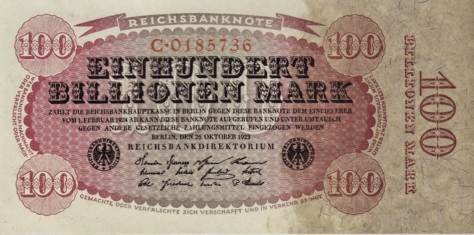
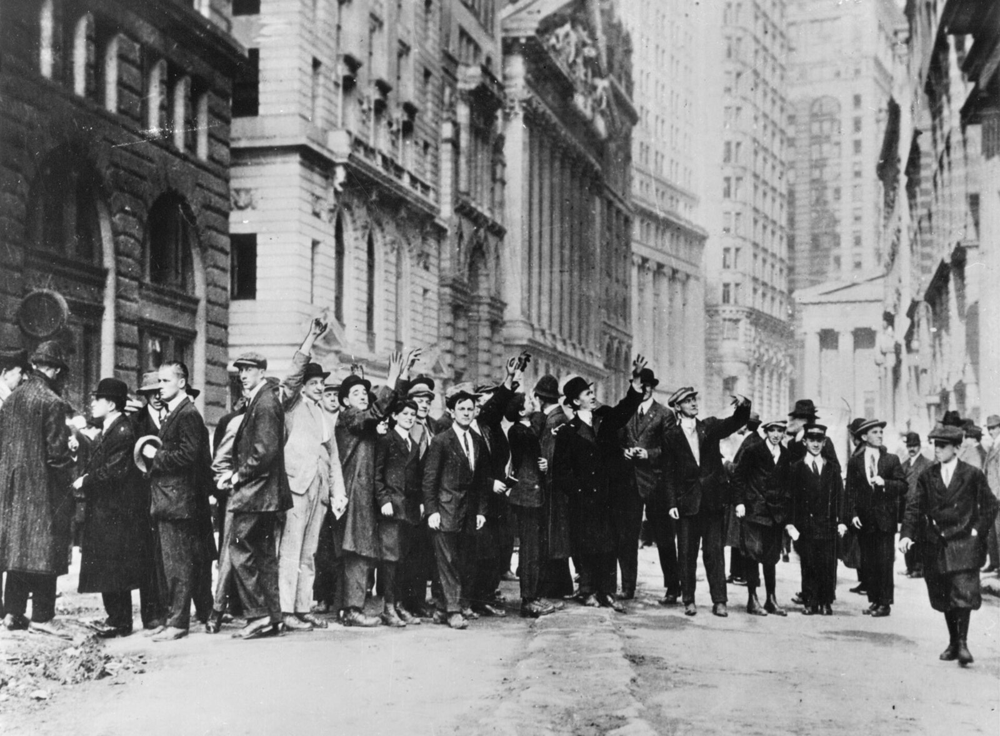
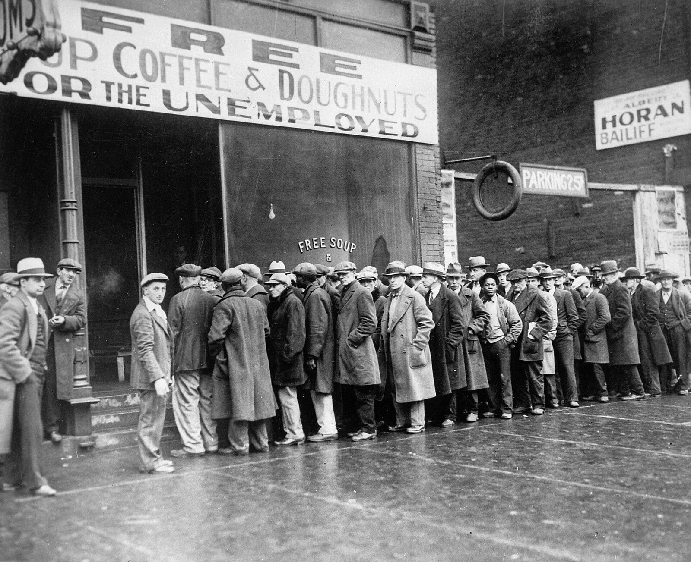
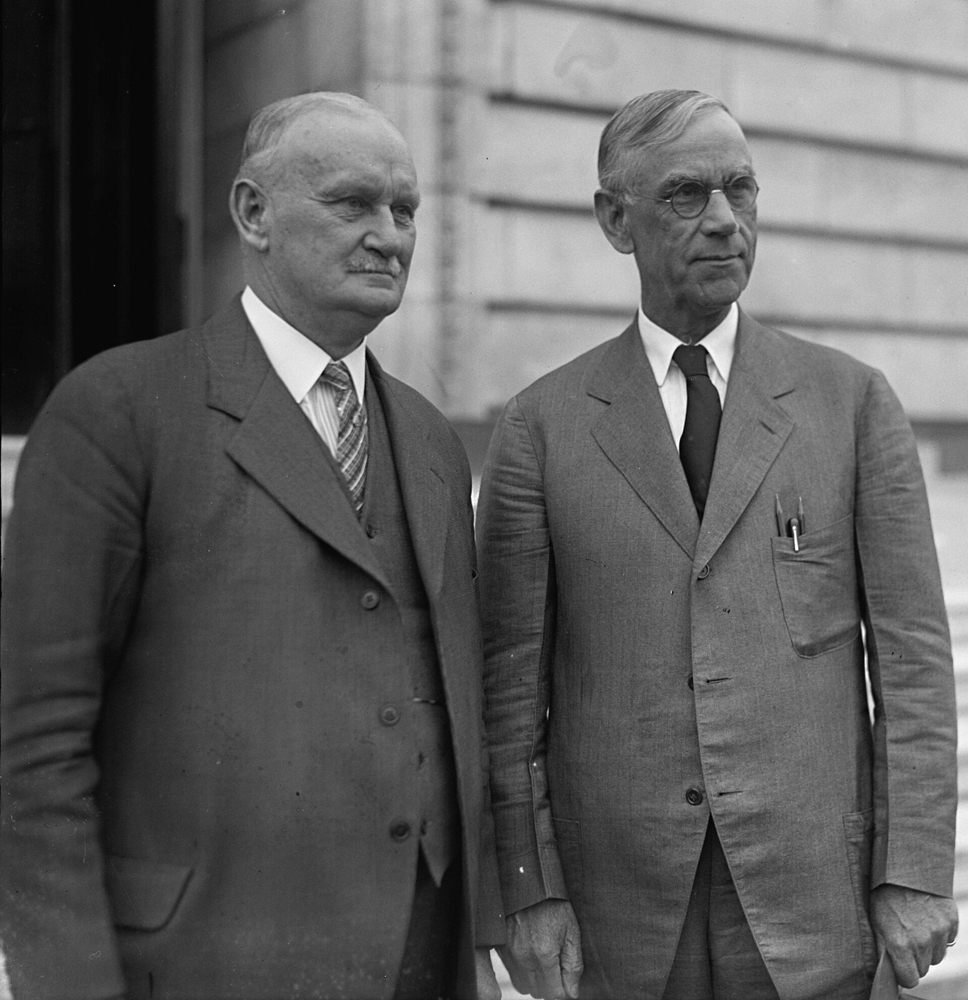
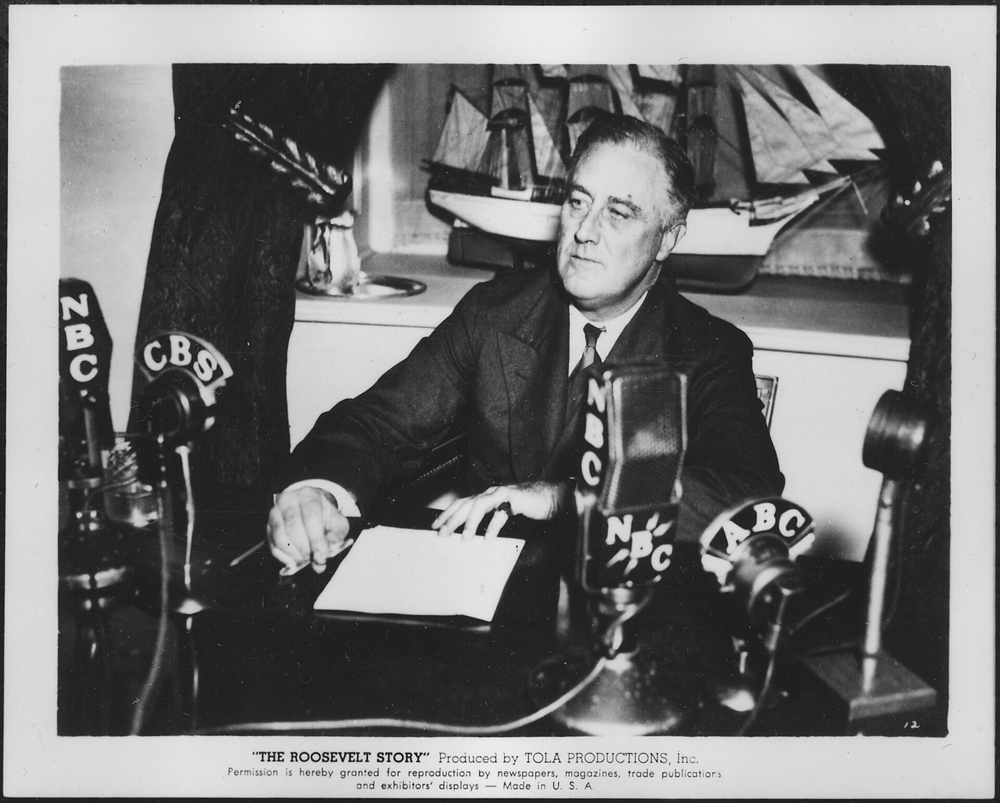
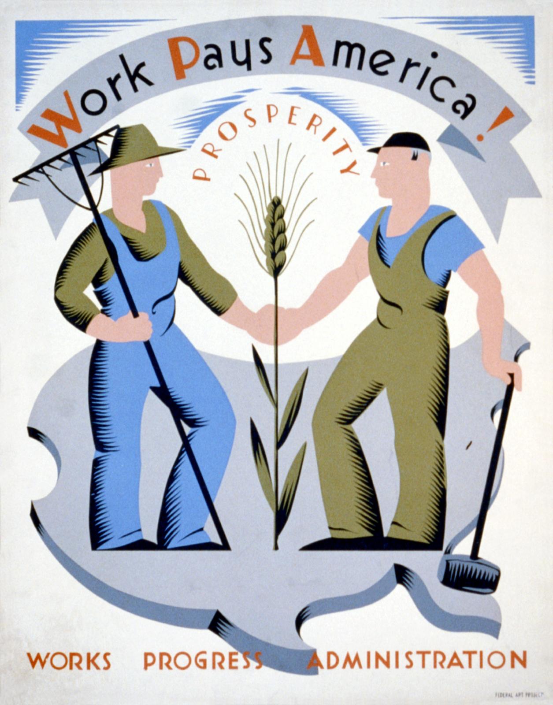
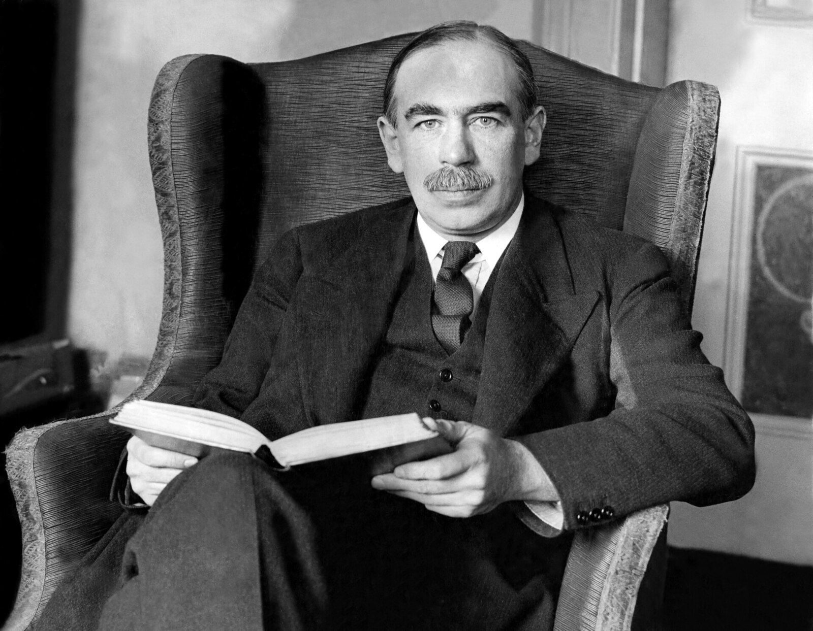
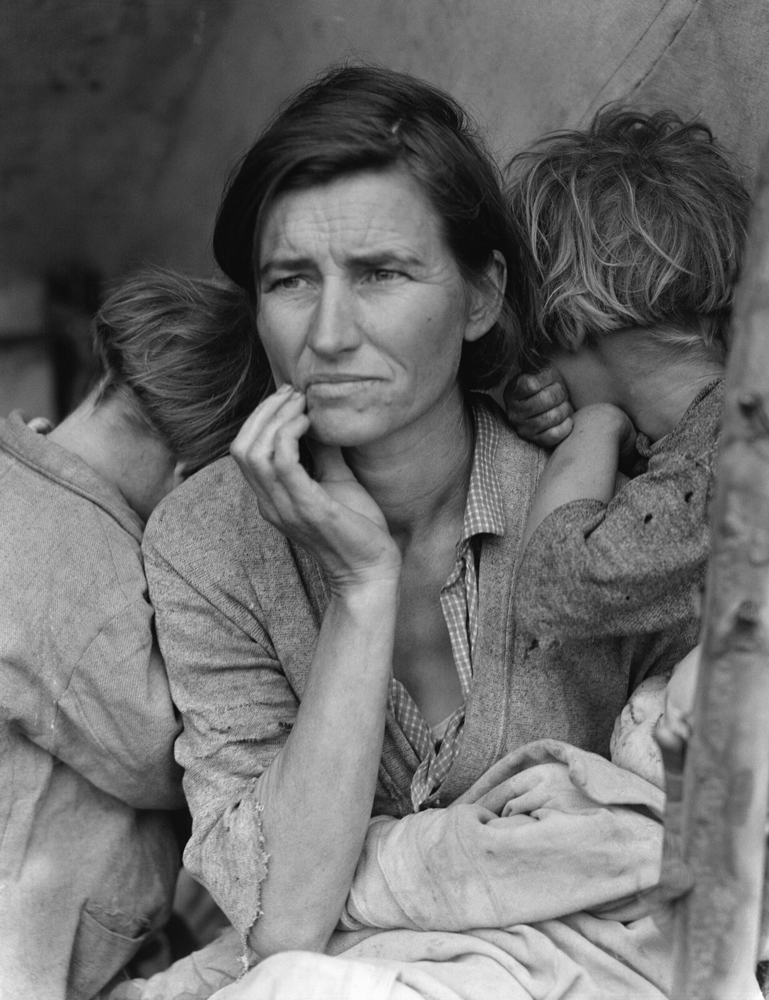

# 77. What caused the Great Depression?

*The United States and the world, from 1919 to 1939*

A crash on the New York stock market in 1929 turned into a worldwide depression because banks failed by the thousand, and because governments did the opposite of what the situation required. They let the supply of money shrink, cut their own spending and shut out one another's goods, out of loyalty to the gold standard and to balanced budgets. The crash itself need not have led to anything worse than an ordinary slump.

On the morning of 10 December 1930, a shopkeeper walked into a branch of the Bank of United States in the Bronx, in New York City, and asked to sell his shares in the bank. The manager tried to talk him out of it. The shopkeeper left, and told people in the street that the bank had refused to give him his money.

By the afternoon a crowd of twenty thousand was standing outside the branch. Mounted police kept order. Inside, the tellers paid out as fast as they could count, and two and a half thousand people closed their accounts before the doors shut for the night. Word spread to the bank's other branches, and by evening there were queues at many of them.

Despite its grand name, the bank was a private company. Most of its hundreds of thousands of customers were immigrant families who worked in the clothing trade. The name had done its work on them: many had opened accounts in the belief that the bank belonged to the government. That belief did not save them. The bank did not open the next morning. Their savings, about a hundred and sixty million dollars, were locked inside, and most of them waited years to recover part of what they had put in.

A rumour could do so much damage because of what a bank does with a deposit. A bank does not keep its customers' money in a vault. Instead, it lends most of it out, and holds a small reserve for those who come to withdraw on an ordinary day. Usually that is enough, because only a few customers want their money at any one time. If everyone comes at once, however, a bank cannot pay out of its own tills, because the money is out with its borrowers.

For that reason a bank lives on confidence. As long as its customers believe they can get their money, they leave it where it is. Once they doubt it, they all come at once, and so a rumour can kill even a sound bank. The Bank of United States was not especially sound. However, what happened to it that week was about to happen to thousands of others.

## A promise to pay gold

The world in which this took place had a peculiar idea about money, and it was held with something close to religious conviction.

A dollar, a pound or a franc was understood to be a promise. Each banknote stood for a fixed weight of gold, and the central bank of the country was bound to hand over gold for its notes on demand. An ounce of gold was worth a little under twenty-one dollars, and had been for a century.

That fixed weight had a useful side effect. Since every major currency was fixed to gold, each was fixed to all the others: if a pound stood for one weight of gold and a dollar for a smaller one, a pound was always worth the same number of dollars. As a result, a merchant in London could sign a contract in dollars for delivery in a year and know exactly what he would pay.

This was the gold standard. Bankers loved it, because it stopped governments from printing money to pay their bills. A government that printed too much would see people turn in its notes for gold, and when the gold ran low it would have to stop.

The cure for a loss of gold was always the same, and it was harsh. First, the central bank raised interest rates, and borrowing became dear. Businesses cut back, and as they did, wages and prices fell. Two things then brought the gold home. High interest drew in money from abroad. Meanwhile, a poorer country bought fewer foreign goods, and so sent less gold abroad to pay for them. In other words, the cure worked by making people poorer for a while, and that was considered healthy.

The war of 1914 broke the system, since no government could fight such a war without printing money. In the 1920s the countries of Europe struggled to put it back together. Meanwhile, one of them showed what could happen without it.

Germany had been ordered to pay for the damage of the war, and it did not have the money. In 1923 it fell behind, and France seized its main industrial region. The German government then paid its bills by running the printing presses day and night. The more notes it printed, the less each one was worth, until the currency dissolved.

In 1914 a dollar had bought about four marks. By November 1923 it bought four trillion. A loaf of bread cost two hundred billion marks. Because money lost its value between morning and evening, workers were paid twice a day, and their wives waited at the factory gate to run to the shops before the afternoon prices were posted. A lifetime's savings would not buy a postage stamp.

The German middle class never forgot it, and neither did the bankers of the world. They drew the lesson that the one thing worse than any slump was inflation.

*A German banknote for 100 trillion marks, dated 26 October 1923, from the year the currency dissolved. Photo: Deutsche Reichsbank, public domain.*

Germany was rescued by a new currency at the end of 1923, and by American loans from 1924. Those loans completed a curious circle. American banks lent money to Germany. Germany used it to pay France and Britain what it owed them for the war. France and Britain used it to repay what they had borrowed from the United States during the war. The money went round and round, and as long as it kept moving, the payments could go on. However, the whole arrangement depended on Americans continuing to lend.

## A permanently high plateau

Americans in the 1920s had plenty to lend. The United States had come out of the war as the richest country in the world, and its factories were turning out things that had barely existed a generation before. By 1929 there were twenty-three million cars on American roads, one for every five people. Houses were being wired for electricity, and filled with radios, refrigerators and washing machines.

Most of these goods were bought on a plan that now spread far more widely than ever before. The buyer paid a small sum down and the rest in monthly instalments, so that the goods arrived at once and the payments went on month after month. For the first time, ordinary families were deep in debt for things other than a house, and felt prosperous.

They bought shares in the same way. An investor could put down as little as one dollar in ten and borrow the rest from his stockbroker, with the shares themselves as security. In other words, if the investor could not repay, the broker could sell the shares to get his money back.

While prices rose, this was a machine for getting rich, because the investor kept the whole gain on the borrowed money as well as on his own. A share bought with ten dollars of one's own money, which rose from a hundred to a hundred and ten, doubled the investment.

Prices did rise, and went on rising. Between 1921 and September 1929 the main index of share prices rose sixfold. Cab drivers gave tips on the market. Even the experts were sure. A famous economist at Yale announced in the middle of October that prices had reached what looked like a permanently high plateau.

The trouble with borrowed money is that it works in both directions. Suppose that same share fell from a hundred to ninety. The investor's own ten dollars were gone, and the broker, who did not mean to lose his loan as well, demanded more cash at once. If the investor could not pay, the broker sold the shares for whatever they would fetch. That sale pushed prices lower, and the lower prices caught the next man, whose broker sold in turn. A small fall could therefore feed on itself.

That is what happened in the last week of October 1929. On Thursday the twenty-fourth, prices began to slide, and by midday the selling was a stampede. A group of bankers calmed things by buying ostentatiously, so that everyone could see the big money still had faith in the market. The calm did not last. On the following Tuesday there was no stopping it. Sixteen million shares were dumped in a day, a record that stood for almost forty years, and the machines that printed the prices ran hours behind, so that sellers could not tell what their shares were fetching.

That was only the beginning. Within three weeks the market had lost more than a third of its value. It kept falling for almost three years, until nine tenths was gone, and it did not regain the level of September 1929 until 1954.

*A crowd in Wall Street in the days after the crash, October 1929. Photo: Associated Press, public domain.*

## Twenty-five thousand banks

Only a small minority of Americans owned shares. The crash wiped out the paper fortunes of the rich and the hopeful. However, it frightened everyone. People put off buying a car. As a result, factories that made cars laid off men, who then could not pay their instalments. That is an ordinary slump, of the kind that had come every ten years or so for a century, and it should have run its course in a year or two.

What turned it into something else was the banks. The United States had about twenty-five thousand of them, most with a single office in a small town, lending to local farmers and shopkeepers. Such a bank was only as strong as the farms and shops around it. Moreover, nothing stood behind their deposits. If a bank failed, the people who had put their money in it could expect to lose a good part of it.

Put those two facts together, and the slump could spread from bank to bank. When borrowers began to default, the weaker banks closed. Each failure taught the customers of neighbouring banks to get their money out while they could, and so the runs reached banks that had not yet been in trouble.

The banks, to protect themselves, stopped lending and called in loans. Each of them was being sensible, keeping as much cash as it could in case its own customers came. Taken together, however, their caution did great harm. Businesses that could not borrow closed, and their workers lost their jobs. Those workers could not repay what they owed, and so more loans went bad, and more banks were weakened. In four years, nine thousand American banks failed. The savings in them were frozen, and much of the money was never seen again.

The effect was to drain money out of the whole economy. A country's money is mostly the balances in its bank accounts, which people spend by cheque as they would spend cash. When a bank closed, the balances in it could no longer be spent. When the survivors stopped lending, fewer new balances appeared to take their place. For both reasons those balances shrank, and by 1933 nearly a third of the American money supply had ceased to exist.

With less money chasing the same goods, prices fell by a quarter. That sounds pleasant, and it is ruinous, because debts do not fall with prices. A farmer who had borrowed five thousand dollars when wheat was a dollar a bushel still owed five thousand dollars when wheat was forty cents. He had to grow two and a half times as much wheat to pay it. He could not, and the bank took the farm, and then the bank failed too. Falling prices sent the debtors under, and the debtors took their lenders down with them.

The cost in jobs was enormous. In 1929, three American workers in a hundred had no job. By 1933 it was one in four, about thirteen million people, and a great many of the rest were on short hours. There was no national system of relief. As a result, men who had been foremen and clerks queued for soup, sold apples on street corners, and rode freight trains from town to town looking for a day's work. On the edges of the cities, families lived in shacks made of packing cases and flattened tins. They named these settlements Hoovervilles, after the president.

*Unemployed men queue outside a soup kitchen opened by the gangster Al Capone in Chicago, February 1931. Photo: unknown, US National Archives, public domain.*

## Liquidate

President Herbert Hoover was an intelligent and humane man who had made his name organising food relief in wartime Europe. He did more than any president before him had done in a slump. He urged employers to keep wages up, brought forward public building works, and in 1932 set up an agency to lend to banks in trouble. However, he and nearly everyone who advised him held a set of beliefs that made all of it too little.

His secretary of the treasury, one of the richest men in America, put the orthodox view, the accepted wisdom of the day, in its purest form. Hoover remembered his advice as: liquidate labour, liquidate stocks, liquidate the farmers, liquidate real estate. In plain words, he meant that wages, shares, farms and property should be left to fall to whatever they would fetch. The idea behind the advice was that the slump was a fever that would purge the rottenness from the system. Weak firms would fail, wages would fall, and enterprising people would pick up the pieces.

Hoover did not go quite so far. He did, however, hold to three articles of faith, and each of them pushed in the wrong direction.

The first was that the government must balance its budget, as a household must. As tax revenues fell, he therefore fought to hold spending down. In 1932, deep in the slump, he went further and raised taxes, taking money from people who were already spending too little.

The second was that the dollar must remain tied to gold. The American central bank had been founded in 1913 for the purpose of lending to sound banks in a panic, which was exactly the situation it now faced. Instead, it stood by while a third of the banks failed, and at one point raised interest rates to defend the currency, making money dearer just when it was scarcest.

The third was that American jobs should be protected from foreign goods. The usual tool for that is a tariff, a tax on goods brought in from abroad. In June 1930 Congress passed one of the highest tariffs in the country's history, raising the duty on some twenty thousand imported items. A thousand economists had signed a petition begging the president not to sign it.

The economists' fear came true. Other countries retaliated within months, with tariffs and quotas of their own, a quota being a limit on how much of a good may be brought in at all. Over the next four years, the value of world trade fell by two thirds.

*Representative Willis Hawley (left) and Senator Reed Smoot, whose names the tariff law of 1930 bears, photographed on 11 April 1929. Photo: National Photo Company, public domain.*

Each of these policies made sense for one household, one bank or one country acting alone. A household that spends less keeps its savings. A bank that stops lending keeps its cash. A country that keeps out imports hopes to protect its own jobs. Applied by everyone at the same time, however, they turned a recession into a catastrophe.

## Coffee in the locomotives

Meanwhile the circle of debts had broken. American banks, in trouble at home, stopped lending abroad and began calling their money back.

In Europe, the first link to snap was in Austria. In May 1931 the largest bank in Austria admitted that it was insolvent, which is to say that it owed more than everything it owned was worth. The panic jumped to Germany, where the banks owed vast short-term sums to foreigners. Loans that fall due soon can be withdrawn quickly, and frightened lenders withdrew them. In July one of the biggest German banks failed, and the government closed every bank in the country for two days.

The government's response was harsh. It put controls on money leaving the country, but it would not let the mark fall from its old value in gold. To hold that value it raised interest rates sharply, cut the pay of civil servants and reduced unemployment benefits. Its chancellor became known as the hunger chancellor. By the winter of 1932 six million Germans were out of work, nearly one in three.

From Germany the run moved to London. Britain had been bleeding gold all summer, and on 21 September 1931 it gave up and announced that the pound could no longer be exchanged for gold. The British had been raised to think of this as national dishonour, the breaking of the promise printed on every note. To general surprise, nothing terrible followed. Instead, the pound fell by a quarter, and British goods became cheaper abroad. Interest rates no longer had to be held up to defend the pound, so they could be lowered, and the economy began slowly to revive.

Elsewhere the news was worse. The countries that suffered most were those that lived by selling raw materials. As the factories of the rich countries shut down, they bought less, and the prices of copper, rubber, wool, wheat and sugar fell by half or more. For a country that sold little else, that meant ruin. Chile's exports dropped by four fifths. Australia had nearly three workers in ten unemployed.

In Brazil the waste was there for anyone to see. Brazil grew most of the world's coffee, and it had far more than it could sell. Selling the surplus would only have driven the price lower still, so for years the government bought it up and destroyed it. Some of it was burned as fuel in railway locomotives.

One large country seemed untouched. The Soviet Union, where the state owned every factory and every bank, was building steelworks and dams under a central plan, and it reported that it had no unemployment at all. To a great many people in the West, standing in line for soup, that looked like an argument against the whole system of private banks and free markets.

## Fear itself

In November 1932 the American voters turned Hoover out by a huge margin. The winner was the governor of New York, Franklin Roosevelt, a wealthy and cheerful man who had lost the use of his legs to polio and took care not to be photographed in his wheelchair. He had promised a "new deal" and had been vague about what it meant.

By the time he took office, on 4 March 1933, the banking system had stopped. The governors of most of the states had closed their banks, or limited withdrawals, to halt the runs, and in much of the country people could not get at their money at all. In his first speech as president, heard on the radio by tens of millions, Roosevelt told the country that the only thing it had to fear was fear itself. The sentence went straight to the cause of the runs, since a run begins when customers fear that their bank will fail.

*President Roosevelt at the microphones of the radio networks for one of his fireside chats, dated 1935 by the National Archives. Photo: unknown, US National Archives, public domain.*

Words alone would not fill the tills, so he acted as well. Two days later he closed every bank in the United States by decree. The pause gave the government time to sort the sound banks from the rest. Government examiners went through their books, and only those judged sound were to reopen. On the eighth evening he spoke on the radio again, this time sitting at a desk in the White House, in the tone of a man talking to a neighbour. He explained how a bank works, and why no bank can pay all its depositors at once. Then he said that it was safer to keep one's money in a reopened bank than under the mattress.

The next morning the banks opened, and there were queues outside them once more. This time, however, people were bringing their money back. To make that confidence last, that June Congress passed a law under which the government insured ordinary bank deposits, at first up to two and a half thousand dollars each. A small saver no longer had to race his neighbours to the counter, because his money was safe even if the bank failed. Runs on American banks by small savers all but ceased.

Roosevelt then tried everything at once, without much regard for consistency. He took the dollar off gold, as Britain had done two years before.

He sent young men to work in the forests, three million of them over nine years, planting trees and cutting firebreaks. Other programmes hired the unemployed by the million to build roads, schools, airports and dams. Meanwhile, farmers were paid to grow less, so as to raise prices. Unions were given the legal right to bargain. Finally, in 1935 a law set up pensions for the old and insurance for the unemployed, paid for by a tax on wages.

*A Works Progress Administration poster, made between 1936 and 1941. The agency hired the unemployed by the million. Poster: Vera Bock, Federal Art Project, public domain.*

It was a partial success. The economy grew fast from 1933, and unemployment fell, though it was still above one in seven in 1937. However, Roosevelt had not abandoned the old religion entirely. That year, thinking the emergency over, he cut spending to balance the budget. At the same time the central bank tightened credit. The economy promptly fell back into recession.

## The paradox of thrift

Why had the old remedies failed so badly, and why had the slump not cured itself? The man who explained what had gone wrong was an English economist who had been warning of it since 1919.

John Maynard Keynes was a Cambridge economist, a successful speculator and an adviser to the British treasury, with a gift for the wounding phrase. Economists of the old school liked to say that in the long run prices and wages would find their proper level. Keynes had answered that years before: in the long run, he wrote, we are all dead.

*John Maynard Keynes in 1929, seven years before he published his argument in full. Photo: unknown, public domain.*

In 1936 he set out his argument in full. The accepted theory held that an economy always tends back towards full employment. If workers are idle, wages fall until it pays to hire them, and so the idle are put back to work.

Keynes said that this was false. An economy can settle into a state in which factories and workers stand idle for years, because nobody is buying. Businesses will not invest when there are no customers, however cheap borrowing becomes. Worse, the workers they lay off are the customers they are missing. A slump of that kind keeps itself going.

The reason lies in a trap that came to be called the paradox of thrift. When times are hard, it is prudent for each family to spend less and save more. However, one person's spending is another person's income. When a family stops buying shoes, the shoemaker earns less, and he in turn spends less at the baker's. If every family cuts back at once, incomes fall, and the country ends up poorer and with less saved than before. What is wise for each is disastrous for all.

It followed that somebody had to spend when nobody else would, and the only somebody large enough was the government. In a slump it should borrow and spend, on anything at all, and balance its budget later, when times were good. Seen that way, the men who had cut spending and raised taxes in 1931 had been pouring water on a drowning man.

The record bears him out, and it also shows how much the gold standard was to blame. Countries recovered in almost exactly the order in which they gave up gold: Britain and Japan from 1931, the United States from 1933, France, which clung to gold until 1936, last of all.

Spending told the same story. One of the fastest recoveries was Germany's, where a new government from 1933 spent heavily on motorways and then on weapons, and had all but ended unemployment by 1938. In the United States, by contrast, full employment did not return until the government began spending on a scale that no one had dared to propose in peacetime, to fight a war.

*Unemployment in the United States, Britain and Germany, 1928 to 1939, with the point at which each country left gold. Figures from Stanley Lebergott's series in Historical Statistics of the United States, the British unemployment insurance returns (as in B. R. Mitchell's British Historical Statistics) and D. Petzina and others, Sozialgeschichtliches Arbeitsbuch III (1978); each country counted differently, so the levels compare only roughly. Chart: drawn for this book.*

## What it left

The Depression changed what people expected of their rulers. Before 1929, most people regarded a slump as something like the weather: it came, it did damage, and then it passed. After it, voters in every democracy held the government responsible for whether they had work, and no government has been allowed to forget it.

*Florence Thompson, aged thirty-two, a pea picker with seven children, in a camp at Nipomo, California, March 1936. Photo: Dorothea Lange, public domain.*

It also left an argument that is still going on, about which of the mistakes mattered most. One school holds that the central banks caused the disaster by letting the banks fail and the money supply collapse. Another, following Keynes, holds that the heart of it was the collapse of spending. A third puts the blame on the gold standard, which forced every country to deepen the slump in order to defend its currency.

They agree on more than they admit, since shrinking money, falling spending and the defence of gold all fed one another. No central banker since has knowingly let the banking system go down.

For a generation, the idea that markets could be trusted to look after themselves was dead. In its place stood two models that appeared to work. One was Roosevelt's, which kept private business and elected government and gave the state the task of steadying both. The other was the dictator's. In Germany, where one worker in three had no job, the party that promised to sweep the whole system away had become the largest in parliament in the summer of 1932.
