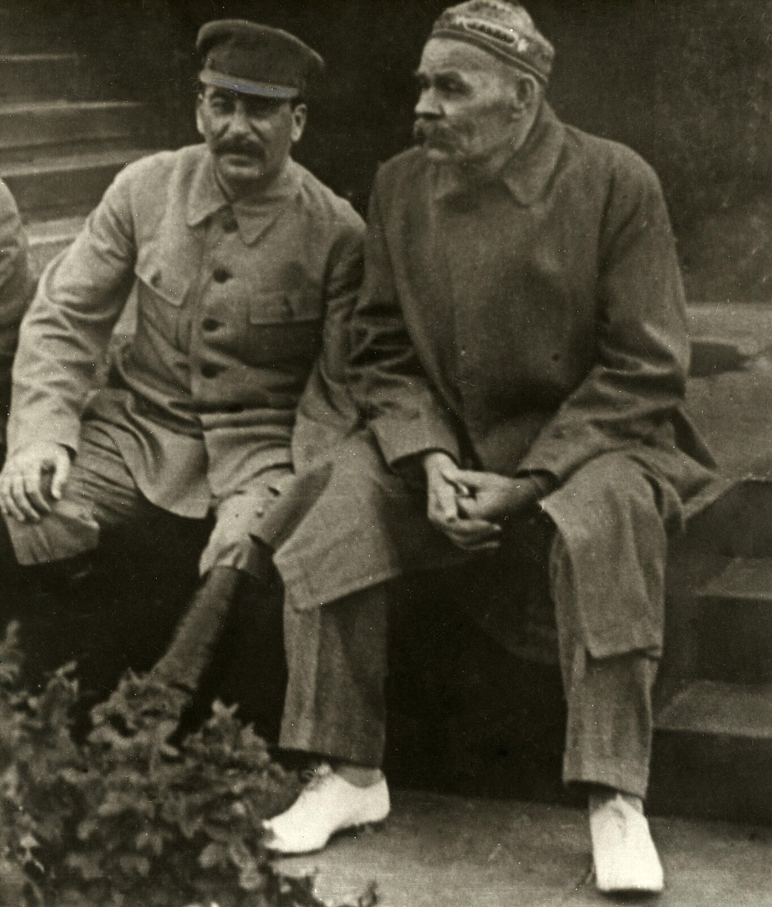
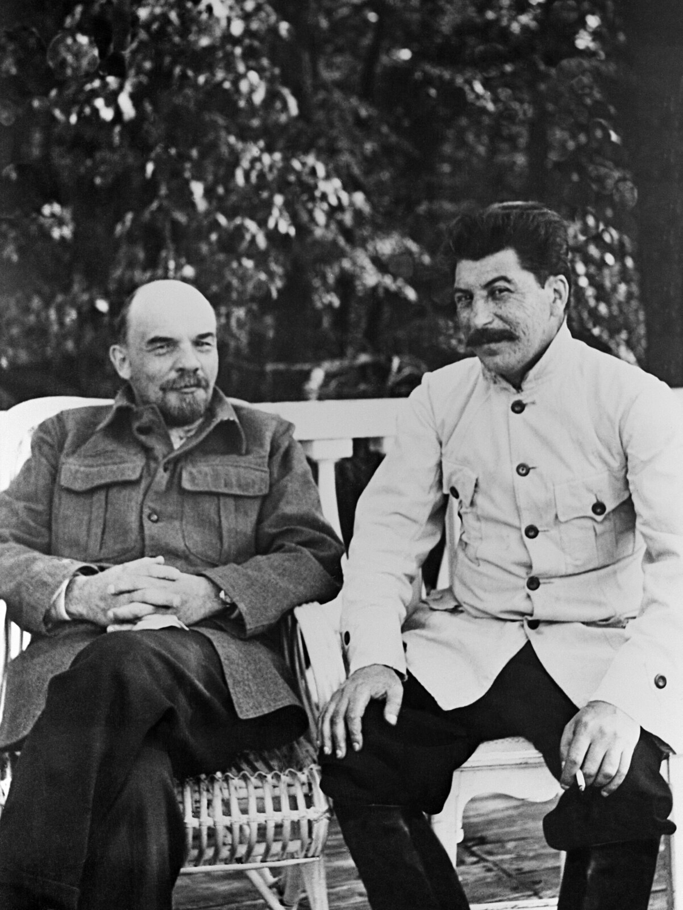
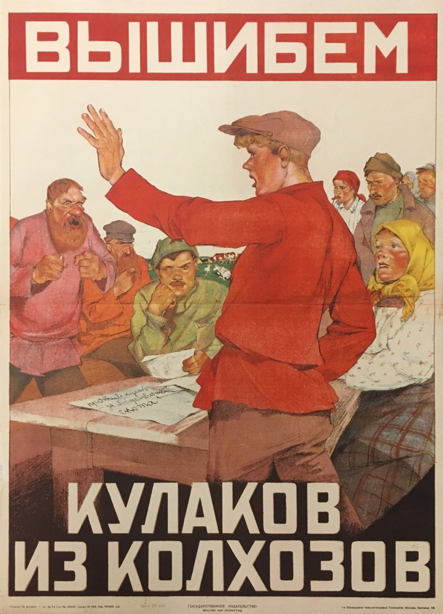
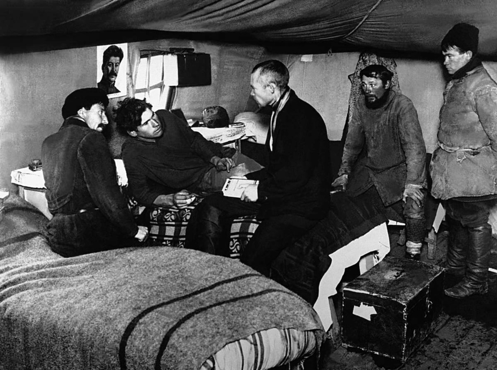
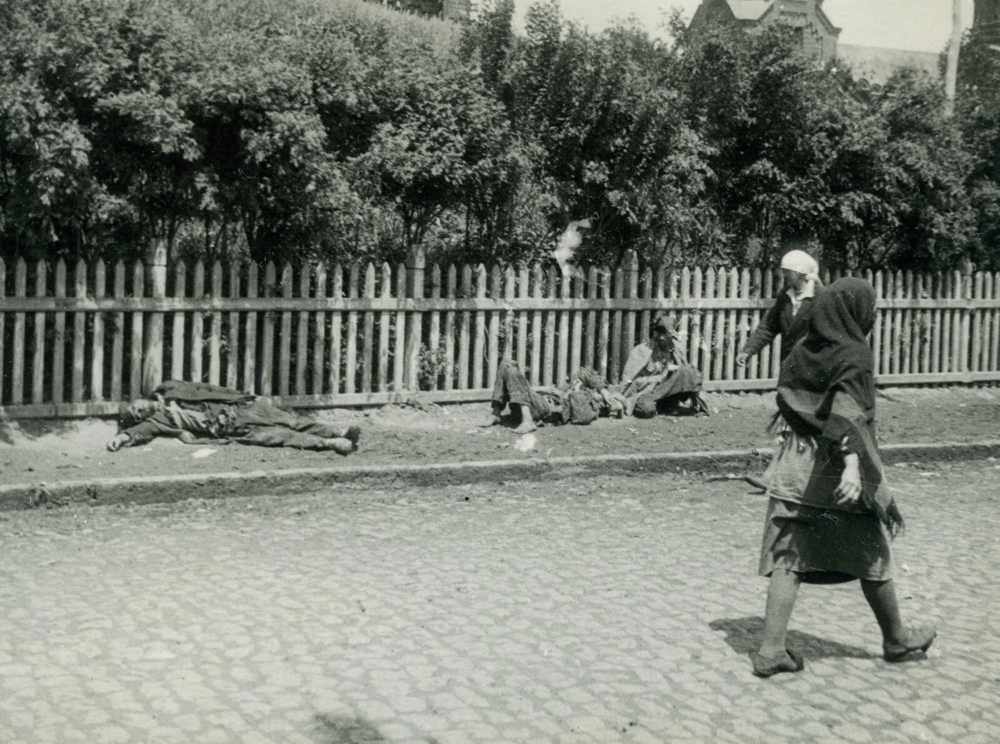
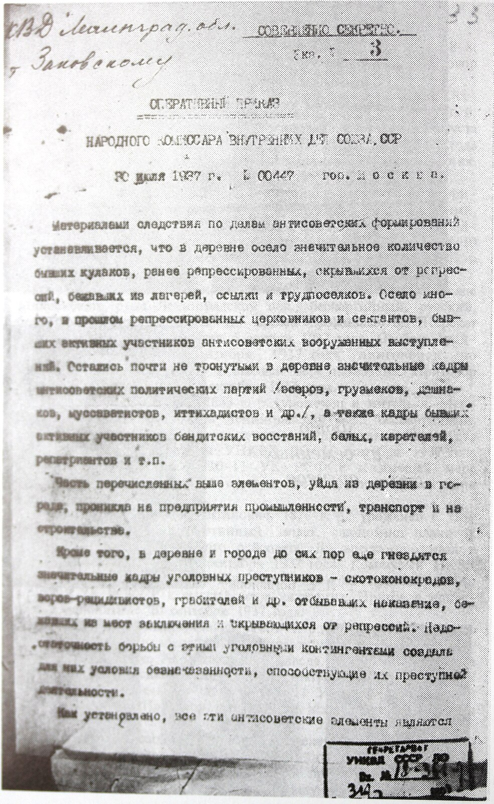
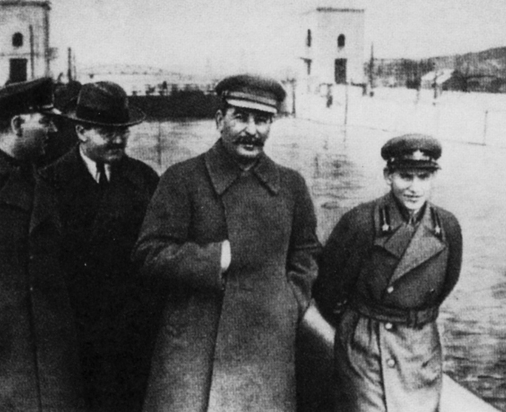
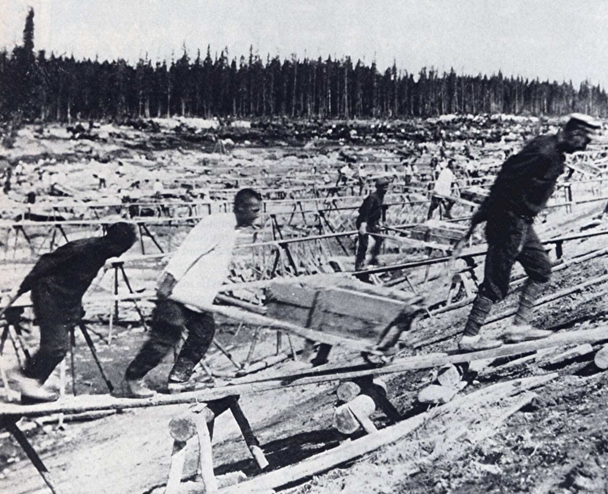
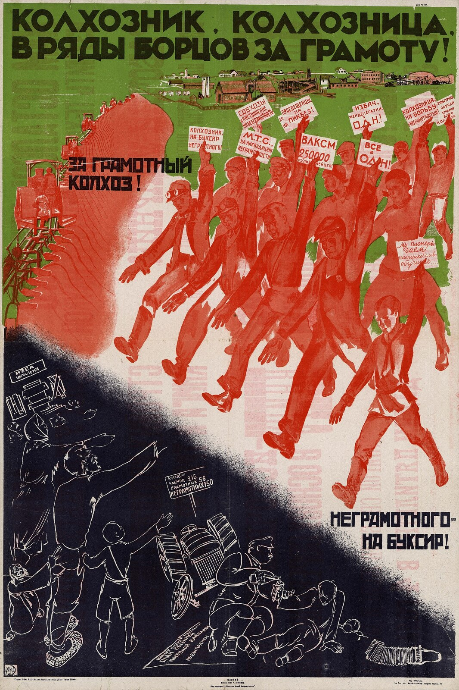

# 78. Why did so many people die under Stalin?

*The Soviet Union, from 1924 to 1941*

They died because Stalin set out to turn a country of peasants into an industrial power in ten years, and the peasants were made to pay for it. The state seized their farms and their grain, and when the harvest fell short it went on taking, until millions had starved. He then turned the same machinery on his own party, his army and anyone else whom the police chose to suspect.

In February 1931 Joseph Stalin, the ruler of the Soviet Union, made a speech to a conference of factory managers in Moscow. Some of them had been asking whether the pace of building could be slowed a little. The targets were impossible and the workers were exhausted.

Stalin said no. The whole history of old Russia, he told them, was the history of being beaten for its backwardness. It was beaten by the Mongol khans, by the Swedish lords, by the British and French capitalists, by the Japanese barons. They beat it because it was weak, and because beating it was profitable and went unpunished.

We are fifty or a hundred years behind the advanced countries, he said. We must make good this distance in ten years. Either we do it, or they will crush us.

Nearly everything that happened in the Soviet Union over the following decade, good and terrible, follows from that calculation.

## The man of steel

He had not been expected to rule. When Lenin died in 1924, the Communist party had several leaders more famous than Stalin, and one far more brilliant. Leon Trotsky had organised the seizure of power and created the Red Army, and he was the finest speaker and writer of the revolution.

Stalin was a different kind of man. He had been born Ioseb Jughashvili, in 1878, in a small town in Georgia, in the mountains on the southern edge of the Russian empire. His father was a shoemaker who drank and beat him. His mother scrubbed floors to send him to a seminary to become a priest, and he was expelled, having discovered Marx. For the party he organised strikes, and at least one spectacular armed robbery of a bank's carriage. He spent years in Siberian exile. Along the way he adopted a name that means "man of steel". He spoke Russian with a heavy accent, in a flat voice, and the intellectuals of the party thought him a grey mediocrity.

*Stalin with the writer Maxim Gorky, 1931. Photo: unknown, public domain.*

In 1922 he took a post that they were happy to leave to him. As general secretary, he ran the party's files and decided who was appointed to what, in every province and district. It was dull work. It meant that, in a few years, most of the officials who voted at party congresses owed their jobs to him.

Lenin saw the danger at the very end. In a note dictated after his strokes, he wrote that Stalin was too rude, and had gathered unlimited power into his hands, and that the comrades should think of a way to remove him. The note was read to the party's leaders after Lenin's death. Stalin offered to resign, and the others, who feared Trotsky more, voted to keep him and to suppress the document.

*Lenin and Stalin at Gorki, near Moscow, September 1922, photographed by Lenin's sister. Stalin had the pictures published to show Lenin's recovery and his own closeness to him. Photo: Maria Ulyanova, public domain.*

He then picked them off. He sided with one group against Trotsky, then with another against the first, always appearing as the moderate man in the middle. Trotsky was expelled from the country in 1929. Eleven years later, in Mexico, an agent sent from Moscow killed him with an ice axe.

## The grain problem

The quarrel among the leaders was about a real difficulty, which the revolution had never solved.

The Bolsheviks had taken power in the name of the industrial workers, in a country where four people in five were peasants. Marx had expected socialism to come to rich, advanced nations. Trotsky's answer had been that the Soviet Union must spread the revolution to Germany and the West, which would then help it. By the middle of the 1920s that hope was dead. Stalin offered a different slogan, "socialism in one country". The Soviet Union would have to build a modern industry by itself, with its own resources.

The resource that mattered most was grain. To build factories, the state needed to feed the workers in the towns, and it needed something to sell abroad in order to buy machines. Both meant getting grain out of the villages, cheaply.

Since the civil war, the peasants had been left in possession of the land they had seized, and allowed to sell their crops. There were twenty-five million family farms. In 1927 the state offered a low price for grain, and the peasants, reasonably enough, declined to sell. They fed it to their animals or stored it and waited. The towns went short of bread.

Stalin drew a conclusion that went well beyond the price of wheat. As long as the food supply was in the hands of millions of independent farmers, they could hold the state to ransom, and every plan for industry would depend on their goodwill. They would have to be brought under control.

## Fists

The method was called collectivisation. The family farms of each village would be merged into one large farm, with the land, the horses and the tools held in common, managed by a chairman who answered to the party. The peasants would work it in gangs and be paid a share of what was left after the state had taken its quota. The state would deal with a quarter of a million farms and no longer with twenty-five million households.

It was begun in a single winter, by force. From the end of 1929, party officials, policemen and brigades of factory workers from the cities descended on the villages. A meeting was called. The villagers were told to vote themselves into a collective, and those who argued were arrested.

*A Soviet poster of 1930: "We will drive the kulaks out of the collectives." Poster: unknown artist, public domain.*

To break resistance, Stalin announced that the richer peasants were to be "liquidated as a class". The word for them was *kulak*, which means "fist", and it had once meant a village moneylender. Now it meant a family with two or three cows, or one that had hired a labourer at harvest. In practice it meant whoever opposed the collective, and each district was given a number to find. In two years, nearly two million people were loaded into goods wagons and shipped to Siberia, the far north and the steppes of central Asia. They were unloaded in the forest, in midwinter, and told to build themselves shelters. Several hundred thousand of them died.

The peasants who remained rioted in thousands of villages, and they had one form of protest that could not be put down. Sooner than hand their animals over to the collective, they killed and ate them. In five years the number of cattle in the Soviet Union fell by almost half, and so did the number of horses, which pulled the ploughs. In March 1930, with the countryside close to revolt, Stalin published an article blaming the excesses on local officials who had become "dizzy with success". The pressure eased for a few months and was then resumed. By 1936 nine farms in ten were collective.

## Steel city

The grain went to the cities and the ports, and what it paid for was astonishing.

In 1928 Stalin had launched a five-year plan, which laid down what every industry was to produce. It was to be completed in four. Coal and steel output were to double or treble, and industries that barely existed, making tractors, chemicals and machine tools, were to be built up into giants.

The symbol of the plan was a place called Magnitogorsk. In the southern Ural mountains, on the empty steppe, there was a hill made almost entirely of iron ore. In 1929 the government decided to build beside it one of the largest steelworks in the world. It hired an American engineering firm to design it, on the model of the great mill at Gary, Indiana. Within three years a quarter of a million people were living there. They were young volunteers fired by the idea of building socialism, peasants who had fled the collectives, and deported kulaks working under guard. They lived in tents and dugouts in a place where the temperature fell to forty below, and they poured the concrete by hand.

*The tent of some of the first builders of Magnitogorsk, early 1930s, where a political talk is under way. Photo: unknown, public domain.*

The same was happening all over the country. An American engineer who had built dams on the Mississippi built the largest in Europe across the Dnieper. An architect from Detroit, the designer of Henry Ford's factories, sent a team to Moscow that drew up plans for more than five hundred plants. The West was in the depths of the Depression, and its engineers were glad of the work.

By the end of the 1930s the output of Soviet industry had roughly trebled. Coal and steel production had quadrupled. A country that had imported its tractors was making them by the tens of thousands. By 1940 it made more steel than Britain and almost as much as Germany. Nothing like it had been done so fast before.

## Death by hunger

The price was paid in the villages, in the winter of 1932.

The collectives were badly run, the horses were dead, and the harvest that year was poor. The state's demands, however, had been set on the assumption of a good harvest, and Stalin took the view that any shortfall was sabotage. Peasants, he believed, were hiding grain.

Brigades were sent from house to house. They prodded the earth floors with iron rods, looking for buried sacks, and they took what they found: the seed grain for the next sowing, and then the potatoes, the beans, the dried peas and the family cow. A law of August 1932 laid down ten years in a camp, or death, for anyone who took so much as a handful of grain from a collective field. Children were convicted under it. Villages that failed to meet their quota were placed on a blacklist and cut off from all supplies, including salt and matches.

By the spring of 1933 people were eating bark, grass and the corpses of horses. Whole families lay down and died in their huts. In the worst districts there was cannibalism, and more than two thousand people were convicted of it. Starving peasants tried to walk to the towns or to other regions in search of food. That January the government had issued an order closing the borders of Ukraine and the north Caucasus, and police at the railway stations turned them back.

*Starving peasants on a street in Kharkiv, 1933. Photo: Alexander Wienerberger, public domain.*

The famine was worst in the richest farmland. Between three and a half and five million people died in Ukraine, where the event is remembered as the Holodomor, which means "death by hunger". About a million and a half died in Kazakhstan, where the collectivisers had destroyed the herds of a people who had lived for centuries as herdsmen. More than a third of all the Kazakhs perished. Altogether, across the Soviet Union, the dead numbered between five and a half and nine million.

Through all of it the government went on exporting grain, and it denied that anything was wrong. A young Welsh journalist slipped away from Moscow, walked through the villages of Ukraine, and reported what he had seen. The most famous foreign correspondent in Moscow, an Englishman who wrote for an American newspaper and had just won its highest prize, replied in print that there was no actual starvation. He was believed. When the next census revealed that millions of people were missing, Stalin had the census suppressed and the statisticians shot.

Whether the famine in Ukraine was an attempt to destroy the Ukrainians as a nation is disputed. Ukraine and more than thirty other countries recognise it as genocide. Historians who agree point to the sealed borders, the blacklists, and the purge of Ukrainian teachers, writers and party leaders that went on at the same time. Others argue that Stalin's aim was grain and obedience, and that he was equally ready to let Russians and Kazakhs die to get them. Both sides work from the same records, and the records show that the government's own orders took the food from the villages and stopped the starving from leaving.

## Quotas

Having crushed the peasants, Stalin turned on his own party, and then on everybody else.

The pretext was a murder. In December 1934 the party chief of Leningrad, a popular figure, was shot in a corridor outside his office. Stalin declared that a vast conspiracy was at work. Over the next four years, almost all the surviving leaders of the revolution, the men who had made it with Lenin, were arrested. They were put on trial in Moscow in front of foreign journalists, and they stood up one after another and confessed that they had been spies for Germany, Britain and Japan and had plotted to murder Stalin and restore capitalism. They had been beaten for weeks, and promised that their families would be spared. Then they were shot.

The trials were the visible part. The larger killing was done in secret and by arithmetic. In July 1937 the head of the political police signed an order, approved by Stalin, for an operation against "anti-Soviet elements". It assigned to each region of the country two numbers. The first was how many people were to be shot. The second was how many were to be sent to the camps. The national total in the first category was about seventy-six thousand.

*The first page of Order No. 00447, signed in July 1937, which set the quotas for the mass shootings. Document: NKVD of the USSR, public domain.*

Local police chiefs, anxious to show zeal, met their quotas and wrote to Moscow asking for more. The requests were granted. Former kulaks, priests, people with relatives abroad, people who had been heard to grumble in a queue, and members of suspect nationalities such as Poles and Germans were arrested at night. Their cases were decided in minutes, by two or three officials who never set eyes on them, and those condemned were taken out and shot. In 1937 and 1938 about a million and a half people were arrested, and about seven hundred thousand were executed, which is roughly a thousand every day for two years.

The army was not spared. Three of its five marshals were shot or died under interrogation, and tens of thousands of officers were dismissed or arrested. The police chief who had run the operation was himself arrested and shot. He had once been photographed walking beside Stalin along a canal bank. In later printings of the photograph there is only water where he stood.

*Stalin (centre) with the police chief Nikolai Yezhov (right) and others beside a canal, April 1937. After Yezhov was shot, later printings of the photograph show only water where he stood. Photo: unknown, public domain.*

Those who were not shot went to the camps. A chain of them stretched across the Arctic and Siberia, where prisoners felled timber, mined gold and coal, and dug canals with shovels on a ration that depended on how much work they did. About eighteen million people passed through them between 1930 and Stalin's death in 1953, and well over a million and a half died there.

*Prisoners at work on the White Sea canal, 1932. Photo: unknown, public domain.*

## Believers

It is tempting to imagine that all this was done by a few monsters to a nation of victims. It was done by hundreds of thousands of people, and many of them believed in it.

The young men and women who went out to the villages to seize grain had been told, and mostly accepted, that the kulaks were enemies who wanted to starve the workers. They thought that they were living through a war for the future of humanity, in which hardness was a virtue and pity a weakness. One of them, who later left the country, recalled watching children die and telling himself that he was performing his revolutionary duty.

There were also real gains. The regime taught the country to read. In 1926 fewer than six in ten people between the ages of nine and fifty could, and by 1939 almost nine in ten could. Schools, technical colleges and universities were opened by the thousand, and through the 1930s they were free. A peasant's son who joined the party and studied at night could become an engineer or a factory director in ten years, and millions did. Every purge opened jobs for the people below. Women entered the professions on a scale unknown anywhere else in the world.

*A Soviet poster of 1931: "Collective farmers, join the fighters for literacy! For a literate collective farm! Take the illiterate in tow!" Poster: Nikolaev, public domain.*

Then there was fear, and a press that told a single story. The newspapers printed production figures and photographs of smiling milkmaids. Stalin's portrait hung in every office and classroom. Life has become better, comrades, he announced in 1935, life has become more joyous. People who had lost a father to the police often concluded that there had been a mistake in their own case, and that if only Stalin knew, he would put it right.

## Ten years and four months

The question that cannot be settled is whether any of it was necessary. Russia's industry had been growing fast before 1914, and it grew fast in the 1920s under private farming. An economy that had not killed its best farmers and half its livestock might well have done as much. Stalin's defenders point to what came next.

On 22 June 1941, ten years and four months after his speech to the factory managers, three million German soldiers crossed the Soviet border, in the largest invasion in history. The army that faced them had lost most of its senior commanders three years before, and it was very nearly destroyed in the first six months.

It was not destroyed. Behind it stood the steelworks in the Urals, out of range of any bomber, and the tractor plants, which had been designed from the beginning to be converted to making tanks. During the war they would turn out more tanks and more guns than the whole of German industry.
