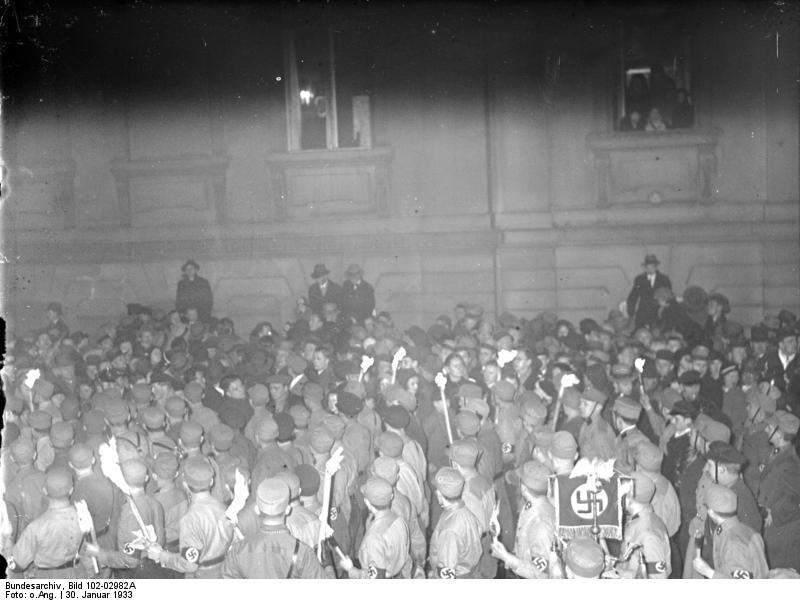
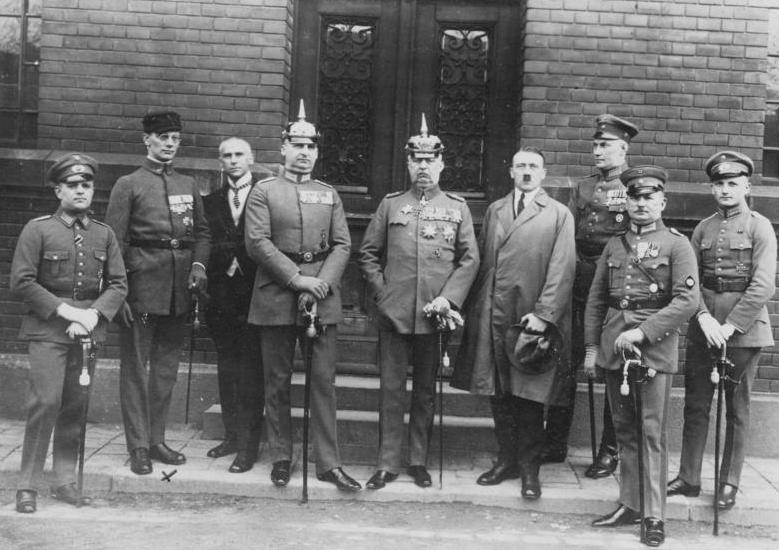
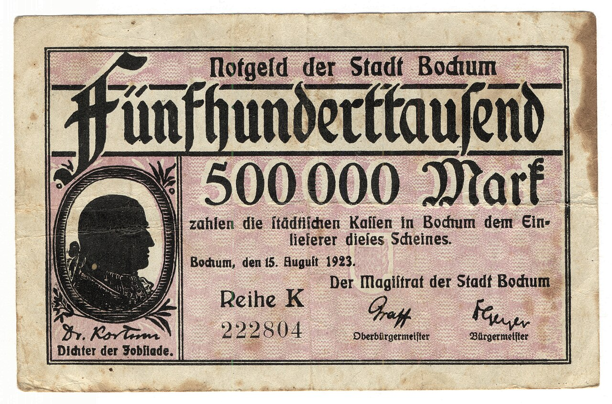
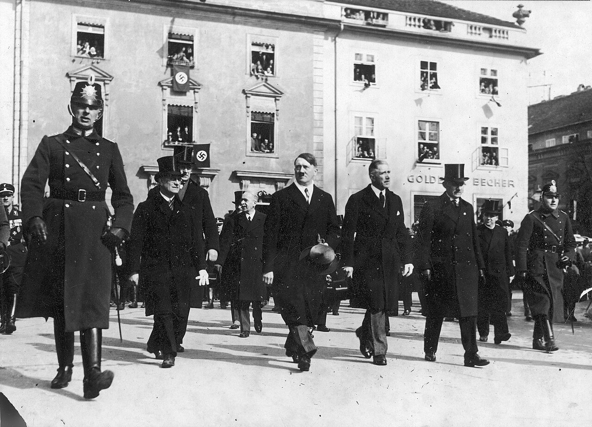
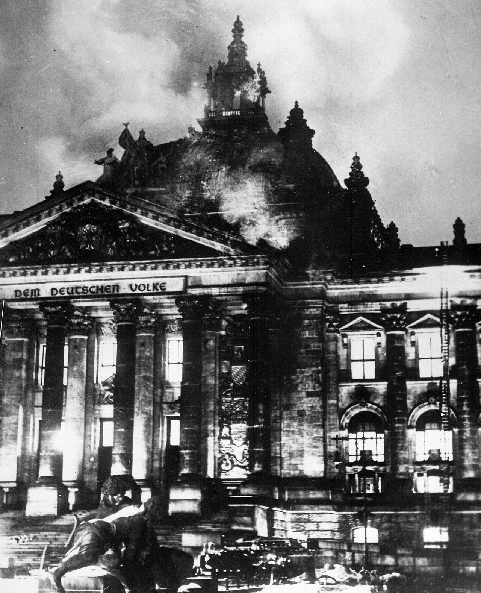
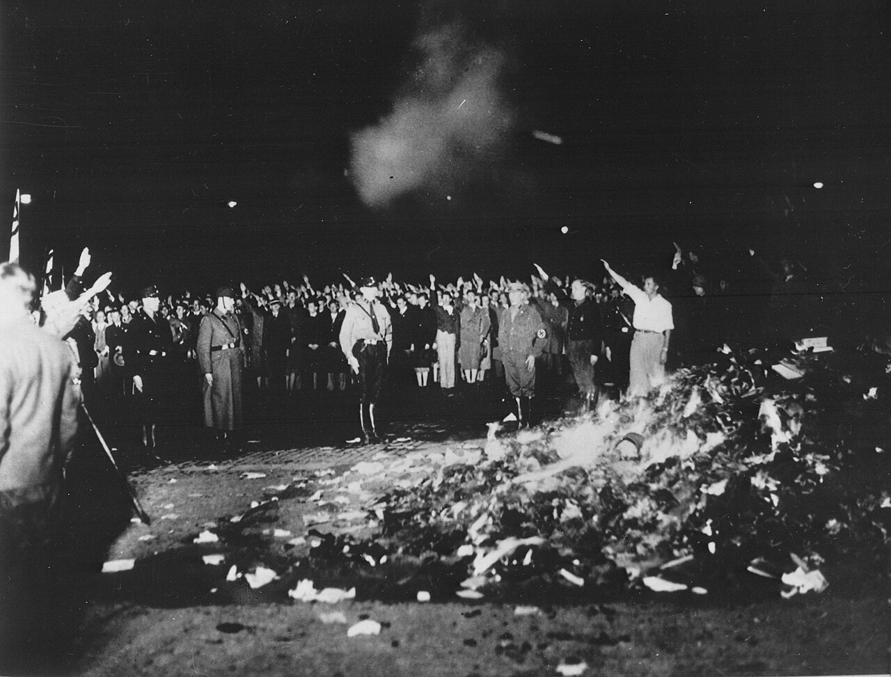
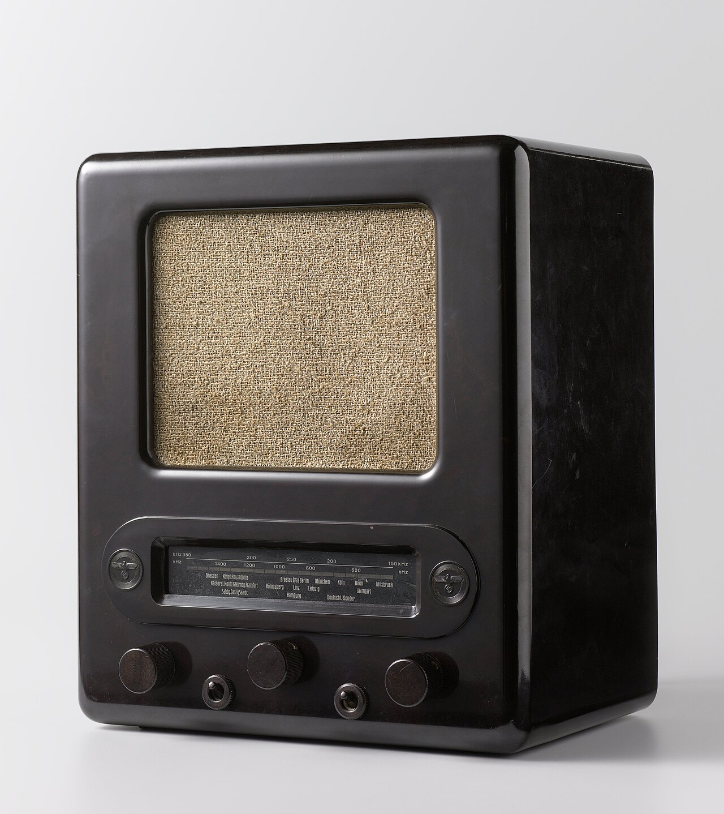
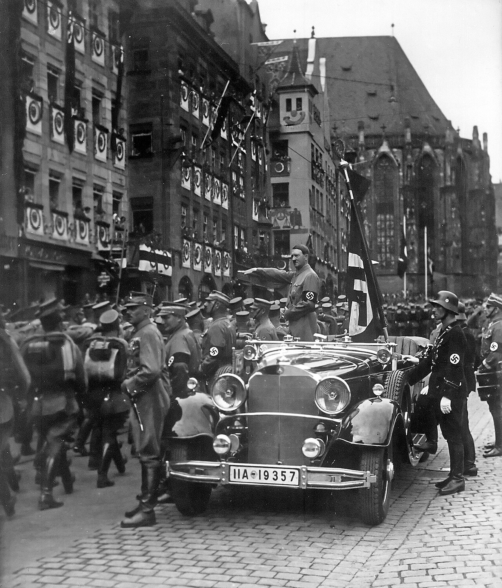
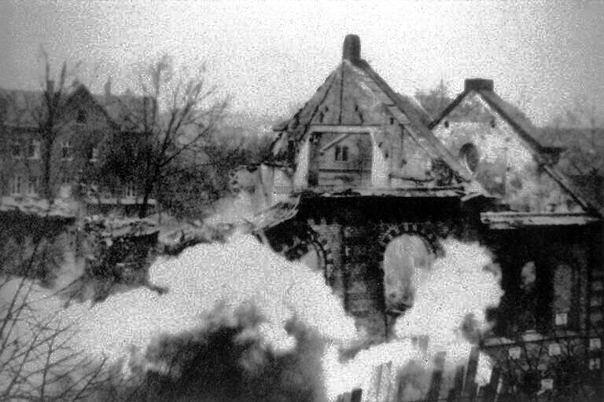

# 79. How did Hitler come to power?

*Germany, from 1918 to 1939*

Hitler was handed power. He did not win a majority in any free election, and he did not take the government by force. He was appointed chancellor of Germany, by the proper legal procedure, at the head of the largest party in parliament, by conservative politicians who believed that they could control him. Within six months he had abolished parliament's powers, the other parties, the trade unions and the free press.

On the evening of 30 January 1933, about twenty-five thousand men in brown uniforms marched through the centre of Berlin carrying burning torches. They passed under the great stone gate, turned down the street of the ministries, and went by the chancellery, where a man of forty-three in a dark suit stood at a lit window, leaning out to salute them. A few windows along, in the old presidential palace, a field marshal of eighty-five watched the same parade, tapping his stick in time to the bands.

*Brownshirts with torches in Berlin on the night of 30 January 1933, the day Hitler became chancellor. Photo: Bundesarchiv, Bild 102-02982A, CC BY-SA 3.0 de.*

The old man was the president of Germany, Paul von Hindenburg. That morning he had sworn in the man at the other window as head of the government. He had done it reluctantly. He disliked Adolf Hitler, whom he called "that Bohemian corporal", and had refused him the post twice.

What changed his mind was not Hitler but a fellow conservative. He had been talked round by a former chancellor, an aristocrat named Franz von Papen, who would now serve as Hitler's deputy. Papen was delighted with his arrangement, and on paper he had reason to be. Of the eleven ministers in the new cabinet, only three were Nazis. The rest were gentlemen of the old school like himself.

When a friend warned him of what he had done, he laughed. We have hired him, he said. In two months we will have pushed Hitler so far into a corner that he will squeak.

## A corporal in hospital

The man they had hired had spent the first thirty years of his life as a failure.

He was born in 1889 in a small town in Austria, the son of a customs official. At eighteen he went to Vienna to become a painter and was twice refused a place at the academy of fine arts. For five years he drifted, sleeping in a hostel for homeless men and selling small watercolours of famous buildings.

The city he drifted through gave him his ideas. Vienna was the capital of an empire of many peoples, and its cheap newspapers were full of the theories of race that were then fashionable. In those theories the Germans stood at the top, and the Jews were the hidden enemy of everyone. Hitler read them.

In 1913 he moved to Germany, to avoid service in the Austrian army. The next year, when the war came, he volunteered for a German regiment the same week. He served for four years on the Western Front as a messenger, carrying orders between headquarters and the trenches, and was decorated twice for bravery. For a man who had failed at so much else, that mattered. The army was the first place where he had belonged.

In October 1918 he was caught in a British gas attack and temporarily blinded. He was lying in a military hospital in the north of Germany when a chaplain came into the ward and announced that the emperor had abdicated and the war was lost. Hitler wrote that he stumbled back to his bed and wept for the first time since his mother's funeral.

Like millions of Germans, he could not understand it. Little they had been told had prepared them for defeat. The newspapers had reported victories until the end. The army stood on French and Belgian soil, and not one enemy soldier stood in Germany.

Into that confusion came an explanation. The generals who had begged for the armistice now let it be understood that the army had never been beaten in the field. It had been betrayed from behind, by the socialists and Jews who made the revolution at home. The story was false. However, it was widely believed, because it spared the army and the nation the shame of defeat, and Hitler built his life on it.

## The beer hall

He stayed in the army after the war, in Munich, and it gave him a job as an informer. In 1919 he was sent to report on one of the dozens of tiny extremist groups in the city, which called itself the German Workers' Party and met in the back room of a tavern. He went to observe, lost his temper with a speaker, and made a speech of his own. The committee invited him to join.

He had discovered the one thing he could do. In front of an audience, the awkward and friendless ex-soldier became someone else. He would begin hesitantly, feel for the mood of the room, and build to a pitch of fury at which he seemed to be saying aloud what his listeners had only dared to think.

That gift carried him to the top of the little party. Within two years he was its leader, and it had added "National Socialist" to its name and adopted a red flag with a black hooked cross. It had its own force of uniformed bullies to protect its meetings and break up other people's.

His first bid for the state itself ended in gunfire. In November 1923, at the height of the great inflation, he tried to seize power. He burst into a Munich beer hall where the leaders of Bavaria, the German state of which Munich is the capital, were holding a meeting, fired a pistol at the ceiling, and announced a national revolution. The next morning he led two thousand followers towards the centre of the city. A line of police opened fire, sixteen Nazis and four policemen were killed, and Hitler fled with a dislocated shoulder.

It ought to have finished him. He was tried for treason, and the judges, who shared many of his opinions, let him turn the dock into a platform and gave him the minimum sentence of five years. He served nine months in a sunny room in a fortress, receiving visitors and dictating a book.

*Hitler (right of centre, in a coat) with General Ludendorff and other defendants outside the court in Munich, 1924, at the time of the trial for the beer-hall rising. Photo: Heinrich Hoffmann, Bundesarchiv, CC BY-SA 3.0 de.*

The book is long and badly written, and it sets out exactly what he meant to do. Germany must tear up the peace treaty and rearm. It must conquer "living space" in the east, in Russia, for German farmers. The Jews were a foreign race, the source of both capitalism and communism, and Germany must be rid of them.

He had also learned a practical lesson from the shooting in Munich. The state could not be overthrown from outside, as the police volley had shown. Instead, he would take it over by its own rules. He said so on oath in a courtroom in 1930: his party would come to power by legal means, and then heads would roll.

## Twenty governments

The republic that he set out to capture had been in trouble from the day it was founded.

It had the misfortune to be born of defeat. Its first act was to sign the armistice, and its second was to sign the peace treaty, and its enemies never let anyone forget it. In their telling, the republic was the regime that had surrendered.

Its rules made matters worse. Its constitution was among the most democratic in the world. Seats in parliament were shared out in exact proportion to votes, so that even small parties won seats. As a result, no party ever came close to a majority, and every government was a coalition of rivals. When the rivals fell out, the government fell with them. There were twenty governments in fourteen years.

Meanwhile, the people who actually ran the country had served the emperor and thought the republic a temporary embarrassment. The army held itself aloof. The judges were openly partial: they gave communists who took up arms long sentences and nationalists who did the same short ones.

The constitution also contained an emergency clause, under which the president could rule by decree if public order was threatened. A decree is an order that has the force of law without a vote in parliament. The clause was meant as a safeguard.

For five years after the inflation, things went well. American loans poured in, and industry revived. Berlin became the liveliest city in Europe, and the extremes withered. In the election of 1928 the Nazi party won under three per cent of the vote, and looked like one more splinter group on the way out.

*A banknote for 500,000 marks printed by the city of Bochum on 15 August 1923, in the year of the great inflation. Photo: Wikimedia Commons, public domain.*

## Work and bread

Much of that recovery rested on borrowed money. Then the American loans stopped, and the German economy fell off a cliff. In the summer of 1929 about a million and a third Germans were unemployed. By the start of 1932 there were six million, nearly a third of the workforce, and millions more on short time.

The government's answer made the slump deeper and the republic weaker. Terrified of another inflation, it cut wages and benefits to balance its budget. Parliament would not pass such measures, so the chancellor governed by the president's emergency decrees instead. The safeguard had become the normal way of ruling. From 1930 onwards Germany was a democracy in little more than name.

The Nazi vote rose with the unemployment figures. In September 1930 the party won eighteen per cent and became the second largest in parliament. In July 1932 it won thirty-seven per cent and became the largest.

*The Nazi party's share of the vote at each national election from 1928 to March 1933, with the share of German workers unemployed in each year. Votes from the official results; unemployment from D. Petzina and others, Sozialgeschichtliches Arbeitsbuch III (1978). Chart: drawn for this book.*

However, the unemployed factory workers mostly did not vote for the Nazis, since they went to the Communists. Catholics largely stayed with their own party.

Hitler's voters were Protestants from small towns and the countryside, shopkeepers, clerks, farmers and pensioners. They were people who had some standing and were terrified of losing it, and who feared the Communists even more than they resented the bankers. To them he promised everything at once: work and bread, an end to the squabbling of parties, the punishment of the "November criminals" who had signed the armistice, and a Germany that the world would have to respect again. He did not, in those years, say very much in public about the Jews.

He also campaigned as nobody had before. In 1932 he hired an aeroplane and spoke in as many as five cities in a day, descending from the clouds to stadiums where the crowd had been kept waiting for hours by bands and searchlights. Meanwhile, in the streets, his brownshirts, four hundred thousand strong, fought the Communists with knuckledusters and revolvers. In the six weeks before the July election, about a hundred people were killed in political brawls across Germany.

Even so, he never won a majority, and that summer was the peak. At a second election in November 1932 the Nazis lost two million votes. The party was nearly bankrupt, and some of its leaders thought that the chance had passed.

Meanwhile, its opponents never combined against it. The two parties of the left, the moderate Social Democrats and the Communists, had more votes between them than the Nazis in that November election. However, the Communists took their orders from Moscow, and Moscow had ruled that the Social Democrats were the main enemy. Communist speakers called them "social fascists" and said that a Hitler government would quickly collapse and clear the way for the revolution.

## "We have hired him"

In the end he was let in by the front door, by men who despised him.

The politicians around the old president had been governing by decree for three years and had run out of ideas. They had no support in parliament and no following in the country. Hitler had both, and that was what made him useful to them.

Papen, who had been chancellor for a few months and badly wanted to return to power, worked out a scheme. Hitler would have the title of chancellor. Papen would be his deputy and the real master, with the president's ear and a cabinet packed with conservatives. They would use the Nazi votes to push through a government of the right, and discard the vulgar little demagogue when he had served his turn.

*Chancellor Hitler with Vice-Chancellor Franz von Papen on his right, walking to the opening of the new parliament at Potsdam on 21 March 1933. Photo: unidentified press photographer, National Digital Archives of Poland, public domain.*

The president was persuaded, and on 30 January 1933 Hitler took the oath to uphold the constitution.

## For the protection of people and state

The men who had hired him had kept most of the ministries for themselves, but they had let one key post go. He called an election for 5 March, and now he had the police. One of the three Nazi ministers took charge of the police of Prussia, the state that covered three fifths of Germany, and enrolled fifty thousand brownshirts and their allies as auxiliary constables. In much of the country, the street fighters had become the law.

On the night of 27 February the parliament building in Berlin was set alight and gutted. A young Dutch communist was arrested inside it, stripped to the waist and holding matches. Whether he acted alone has been argued over ever since. It did not matter to what followed. Hitler declared that it was the signal for a communist uprising. The next morning he took a decree to the president, who signed it.

*The Reichstag in Berlin burning on the night of 27 February 1933. Photo: unknown, public domain.*

That one signature did more than any election. The Decree for the Protection of People and State suspended, "until further notice", the basic liberties in the constitution: freedom of speech, of the press and of assembly, the privacy of letters and telephone calls, and protection against arrest without charge. It was never repealed, and it remained the legal basis of the dictatorship for twelve years. That night the police and the brownshirts arrested four thousand Communists.

Even so, in an election held amid beatings and banned newspapers, the Nazis won only forty-four per cent. To be free of parliament for good, he needed parliament to vote him the power.

On 23 March the new parliament met in an opera house, since its own building was a ruin. The Communist members were in prison or in hiding. Brownshirts lined the walls and filled the corridors, chanting that they wanted the bill or there would be fire and murder.

The bill was five short paragraphs long. It gave the government the power to make laws by itself, without parliament, for four years. Since it changed the constitution, it needed two votes in three, and the Nazis did not have them. The Catholic party supplied the difference, after Hitler promised to respect the rights of the Church, and the smaller parties followed. The bill passed by four hundred and forty-four votes to ninety-four.

Only the Social Democrats voted against. Their leader walked to the rostrum with a poison capsule in his pocket, in case he was arrested and tortured, and told Hitler to his face that freedom and life could be taken from them, but not honour.

After that it went quickly. A concentration camp for political prisoners had opened the day before in a disused factory at Dachau, near Munich, and it became the model for all the others. In April the government began dismissing Jews from the civil service and the universities.

On 2 May, the morning after a national holiday in honour of labour, the brownshirts occupied the offices of the socialist trade unions across the country and confiscated their funds, and the remaining unions were swallowed within weeks.

On 10 May students in the university towns threw the works of Jewish, socialist and pacifist authors onto bonfires. One of the writers whose books were burned was a German poet of the previous century, who had written that where they burn books, they will end by burning people. By July every party except the Nazi party had dissolved itself or been banned.

*Books burning on the Opernplatz in Berlin in May 1933, in front of a crowd. Photo: Georg Pahl, Bundesarchiv, CC BY-SA 3.0 de.*

One danger remained, and it came from his own side. The brownshirts, now several million strong, expected to be rewarded, and their leader wanted to absorb the army. The generals were alarmed, and Hitler needed the generals more than he needed the street fighters.

He chose the army. Over three days from 30 June 1934, Hitler had the leader of the brownshirts and about a hundred others shot without trial, among them a former chancellor, who was a general, and his wife. The army, satisfied, did not protest. Five weeks later the old president died. Hitler merged the offices of president and chancellor, and every soldier in Germany swore a new oath of unconditional obedience, to him by name.

## The people's receiver

Force was only half of it. The other half was that a great many Germans, probably most, were content.

The first reason was work. The new government spent on a scale that its predecessors had thought sinful, on roads and public buildings and then on tanks and aircraft, and in five years the six million unemployed had disappeared.

The second was pride. In 1936 Hitler sent troops into the Rhineland, the border zone that the peace treaty had forbidden Germany to garrison, and the French did nothing. In March 1938 he annexed his native Austria, to cheering crowds. That autumn Britain and France agreed, at a conference in Munich, that he could take the German-speaking fringe of Czechoslovakia, and the British prime minister flew home to announce peace for our time.

Each success had been won without a shot. To people who remembered the defeat of 1918, that seemed close to a miracle. A man who had done all that could be forgiven a good deal.

They were told nothing to disturb the picture. One of the first acts of the regime was to commission a cheap radio set, the "people's receiver", which cost about two weeks' wages for a skilled man, a fraction of the price of an ordinary set. The point was to put the government's voice into every kitchen. In eight years the share of German homes with a radio rose from one in four to two in three.

The rest of the picture was controlled as well. Every newspaper, film and schoolbook passed through a ministry of propaganda. The party's annual rally was filmed by a gifted young director, with a crew of more than a hundred and fifty, as a pageant of banners, searchlights and a hundred thousand men moving as one.

*A "people's receiver", model VE 301 Dyn, made in or after 1938. Photo: Rijksmuseum, CC0.*

Much of what the radio taught was old poison. The most influential forgery of modern times was a pamphlet purporting to be the minutes of a secret meeting of Jewish leaders planning to take over the world. It had first been printed in Russia in 1903. A London newspaper proved it a fake in 1921, by printing it beside the French political satire from which whole pages had been copied. Hitler cited it in his book all the same, and argued that the outcry against it proved that it was true.

Fear did the rest. The secret police, which everyone believed to be everywhere, was in fact small. It did not need to be large, because ordinary Germans did much of its work for it. A great many of its cases began with a letter or a visit from an ordinary citizen, reporting a neighbour who had told a joke or a colleague who listened to London.

## Grandparents

For the Jews of Germany there was no contentment to be had. There were about half a million Jews in Germany in 1933, fewer than one person in a hundred. Far from being a foreign enemy, they were among the most patriotic of its citizens, and twelve thousand of them had died for it in the war.

Much of the persecution was carried out through the law. In 1935 a pair of laws announced at the party rally stripped them of their citizenship and forbade them to marry other Germans.

To enforce such laws, the state first had to decide who counted as a Jew, and it did so by ancestry rather than belief. A person with three Jewish grandparents was a Jew, whatever church he attended. For the doubtful cases, officials were supplied with charts of black and white circles to work out where a person stood. Over the next three years Jews were pushed out of one profession after another, and their businesses were forced into sale for a fraction of their worth.

*Brownshirts marching past Hitler at the party rally in Nuremberg, September 1935, the rally at which the race laws were announced. Photo: unknown, public domain.*

Three years later came open violence across the whole country. On the night of 9 November 1938, on orders from the top, the brownshirts went out across Germany. They set fire to more than a thousand synagogues while the fire brigades stood by to protect the buildings next door. They smashed the windows of seven and a half thousand shops, so that the streets were covered in broken glass, and beat their owners. About a hundred people were killed, and thirty thousand Jewish men were arrested, most of whom were sent to the camps. The government then fined the Jewish community a billion marks for the damage, so that the victims were made to pay for the crime.

*The synagogue at Eisenach burning on the night of 9 November 1938. Photo: unknown, public domain.*

By then every Jew in Germany who could get out wanted to. The difficulty was finding a country that would let them in.

The rest of the world had already been asked, and had mostly said no. That July, delegates of thirty-two nations had met at a resort on the French shore of Lake Geneva to discuss the refugees. One after another they expressed their sympathy and explained that their own countries, regrettably, could not raise the number they admitted. Only the Dominican Republic offered to accept a large number.

## A pastor

Some of those who had cheered him changed their minds. Among the Germans who had welcomed Hitler in 1933 was a Protestant clergyman in a wealthy suburb of Berlin. Martin Niemöller had been a submarine commander in the war and a nationalist ever since, and he had voted for the Nazis. He turned against them when they began to interfere in his church, and spent seven years in concentration camps.

After the war he used to describe, in sermons and lectures, how it had been done, one group at a time. First they came for the communists, he would say, and I did not speak out, because I was not a communist. Then they came for the trade unionists, and I did not speak out, because I was not a trade unionist. Then they came for the Jews, and I did not speak out, because I was not a Jew. Then they came for me, and there was no one left to speak for me.
