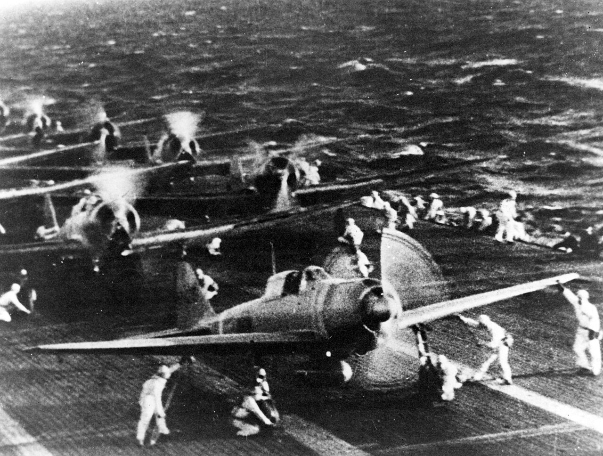
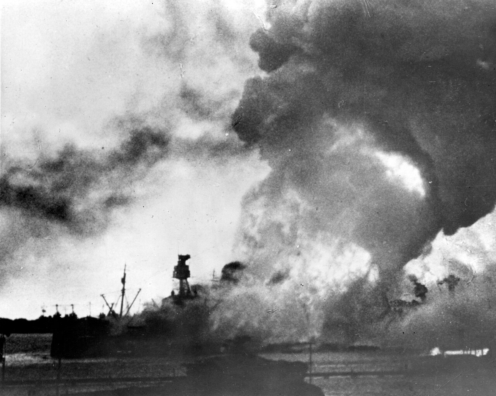
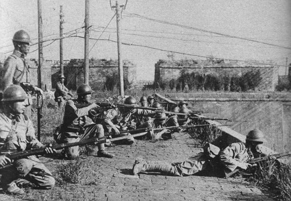
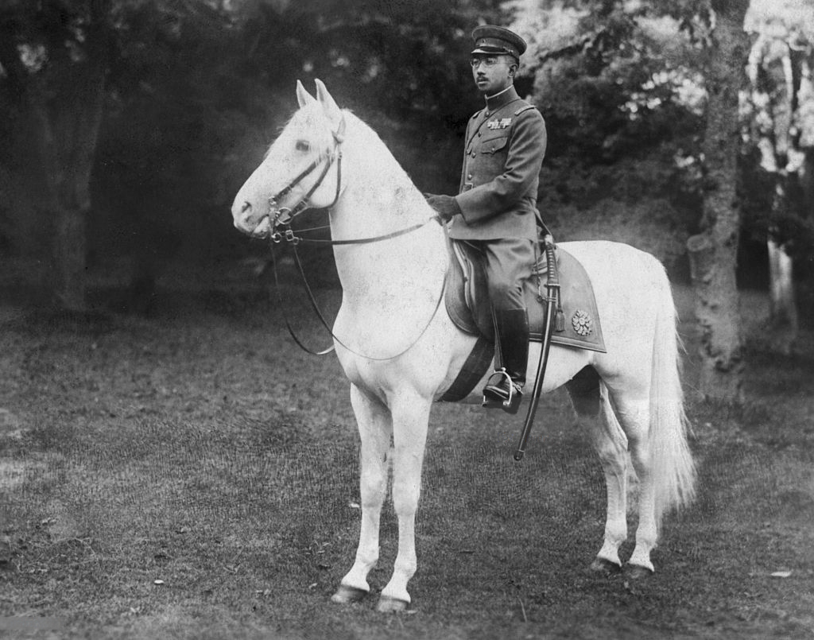
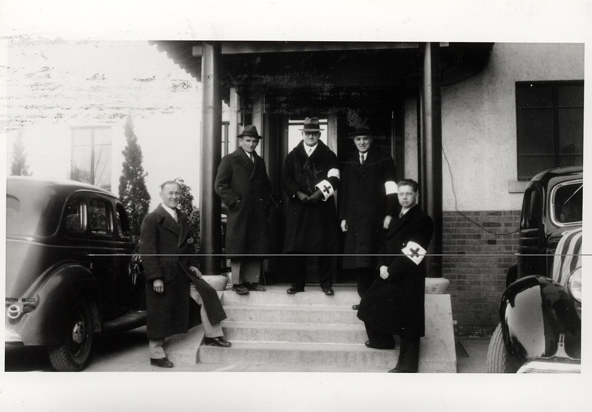
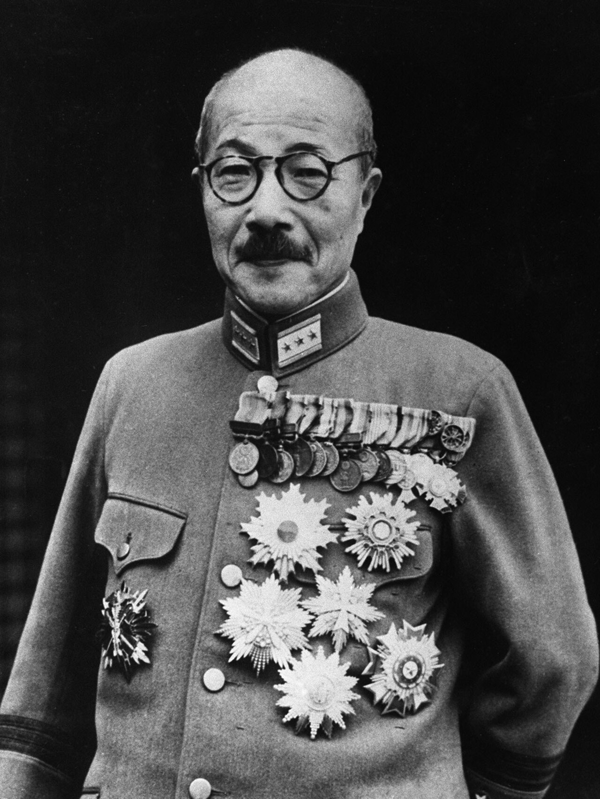
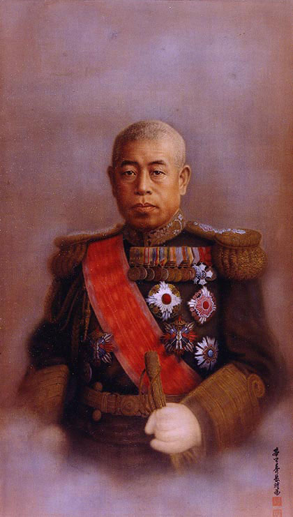
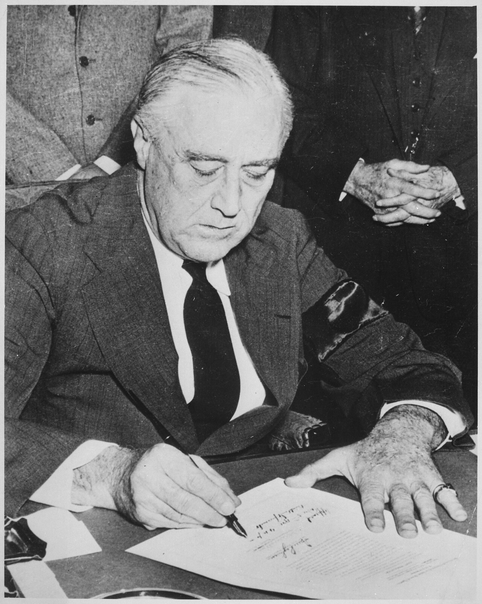
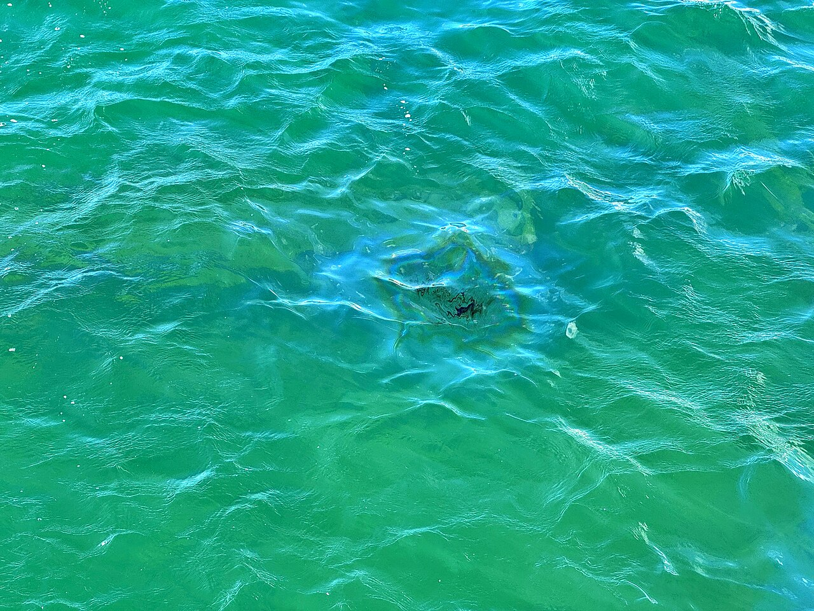

# 80. Why did Japan attack Pearl Harbor?

*Japan, China and the Pacific, from 1929 to 1941*

Japan attacked because it was running out of oil. It had been fighting for four years to conquer China, and in the summer of 1941 the United States, which sold Japan most of its fuel, cut off the supply to make it stop. Japan's leaders could then withdraw from China or seize the oilfields of South-East Asia. They chose the oil. The sea route to it ran past the Philippines, which the United States ruled, and so they expected to have to fight America, and they began by trying to sink the American fleet.

At seven o'clock on the morning of Sunday, 7 December 1941, two young American soldiers were about to switch off a radar set on the northern tip of the island of Oahu, in Hawaii. Radar was new. It was a way of spotting aircraft far beyond the range of the eye, by the radio echoes that bounced back from them, and the army ran its sets for only three hours a day, from four in the morning until seven. That morning, however, the truck that was to take the two men to breakfast was late, and so they kept the machine running for practice.

At two minutes past seven a mark appeared on the screen that was larger than anything they had seen. It showed a great number of aircraft approaching from the north, a little over two hundred kilometres out. One of them telephoned the information centre. The only officer still on duty there was a lieutenant on his second day in the job. He knew that a flight of American bombers was due in from California that morning. To him the explanation seemed obvious, and he told them not to worry about it.

The aircraft were Japanese. They had taken off from six aircraft carriers, ships with long flat decks from which aircraft can take off and land, and the carriers had crossed the northern Pacific unseen. At five to eight the aircraft arrived over Pearl Harbor, the base of the United States Pacific Fleet. Seven of the fleet's eight battleships were moored in a row beside an island in the middle of the harbour, and the sailors were at breakfast or getting ready for church. Lined up like that, the battleships made a target that was hard to miss.

*Japanese naval aircraft preparing to take off from an aircraft carrier, reportedly the Shokaku, for the attack on Pearl Harbor, 7 December 1941. Photo: unknown, public domain.*

In two hours the Japanese aircraft sank four of the battleships and damaged the rest. A bomb went through the deck of the *Arizona* and exploded in the forward magazine, where the ammunition was stored. The ship was torn apart, and nearly twelve hundred of her crew died. Altogether twenty-four hundred Americans were killed. The Japanese, by contrast, lost twenty-nine aircraft. For the attackers it had been a cheap morning's work.

*The battleship Arizona burning at Pearl Harbor on 7 December 1941, just after her forward magazine exploded. Photo: US Navy, public domain.*

No declaration of war had been delivered. Japan and the United States had been at peace when the first bomb fell.

## Silk

The road to that morning began with a country that had done everything right and still felt cornered.

In two generations Japan had turned itself from a closed kingdom of swordsmen into an industrial power. It had beaten China and then Russia, taken Taiwan and Korea as colonies, and fought on the winning side in the war of 1914. It sat at the peace conference in 1919 as one of the five great powers. By any outward measure, it had arrived.

It did not feel that it was treated as one, however, and the slights began at that same conference. There the Japanese delegates proposed that the charter of the new League of Nations should include a sentence affirming the equality of races. A majority of the committee voted for it. The American president, who was in the chair, ruled that it had failed because the vote was not unanimous.

Other blows followed. Five years later the United States passed an immigration law that shut out Japanese immigrants almost entirely. In addition, a treaty on warships limited Japan's battle fleet to three fifths the size of Britain's or America's. Each of these was felt in Japan as an insult.

There was also a weakness underneath the pride. The Japanese islands held about seventy million people. They had coal, and little else that an industrial economy runs on. Japan had little iron, no rubber, and hardly any oil. Nine tenths of its oil was imported, and most of that came from California. The warships that Japan was so proud of ran largely on American fuel.

It paid for these things by exporting, and its largest export by far was raw silk, which went to America to be made into stockings. Japan therefore depended on America twice over, as the seller of its fuel and as the buyer of its silk.

That second tie reached deep into the countryside. Two farm families in five raised silkworms, as the crop that brought in cash. As a result, when the American economy collapsed in 1929, the blow landed in Japanese villages. The price of silk fell by more than half in two years, and rice soon followed. In the poor north of the country the harvest then failed. Families ate roots and bark, and the selling of daughters to the brothels of the cities became a national scandal.

The army took note. Most of its soldiers were farm boys, and many of its young officers came from the same villages, so the suffering reached it directly. They drew a lesson from the Depression that was being drawn all over the world. A country that depended on trade was at the mercy of foreigners, who could shut their markets whenever they liked.

The officers looked at the other powers and saw what Japan lacked. Britain had an empire to fall back on, and America had a continent. Both could feed their factories from land they controlled. Japan's colonies, by contrast, were too small to feed its factories, and it would have to get something larger.

## A length of railway track

The place to get it was Manchuria, the cold north-eastern corner of China, which is larger than France and Germany together and rich in coal, iron and farmland. Japan had controlled its main railway since the war with Russia, and kept an army there to guard the line. The soldiers who wanted Manchuria were already standing in it.

The officers of that army did not wait to be asked. On the night of 18 September 1931, a lieutenant set off a small charge of explosive beside the track near the city of Mukden. It did so little damage that an express train passed over the spot a few minutes later. The explosion was not meant to destroy anything. It was meant to provide an excuse.

The army announced that Chinese soldiers had blown up the railway. On that pretext it attacked the local Chinese barracks that same night, and it went on to occupy the whole of Manchuria in five months.

*Japanese soldiers at the Little West Gate of Mukden on 19 September 1931, the morning after the explosion beside the railway. Photo: unknown, public domain.*

The plot had been laid by two officers on the staff. The government in Tokyo had not approved it, and when the news arrived the cabinet voted to stop the fighting from spreading. The army in Manchuria ignored it, and nobody in Tokyo could make it obey.

At home, meanwhile, the newspapers were jubilant and the public cheered every advance. Ministers who had tried to restrain the soldiers found that they had no means of doing so and no support. Within months they had resigned.

Manchuria was turned into a state that was independent on paper, with the last emperor of China brought out of retirement to be its head, and later its emperor. The League of Nations, the club of countries whose charter had been drawn up at the peace conference, sent a commission to look into what had happened. It reported that the new state was a Japanese creation and that the army's actions that night could not be regarded as self-defence.

In February 1933 the League voted to accept the report, forty-two to one. The Japanese delegation stood up and walked out of the hall, and Japan left the League.

The lesson was not lost on anyone. An army had made foreign policy on its own. It had been rewarded with an empire. Meanwhile, the world had done nothing but talk.

## Government by assassination

Japan in 1931 was a parliamentary country. It had political parties, elections in which nearly all grown men could vote, a lively press, and prime ministers who came from the largest party. In five years the parties lost the power to govern, and much of it was done from below, by young men with pistols. The method was brutally simple. Politicians who stood in the way were shot, and the country often went easy on the men who shot them.

In 1930 a prime minister who had signed a treaty limiting the navy was shot at Tokyo station, and later died of the wound. In May 1932 a group of young naval officers walked into the residence of the prime minister of the day, an old man of seventy-six. He invited them to sit down and talk it over. Dialogue is useless, one of them said, and they shot him.

What followed mattered more than the murder. At their trial the killers were allowed to make long speeches about the corruption of politicians and the suffering of the farmers. The court received more than a hundred thousand petitions for mercy, many signed in blood. Nine young men from the north sent their own severed little fingers, preserved in a jar of alcohol, as a token of sincerity.

The sentences were light. Every politician could draw the conclusion: a man who opposed the officers might be shot, and his killers would be treated gently. No party politician led a Japanese government again until after 1945.

The largest attempt came on 26 February 1936. Before dawn, in heavy snow, fourteen hundred soldiers led by junior officers seized the centre of Tokyo. Squads went to the houses of the leading statesmen and killed three of them, including the finance minister, an old man who had pulled Japan out of the Depression and then tried to cut the army's budget. The prime minister escaped because the soldiers shot his brother-in-law by mistake.

The mutiny failed, because the emperor was furious and ordered it crushed. Its leaders were shot. However, the generals who put it down collected the reward. They told the civilians that only a larger budget and a freer hand could keep the young officers quiet. In effect, the army turned its own rebels into an argument for giving the army more.

That year a rule was restored under which the ministers for the army and the navy had to be generals and admirals on active service. A cabinet could not be formed without an army minister, and only the army could supply one. From then on the army could bring down any government it disliked by ordering its minister to resign and refusing to supply another.

Above all of this stood the emperor, Hirohito, a shy man of thirty-five whose passion was marine biology. Every Japanese child was taught that he was descended from the sun goddess and that to die for him was the highest honour.

On paper his power was enormous. The constitution made him supreme commander, and the army and navy answered to him alone and not to the cabinet. By long custom, however, the emperor did not rule. He approved what his ministers and commanders had agreed. He asked questions, and gave his assent.

The result was a gap at the top of the state. The armed forces therefore answered in practice to no minister and no parliament, and each new step was presented to the country as the emperor's will.

*Emperor Hirohito on his white horse Shirayuki, in a photograph of about 1935. Photo: unknown, public domain.*

## The bridge

In July 1937 the army got the war that it had been edging towards. Japanese troops had been stationed near Beijing, by treaty, since 1901. On the night of the seventh, during an exercise beside an old stone bridge outside the city, shots were exchanged with a Chinese unit in the dark, and a Japanese soldier was missing at roll call.

He turned up twenty minutes later. By then, however, both sides were sending reinforcements, and the quarrel had taken on a life of its own.

The generals promised the emperor a quick victory. Instead, it took them three months to capture a single city. The Chinese leader, Chiang Kai-shek, threw his best divisions into the defence of Shanghai, and a quarter of a million Chinese soldiers were killed or wounded there, street by street, before the line broke. China, it was clear, would not be beaten quickly.

The Japanese army then marched up the river to the Chinese capital, Nanjing, which fell on 13 December. For six weeks the soldiers were let loose on the city. They shot prisoners in batches of thousands on the river bank, used others for bayonet practice, and raped tens of thousands of women. The court that tried the Japanese commanders after the war found that more than two hundred thousand people had been killed.

About two dozen foreigners had stayed in the city, and they marked out a district of a few square kilometres as a safety zone. Its chairman was a German businessman, the local manager of an electrical firm, who was a member of the Nazi party. Germany was Japan's friend, and so he used his swastika armband to order Japanese soldiers out of houses. About two hundred thousand Chinese survived inside the zone.

He also wrote to Hitler to tell him what his ally was doing. The letter was stopped, and the secret police called him in for questioning.

*Members of the International Committee for the Nanking Safety Zone, including its chairman John Rabe (centre), on 13 December 1937, the day the city fell. Photo: Memorial Hall of the Victims in Nanjing Massacre by Japanese Invaders, public domain.*

Chiang did not surrender. He moved his government a thousand miles up the river, behind the mountain gorges, and held on. That left Japan with a problem it never solved.

The Japanese took every large city on the coast and the main railways, and found that they controlled little beyond the range of their guns. By 1941 they had a million men in China and had lost well over a hundred thousand dead. They had no plan to end the war. Nor would the army hear of leaving, because to leave would be to admit that those men had died for nothing. The war had become a trap: too costly to go on with, and, in the army's eyes, too costly to stop.

## Going south

A war on that scale ate oil, steel and rubber, and Japan was now buying more from abroad than ever before, chiefly from the United States. This was the old weakness again, made worse. The war that was meant to free Japan from depending on foreigners was making it depend on them more.

The army had always expected that its real enemy would be the Soviet Union. In the summer of 1939 it tested the idea, in an undeclared battle on the border of Mongolia, and Soviet tanks destroyed a Japanese division. After that the north looked less inviting, and the generals looked for an easier direction.

Events in Europe supplied one. Hitler had invaded Poland in September 1939, and Britain and France had declared war on him. In the spring of 1940 Germany overran the Netherlands and France in six weeks, and Britain was left fighting for its life.

Their colonies in Asia were suddenly orphans. Their home countries had been beaten or were struggling to survive, and could do little to defend them. French Indochina had rubber and rice. British Malaya was the world's largest producer of tin and of rubber. The Dutch East Indies, the islands that are now Indonesia, had oilfields in Borneo and Sumatra that produced far more than Japan used. Within reach of Japanese ships lay enough oil to free Japan from American fuel.

The United States had protested about China for years and had gone on selling Japan what it needed. That summer, however, it began to restrict the sale of scrap iron and of the high-grade fuel used in aircraft. In September 1940 Japan sent troops into the north of Indochina and signed an alliance with Germany and Italy.

The government announced that it was building a "Co-Prosperity Sphere" in which Asia would be freed from the white empires and would prosper under Japanese guidance. The pact was meant to frighten the Americans into keeping out of the way.

It had the opposite effect. To Americans, Japan had now joined Hitler, and the restrictions were tightened month by month.

## Four hundred tons an hour

In July 1941 Japan announced that its troops would move into the south of Indochina, where their bombers would be within range of Malaya and the Dutch islands. President Roosevelt at once froze every Japanese bank account and asset in the United States. Frozen money still belonged to Japan, but it could not be spent without American permission. Without dollars Japan could buy nothing, and within a week the measure had become a complete embargo on oil. Britain and the Dutch joined it. Japan lost nine tenths of its oil supply at a stroke.

A clock now began to run. The navy had been storing oil for years, and it had enough for about two years. Its ships burned four hundred tons an hour simply by existing. Every day of negotiation made Japan weaker, and its admirals said so at every meeting.

Their reasoning was harsh but simple. If there was to be a war, it had to begin before the tanks ran dry, and before the winter storms closed the seas. To the admirals, waiting looked like the worst choice of all.

The American price for turning the oil back on was that Japan should withdraw its troops from Indochina and from China. The prime minister, a prince of the old nobility, wanted to find a compromise. His minister for the army, General Tojo Hideki, refused to discuss withdrawal. Since the army could bring down a government by withdrawing its minister, the prince had little room to move. In October the prince resigned, and Tojo took his place.

Nobody in the Japanese leadership believed that Japan could conquer the United States. Their own studies told them that America made ten times as much steel and could build ships and aircraft many times as fast. What they hoped for was something smaller. Japan would seize the oil and the rubber, fortify a ring of islands across the Pacific, and make the cost of taking them back so high that the Americans, who would also be fighting Germany, would tire and agree to a peace. The whole plan depended on the Americans losing heart.

At a conference in September the emperor, who by custom said nothing at such meetings, astonished the room by taking a piece of paper from his pocket and reading a poem written by his grandfather. All the seas, it ran, are brothers to one another, so why do the winds and waves rage so? Then he fell silent again, and the planning continued.

General Tojo put the mood more plainly to the prince before he resigned. There are times, he said, when a man must shut his eyes and jump from the terrace of the temple.

*General Tojo Hideki in 1941, the year he became prime minister. Photo: unknown, public domain.*

## The gambler

The plan for the opening blow was the work of the commander of the fleet, Admiral Yamamoto Isoroku, and no one in Japan was more opposed to the war.

Yamamoto knew the enemy. He had studied at Harvard and served as naval attaché in Washington, and he had made a point of travelling to see the car factories of Detroit and the oilfields of Texas. He had fought the alliance with Germany so hard that the navy sent him to sea to keep him out of reach of assassins.

A year before the attack, the prime minister asked him what the navy's chances would be. If I am told to fight, Yamamoto said, I shall run wild for the first six months or a year. For the second and third years I have no confidence at all. A war, in his view, could be started well and still be lost.

*A painted portrait of Admiral Yamamoto Isoroku, undated. Painting: unknown artist, public domain.*

He was also a famous gambler, at poker and at the Japanese game of chess. Since war was coming, he proposed to stake everything on the first hand. The one force strong enough to stop the seizure of the southern oilfields was the American fleet at Pearl Harbor. It must therefore be destroyed on the first morning, from the air, before it knew that it was at war.

His own admirals thought it reckless. A fleet would have to sail six thousand kilometres undetected. There was also a technical obstacle. A torpedo dropped from an aircraft plunges deep before it levels off, and Pearl Harbor is only twelve metres deep. In water that shallow, a torpedo would hit the bottom before it could run towards a ship.

The British had found an answer the year before, when twenty-one biplanes crippled the Italian fleet in a shallow harbour. The Japanese improved on it by fitting their torpedoes with wooden fins that broke away on hitting the water, so that the torpedoes did not dive too deep. Even so, the admirals were not won over. Yamamoto got his way by threatening to resign.

The six carriers sailed on 26 November from a bay in the fogbound islands north of Japan. They kept radio silence and took the stormy northern route, where no merchant ships went.

The government intended to observe the forms, narrowly. A long message breaking off negotiations, which stopped short of declaring war, was to be handed to the American secretary of state at one in the afternoon, Washington time, half an hour before the first bomb. The embassy staff, who had been told to use no typists, were slow in decoding and typing it, and the ambassador delivered it more than an hour late. By then the bombs were already falling.

The Americans had in fact broken the Japanese diplomatic code and read it before he did. Reading it did them little good. A warning was sent to Hawaii that morning by commercial telegram, because the army's radio link was down. A messenger boy on a motorcycle delivered it to headquarters after the attack was over.

## What was not hit

For six months it went exactly as Yamamoto had promised. On the same day as Pearl Harbor, Japanese forces struck the Philippines, Hong Kong and Malaya. In February 1942 the great British base at Singapore surrendered with eighty thousand men, to a Japanese army less than half that size, in the largest capitulation in British history. By March the oilfields of the Dutch islands were in Japanese hands. In half a year Japan had taken an empire that stretched from the border of India to the middle of the Pacific.

*Japan's empire in December 1941, roughly, with the oilfields of Borneo and Sumatra, the route of the carrier fleet to Hawaii, and the places attacked on 7 and 8 December 1941. Map: drawn for this book; coastlines and rivers from Natural Earth, public domain.*

The raid had missed the ships that mattered most. The American fleet had three aircraft carriers in the Pacific, and by chance none of them was in harbour that Sunday. The attack had itself just shown that carriers, and not battleships, would decide the war.

The Japanese pilots had also left alone the fuel tanks beside the harbour, which held enough oil to keep the whole fleet at sea for months, and the dockyards. Because the dockyards survived, six of the eight battleships were repaired and sent back to fight.

The largest miscalculation was about people. Before that Sunday, four Americans in five wanted to stay out of the war, and Roosevelt had not been able to find a way to bring them in. Japan's leaders had counted on that reluctance. They expected a divided country that would tire of a distant war. Instead, the attack united it.

The next day the president told Congress that 7 December was a date that would live in infamy, and Congress voted for war with one dissenting voice. Three days later Hitler, who was under no obligation to do so, declared war on the United States himself. In a single week the war in Europe and the war in Asia had become one war.

*President Roosevelt signing the declaration of war on Japan on 8 December 1941. Photo: unknown, US National Archives, public domain.*

Across the Atlantic, one man greeted the news with relief. The British prime minister heard it on the radio at dinner. He wrote afterwards that he went to bed thinking that the war was now won, and slept the sleep of the saved and thankful.

The *Arizona* was never raised. She lies where she sank, in twelve metres of water, with more than a thousand of her crew still inside. She had filled her tanks the day before the attack. A few litres of that oil still rise to the surface every day and spread in rings on the water above her.

*Oil still rising from the wreck of the Arizona, photographed in December 2024. Photo: Shellcreek, CC BY-SA 4.0.*
