# 81. How was the Second World War won?

*The world, from 1939 to 1945*

It was won by factories and by Soviet soldiers. Germany and Japan struck first and struck well, and by the middle of 1942 they held most of Europe and the whole eastern edge of Asia. They could not finish it, and in a long war the side with more oil, more steel and more people was bound to wear the other down. The United States supplied most of the machines. The Soviet Union supplied most of the dead.

On the evening of 30 November 1943, the three men who commanded the alliance against Hitler sat down to dinner at the British legation in Tehran, the capital of Iran. It was the sixty-ninth birthday of the British prime minister, Winston Churchill, and he was the host. His guests were the American president, Franklin Roosevelt, and Joseph Stalin. The conference was the first at which the three had met.

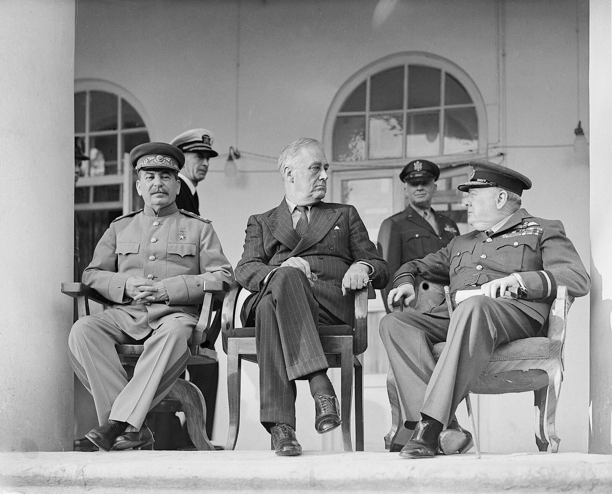
*Stalin, Roosevelt and Churchill on the veranda of the Soviet legation in Tehran, during the first conference of the three leaders, late November 1943. Photo: Dennis Charles Oulds, public domain.*

The dinner went on for hours, with toast after toast in the Russian manner. Late in the evening Stalin rose once more. He wished to say, from the Russian point of view, what the president and his country had done. The most important things in this war, he said, are machines. The United States can build far more aircraft each month than Russia can. The United States is therefore a country of machines, and without those machines we would lose this war.

Stalin was not a man given to generosity, and he was speaking as the leader of the country that had done most of the fighting. Both halves of his remark were true.

## Lightning

The war began with a bargain between two dictators who had spent years denouncing each other.

In August 1939 Hitler wanted to invade Poland without having to fight the Soviet Union as well. Stalin wanted time, and territory. Their foreign ministers signed a treaty in Moscow promising that neither country would attack the other, and a secret page attached to it divided the lands between them. Nine days later, on 1 September, the German army crossed the Polish border, and Britain and France, which had promised to defend Poland, declared war two days later. Soviet troops came in from the east and took their half.

What the German army did in Poland, and then in the west, was something new. Every army had tanks and aircraft. The difference lay in how they were used.

The French in fact had more tanks than the Germans, and better ones. However, they used most of them in the old way, spread along the line to support the infantry, and directed them by flags and messengers. The Germans gathered theirs into armoured divisions, gave each tank a radio, and sent them through a single weak point with dive bombers overhead in place of artillery.

Once through, the tanks did not stop to fight. They drove on, deep into the rear, cutting telephone lines and supply roads, so that the armies in front of them were surrounded before their generals understood what had happened. The newspapers called it lightning war.

In May 1940 that method was turned on France. The German tanks came through the wooded hills of the Belgian border, where the French had thought that no tank could pass, and reached the Channel coast in ten days. The British army escaped from the beaches at Dunkirk in a fleet of destroyers, ferries and pleasure boats, leaving its guns behind. France surrendered in six weeks. In the war of 1914 it had held out for four years.

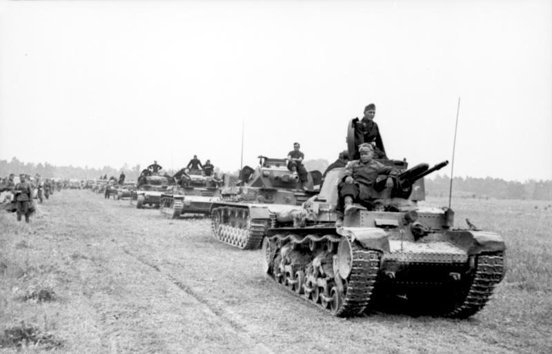
*German tanks on the move in France in 1940: a Panzer 35(t) in front and a Panzer IV behind it. Photo: Erich Borchert, German Federal Archive, CC BY-SA 3.0 de.*

Italy, under the dictator Mussolini, who had ruled it since 1922 and invented the word fascism, now joined what looked like the winning side. Britain and its empire were left to fight on with no ally in Europe, and most of the world expected them to make terms. Its new prime minister refused.

Through the summer of 1940 the German air force tried to destroy the British one as the first step to an invasion, and failed, in part because the British had built a chain of radar stations along their coast and could see each raid coming. The Germans also turned to bombing London and the other cities by night, and killed forty-three thousand civilians in eight months. The invasion was put off.

Hitler had won an empire that ran from the Atlantic to the Polish plain. He had also arrived at the limit of what speed could do. Britain could not be reached by tanks. His real war, the one he had written about in prison, lay in the other direction.

## Six hundred thousand horses

On 22 June 1941, three million German soldiers attacked the Soviet Union along a front of nearly three thousand kilometres. It was the largest invasion in history. Hitler told his generals that the campaign would take three months. You have only to kick in the door, he said, and the whole rotten structure will come crashing down.

It was to be a different kind of war from the one in France. The purpose was land. The fertile plains of Ukraine and Russia were to be emptied and settled by Germans, and the people who lived there were to be killed, starved or kept as labourers. The army was told that the ordinary rules of war did not apply. Its plans assumed that it would feed itself from Soviet farms and that tens of millions of Soviet civilians would starve as a result.

For five months it looked as though Hitler was right. The Soviet army had lost most of its senior commanders to Stalin's firing squads, and its divisions were surrounded one after another. By December three million Soviet soldiers were prisoners. The Germans kept them in open fields behind barbed wire, without shelter or food, and two million of them were dead by the following spring.

By the first week of December, German officers could see the towers of Moscow through their field glasses. They got no closer. The temperature fell to thirty below. The engines of the tanks froze solid, and the soldiers, who had been issued no winter clothing because the war was to be over by autumn, stuffed their uniforms with newspaper. Then Stalin attacked with fresh divisions brought from Siberia, where they had been guarding the border against Japan. He had learned from a spy in Tokyo that Japan was going south. As a result, the Siberian divisions could safely be spared.

The German army was not the machine that its enemies imagined. Its armoured divisions were a spearhead, and behind them the greater part of the army walked, as armies always had, with its guns and supplies pulled by six hundred thousand horses. In the vast spaces of Russia the spearhead outran the rest, and the roads turned to mud and then to ice.

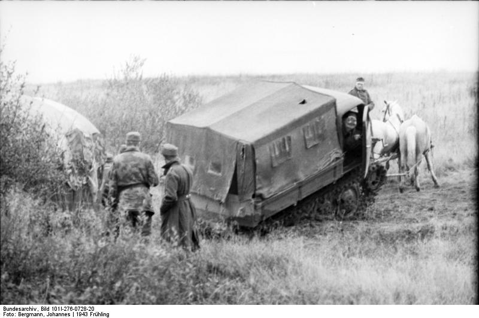
*A German tracked tractor with horses harnessed to it in the mud in Russia, March 1943. Photo: Johannes Bergmann, German Federal Archive, CC BY-SA 3.0 de.*

Meanwhile the Soviet government had done something that the Germans had not thought possible. In the summer and autumn of 1941, as the front came nearer, more than fifteen hundred factories were unbolted from their floors, loaded onto railway wagons with their workers, and carried east, to the Ural mountains, Siberia and central Asia. Machines were set up in the open and running before the walls had been built around them. By the next year they were making more tanks than Germany.

## Tanya's notebook

The city of Leningrad, the old capital, was cut off by land in September 1941. The one way in or out lay across a great lake to the east of it, by boat in summer and by a road of ice in winter, under German guns. Hitler did not want it captured, since he would then have had to feed it. He ordered that it should be sealed off and left to starve.

Three million people were inside. By November the daily ration for anyone who was not a worker or a soldier was a hundred and twenty-five grams of bread, a slice the size of a pack of cards, and the bread was bulked out with wood pulp and the sweepings of oil mills. There was no heating, and the water pipes had frozen. People burned their furniture and their books. They boiled leather belts and scraped the paste from wallpaper. They pulled their dead to the cemeteries on children's sledges, until they were too weak to pull.

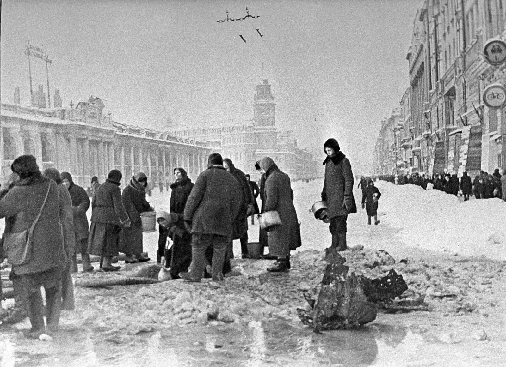
*Residents of Leningrad taking water from a shell hole on the Nevsky Prospect, December 1941, with the water pipes frozen. Photo: Boris Kudoyarov, RIA Novosti, CC BY-SA 3.0.*

A girl of eleven named Tanya Savicheva kept a record in a small address book, one page for each entry, filed under the letter of the name. Zhenya died on 28 December at twelve in the morning, 1941. Grandmother died on 25 January. Leka died on 17 March. Uncle Vasya died on 13 April. Uncle Lesha, on 10 May. Mama, on 13 May, at half past seven in the morning. Then three more pages: The Savichevs are dead. Everyone is dead. Only Tanya is left. She was taken out of the city that summer, across the lake, and died two years later of the effects of starvation.

The siege lasted eight hundred and seventy-two days, and about eight hundred thousand people died in it. That is about as many as the war dead of Britain and the United States together.

Hunger was a weapon everywhere in this war, and it killed more people than bombs did. Armies took the food of the countries they occupied. Blockades and sunken ships cut off the countries that lived by importing it.

Famine could also follow from the way a government chose to share out what food there was. In 1943, in the British-ruled Indian province of Bengal, the rice that had come from Burma was lost to the Japanese, prices ran out of reach of the poor, and the government fed the army and the factory towns first. As many as three million villagers died.

## The Volga

In 1942 Hitler tried again, and this time he aimed at fuel. Germany had almost no oil of its own. It made a costly substitute from coal, and bought the rest from Romania, and its tanks and aircraft were always short. The Soviet oilfields lay in the Caucasus, between the Black Sea and the Caspian. An army that took them would supply itself and cut off the enemy at a stroke.

The German columns drove south-east across the steppe all summer. To protect their flank they had to take a city on the river Volga, an industrial town thirty miles long that bore Stalin's name. He ordered that it be held, and for five months Stalingrad was fought over house by house and floor by floor. Soldiers fought with grenades and sharpened spades for a staircase or a sewer. The railway station changed hands more than a dozen times.

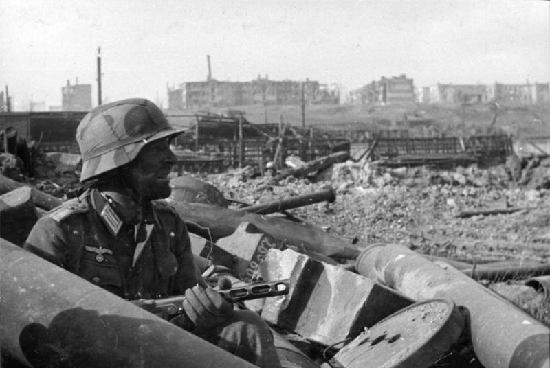
*A German officer sheltering among the wreckage in Stalingrad in the autumn of 1942. The picture was taken by a German propaganda unit. Photo: German Federal Archive, CC BY-SA 3.0 de.*

While the Germans poured men into the ruins, the Soviet command quietly assembled a million soldiers to the north and south. The long lines on either side of the city were held by the armies of Germany's ally Romania, which had few guns that could stop a tank. Those were the weak points, and the Soviet blow fell on them.

On 19 November the Soviet forces broke through on both sides, and in four days their two arms met behind the city. A quarter of a million Germans and their allies were caught inside the ring. Hitler forbade them to break out. Instead, they were starved and frozen through the winter, and at the beginning of February 1943 the ninety thousand survivors surrendered. About five thousand of them ever saw Germany again.

The German army attacked once more, the following summer, and was beaten in the largest tank battle ever fought. From then on it went backwards, all the way to Berlin.

The scale of that fighting has no parallel. Most of the German soldiers killed in the whole war died on the eastern front. The price was paid by the Soviet people. About twenty-seven million of them died, soldiers and civilians, which was one person in seven.

![Two maps, one above the other. Above, Europe in November 1942: Germany, its allies and the lands they occupied shaded red from France to the front line, which runs from near Murmansk past Leningrad and west of Moscow to Stalingrad and the Caucasus; the Soviet Union and Britain shaded blue, the neutral countries hatched, oilfields marked in the Caucasus and Romania, and a dashed convoy route crossing the Atlantic to Britain. Below, Asia and the Pacific in mid 1942: the land held by Japan shaded red from Burma and Manchuria to New Guinea, with a dashed line around its furthest advance, oilfields in Sumatra and Borneo, and Midway marked beyond the line](images/map_furthest_advance.png)
*The furthest advance of Germany, in November 1942, and of Japan, in mid 1942, with the oil each was reaching for, roughly. Map: drawn for this book; coastlines and rivers from Natural Earth, public domain.*

## Fire in a cylinder

All of this turned on a machine that had been a novelty at the start of the previous war.

A steam engine burns its fuel in a furnace, to boil water, and it needs a boiler and a load of coal that together weigh many tons. It can move a ship or a train. In the 1870s and 1880s German engineers built an engine that burned its fuel inside the cylinder itself. The cylinder is a metal tube closed at the top, with a plug called a piston sliding up and down inside it.

A mist of petrol and air is drawn in, squeezed by the rising piston, and set off by a spark, and the small explosion drives the piston down. As it does so, a crank at the bottom turns that push into the spinning of a shaft, as a cyclist's leg turns a pedal. Then the piston rises again to sweep out the burnt gas, and the cycle repeats thousands of times a minute. Such an engine is light, starts at once, and runs on a liquid that can be carried in a can.

That lightness made possible the truck, the tank and the aeroplane, and with them a new kind of war. An army on trucks could move five times as fast as one on foot. A bomber could carry the war to a city five hundred miles behind the front. The price was that the new kind of war ran on oil. An armoured division burned as much fuel in a day as a town, and an army that ran dry stopped where it stood.

The oil was almost all on one side. In 1940 the United States pumped most of the world's supply. Of every seven barrels that the Allies burned in the war, six came from American wells. Germany and Japan had gone to war partly to get oil, and neither ever had enough. By 1944 the German air force had more aircraft than it could fly, because there was no fuel to train the pilots.

The same was true of the engines themselves. The United States sent its allies vast quantities of weapons and supplies without payment, on the understanding that they would be returned or settled after the war. To the Soviet Union it sent tanks and aircraft, and above all four hundred thousand trucks and jeeps. The Soviet factories could therefore concentrate on tanks and guns, and by 1944 the Red Army was advancing in American trucks, while the Germans retreating in front of it still depended on horses.

## The bridge of ships

What America made for the war in Europe had to cross an ocean, and for three years the most dangerous enemy that the Allies faced was the German submarine.

Britain is an island that imported half of its food and all of its oil. If the ships stopped, it would starve within months, and there would be no base from which to invade Europe. The Atlantic crossing was therefore the lifeline of the whole war in the west.

The German submarines hunted in groups in the middle of the Atlantic, beyond the reach of aircraft. They attacked the convoys of merchant ships at night, on the surface, and in the worst months they sank ships far faster than new ones could be launched. Over the course of the war they sent about three and a half thousand merchant ships to the bottom, with thirty thousand of their sailors.

They were beaten by a combination of things. Aircraft were given the range to cover the whole ocean, and radar sets small enough to carry, which could find a submarine on the surface in the dark.

The other weapon was reading the enemy's mail. German commanders sent their orders by radio in a cipher produced by a machine like a typewriter, which scrambled each letter through a set of rotating wheels and could be set in billions of ways. They believed it unbreakable. In fact, three Polish mathematicians had worked out its principles before the war and handed their results to the British. At a country house north of London, a team of mathematicians and chess players built electrical machines that tested thousands of possible settings a minute. For long stretches the British navy read the submarines' orders within hours and steered the convoys around them.

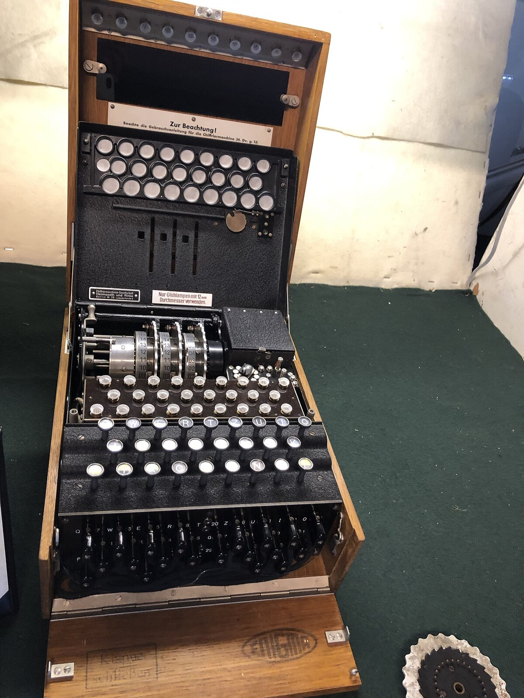
*A German Enigma cipher machine, open to show its keys, lamps and rotating wheels, as used in the 1930s and 1940s. Photo: Arnold Reinhold, CC BY-SA 4.0.*

In May 1943 the Germans lost forty-one submarines in a month and withdrew from the North Atlantic. Of the forty thousand men who served in them, three out of four died.

Meanwhile, in American shipyards, a standard cargo ship was designed to be built in sections in different places and welded together at the shipyard, in place of the old method of riveting plate by plate on the slipway. The first took two hundred and thirty days to build. Within two years the average was about forty days, and one was put together, as a stunt, in under five. The yards launched twenty-seven hundred of them. By 1943 the Allies were building ships faster than any navy could sink them.

## A bomber an hour

What happened in American factories in those years had no precedent. The country had been in a depression for a decade, with millions out of work and plants standing idle. Within three years of Pearl Harbor it was making two fifths of all the weapons in the world.

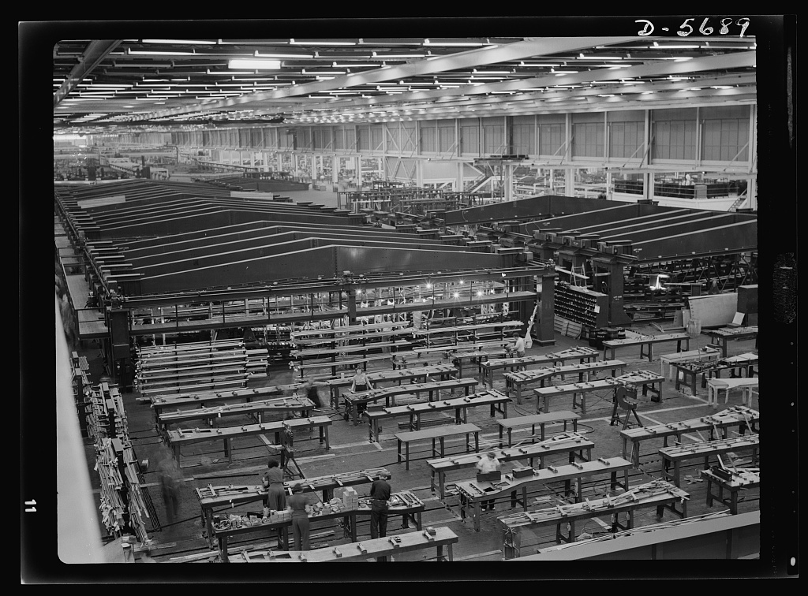
*Part of the Ford bomber plant at Willow Run, Michigan, in July 1942, with fixtures for holding bomber wings during assembly. Photo: Ann Rosener, Library of Congress, public domain.*

Car makers stopped making cars. Near Detroit the Ford company built a factory to make four-engined bombers on an assembly line a mile long, in the same way that it had made its cars. The aircraft industry said that it could not be done, since a bomber had over a million parts. By 1944 a finished bomber rolled out of the door every sixty-three minutes. In that year American factories built ninety-six thousand aircraft, far more than Germany and Japan together.

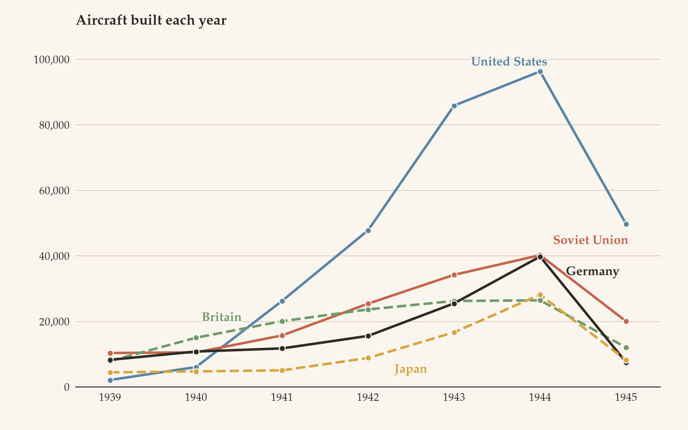
*Aircraft built each year, 1939 to 1945, by the five largest powers. Figures from John Ellis, The World War II Databook (1993), and other standard sources, as tabulated in English Wikipedia's "World War II aircraft production". Chart: drawn for this book.*

The workers were found wherever they could be. Twelve million men were in uniform, and six million women took jobs for the first time, many of them in shipyards and aircraft plants, driving rivets and welding. More than a million Black Americans left the farms of the South for the factories of the North and the West.

The Allies also understood something about machines that the Germans did not. In 1942 German engineers built the most feared tank of the war, a monster of fifty-seven tons whose gun could destroy an Allied tank from farther away than the Allied tank could hurt it. It was so complicated that fewer than fourteen hundred were made, and it broke down constantly. The Soviet Union and the United States each settled on one plain, reliable design, and made tens of thousands of each. In a long war, many good tanks counted for more than a few excellent ones.

One product of those years saved lives. In 1928 a London doctor had noticed that a mould growing by accident on a dish of bacteria had killed the bacteria around it. He could not extract the substance, and the discovery lay unused for ten years. In 1940 a team at Oxford purified a few grams, and early the next year they tried it on a policeman who was dying of an infection that had begun with a scratch. He rallied within a day. The supply was so small that the doctors recovered the drug from his urine to give to him again. After five days it ran out, and he died. The drug worked. What was missing was a way to make it in quantity.

Britain, under bombardment, had no factories to spare. The Oxford scientists took the mould to America, to a government laboratory in the farm town of Peoria. Staff there searched the world for a more productive strain, and found it on a rotting melon from a market down the road. With that strain, drug companies learned to grow it in tanks the size of a house. In June 1944 there were more than two million doses ready for the armies that landed in France. In earlier wars, more soldiers had died of infected wounds and disease than had been killed outright.

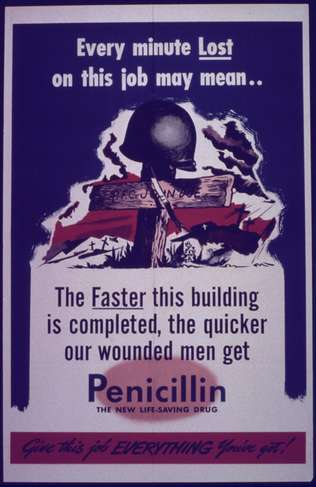
*An American poster urging builders to finish a penicillin plant quickly: "The faster this building is completed, the quicker our wounded men get penicillin." Made between 1941 and 1945. U.S. National Archives, public domain.*

## Firestorm

The engine also carried the war to people who had never expected to see it.

Britain and the United States built great fleets of heavy bombers and sent them over Germany, the British by night and the Americans by day. It had been found early on that a bomber at night could not hit a factory. It could hit a city. The British air command therefore set out to burn the cities, in order to destroy the houses of the workers and their will to go on.

On a hot, dry night in July 1943, the bombers dropped so many fire bombs on the port of Hamburg that the separate fires joined into one. The heat drew in air from all sides at the speed of a hurricane, and the wind pulled people off their feet and into the flames. Those who sheltered in cellars were suffocated when the fire took the oxygen. About thirty-seven thousand people died. In March 1945 American bombers did the same to Tokyo, a city built largely of wood and paper, and killed about a hundred thousand in one night, which is the largest number ever killed in a single air raid.

Half a million German civilians died under the bombs, and so did nearly half of the British airmen who flew the missions. The bombing did not break the will of the people beneath it, in Germany any more than in London. It did, in the last year, wreck the German fuel plants and railways, and it forced Germany to keep most of its fighter aircraft and thousands of its best guns at home, pointing at the sky.

## The other half of the world

The war in Asia had started first, in 1937, and China fought it for eight years. The Chinese armies lost almost every battle and never gave in, and for most of the war they held down more than half a million Japanese soldiers who would otherwise have been somewhere else. At least fourteen million Chinese died, and eighty million fled their homes.

In the Pacific the turn came early. Six months after Pearl Harbor, almost to the day, the Japanese fleet sailed to seize the island of Midway and finish off the American carriers. American code-breakers had read the plan. The carriers were waiting, and on the morning of 4 June 1942 their dive bombers caught the Japanese carriers while fuelled and armed aircraft crowded their hangars. Three were ablaze within six minutes, and the fourth was hit that afternoon. All four sank. They were four of the six that had attacked Pearl Harbor.

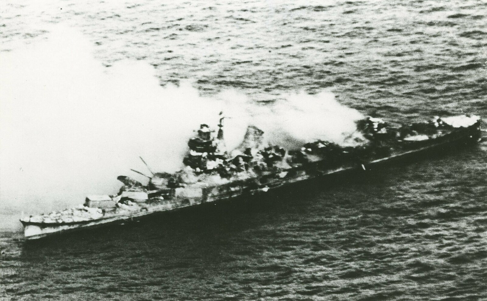
*The Japanese cruiser Mikuma, wrecked and burning on 6 June 1942 after attack by American dive bombers during the battle of Midway. Photo: Royal Netherlands Navy, CC BY-SA 4.0.*

After that it was a matter of arithmetic. Japan launched a handful of large carriers during the rest of the war, and the United States launched more than twenty. American forces advanced across the ocean from island to island, against garrisons that mostly fought until almost every man was dead.

Meanwhile, American submarines did to Japan what the Germans had failed to do to Britain. They sank most of its merchant ships, and the oil of the Dutch islands, for which Japan had gone to war, could no longer be carried home.

The empires fought with soldiers from every continent. Two and a half million Indians served in the British forces, the largest army of volunteers ever raised. Africans fought in Burma, and Brazilians in Italy. Many of those men had been told that they were fighting for freedom, and they did not forget it when they went home.

## The beach and the marsh

In June 1944 the Germans were struck from both sides within three weeks.

On the sixth, British, American and Canadian troops landed on the coast of Normandy, in northern France. Stalin had been demanding it for two years. Seven thousand ships and boats crossed the Channel, and a hundred and fifty-six thousand men landed on the first day, from the sea and by parachute. They brought two floating harbours in pieces, since the Germans held all the ports, and later laid a fuel pipe along the sea bed. By the end of August they were in Paris.

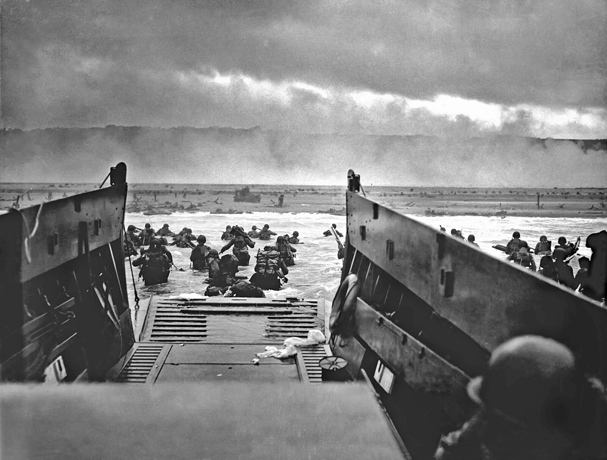
*American troops wading ashore from a landing craft at Omaha Beach, Normandy, on the morning of 6 June 1944. Photo: Robert F. Sargent, U.S. Coast Guard, public domain.*

On the twenty-second, three years to the day after the invasion of the Soviet Union, the Red Army attacked in the forests and marshes of Belarus with more than a million and a half men. In five weeks it destroyed the central group of German armies, some thirty divisions, and advanced four hundred miles to the gates of Warsaw. It was a larger defeat than Stalingrad, and it is hardly known in the West.

Germany fought on for ten more months. Hitler, in a concrete shelter under Berlin, issued orders to armies that no longer existed. He shot himself on 30 April 1945, with Soviet soldiers a few streets away, and a week later his generals surrendered. Japan held out until August.

Between sixty and seventy million people had died, most of them civilians. The great powers of Europe, which had ruled most of the world in 1914, were bankrupt or in ruins.

On 25 April 1945 an American patrol reached the river Elbe, in the middle of Germany, at a small town called Torgau. The bridge had been blown up. On the far bank were Soviet soldiers. A young American lieutenant crawled out along the twisted girders, a Soviet soldier crawled out from the other side, and above the water they shook hands. The next day the photographers arrived and had them do it again. Within a few years a guarded border ran through the middle of Germany, a hundred and fifty kilometres to the west of that bridge, and their two armies faced each other across it for the next forty-five years.
