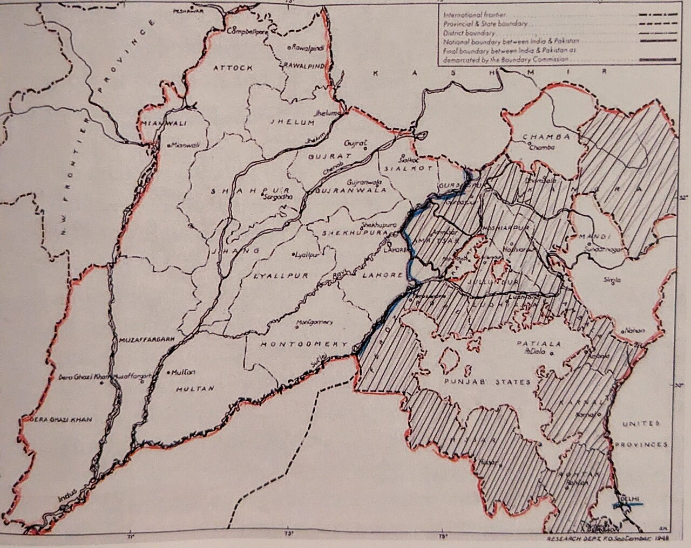
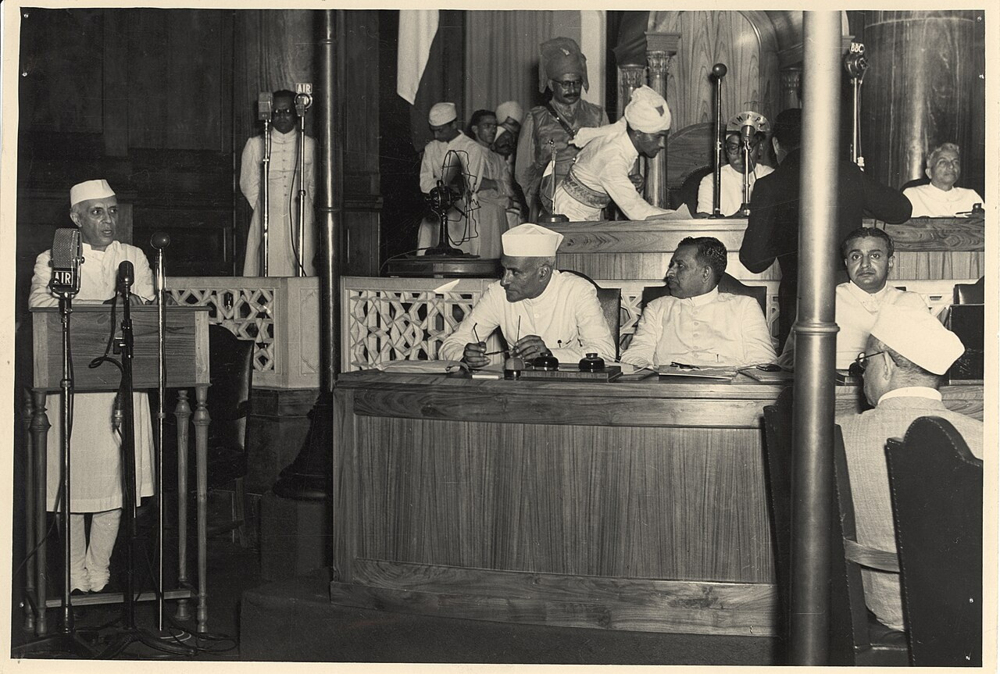
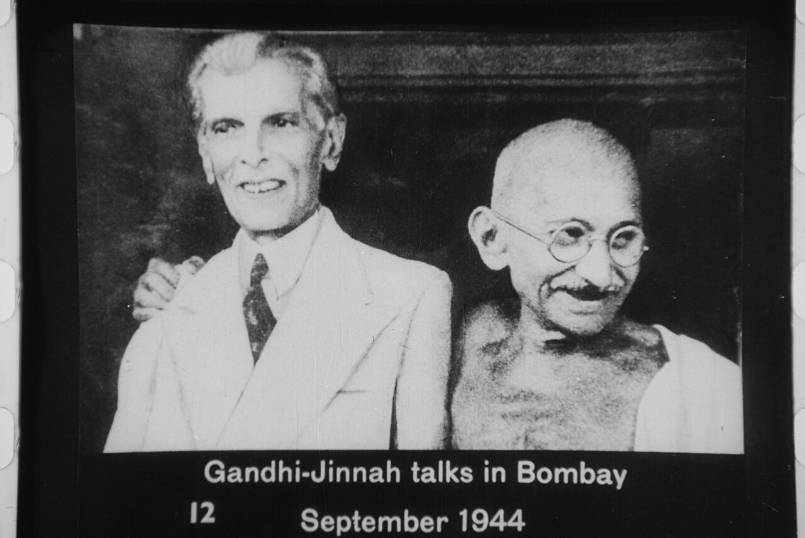
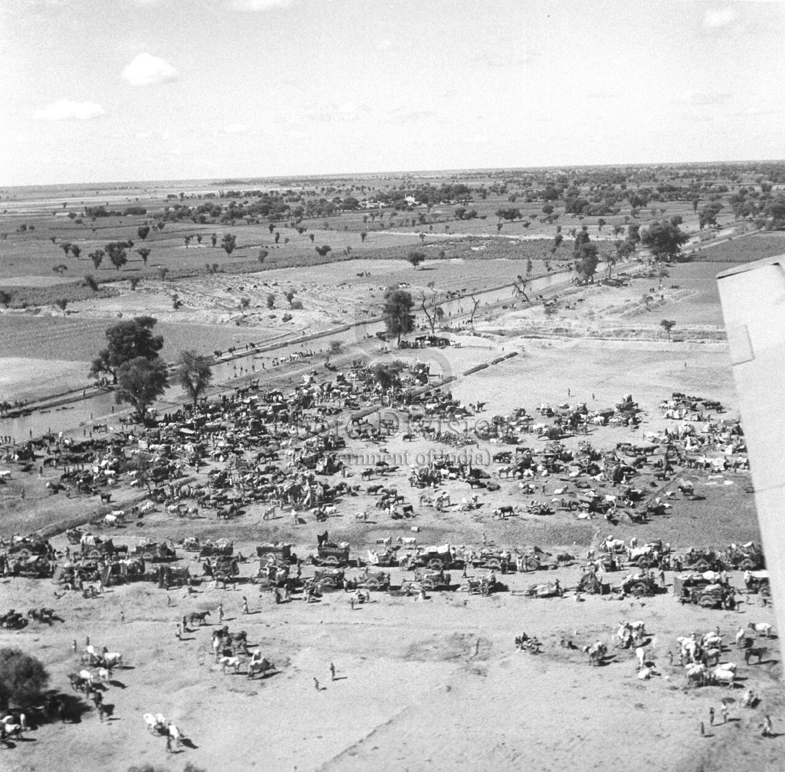
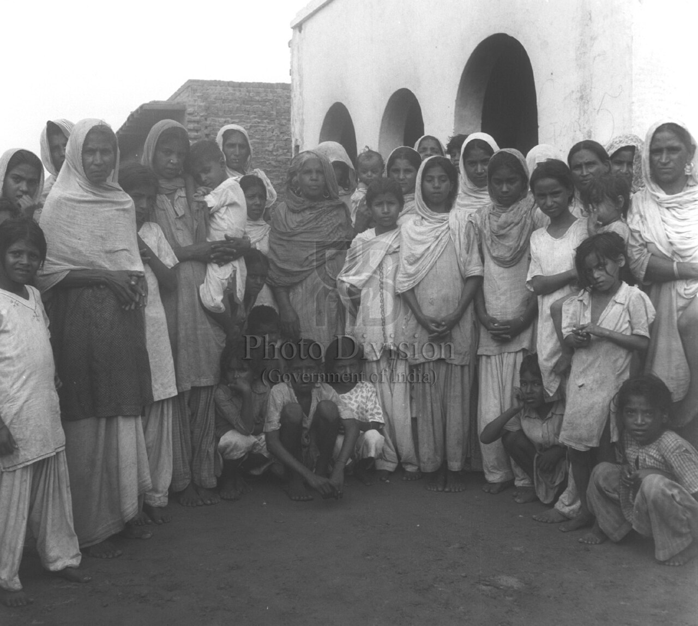
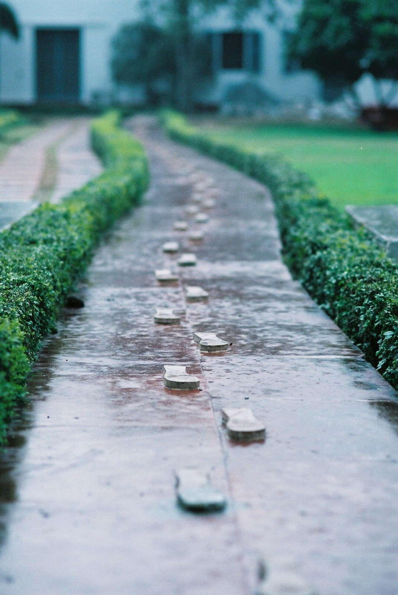
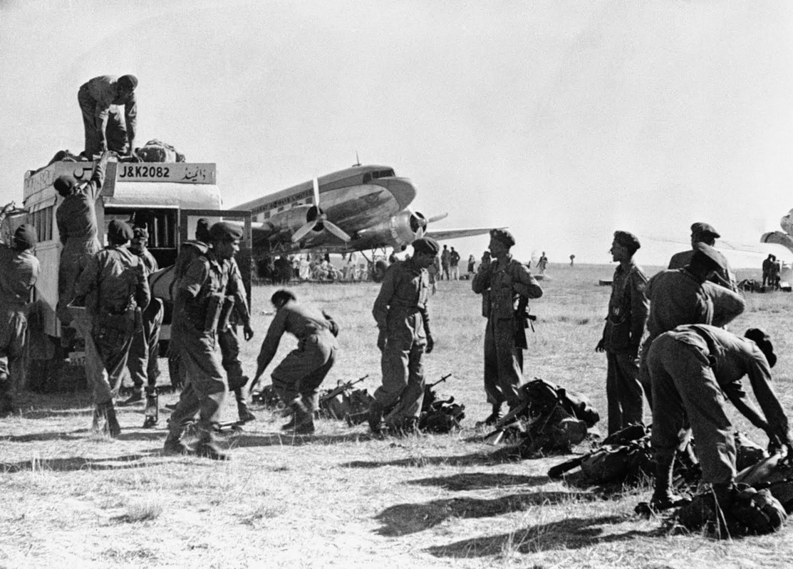
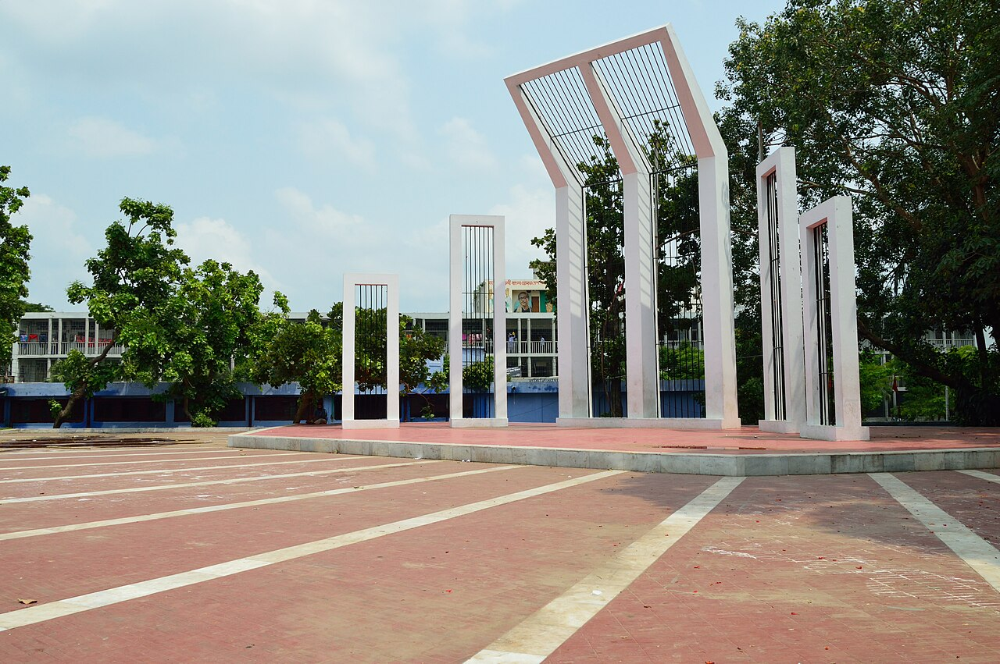
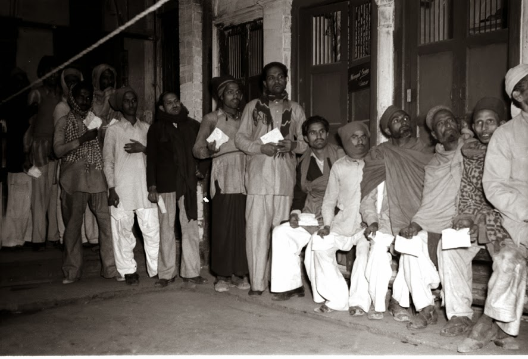
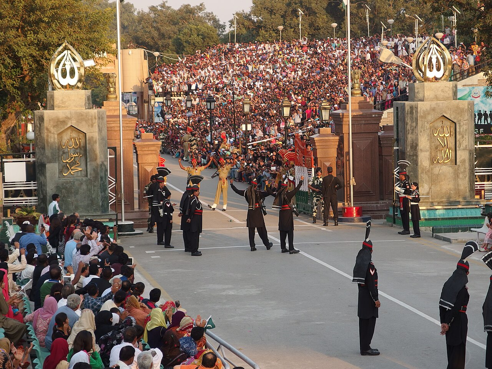

# 84. Why were India and Pakistan divided?

*South Asia, from 1937 to 1971*

They were divided because the leaders of India's Muslims feared that a democratic India would be ruled for ever by its Hindu majority, because the leaders of that majority would not accept the loose kind of union that might have calmed the fear, and because Britain, which was bankrupt and wanted to leave, cut the country in two in ten weeks.

On 8 July 1947 a London lawyer named Cyril Radcliffe stepped off an aeroplane in Delhi. He was forty-eight, a brilliant barrister, and he had never been to India. He had in fact never been east of Paris. That was the reason he had been chosen. The British government wanted a man whom nobody could accuse of favouring either side, and a man who knew nothing of India could hardly have taken a side in its quarrels.

His task was to draw two lines on a map. One would run through the province of Punjab, in the north-west, and the other through Bengal, in the east. On one side of each line would be India, and on the other a new country called Pakistan. The two provinces together were larger than Germany and held eighty-eight million people. He had five weeks.

*Radcliffe's award for Punjab, as published by the British Foreign Office in 1948. His line, in blue, runs between Lahore and Amritsar. Map: British Foreign Office, public domain.*

Picture, then, a stranger with a pencil and a deadline, deciding which country each of those people would belong to. His tools were poor. He was given a bungalow, and a set of maps and census tables that were years out of date. He was also given four Indian judges for each province, two Muslims and two who were not. They could agree on nothing that mattered. The summer heat, meanwhile, was so great that he could work for only a few hours at a time. He had no time to visit the places he was dividing. He drew his lines through districts, villages and, in places, through single houses, and finished on 12 August.

India and Pakistan became independent at midnight on 14 August. The lines, however, were not published until the 17th. For those two days, millions of people in Punjab and Bengal celebrated, or hid, without knowing which country they were in.

*Nehru speaking in the assembly hall in Delhi at midnight on 14 to 15 August 1947, as India became independent. Photographer unknown, public domain.*

The man who had drawn the lines did not stay to watch them take effect. Radcliffe burned his papers, refused his fee, and flew home before the lines were published. He never went back. He told a journalist years afterwards that people on both sides of his line would have shot him on sight.

## A quarter of India

Behind the lines lay a plain fact of numbers. About one Indian in four was a Muslim. Muslims lived in every part of the country, speaking the same languages as their Hindu neighbours and often sharing their saints and festivals. They were a majority, however, only in the north-west and in the east of Bengal, a thousand miles apart.

![Map of British India divided in 1947. India is shaded yellow; Pakistan, in green, lies in two parts a thousand miles apart, West Pakistan with Punjab's western half, Sindh and Baluchistan, and East Pakistan, the eastern half of Bengal. Heavy black lines mark the partition lines through Punjab, between Lahore and Amritsar, and through Bengal, west of Dhaka and east of Calcutta. Dotted outlines show the old provinces of Punjab and Bengal. The princely state of Kashmir is hatched, with a dashed ceasefire line of 1949 running west and north of Srinagar. Red arrows show Hindus and Sikhs fleeing east across Punjab, west across Bengal and by sea from Karachi to Bombay; green dashed arrows show Muslims fleeing west across Punjab, from Delhi to Karachi, and east across Bengal. Rawalpindi and Delhi are also marked](images/map_partition.png)
*British India divided in 1947: India, and Pakistan in two parts, with the lines drawn through Punjab and Bengal, the princely state of Kashmir and the ceasefire line of 1949, and the main flows of refugees. The old provinces and Kashmir are drawn roughly. Frontiers after OpenStreetMap contributors. Map: drawn for this book; coastlines and rivers from Natural Earth, public domain.*

For centuries before the British, Muslim dynasties had ruled most of India, and the memory of that mattered to both communities. A memory alone, however, does not draw a border. What turned it into a political question was the slow arrival of elections.

The reasoning was simple, and it frightened people. If the country was to be governed by votes, the larger group would win. Hindus outnumbered Muslims nearly three to one. On any question that split the voters by religion, then, the Muslims could expect to lose, not once but every time.

The British had met this problem in 1909 in a way that fixed it in place. When they widened the election of Indian members to the councils that advised the government, they gave Muslims a separate list of voters and seats reserved for them. A Muslim standing for one of those seats from then on needed only Muslim votes, and had no reason to ask a Hindu for anything. Religion had become the unit of politics.

The Indian National Congress, the movement led by Gandhi and by his younger colleague Jawaharlal Nehru, insisted that it spoke for all Indians of every faith. It had many Muslim members. Most of its leaders, though, were Hindus. Gandhi himself spoke the language of Hindu holiness, and to a Muslim listening from outside, the claim to speak for everyone could sound thin.

The claim was put to the test in 1937, when the provinces held elections for their own governments. Congress came to govern eight of the eleven. In the largest province of the north, where it had the votes to rule alone, it refused to share office with the Muslim League, the main party of the Muslims. To many educated Muslims, however, those two years of Congress government looked like a rehearsal for the future: a majority that, once in power, kept the power to itself.

## A man in a London suit

The man who turned that unease into a demand was an unlikely leader of a religious cause.

Muhammad Ali Jinnah, the leader of the Muslim League, was tall and very thin, and wore suits made in London and a monocle. He drank whisky, rarely set foot in a mosque, and spoke English far better than Urdu, the language of Muslim poetry and politics in the north. Very little about him suggested a man of faith.

Nor had he always stood apart from the Hindus. For the first half of his career he had been a member of Congress, and was called the ambassador of Hindu-Muslim unity. He had left when Gandhi turned the movement towards mass protest and religious imagery, which he thought dangerous.

By the late 1930s he had concluded that Congress would never treat Muslims as partners. From that conclusion he built a new argument. He began to argue that the Muslims of India were not a minority at all.

The difference was more than a matter of words. A minority can be outvoted, and has to ask the majority for protection. A nation, by contrast, deals with other nations as an equal. The Muslims, Jinnah said, were a nation, as distinct from the Hindus as the French were from the Germans, with their own history, law and heroes. And a nation was entitled to a homeland.

In March 1940, at a meeting in the city of Lahore, the Muslim League turned the argument into a programme. It voted to demand that the Muslim-majority regions of the north-west and the east should become independent states. It did not use the name Pakistan. That had been invented seven years earlier by a student at Cambridge, who made it from the initials of the north-western provinces, Punjab, the Afghan frontier, Kashmir and Sindh, and the end of Baluchistan. By a happy chance the word also means "land of the pure".

What Jinnah truly wanted is still disputed. Some historians believe that he was bargaining, and that his real aim was a guaranteed share of power for Muslims inside a united India. On that reading, Pakistan was a threat laid on the table, the price of agreement rather than the goal itself.

## The last chance

Whatever his aim, the war gave him his opening. In 1939 the British declared war on India's behalf without asking any Indian. The Congress governments resigned in protest, and in doing so gave up the power they had won two years before.

Worse followed for Congress. In 1942 Gandhi launched a campaign to drive the British out at once, and most of the Congress leadership spent the rest of the war in prison. Jinnah, by contrast, supported the war and was left free to organise. He had the field almost to himself.

The results showed when elections were held in the winter of 1945. The Muslim League won nearly nine tenths of the Muslim vote. Jinnah could now claim to be the sole spokesman of nearly a hundred million people.

*Jinnah and Gandhi in Bombay in September 1944, when they met for talks on India's future. They failed to agree. Photographer unknown, public domain.*

The British, meanwhile, were looking for a way out. In the spring of 1946 three British ministers came to Delhi to find a way of handing over power. They proposed an India of three tiers. At the top, a central government would deal only with defence, foreign affairs and communications. Below it, the provinces would run everything else. In between, the provinces would be sorted into groups, so that the Muslim-majority provinces of the north-west and the east could govern themselves together. There would be no Pakistan, and the Muslims would have their own house inside a common wall. An assembly elected by the provinces would write the constitution.

The scheme was meant to give the Muslims most of what Pakistan promised without breaking India apart. Both parties accepted, each with its own reading of the small print. The difference came down to one question: could a province refuse to join its group? The League understood that provinces must join their groups. Congress held that each was free to stay out. If provinces could stay out, the Muslim groups might never form, and the protection they offered would be worth little. Even so, the plan was the last serious chance of keeping India whole.

It lasted a few weeks. Nehru, who had just become president of Congress, wanted a strong central government that could plan the economy and lift the country out of poverty. A weak centre, with strong groups beneath it, stood in the way of that ambition. In July he told a press conference that Congress would enter the assembly free to change whatever it wished, including the groups.

Jinnah took this to mean that any agreement would be torn up once the British had gone. If the promises held only for as long as the British stayed, they were worth nothing to him. He withdrew his acceptance and called on Muslims to show their strength by "direct action" on 16 August.

What direct action would mean became clear on the day. In Calcutta, the largest city in the country, the day began with a mass meeting and ended in murder. For three days, gangs of Muslims and Hindus hunted each other through the streets with iron bars and knives, and the police did little. About four thousand people were killed.

The killing then spread. In the villages of east Bengal, Muslims attacked Hindus. In the neighbouring province, Hindus killed several thousand Muslims in revenge. Each massacre was reported, with embellishments, in the next place, so that one killing helped to cause another.

## Ten weeks

Britain could not hold the ring, as a referee holds apart two fighters in a boxing match. The reason was money and men. It had come out of the war owing money to half the world, India included. Its army, meanwhile, was being sent home. A bankrupt country with a shrinking army was in no position to keep the peace across a subcontinent. In March 1947 it sent out a last viceroy, Lord Louis Mountbatten, a cousin of the king, with instructions to hand over power by June 1948.

Mountbatten was handsome, energetic and impatient. Within weeks he had decided that the parties could not be reconciled and that every month of delay brought civil war closer. Congress, for its part, had concluded that a smaller India that it could govern firmly was better than a large one paralysed by quarrels. With the viceroy in a hurry and Congress no longer resisting, the way to division lay open. On 3 June 1947 the viceroy announced that British India would be divided.

The date itself was settled almost by accident. At a press conference the next day, he was asked for one. He had not fixed one. He said 15 August, which was ten weeks away, and explained afterwards that it had come into his head because it was the anniversary of Japan's surrender. In a single answer, most of a year had vanished from the timetable.

In those ten weeks a government that had taken two centuries to build was taken apart. Everything had to be shared out, down to the furniture. Committees divided the railway engines, the printing presses, the typewriters and the chairs, roughly four and a half to India for each one to Pakistan. The army was split regiment by regiment. Officials were asked which country they chose to serve. The contents of the treasury were shared out after an argument that nearly led to blows.

Hardly any thought was given to the people. The plan assumed that the minorities would stay where they were, as hostages for one another's good treatment. Each country was expected to protect its own minority because the other country held one too. A special force of soldiers was assembled to keep order along the new border in Punjab. It had, on a generous count, one man for every square mile.

## Trains

Punjab was the worst place in India in which to draw a line, and the reason was the Sikhs. It was their home. They were a community of nearly six million with their own faith, neither Hindu nor Muslim, and a proud military tradition. Their farms and holy places were scattered across the whole province, so any border would cut them in half. They had resolved, moreover, not to live under Muslim rule. A people who could not be divided cleanly, and would not be ruled by the other side, had no peaceful place to go.

The killing had started there in March, months before any line was drawn. In one village near the city of Rawalpindi, as a Muslim mob closed in, some ninety Sikh women and girls drowned themselves in a well, to avoid being taken. Their families spoke of it afterwards with pride.

When the line was published, in the third week of August, minorities on both sides understood that they were in the wrong country. Staying, they soon learned, would not be allowed. Armed bands, many of them led by former soldiers, set out to make sure that they left. Villages were surrounded at night and burned.

Hindus and Sikhs fled east, and Muslims fled west, on foot and in bullock carts, in columns that filled the roads from edge to edge. One of them held four hundred thousand people, as many as a large city on the move. The columns were attacked as they went, and those who fell behind were left.

*A column of Hindu and Sikh refugees from West Punjab, halted with carts and cattle near Baloke Head on the way to India, September 1947. Photo: Photo Division, Government of India, public domain.*

Others went by rail. Trains crossed the new border with people packed into the wagons and clinging to the roofs. Gangs stopped them in open country and killed everyone aboard. Trains pulled into the stations of Lahore and Amritsar in silence, with blood running from under the doors. Then a train going the other way would be attacked in reprisal.

The killers were not only strangers. Neighbours who had lived side by side for generations took part. So did the police, who were supposed to stop it. More than eighty thousand women were abducted, raped, and in many cases kept as wives by their captors. Fathers killed their own daughters to prevent it.

The scale of the movement is hard to take in. Within four years about fifteen million people had crossed the borders, most of them in the first few months, in one of the largest forced migrations ever recorded. Between half a million and a million were dead.

The great cities on either side were remade. Delhi, the Indian capital, filled with Hindu and Sikh refugees who had lost everything. They turned on the city's Muslims, tens of thousands of whom took shelter inside the walls of the old Mughal monuments. Karachi, the capital of Pakistan, went through the same change in reverse. It was a port where Hindus were half the people in 1947. Three years later most of its Hindus had gone, and its population had doubled with Muslims from India.

*Women and children at the Kotla refugee camp, 24 August 1947. Photo: Photo Division, Government of India, public domain.*

## A fast

One man had more effect on the killing than the special force did.

Gandhi had opposed partition to the end, and called it vivisection, the cutting up of a living body. In August 1947 he was in Calcutta, where everyone expected the worst slaughter of all. He moved into a house in a Muslim slum together with the Muslim politician whom many Hindus blamed for the riots of the year before. In effect, he put his own body between the two communities.

The city stayed calm through independence. Mountbatten wrote to him that in Punjab he had fifty-five thousand soldiers and large-scale rioting, and in Bengal he had one man and peace.

The calm did not hold for long. When the violence began again, at the start of September, Gandhi announced that he would eat nothing until it stopped. The threat was plain: if the killing went on, the old man would die, and the killers would carry the blame. On the fourth day the leaders of the gangs came to his bedside and laid their weapons on the floor. Bengal stayed quiet.

In January 1948 Gandhi fasted again, in Delhi. He demanded that the city's Muslims be left in safety, and that the Indian government hand over Pakistan's share of the treasury, which it had been holding back. The government gave way.

*Stone footprints set into the path at Gandhi Smriti, the former Birla House in Delhi, where Gandhi ended his fast in January 1948. They mark his last steps, towards the place where he was killed on 30 January. Photo: Hideyuki Kamon, CC BY-SA 2.0.*

To some Hindus this was treachery. On the evening of 30 January, as Gandhi walked across a garden to his daily prayer meeting, a man stepped out of the crowd, bowed to him, and shot him three times in the chest. The killer was a Hindu nationalist, the editor of a small newspaper, who believed that Gandhi had weakened the Hindus and appeased the Muslims. Nehru went on the radio that night and said that the light had gone out of their lives.

The murder shocked the country into stillness. The organisations that had preached hatred were banned, and the attacks on Muslims in India largely stopped.

## The maharaja's choice

The lines through Punjab and Bengal settled only the land that Britain ruled itself, and that was not the whole of India. Two fifths of India had never been ruled by the British directly. It belonged to more than five hundred princes, whose states ranged from a few villages to kingdoms the size of Britain. They were told to join one country or the other. Nearly all did, persuaded by a mixture of flattery, pensions and threats.

One hesitated too long. Kashmir, a mountain kingdom in the far north, touched both new countries, so it could have joined either. Its people and its ruler, however, pointed in different directions. Three quarters of its people were Muslims. Its ruler was a Hindu, and he dreamed of independence.

While he waited, the choice was taken out of his hands. In October 1947 several thousand armed tribesmen from Pakistan's frontier crossed into Kashmir, with the help of Pakistani officers, and marched on his capital, stopping to loot on the way. The maharaja appealed to India. India answered that it could send soldiers only to its own territory. The meaning was clear: help would come only if Kashmir became part of India. He signed. Indian troops were flown in the next morning and held the town.

*Indian soldiers at Srinagar airfield during the war over Kashmir, 1947 to 1948. Photo: Government of India, public domain.*

What followed was a war between brothers in arms. The two new armies, which had been one army a few months before and whose officers had trained together, fought in the mountains for a year. The ceasefire left India with two thirds of Kashmir, including its central valley, and Pakistan with the rest.

India promised that the people would be asked by vote which country they wished to join. The United Nations ruled that Pakistan's fighters must first withdraw and India's army be reduced. Neither side would move first, and the vote has never been held.

A line meant to stop a war became a border in all but name. The ceasefire line is still there. The two countries went to war over it again in 1965 and in 1999, and both now have nuclear weapons.

## Two wings

Pakistan was born in two pieces, with a thousand miles of India between them. It was also born with its founder dying. Jinnah had tuberculosis, which he had kept secret, since he knew that his opponents would simply have waited.

Three days before independence, he told the new assembly that its citizens were free to go to their temples, their mosques or any other place of worship, and that religion was not the business of the state. It was a striking thing to hear from the man who had demanded a homeland for a religion. He died thirteen months later. Ever since, the country has argued over what he meant it to be.

Its two halves had little in common except their faith, and faith soon proved not to be enough. The western wing held the capital, the army and the civil service. The eastern wing, the Muslim half of Bengal, held more than half the people.

The first quarrel was over language. The people of the east spoke Bengali, a language with its own alphabet and a great literature, and they were told that the only national language would be Urdu. In February 1952 the police in the eastern city of Dhaka fired on students who were demonstrating for their language, and killed several. The day is still kept as a day of mourning.

*The Shaheed Minar in Dhaka, the monument to the students killed in February 1952 while demonstrating for the Bengali language. Photo: Biswarup Ganguly, CC BY 3.0.*

The second quarrel was over money. For twenty years the east supplied most of the country's export earnings and received the smaller share of its spending.

In the end the grievance reached the ballot box. In 1970, in Pakistan's first free national election, a Bengali party won an outright majority in parliament. By the rules of any democracy, it should have formed the government. Pakistan was not run by its parliament. The army had ruled Pakistan since 1958, and the generals, all from the west, refused to let it take office.

Instead, they used force. In March 1971 the army moved into Dhaka and began killing students, professors, and Hindus. Over nine months at least three hundred thousand people were killed, and by Bangladesh's count three million. Ten million people fled across the border into India.

India armed the Bengali rebels, and in December, after Pakistani aircraft bombed its airfields, it invaded. The war lasted thirteen days, and ended with the surrender of the whole Pakistani army in the east. India took ninety thousand prisoners.

The eastern wing became a new country, Bangladesh, and Pakistan lost more than half its people. A state founded on the idea that a shared religion made a nation had been broken by a difference of language.

## Symbols on a ballot

India took a different road. About thirty-five million Muslims had stayed, and the question was what kind of country they had stayed in. The new constitution gave the answer. It was written by a committee under Ambedkar, the lawyer born among the lowest of the low who had quarrelled with Gandhi over caste, and it declared that the state had no religion and that every adult had a vote.

Both promises were bold. The first told the Muslims who remained that India would not become a Hindu state. The second handed the vote to every adult, rich or poor, whether or not they could read.

Few outsiders believed that it could work. Four Indians in five could not read, and a ballot paper covered in names would mean nothing to them. In the winter of 1951 the country held its first general election, with a hundred and seventy-three million voters, which made it the largest ever held anywhere.

Since most voters could not read a name, each party was given a picture: a pair of oxen, a hut, a lamp, an ear of corn. A voter needed only to recognise the picture of the party they wanted. Two million steel ballot boxes were made. Officials carried them to the polling stations on camels and elephants, and across rivers by boat. Nearly half of the voters turned out.

*Voters queuing at a polling station near the Jama Masjid in Delhi on 14 January 1952, during India's first general election. Photo: Photo Division, Ministry of Information and Broadcasting, public domain.*

The experiment that so few outsiders had expected to work became a habit. India has held elections ever since, and has changed its government by them many times. It now has more than two hundred million Muslim citizens, nearly as many as Pakistan has people.

The line itself remains, and it has become a stage. On the main road between Lahore and Amritsar, where the trains once crossed, there is a gate in Radcliffe's line. Every evening at sunset, soldiers of the two countries, chosen for their height and dressed in plumed turbans, march up to it from either side. They stamp, glare and kick their legs above their heads, in front of crowds who cheer from grandstands. The two flags are lowered at exactly the same speed, so that neither is above the other. Then the gates are slammed shut for the night.

*The evening ceremony at the Wagah border gate between India and Pakistan, 2014. Photo: Guilhem Vellut, CC BY 2.0.*
