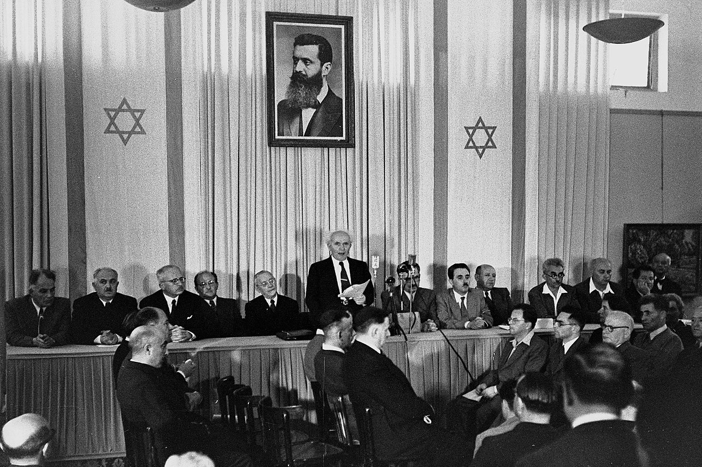
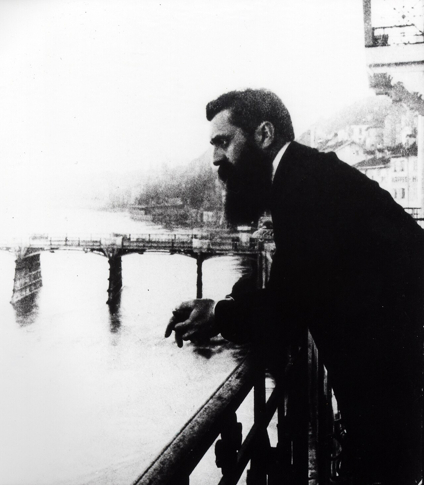
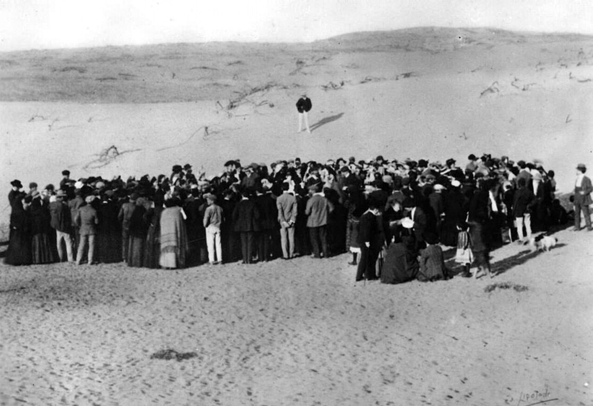
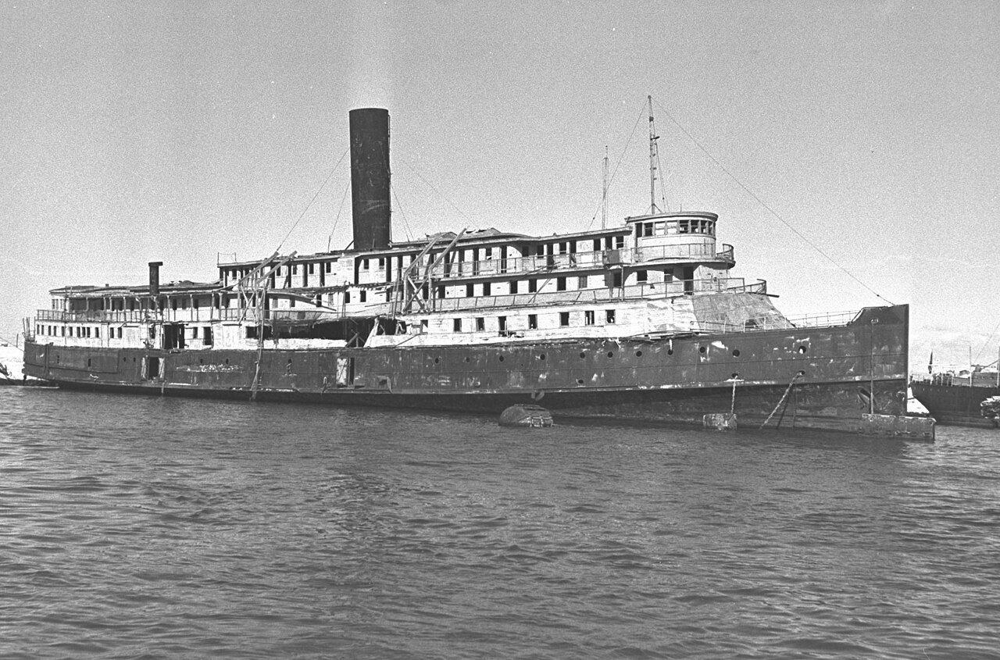
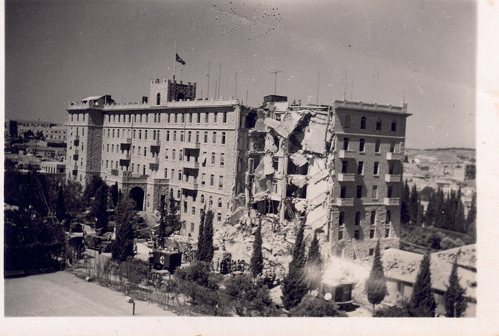
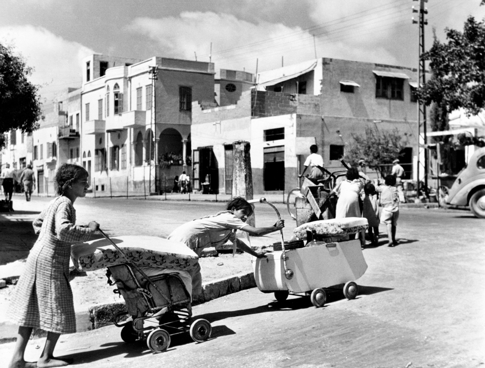
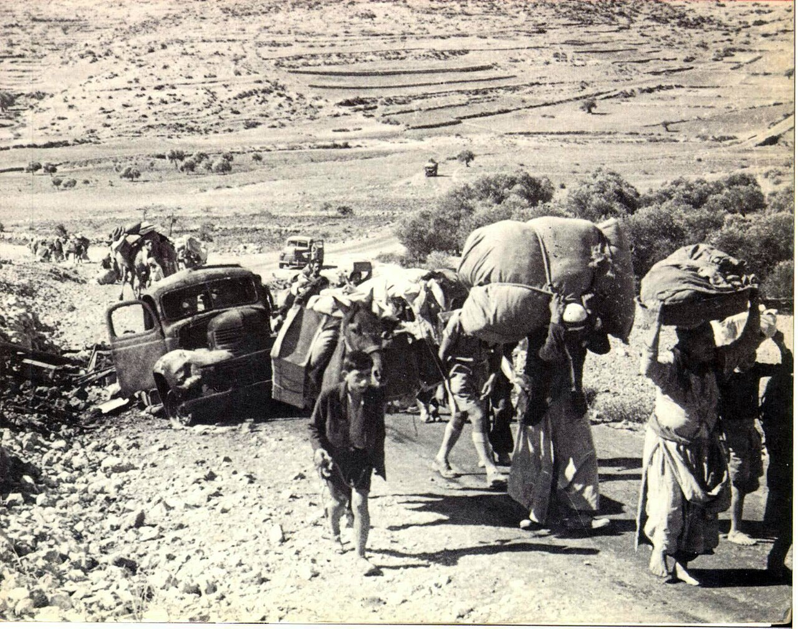
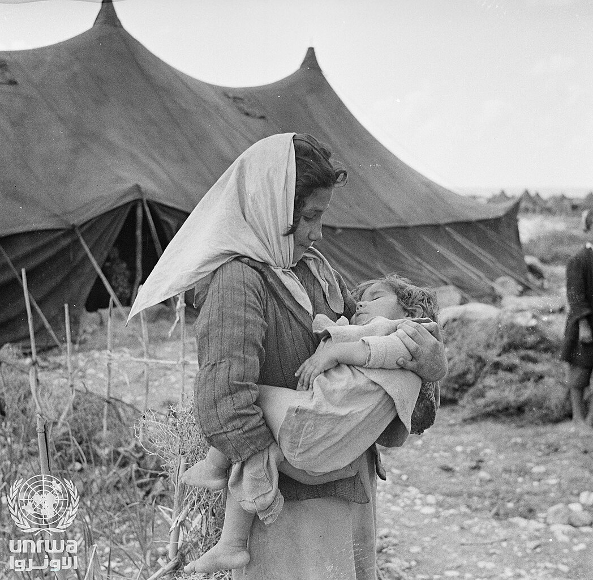
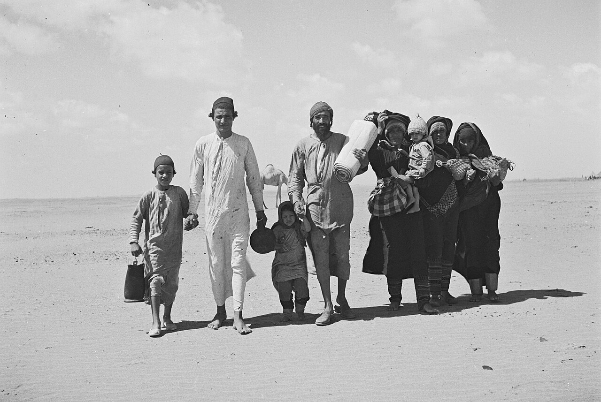
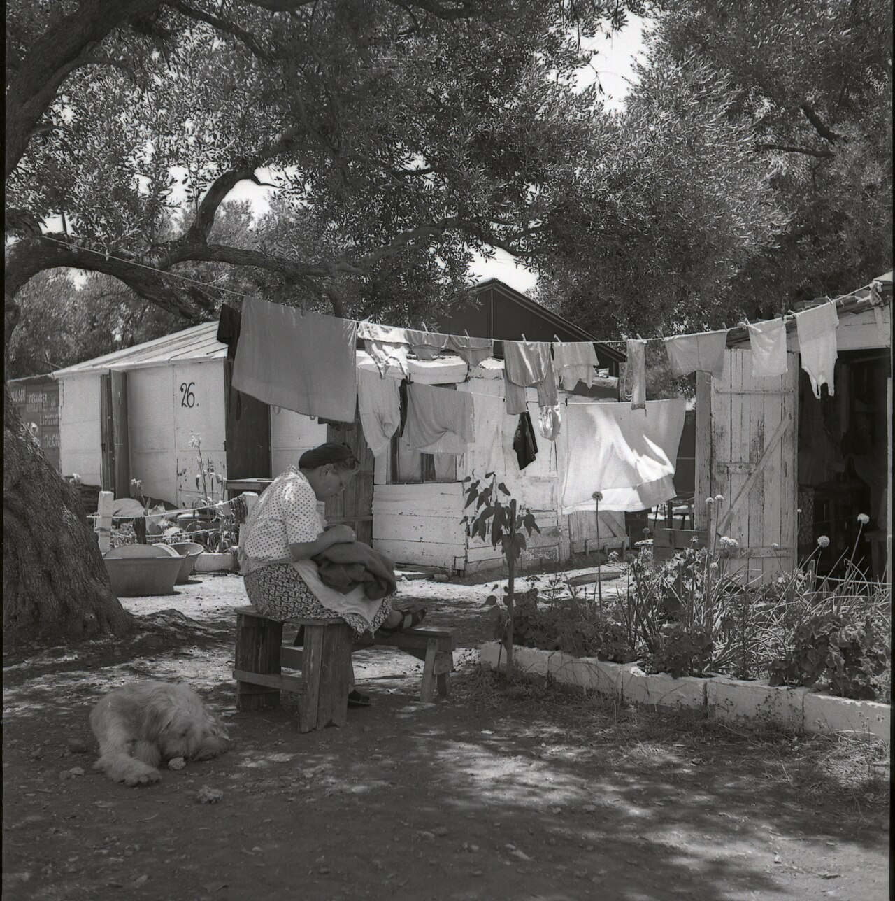

# 85. How was Israel created?

*Palestine and Israel, from 1896 to 1949*

Israel was created in 1948 by a Jewish national movement that had been settling in Palestine for sixty years, after the murder of the Jews of Europe had left the survivors with no home to return to and few countries willing to take them. The United Nations voted to divide the country between its Jews and its Arabs. The Arabs, who were the majority, refused, and in the war that followed the Jews won. About seven hundred thousand Palestinian Arabs lost their homes and were not allowed to return to them.

At four o'clock on the afternoon of Friday, 14 May 1948, some two hundred and fifty people sat in the main hall of a small art museum in Tel Aviv. The invitations had gone out by messenger that morning, with a request to keep the matter secret. On the wall behind the platform hung a portrait of a man with a long black beard, between two blue and white flags.

A short, stocky man of sixty-one with tufts of white hair rapped a gavel on the table. David Ben-Gurion had come to Palestine from Poland as a farm labourer forty-two years before. He read out a document of about a thousand words, which declared the establishment of a Jewish state, to be called Israel. The ceremony took thirty-two minutes. It had to be over before sunset, when the Jewish day of rest began. British rule over Palestine, meanwhile, was due to end at midnight.

*Ben-Gurion reading the declaration of the State of Israel in the Tel Aviv museum hall, 14 May 1948, beneath the portrait of Theodor Herzl. Photo: Rudi Weissenstein, public domain.*

Outside, people danced in the street. Ben-Gurion did not join them. Egyptian aircraft bombed Tel Aviv the next morning.

The celebration had another side. A few kilometres down the coast, in the old Arab port of Jaffa, there was no one to dance. It had been a city of seventy thousand people in January. That week about four thousand were left.

## A journalist in Paris

The man in the portrait was Theodor Herzl, a newspaper correspondent from Vienna. Others had dreamed of a Jewish state before him. He was the one who turned the dream into a movement.

Herzl was a Jew of the modern kind. He did not practise his religion, and he believed that the old hatred was dying out. In 1895 that belief was shaken. He was in Paris to report on the public disgrace of a Jewish army captain who had been convicted, falsely, of spying for Germany. He heard the crowd outside the parade ground shouting for death to the Jews.

What shook him was where it happened. This was France, the country that had first given Jews equal rights. Nor was it the only warning. He had seen the same hatred win elections at home in Vienna. If Jews were not safe in France, he concluded, they would never be safe anywhere as a minority.

The next year he published a pamphlet called *The Jewish State*. The Jews, he argued, were a nation like any other, and needed what other nations had, a country of their own. The answer to the hatred, in other words, was not to wait for it to fade but to stop being a minority. The year after, he turned the argument into an organisation. In 1897 he gathered two hundred delegates in a concert hall in the Swiss city of Basel, in evening dress, to found a movement. He wrote in his diary: At Basel I founded the Jewish state. If I said this aloud today, I would be answered with universal laughter. Perhaps in five years, and certainly in fifty, everyone will know it.

*Theodor Herzl on the balcony of the Three Kings hotel in Basel during the Fifth Zionist Congress, December 1901. Photo: Ephraim Moses Lilien, public domain.*

That left the question of where the state should be. Herzl was willing to consider Argentina. His followers were not. Jews had prayed for a return to the land of Israel, which they called Zion, for eighteen hundred years.

The land of those prayers, however, was not empty. It was then a quiet corner of the Turkish empire known as Palestine, with about half a million inhabitants. Nineteen in twenty of them were Arabs.

The movement set about building a society there before it had a state. The first need was land. A fund bought land, often from landlords who lived in Beirut or Damascus, and the Arab tenants who had farmed it were made to leave. Where the sellers lived far away, the cost fell on the people in the fields.

Alongside the land came people to work it. Young immigrants from Russia founded farms that they owned in common. There were towns, too. In 1909 sixty families drew lots for plots on the sand dunes north of Jaffa and began the first modern Jewish city.

A nation also needed a language of its own. A scholar in Jerusalem had resolved that the new nation must speak Hebrew, which had been a language of prayer and study, and no people's mother tongue, for some seventeen hundred years. To bring it back to everyday life, he raised his son to hear nothing else. The experiment worked. Within a generation children were quarrelling in it in the playground.

*Families drawing lots for building plots on the sand dunes north of Jaffa, 11 April 1909, the founding of Tel Aviv. Photo: Avraham Soskin, public domain.*

The building went on under new rulers. Under British rule, after 1917, the Jewish community grew from a tenth of the population to a third. It had its own schools, trade unions, bus companies, a university and an elected assembly. It even had an underground army, the Haganah. Two smaller armed groups, more extreme, rejected its authority. In everything but name, a state was taking shape inside the country.

The Arabs of Palestine, watched this with growing alarm. A community that had grown from a tenth to a third could, in time, become a majority. They rose against it, and were crushed. By 1939 the British had decided to close the door, and limited Jewish immigration to a trickle.

Then came the war, and what was done in it.

## Survivors

When the war was over, the problem had changed its shape. By 1947 there were about a quarter of a million Jews in camps in Germany, Austria and Italy, guarded by Allied soldiers. Some of them had come out of the death camps alive. Others had returned from hiding, or from refuge in the Soviet Union, to towns in Poland. There they found their families dead and their houses occupied by others, and their neighbours in some cases attacked them. They could not go back, and no country offered to take them in any number. Most wanted to go to Palestine.

Against a quarter of a million people waiting in the camps, Britain held to its limit of fifteen hundred a month. It still ruled an empire full of Muslims and depended on Arab oil, and it would not provoke another revolt.

The Zionist movement answered by smuggling people in. It bought old ferries and river steamers and ran the blockade, which meant trying to slip them past the British warships that patrolled the coast. The British navy intercepted nearly all of them and put the passengers behind wire in Cyprus.

In July 1947 the British boarded one of these ships off the coast of Palestine. It was a worn-out American pleasure steamer renamed *Exodus 1947*, and it had four and a half thousand survivors on board. Three people were killed in the fight. Passengers on such ships were normally taken to Cyprus. This time, however, the British government decided to make an example, and sent the passengers back to Europe.

They refused to land in France. In the end British soldiers carried them off the ships in Germany, and put them in camps there. Survivors of the Nazi camps were being carried by soldiers into camps on German soil. Newspapers all over the world printed the pictures. It was the worst advertisement for a policy that could have been devised.

*The hulk of the Exodus 1947 at Haifa, photographed in 1952, five years after the voyage. Photo: Fritz Cohen, Government Press Office, public domain.*

In Palestine itself, meanwhile, the Jewish underground had turned on the British. One of the two extreme groups blew up the wing of the hotel in Jerusalem that housed the British administration, in July 1946, and killed ninety-one people.

Britain had a hundred thousand soldiers in a country not much bigger than Wales. Even so, it could not keep order. It was also bankrupt, and its public was sick of the whole business. In February 1947 the government announced that it was handing the problem to the United Nations.

*The King David Hotel in Jerusalem after the bombing of 22 July 1946. Photo: Gordon Trevor Moore, CC BY-SA 4.0.*

## Thirty-three to thirteen

The United Nations sent a committee of eleven countries, which toured Palestine that summer. The idea itself was not new. Its majority recommended what the British commission had proposed ten years before. The country should be divided.

The plan gave the Jewish state fifty-six per cent of the land, including most of the coast and the thinly peopled southern desert. The Arab state would have forty-three per cent, in three pieces joined at their corners: the hills of the north, the hill country of the centre, and a strip of the southern coast. Jerusalem, holy to three religions, would belong to neither and be run by the United Nations. Picture the Arab state as three islands of land that touched one another only at their tips.

On 29 November 1947 the General Assembly voted. Jews in Palestine sat by their radios with pencils, keeping count as each country was called. The result was thirty-three in favour and thirteen against, with ten abstaining. The United States and the Soviet Union, which agreed on little else, both voted yes.

To the Jews it was the fulfilment of Herzl's prediction, fifty years after Basel, to the year. The plan was far from what they had wanted. Nearly half the people in their state would be Arabs, so that it would be Jewish by a narrow margin, and Jerusalem was left out. They accepted it all the same, because a state of any size meant that no Jew would again be turned away for want of somewhere to go.

To the Arabs of Palestine, by contrast, the plan was an injustice from start to finish. Their objection began with numbers. They were two thirds of the population and owned most of the farmland, and they were being offered less than half the country. It went on to principle. They had had no part in the crimes of Europe, and they did not see why they should pay for them. Their leaders, and every Arab government, rejected the vote and said that they would resist it. The matter would now be settled by force.

## The roads

Fighting began the next morning, with an attack on a Jewish bus. Through the winter it was a war of neighbours, fought between villages and quarters that lived side by side rather than between armies. Arab fighters ambushed the convoys that supplied the Jewish quarters of Jerusalem and the outlying farms. Jewish squads, for their part, blew up houses in Arab villages. Bombs went off in markets and outside newspaper offices. The British, counting the days until they could leave, mostly stood aside.

At first the Arabs had the better of it. By March the hundred thousand Jews of Jerusalem were under siege and short of food, because the convoys that fed them were being stopped on the road.

In April, however, the Jewish forces went over to the attack. They had a plan to secure the whole area allotted to the Jewish state, and the roads to the settlements beyond it, before the British left and the Arab armies came in. The plan gave commanders the authority to destroy villages that could not be held and to expel those who lived there if they resisted.

On 9 April about a hundred and twenty fighters from the two extreme underground groups attacked Deir Yassin. It was a village of stonecutters on a hill at the western edge of Jerusalem. The villagers fought back, and the attackers took the place house by house with grenades. More than a hundred people were killed, many of them women, children and old men. The main Jewish leadership condemned it.

The news of the killing then did damage of its own. The Arab radio stations broadcast the story with additions, in the hope of stiffening resistance. The effect was the reverse. Frightened people ran instead of standing. In village after village, when Jewish forces approached, families remembered Deir Yassin and left.

The killing went both ways. Four days later Arab fighters ambushed a convoy of buses and ambulances on its way to the Jewish hospital on the far side of Jerusalem. Seventy-eight people, among them doctors, nurses, students and patients, were shot or burned to death.

The towns went quickly. Haifa, the main port, came first. It had seventy thousand Arab inhabitants. Many of its leading men and wealthier families had left during the winter, as such families had done in earlier troubles, expecting to come back when things were calm. The town had lost much of its leadership, then, before the battle began. On 21 April the Jewish militia took the Arab quarters in a day and a night. The town's remaining Arab leaders were offered terms. They chose to evacuate, and the people crowded onto the quays and into boats. By May there were a few thousand left. Jaffa followed, and in the week of the declaration only a few thousand remained there too.

*Girls pushing their belongings in prams and carts as they leave Jaffa, 1948. Photographer unknown, United Nations archive, public domain.*

## Five armies

The day after Ben-Gurion's ceremony, the war of neighbours became a war of states. On 15 May the regular armies of Egypt, Transjordan, Syria and Iraq crossed the borders, with a small force from Lebanon. The secretary of the Arab League had spoken of a war of extermination. Israel had six hundred and fifty thousand people and had existed for a matter of hours.

It looked like a contest between a village and five nations. In fact it was closer than that.

The Arab governments sent only part of their armies, some twenty thousand men at the start. Israel, by contrast, put a large share of its young men and women into uniform, and by the summer it had more soldiers in the field than all of them together. The Israelis, moreover, fought with their backs to the sea, three years after the camps, and understood that losing would mean the end of everything. They also had a single command. Their supply of arms, meanwhile, grew as the fighting went on. Through the spring, and again during a truce in June, they brought in rifles, machine guns and fighter aircraft bought from Czechoslovakia.

The Arab armies, meanwhile, had no common plan and did not trust one another. The best of them belonged to King Abdullah of Transjordan, and his aims were not those of his allies. He had held secret talks with the Zionists before the war and had no interest in a Palestinian state. He wanted the hill country west of the river Jordan for his own kingdom. His army took it and largely stopped there, though it also held the walled Old City of Jerusalem against every attack. The king of Egypt, for his part, had gone to war chiefly to prevent Abdullah from getting too much.

By the beginning of 1949 Israel had driven the Egyptian army back into the desert and held far more than the United Nations had assigned to it. The victory had been costly. Six thousand Israelis had been killed, one in every hundred. The fighting ended in a series of armistices, agreements to stop fighting that fell short of peace, the first of them signed that February on a Greek island.

The lines drawn there stood for eighteen years. Israel had seventy-eight per cent of what had been Palestine, against the fifty-six per cent that the plan had offered. Transjordan kept the hill country, which came to be called the West Bank, and the eastern half of Jerusalem, and renamed itself Jordan. Egypt kept a strip of coast forty kilometres long around the town of Gaza. The Arab state proposed by the United Nations did not come into existence. Its land had ended up in other hands.

![Two maps of Palestine side by side. Left, the United Nations plan of 1947: the Jewish state, in blue, takes most of the coast, the east of Galilee and the Negev desert down to the Red Sea; the Arab state, in red, has three pieces joined at their corners, western Galilee, the hill country of the centre and a strip of the southern coast round Gaza, with Jaffa as a small enclave; Jerusalem, hatched, is under the United Nations. Right, the armistice lines of 1949: Israel, in blue, holds most of the country; the West Bank, in red, is held by Jordan and the Gaza strip by Egypt. Tel Aviv, Jaffa, Haifa, Lydda, Ramle and Jerusalem are marked. An inset of Jerusalem shows the line dividing the city, with the Old City and East Jerusalem on the Jordanian side, West Jerusalem and Deir Yassin on the Israeli side, and Mount Scopus as an Israeli island](images/map_partition.png)
*Left, the United Nations plan of 1947, drawn roughly. Right, the armistice lines of 1949, with the West Bank held by Jordan and the Gaza strip by Egypt; inset, Jerusalem divided. Plan traced from a public-domain map by AnonMoos; lines of 1949 after OpenStreetMap contributors. Map: drawn for this book; coastlines and rivers from Natural Earth, public domain.*

## Keys

For the Arabs of Palestine, the armistice lines marked a different kind of result. More than half of them, about seven hundred thousand people, were now outside the lines, in the West Bank, Gaza, Lebanon, Syria and Jordan. More than four hundred of their villages stood empty.

They had left in many different ways. Some went early, by car, to wait out the fighting. Many fled as the front came near, as civilians do in every war, after hearing what had happened elsewhere. Many were driven out.

In July 1948, when Israeli forces took the towns of Lydda and Ramle on the road to Jerusalem, some fifty thousand people were ordered out of their houses. Most of those from Lydda were made to walk to the Arab lines in the heat of midsummer, and a number died on the way. In some villages in the north there were massacres. In others the people were left alone and are there to this day.

*Palestinian refugees on a road in the hills, 1948. Photo: Fred Csasznik, public domain.*

Why they left was disputed for forty years, and the question mattered, because each answer laid the blame on a different side. Israel's official account held that the Arab leaders had told them by radio to get out of the way of the armies. Palestinians said that they had been expelled according to a plan.

In the 1980s the Israeli archives were opened, and Israeli historians went through the army's own records. They found almost no trace of orders from Arab leaders to leave. They found that most refugees had fled from attacks and the fear of attacks, and that a large number had been expelled by local commanders. Whether there was a central plan to remove them is still argued, and historians reading the same documents disagree.

In the summer of 1948 the Israeli cabinet decided that the refugees would not be allowed back. A Jewish state with a large and hostile Arab population, the ministers reasoned, could not survive. Empty villages were bulldozed or given to new immigrants, and the land was taken over by the state. Those who tried to slip back across the lines to their fields were treated as infiltrators and often shot.

In December the United Nations resolved that refugees who wished to return and live at peace should be permitted to do so. Nothing came of it. The Arab states, except Jordan, declined to make the refugees citizens, on the grounds that to settle them would be to accept their loss. Caught between the two refusals, the refugees remained refugees. The tent camps set up in 1949 became towns of concrete, and they are still there. The agency created to feed their people has about six million of them and their descendants on its books.

*A refugee girl carrying her sleeping baby sister in the new Mia Mia camp near Sidon, Lebanon, 1949. Photo: UNRWA archive, CC BY-SA 3.0 IGO.*

Many families had locked their doors when they left and taken the key, expecting to be gone for a few weeks. The keys were kept. Large iron keys to houses that no longer exist hang on the walls of homes in the camps, and have passed to grandchildren and great-grandchildren. A key is a small thing to carry, and it has become a way of saying that the loss is not accepted.

Not everyone had gone. About a hundred and fifty thousand Arabs remained inside Israel, a minority now in a Jewish state. They became citizens with the vote. At the same time, they lived for the next eighteen years under military rule, needing a permit to travel from one town to the next.

## The other exodus

The war also ended a much older world, far from Palestine. Jews had lived in Iraq since the Babylonian exile, twenty-five centuries before, and in Egypt, Yemen and Morocco since before the coming of Islam. In 1948 there were about eight hundred thousand of them across the Arab countries.

After the war in Palestine, they were no longer safe. There were riots, arrests and dismissals, and in some countries their property was seized. Fear pushed many to leave. Others were drawn by the new state, which sent agents to bring them.

The departures took different forms. Almost the whole Jewish community of Yemen, some fifty thousand people, many of whom had never seen an aircraft, was flown out in little more than a year. In Iraq the departure came in two steps. A hundred and twenty thousand left Iraq, under a law that allowed them to go if they gave up their citizenship. A second law, a year later, froze everything that they owned. The first law opened the door, and the second made sure that those who went through it left their property behind. Within twenty-five years the Jewish communities of the Arab world had all but disappeared, and most of their people were in Israel.

*A Yemenite Jewish family walking through the desert to a reception camp near Aden, 1949. Photo: Zoltan Kluger, public domain.*

They arrived alongside the survivors from Europe, and the new state opened its doors to both. In 1950 Israel passed a law giving every Jew in the world the right to come and become a citizen. In three years its Jewish population doubled.

So rapid a growth was felt in daily life. The newcomers lived in tents and tin huts, on rationed food, in a country with no oil and enemies on every border.

*A woman sewing outside the huts of a ma'abara, an immigrant transit camp, in Israel, May 1951. Photo: Boris Carmi, CC BY 4.0.*

## Two words

Israelis call the war of 1948 the War of Independence. They remember it as the moment when a people that had been hunted across Europe three years before stood and defended itself, and won a home.

Palestinians call the same year the *Nakba*, which means the catastrophe. They remember it as the moment when a society that had farmed the same hills for longer than anyone could trace was broken up and scattered.

Each of the two memories is accurate, and for most of the years since, each people has found it almost impossible to listen to the other's. In Israel the anniversary is kept each spring with flags and fireworks. On 15 May, in the camps of Lebanon and Gaza and the towns of the West Bank, people walk in procession and hold up the keys.
