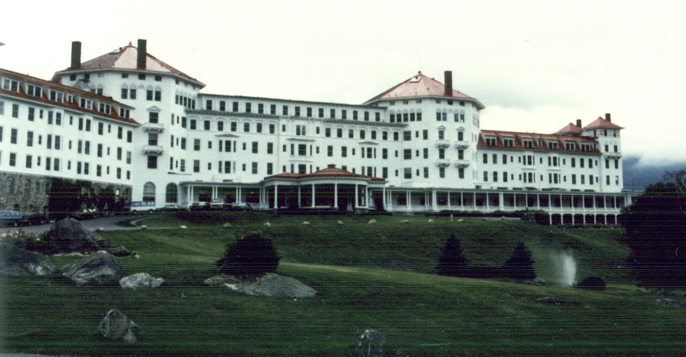
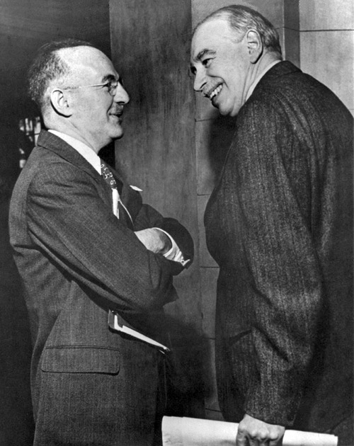
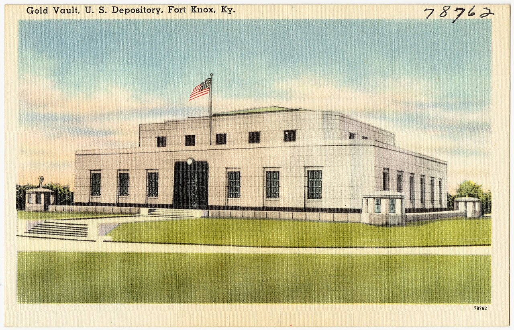
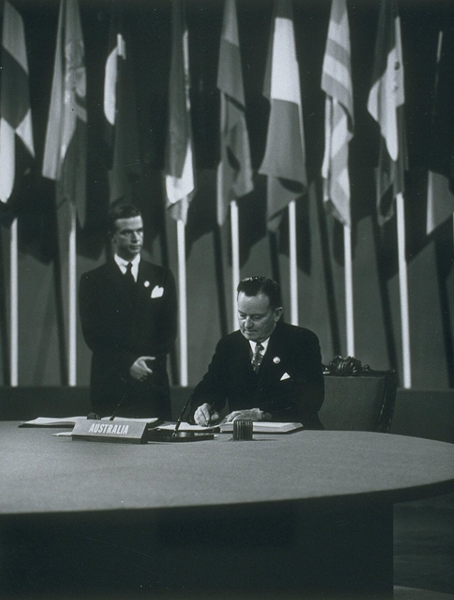
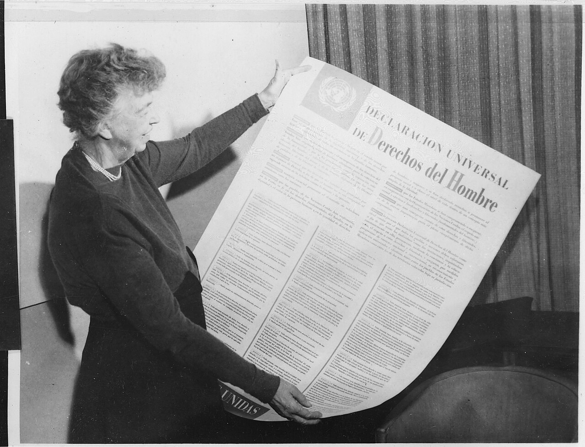
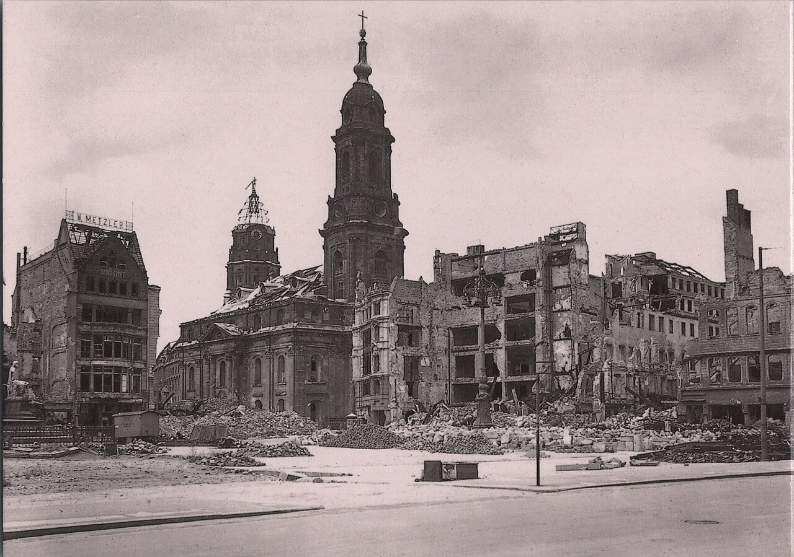
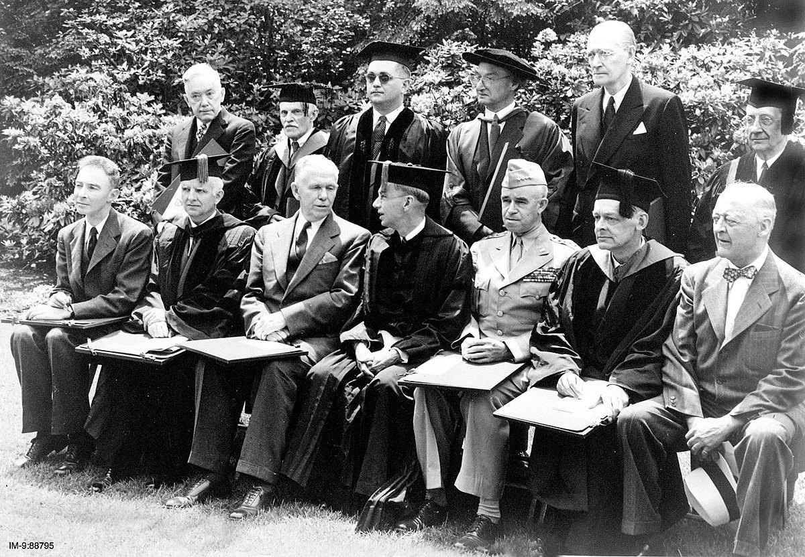
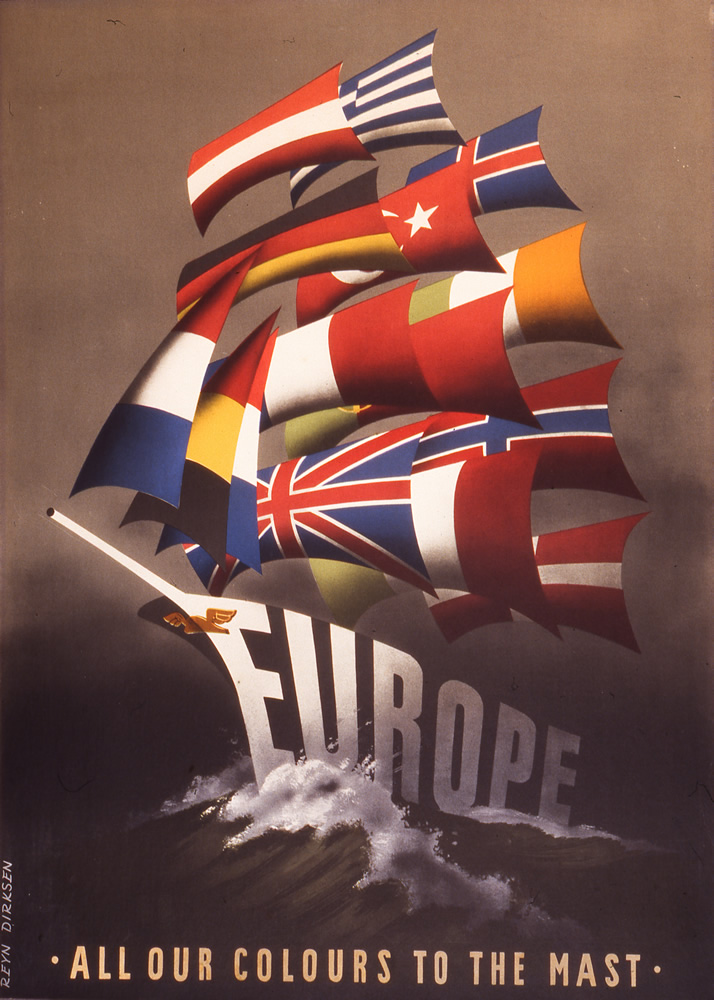
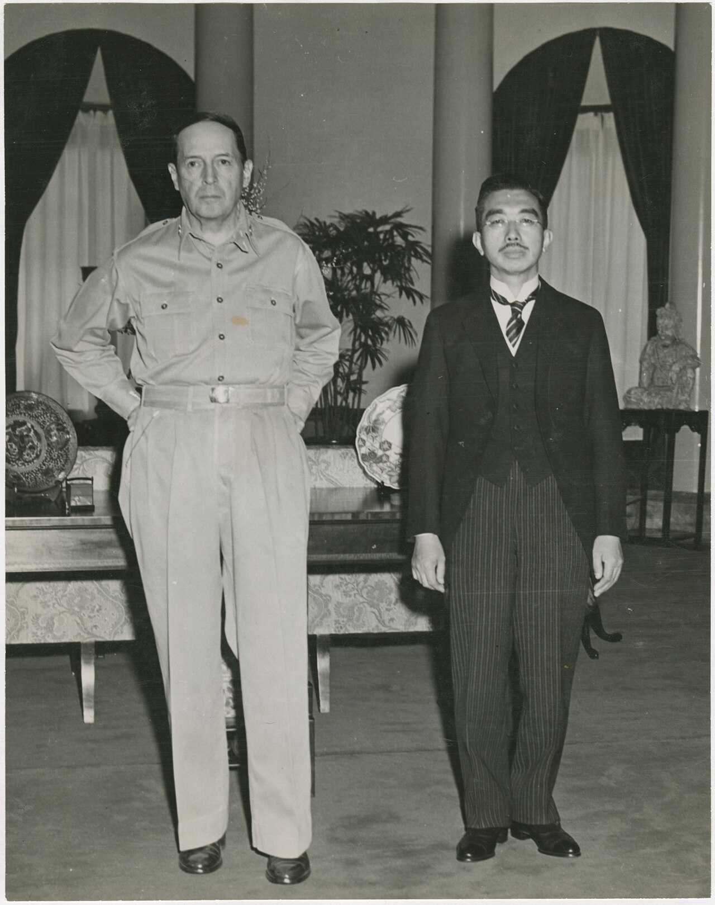
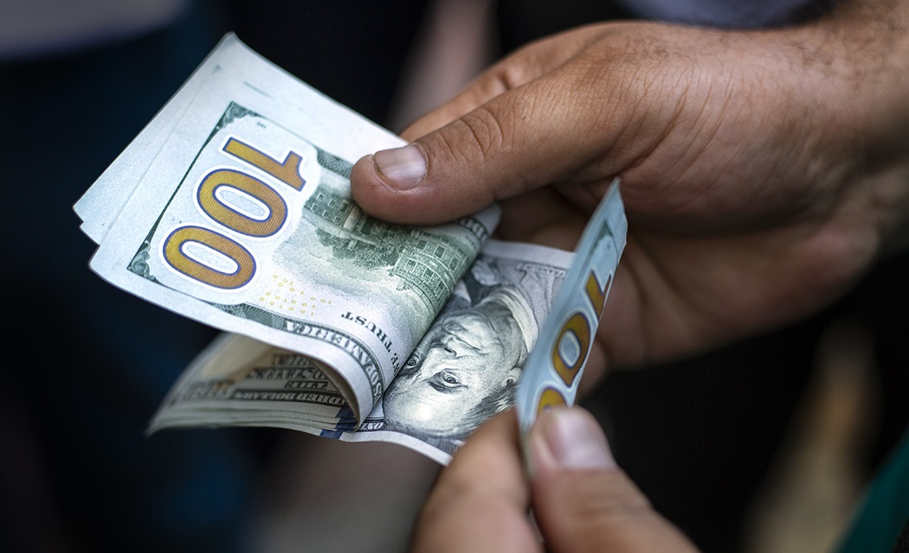

# 86. Why does the world use the American dollar?

*The United States and the world, from 1944 to 1971*

The world uses the dollar because the rules of the world economy were written in 1944, when the United States was the only great power that the war had made richer. It held most of the world's gold, and its factories made half of everything manufactured on Earth. At a conference in the mountains of New Hampshire it tied the currencies of its allies to its own, and in the five years that followed it founded most of the institutions that have managed world affairs ever since.

In the first three weeks of July 1944, seven hundred and thirty delegates from forty-four countries crowded into a vast white wooden hotel at a place called Bretton Woods. The hotel had been shut for two years and was reopened in a hurry. There were not enough beds, and the hot water ran short. The war was still being fought. The armies that had landed in Normandy the month before were stuck a few miles from the beaches.

*The Mount Washington Hotel at Bretton Woods, New Hampshire, where the conference of July 1944 was held. Photographer unknown, public domain.*

The purpose of the meeting was to design the money of the world after the war. Two men dominated it, and they did not like each other.

The first was John Maynard Keynes, the most famous economist alive, who led the British delegation. He was sixty-one, with a failing heart, and collapsed one evening on the hotel stairs. The second was Harry Dexter White, the son of Lithuanian immigrants, a blunt official of the American treasury whom hardly anyone outside Washington had heard of. Keynes had the better arguments. White had the money, and he won on nearly every point.

*Harry Dexter White and John Maynard Keynes at the first meeting of the International Monetary Fund's governors in Savannah, Georgia, 8 March 1946, twenty months after Bretton Woods. Photo: International Monetary Fund, public domain.*

## Never again

Both men were trying to solve the same problem. They had lived through the 1930s, when the collapse of trade and the scramble of each country to save itself at its neighbours' expense had turned a slump into a catastrophe, and had brought Hitler to power. Both believed that the peace would be lost in the same way unless the rules were changed.

The old gold standard had been one cause. It had kept currencies stable, and trade thrives on stable currencies, since a merchant who signs a contract wants to know what the money will be worth when the goods arrive. However, it had forced a country in difficulty to cut wages and throw people out of work in order to defend its gold. When countries abandoned it, they recovered, and they also turned on one another. They pushed down the value of their currencies to make their exports cheap, put up tariffs, and blocked their citizens from sending money abroad. Each measure was answered in kind.

Keynes came with a bold design. There would be a world bank for governments, issuing a currency of its own, which he called bancor. Countries that sold more to the world than they bought would pile up bancor and be fined for hoarding it. The burden of putting things right would thus fall on the strong, who could afford it, as well as on the weak. He had one country chiefly in mind. The United States sold far more than it bought, and Britain, which had spent everything it owned on the war, was going to need American goods for years with nothing to pay for them.

White's design was simpler. The world already had a currency that everyone wanted, backed by two thirds of the world's gold. He saw no reason to invent another.

## Thirty-five dollars an ounce

What the delegates signed was White's plan, softened a little.

Every member country would fix the value of its currency against the dollar, and keep it there. If its currency weakened, its central bank had to buy it up, paying with dollars from its reserves, until the price recovered. The dollar alone would be fixed to gold. Americans themselves had not been able to change their banknotes for gold since 1933. The American treasury now undertook to do so for any foreign government that asked, at thirty-five dollars an ounce. A French franc or a Japanese yen was therefore a promise of a certain number of dollars, and a dollar was a promise of gold. Central banks around the world could hold their reserves in dollars and treat them as being as good as gold, and unlike gold, dollars in a bank earned interest.

*The United States gold vault at Fort Knox, Kentucky, on a postcard from the 1930s or 1940s. Postcard: Tichnor Brothers, Boston, public domain.*

Two institutions were set up to keep the system working. The International Monetary Fund, to which every member contributed, would lend to a country whose reserves of dollars were running out, so that it would have time to put its affairs in order without wrecking its economy. A country could change the value of its currency, with permission, if its position was hopeless. The World Bank would lend for rebuilding what the war had destroyed, and later for dams, roads and power stations in poor countries. Governments were permitted to control the movement of money across their borders, so that speculators could not overturn a currency in an afternoon.

Votes in both bodies went largely in proportion to the money each country put in. The United States put in about a third. The most important decisions needed a majority of four fifths, and so none of them could be taken against American wishes. Both institutions were placed in Washington, a few minutes' walk from the treasury.

The Soviet Union sent delegates, signed, and then declined to join. Most of Asia and nearly all of Africa were not in the room, because they were colonies. India attended as part of the British empire.

Britain discovered within a year what the new order meant. When the war ended, American aid stopped overnight. Keynes was sent to Washington to ask for a gift, in recognition of what Britain had spent in the common cause. He came back with a loan, at interest, on the condition that Britain open its empire to American trade and allow pounds to be freely exchanged for dollars. When that was done, in 1947, the holders of pounds rushed to change them, and the reserves drained away in five weeks. Keynes had died the previous spring, worn out by the negotiations. Britain made the last payment on the loan in 2006.

## Five vetoes

The money was one half of the design. The other half was a body to keep the peace.

There had been one before. The League of Nations had been founded after the war of 1914, and had watched helplessly while Japan took Manchuria, Italy took Ethiopia and Germany took Austria. It had two fatal weaknesses. The United States had never joined, and the League could take no serious step unless its members were unanimous.

In the spring of 1945 delegates of fifty countries met in San Francisco and wrote the charter of the United Nations. It kept the idea of an assembly in which every country, large or small, had one vote. Real power was placed elsewhere, in a council of eleven that alone could order sanctions or the use of force. Five countries had permanent seats on it: the United States, the Soviet Union, Britain, France and China. Each of the five could block any decision of substance by voting no.

*Frank Forde signing the Charter of the United Nations for Australia at San Francisco, 26 June 1945. Photo: Australian Department of Information, public domain.*

The veto was the price of getting the great powers to join, and it has been criticised ever since. It meant that the council could never act against any of the five, or against a friend of any of the five. Its designers understood this. They judged that a body that the powers could paralyse was better than one that they would walk out of.

This time the United States was at the centre of it, and gave it a home. A site of slaughterhouses beside the river in New York was bought for the headquarters with a gift from the richest family in America.

## All human beings

One of the first tasks the new organisation set itself was to say what every government owed to the people under it. The war had shown what a state could do to its own citizens when nothing outside it had any right to object.

A commission of eighteen countries worked on the text for two years. Its chairman was Eleanor Roosevelt, the widow of the president. Its most active members were a French jurist who had lost twenty-nine relatives in the camps, a Lebanese philosopher, and a Chinese scholar and playwright who kept reminding the others that the West did not own the idea of human dignity. The first draft began with the words "All men are born free and equal". The delegate of newly independent India, a woman named Hansa Mehta, objected that in some countries this would be read to exclude women. It was changed to "All human beings".

*Eleanor Roosevelt holding a Spanish-language poster of the Universal Declaration of Human Rights, November 1949. Photographer unknown, public domain.*

The Universal Declaration of Human Rights was adopted in Paris on 10 December 1948. It has thirty articles. They say that no one shall be held in slavery or tortured, and that everyone has the right to a fair trial, to leave any country, to marry freely, to own property, to hold and express opinions, to take part in government, to work, to rest, and to be educated. Forty-eight countries voted for it and none against. Eight abstained, among them the Soviet Union, which objected to the freedoms, South Africa, which objected to the equality, and Saudi Arabia, which objected to the right to change one's religion.

It was a statement of principle and bound nobody. There was no court to hear a complaint and no force to act on one. The countries that voted for it included Britain and France, which ruled several hundred million colonial subjects without their consent, and the United States, where across the South most Black citizens were kept from voting and the law forbade them to eat in the same restaurants as white people or to sit at the front of a bus. This did not go unnoticed. The year before, the oldest organisation of Black Americans had presented the United Nations with a petition of nearly a hundred pages, edited by the scholar W. E. B. Du Bois, asking it to consider the denial of human rights in the United States. The American delegation, Eleanor Roosevelt included, made sure that it was not discussed.

The declaration mattered all the same, and in a way that its authors had half expected. It gave people everywhere a standard, signed by their own governments, to hold those governments to.

## Five per cent

The winter that began in 1946 was among the coldest that Europe had known in the century, and it fell on a continent whose recovery had barely started. Bridges and railways lay wrecked. Coal could not be moved, and so factories stopped. In the British zone of Germany the ration fell to a thousand calories a day. Europe needed American food, fuel and machines, and had no dollars with which to buy them.

*The centre of Dresden in ruins after the war, with the tower of the Kreuzkirche among gutted buildings. Photo: Deutsche Fotothek, CC BY-SA 4.0.*

American officials watched with alarm, for reasons of their own. In France more than a quarter of the voters supported the Communist party, and in Italy nearly a fifth. If the misery went on, those parties would win, and the whole continent might pass under the influence of Moscow without a shot.

On 5 June 1947 the American secretary of state, General George Marshall, who had run the army during the war, gave a short speech at a university ceremony. He said that the United States would do whatever it could to help Europe recover, and invited the Europeans to draw up a joint plan. Over the next four years the United States gave sixteen countries about thirteen billion dollars, most of it as outright gifts. That was roughly five per cent of what America produced in a single year, spread over four. It arrived as wheat, coal, tractors and machine tools, in crates stamped with a shield in the colours of the American flag.

*George C. Marshall, third from left in the front row, at Harvard on 5 June 1947, the day of his speech, with other holders of honorary degrees including J. Robert Oppenheimer, Omar Bradley and T. S. Eliot. Photographer unknown, public domain.*

The offer had been made to all of Europe, including the Soviet Union and the countries that its army occupied. Stalin saw in it a device for drawing his new satellites into the American economy. He refused, and ordered them to refuse. The government of Czechoslovakia, which had already accepted, was summoned to Moscow and made to withdraw.

The plan had a condition that outlasted the money. The Americans insisted that the Europeans decide together how to spend it, and remove the barriers to trade among themselves. The habit stuck. In 1951 France, West Germany, Italy and three smaller neighbours placed their coal and steel industries, the materials of war, under a single authority, so that none could arm against the others. Six years later the same six formed a common market. It has since grown into a union of twenty-seven countries.

*A poster made for the Marshall Plan in Europe, about 1950: the flags of the countries taking part form the sails of a ship. Poster: Reyn Dirksen for the Economic Cooperation Administration, public domain.*

## A constitution in a week

The victors of 1918 had tried to make Germany pay, and the attempt had ended in ruin for everyone. The Americans began in 1945 by dismantling German factories. Within two years they had reversed themselves, and set out to turn their two great enemies into prosperous allies.

Japan was occupied by an American army under a general who ruled it like a viceroy. In February 1946, dissatisfied with the Japanese government's proposals, he ordered his own staff to write the country a new constitution, and gave them a week. Twenty-five Americans, working in a requisitioned ballroom, produced it. The emperor remained as a symbol with no power. Japan renounced war for ever and the right to keep armed forces. The clause that made women equal to men in marriage, property and inheritance was written by a woman of twenty-two, who had grown up in Tokyo as the daughter of a pianist who had come there to teach and was the only person in the room who knew how Japanese women lived. That constitution is still in force and has never been amended.

*General Douglas MacArthur and the emperor Hirohito at their first meeting, at the American embassy in Tokyo, 27 September 1945. Photo: Gaetano Faillace, public domain.*

The western part of Germany was given a new currency in 1948, a share of the American aid, and a democratic constitution of its own. Within ten years both countries were richer than they had been before the war, and both were American allies with American troops on their soil.

## Bases

Those troops were the last element of the design. In 1949 the United States, Canada and ten countries of western Europe signed a treaty declaring that an attack on any one of them would be treated as an attack on them all. For the United States this was a break with its whole history. It had kept out of alliances in peacetime for a century and a half, and after the previous war it had brought its soldiers home and left Europe to defend itself.

It now did the reverse. Treaties followed with Japan, South Korea, Australia and others, and American garrisons, airfields and naval stations spread across the world until there were several hundred of them. The American navy patrolled the sea lanes, as the British had done in the century before.

A set of rules for trade completed the structure. In 1947 twenty-three countries agreed to cut their tariffs and to give one another equal treatment. More joined at each round of bargaining, and world trade grew faster than it had ever done.

## Thirty years

It worked, for those inside it, better than anyone at the hotel in New Hampshire had dared to hope. From 1950 to 1973 the economies of western Europe, North America and Japan grew at a pace that had no precedent. Unemployment almost vanished. An ordinary family in France or Italy that had owned a bicycle in 1950 owned a car, a refrigerator and a television set in 1970. In France those years are still called the thirty glorious ones.

The arrangement gave the United States an advantage on a scale that Britain, in the days when the pound was the world's money, had never enjoyed. Every other nation had to earn or borrow dollars in order to trade. The United States could simply create them. A French finance minister of the 1960s called this America's exorbitant privilege. A country that owns the world's money can buy more than it sells year after year, and run its government in debt, and the rest of the world will finance it by holding its banknotes and its bonds.

It also contained a flaw. The world needed more dollars every year as trade grew, and the only way to supply them was for America to send more money abroad than came back. By the 1960s it was doing so freely, in investments by its companies, on its garrisons, and on a war in Vietnam. The dollars piled up in foreign central banks, and the gold to redeem them did not grow at all. In 1949 the United States had held nearly twenty-two thousand tons of it. By 1971 it held about nine thousand, and foreign governments held far more dollars than that gold was worth. France began exchanging its dollars for gold and shipping the gold home from New York.

![Line chart of the gold held by the United States at the end of each year from 1938 to 1971, in tonnes. It rises from about thirteen thousand tonnes in 1938 to twenty thousand in 1941, dips to about seventeen thousand eight hundred in 1945, and peaks at about twenty-one thousand eight hundred in 1949. It stays near twenty thousand through the 1950s, then falls steadily from 1958 to about nine thousand one hundred in 1971. The Bretton Woods conference of July 1944 and the end of the exchange of dollars for gold in August 1971 are marked](images/chart_gold.png)
*The gold held by the United States at the end of each year, 1938 to 1971, in tonnes. Chart: drawn for this book; data from Historical Statistics of the United States, Millennial Edition, table Cj1, the monetary gold stock at $35 an ounce, converted to tonnes.*

On the evening of Sunday, 15 August 1971, President Richard Nixon interrupted the most popular programme on American television to make an announcement. The United States, he said, would suspend temporarily the exchange of dollars for gold. The suspension is still in force.

Many people expected the dollar's reign to end that night. A dollar was now a promise of nothing except another dollar. The world went on using it, and it still does. Oil is priced in dollars, and so is a great part of the goods that cross a border. Central banks keep more than half their reserves in them. Nearly nine in ten exchanges of one currency for another, anywhere on Earth, have the dollar on one side. Everyone uses it because everyone else does, in the way that people go on speaking a language.

A hundred-dollar note costs about eleven cents to print. More than half of all those in existence are held outside the United States.

*Hundred-dollar notes. Photo: Mohammadmahdi Dorani, CC BY 4.0.*