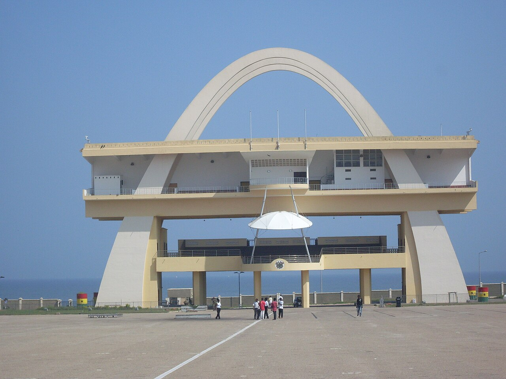
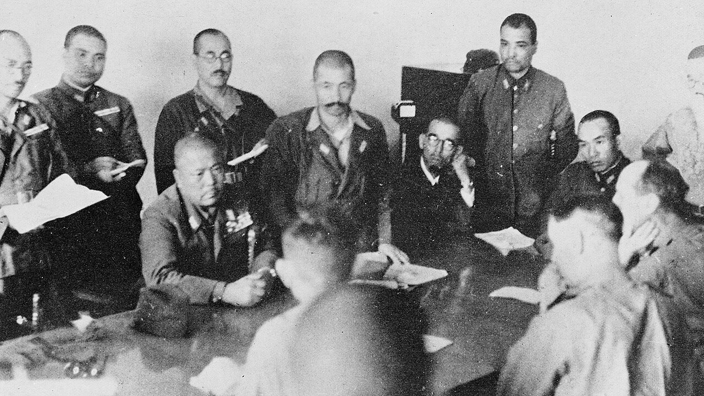
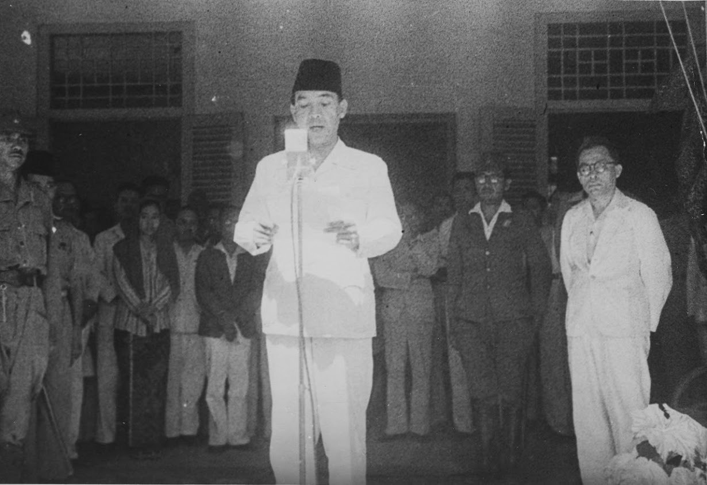
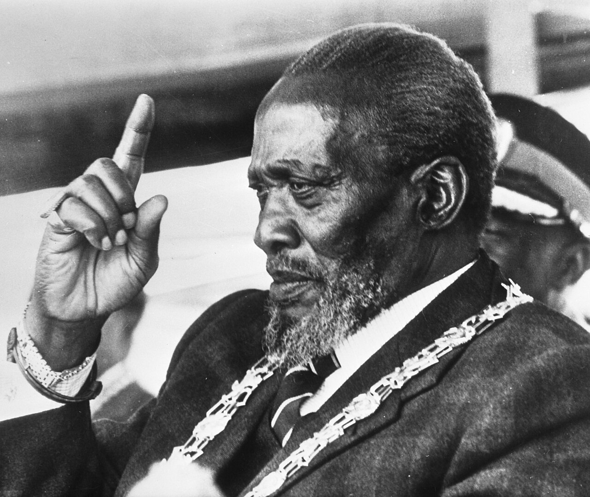
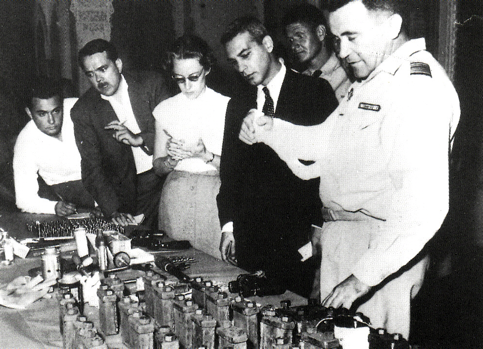
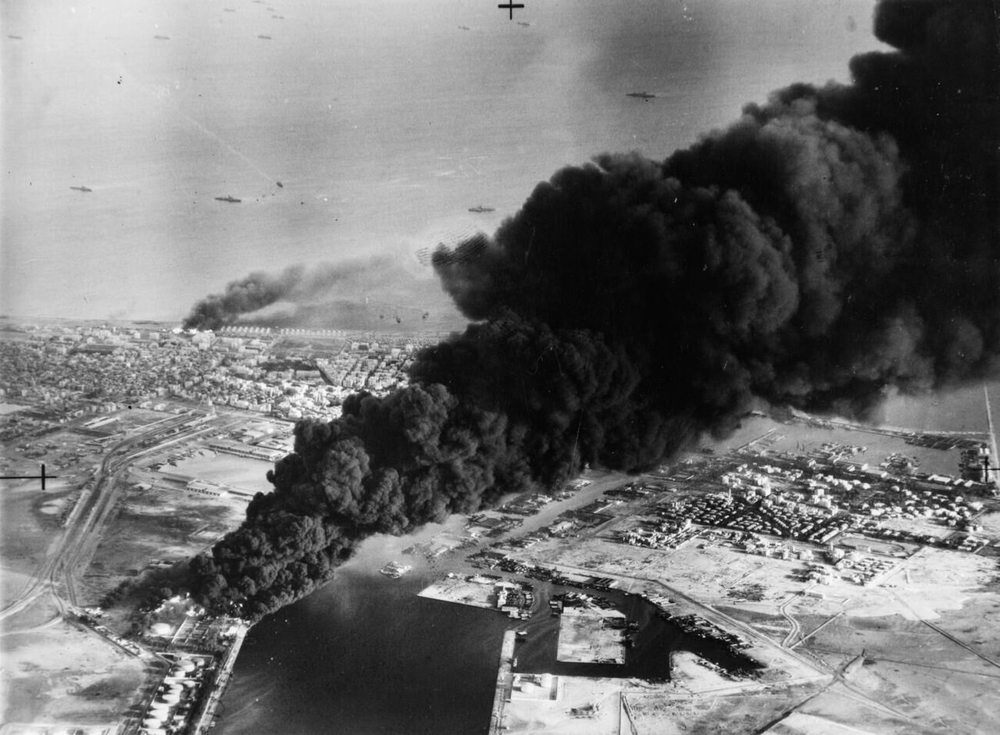
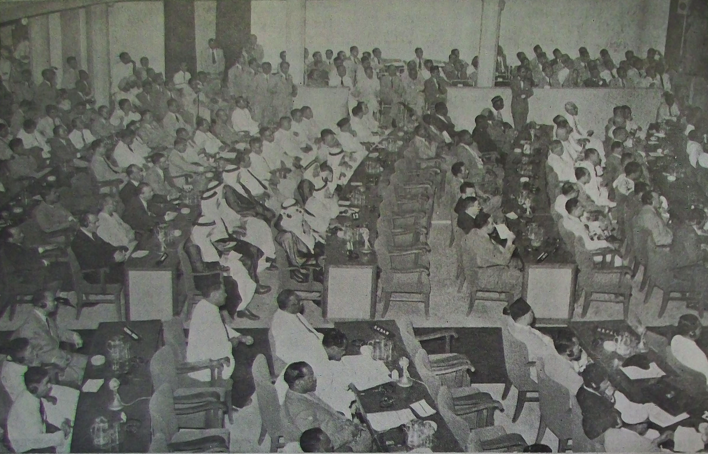
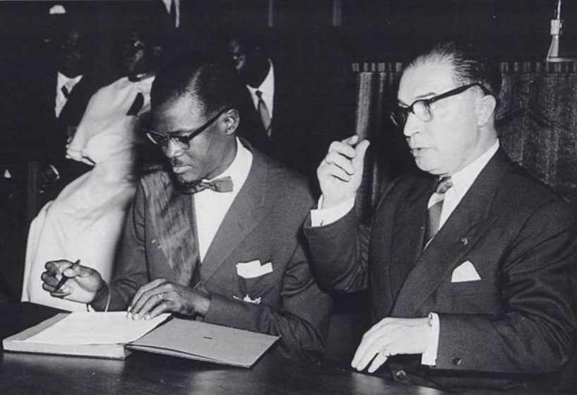
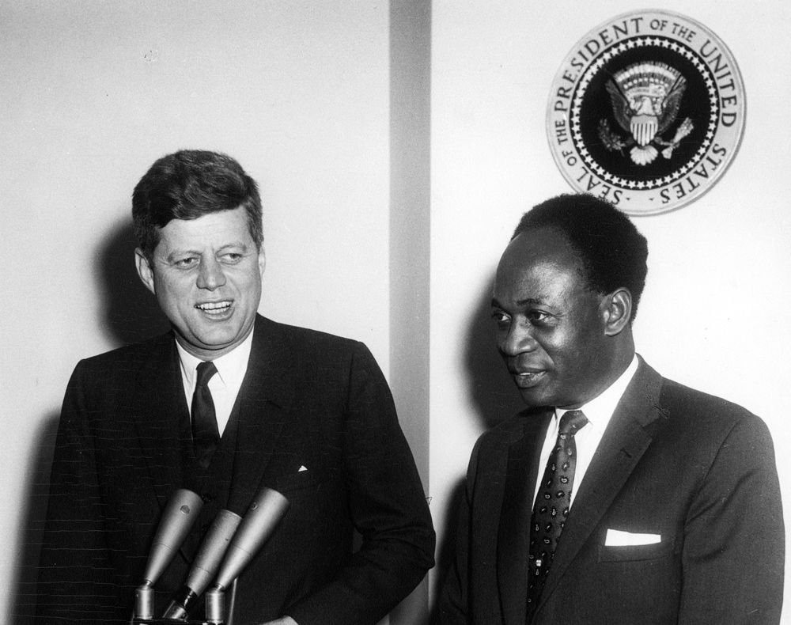

# 87. Why did the European empires give up their colonies?

*Africa and Asia, from 1945 to 1975*

They gave them up because the war had left them too poor and too weak to hold on, because the people they ruled had organised to throw them out, and because the two powers that now dominated the world, the United States and the Soviet Union, had no wish to prop the old empires up, except where one feared that the other would gain by their fall. In 1945 about one person in three on Earth lived in a colony. Thirty years later almost nobody did.

A few minutes before midnight on 5 March 1957, a crowd of perhaps a hundred thousand people stood on the old polo ground in Accra, the capital of the British colony of the Gold Coast, in West Africa. In the building beside it, the colony's parliament was holding its last sitting. At midnight the British flag came down, and a new one went up, red, gold and green with a black star.

A man of forty-seven stood on a small wooden platform above the crowd. Kwame Nkrumah, the prime minister, wore a plain cotton smock and a white cap embroidered with the letters P.G., for "prison graduate", which was the badge of those whom the British had jailed. At long last, he shouted, the battle has ended, and Ghana, your beloved country, is free for ever.

Ghana was the first country in Africa south of the Sahara to win its freedom from a European empire, and guests had come from all over the world. Among them were the vice-president of the United States and, in the crowd on the polo ground, a young Black minister from Alabama named Martin Luther King, who wept. When the two Americans met at a reception, King told the vice-president that he wanted him to come and visit them down in Alabama, where they were seeking the same kind of freedom that the Gold Coast was celebrating.

The night in Accra was a beginning, not an end. In the years that followed, scenes like it would be played out across Africa and Asia, some of them in the same spirit of celebration and some of them after years of killing.

*The Independence Arch and the stand of Independence Square in Accra, built beside the sea near the place where Ghana's independence was celebrated in 1957. Photo: George Appiah, CC BY 2.0.*

## The spell

Fifty years earlier, the empires had looked permanent to rulers and ruled alike. That was a remarkable thing, given how thinly the rulers were spread. A few thousand European officials governed hundreds of millions of people. They could not have held them by force alone. Instead, they did it largely by reputation. Most of their subjects had come to believe that the Europeans could not be dislodged, and a belief like that does much of the work of an army.

The war broke the spell. In February 1942 a Japanese army captured Singapore, Britain's great fortress in Asia, and eighty thousand British, Indian and Australian soldiers laid down their arms. Within months the Japanese had driven the British from Burma and Malaya, the Dutch from Indonesia and the Americans from the Philippines. An Asian power had humbled the Europeans in front of the whole of Asia. That mattered more than the territory lost, because a reputation broken in public is not easily mended.

The Japanese proved to be harsher masters than those they replaced. Nevertheless, for their own purposes, they armed and trained local nationalists. As a result, when they surrendered in 1945 they left behind them countries that had seen the old rulers run, and men who had been taught to fight.

*Japanese commanders at the table where the British surrendered Singapore, 15 February 1942. Photographer unknown, Japanese official photograph, public domain.*

Two days after Japan's surrender, in Jakarta, the nationalist leader Sukarno read out a declaration of two sentences proclaiming the independence of Indonesia. The Dutch, who had themselves just been freed from German occupation, sent an army to take their colony back. They fought for four years. In the end, however, the matter was settled as much in Washington as in Java. The Dutch gave up in 1949, when the United States threatened to cut off the aid on which the Dutch economy depended. The old empires now leaned on American money, and that gave the Americans a say in how long they lasted.

*Sukarno reading the proclamation of Indonesian independence in Jakarta, 17 August 1945. Photo: Frans Mendur, public domain.*

The war had also changed the colonial soldiers. Millions of Indians, Africans and Arabs had fought for Britain and France, in Burma, Italy and the desert. They had seen white men afraid, and had been told that they were fighting for freedom. Men who have risked their lives on a promise like that tend to ask whose freedom it was.

The leaders of the Allies had, in fact, put the promise in writing. In 1941 the British prime minister and the American president had issued a declaration promising to respect the right of all peoples to choose their own form of government. Churchill explained afterwards that he had meant the peoples conquered by Hitler, and not those of the British empire. The peoples of the empire had read it for themselves, and drawn their own conclusion.

Finally there was money. An empire costs something to run, and after the war the bill fell on countries that could no longer easily pay it. Britain and France came out of the war deep in debt, with their cities to rebuild and their voters demanding houses, pensions and hospitals. A government in that position has to choose, and a garrison in a distant colony is hard to defend to voters waiting for a home.

India, the largest colony of all, went in 1947. Once the greatest prize had gone, it was harder to argue that the smaller ones were worth a fight. After that the question for the others was when, and how.

![Map of Africa and Asia with modern borders, each country shaded by the decade in which it left colonial rule: India, Pakistan, Burma, Indonesia and the Philippines in the late 1940s; Ghana, Sudan and the countries of Indochina in the 1950s; most of Africa, including Algeria, Congo and Kenya, in the 1960s; Angola, Mozambique and Zimbabwe in the 1970s. Namibia, Eritrea and Western Sahara are hatched as later; Egypt, Ethiopia, Liberia, South Africa, Turkey, Iran, China and Japan are grey as already independent. Bandung is marked in Java](images/map_independence.png)
*Africa and Asia, with each country shaded by the decade in which colonial rule there ended, 1945 to 1980, on modern borders; Bangladesh and South Sudan are dated with Pakistan and Sudan, of which they were then part. Map: drawn for this book; coastlines and rivers from Natural Earth, public domain.*

## Prison graduate

The Gold Coast was thought to be the most contented colony in Africa, and on paper it had every reason to be. It grew more cocoa than any other country in the world, and the farms that grew it were owned by Africans rather than Europeans. It had good schools, an educated class of lawyers and clergymen, and no white settlers. If any colony seemed likely to wait patiently for its turn, it was this one.

On 28 February 1948 a column of African veterans who had fought for Britain in Burma marched towards the governor's residence in Accra with a petition. They had been promised jobs and pensions and had received neither. They were exactly the men the war had changed: they had fought far from home in Britain's name, and they expected Britain to keep its word.

At a crossroads a British police officer ordered them to halt, and when they did not, opened fire. Three of the veterans were killed. The city rioted, and the riots spread to other towns. Suddenly the contented colony was contented no longer.

The man who would turn that anger into a movement had come home just in time. Nkrumah had returned to the colony two months earlier, after twelve years abroad. He was a goldsmith's son who had trained as a teacher, saved his fare to America, and put himself through university there by working in a soap factory and as a waiter on ships. In 1945 he had helped to organise a congress in Manchester, in England, at which Africans and people of African descent from three continents had resolved to demand independence. He came back, in other words, with the demand already made.

The colony's lawyers and chiefs were asking for self-government "in the shortest possible time". That sounded bold, but it left the British to decide how short the time should be. Nkrumah founded his own party and gave it a shorter slogan: self-government now. The difference was a matter of a few words, but it turned a request into a demand.

He also changed who took part. He recruited the people whom the older leaders had overlooked, the clerks, market women and young men just out of school. They had no voice in the colony as it was, and there were far more of them than there were lawyers. In 1950 he called a general strike and a boycott of British goods, and was sent to prison for three years.

The British then held an election, the first in which most adults could vote. They expected the moderates to win. Instead, Nkrumah's party took thirty-four of the thirty-eight seats that the voters filled, and he was elected from his cell.

That left the governor with an awkward choice. He could keep the winner of the election in prison and govern against the voters, or he could deal with him. The governor considered the position, had him released, and invited him to form a government. Six years later the colony was free.

## Wind of change

The British drew a conclusion from this and from India. It was better to leave early, on good terms, and hand over to a government that would stay friendly and go on trading, than to be driven out by people who had learned to hate you.

In February 1960 the British prime minister carried that conclusion to the place where it was least welcome. Speaking to the all-white parliament of South Africa, he told its members something they did not wish to hear. The wind of change, he said, was blowing through the continent. Whether they liked it or not, the growth of national feeling was a fact, and policy must take account of it.

That year seventeen African countries became independent, most of them former French colonies that Paris released together. France, in other words, had reached much the same conclusion as Britain. The ceremonies followed a pattern, and the scene in Accra became something close to a routine. A member of the royal family or a minister flew out. The flag was lowered at midnight, and the band played the new anthem.

It went that way in most places where the rulers had little to lose. The hard cases were the places where some of them had a great deal to lose. Where Europeans had settled in numbers and taken the land, they did not mean to leave. A visiting minister could fly home after the ceremony, but a settler could not, because for him the colony was home. As a result, the home governments were drawn into wars to protect them.

## The forest

In Kenya, in East Africa, the British had reserved the cool, fertile highlands for white farmers. About thirty thousand settlers held the best land. The Kikuyu people, who had farmed it before them, were crowded into reserves or worked on the white farms as labourers, with no right to the plots that they lived on. The grievance was simple to state: a people had lost its land, and others now farmed it.

In 1952 a secret movement among the landless Kikuyu, bound by oaths, began killing settlers and Africans loyal to the government. The British called it Mau Mau and declared an emergency. The rebels fought from the forests with home-made guns and long knives. In eight years they killed thirty-two white settlers and about eighteen hundred African civilians. Most of the rebels' victims, in other words, were Africans, not settlers.

The British answer was on another scale. More than a million Kikuyu were moved into guarded villages behind barbed wire, and at least eighty thousand suspects were held in camps without trial. Prisoners were beaten, starved and tortured to make them renounce their oath. More than a thousand were hanged, which is more than the British executed in any other colonial emergency.

In the end, cruelty on that scale became a cost at home. At one camp in 1959, guards clubbed eleven prisoners to death, and the scandal in parliament helped to convince London that Kenya was not worth keeping.

Jomo Kenyatta, whom the British had jailed as the leader of the rising, led Kenya to independence in 1963 and became its first president a year later. As in the Gold Coast, the prisoner had become the man the British had to deal with.

The past, however, was not forgotten. Fifty years after independence, the British government expressed its regret in parliament and paid compensation to five thousand elderly survivors of the camps.

*Jomo Kenyatta, president of Kenya, in 1978, the year of his death. Photo: Nationaal Archief, Anefo, CC BY-SA 3.0 nl.*

## Part of France

The hardest of all these wars was fought across the Mediterranean from France.

France had conquered Algeria in 1830, and regarded it as more than a colony. On the map it was three counties of France itself, represented in the parliament in Paris. To a French politician, giving up Algeria sounded less like leaving a colony than like giving away a piece of France.

A million people of European descent lived there, many of them poor, whose families had been in Algeria for four or five generations. For them, too, Algeria was simply home. Around them lived nine million Arab and Berber Muslims, who for a century had been French subjects without being French citizens. They were made citizens in 1946. Even so, their votes were still counted in a separate list, which elected the same number of deputies as the million Europeans. In other words, the nine million had no more say in Paris than the one million.

On 8 May 1945, the day that Germany surrendered, Muslims in the town of Sétif joined the victory parade carrying a nationalist flag. The police fired, and the crowd turned on the Europeans and killed about a hundred. What followed was out of all proportion. The French army and settler militias then killed several thousand Muslims in reprisal, shelling villages from a warship and bombing them from the air. Many Algerians who had believed in gradual reform stopped believing in it that month.

On 1 November 1954 a new movement, the National Liberation Front, set off bombs and attacked police posts across the country. It had a few hundred fighters, set against the whole weight of the French state. France answered that Algeria was France and that there would be no negotiation. A government does not bargain over its own counties, or so the argument ran. In time it sent four hundred thousand soldiers, most of them young conscripts.

Both sides fought without restraint. The Front murdered settlers and cut the throats of Muslims who cooperated with the French.

In 1956 it carried the war into the city of Algiers, where young women in European dress left bombs in cafés and a dance hall. The government handed the city to the paratroopers, who broke the network in nine months. They did it by arresting thousands of people and torturing them with electricity and water for the names of others. Three thousand of those arrested were never seen again. A French general admitted, more than forty years later, that he had tortured and killed prisoners there, and said that he did not regret it.

*A French officer shows journalists bombs recovered in searches of the Casbah of Algiers during the battle of Algiers. Photographer unknown, public domain.*

The army won the battle and France lost the war. The two were connected, because the methods that won in Algiers lost the argument at home. News of the torture divided the country.

The quarrel then came back across the sea. In May 1958 the settlers and the generals in Algiers, fearing that Paris was about to give in, rose in revolt, and the government of France collapsed. Charles de Gaulle, the leader of France's wartime resistance, was called back to power as the one man the army would obey. He flew to Algiers and told a vast crowd of settlers from a balcony: I have understood you.

He had, and he concluded that the thing could not be done. France could not hold nine million people by force for ever, and the attempt was ruining its army and its standing in the world. He opened talks with the Front. That was exactly what the settlers and the generals had feared, and some of them answered with force. Four generals tried to overthrow him in 1961, and failed when the conscripts, listening to his broadcast on their transistor radios, refused to follow their officers. A secret army of settlers and deserters set off bombs in Algiers and Paris and tried several times to kill him.

Algeria became independent in July 1962. The cost had been terrible on every side. At least three hundred thousand Algerians had died. Within a few months nine hundred thousand settlers crossed the sea to a France that most of them had never seen, with what they could carry. The saying among them was that the choice was the suitcase or the coffin. Tens of thousands of Algerian Muslims who had served in the French forces were left behind, and many were killed with their families.

## The canal

In Egypt, at the same time, Britain and France tried to act as great powers always had.

The Suez Canal, which runs through Egypt and joins the Mediterranean to the Red Sea, had been built with French and Egyptian money and Egyptian labour, and was owned by a company whose largest shareholder was the British government. In July 1956 the president of Egypt, a young colonel named Gamal Abdel Nasser, announced that Egypt was taking it over. To London and Paris, a canal in the hands of an Egyptian nationalist was not to be borne. In October Britain and France, by a secret arrangement with Israel, sent an invasion force to seize it back and bring him down.

The American president had not been consulted, and was furious. He also had the means to make his anger felt. Investors were selling pounds, and Britain needed an emergency loan. Washington let it be known that there would be no loan until the troops left. They left. The prime minister resigned. Nasser, who had lost every battle, became the hero of the Arab world. Everyone watching could draw the conclusion: Britain and France could no longer count on carrying through a war that Washington opposed.

*Smoke rising from oil tanks beside the Suez Canal at Port Said after the Anglo-French assault of 5 November 1956. Photo: Fleet Air Arm official photographer, public domain.*

## Neither side

Meanwhile, the peoples of Asia and Africa were looking for a voice of their own. In April 1955 the leaders of twenty-nine Asian and African countries met in the Indonesian hill town of Bandung. Between them they governed more than half of humanity. Sukarno, their host, told them that it was the first conference of coloured peoples across continents in the history of mankind.

Most of those present had been subjects of an empire ten years before. They did not agree on much. Some were allies of the United States, China was communist, and India wanted to side with neither. What they shared was a refusal to accept that the world's only quarrel was the one between Washington and Moscow. They condemned colonialism "in all its manifestations", demanded a voice in world affairs, and resolved to stand together. Much of the point lay in the meeting itself: former subjects talking to one another, without the European powers in the room.

*A plenary session of the Asian-African conference at Bandung, April 1955. Photo: Foreign Ministry of Indonesia, public domain.*

A French writer had found a name for them three years earlier, and he took it from his own country's history. Before the French Revolution, he pointed out, the common people, who were nearly everyone, had been called the third estate. They had been ignored, exploited and despised, and they had wanted to become something. The poor countries, which belonged by rights to neither the capitalist nor the communist camp whatever alliances their governments had signed, were a third world.

## A king's speech

The worst handover of all took place in the middle of Africa.

Belgium had run the Congo, a territory the size of western Europe, as a business. It built mines, railways and clinics, and taught a great many Congolese to read. It allowed them no politics and almost no higher education. The result was a country in which many people could read and almost none had been trained to govern.

Few in Brussels expected that to matter soon. As late as 1955 a Belgian professor who proposed independence in thirty years was thought a radical. Then riots broke out in the capital, and the Congolese parties, summoned to Brussels at the start of 1960, stood together and demanded independence at once. The Belgians lost their nerve and agreed to leave in five months. The professor's thirty years had shrunk to five months.

The gap showed on the day itself. On independence day, 30 June 1960, the country had fifteen million people. A few dozen of them had university degrees. It had no African doctors, and no African officers in its army.

The king of the Belgians came to the ceremony. He made a speech praising the genius of his great-great-uncle, the king who had founded the colony, and advising the Congolese not to spoil what Belgium had given them. It was the speech of a ruler who saw the colony as a gift.

The new prime minister, a former postal clerk of thirty-four named Patrice Lumumba, had not been due to speak. He rose and replied, and what he said was the other side of the story. We have known mockery, insults and blows, he said, morning, noon and night, because we were Negroes. We have seen our lands taken. Who will forget the shootings, or the cells into which those who would not submit were thrown?

*Patrice Lumumba signing the document of independence next to the Belgian prime minister Gaston Eyskens, 30 June 1960. Photo: Congopresse, public domain.*

Within a week the army mutinied against its Belgian officers, and the country began to come apart. Belgian troops flew back in. The province of Katanga, which held the copper mines, declared itself a separate country with the support of Belgian mining interests. Lumumba asked the United Nations to expel the Belgians. Its soldiers arrived within days. However, they refused to move against Katanga, which was what Lumumba needed most. So he turned to the Soviet Union, which sent aircraft and trucks.

To Washington that made him a danger. In the middle of the contest with Moscow, a leader who accepted Soviet aircraft in the heart of Africa looked like a door opening for the other side.

The head of American intelligence cabled that his removal was an urgent objective, and a scientist was sent to the Congo with poison to be put in his food. It was never used. In September the army's chief of staff, a former sergeant and journalist named Joseph Mobutu, seized power with American encouragement. Lumumba was arrested, beaten, and flown to Katanga. On the night of 17 January 1961 he was shot beside a tree by a firing squad under the command of Belgian officers. He had been prime minister for less than three months.

Mobutu made himself president by a second coup in 1965 and ruled the country for thirty-two years, as a firm friend of the West, and stole several billion dollars from it.

## What was handed over

The first empire that had come was almost the last to go. Portugal fought for thirteen years to keep its African territories, until in 1974 its own young officers, sick of the wars, overthrew the dictatorship in Lisbon and brought the soldiers home. As in France, the war was settled in the capital as much as in the colonies.

By then the question was no longer whether the empires would go, but what they had left behind. The new countries began with heavy handicaps.

The first lay in the shape of the countries themselves. Their borders were the lines that Europeans had ruled across the map of Africa during the partition, which bundled rival peoples into one state and split others between several. Changing them, however, looked more dangerous than living with them. In 1964 the African governments agreed among themselves to leave those borders as they were, since to reopen one would be to reopen all of them.

The second handicap was the economy. Their economies had been built to supply Europe with a single crop or metal, and the price was set elsewhere. A country in that position does well when the price is high and suffers when it falls.

Ghana lived by cocoa. Nkrumah borrowed heavily to build a great dam, factories and schools, and dreamed of uniting the whole continent in one federation. The debts would have to be paid from the sale of cocoa. Then the price of cocoa fell by more than half. He grew dictatorial, jailed his opponents without trial, and in 1966 was overthrown by his own army while on a visit to China. Ghana was far from alone. In the next forty years African armies carried out about eighty successful coups.

Nkrumah spent his exile writing about what he called the new colonialism. The flags had changed, he argued, and little else. The mines and plantations still belonged to foreign companies, the former rulers still trained the armies and lent the money, and a government that stepped out of line could expect to be removed, as Lumumba had been.

*Kwame Nkrumah with President John F. Kennedy at the White House, 8 March 1961, four years after Ghana's independence. Photo: Abbie Rowe, public domain.*

There was truth in it. However, there were also gains. In the first decades of independence, the number of African children in school multiplied many times over, and people lived longer. No country that won its freedom has asked for its old rulers to return.

Lumumba's killers dug up his body, cut it in pieces and dissolved it in acid, so that there should be no grave. The Belgian police officer who did the work kept a tooth as a souvenir. In 2022 the Belgian government returned it, in a small blue box, to his children. It was flown home, carried around the country that he had led for eleven weeks, and laid to rest in a mausoleum in the capital.
