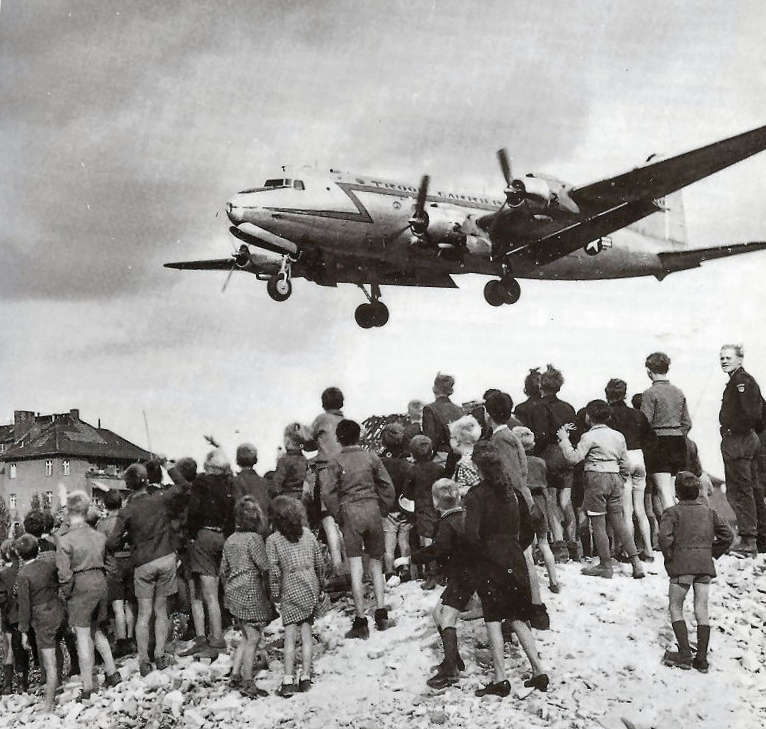
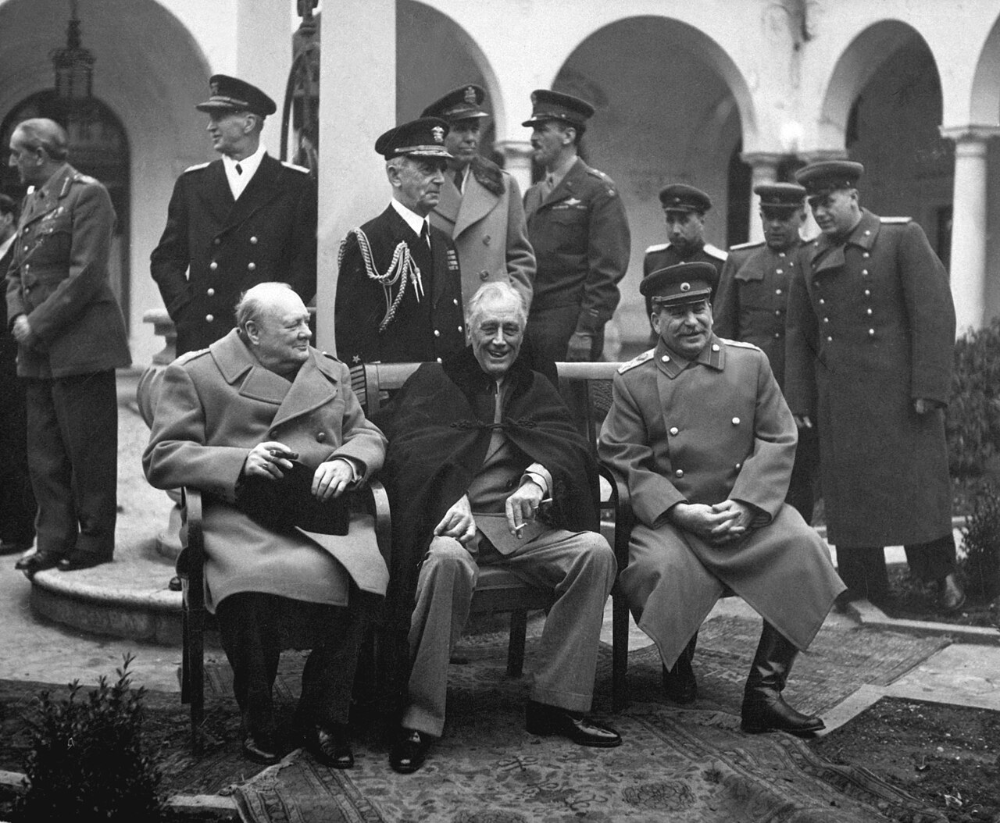
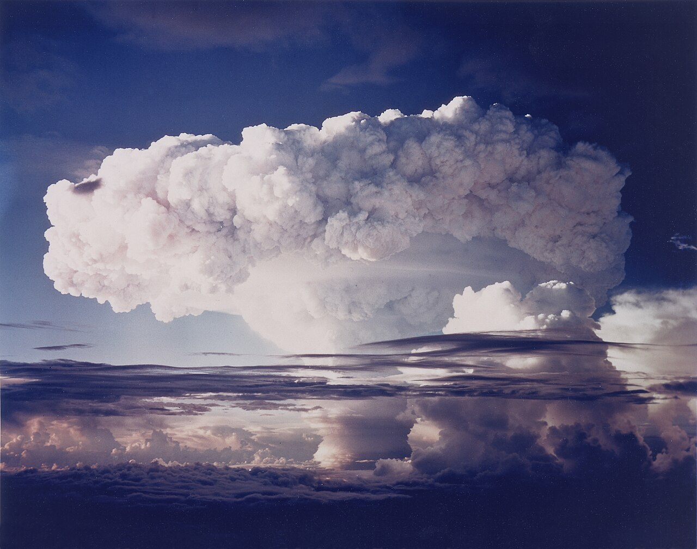
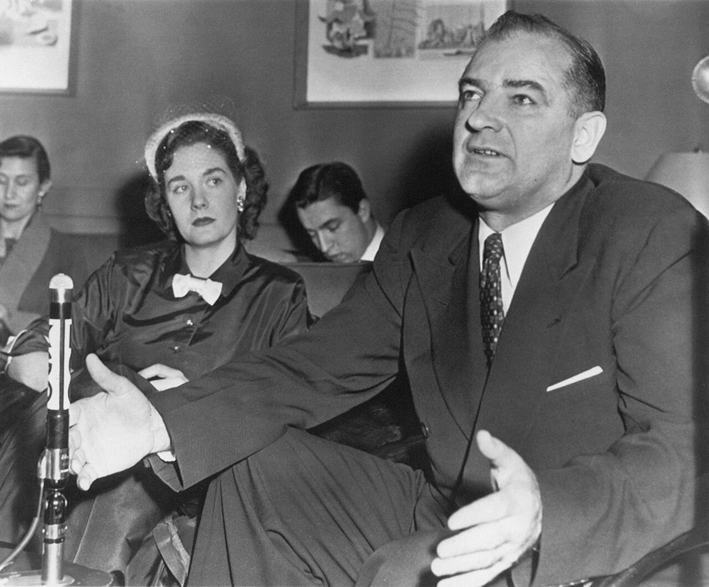
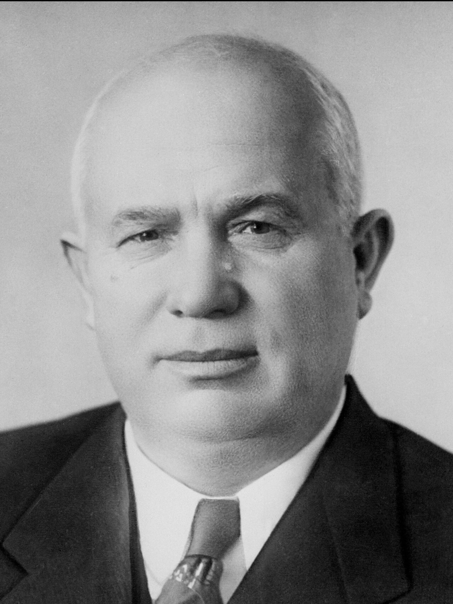
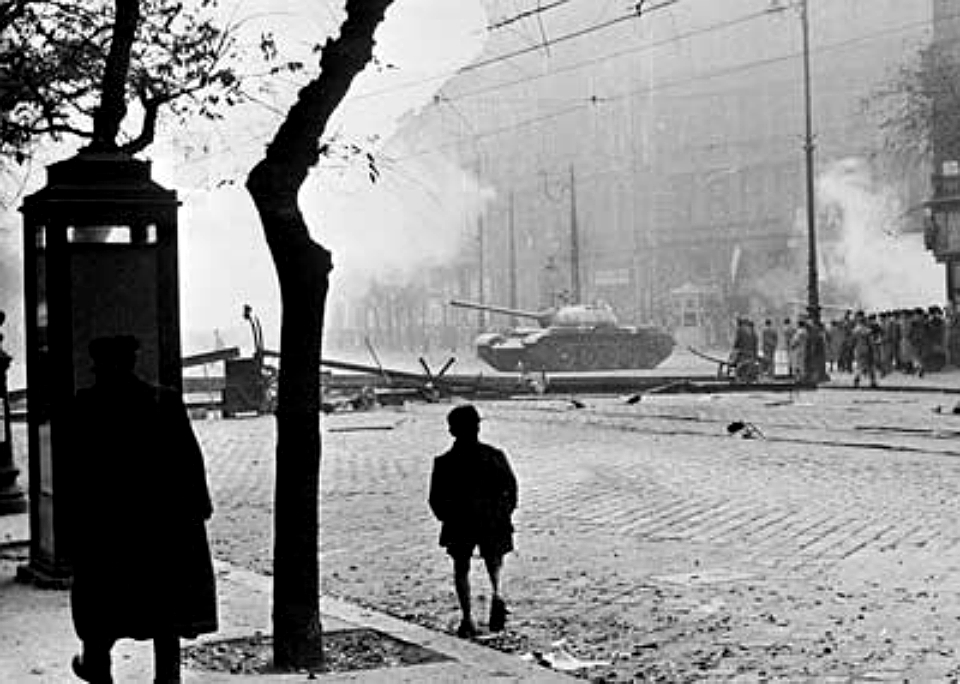
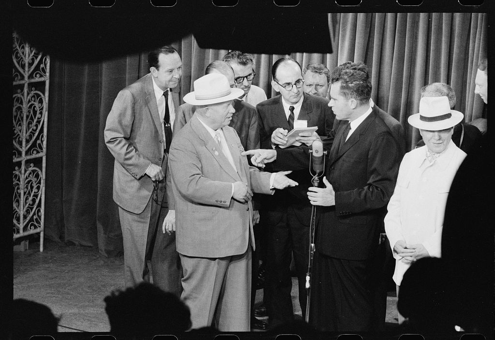
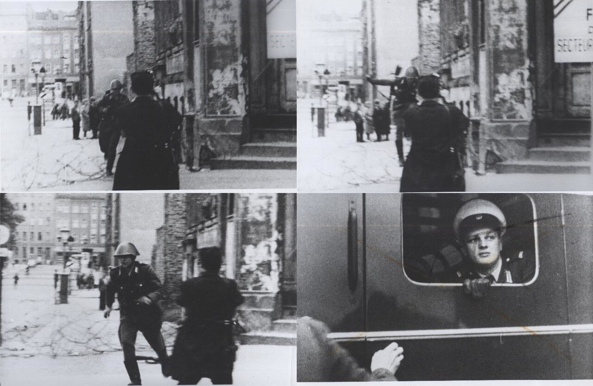
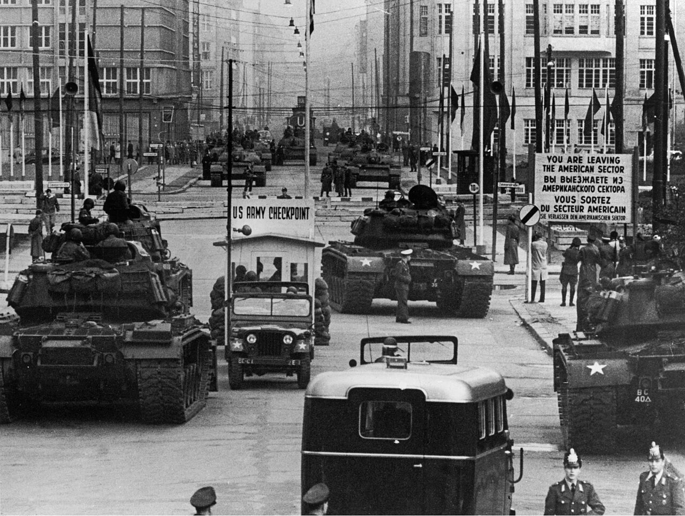
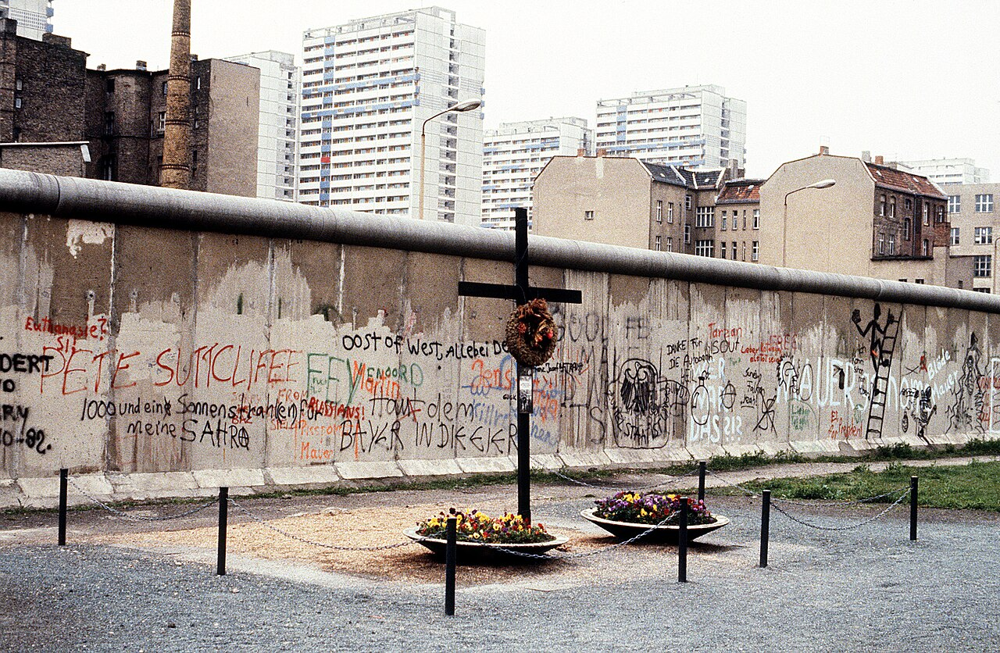

# 88. What was the Cold War?

*Europe, the United States and the Soviet Union, from 1945 to 1962*

The Cold War was a contest that lasted forty-five years between the United States and the Soviet Union, the two countries left standing when the others had been ruined. Each believed that its own system was the future of mankind and that the other intended to destroy it. It was called cold because the two never went to war with each other. Their weapons came to make that a form of suicide, and so they fought by other means: an arms race, spies, propaganda, and the arming of opposite sides in other people's wars.

In the summer of 1948, the children of Berlin took to standing on the heaps of rubble at the end of an airfield in the middle of their city, looking up. Every few minutes, day and night, a transport aircraft came in low over the roofs of the bombed apartment blocks and landed. Each one carried about ten tons of cargo, most of it sacks of coal, and was unloaded and back in the air within half an hour.

*Berlin children watch an American C-54 transport come in to land at Tempelhof airport during the airlift of 1948. Photo: Henry Ries, US Air Force, public domain.*

Berlin lay a hundred and sixty kilometres inside the part of Germany that the Soviet army had occupied. The city itself had been divided among the four victorious powers. As a result, the two and a quarter million people in its western districts lived on an island, and they depended on trains and trucks from the west for their food and fuel. On 24 June 1948 the Soviet authorities closed every road, railway and canal. The reasoning was simple: a city that cannot be fed cannot be held. They expected the Americans, the British and the French to give up the city in a matter of weeks.

The western powers faced a hard choice. They could have tried to force the roads with tanks, and risked a war. Instead, they chose to supply a whole city by air, which nobody had done before. It sounded close to impossible. A city needs food every day, and coal to cook with and to keep warm, and the roads and railways that had carried it were closed.

The flights went on through the winter. By the time the airlift ended the western aircraft had made more than a quarter of a million flights and delivered over two million tons. The pilots, oddly enough, were in many cases the same men who had bombed Berlin three years earlier. One of them took to dropping chocolate bars to the children on parachutes made of handkerchiefs, and soon whole squadrons were doing it. For the children on the rubble heaps, the enemy of three years before had become the friend who brought sweets.

In May 1949, after eleven months, Stalin reopened the roads. Nothing had been gained, and the people of western Germany, who had been America's enemies four years before, were now its allies. Berlin had shown, in a small space, how the contest would be fought: with pressure and endurance, and with each side careful to stop short of shooting.

## Two kinds of safety

The alliance that defeated Hitler had been a marriage of necessity, and it did not outlast him by a year. Once the common enemy was gone, the differences between its members came back into view.

The quarrel began over the lands between Germany and Russia. In the last year of the war the Soviet army had fought its way across Poland, Hungary, Romania, Bulgaria and Czechoslovakia, and half of Germany itself, and in most of them it was still there. Stalin had no intention of letting those countries choose governments that might be hostile to him.

From where he stood, that was ordinary prudence. His country had been invaded from the west twice in thirty years, across the Polish plain, and the second invasion had killed twenty-seven million of its people. He wanted a belt of obedient states between himself and any future Germany. He also believed, as a Marxist, that a clash with the capitalist powers was certain in the end. If the clash was certain, then a belt of obedient states was not a luxury but a necessity.

*Winston Churchill, Franklin Roosevelt and Joseph Stalin at Yalta in the Crimea, February 1945, with their officers behind them. Photo: US government photographer, public domain.*

To the Americans, and to the British, who had gone to war over the independence of Poland, this looked like one tyranny replacing another. Each side, in other words, was seeking its own kind of safety, and each found the other's kind alarming.

Stalin had promised free elections in the countries he had liberated. What he delivered was something else, and it came slowly and carefully. Local communists, backed by the Soviet army and trained in Moscow, entered coalition governments and asked for the ministry that controlled the police. That was the post that mattered, because whoever controls the police decides who is arrested. Their rivals were then removed a few at a time, by arrest, blackmail and rigged votes. A Hungarian communist described the method as slicing a salami: no single slice looked like much, but in the end nothing was left.

By 1948 every country in eastern Europe that the Soviet army had freed had a government run by communists who took their orders from Moscow. The last to go was Czechoslovakia, the one real democracy among them, where the communists seized power that February and the foreign minister was found dead two weeks later in the courtyard beneath his window.

## A long telegram

In the West, the words for what was happening came quickly. In March 1946 Winston Churchill, who was out of office, gave a speech at a small college in the American state of Missouri, with the president sitting beside him. An iron curtain, he said, had descended across the continent, from the Baltic to the Adriatic, and behind it lay all the capitals of the ancient states of central and eastern Europe. The phrase stuck, because it gave the division of Europe a shape that anyone could picture.

A few weeks earlier a diplomat at the American embassy in Moscow had sent Washington a telegram of five thousand words, the longest in the history of the service. He argued that the Soviet leaders needed a foreign enemy in order to justify their rule at home, and so could not be won over by friendliness. They were not reckless, however. They would push wherever they met weakness and stop wherever they met firm resistance. That made them dangerous, but it also made them predictable. The right policy, as he put it the following year, was to contain them, patiently, at every point, until the system changed from within.

That advice became American policy for the next forty years, and it was put into practice within about a year. In March 1947 the president asked Congress for money to support the governments of Greece and Turkey against communist pressure, and declared that the United States would help free peoples anywhere who were resisting subjugation. The offer of aid to rebuild western Europe followed three months later. Money, as much as soldiers, was to be the means of containment.

Each side explained the other by its own worst memory. The Americans had learned in the 1930s that a dictator who is given way to demands more, and they saw in Stalin another Hitler. The Soviet leaders had learned that the capitalist world wished them dead. They saw a country that alone possessed the atomic bomb, was building air bases around their borders, and was putting Germany back on its feet. Both were acting from fear. As a result, each took the other's precautions as proof of its hostile intentions, and answered them with precautions of its own, which the other read in the same way.

## Two Germanies

Nowhere did those fears meet more directly than in Germany. It was where the two pressed hardest against each other, and in the end it split along the line between the zones that the armies occupied. In 1949 the American, British and French zones became a democratic state, West Germany. The Soviet zone became a communist one, East Germany. Berlin remained divided inside it, an island of the West a hundred miles behind the lines.

That same year the United States and its allies signed the treaty that bound them to defend one another. It is known as NATO. In plain terms, an attack on any one of them would be treated as an attack on them all. The Soviet Union later formed an alliance of its own from the states that it controlled, the Warsaw Pact. For the next forty years, the two largest armies ever assembled in peacetime faced each other across a fence that ran through the fields and forests of the middle of Germany.

![Map of Europe in 1955. NATO countries, from Iceland, Norway and Britain to Portugal, Italy, Greece, Turkey and West Germany, are shaded blue; the Warsaw Pact, from East Germany, Poland and Czechoslovakia to Hungary, Romania, Bulgaria, Albania and the Soviet Union, is shaded red; Sweden, Finland, Ireland, Switzerland and Austria are hatched as neutral; Spain and Yugoslavia are in neither. A dashed iron curtain runs from the Baltic through Germany to the Black Sea, with West Berlin as a blue dot inside East Germany. Below, one panel shows the two Germanies and the three air corridors from West Berlin to Hamburg, Hanover and Frankfurt; another shows Berlin's Soviet, American, British and French sectors, with Tempelhof airfield](images/map_europe_1955.png)
*Europe in 1955, roughly: the two alliances, the neutral states, the iron curtain and the border between the two Germanies; below, West Berlin's three air corridors through East Germany, and the four sectors of Berlin. Map: drawn for this book; coastlines and rivers from Natural Earth, public domain. Berlin's districts from OpenStreetMap.*

## Duck and cover

Meanwhile, the balance of weapons was shifting. Many American leaders had assumed that their monopoly of the atomic bomb would last for ten years or more. It lasted four. From then on, each side had to plan for the other's bombs as well as its own. In August 1949 the Soviet Union exploded a copy of the bomb that had been dropped on Nagasaki, built with the help of designs passed to Moscow by a physicist who had worked on the original.

Both sides then moved on to something far worse. The hydrogen bomb uses an atomic bomb merely as its trigger. The heat and pressure of that first explosion squeeze the lightest atoms until they fuse together. That is the reaction that powers the Sun, and it releases far more energy than splitting atoms does. The United States tested one in 1952, on a Pacific island that ceased to exist, and the Soviet Union followed three years later.

The new weapon changed the scale of the danger. A single such bomb could destroy any city on Earth. By the 1960s the two countries had more than thirty thousand nuclear warheads between them, and the Americans kept bombers in the air around the clock so that they could not be caught on the ground. In 1961 the Soviet Union tested a bomb with three thousand times the force of the one that had destroyed Hiroshima. Windows broke nine hundred kilometres away.

*Ivy Mike, the first hydrogen bomb, exploded by the United States at Enewetak Atoll in the Pacific on 31 October 1952. Photo: United States government, public domain.*

People learned to live with this. American schoolchildren were drilled to crouch under their desks and cover their heads when they saw the flash. Families dug shelters in their gardens and stocked them with tinned food. In the Soviet Union the population was assured that the imperialists were preparing an attack.

The weapons did have one effect that few had dared to count on. Once each side could destroy the other even after being struck first, neither could start a war and survive it. Every crisis of the next forty years was managed with that knowledge. The peace of Europe was kept by a promise of mutual suicide.

## A list of names

A long contest with a hidden enemy changes the country that wages it. Fear of spies, once it takes hold, is hard to keep within bounds.

In the United States, the government had begun checking the loyalty of its own employees in 1947, and the discovery that Soviet spies had stolen the secret of the bomb turned that search into a hunt for traitors. In February 1950 a little-known senator named Joseph McCarthy told a women's club in West Virginia that he held in his hand a list of two hundred and five communists working in the foreign ministry. He had no such list, and the number changed from speech to speech. That hardly mattered, because the fear was real even when the list was not. For four years he was one of the most feared men in the country all the same.

Across the country, the hunt went on. Civil servants, teachers, film writers and trade unionists were questioned about their opinions and their friends, and thousands lost their jobs. A married couple from New York were sent to the electric chair for conspiring to pass atomic secrets, though the case against the wife was thin.

In the end McCarthy went too far. He fell in 1954, when he accused the army itself and was asked on live television, by the army's elderly lawyer, whether he had no sense of decency.

*Senator Joseph McCarthy speaking to reporters on 10 February 1954, with his wife Jean beside him. Photo: Associated Press, public domain.*

What happened on the other side was of a different order. In the Soviet Union and its satellites there was no press to expose an accuser, and in a political trial no court that could acquit. Without those checks, an accusation was as good as a verdict. In the late 1940s Stalin turned on the communist leaders of eastern Europe as he had once turned on his own. In Prague in 1952, fourteen of the highest officials in the country confessed in court to being spies for the West, and eleven were hanged.

Behind the trials stood a permanent machine. Every state in the bloc had a secret police on the Soviet pattern. The East German one grew until, by the 1980s, it had ninety thousand officers and twice as many informers, in a country of sixteen million. It kept files on a third of the population, and people learned after its fall that their friends, colleagues and in some cases their husbands and wives had been reporting on them.

## The secret speech

Stalin died in March 1953, of a stroke, lying for hours on the floor of his room because his guards were afraid to go in without being called. His death left the men around him with a question: what to do with the memory of the man they had all served.

Three years later his successor, Nikita Khrushchev, a blunt and energetic former miner, called the delegates of the party congress to a closed session at midnight. He spoke for four hours. He told them that Stalin had been a murderer, who had tortured loyal communists into false confessions, shot the best generals of the army, and built a cult of himself as a god. The delegates listened in silence. The speech was secret for a few weeks. Then it was read aloud to party meetings across the country, and copies reached the West.

*Nikita Khrushchev, who denounced Stalin to the party congress in 1956, in an official portrait of that year. Photo: TASS, public domain.*

Khrushchev wanted to save the system by cleansing it. The fault, in his telling, lay with one man, and once the man was condemned the party could carry on. Prisoners came home from the camps by the hundred thousand. The people of eastern Europe, however, drew a wider conclusion. If Stalin had been a criminal, the governments that he had installed had no right to rule.

In Hungary, that conclusion was soon put to the test. In October 1956 students in Budapest marched to demand free elections and the withdrawal of Soviet troops. The crowd pulled down a bronze statue of Stalin eight metres high, leaving only the boots. The Hungarian army joined the uprising. A reforming communist became prime minister, and announced that Hungary would hold free elections and leave the Soviet alliance. For a few days it looked as though the rising had won.

On 4 November a thousand Soviet tanks entered the city. The fighting lasted a week. About two and a half thousand Hungarians were killed, and two hundred thousand fled the country, most of them across the border to Austria. The prime minister was taken away and later hanged. Hungarian radio had broadcast appeals to the West for help until the moment it went off the air.

*A Soviet tank approaches a barricade in a street of Budapest during the uprising of 1956. Photo: CIA, public domain.*

None came. The United States had encouraged the peoples of eastern Europe to hope for liberation, and it now made clear that it would not risk a world war to free them. That was the unwritten rule of the Cold War in Europe. Each side denounced what the other did in its own half, and left it alone.

## A kitchen

Since the two could not fight, they competed, in everything from the number of their steel mills to the medals of their athletes. Underneath lay a simple question. Which system gave ordinary people a better life? Whichever could show the better answer would win the argument without a shot.

For a time the answer was not obvious. The Soviet economy grew fast in the 1950s. It had rebuilt its cities, and it gave its citizens free schooling, free medicine and a job for life. In 1956 Khrushchev told a room of Western ambassadors that history was on his side. We will bury you, he said. It was the boast of a man who believed that his side was winning. The next year, moreover, his country astonished the world by putting the first satellite into orbit.

In July 1959 the argument was carried into a kitchen. The American vice-president opened an exhibition in Moscow, which included a full-sized model of an ordinary American house. The choice made a point: the Americans were showing off not rockets but the comforts of an ordinary home. He and Khrushchev stopped in its kitchen, in front of the washing machine, and had an argument before the cameras. The vice-president said that any American steelworker could afford such a house. Khrushchev replied that Soviet houses were built to last and that his country would overtake America in seven years. Millions of Russians queued to walk through the house, and to taste a free cup of a sweet brown American drink.

*Nikita Khrushchev and Richard Nixon arguing at the American exhibition in Moscow, 24 July 1959, the "kitchen debate". Photo: Thomas J. O'Halloran, public domain.*

## The wall

The test came in the one place where people could vote on the question with their feet.

The border between the two Germanies had been fenced and guarded since 1952. Inside Berlin, however, the line between the Soviet sector and the western ones ran down the middle of streets, and anyone could cross it by taking the underground railway for one stop. From West Berlin a person could fly to West Germany and be accepted as a citizen on arrival. In effect, the underground railway was a door in the iron curtain, and it stood open.

By 1961 about three million East Germans had left for the West, most of them by that route. They were one in six of the population. The loss was heavy, and it fell where it hurt most. The leavers were disproportionately the young and the trained, the doctors, engineers and teachers whom the state had educated at its own expense. In the summer of 1961 they were leaving at the rate of two thousand a day, and the East German leaders told Moscow that the country would collapse.

Shortly after midnight on Sunday, 13 August 1961, East German soldiers and police unrolled barbed wire along the whole line through the city. The underground stations were sealed. Berliners woke to find that they could no longer reach their jobs, their parents or their fiancées on the other side.

The barrier did not stay a coil of wire for long. Within days the wire was being replaced by a wall of concrete blocks, and over the years it was rebuilt into a double barrier with a strip of raked sand between, watchtowers, floodlights and dogs. It ran for a hundred and fifty-five kilometres around West Berlin.

On the third day after the wire went up, a nineteen-year-old East German border guard, posted at a corner where the barrier was still a coil of wire, was seen glancing over his shoulder. People on the western side called to him to come. He ran, jumped the wire, and dropped his gun as he landed. A photographer caught him in the air. The picture made him famous: a guard of the state, escaping from it.

*The East German border guard Conrad Schumann leaping the barbed wire into West Berlin on 15 August 1961, in frames from the sequence that made him famous. Photo: via the CIA, public domain.*

The American president was privately relieved. A wall, he told his aides, was a great deal better than a war. A divided city, cruel as it was, could be lived with, and a nuclear war could not. The danger, however, had not passed. That October American and Soviet tanks faced each other at a crossing point in the middle of the city for sixteen hours, with their engines running and their guns loaded, a hundred metres apart. Neither side wanted to be the first to give way, and neither wanted to be the first to fire. Then one Soviet tank backed away a few metres, and one American tank did the same, and the rest followed in turn.

*American tanks at Checkpoint Charlie in Berlin, with Soviet tanks facing them down the street, October 1961. Photo: US Army, public domain.*

East Germany called the wall a rampart against fascism. However, every one of its defences pointed inwards, at the state's own people. Over the twenty-eight years that it stood, at least a hundred and forty people died at it, most of them shot or killed in falls while trying to cross.

One of the first was a bricklayer of eighteen named Peter Fechter. On 17 August 1962 he and a friend ran for the wall near the crossing point, in the middle of the day. The friend got over. Fechter was shot in the hip as he climbed, and fell back on the eastern side. He lay at the foot of the wall for almost an hour, calling for help, in plain view of a crowd of West Berliners, of American soldiers, and of the East German guards. The guards were afraid of being shot from the West, and the Americans had orders not to set foot on the other side. Nobody went to him until he was dead.

*The memorial to Peter Fechter on the western side of the Berlin Wall, photographed on 1 May 1984. Photo: US Department of Defense, public domain.*