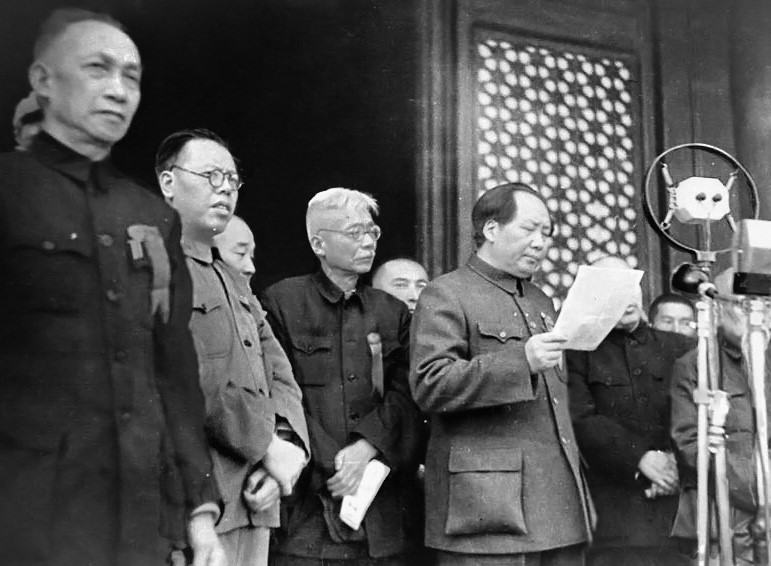
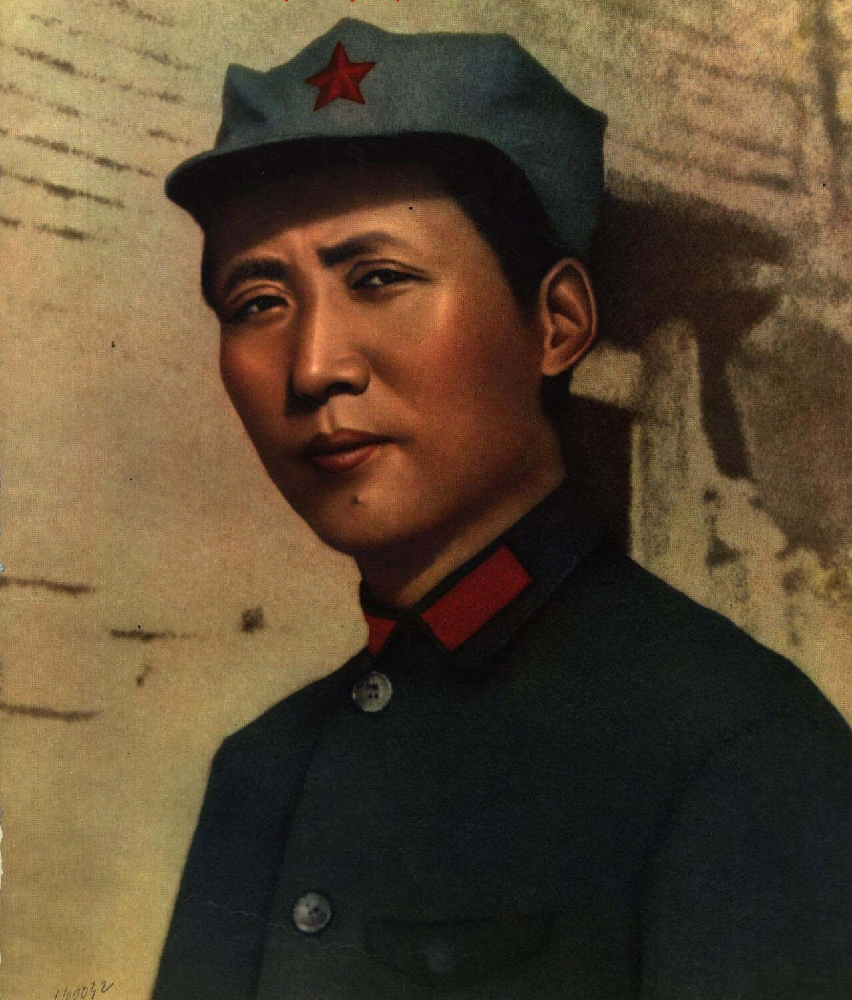
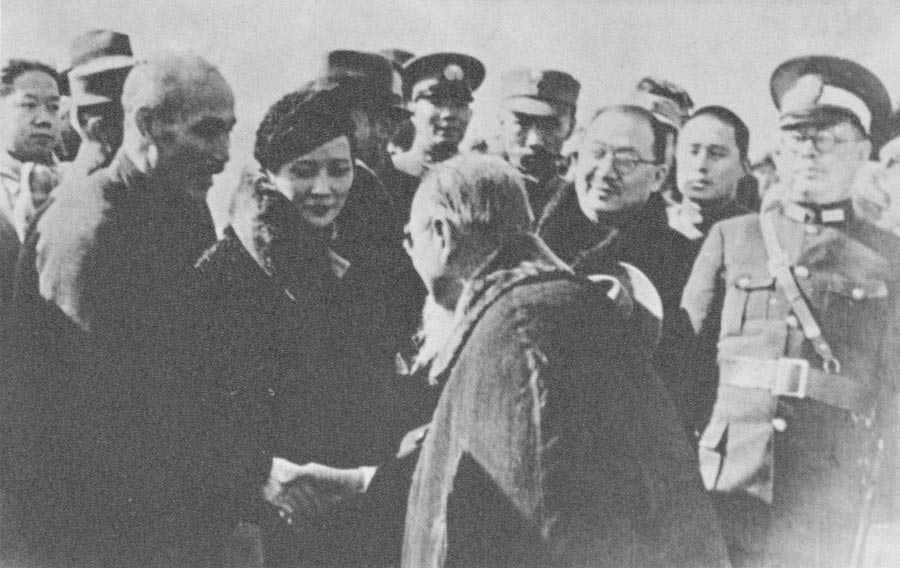
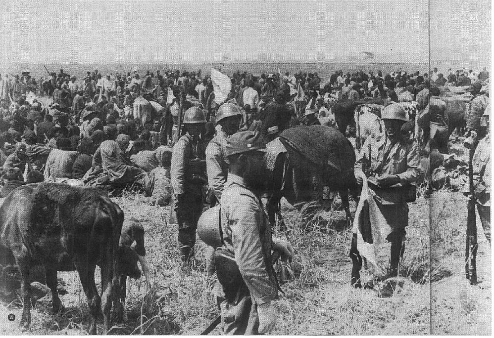
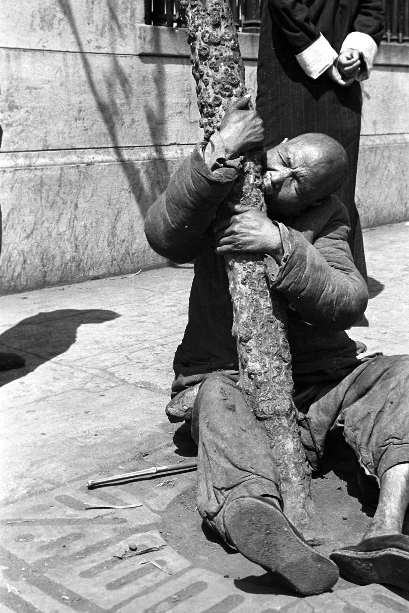
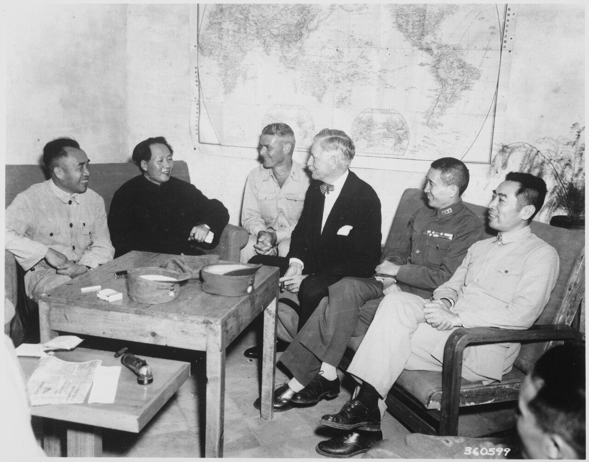
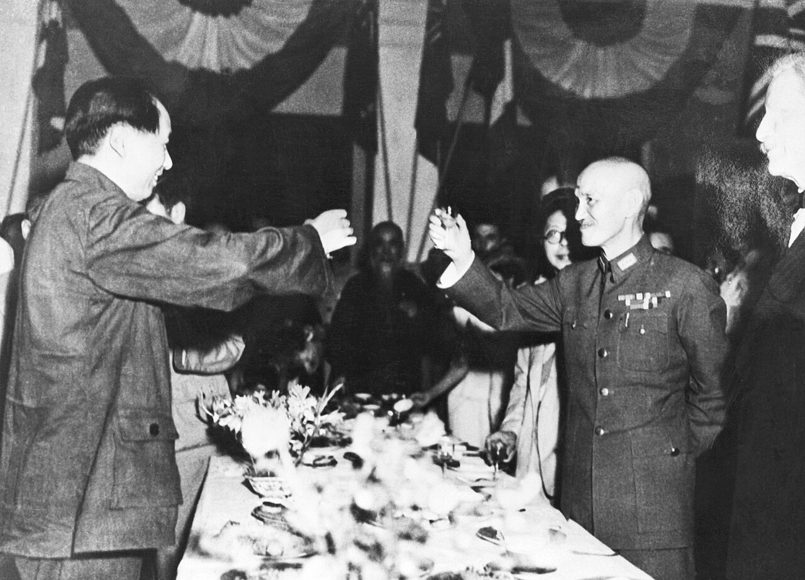
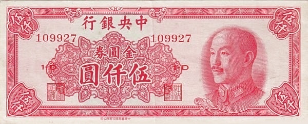
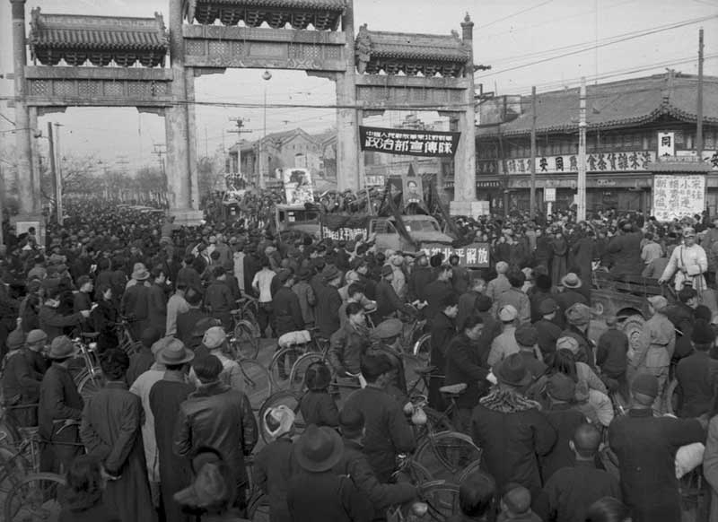
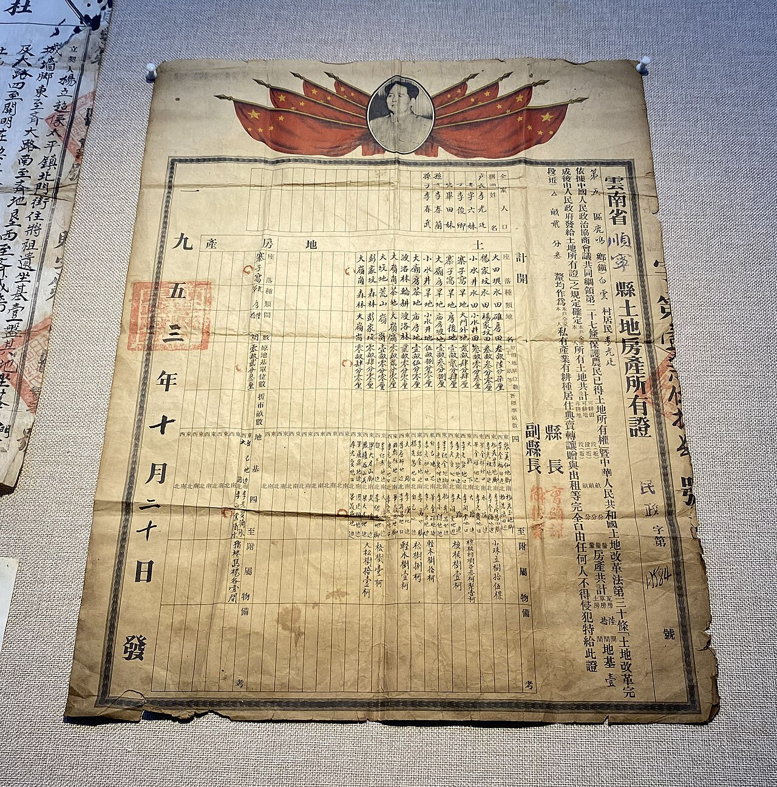

# 89. Why did China become communist?

*China, from 1927 to 1952*

China became communist because eight years of war with Japan ruined the government that the Communists were fighting, and because the Communists offered the peasants, who were four fifths of the nation, the thing that they most wanted, which was land. In 1946 the government had four times as many soldiers, and American aircraft, trucks and guns. Three years later it had lost the whole of the mainland.

At three o'clock on the afternoon of 1 October 1949, a tall, heavy man of fifty-five in a plain suit buttoned to the neck stepped up to a row of microphones on the balcony of the great red gate that leads into the old imperial palace in Beijing. Below him the square was packed with soldiers, students and workers, about three hundred thousand of them, under a cold blue sky.

Mao Zedong spoke in the thick accent of his native province, which many in the crowd could barely follow. The Central People's Government of the People's Republic of China, he said, is founded today. Then he pressed a button, and a red flag with five gold stars went up a pole in the middle of the square.

*Mao Zedong reading the proclamation of the People's Republic from the rostrum above Tiananmen, 1 October 1949. Photographer unknown, public domain.*

Ten days earlier he had told a gathering of delegates that the Chinese people, a quarter of mankind, had now stood up. Ours will no longer be a nation subject to insult and humiliation, he said. For a hundred years China had been beaten by foreigners, carved into zones by them, and fought over by its own generals. Whatever else people felt that afternoon, a great many who were no communists felt that this, at least, was over.

## A librarian's assistant

Mao had come a long way to that balcony, most of it on foot.

He was born in 1893 in a village in the southern province of Hunan, the son of a peasant who had worked his way up to owning a few acres and dealing in grain. He quarrelled with his father, refused the wife who was chosen for him, and left to get an education. In 1918 he was in Beijing, working as an assistant in the university library, where he carried newspapers to the reading tables and was ignored by the professors. He read Marx there.

The movement he joined was tiny at first. In 1921 he was one of thirteen delegates who met in a house in Shanghai to found the Chinese Communist Party. It had about fifty members in the whole country. In a nation that made up a quarter of mankind, that was hardly a party at all.

The party's Russian advisers held that a revolution must be made by factory workers. China, however, had few of those, and so the Communists were too weak to act alone. They therefore joined forces with the larger Nationalist party, which was trying to reunite the country. In 1927 the Nationalist leader, General Chiang Kai-shek, turned on them and had them massacred in the cities. The cities, where the party had placed its hopes, became its graveyard.

Mao had spent the early months of that year in the villages of his home province, where the peasants were rising against their landlords, and he had written a report that the party leaders found alarming. It put the peasants, not the factory workers, at the centre of the revolution. The peasants, he said, would rise like a hurricane, and every revolutionary would have to choose whether to lead them, trail behind them, or stand in their way. A revolution is not a dinner party, he wrote. It is an act of violence by which one class overthrows another.

He drew a second lesson from the massacre. The Communists had been slaughtered because they had no army of their own. Political power, he said, grows out of the barrel of a gun.

The two lessons fitted together. If the peasants were the revolution's strength, and an army was its first need, then the army would have to be made of peasants.

## The long way round

He took the survivors to the mountains on the border of two southern provinces, and there, over seven years, built a small state of several million people with its own army. Its soldiers were peasants, and it paid them by taking the land of the landlords and sharing it out. That was the bargain at the heart of all that followed: land in return for loyalty.

*Mao Zedong in 1936, the year the American journalist Edgar Snow reached the Communists in the north-west, in a colour print of Snow's photograph published in 1967. Photo: Edgar Snow, public domain.*

Chiang, who now governed most of China from the city of Nanjing, sent five expeditions against it. The fifth, in 1934, was slow and methodical. It ringed the Communist area with thousands of concrete forts and tightened the circle month by month. To stay was to be strangled. In October about eighty-six thousand men, and a few dozen women, broke out to the west and began walking.

They walked for a year, in a vast loop through the mountains and marshes of western China, fighting most of the way. They crossed rivers under fire and snow passes four thousand metres high in cotton clothes and straw sandals. In the high grasslands on the edge of Tibet, where the ground was a bog and there was nothing to eat, men boiled their leather belts. About eight thousand reached the dry hills of the north-west.

In later years this retreat, the Long March, became the founding legend of the new China, and to have been on it was the highest of honours. A defeat had been turned into a story of triumph.

The march also changed who led the party. During it, Mao became the dominant figure in the party, and within a few years he was its unchallenged leader, which he remained until his death.

The survivors settled in the bare hills of the north-west, and soon made their capital in the dusty town of Yan'an, where they lived in caves cut into the hillsides. An American journalist reached them in 1936 and wrote a book that described a band of cheerful, honest young men who shared everything and meant to fight Japan. It was the first that most of the world had heard of them. For a party that had so nearly been destroyed, it was a priceless piece of publicity.

![Map of eastern China, 1934 to 1949. A small Communist base on the Jiangxi-Fujian border in the south-east; the dashed route of the Long March looping west through Guizhou and Yunnan, north along the edge of Tibet and east to Yan'an; the land held by Japan in 1940, covering Manchuria, Korea, Taiwan and the north and east of China to the lower Yangtze; hatched Communist areas of 1945 around Yan'an and scattered behind the Japanese lines in the north and east; crosses for the battles of 1948 near Changchun and Shenyang, round Xuzhou and at Tianjin; and an arrow from Shanghai to Taiwan for Chiang's retreat in 1949. Beijing, Nanjing, Chongqing and Xi'an are marked](images/map_china_1949.png)
*China, 1934 to 1949, roughly: the Communist base in the south-east until 1934, the Long March to the north-west, the land held by Japan in 1940, the Communist areas of 1945, the great battles of 1948 and 1949, and the Nationalist retreat to Taiwan. Map: drawn for this book; coastlines and rivers from Natural Earth, public domain.*

## Kidnapped

Japan had seized the north-eastern provinces in 1931 and was pressing steadily south. That left Chiang with two enemies at once, and he had to choose which to fight first. He had decided that he could not fight Japan until he had finished with the Communists. The Japanese, he said, were a disease of the skin, and the Communists a disease of the heart. In his view, the first could wait and the second could not.

Many Chinese thought that he had it backwards, and one of them was a general of his own. In December 1936 Chiang flew to the city of Xi'an to order one last campaign against the Communists. The general in command there came from the north-east and had lost his homeland to Japan. To him, the Japanese were no disease of the skin. Before dawn his soldiers stormed the villa where Chiang was sleeping. The leader of China escaped through a window in his nightshirt, without his false teeth, and was found hiding among the rocks on the hillside.

He was held for two weeks. He was released when he agreed to stop the civil war and join the Communists in a common front against Japan. The kidnapping had spared the Communists the last campaign. Seven months later the Japanese invaded in full strength.

*Chiang Kai-shek and his wife Soong Mei-ling returning to Nanjing after his release at Xi'an in December 1936, greeted by Lin Sen, chairman of the Nationalist government. Photographer unknown, public domain.*

## Bleeding

The war that followed destroyed Chiang's government, although it ended on the winning side.

His armies did most of the fighting, and they paid for it. In the first year he lost the best of them, the divisions that German advisers had trained, in the defence of Shanghai. He lost the coast, and with it the ports, the factories and the customs duties that had paid for his government. Without them, he had to run a vast country at war with very little money. He retreated a thousand miles inland to the city of Chongqing, which Japanese aircraft bombed for five years.

To slow the Japanese advance in 1938, he ordered the dikes of the Yellow River to be blown open. The flood covered thousands of villages without warning and drowned or starved half a million of his own people. A government that would do that to its own villages was close to desperate.

*Refugees of the Yellow River flood of 1938, in a photograph that describes them as rescued by Japanese forces. Photographer unknown, public domain.*

An army of several million had to be kept in the field with little industry and less revenue. It needed men, food and money, and each was found at the expense of the people.

The government found the men by force. Press gangs seized peasants from the fields and marched them to the front roped together, and so many died of hunger and disease on the way that some units arrived at half strength.

It found the food by taxing the harvest in grain. In 1942 the crop failed in the province of Henan, and the collectors took their quota all the same. The tax took no account of whether there was anything left to take. More than a million people starved. An American reporter rode through the province and saw dogs eating corpses by the roadside, and then was served a banquet by the local officials.

*A starving man gnawing the bark of a tree during the Henan famine, 1943. Photo: Harrison Forman, public domain.*

It found the money by printing it. Prices doubled, and doubled again, year after year. As a result, a civil servant or an officer could no longer live on his pay, and so he lived on bribes, or sold his unit's rations and petrol. The damage went beyond money. By 1945 the Nationalist government, which had begun with a real following among educated and patriotic Chinese, was known for its corruption above all else.

## Not a needle or a thread

The Communists fought a different war. The Japanese held the cities and the railways of northern China, and could not garrison the countryside between them. Into that space went small Communist units, which organised the villages, ambushed supply columns, and melted away when the Japanese came in force. It was the kind of war that a weak army can fight against a strong one, and the villages were its base.

Every soldier had to learn a short list of rules by heart, and they were set to a marching song. Obey orders. Do not take a single needle or piece of thread from the people. Speak politely. Pay fairly for what you buy. Return everything you borrow. Do not hit or swear at people. Do not damage crops. Do not take liberties with women. To Chinese villagers, who had learned over centuries to bury their grain and hide their daughters when soldiers of any army approached, this was something new. An army that paid for its food was an army that villagers might help rather than flee.

In the areas they controlled, the Communists were careful. They had stopped seizing land, since they wanted the landlords on their side against Japan, and they limited rents and interest and taxed the rich more than the poor. Villagers elected their own councils. Peasants learned to read in winter schools. The aim was to win as many friends, and make as few enemies, as possible.

There was another side to Yan'an, which the visiting journalists did not see. From 1942 Mao put the whole party through a campaign of what he called rectification. Members were made to study his writings, to criticise themselves in front of their comrades, and to write and rewrite confessions of their wrong thoughts until they were accepted. Thousands were locked up as suspected spies, and some were tortured. The party that came out of it was disciplined and obedient to one man.

The Communist movement had also grown enormous. In 1937 the Communists had about forty thousand soldiers. In 1945 they had about a million, and governed almost a hundred million people. The war against Japan, which had bled the government, had fed its rival.

*Mao Zedong, second from left, with the American ambassador Patrick Hurley and Colonel Ivan Yeaton at Yan'an on 27 August 1945, before Mao flew to Chongqing to talk with Chiang Kai-shek. Photographer unknown, US National Archives, public domain.*

## The transport officer

When Japan surrendered in August 1945, the two sides raced to take over the territory that it had held. Whoever held it would begin the next round of the civil war with the advantage. Soviet troops had occupied the north-east in the last week of the war. Before they went home they let the Chinese Communists take the rifles, guns and tanks of the Japanese army there. The Americans, meanwhile, backed the other side. The United States airlifted Chiang's divisions to the northern cities and sent one of its most distinguished generals to arrange a coalition government. He spent a year at it and went home in despair.

*Mao Zedong and Chiang Kai-shek toasting the victory over Japan at Chongqing, September 1945. Photographer unknown, public domain.*

On paper the outcome was not in doubt. Chiang had more than four million soldiers, an air force, and two billion dollars' worth of American aid. The Communists had a little over a million men and no air force to speak of. Paper, however, was not the battlefield.

The Nationalist generals used their troops to hold the cities and the railways, as the Japanese had, and were cut off in them in the same way. Their soldiers were conscripts who had been beaten and cheated of their pay. Such men had little reason to die for their officers, and when they were surrounded they changed sides, whole divisions at a time, bringing their American trucks and guns with them. Mao remarked that Chiang was his transport officer. The American aid, in other words, was arming the other side.

Behind the lines the money died. The government was now printing banknotes to cover almost its whole budget. In Shanghai in the autumn of 1948, prices rose more than tenfold in three months. Workers were paid daily and ran to spend their wages before noon. People carried banknotes to market in sacks and wheelbarrows, and a wad of them was worth less than the paper as fuel. The middle classes of the cities, who had been the Nationalists' strongest supporters, lost their savings and their faith together.

*A banknote of 5,000 gold yuan issued by the Nationalist government's Central Bank in 1949, with Chiang Kai-shek's portrait. The gold yuan had been introduced in the currency reform of 1948. Image: Central Bank of China, public domain.*

## Speak bitterness

The Communists had won the trust of the northern villages during the war with Japan. In 1946, with that war over, they went back to the weapon that they had laid aside, and began once more to take the land from the landlords.

The method was patient. A team of party workers would arrive in a village and live for weeks with its poorest families, asking about their lives. Then a meeting was called. The landlord was brought before it, and the villagers were invited to "speak bitterness". At first nobody dared, since years of fear do not vanish in an evening. Then someone would begin, with a story of a daughter taken in payment of a debt, or of a beating over a missed rent. Others followed, and the meeting became a trial. At the end the landlord's fields, animals, tools and furniture were divided among the families of the village, with the largest shares for those who had owned least.

It was often savage. Landlords were beaten to death by the crowd, and so were people who had merely been a little better off than their neighbours, or who had enemies. The party sometimes restrained the violence and often encouraged it, since it bound the village to the revolution.

A family that had taken a share of the landlord's land knew what would happen if the Nationalist army came back and brought the landlord with it. Its sons joined the Communist army to make sure that it did not.

The decisive battles were fought in the winter of 1948. In the largest of them, on the plain north of the Yangtze, half a million Nationalist soldiers were surrounded and destroyed. By then the army and the villages were working as one. The Communist army was supplied by several million peasants, who carried grain and shells to the front on shoulder poles and wheelbarrows. One of its commanders said afterwards that the victory had been pushed there on wheelbarrows.

The war was not won by kindness. That same year the Communists besieged the north-eastern city of Changchun for five months, and refused to let its civilians leave, so that they would eat the garrison's food. More than a hundred thousand of them starved.

## Across the strait

After that, the end came quickly. In January 1949 the general defending Beijing surrendered the city without a fight. In April the Communists crossed the Yangtze, and the great cities of the south fell one after another. Only Shanghai was seriously defended, for two weeks.

*Crowds in Beijing watching a People's Liberation Army truck with banners pass beneath the Xisi pailou arch, February 1949, after the city's surrender. Photographer unknown, public domain.*

Chiang had prepared a refuge. The island of Taiwan, a hundred miles off the coast, had been a Japanese colony for fifty years and had just been returned to China. Through 1949 he moved his government there, with about two million soldiers, officials and their families. He also took the gold reserves of the central bank and nearly four thousand crates of the finest objects from the imperial palace collection, packed years before to save them from the Japanese.

He ruled the island under martial law until his death, still claiming to be the government of all China. The Communists had no fleet that could carry an army after him, and from 1950 an American one stood in the way. Taiwan has governed itself ever since, and the question of whom it belongs to has never been closed.

Abroad, the victory was felt at once. In the United States the news set off a bitter argument over who had "lost" China, as though it had been America's to keep. Meanwhile, in Moscow, Mao signed a treaty of alliance with Stalin. The largest country in the world by population had joined the largest by area, and a third of humanity now lived under communist governments.

## New China

For the first few years, most Chinese had reason to think that the change was for the better.

The new government ended the inflation within a year, by balancing its budget and paying wages in units tied to the price of rice and cloth. It closed the opium dens and the brothels, and shot the gangsters who had run them.

For the first time in forty years, one authority ruled the whole mainland, and officials caught taking bribes were shot. After decades of war, order itself felt like a gift. Teams of medical workers vaccinated whole provinces. Life expectancy, which had been under forty, began a steep climb.

One of its first laws dealt with marriage. It banned the sale of brides, the betrothal of children and the keeping of concubines, and declared that a marriage required the free consent of both partners. Mao himself, as a young man, had refused the wife who was chosen for him. The new law gave every young person the same right. Women had held the right to ask for a divorce on paper for twenty years. Now village courts enforced it, and in the next few years more than a million used it.

Land reform was carried to the whole country. By the end of 1952 nearly half the farmland of China had been taken from landlords and distributed to three hundred million peasants. It was one of the largest transfers of property in history.

The price was paid in blood. Hundreds of thousands of landlords were killed in the process, and by some counts two million. In the same years a campaign against "counter-revolutionaries", who included former Nationalist officials, bandits and members of religious sects, ended with the execution of more than seven hundred thousand people. Mao set quotas for it, province by province, as a proportion of the population. Killing, in other words, had become a matter of planning.

At the end of the reform, each family was given a deed to its new fields, a sheet of paper printed with the national flag and stamped with the red seal of the county government. In many houses it was pasted on the wall beside the door. For a people who had rented land for generations, it was the most valuable thing that they had ever owned.

*A land and house ownership certificate issued in Shunning County, Yunnan, on 20 October 1953 under the land reform law, with the red seals of the county government. Photo: 瑞丽江的河水 (Fengqing Dianhong Tea Museum), CC BY-SA 4.0.*

They kept it for about four years. By 1956 the government had gathered the fields of nearly every village into collective farms, which the families worked together under a manager and no longer owned. The deeds were waste paper.
