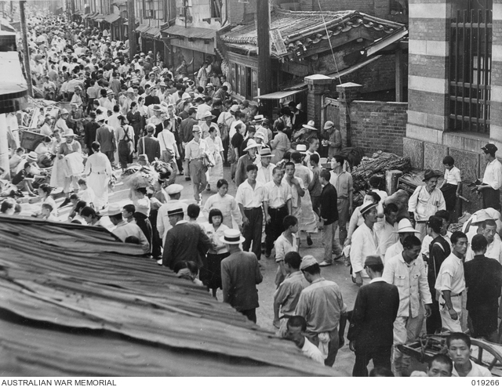
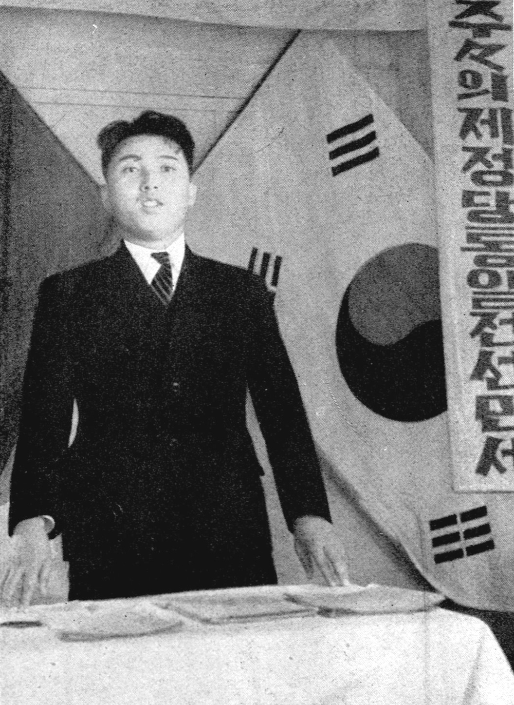
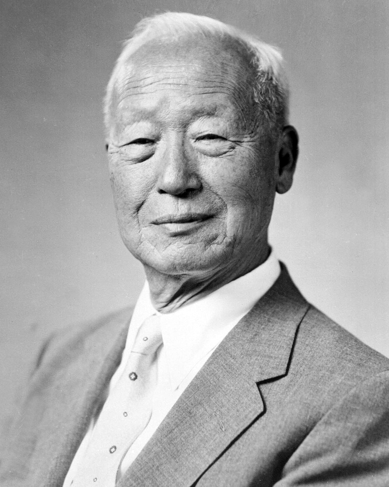
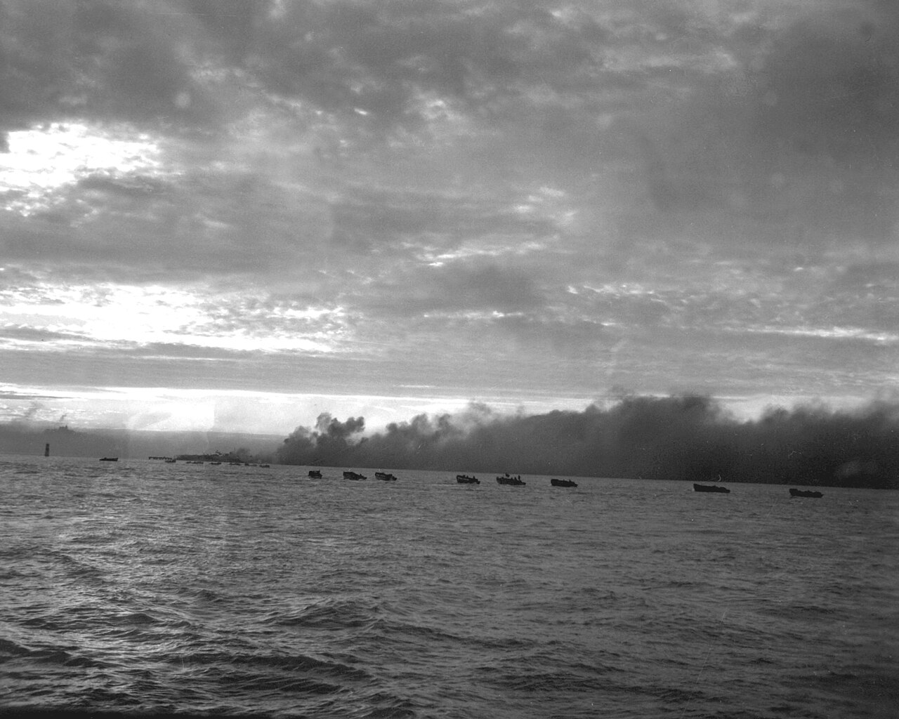
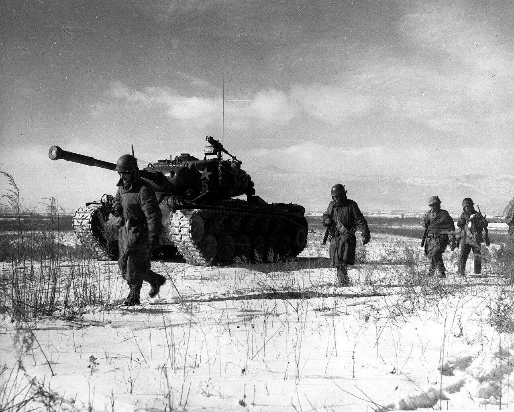
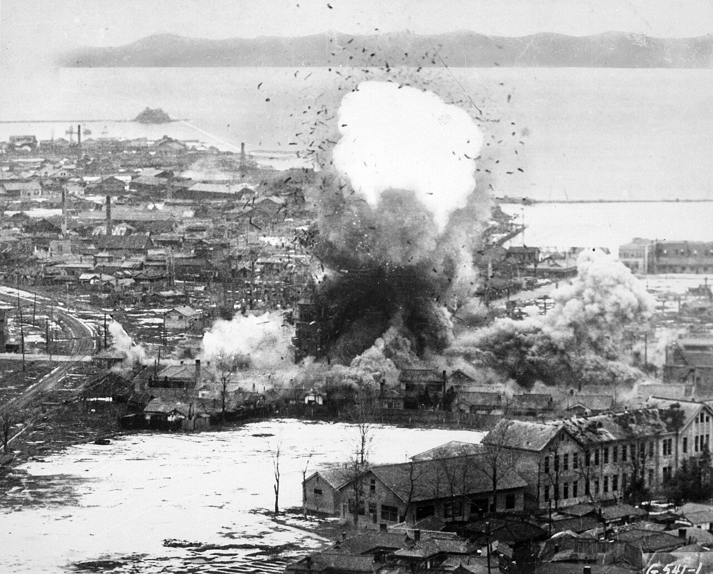
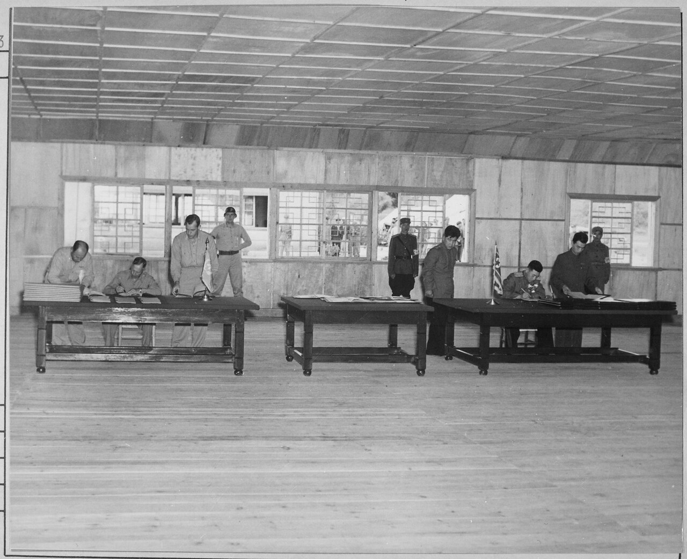
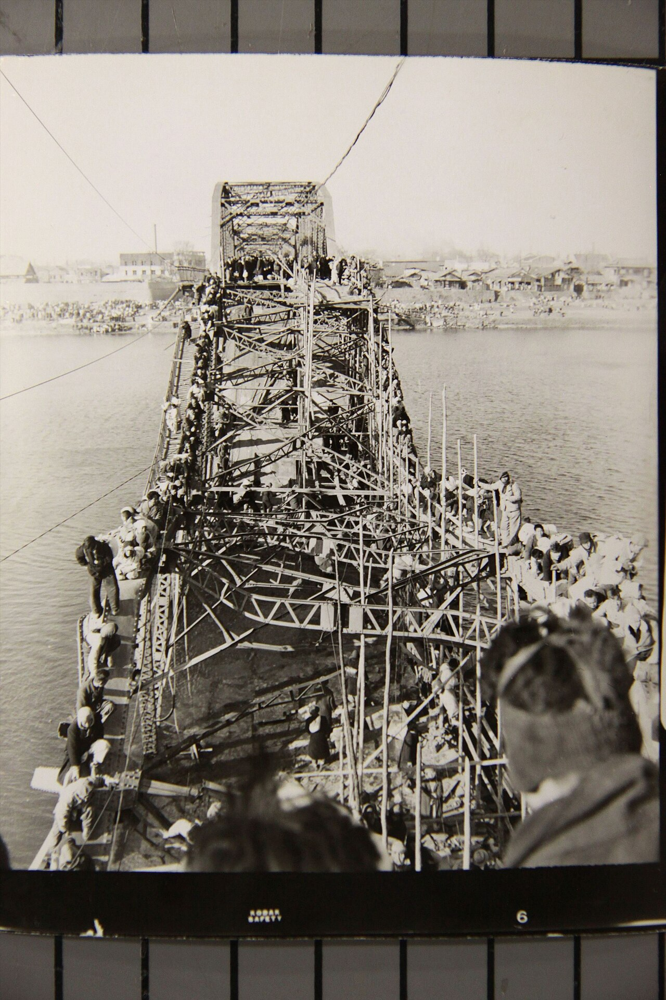
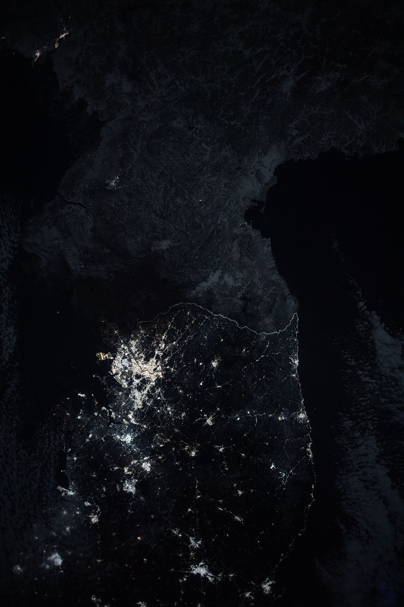

# 90. Why is Korea divided?

*Korea, from 1945 to 1953*

Korea was divided in half an hour, in August 1945, by two American officers with a map from a magazine. The line was a convenience for accepting the surrender of the Japanese army, and it was meant to be temporary. Each of the two powers that occupied the country then set up a government in its own likeness. In 1950 one of those governments tried to conquer the other, and the war that followed left the line almost exactly where it had been.

Late on the night of 10 August 1945, two young colonels were sent into a side room of the American war department in Washington and told to find a way of dividing Korea. Japan was about to surrender. The Soviet army had entered the war two days before and was already pouring into the north of the peninsula. The nearest American troops, by contrast, were a thousand kilometres away. Unless the two powers agreed quickly on where each would take the Japanese surrender, the Soviets could simply keep on coming.

Neither man knew much about the country. The only map in the room was one published by a geographical magazine. They looked first for a natural border, a river or a range of hills that ran from coast to coast, and found none. What they saw instead was a line of latitude, the thirty-eighth parallel. It had two things in its favour: it cut the peninsula roughly in half, and it left the capital, Seoul, on the American side. They had thirty minutes. They proposed the line, their superiors approved it, and it was cabled to Moscow. Somewhat to the Americans' surprise, Stalin accepted, and his troops halted at it.

The line had been drawn on paper, and on the ground it followed no feature of the land. One of the two colonels later became the American secretary of state. He wrote that the line made no sense in terms of the country itself. It cut across more than seventy streams, twelve rivers, hundreds of roads and villages. Worse, it split an economy that worked as one. The north had the mines and the power stations, and the south had the rice, and the line separated them.

Korea had been a single kingdom for more than a thousand years. No Korean was asked.

## Thirty-five years

What Koreans expected in 1945 came out of what they had just lived through. By then they had been ruled by Japan for thirty-five years, and it had been among the harshest of colonial governments. The Japanese had built railways, steelworks and dams, but they built them for their own purposes. They had also taken the best farmland and banned the Korean language from schools. In the last years they went further still, and ordered Koreans to adopt Japanese names and worship at Japanese shrines. During the war they shipped hundreds of thousands of Korean men to work in the mines and factories of Japan, and tens of thousands of young women to military brothels.

When the emperor's surrender was broadcast, the country exploded with joy. People did not wait to be told what to do next. Within days, committees of local people had formed in almost every town and county, to keep order, guard the grain stores and take over from the Japanese police. Some were led by communists, many by nationalists and Christians, and most by whoever had the respect of the neighbourhood. In early September a national assembly of these committees met in Seoul and declared a republic. As far as Koreans were concerned, the matter was settled: they assumed that they were now free.

*A crowd in a market street in Seoul, then called Keijo, on 15 August 1945, the day of the Japanese surrender. Photographer unknown, Australian War Memorial, public domain.*

## Two governments

The Americans, however, had not come to recognise a Korean government. The American general who landed two days later had been given no instructions about any republic. He was a plain soldier who had been chosen because his troops were the closest, not because he knew anything about Korea. He refused to deal with the committees, which looked to him like a communist front, and ruled through a military government instead. For want of anyone else who knew the work, he kept on the Koreans who had served in the Japanese colonial police. It was a damaging choice, because to most of the population these men were traitors.

In the north, the Soviet command took the opposite course. It let the committees stand, and then put its own people into them. It had also brought with it a Korean of thirty-three who had fought the Japanese as a guerrilla in Manchuria and had spent the last years of the war as a captain in the Soviet army. His name was Kim Il-sung. Within a year, with Soviet backing, he was at the head of a government that remade the north. It took the land from the landlords and shared it out to the peasants, and it took the factories from the Japanese. The people who stood to lose most from this voted with their feet. Several hundred thousand landlords, Christians and businessmen fled south.

*Kim Il-sung speaking at a rally in Pyongyang before the local elections of 3 November 1946. Photographer unknown, first published in a Soviet book in 1948, public domain.*

The Americans found their man in a very different figure. Kim was young and had made his name with a rifle; Syngman Rhee was seventy, and had made his in exile, with words. He had been jailed and tortured as a young nationalist in the 1890s. Afterwards he had taken a doctorate at an American university, and had spent thirty-three years in exile in the United States, lobbying for his country's freedom. He was a fierce anti-communist, which suited his sponsors. He was also autocratic, and impossible to control, which did not.

*Syngman Rhee, official portrait, 1948, the year he became the first president of the Republic of Korea. Photographer unknown, public domain.*

On paper, the occupation was still meant to end in one Korea. The two great powers talked for two years about forming a single government, and could not agree on who should be in it. In the end, in 1948, each sponsored its own. A Republic of Korea was proclaimed in the south in August, with Rhee as president, and a Democratic People's Republic in the north in September, under Kim. Each claimed to be the government of the whole peninsula, and each promised to reunite it. The temporary line now had a government on either side of it, and each regarded the other as illegitimate.

The south, meanwhile, was already at war with itself. On the island of Jeju, off the southern coast, a rising against the police in April 1948 was put down by the army and by gangs of anti-communist youths from the mainland. They burned most of the island's inland villages. By the time the last rebels were hunted down, as many as thirty thousand people had been killed, a tenth of the population. Along the parallel, too, there was no peace: the two armies raided each other month after month.

## Forty-eight telegrams

By 1949 both the Soviet and the American troops had gone home. What they left behind were two forces of very unequal strength. The Soviets had given Kim tanks, heavy guns and aircraft. The Americans had been more cautious with Rhee, because they worried that he would march north if he could. As a result they had given him an army equipped for keeping order, without a single tank.

Kim, for his part, was sure that he could win in a few weeks, and that the people of the south would rise to welcome him. However, he could not move on his own. He needed Stalin's permission. He asked for it again and again, in person and in dozens of telegrams, and through 1949 Stalin said no. The reason was simple: he did not want a war with the United States.

Early in 1950 Stalin changed his mind, and the world had changed around him in ways that explain why. The Soviet Union now had its own atomic bomb, so America could no longer threaten it with a weapon it alone possessed. The Communists had won China, and tens of thousands of battle-hardened Korean soldiers who had fought in Mao's army were coming home to swell Kim's ranks. Finally, in January the American secretary of state had made a speech describing the line that America would defend in the Pacific. It ran through Japan and the Philippines, and it left Korea out. To Moscow, that looked like a door left open.

Even so, Stalin gave his consent with a condition. The Soviet Union would supply weapons and plans, and would send no soldiers. If you get kicked in the teeth, he told Kim, I shall not lift a finger. You will have to ask Mao for help.

## Sunday morning

Before dawn on Sunday, 25 June 1950, in heavy rain, the northern artillery opened fire along the parallel. Ninety thousand soldiers followed, behind a hundred and fifty Soviet tanks. Here the unequal gifts of the two great powers showed at once. The southern army had nothing that could stop a tank, and many of its soldiers were away on weekend leave.

Seoul fell in three days. Its fall was marked by a disaster of the south's own making. As the northern tanks entered the city, southern engineers blew up the main bridge over the river to the south of it, without warning, while it was crowded with refugees and their own retreating soldiers. Several hundred people went into the water.

In Washington, meanwhile, the president, Harry Truman, decided within hours that this was the test. His reasoning came from the last war. He believed that if the West had stood up to Hitler early, there would have been no world war, and that Stalin was now doing what Hitler had done. The matter went to the United Nations. Its council voted to call on all members to help repel the attack. Ordinarily the Soviets could have blocked it, because a resolution of that kind could have been stopped by a single Soviet no. However, the Soviet delegate was not in his seat. He had been staying away for six months in protest at the council's refusal to give China's place to the new Communist government, and his absence let the vote through.

In the end, sixteen countries sent troops under the flag of the United Nations. The flag was shared, but the burden was far from evenly shared: nine tenths of the foreign soldiers were American. Truman did not ask Congress to declare war. Instead he agreed with a reporter who suggested that it might be called a police action.

## Up and down

What followed was a war that swung from one end of the peninsula to the other and back again. At first it went badly for the south. The first American units, rushed over from garrison duty in Japan, were soft and badly armed, and were brushed aside. By August the southern and American forces had been driven into a pocket around the port of Pusan, in the far south-east corner, with their backs to the sea. Ninety per cent of Korea was in northern hands.

The man who turned it round was General Douglas MacArthur, the commander of the United Nations forces, who had ruled Japan since its surrender. He was seventy, vain, theatrical, and had not spent a night in Korea. He now proposed a gamble. He would land an army at Inchon, the port of Seoul, a hundred and fifty miles behind the northern lines. The difficulty lay in the sea itself. The harbour there has some of the highest tides in the world, and for most of the day its approaches are miles of mud, so ships could reach the shore only for a few hours. His admirals and the chiefs in Washington told him that it was too great a risk. On 15 September the marines went in on the high tide, and found the place almost undefended. Seoul was retaken within two weeks. The northern army, cut off from its supplies, fell apart.

*Landing craft heading for the smoking beach at Inchon on 15 September 1950. Photo: Sgt. Frank C. Kerr, US Marine Corps, public domain.*

The purpose of the war had been achieved in three months. The invader had been driven out, and the line was back where it had been. At this point the war could have stopped. However, the temptation to go further was too strong. Truman authorised MacArthur to cross the parallel, destroy the northern army and unite Korea under Rhee. In effect, the Americans now set out to do to the north exactly what the north had tried to do to the south. By late October American and southern troops were approaching the Yalu, the river that forms the border between Korea and China.

China had given notice that it would not allow this. Its prime minister summoned the ambassador of India at midnight and told him that if American troops crossed the parallel, China would enter the war. Washington took this for bluff. MacArthur assured the president that the Chinese would not come, and that if they did there would be the greatest slaughter.

In fact, they were already on their way. More than two hundred thousand Chinese soldiers had crossed the river bridges by night during October, and hidden in the mountains by day, lighting no fires so that no aircraft would spot them. Mao's motive was plain enough. A year after winning his own civil war, he did not want an American army on his border. His soldiers struck once at the end of October, mauled several units, and vanished back into the hills. It was a warning, and MacArthur ignored it and pressed on. At the end of November they attacked in full strength. They had few trucks, little artillery and no air cover. Instead they came on foot along the ridges, in padded cotton uniforms and canvas shoes, to the sound of bugles.

The cold became an enemy of its own. It was the coldest winter in years. Around a frozen reservoir in the northern mountains, thirty thousand American and allied troops were surrounded by four times their number, at thirty-five degrees below zero. At that temperature the equipment itself failed: weapons jammed, and blood plasma froze in the bottles. They fought their way out to the sea in two weeks. Meanwhile the whole United Nations army fell back nearly three hundred miles, and in January Seoul was lost for the second time.

*Troops and a tank of the US 1st Marine Division moving through snow in the breakout from the Chosin Reservoir, winter of 1950. Photo: Cpl. Peter McDonald, US Marine Corps, public domain.*

Then the tide turned once more, and the Chinese outran their supplies in turn. By the spring of 1951 Seoul had changed hands for the fourth time. The front had come to rest close to the thirty-eighth parallel, where it had all started. Months of fighting up and down the length of the country had brought both sides back almost to the line two colonels had picked off a magazine map.

![Four maps of the Korean peninsula, with the land held by the North shaded red and by the South and the United Nations shaded blue. June 1950: the front on the 38th parallel, with arrows of the northern invasion towards Seoul. September 1950: the North holds all but a small pocket round Pusan, and an arrow shows the landing at Inchon. November 1950: the United Nations forces hold almost everything up to a line near the Yalu, and arrows show the Chinese attack. July 1953: the armistice line runs near the 38th parallel past Panmunjom, a little south of it in the west and north of it in the east](images/map_korea_fronts.png)
*The front in Korea in June 1950, September 1950, November 1950 and July 1953, roughly, with the 38th parallel dashed. Map: drawn for this book; coastlines and rivers from Natural Earth, public domain.*

## The general

The question now was whether to settle for that line or to widen the war in order to win. MacArthur could not accept a draw. He wanted to bomb the bases and factories of China, blockade its coast, and bring over from Taiwan the army of Chiang Kai-shek, Mao's defeated rival in the civil war. In confidential messages he asked for atomic bombs. Nor did he keep his disagreement private. He criticised the policy of his own government in public, and in a letter to a congressman that was read out in the House, he declared that there was no substitute for victory.

Truman and his advisers saw the danger differently. They thought that a war with China would be, as the senior American general put it, the wrong war, at the wrong place, at the wrong time, and with the wrong enemy. Above all, it would tie down American strength in Asia and leave Europe open to the Soviet Union. There was also a matter of principle. In the American system the president decides policy and generals carry it out, and MacArthur was openly campaigning against the president's policy. On 11 April 1951 Truman dismissed the most famous soldier in the country.

At first the country sided with the general. MacArthur came home to parades larger than any since the end of the world war, and for a few weeks Truman was the most unpopular man in America. Nevertheless, the dismissal stood, and with it the decision behind it. The war would be limited, fought for a line and not for the destruction of the enemy. It was the first war in which nuclear powers stood behind both sides, and Washington and Moscow had each decided that they would rather not win it than risk the larger one.

## Caves

Limiting a war, however, turned out to be different from ending it. Truce talks began in July 1951, and went on for two years. For most of that time they were stuck on one question, which was what to do with the prisoners. Tens of thousands of the Chinese and northern prisoners held by the United Nations did not want to be sent home. Many of the Chinese had been soldiers of Chiang Kai-shek before they were Mao's, and many northerners feared what awaited a man who had surrendered. Truman remembered the Soviet prisoners who had been handed back to Stalin in 1945 and shot or sent to the camps, and refused to return anyone by force. The communist side, for its part, insisted on having them all back. Neither would give way.

While the delegates argued, the fighting went on. The armies dug in across the waist of the peninsula and fought for hilltops, in conditions much like those of the Western Front in 1916. These were not small skirmishes on the edge of a settled peace. Nearly half of the American casualties of the war were suffered after the talks began.

The other war was fought from the air, and it fell hardest on the north. American aircraft dropped more bombs on Korea than they had dropped in the whole Pacific theatre in the war against Japan. Along with them came thirty thousand tons of napalm, a jellied petrol that sticks and burns. The bombing went on so long that by 1952 the pilots were complaining that there were no targets left. Almost every town and city in the north had been levelled. In the last months the bombers went after the food supply, and broke several of the dams that irrigated the rice fields.

The people of the north survived by moving underground, into caves and tunnels, and whole factories and schools went with them. The memory of them is the foundation of what the northern state has told its people about America ever since.

*Bombs from American B-26 aircraft bursting among warehouses and docks at the port of Wonsan, North Korea, about 1951. Photo: US Air Force, public domain.*

No side kept its hands clean. Civilians were killed by every army. In the first weeks of the war, the southern police and army shot at least a hundred thousand people who had been registered as suspected leftists, for fear that they would help the invader. The northern forces, for their part, shot officials, policemen and landlords in the towns that they took, and killed their prisoners when they retreated. American soldiers had been ordered to let no refugees through their lines, in case infiltrators were among them. Following that order, they killed several hundred who had taken shelter under a railway bridge.

## A ceasefire

What finally broke the deadlock was a death in Moscow. Stalin died in March 1953, and his successors wanted the war closed. The armistice was signed on 27 July, in a wooden hall built for the purpose at a village called Panmunjom. An American general signed for the United Nations and a northern general for the communist side. Even at the end, there was no warmth: they did not speak or shake hands. Rhee, who wanted to fight on, refused to sign at all.

*The armistice being signed in the hall at Panmunjom in July 1953: the United Nations delegation, led by General W. K. Harrison, at the left table and the northern delegation at the right. Photographer unknown, US National Archives, public domain.*

It was a ceasefire, an agreement to stop shooting, and no peace treaty has ever followed it. Legally, the war was paused rather than ended. On the ground, the two armies each drew back two kilometres from the line where they stood. The strip between them runs for two hundred and fifty kilometres from sea to sea, fenced and mined on both sides. Most of it has been left to itself for seventy years. Cranes and wild deer live in it.

The price of returning to the old line was enormous. About three million Koreans had died, one in ten of the population, most of them civilians. China lost about two hundred thousand soldiers by its own count, among them Mao's eldest son. Thirty-six thousand Americans died. For all of that, the border had moved a few miles.

## What it settled

Inside Korea the war settled almost nothing. Outside Korea, by contrast, it changed a great deal. It convinced Washington that communism would use armies wherever it was not faced with armies. The lesson was quickly turned into money and men. The American defence budget was multiplied nearly fourfold in three years and never returned to anything like its old level. The alliance in Europe was given a real army and an American commander. American troops stayed in Korea and Japan, and they are there today.

Two old enemies of the Communists gained by it. The first was Chiang Kai-shek. Mao had been gathering boats and troops on the coast opposite Taiwan, ready to finish the civil war. In June 1950, however, Truman sent a fleet into the strait, and the invasion was called off. The second was Japan, the enemy of five years before. It became the workshop and repair yard of the American army, and the orders pulled its economy out of ruin. Its prime minister called the war a gift of the gods.

China's account was mixed. It had fought the strongest power on Earth to a standstill, a century after the Opium Wars. It paid for that with twenty years of American hostility, during which Chiang's government on Taiwan kept China's seat at the United Nations.

For Koreans the war made the division permanent. What had been a line on a map became a wall through families. Millions of people had been caught on the wrong side of the line from their parents, wives or children. No ordinary post crossed it, and no telephone calls. Since 1985, and more often since 2000, the two governments have occasionally allowed a few hundred old people, chosen by lottery, to meet their relatives for a few hours in a hotel, under supervision, before being bused back. The numbers never came close to the need. Most of those who put their names down have died waiting.

*Korean refugees climbing over the wrecked Taedong River bridge at Pyongyang on 3 December 1950, fleeing the advancing Chinese army. Photo: Sgt. D. Helms, US Army, public domain.*

The two halves then set off on very different paths, and at first it was the north that seemed to have the better start. In 1953 the north was the richer half. It had the industry, and Soviet and Chinese aid rebuilt it quickly. The south was one of the poorest countries in the world, living on American grain, under one dictator after another. Then the positions reversed. From the 1960s the south began to make goods for sale abroad: first shirts, then ships, then cars and computer chips. In 1987 its people forced the generals to allow free elections. The north, meanwhile, remained the property of one family, which is now in its third generation. It has built nuclear weapons, and in the 1990s it let several hundred thousand of its people starve.

The result is an experiment that nobody would have designed on purpose. The two halves share a language, a cuisine and two thousand years of history, so the difference between them is almost entirely the work of the past seventy years. It shows even in people's bodies. Young men who escape from the north are, on average, several centimetres shorter than southerners of the same age, and the south's income per person is more than twenty times the north's. It shows from space, too. A photograph of the peninsula taken at night from space shows the south as a blaze of cities, and China glowing to the north-west. Between them is a dark shape with one small point of light at the capital, and at its southern edge the lights stop along a line.

*The Korean peninsula at night, photographed from the International Space Station on 24 January 2024: the lights of the south stop at the border, and the north is dark. Photo: NASA, public domain.*
