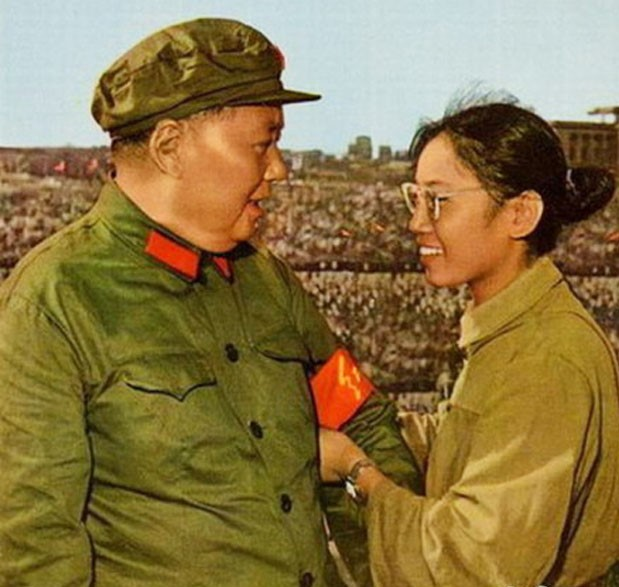
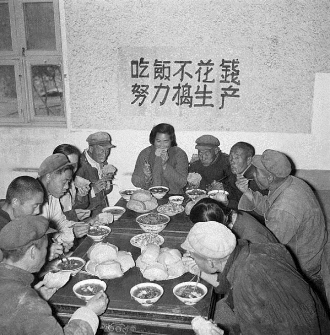
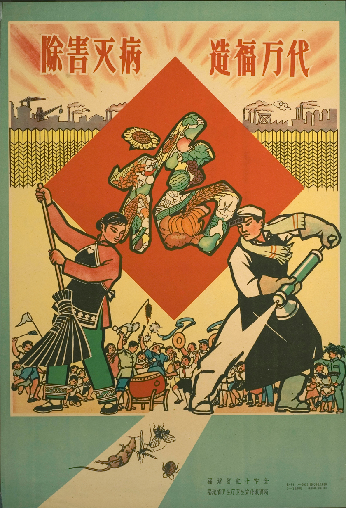
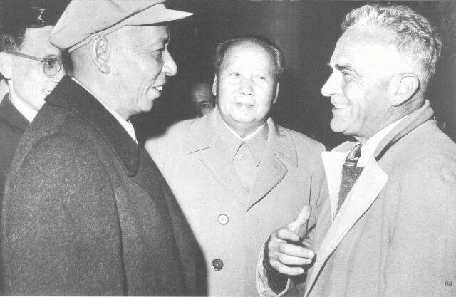
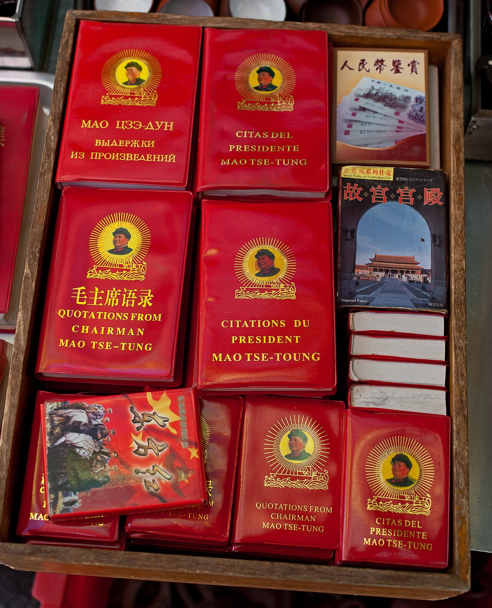
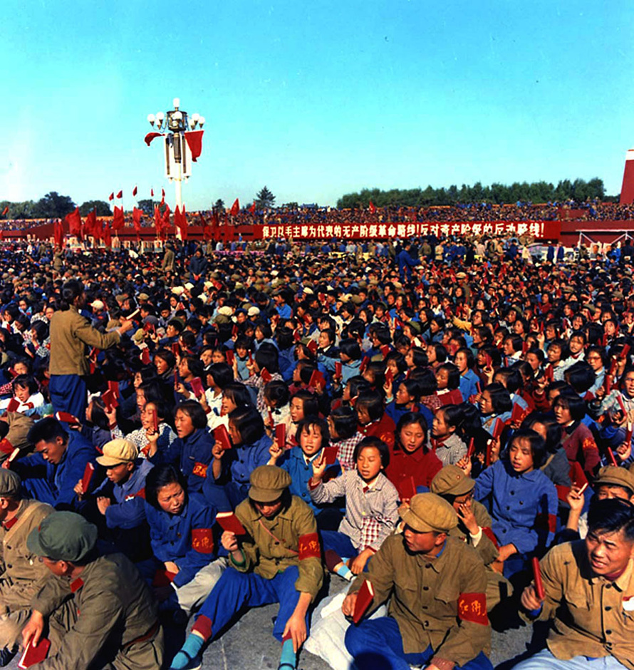
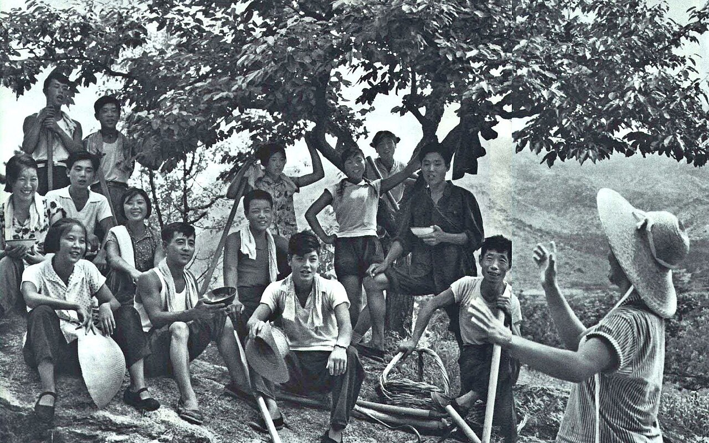
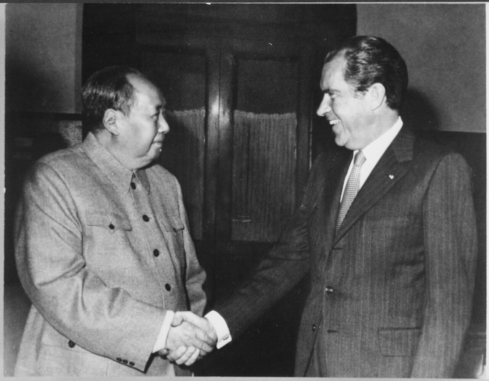
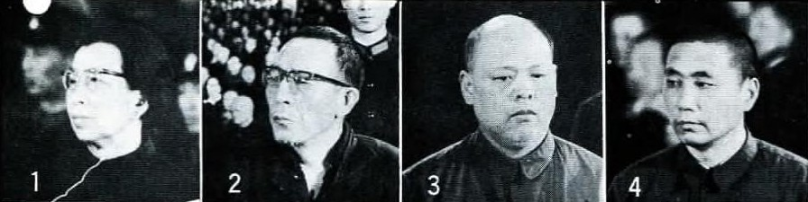

# 91. What was the Cultural Revolution?

*China, from 1956 to 1976*

The Cultural Revolution was ten years of upheaval that Mao Zedong set loose against his own party. His attempt to turn China into an industrial power in a single bound had caused the worst famine in history, and afterwards his colleagues had quietly taken the running of the country out of his hands. To get it back, he called on schoolchildren and students to attack their teachers, their parents and the government itself.

Before dawn on 18 August 1966, a million young people began filing into the great square in the middle of Beijing. Most were between twelve and twenty. They were dressed almost alike, in green army-style jackets and caps and red armbands, and each carried a small book with a red plastic cover. They called themselves Red Guards.

As the sun came up, Mao appeared on the balcony of the gate above them, in a soldier's uniform that he had not worn for years. The choice of clothes was itself a message: the old revolutionary was dressed for war again. The square shook with the chant of ten thousand years to Chairman Mao. Hundreds of the guards were chosen to go up and meet him. One of them, a girl of nineteen with glasses and plaits, the daughter of a general, pinned a red armband on his sleeve.

*Song Binbin pinning a Red Guard armband on Mao Zedong's sleeve at Tiananmen, 18 August 1966. Photographer unknown, public domain.*

He asked her name. It was Binbin, she said, which means refined and gentle. Mao smiled. Be martial, he told her.

The words sounded like a joke between an old man and a girl. In fact, at her own school, violence of exactly that kind had already happened. Thirteen days earlier, at the girls' school that she attended, the pupils had turned on their teachers. They poured ink over the deputy headmistress, a woman of fifty and a mother of four, made her kneel, and beat her for hours with wooden clubs studded with nails. She was left to die on a rubbish cart in the school yard. She was the first teacher in Beijing to be killed by her students, and she was far from the last. In the two months that followed, more than seventeen hundred people in the city had died in the same way.

The road to that school yard had begun ten years earlier.

## Let a hundred flowers bloom

Mao was seventy-two that summer, and he had ruled China for seventeen years. For the first few of them, the Communist government had been competent and popular. Then it began to move faster than the country could bear.

By 1956 the land that had been shared out among the peasants had been taken back into collective farms, which meant that the villagers now worked the fields together under the party's direction. That year Mao tried something that looked generous. He invited the country's writers, scientists and teachers to say frankly what they thought of the party's work. Let a hundred flowers bloom, he said, and let a hundred schools of thought contend.

Understandably, the educated were wary. After some hesitation, however, they did speak up, and the criticism was much sharper than he had expected. Posters at the universities demanded free elections and an end to one-party rule. In the summer of 1957 he reversed himself. More than half a million people who had spoken up were branded as "rightists", enemies of socialism. They were dismissed, and sent to labour camps or to the countryside, many for twenty years.

The lesson was widely learned. Honesty had been invited, and then it had been punished. From then on, very few people in China told the party anything that it did not wish to hear.

## Backyard steel

In 1958 Mao announced that China would make a Great Leap Forward. The goals were enormous. China would overtake Britain in the production of steel within fifteen years, and soon afterwards it would pass directly into communism, ahead of the Soviet Union. The method would be the one that had won the civil war. China lacked machines and capital. However, it had more people than any country on Earth, and if they were all mobilised like an army, they could move mountains. Labour, in other words, would stand in for everything the country did not have.

The villages were reorganised on a vast scale. The collective farms were merged into twenty-six thousand "people's communes", each of about five thousand families. Private plots were abolished, and so, in many places, were private kitchens. Families handed in their cooking pots and ate in communal canteens, where at first the food was free and people were told to eat as much as they liked. Work was organised like military service. Men and women were marched to work in squads, and sent for months to dig canals and reservoirs with hand tools.

*A people's commune canteen in 1958, where members were told that they could eat as much as they wanted. The slogan on the wall reads, "Eating meals costs no money, work hard at production." Photographer unknown, public domain.*

Steel was to come from everywhere, not only from steelworks. Ninety million people, among them farmers, schoolteachers and doctors, built small furnaces of brick and clay in village squares and schoolyards, and fed them day and night. When the ore ran out, they melted down the cooking pots, the door hinges, the bicycles and the farm tools. The result was a double loss. The lumps of brittle iron that came out were useless, and the tools that had gone into them were gone. Worse still was the timing. The work was done in the autumn of 1958, and in many districts the best harvest in years was left to rot in the fields because the men were at the furnaces.

Meanwhile farming itself was reorganised by decree. Seed was sown five or ten times more thickly than before, on the theory that plants of the same kind would not compete with one another. They did compete, and the seedlings choked. A national campaign was also launched against sparrows, which ate grain. The whole population turned out to bang pots and wave flags, so that the birds could not land and fell dead from exhaustion. Hundreds of millions were killed. The campaign took no account of the fact that sparrows also eat insects. The next year the insects that sparrows had eaten devoured the crops.

*A poster from the campaign against pests during the Great Leap Forward, issued by the Red Cross in Fujian province in 1960. Its title is "Eradicate pests and diseases and build happiness for ten thousand generations". Poster: Red Cross and Health Propaganda Office of Fujian Province, CC BY-SA 4.0.*

## Sputnik fields

None of these mistakes had to become a catastrophe. The disaster could have been caught in time if anyone had been able to say what was happening.

Instead, the whole system pushed people to lie. Every official had been given targets, and every official knew what had happened to the rightists. To report a poor harvest was to risk being called an enemy of the Leap. So village leaders reported harvests two or three times larger than the truth. The county doubled the figure before passing it up. As the numbers climbed through each level of government, they drifted further from anything growing in the ground.

The lies were even staged for the camera. Newspapers printed photographs of wheat growing so densely that children could stand on top of it. They had been taken in fields into which the crop of a dozen others had been transplanted for the photographer. These were called sputnik fields, after the Soviet satellite. Mao toured the country, was shown these wonders, and began to worry about what China would do with all its surplus grain.

The false figures then did real harm, because the state took its share on the basis of the reported figures. If a village had reported three times its real harvest, the state's share of the imaginary crop could swallow the real one. In many villages that meant the entire real harvest, seed grain included, so there was nothing left to eat and nothing to plant. Even so, through the worst of what followed, China went on exporting grain, in part to repay its debts to the Soviet Union ahead of time.

There was one moment when the truth reached the top. In July 1959 the party leaders met at a resort in the mountains. The defence minister, a blunt old soldier from a peasant family who had commanded the Chinese army in Korea, had been to his home village and seen the hunger. He wrote Mao a private letter. It was respectful, and while it praised the Leap's achievements, it warned of serious waste and exaggeration.

Mao treated it as an attack. He had the letter copied and circulated, accused its author of plotting against him, and had him dismissed. A new purge of "right opportunists", people accused of weakening the Leap, swept the party. The warning of 1957 had now been repeated at the very top, and the party understood it. After that, for two years, hardly anybody objected to anything.

By the winter of 1959 the canteens were empty. With nothing else left, people ate bark, roots and a white clay that filled the stomach and blocked the bowels. Whole villages died. In one district of central China, a million people out of eight million starved. They starved while the local granaries held enough to feed them, and militia were posted on the roads to stop the hungry from leaving to beg. There was cannibalism, in thousands of documented cases.

In three years about thirty million people died. One historian, working from provincial archives and counting those who were beaten or worked to death over four years, puts the figure at forty-five million. Either way, it was the worst famine in history. It happened in peacetime, in weather no worse than China had often known, under a government that controlled every part of the country.

*Births and deaths per thousand people in China, 1950 to 1970; in 1960 deaths outnumbered births. Chart: drawn for this book; data from China's State Statistical Bureau, China Statistical Yearbook and China Population Statistical Yearbook, as tabulated in English Wikipedia's "Demographics of China".*

## A black cat or a white cat

By 1961 the men who ran the party from day to day had had enough. The head of state, Liu Shaoqi, was a pale, methodical organiser who had been Mao's deputy for twenty years. He visited his own home district and came back shaken. At the start of 1962 he told a conference of seven thousand officials that the disaster was three parts natural and seven parts man-made. Coming from Mao's own deputy, before so many officials, it was a bold thing to say. In private he went further. To Mao's face he said that history would record the part that the two of them had played, and that the eating of human flesh would go into the books.

*Liu Shaoqi (left), Mao Zedong and the American writer Edgar Snow in conversation in October 1960. Photographer unknown, public domain.*

Mao withdrew from daily affairs. Liu and the party's general secretary, a short, tough veteran named Deng Xiaoping, set about repairing the damage. Their method was to undo the Leap piece by piece. They broke up the canteens, gave families back their small plots, reopened the village markets, and shut down the furnaces. Deng summed up the attitude with a proverb from his home province: it does not matter whether a cat is black or white, so long as it catches mice. What counted, in other words, was whether a policy fed people, not whether it was pure. Within three years the country was eating again.

Mao watched this from the sidelines and drew his own conclusions. To him the recovery was not a rescue but a betrayal. He believed that his colleagues were leading China down the road that the Soviet Union had taken. There, as he saw it, the revolution had hardened into a new ruling class of officials with cars, villas and special shops, who cared only for their comforts. By then the two communist powers had quarrelled bitterly, and in 1960 Moscow had called home all its engineers.

The Soviet example frightened him for a more personal reason too. He remembered that three years after Stalin's death, his successor had stood up and denounced him as a tyrant and a murderer. Mao had no doubt that there were men around him who would do the same.

## Bombard the headquarters

That left him with a problem. He could not use the party against itself, since the party was the problem. Instead he turned to two forces outside its ordinary machinery: to the army, whose new chief, Lin Biao, was devoted to him, and to the young.

The army supplied the tool. It had compiled a pocket book of his sayings for its soldiers, bound in red plastic. It was now printed for everyone, and over the following years a billion copies were made. Children learned it by heart. His portrait hung in almost every home, and in many workplaces people began each day by bowing to it and reporting their thoughts. Loyalty was being moved away from the party and onto the man himself.

*Copies of Quotations from Chairman Mao, the "little red book", in Chinese, English, French, Russian and Spanish editions, photographed in 2013. Photo: Chris Brown, CC BY-SA 2.0.*

Next came a display of strength. In July 1966, to show that he was fit for a fight, he swam in the Yangtze river, and the newspapers reported that he had covered fifteen kilometres in little more than an hour. In August he wrote a short poster of his own and had it handed round the party's leaders. Its title was "Bombard the headquarters". Word spread within days, and the country understood that the chairman of the party was calling on the people to attack the party's leaders. To rebel is justified, he told the students.

The young took him at his word, and the state cleared the way for them. Schools and universities were closed, and stayed closed for years. Red Guards were given free travel on the railways, and eleven million of them came to Beijing that autumn to see Mao at eight great rallies. They then spread out across China to make revolution, sleeping in schools and temples and fed at public expense. For teenagers who had been raised on stories of the Long March, the communists' epic retreat of the 1930s, and had never been allowed to decide anything, it was intoxicating.

*Red Guards waiting for Mao in Tiananmen Square on 15 September 1966, one of the eight great rallies of that autumn. Many hold the little red book. Photo: Meng Zhaorui, public domain.*

## The four olds

Their instructions were to destroy the "four olds": old ideas, old culture, old customs and old habits. Almost anything could be made to fit one of those words, which is what made the order so dangerous.

They began with the people closest to hand, their teachers. Teachers were paraded in tall paper hats, with placards round their necks listing their crimes, and made to kneel on broken glass. From the schools the guards moved on to anyone with a suspect past: former landlords and businessmen, people with relatives abroad, people who owned foreign books or a piano. In Beijing in August and September, Red Guards searched more than thirty thousand homes. They burned books and paintings in the street, cut off women's long hair and smashed their high-heeled shoes.

Fame offered no protection. The best-loved novelist in the city was beaten for hours in the courtyard of a temple, and drowned himself in a lake the next day.

Nothing old was safe, whether it was a building, a statue or a family bond. More than two thirds of the historic monuments of Beijing were damaged or destroyed. Guards travelled to the home town of Confucius, the ancient sage whose teachings had shaped Chinese life for centuries, smashed the statues in his temple, and dug up his grave. Inside families, children were urged to denounce their parents, and many did. A person accused had no defence, since to deny a charge was proof of a bad attitude.

At the top, the targets were the men who had cleaned up after the Leap, the very people who had ended the famine. Liu Shaoqi was denounced as the leading person in authority taking the capitalist road. He was dragged from his house and beaten in front of his children, and held alone for two years, ill with diabetes and pneumonia, without treatment. In 1969 he was flown to a provincial jail, where he died a month later. His family was told three years afterwards.

Deng Xiaoping survived, but his family paid heavily. He was sent to work as a fitter in a tractor repair shop. His eldest son, a physics student, fell from an upper window while being held by Red Guards and was paralysed for life.

The purge reached into the next generation as well. Among the officials purged was a deputy prime minister whose fifteen-year-old son was sent to a poor village in the north-west. The boy lived there for seven years in a cave dug into the hillside, hauling manure and coal. His name was Xi Jinping.

## Tanks in the streets

Mao had started something that even he could not steer. Every group could claim his blessing, so no group would accept another's claim. By 1967 the Red Guards had split into rival factions, each claiming to be the true defender of the chairman, and they were fighting one another. Their weapons escalated quickly. They raided army depots for rifles, machine guns and artillery. In some cities they fought with tanks. Ordinary life broke down: factories stopped, and trains ran when the factions allowed.

Bad as the cities were, the worst killing took place in the countryside, far from any outside eye. In one rural county in the south, local militia murdered more than four thousand people in two months, the families of former landlords down to their infants. Their pretext was that the victims were planning a revolt. In a neighbouring province there were districts where the victims were eaten at public feasts, as proof of loyalty.

The army was supposed to calm things down, and at first it made them worse. It had been ordered in to support the left, and had ended by arming one faction against another. In 1968 Mao told it to end the disorder. Soldiers took over the schools, the factories and the government of every province. The order they brought was not gentle. The campaign that followed, against a new list of hidden enemies, killed more people than the Red Guards had.

The guards themselves were now a nuisance. Having used them, Mao needed them out of the cities. He announced that educated young people should go to the countryside and learn from the peasants. Over the next twelve years seventeen million city teenagers were sent to villages and state farms, some near home and millions in the remotest parts of the country, with no date of return. Most were there for years. They are known in China as the lost generation.

Their lost schooling was not easily made up. The universities, when they reopened, took students by political recommendation. There was no national entrance examination until 1977. When one was finally held, nearly six million people, some of them thirty years old, sat for a quarter of a million places.

*Educated city youths resting during farm work in Changli County, Hebei, in July 1964, in an earlier version of the campaign that from 1968 sent seventeen million city teenagers to the countryside. Photo: People's Pictorial, public domain.*

## A plane in Mongolia

Lin Biao, the army chief who had made the cult of Mao, was named in the party's constitution as his successor. Then, in September 1971, he died when his aircraft crashed in Mongolia in the middle of the night. The official explanation, when it came, was that he had plotted to assassinate Mao and had been fleeing to the Soviet Union.

For ordinary people the story was impossible to digest. People who had been told for five years that he was the chairman's closest comrade were now told to curse him. If the chosen heir was a traitor, it was hard to know what else to believe. For many Chinese that was the moment at which belief gave out.

Meanwhile Mao was turning China's foreign policy upside down. The danger now came from the north. In 1969 Chinese and Soviet troops had fought on their frozen border river, and Moscow had sounded out other governments about a strike on China's nuclear plants. Mao concluded that the nearer enemy was the more dangerous one, and that America could be useful against it.

The approach began gently. In 1971 he invited an American table-tennis team to tour China. An American envoy flew to Beijing in secret that July. Then, in February 1972, the American president, a man who had built his career on hostility to communism, walked into Mao's study and shook his hand. Four months before, the United Nations had given China's seat to the government in Beijing. The reversal was complete. The two countries had fought each other in Korea twenty years earlier. They were now, in effect, partners against the Soviet Union.

*Mao Zedong and President Richard Nixon shaking hands in Beijing, 21 February 1972. Photographer unknown, US National Archives, public domain.*

## Seventy per cent

Mao died on 9 September 1976, a few weeks after an earthquake that killed a quarter of a million people in a city east of Beijing. Chinese tradition holds that such disasters announce the end of a dynasty.

The radicals fell quickly. Within a month his widow, a former film actress who had led the radicals, was arrested with her three closest allies. At her trial she was defiant, and her defence was that she had only done what Mao wanted. I was Chairman Mao's dog, she told the judges. I bit whomever he told me to bite.

Meanwhile an old survivor was on his way back. Deng Xiaoping had been brought back by Mao in 1973 and thrown out again in 1976. He returned once more, and within two years he was leading the country.

*The "Gang of Four" on trial in November 1980, left to right: Jiang Qing, Zhang Chunqiao, Yao Wenyuan and Wang Hongwen. Photo: China Publications Centre, public domain.*

The party had to decide what to say about the man whose portrait hung over the gate of the old palace. To condemn him entirely would be to condemn the party that had followed him and the state he had built. To praise him entirely would be absurd. In 1981 it found a middle path. It declared that the Cultural Revolution had been a catastrophe, for which Mao was chiefly responsible, and that it had caused the heaviest losses since the founding of the state. It also ruled that his merits outweighed his errors.

Deng's private formula was that Mao had been seventy per cent right and thirty per cent wrong. The thirty per cent was heavy. Between one and two million people had been killed in those ten years, and tens of millions had been persecuted.

Nevertheless, the seventy per cent was not empty. His rule had built some things as well. In 1949 a Chinese baby could expect to live about thirty-five years, and four adults in five could not read. In 1976 life expectancy was sixty-five, and most people were literate. The country was united, armed with nuclear weapons, and owed almost nothing abroad. It was also very poor. The people who now set out to change that were the same ones Mao had pushed aside: they had spent the past decade in prisons, villages and tractor workshops.

The subject is still handled with care in China. The famine is called the three years of difficulty, a phrase that leaves out who caused it. There is no national memorial to the dead of either period, and the archives are mostly closed.

Some of those who took part have tried to face it on their own. In January 2014 a group of women in their sixties went back to the girls' school in Beijing. One of them was the woman who had pinned the armband on Mao, by then a retired scientist who had spent much of her life in America. In front of a bronze bust of the deputy headmistress, she read out an apology, in tears, for having failed to protect her.

The teacher's husband was then ninety-three. On the day after his wife's death in 1966, he had bought a camera and photographed her body, and he had kept her bloodstained clothes and her broken watch ever since. He said that he did not accept the apology. Nobody had yet been named as her killer, and nobody had been tried.
