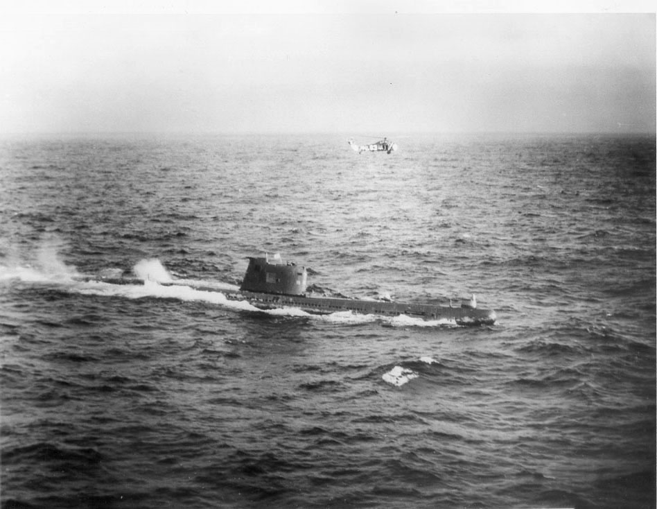
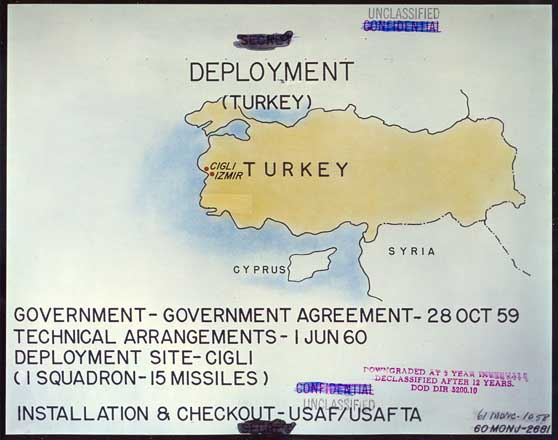
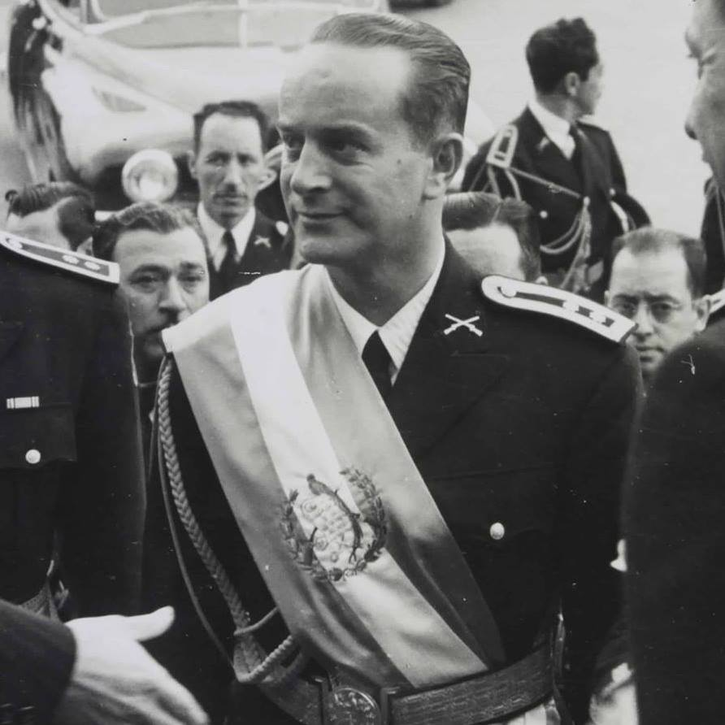
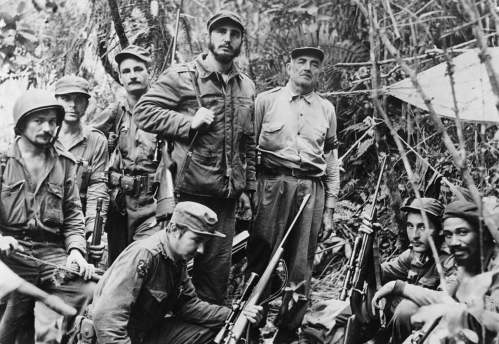
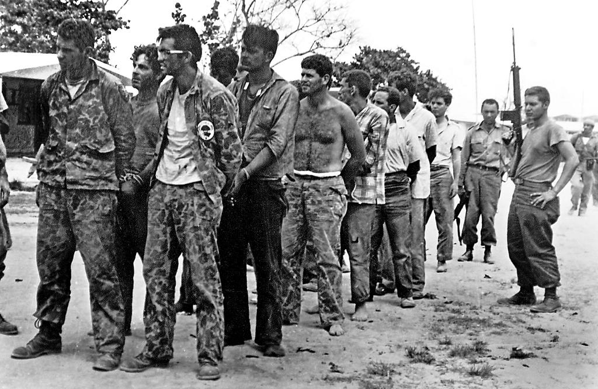
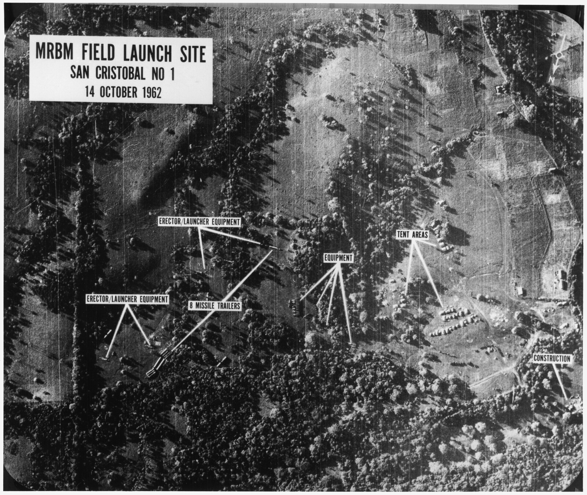
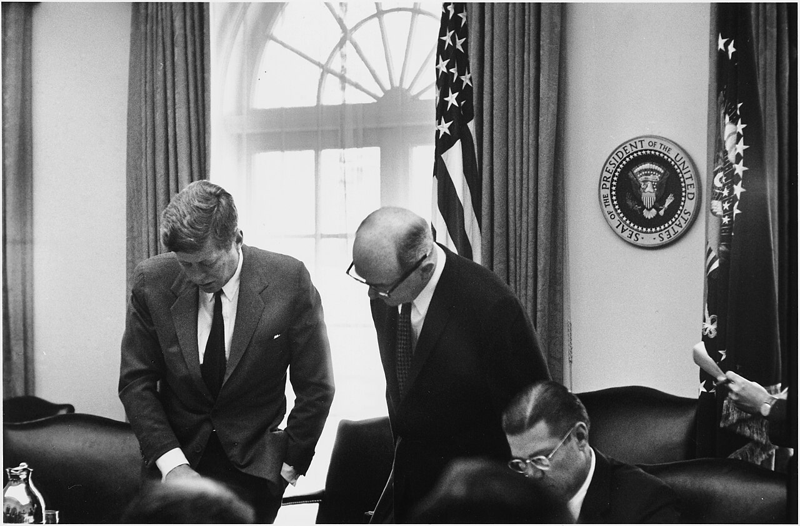
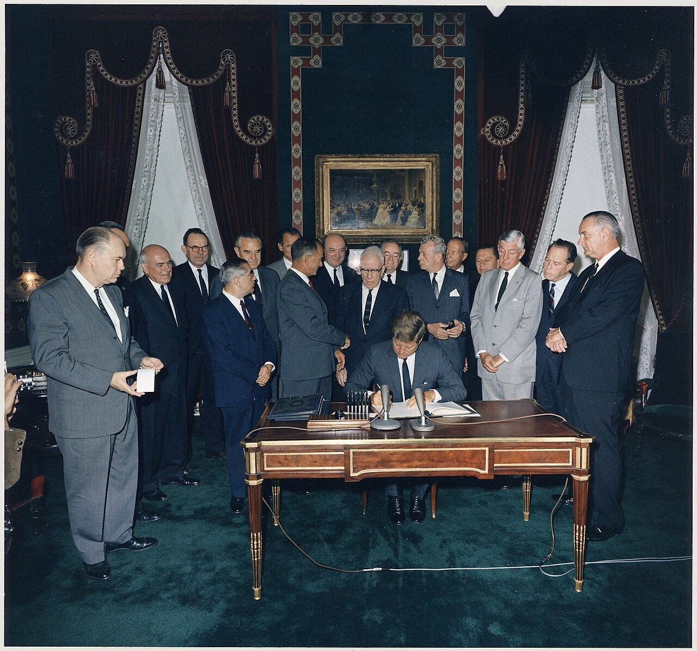
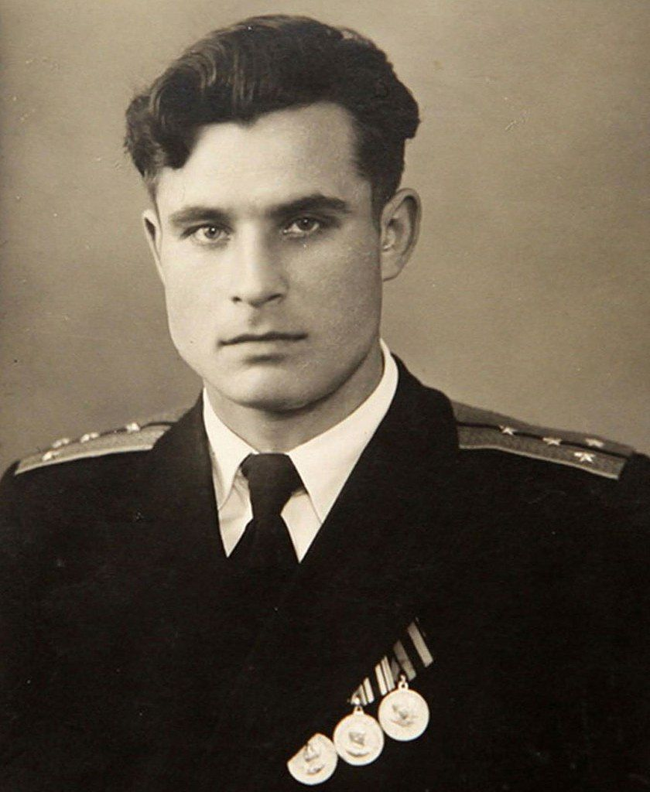

# 92. How close did the world come to nuclear war?

*Cuba, the United States and the Soviet Union, from 1954 to 1963*

The world came closest in the last week of October 1962, after the Soviet Union secretly placed nuclear missiles on the island of Cuba and the United States sent its navy to stop any more from arriving. The two governments settled the matter within thirteen days of the American president first seeing the evidence. On the most dangerous of those days, the decision passed for a few minutes out of their hands and into those of the officers of a submarine.

On the afternoon of 27 October 1962, the Soviet submarine B-59 was lying deep in the Atlantic, north-east of Cuba, and she was in a bad way. She had been at sea for four weeks. Her batteries were almost flat, and her air conditioning had failed. Picture what that meant inside a steel tube under the sea. The temperature inside the hull was above forty-five degrees Celsius, the air was thick with carbon dioxide, and men on watch were fainting at their posts. Worse, she was cut off. She had been out of radio contact with Moscow for days, so her officers knew little of what was happening in the world above them.

Above her were eleven American destroyers and an aircraft carrier. They had found her that morning and were dropping small explosive charges into the water to force her to the surface. The American navy had told Moscow that these would be harmless signals. However, the message had not reached the submarine. As a result, the men inside could not be sure whether they were being signalled or attacked. To them, each blast sounded like a sledgehammer on an oil drum.

Her captain, exhausted and furious, began to suspect that the war had already begun over their heads. If he was right, he had the means to answer. The submarine carried one torpedo with a nuclear warhead, nearly as powerful as the bomb that had destroyed Hiroshima. In the end, however, the batteries decided what happened next. That night B-59 had to come up to recharge them, into the glare of American searchlights.

On the surface, things got worse. American planes roared low over the conning tower, the tall structure on top of the hull where the officers stood, firing their cannon. The captain, half blinded, took it for an attack. He ordered an emergency dive and called for the nuclear torpedo to be made ready.

The rules left him a dangerous amount of room. His orders allowed him to use the weapon without asking Moscow if his boat was attacked and her hull broken open. What stopped him was an accident of who was on board. He was not the senior man aboard. The chief of staff of the flotilla, a quiet officer of thirty-six named Vasili Arkhipov, happened to be travelling in her. A flotilla is a small group of warships, and this one was made up of four submarines. Arkhipov was still standing on the tower, and he could see what the captain had missed: the planes were firing past the boat, not at it. The Americans were signalling, not attacking. He called the captain back and talked him down.

The order never reached the torpedo room. The next day B-59, her batteries full, slipped back under the sea and away from her pursuers. The officers on the destroyers had no idea what she carried, and did not find out for forty years.

*The Soviet submarine B-59 on the surface near Cuba, shadowed by American warships, 28 or 29 October 1962, with an American helicopter overhead. Photo: US Navy, public domain.*

## Thirty minutes

That a single tired officer could come so close to starting a nuclear war was the result of a long chain of decisions. The crisis had grown out of a machine that both sides had learned to build in the fifteen years since the war.

In 1944 German engineers had fired the first long-range rockets at London. Such a rocket climbs out of the atmosphere, coasts through space and falls on its target faster than sound, and nothing could intercept it. After the war the Americans and the Soviets each carried off as many of the German engineers as they could find. By 1957 the Soviet Union had a rocket that could throw a hydrogen bomb from one continent to another.

That changed the arithmetic of survival, and the change came down to time. A bomber took eight or ten hours to reach its target and could be called back. A missile took thirty minutes and could not. Consider what that left a leader who believed that he was being attacked. He would have a quarter of an hour in which to decide whether to fire his own missiles before they were destroyed on the ground. A mistake could no longer be undone.

Fear of the new weapon soon outran the facts. The Soviet leader, Nikita Khrushchev, boasted that his factories were turning out missiles like sausages. Americans believed him. John Kennedy won the presidency in 1960 partly by accusing the outgoing government of allowing a "missile gap". There was a gap, and it ran the other way.

The proof came from space. In 1960 the United States had begun launching satellites that photographed the Soviet Union from space and dropped the film by parachute, to be caught in the air by aircraft. By 1962 the pictures showed that the Soviets had only a few dozen long-range missiles. The United States had several times as many, and eight times as many nuclear warheads of all kinds.

This left Khrushchev in an uncomfortable position. He knew the true balance, and knew by 1961 that the Americans knew it, so his boasting had lost its power. Meanwhile he also had to look at American missiles stationed just across the Black Sea in Turkey, which could reach Moscow in minutes.

*An American briefing slide on the deployment of Jupiter missiles in Turkey: one squadron of 15 missiles at Cigli, near Izmir, under an agreement of October 1959. Slide: US Army Missile Command, 1960s, public domain.*

## Bananas

The missiles explain why the crisis was so dangerous. The road to Cuba, however, began a decade earlier, in Guatemala.

In 1950 the people of Guatemala, in Central America, elected a young army officer named Jacobo Árbenz as president. He inherited a country where the land was badly shared. Most of the country's farmland belonged to a tiny number of owners. The largest of them was an American banana company, which also owned the railways and the main port, and left most of its land unplanted.

Árbenz set out to change that. He passed a law taking over idle land, with compensation, and giving it to peasant families. The company had friends in Washington, who said that he was a communist. In 1954 the American intelligence service armed a few hundred exiles, flew bombing raids on the capital, and broadcast false reports of a great invading army. The trick was to make a small force look like a large one, and it worked. The Guatemalan generals lost their nerve and forced the president out.

The cost came later, and it was paid by Guatemalans. Generals ruled Guatemala for most of the next thirty years, and in the civil war that grew out of the coup some two hundred thousand people were killed, the great majority of them by the army.

*Jacobo Árbenz, president of Guatemala, in 1951. Photo: Government of Guatemala, public domain.*

A young Argentine doctor who was living in Guatemala that summer watched the coup happen. His name was Ernesto Guevara, and his friends called him Che. He drew two conclusions. The first was that the United States would not tolerate real reform anywhere in its neighbourhood. The second followed from what he had seen of the generals: a revolution that left the old army in place was finished.

## Eighty-two men in a boat

Guevara fled to Mexico, where he met a Cuban lawyer named Fidel Castro.

To see what Castro was fighting against, picture the island as it was. Cuba lies a hundred and fifty kilometres from the coast of Florida, and since its independence from Spain it had been an American dependency in all but name. American companies owned its largest sugar mills, its telephones, its electricity and half its railways. Havana was a playground of casinos and brothels run by American gangsters. The country was ruled by a former sergeant, Fulgencio Batista, who had seized power in a coup and kept it with torture.

Castro's next attempt to bring that regime down began in near disaster. At the end of November 1956 Castro, Guevara and eighty others sailed from Mexico in a leaking motor yacht built for twelve. The army was waiting. About twenty survived to reach the mountains at the eastern end of the island. From there, over two years, they built a guerrilla army among the peasants. Meanwhile Batista's forces, which nobody wished to die for, fell apart. On New Year's Day 1959 the dictator fled, and Castro entered Havana a week later, at thirty-two, as the most popular man in Latin America.

*Fidel Castro and his guerrillas in the Sierra Maestra, in the mountains at the eastern end of Cuba, in the late 1950s. Che Guevara stands second from left. Photographer unknown, public domain.*

Once in power, Castro showed two faces. On one side was the strongman. He had promised elections, and did not hold them. He had several hundred of Batista's policemen and soldiers shot after hasty trials, one of them held in a sports stadium before a crowd. On the other side was the reformer. He cut rents, opened the beaches to Black Cubans, sent students to teach the countryside to read, and broke up the great estates.

The break with the United States then came one step at a time. When the American-owned oil refineries refused to process Soviet crude, he took them over. Washington stopped buying Cuban sugar, and the Soviet Union bought the sugar. Castro then took the rest of American property on the island, and Washington banned almost all trade. Each step pushed the two countries further apart. Whether Castro was a communist from the start or was driven into Moscow's arms is still argued.

Kennedy inherited a plan to repeat what had worked in Guatemala. In April 1961 fourteen hundred Cuban exiles, trained by American intelligence, landed on a beach on the south coast called the Bay of Pigs. This time, however, the trick did not work. Castro, who had read the same lesson from Guatemala as Guevara, had replaced the old army with his own, so there were no old generals to lose their nerve. The invaders were defeated in three days, and Kennedy was humiliated.

Defeat did not end the effort. His government went on trying to get rid of Castro by other means, including sabotage and plots to have him killed, in which gangsters were hired to slip poison pills into his food. Seen from Havana, the pattern was obvious. The Cubans were sure that next time the Americans would come themselves.

*Prisoners of Brigade 2506, the invaders captured at the Bay of Pigs, guarded by Cuban militiamen, April 1961. Photo: Miguel Viñas, public domain.*

## A hedgehog

By then, Khrushchev had a weak hand in missiles, American missiles near his border, and an ally in Cuba who expected to be invaded. In the spring of 1962, on holiday by the Black Sea, he had an idea that would solve several of his problems at once. He would put Soviet missiles in Cuba.

Each of his worries had an answer in that one move. First, it would protect the only socialist country in the Americas from invasion. Second, it would double, at a stroke and at little cost, the number of warheads that he could land on the United States. Finally, the Americans would learn how it felt to have enemy missiles pointing at them from next door. He told his colleagues that it was time to throw a hedgehog down Uncle Sam's trousers.

Everything depended on surprise. It was to be done in secret and announced when the missiles were ready, so that the Americans would face a finished fact. Through the summer, eighty-five ships carried forty-two thousand Soviet soldiers and technicians to Cuba. The men travelled below decks in the tropical heat and were allowed up only at night. The deception went further still. They had been issued with skis and winter clothing, so that spies in the ports would think that they were bound for the Arctic.

With them went three dozen missiles that could reach Washington, and their warheads. They were not the only nuclear weapons sent. The commanders were also given about a hundred smaller nuclear weapons, for use on the battlefield against an invasion. The Americans never suspected those.

## Photographs

The secret held until the autumn. On 14 October an American spy plane flying more than twenty kilometres above western Cuba photographed a clearing in a palm forest. The film showed long canvas-covered trailers, launch stands and fuel trucks. What gave them away was their arrangement: they were laid out in a pattern that the analysts recognised from pictures of missile bases in the Soviet Union.

*The aerial photograph of the missile site at San Cristóbal, Cuba, taken on 14 October 1962 and labelled by American analysts: erector and launcher equipment, eight missile trailers and tent areas. Photo: US Department of Defense, public domain.*

Kennedy was shown the photographs in his bedroom on the morning of the sixteenth. For six days he met in secret with about a dozen advisers. Nearly all of them began by favouring an air strike to destroy the missiles, followed by an invasion. The chief of the air force told the president that anything less would be almost as bad as the surrender to Hitler before the war.

Kennedy was not persuaded, and his reasoning ran one step at a time. First, the air force could not promise to hit every missile, and those left might be fired. Second, Soviet soldiers would be killed, and Khrushchev would have to answer, most likely by seizing West Berlin. Then it would be America's turn to answer, and each step would make the next harder to stop.

Instead he chose something slower, which would leave Khrushchev time to think. The navy would stop ships bound for Cuba and turn back any that carried missiles or bombers. A blockade is an act of war in law, so it was called a quarantine.

*Cuba in October 1962: the Soviet missile sites and the range of the medium-range missiles, the quarantine line, roughly, the Bay of Pigs and Guantánamo; inset, the American Jupiter missiles in Turkey, within range of Moscow. Map: drawn for this book; coastlines and rivers from Natural Earth, public domain.*

Then the secret was out. On the evening of 22 October he told the country on television. He said that any missile launched from Cuba would be treated as an attack by the Soviet Union on the United States, requiring a full response. Words were backed by readiness. Two days later, for the only time in its history, the American bomber and missile command was moved to the last stage of alert before war. Bombers loaded with hydrogen bombs circled over the Arctic and the Mediterranean in shifts, waiting for a code word.

## Eyeball to eyeball

The first test came at sea. On the morning of the twenty-fourth the quarantine took effect, with Soviet freighters, as far as Washington knew, a few hours from the line. In the room next to the president's office the advisers sat in silence, waiting to learn whether the ships would try to push through. A little after ten, a note was handed in. Some of the Soviet ships had stopped in the water, and some were turning round. We're eyeball to eyeball, the secretary of state murmured to the man beside him, and I think the other fellow just blinked. In fact, the ships carrying missiles had been ordered home the day before and were already hundreds of miles from the line.

*President Kennedy at a meeting of the Executive Committee of the National Security Council in the Cabinet Room, 29 October 1962. Photo: Cecil W. Stoughton, White House, public domain.*

Khrushchev, on the other side, had been as frightened as anyone. He had miscalculated. He had thought that the young president would protest and accept it. Turning the ships round, however, solved only half the problem. The missiles already on the island were still there, and work on them was going on day and night. Every day brought them closer to being ready to fire.

Khrushchev now looked for a way out. On the evening of the twenty-sixth a long, rambling letter arrived from Moscow, plainly written by Khrushchev himself. He and the president, he said, ought not to pull on the ends of a rope in which they had tied the knot of war, because the harder they pulled, the tighter it would become, until only a sword could cut it. He suggested a bargain. The missiles would go if the United States promised not to invade Cuba.

Before Washington could answer, the terms changed. The next morning a second letter was broadcast on Moscow radio, colder in tone. It added a condition. The American missiles must leave Turkey.

## Saturday

Until then the crisis had been a contest between two governments that were, for the most part, in control of their own forces. That day, the twenty-seventh, was the one on which control began to slip.

The first blow came over Cuba. In the morning an American spy plane over eastern Cuba was hit by a Soviet anti-aircraft missile, and its pilot was killed. The order to fire had not come from Moscow. It had been given by Soviet officers on the island, on their own authority, against instructions. Kennedy's advisers had agreed beforehand that if a plane was shot down, the battery responsible would be bombed. The president held off.

At about the same hour, thousands of kilometres away, a second incident unfolded. Another American spy plane, on a flight to the North Pole to sample the air for traces of nuclear tests, was blinded by the northern lights, lost its way, and wandered deep into Soviet airspace over Siberia. To the Soviets, an American plane over their territory in the middle of a crisis could look like the start of an attack. Soviet fighters rose to shoot it down. American fighters were sent to escort it home, armed, because of the alert, with nuclear-tipped missiles. Luck held. The pilot glided back to Alaska with empty tanks.

Meanwhile the Cuban leader was preparing for the worst. In Havana, Castro had spent the night in the Soviet embassy, convinced that the invasion would come within three days. He dictated a cable to Khrushchev. If the Americans invaded, he wrote, the Soviet Union must never allow them to strike the first nuclear blow, and should wipe out that danger for ever, however hard and terrible the solution would be. Khrushchev read it as a request to start a nuclear war, and was appalled. His ally, it seemed, was readier for the end of the world than he was.

In the afternoon came the encounter with the submarine.

After the loss of the spy plane over Cuba, the president had seen how easily events could run ahead of him, and he moved to close the deal. That evening the president sent his brother, who was his closest adviser, to see the Soviet ambassador. Robert Kennedy carried a message in two parts. In public, the United States would accept the terms of the first letter: no invasion, in return for the removal of the missiles. In private, the president gave his word that the missiles in Turkey would be gone within five months.

That part must never be made known, and if the Soviets revealed it, the offer was void. He added a warning to hurry the answer. The generals were pressing for war, he said, and time was very short.

## What was not said

Khrushchev did not wait to be asked twice. At nine the next morning, Sunday, Moscow radio announced that the weapons in Cuba would be crated and returned to the Soviet Union. Khrushchev had been in such a hurry to end it that he had the message read out on air instead of waiting for the diplomatic cables.

One person was left out entirely. Castro heard the news from a journalist. Nobody had asked him. He kicked a wall and smashed a mirror, and refused to allow inspectors onto the island. Crowds in Havana chanted a rhyme calling Khrushchev a sissy who took back what he had given.

The story the world heard was simpler than the truth. The world was told that Kennedy had stood firm and that Khrushchev had backed down. The American government did not admit the Turkish half of the bargain for more than twenty-five years. A generation of American politicians therefore learned that the way to deal with Moscow was to refuse all compromise, when in fact the crisis had ended in a trade.

There was a second secret, and it took even longer to come out. The men who had advised an invasion did not learn until 1992 what it would have met. At a meeting in Havana that year, a retired Soviet general told Kennedy's former secretary of defence about the hundred battlefield nuclear weapons, and said that the local commander had been prepared to use them on the landing beaches. In other words, the invasion that most of Kennedy's advisers had first wanted could have been met with nuclear fire. The American said afterwards that it had been luck that prevented nuclear war, and nothing else.

## Afterwards

Both leaders had been sobered, and one lesson they drew was about speed. During the crisis their messages had taken up to twelve hours to encode, deliver and translate. In an age of thirty-minute missiles, that was far too slow. In 1963 a direct teleprinter line, which carried typed messages, was installed between Washington and Moscow.

There was a second step as well. That summer the two countries and Britain signed a treaty banning nuclear tests in the air, in space and under the sea. It put a stop to most of the fallout that had been turning up in children's milk teeth all over the world.

*President Kennedy signing the nuclear test ban treaty at the White House, 7 October 1963, with members of Congress and officials standing round him. Photo: Robert Knudsen, White House, public domain.*

Neither leader stayed long to enjoy the calm. Kennedy was shot dead in November 1963. Khrushchev was removed by his colleagues a year later, and the list of his offences included the reckless adventure in Cuba.

The men who replaced him drew their own lesson from Cuba. His successors resolved never again to bargain from weakness. Over the next twenty years they built missiles until the Soviet Union had as many as the United States, and then more. The race that followed dwarfed anything seen in 1962. At the peak, in the 1980s, the two countries held more than sixty thousand nuclear warheads.

For the island at the centre of it all, the deal held. Cuba was not invaded. Castro governed it for almost fifty years, through ten American presidents, and the ban on trade that was meant to bring him down is still in force.

As for the man who had stopped the launch, his reward was silence. Arkhipov went home to no welcome. The submarine commanders had been ordered to stay hidden, and three of the four had been forced to the surface. In Moscow that counted as failure. An admiral told them that it would have been better if they had gone down with their boats. Arkhipov served on, rose to vice-admiral, and said little about that night. He died in 1998. He had been heavily irradiated in a reactor accident on another submarine the year before the crisis. What he had done became widely known four years after his death, when one of his fellow officers described it to a conference of old men from both sides.

*Vasili Arkhipov as a young Soviet naval officer, date of the photograph not recorded. Photo: courtesy of Olga Arkhipova, CC BY-SA 4.0.*
