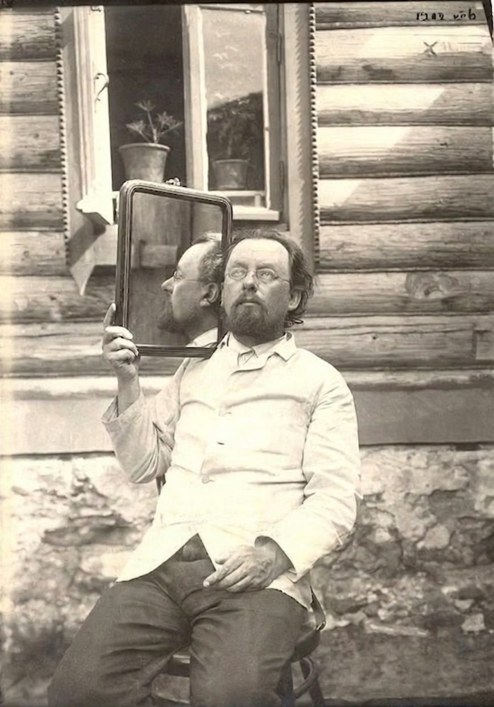
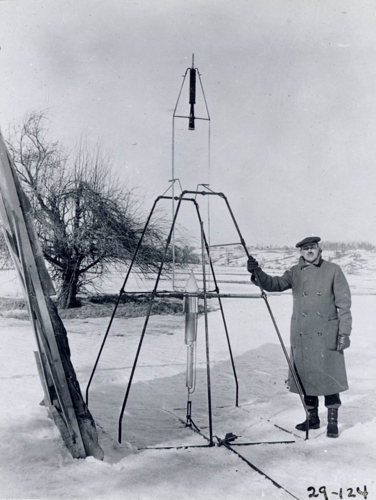
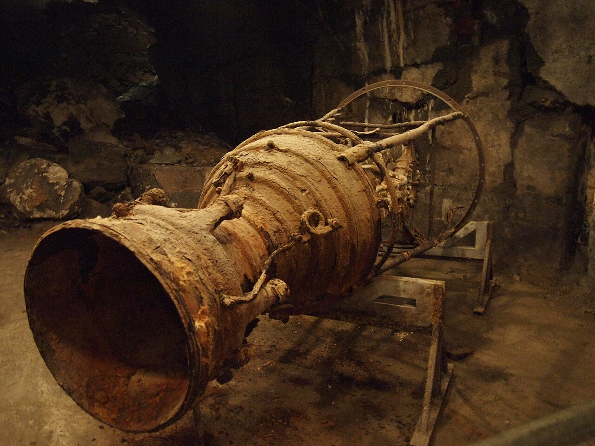
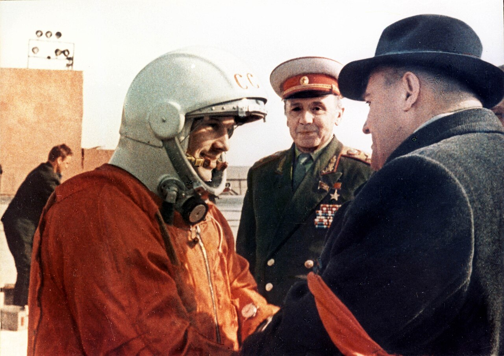
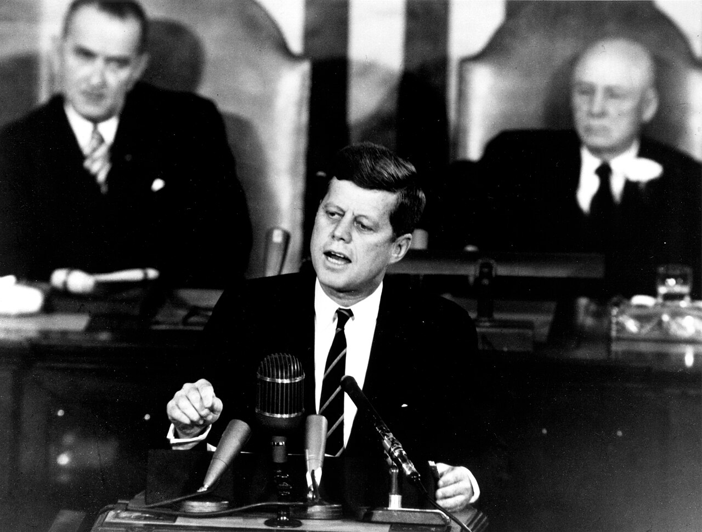
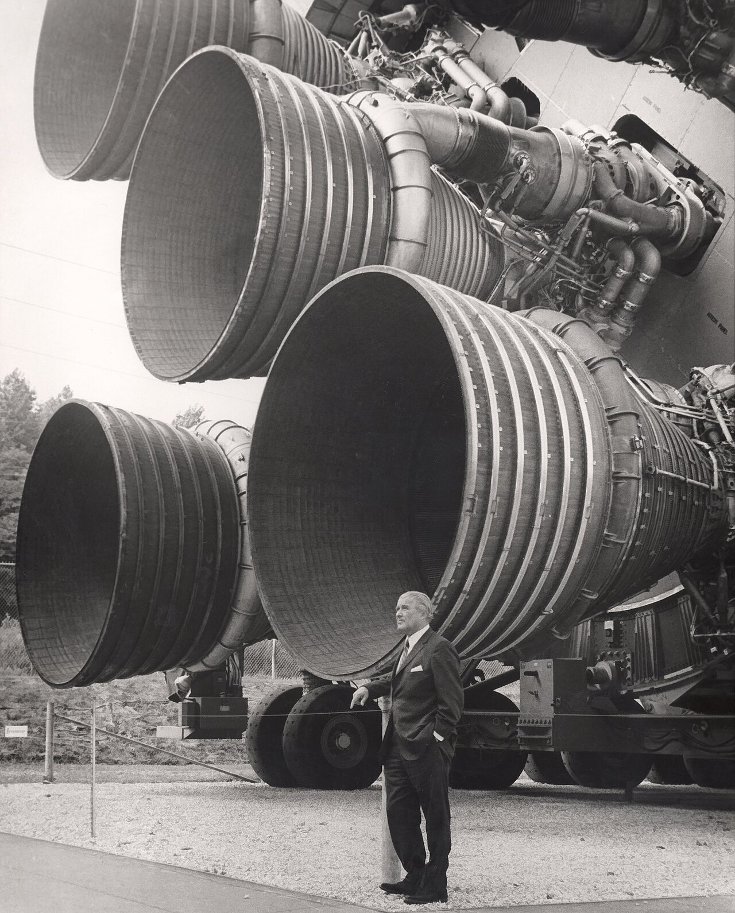
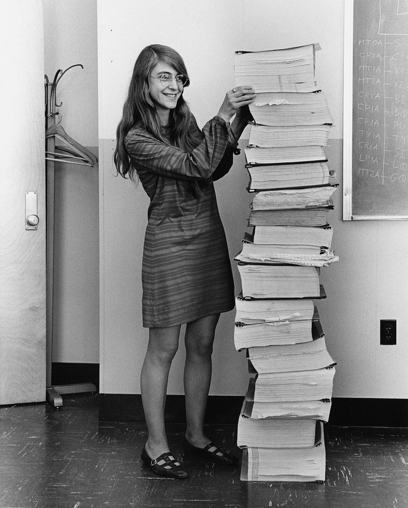
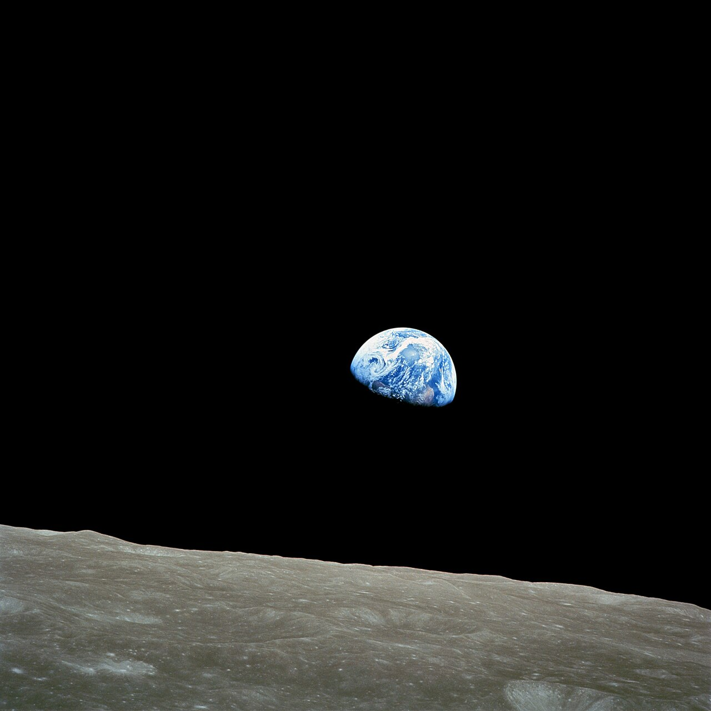
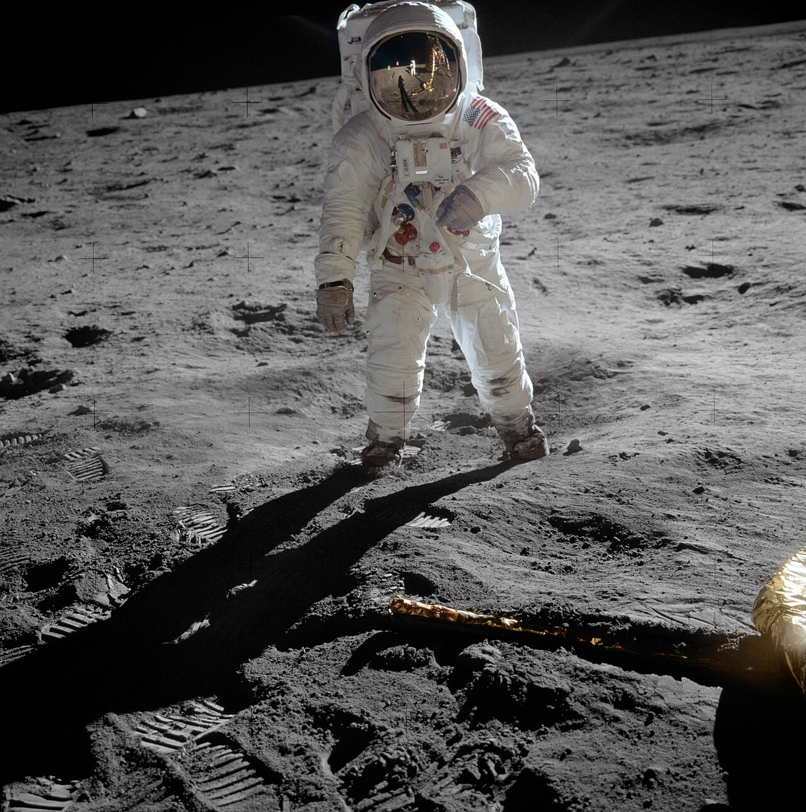
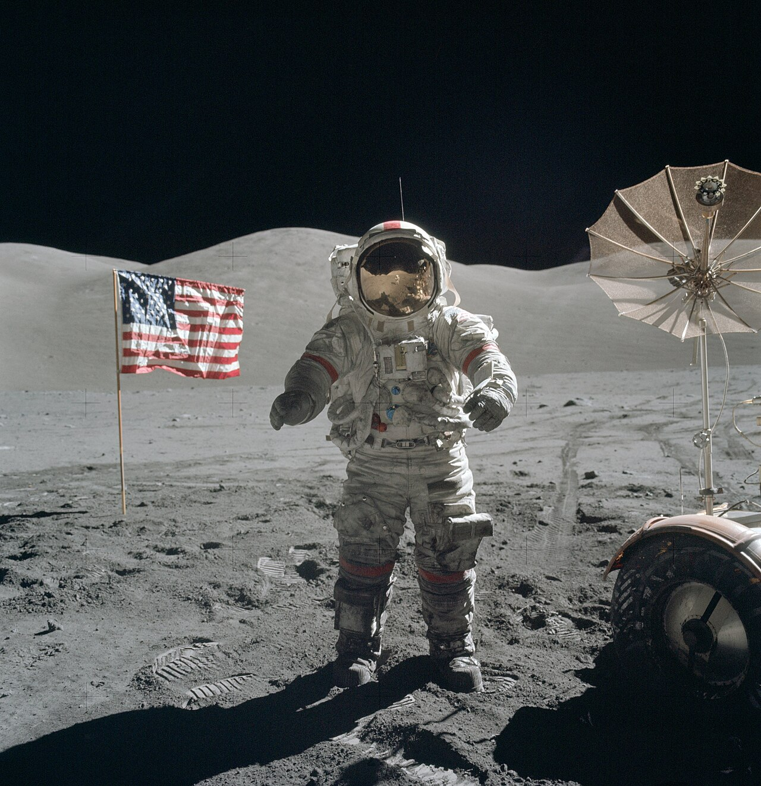

# 93. Why did we go to the Moon?

*The United States and the Soviet Union, from 1957 to 1972*

People went to the Moon because the United States and the Soviet Union were each trying to prove to the rest of the world that the future belonged to its system. The Soviets had put the first satellite and the first man into space. An American president needed a contest that his country could still win, and he picked the hardest one that anybody could think of.

On the afternoon of 20 July 1969, a spidery machine wrapped in gold foil was falling towards the surface of the Moon with two men standing inside it. It was the size of a small van, and its walls were in places as thin as three sheets of kitchen foil. It had never been flown to a landing before, because it could not fly on Earth.

Two thousand metres up, an alarm sounded that neither man had seen in training. The computer that was steering them had been given more work than it could do. The question, suddenly, was whether it could still be trusted to bring them down. A twenty-six-year-old engineer in Houston, three hundred and eighty thousand kilometres away, had about fifteen seconds to decide whether to call off the landing. He said to go on.

That was not the end of the danger. The commander, Neil Armstrong, looked out of his small triangular window and saw that the computer was taking them into a crater the size of a football stadium, strewn with boulders as large as cars. It was no place to land.

So he took over the controls and flew on, skimming the surface, looking for somewhere flat, while the man beside him read out the height and the fuel. Every second of searching burned fuel they could not get back. A voice from Houston said sixty seconds, then thirty. When the legs touched the dust, there were about twenty-five seconds left before he would have had to give up the landing.

Houston, Armstrong said, Tranquility Base here. The Eagle has landed. The voice that answered him stumbled over its words. You've got a bunch of guys about to turn blue here, it said. We're breathing again.

About six hundred million people, one in six of everyone alive, watched on television as he climbed down the ladder more than six hours later.

## Dreamers

The idea was older than the means. At the beginning of the century a deaf schoolteacher in a small Russian town, who had never seen a rocket larger than a firework, worked out on paper how it could be done.

*Konstantin Tsiolkovsky, the deaf schoolteacher who worked out spaceflight on paper, photographed in 1902 in his small Russian town. Photo: attributed to Aleksandr Assonov, public domain.*

His starting point was the rocket itself. A rocket works by throwing mass out of its tail. Hot gas rushes backwards, and the rocket is pushed forwards, as a boat moves when someone on board hurls a stone astern. Unlike a jet or a propeller, it needs no air to push against or to burn with, since it carries its own oxygen. For that reason it is the one kind of engine that works in the emptiness of space.

The schoolteacher, Konstantin Tsiolkovsky, wrote down the equation that tells how fast a rocket can go for a given load of fuel. The sums carried bad news. He saw that no single rocket could carry enough, because the fuel itself, and the tanks that held it, were part of the weight to be lifted. The answer, he saw, was to stack several rockets on top of one another and drop each when it was empty, so that the ones still firing had less dead weight to push. The Earth, he wrote, is the cradle of mankind, but one cannot live in the cradle for ever.

He also understood what an orbit is. Picture a cannonball fired level from a mountain top. It curves down and hits the ground. Fire it faster, and it lands farther off. Fire it at twenty-eight thousand kilometres an hour, and the ground curves away beneath it as fast as it falls. It is still falling, and it never arrives. An orbit, in other words, is a fall that never ends. Anything moving sideways at that speed just above the air will circle the Earth with its engine off.

The early hardware was tiny. In 1926 an American physics professor named Robert Goddard built the first rocket to burn liquid fuel, and set it off in his aunt's cabbage field. It flew for two and a half seconds and rose twelve metres.

Even that was more than many people thought possible. A leading newspaper had already mocked him for not knowing what every schoolboy knew, that a rocket could not work in a vacuum. The newspaper was wrong: a rocket pushes against its own exhaust, not against the air, which is exactly why it can work in a vacuum. The newspaper printed a correction forty-nine years later, on the day after men left for the Moon.

*Robert Goddard beside the first liquid-fuel rocket, in the frame it was fired from on 16 March 1926. Photo: Esther Goddard, public domain.*

## Two engineers

The people who turned the dream into machinery were paid to do it by armies, and the two greatest of them were formed by the two dictatorships.

Large rockets were expensive, far beyond a professor's means. Armies could pay, because a rocket that could fly a long way could also carry a bomb a long way.

Wernher von Braun was a Prussian aristocrat who had wanted to go to the Moon since he was a boy. The German army gave him the money. By 1944 he had built a rocket fourteen metres high that could carry a ton of explosive three hundred kilometres, and several thousand were fired at London and Antwerp.

The cost of building them was paid by other people. They were assembled in tunnels under a mountain by prisoners from a concentration camp, who were worked, starved and hanged from the cranes. About twenty thousand of them died in that camp and its outposts. As a result, the rocket killed more people in its making than in its use.

Von Braun was no bystander to any of this. He was a member of the Nazi party and an officer of the SS, and he visited the tunnels. In 1945 he arranged to surrender to the Americans. They wanted what he knew. They brought him and more than a hundred of his engineers to the United States and asked few questions.

*A rusted V-2 rocket engine in the tunnels at Mittelbau-Dora, in Germany, where prisoners assembled the rockets in 1944. Photo: sockenhorst, CC0.*

Sergei Korolev was his Soviet counterpart, and for most of his life nobody outside a small circle knew his name. He had been a young rocket enthusiast in Moscow in the 1930s. In 1938, during Stalin's great purge, he was arrested on a false charge, beaten until his jaw was broken, and sent to a gold mine in the far north-east of Siberia, where he lost most of his teeth to scurvy.

He was pulled out to design aircraft in a prison workshop. After the war the state that had nearly killed him put him in charge of its missiles. Even then it kept him hidden. In the Soviet press he was referred to only as the Chief Designer.

## A beeping ball

On 4 October 1957 Korolev's team launched a polished metal sphere the size of a beach ball, with four trailing aerials, on top of the rocket that had been built to carry a hydrogen bomb. That last detail mattered more than the ball.

The ball itself was modest. It weighed eighty-three kilograms, and it did little except circle the Earth every ninety-six minutes and send out a steady beep that any radio amateur could pick up. It was called Sputnik, which means fellow traveller.

The effect on Americans, however, was close to panic. They had taken it for granted that their country led the world in science. Now a Soviet object was passing over their heads several times a day. Worse, a rocket that could lift it could plainly drop a bomb on any city in the United States.

The Soviets did not let the moment pass. A month later they sent up a second, six times heavier, with a dog inside. She was a stray from the streets of Moscow named Laika, and there was no plan to bring her back. She died of overheating within a few hours, which was not admitted for forty-five years.

In December the United States tried to answer. In front of the television cameras its rocket rose about a metre, sank back, and exploded. The newspapers called it Flopnik.

The reaction went well beyond rockets. Americans had decided that the trouble lay in their classrooms as well as on their launch pads. Congress voted money for science and language teaching in schools and for scholarships at universities, and founded a civilian space agency. Meanwhile the army had already been allowed to turn to von Braun, who put a small American satellite into orbit at the end of January.

## "Let's go"

The Soviets kept winning, and their next victory was the largest yet. On the morning of 12 April 1961 a twenty-seven-year-old air force pilot, the son of a carpenter and a dairymaid from a collective farm, was strapped into a steel ball on top of one of Korolev's rockets. As it rose, Yuri Gagarin called out a single cheerful word that means "Let's go".

He circled the Earth once, in a hundred and eight minutes, and came down by parachute in a ploughed field beside the Volga. The first people to meet him had no idea what they were seeing. An old woman and her granddaughter, planting potatoes, saw a figure in an orange suit and a white helmet walking towards them, and began to back away. Can it be, she asked, that you have come from space?

*Yuri Gagarin in his helmet before the flight on 12 April 1961, with Marshal Kirill Moskalenko and Sergei Korolev. Photo: Russian Ministry of Defence / RIA Novosti, CC BY 4.0.*

Gagarin was sent round the world as the smiling face of a system that had lifted a peasant's son to the stars. That was what made him so valuable. A rocket was only a machine, but a cheerful young man from a collective farm was an argument. Many people in the new countries of Asia and Africa were watching to see which of the two great powers was the one to follow.

The American president, John Kennedy, had been in office for three months. Five days after Gagarin's flight came the disaster at the Bay of Pigs, a second humiliation in less than a week. He asked his vice-president to find him a space programme which promised dramatic results in which America could win.

The experts replied that the Soviets, with their big rockets, would be first at anything in the next few years. That sounded like bad news, but it held an opening. A landing on the Moon was so far beyond what either country could do that both would have to start again from the beginning. In a contest so new to both sides, a head start in big rockets would count for less. Instead, it would be a long race, and in a long race American industry would tell.

On 25 May 1961 Kennedy asked Congress to commit the country to landing a man on the Moon and returning him safely to the Earth before the end of the decade. It was a promise made almost entirely on faith. At that moment the whole American experience of human spaceflight amounted to one man, for fifteen minutes.

*President Kennedy asking Congress, on 25 May 1961, to land a man on the Moon before the end of the decade. Photo: NASA, public domain.*

He said in public that the country chose to do such things not because they were easy but because they were hard. In private he was blunter. In a meeting that November, which was recorded, he told the head of the space agency that he was not that interested in space. The point was to beat the Russians.

Both versions rested on the same calculation. The hardness of the task was the whole point, because only a very hard task gave the Americans time to catch up.

## Four hundred thousand

Once the promise was made, the money followed. It was the largest engineering project that any country had undertaken in peacetime. At its height it employed four hundred thousand people, in thousands of companies and universities, and the space agency was taking more than four cents of every dollar that the American government spent.

The rocket at the centre of it all was von Braun's. Its shape followed Tsiolkovsky's old reasoning: stages stacked on top of one another, each dropped when its work was done. It stood a hundred and ten metres high, taller than a thirty-storey building, and weighed three thousand tons, nearly all of it fuel. Its five main engines burned thirteen tons every second. Of that whole tower, the part that came home was a cone three metres high with three men in it.

*Wernher von Braun beside the engines of a Saturn V first stage, the rocket he designed. Photo: NASA, public domain.*

Even a rocket that size was not big enough for the most obvious plan, so the key decision was how to land. To set the entire spacecraft down on the Moon and lift it off again would have needed a rocket far larger than any available. The whole ship, with its fuel for the journey home, would have had to land and then take off again.

A stubborn engineer at one of the agency's laboratories saw a way round this. He argued for two years, against von Braun among others, that only a small separate craft should go down to the surface, with two of the crew, and then fly back up to meet the main ship in orbit round the Moon. Everything else could be left behind.

The plan had a price. It meant that two vehicles would have to find each other and join up a quarter of a million miles from help. In exchange, it meant that the job could be done with one rocket.

![Diagram of a flight to the Moon and back. Left, the rocket as it stood, from the bottom: first stage, second stage, third stage, landing craft, the main ship's engine section, and the cone with the crew on top. Right, the Earth and the Moon with the path between them, in eight numbered steps: launch, with the first two stages falling away; one and a half turns round the Earth; the third stage firing for the Moon, and the main ship turning round to dock with the landing craft and pull it free; three days' coasting into orbit round the Moon; two men going down in the landing craft while one stays in orbit; the top half of the landing craft climbing back to meet the main ship; the engine firing behind the Moon for home; and the engine section dropped before the cone comes down by parachute in the Pacific](images/diagram_flight_plan.png)
*How the landing was flown in July 1969: each part of the rocket was dropped once it had done its work, and two men went down in the small landing craft while the main ship waited in orbit round the Moon; only the cone came home. Not to scale. Diagram: drawn for this book.*

A plan like that could not be flown by eye. To steer, the spacecraft needed a computer, at a time when a computer filled a room. The one that was built weighed thirty-two kilograms and had less memory than a modern greetings card that plays a tune.

Storing its programs took a strange kind of craft. A computer holds every number and every instruction as a string of ones and noughts. In this one, the programs were stored by threading copper wires through or around tiny magnetic rings, a wire through a ring for a one and around it for a zero. The work was done by hand, by women who had been weavers and watchmakers, and a single program took months to weave.

The team that wrote those programs was led by a mathematician of thirty-two named Margaret Hamilton. Its foresight was tested on the day. Her team had made sure that the computer could drop its less urgent tasks if it was overloaded, and that is what it did in the last minutes of the descent. The alarm in the descent had been the computer's way of saying so.

*Margaret Hamilton beside the printed listings of the programs her team wrote for the Apollo computer, 1969. Photo: 1969 photograph restored by Adam Cuerden, public domain.*

Much of the rest of the work was done by people far from any spotlight. The spacesuits, each of twenty-one layers, were sewn by seamstresses at a company that made brassieres, to a tolerance of less than a millimetre, since a single wrong stitch could kill.

The sums mattered as much as the stitches. The paths of the early flights were checked by a group of Black women mathematicians in Virginia, who had for years been kept in a separate office and were known as computers, because calculating was their job. The first American to orbit the Earth refused to fly until one of them, Katherine Johnson, had gone over the electronic machine's figures by hand. He trusted her arithmetic more than the new machine.

## Fire

It nearly ended before it began. The Moon programme was called Apollo. On 27 January 1967 the crew chosen for its first flight was sealed into its capsule on top of an unfuelled rocket for a rehearsal. Nothing was supposed to be dangerous about the day.

The cabin, however, was filled with pure oxygen, in which almost anything will burn fiercely, and it was full of wiring and nylon. A spark set it alight. The hatch opened inwards, and the pressure of the fire held it shut, so the crew could not pull it open. The three men were dead before anyone could reach them. The spacecraft was redesigned from end to end.

The Soviets were in worse trouble, and nobody outside knew. Korolev had died on an operating table in January 1966, at fifty-nine, during what should have been a routine operation. His jaw, broken by his interrogators in 1938, had made it impossible to fit a breathing tube. His obituary told the Soviet public for the first time who the Chief Designer had been.

His death cost the Soviets more than any single accident. Without him the rival design offices, which he had barely held together, went their own ways. In April 1967 a new spacecraft was sent up before it was ready, its parachute tangled, and the cosmonaut was killed. The giant rocket that was meant to carry Soviet men to the Moon was launched four times, and blew up each time, once in an explosion that destroyed its launch pad.

Rather than admit defeat, the Soviet government denied there had been a contest. It said for twenty years afterwards that it had never been in a race to the Moon at all.

## Earthrise

The Americans, meanwhile, recovered from the fire and pressed on. In December 1968 three Americans became the first human beings to leave the Earth's neighbourhood. They flew to the Moon, circled it ten times, and came back. It had been a terrible year, of assassinations, riots and a hopeless war, and the flight stood out against it all the more.

On the fourth orbit, as their ship came round from behind the Moon, one of the crew looked up and saw the Earth rising over the grey horizon. It was blue and white, half in shadow, and very small. He scrambled for a camera with colour film.

The photograph that he took has been reproduced more often than almost any other. Its power lay in what it left out. It showed people their own planet as a single thing, with no borders on it, alone in the dark. The astronaut said afterwards that they had gone all that way to explore the Moon, and that the most important thing they discovered was the Earth.

That way of seeing the planet spread quickly. Within sixteen months the first Earth Day was held, and twenty million Americans took part.

*The Earth rising over the grey horizon of the Moon, photographed from Apollo 8 on 24 December 1968. Photo: Bill Anders, NASA, public domain.*

## Mule carts

Not everybody was carried away. The same sums that impressed engineers looked very different to people who were struggling at home. Through most of the 1960s, when Americans were asked whether the Moon programme was worth what it cost, more said no than yes.

On the day before the launch in July 1969, a Black minister who had taken over the leadership of the movement for the rights of the poor arrived at the gates of the launch site with several hundred followers and mules pulling farm wagons. They had come, he said, to protest at a nation that could spend billions to put men on the Moon while a fifth of its own people lacked decent food, clothing and shelter.

The head of the space agency came out to meet them, and his answer was a careful one. He said that if not pushing the button tomorrow would solve the problems of poverty, he would not push it, and he asked the minister to hitch his wagons to the rocket. The minister said that he would pray for the astronauts, and was given seats to watch.

## Two and a half hours

After the long journey and the anxious landing, the walk outside was short and busy. Armstrong and his companion spent two hours and thirty-one minutes outside. They planted a flag held out by a metal rod along its top edge, since there is no wind, set out instruments, and gathered twenty-one kilograms of rock. They left a plaque that said that they had come in peace for all mankind.

Meanwhile, a third man circled overhead, alone. Each time he passed behind the Moon he was farther from any other human being than anyone had ever been.

*Buzz Aldrin on the Moon in July 1969. In his visor are the landing craft and the photographer, Neil Armstrong. Photo: Neil Armstrong, NASA, public domain.*

Everything now depended on a single engine. If the engine that was to lift them off failed to fire, the two men on the surface would have no way home. In Washington a speech lay ready in case it failed. It would have begun: Fate has ordained that the men who went to the Moon to explore in peace will stay on the Moon to rest in peace. The engine fired.

## Afterwards

The race was over, and the audience went home. Once the contest had been won, the reason for spending so much on it was gone. There were five more landings. By the last of them, the television networks had cut back their coverage. Three planned missions were cancelled to save money, and their rockets were laid out on lawns as museum pieces.

The last men left the Moon in December 1972. Twelve people have walked on it, all of them American men, and nobody has been back.

The rivalry itself softened. In 1975 an American and a Soviet spacecraft met in orbit, and their commanders shook hands through the open hatch. The contest had become, for a while, a partnership.

Looking back, the Moon itself turned out to matter less than what had been built in order to reach it. The same race put satellites in orbit by the hundred, and it is satellites that changed daily life. They forecast the weather, carry television and telephone calls across oceans, tell a mobile telephone where it is, and watch the ice caps and the forests.

Satellites changed the rivalry too. They let each side count the other's missiles. Once each side could check what the other had, it became possible, in 1972, to sign the first treaty limiting them.

The guidance computer left a legacy of its own. It had needed electronic circuits printed on tiny chips of silicon, a new and very costly invention. In the early 1960s the Moon programme bought more than half of all the chips made in America. Making so many taught the factories to make them cheaply, and that order book brought their price down from a thousand dollars to about twenty dollars apiece.

Even the science was a by-product of the contest. The rocks that the astronauts brought back showed that the Moon is four and a half billion years old and was formed from the debris thrown out when another young planet struck the Earth.

The last man to walk there was a navy pilot named Eugene Cernan. Before he climbed the ladder, he knelt and wrote his nine-year-old daughter's initials in the dust with his finger. There is no wind or rain on the Moon. The letters will be there for tens of thousands of years.

*Eugene Cernan on the Moon in December 1972, on the last of the landings. Photo: Harrison Schmitt, NASA, public domain.*