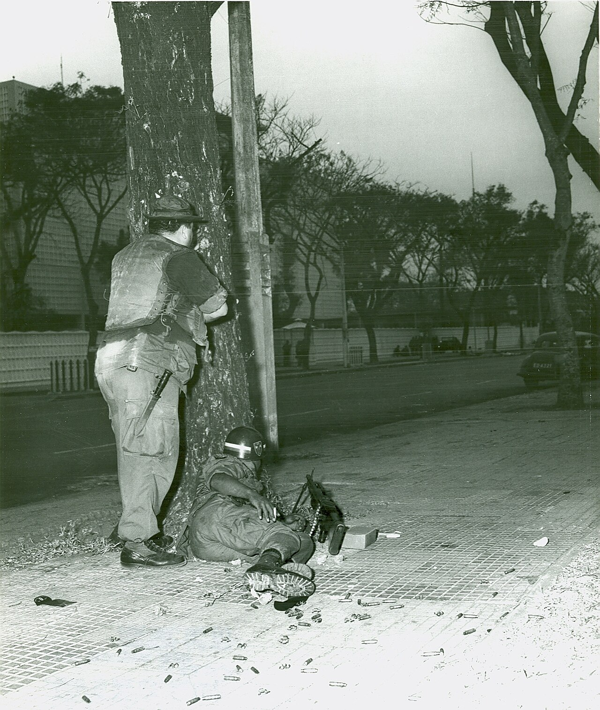
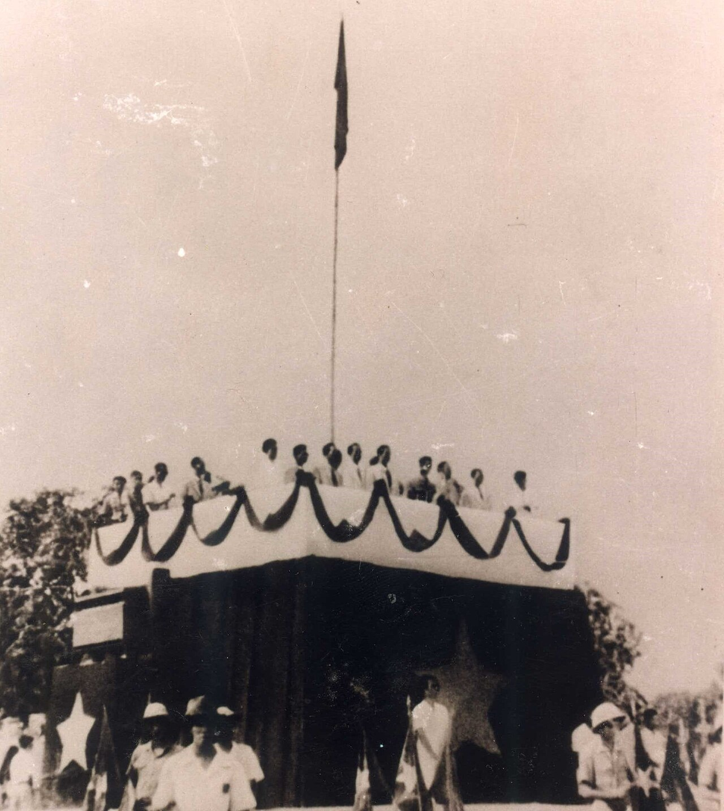
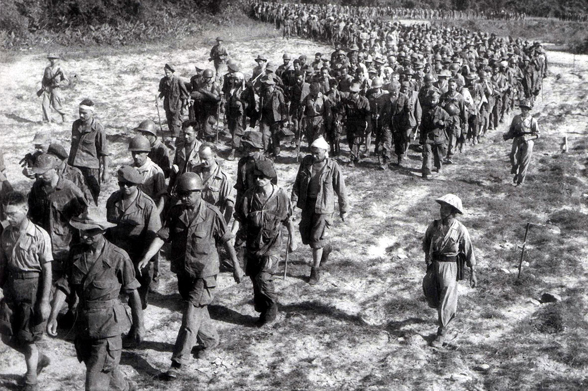
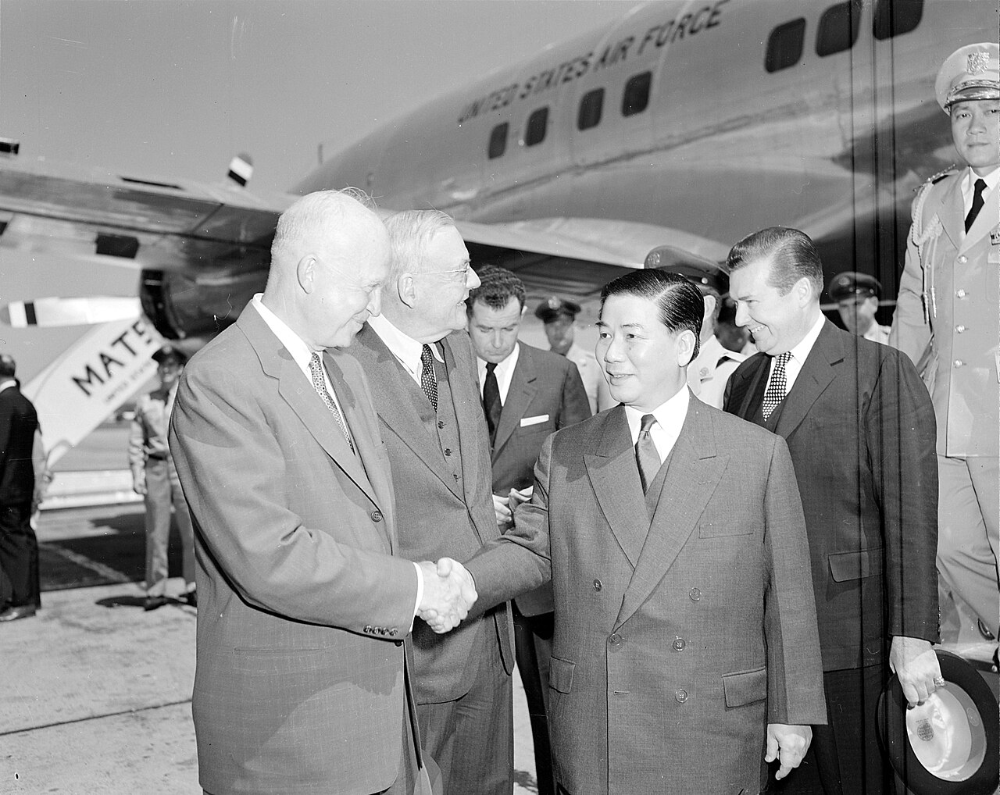
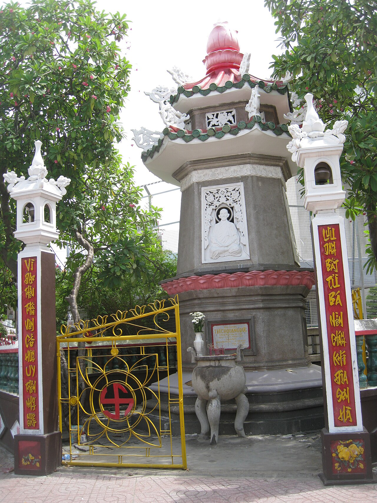
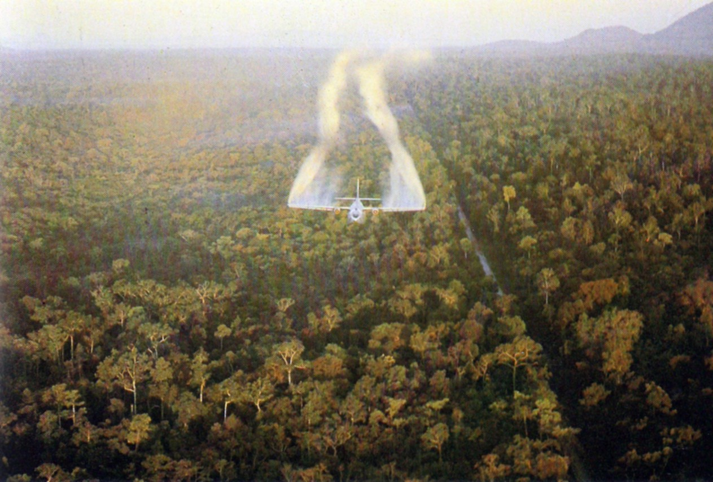
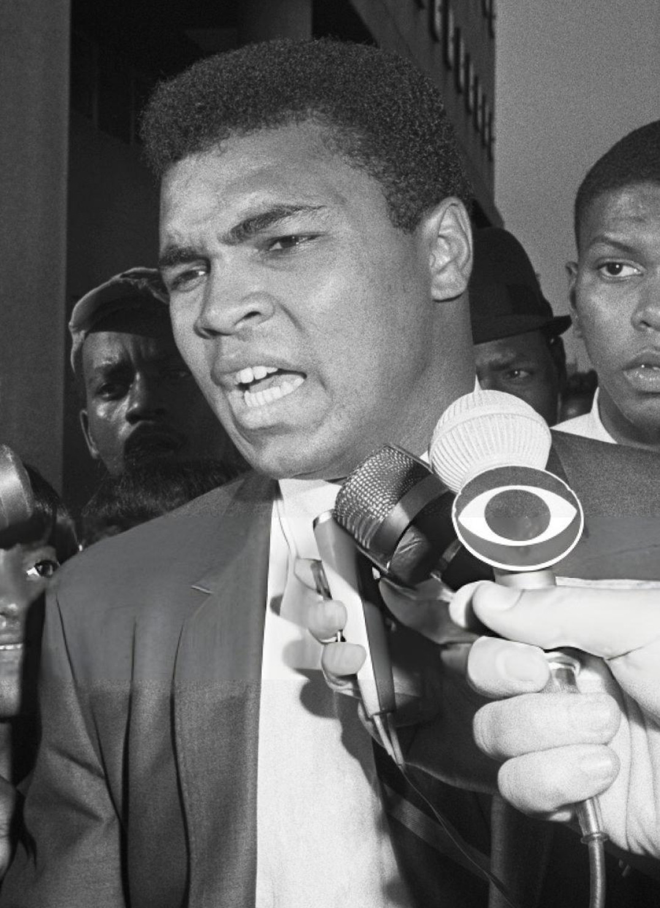
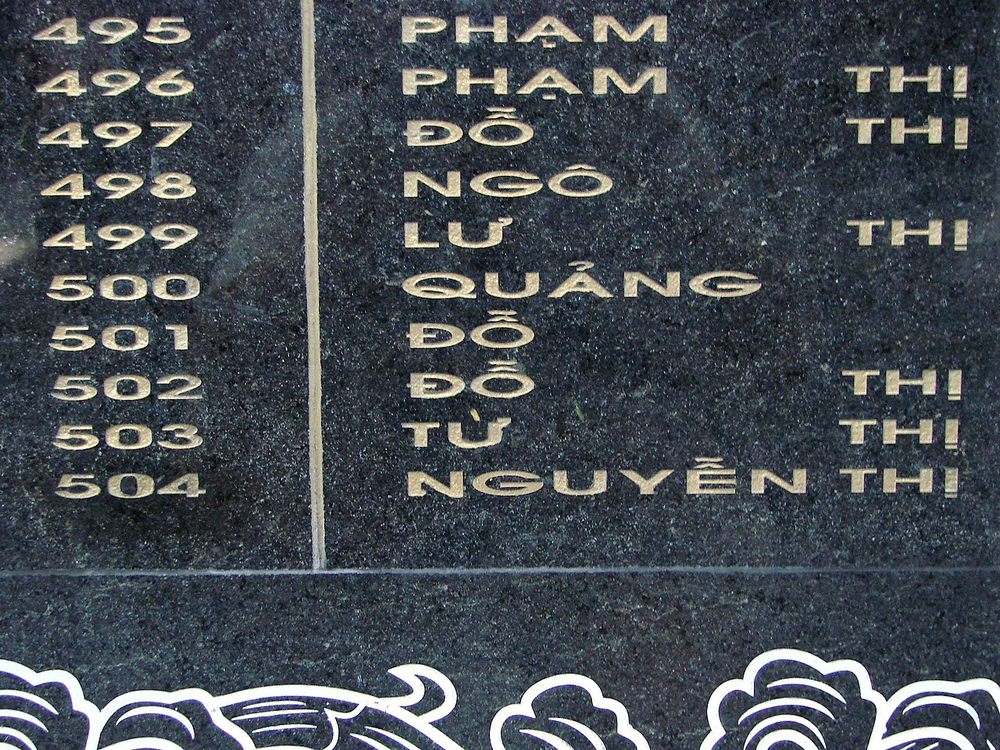
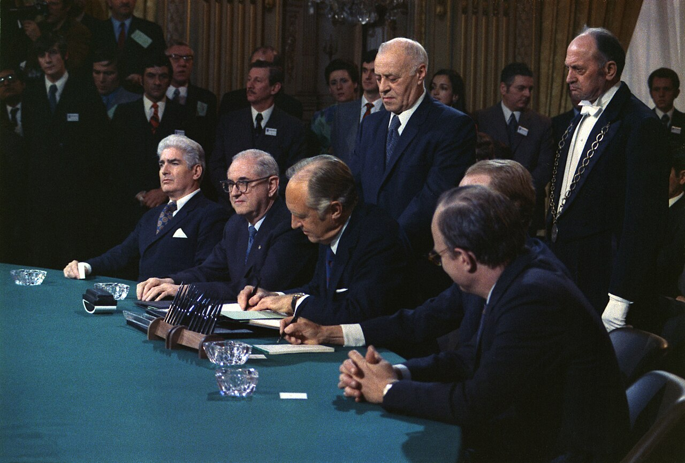
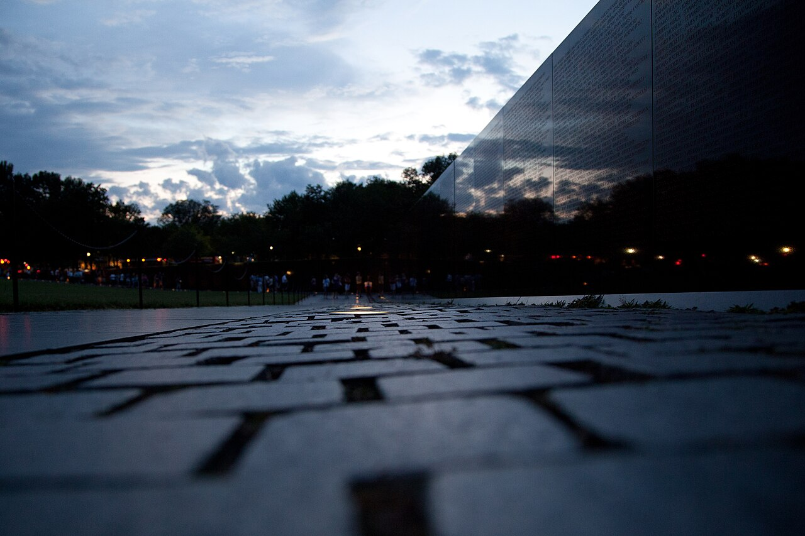

# 94. Why did America lose the war in Vietnam?

*Vietnam, from 1945 to 1975*

America lost because it was fighting a different war from its enemy. To Washington, Vietnam was a place where the spread of communism had to be stopped. To the Vietnamese on the other side, it was the last stage of a long fight to rid their country of foreign rule, and their leaders were prepared to spend lives on it for as long as it took. The United States could destroy whatever it could find. It could not make the people of the South believe in the governments that it held up.

At a quarter to three on the morning of 31 January 1968, a taxi and a small truck pulled up beside the American embassy in Saigon, the capital of South Vietnam. Nineteen men got out. One of them blew a hole in the wall with a satchel of explosive, and they climbed through, firing.

The timing and the target were both chosen to shock. It was the first night of Tet, the lunar new year, the greatest holiday in Vietnam, and a truce had been announced. The embassy was a new white building of six storeys, the most heavily guarded in the country. For six hours the attackers held its grounds against American military police, until the last of them was dead or captured.

*American military police outside the embassy in Saigon in the early morning of 31 January 1968, during the Tet attack. Photo: U.S. Army Military History Institute, public domain.*

The embassy was only one target among many. That same night about eighty thousand guerrillas and northern soldiers struck more than a hundred cities and towns across South Vietnam, most of which had seemed safe.

On the battlefield, the attack failed. Within weeks the attackers had been driven out everywhere, with the loss of perhaps forty-five thousand men, and the guerrilla movement in the South never recovered.

It made no difference, because the battle that mattered was being fought somewhere else. For three years the American government had been telling its people that the enemy was nearly finished. Two months earlier the commanding general had said that the end was beginning to come into view. Now Americans watched, on the evening news, gun battles in the garden of their own embassy. An enemy that was nearly finished could not do that.

The doubt spread upwards. The most trusted newsreader in the country went to see for himself, and told his audience that the war was a stalemate and could not be won. At the end of March the president announced that he would not stand for another term.

## A retoucher of photographs

The other side could lose battles and keep fighting. Its leader had been at this for fifty years.

He was born about 1890 in a village in central Vietnam, which was then part of a French colony. As a young man he left as a kitchen hand on a steamship, and for the next thirty years he did not come home. He washed dishes in London, saw Boston and New York, and settled in Paris, where he touched up photographs for a living.

Paris also gave him a chance to plead his country's case. In 1919, when the victors of the world war gathered there to redraw the map, he bought a suit and tried to present them with a petition asking for equal rights and a voice for the Vietnamese. He had reason to hope. The American president had spoken of the right of peoples to rule themselves. Nobody would see him.

Turned away by the democracies, he found another creed. Lenin had written that the colonial peoples were the natural allies of the revolution. That promise drew him in. He became a communist, was trained in Moscow, and spent the next two decades as an agent in China and Siam under a string of false names. The last of them, the one that stuck, was Ho Chi Minh, which means "he who enlightens".

In 1941 he walked back over the border and founded a league to fight for independence. By then the country had new masters. Japan had occupied it, and the French officials went on running it under Japanese orders. That made Ho, for a while, an ally of the Americans, who were at war with Japan. His guerrillas rescued American airmen who had been shot down, and American agents gave them rifles and training in return.

The friendship reached its high point at the end of the war. On 2 September 1945, the day that Japan signed its surrender, he stood in front of several hundred thousand people in a square in Hanoi and proclaimed his country free. He began with a sentence that he had borrowed. All men are created equal, he read. They are endowed by their Creator with certain unalienable rights. American officers stood near the platform, and American aircraft flew over the crowd.

*The platform in Ba Dinh Square, Hanoi, on 2 September 1945, where Ho Chi Minh read the declaration of independence. Photo: unknown photographer, public domain.*

## Bicycles

France, however, wanted its colony back. Its army came back within weeks, and at the end of 1946 a war began that lasted eight years.

Ho told a French visitor how it would go. You can kill ten of my men for every one I kill of yours, he said. Even at those odds, you will lose and I will win. The boast rested on patience. A people fighting in its own country could go on taking losses long after a foreign army had tired of paying for the war.

Then the wider world changed the meaning of the war. By 1950 the Communists had won China, and the United States had come to see the French war as part of the defence of Asia. By the end, America was paying four fifths of its cost.

At the end of 1953 the French commander set a trap. He placed fifteen thousand of his best troops in a remote valley near the border of Laos, at a place called Dien Bien Phu, to draw the enemy into a battle in which French artillery and aircraft would destroy him. The plan rested on a belief about the terrain. He was certain that the Vietnamese could not bring heavy guns through two hundred kilometres of roadless mountain jungle.

They brought them in pieces. Tens of thousands of peasants dragged the guns up the slopes by rope, a few metres a day, and dug them into the hillsides facing the valley.

Feeding the army that fired them was just as hard, and the answer was just as humble. Supplies came on bicycles, reinforced with bamboo, each pushed by one man and loaded with two hundred kilograms of rice. A bicycle used that way became a pack animal that never needed feeding.

The French found out too late. When the guns opened fire, the French artillery commander understood what had happened and killed himself with a grenade. The garrison surrendered after fifty-six days.

*French soldiers captured at Dien Bien Phu, led away by Vietnamese troops to a prisoner-of-war camp, 1954. Photo: AFP, public domain.*

## A line and a promise

With the French beaten, the question was what would happen to the country they left. The peace conference met at Geneva. The great powers, with the United States standing aside, agreed that Vietnam would be divided for the time being at the seventeenth parallel, with Ho's government in the north and a French-backed one in the south. The division was meant to be temporary. An election would be held within two years to reunite the country.

The election was not held. The American president of the day wrote in his memoirs that every informed person he had talked to agreed that, in an election held while the fighting lasted, Ho would have won four votes in five. A vote, in other words, would have handed the whole country to a communist. Instead, Washington chose to build a separate, anti-communist state in the south.

The man it found to lead that state was Ngo Dinh Diem, a devout Catholic from a family of officials. He was honest, stubborn and remote, and he governed through his brothers.

His faith shaped his government, and that was a problem. In a country where eight people in ten were Buddhists, he filled the army and the administration with Catholics. He also undid much of what the villagers valued. He cancelled the village elections, gave the land back to the landlords from whom the guerrillas had taken it, and jailed his critics.

Each of those steps made the guerrillas' case for them. By 1960 the survivors of the old independence movement in the south had taken up arms again, with the backing of the north.

*President Eisenhower and Secretary of State John Foster Dulles welcoming Ngo Dinh Diem at Washington National Airport, 8 May 1957. Photo: U.S. Air Force, public domain.*

Why did the Americans stand by such a government? The reasoning in Washington was summed up in a picture. You have a row of dominoes set up, the president had said, and you knock over the first one, and the last one will go over very quickly. If Vietnam fell, the rest of South-East Asia would follow, and then perhaps Japan.

There was a reason closer to home as well. American politicians also remembered what had happened to those accused of having "lost" China. No president wanted to be accused of losing Vietnam.

## A monk at a crossroads

Diem's treatment of the Buddhists finally produced a protest that the whole world saw. On 11 June 1963 an elderly Buddhist monk sat down in the middle of a busy crossroads in Saigon, in the posture of meditation. Another monk poured petrol over him. He struck a match.

He burned for ten minutes without moving or crying out, while monks and nuns knelt around him and an American photographer took pictures. He was protesting at the government's treatment of his religion. The response from the palace made matters worse. Diem's sister-in-law, who acted as first lady, remarked that she would clap her hands at another monk barbecue.

*The memorial in Ho Chi Minh City, once Saigon, to the monk Thich Quang Duc, who burned himself in 1963. Photo: Nguyễn Thanh Quang, CC BY-SA 3.0.*

The photographs went round the world, and the Americans concluded that the war could not be won with Diem. They did not remove him themselves. Instead, they let his generals know that they would not object to a change.

The generals took the hint. On 1 November they seized power, and the next morning Diem and his brother were shot in the back of an armoured car. Three weeks later the American president was himself assassinated.

Getting rid of Diem did not bring stability. By then there were sixteen thousand American military advisers in South Vietnam. The generals who followed Diem overthrew one another every few months, and the guerrillas controlled much of the countryside.

## Two destroyers

The new president, Lyndon Johnson, did not want this war. He was a Texan of poor origins who had a plan to end poverty and racial injustice in America, and he feared that Vietnam would wreck it.

He feared more that he would be the president who let a country fall to communism. Caught between those two fears, he could see no way out. He said later that he had known from the start that he was bound to be crucified either way.

The occasion for going in came from a confused night at sea. In August 1964 North Vietnamese patrol boats exchanged fire with an American destroyer off their coast, in the Gulf of Tonkin. Two nights later, in a storm, two destroyers reported that they were under attack again.

In fact, the second attack never happened. Their sonar and radar had picked up ghosts. There were no enemy boats, as the captain on the spot suspected within hours.

Johnson went on television to announce the second attack regardless, and asked Congress for the authority to take all necessary measures. The lower house gave it without a single vote against, and the senate with two. The wording was broad enough to cover almost anything. That resolution was the nearest that Congress ever came to declaring the war that followed.

The great escalation came the next year. In March 1965 American aircraft began a bombing campaign against the north that went on for three years, and the first marines waded ashore. Within three years there were more than half a million American soldiers in the country.

## Body count

They had come to fight an army, and for the most part they could not find one.

There was no front line. The enemy lived among the villagers, or in the jungle, or across the border, and chose when to fight. As a result, a typical operation went nowhere. American units were flown out by helicopter to sweep an area, lost a few men to mines and snipers, and were flown back. The ground was given up the same evening.

That created a problem of measurement. In an ordinary war, progress shows on a map. Since ground won could not be held, success was measured instead by the number of enemy dead, and every unit reported its count.

The count soon took on a life of its own. Officers were promoted on it. The numbers were inflated, and a dead Vietnamese was readily counted as an enemy. A war measured that way rewards killing, whoever is killed.

What the Americans had, in place of a front, was firepower. Whole districts were declared zones in which anything that moved could be fired on. Aircraft dropped more than seven million tons of bombs on Vietnam and its neighbours, three times the weight that American aircraft had dropped in the whole of the Second World War.

The war was fought against the land as well as the people. The Americans sprayed seventy-five million litres of weed-killer over the forests and rice fields of the south, to strip the cover from the guerrillas and the food from their supporters, and much of it contained a poison that has been causing cancers ever since.

The logic of firepower reached its end in a single remark. After one town in the Mekong delta was shelled flat to drive out the guerrillas, an American major explained to a reporter that it had become necessary to destroy the town in order to save it.

*An American aircraft spraying defoliant over forest in South Vietnam in 1962, the first year of the spraying. Photo: U.S. Air Force, public domain.*

All that destruction worked against its purpose. Burned villages made recruits for the other side. A family whose house had been destroyed by American shells had little reason to fight for the government the Americans supported.

The north, meanwhile, sent men and weapons south down a web of jungle tracks through Laos and Cambodia, which was bombed day and night and never closed. The Soviet Union and China supplied the trucks, rifles and anti-aircraft missiles.

Where the bombs could reach, the fighters went underground. Near Saigon the guerrillas, whom the Americans called the Viet Cong, lived in two hundred and fifty kilometres of tunnels, with kitchens, hospitals and workshops underground. They lost ten men, or more, for every American, as Ho had said. Even so, as he had foretold, they kept going.

![Map of Vietnam, Laos and Cambodia. North Vietnam is shaded red and South Vietnam blue, divided by the line of 1954 just south of the seventeenth parallel. Hanoi and Dien Bien Phu, near the border of Laos, are in the north; Saigon and the Mekong delta in the south, and My Lai on the central coast. The Gulf of Tonkin lies east of the north. Dashed brown arrows of the supply trails run from the North south through eastern Laos and north-eastern Cambodia, with branches east into South Vietnam and the main line ending north-west of Saigon. Thailand, or Siam, lies to the west and China to the north](images/map_vietnam.png)
*Vietnam, divided at the line of 1954, with Laos and Cambodia, and the supply trails from the North through Laos and Cambodia, roughly. Map: drawn for this book; coastlines and rivers from Natural Earth, public domain.*

## The draft

The Americans who fought were young, and they were not a cross-section of their country. More than two million men were conscripted.

Who went depended a great deal on who could stay away. A man at university could put off his service, and one with a helpful doctor could avoid it. As a result, the infantry was drawn heavily from the sons of factory workers and farmers, and in the early years disproportionately from Black Americans. A soldier's tour in Vietnam lasted a year, and he counted the days.

The unfairness found its most famous voice in a boxer. In 1967 the heavyweight boxing champion of the world was called up, and refused to go. I ain't got no quarrel with them Viet Cong, he had said the year before.

The price of refusing was high. He was stripped of his title, banned from boxing for three years in the prime of his career, and sentenced to five years in prison, which the Supreme Court later overturned. For many young Black men, who were being asked to fight for a freedom abroad that they did not have at home, Muhammad Ali had said what they thought.

*Muhammad Ali leaving the federal court in Houston on 20 June 1967, after he was sentenced to five years in prison for refusing the draft. Photo: United Press International, public domain.*

## A village in March

A war in which any dead Vietnamese could be counted as an enemy, and in which villages were burned to deny them to the guerrillas, made one kind of horror easier to commit. On the morning of 16 March 1968, a company of American infantry was landed by helicopter beside a village on the central coast called My Lai, in an area that had cost it several men to mines and booby traps. They had been told to expect an enemy battalion. Instead, they found old men, women and children eating breakfast.

Over the next four hours the soldiers killed about five hundred of them. They shot families in their huts, herded groups into a ditch and fired into it, and raped women before killing them. Not one shot was fired at them.

*A plaque at the My Lai memorial museum, in Vietnam, listing the 504 victims of the killings of 1968, photographed in 2009. Photo: Adam Jones, CC BY-SA 3.0.*

Some Americans tried to stop it. A helicopter pilot of twenty-four, flying overhead, saw the bodies and then saw soldiers advancing on a group of villagers hiding in a shelter. He landed his aircraft between them. He told his two gunners that if the Americans fired on the civilians, they were to fire on the Americans, and he coaxed about a dozen people out and had them flown away.

What followed showed how the body count could hide a massacre. The army reported a victory, with a hundred and twenty-eight enemy dead. The truth was buried for a year and a half, until a former soldier's letters to Congress and a freelance reporter brought it out.

Even then, the punishment was slight. One junior officer was convicted of murder. He served three and a half years, confined to his own apartment. The pilot, by contrast, was shunned by fellow officers for years.

## The living room

Cruelty in war was nothing new. What was new was how much of it the people at home could see, and how soon. No war had been seen like this one. Earlier wars had reached the public through censored reports and newsreels shown weeks later. This one arrived every evening in colour, within a day or two of the events, filmed by crews who could travel wherever a helicopter would take them.

Two photographs did as much as any battle. One, from the Tet fighting, shows the chief of the South Vietnamese police holding a revolver to the head of a prisoner in a checked shirt, at the instant he fires. The other, from 1972, shows a nine-year-old girl running naked down a road towards the camera, screaming, her clothes burned off by napalm dropped by a South Vietnamese plane.

The opposition began on the university campuses and spread. Its size grew with the war. In October 1969 two million people took part in demonstrations across the country in a single day.

The government's response could be deadly. In May 1970, when the war was extended into Cambodia, soldiers of the state militia opened fire on a crowd of students at a university in Ohio and killed four of them.

The worst blow to trust came from inside the government itself. In 1971 a former government analyst gave the newspapers a secret history of the war, seven thousand pages long, that had been compiled inside the defence ministry. It showed that four presidents had misled the public about what they were doing and how it was going.

The papers also showed, in plain figures, what the war was for. One memorandum from 1965 set out why America was in Vietnam. Seventy per cent of the purpose, it said, was to avoid a humiliating defeat. Twenty per cent was to keep the territory out of Chinese hands. Ten per cent was to give the people of South Vietnam a better and freer life.

## Peace with honour

Long before the papers came out, the question had become how to leave. Richard Nixon was elected in 1968 on a promise to end the war with honour. It took him four more years, in which twenty thousand more Americans died.

He brought the troops home in stages and handed the fighting to the South Vietnamese army. At the same time he widened the bombing, in secret, to Cambodia, where the northern army had its bases.

Cambodia paid dearly for it. That bombing helped to tip a neutral country into civil war. In 1975 it was won by a communist movement of extreme ferocity, which emptied the cities, abolished money and schools, and in four years killed or starved nearly two million Cambodians, a quarter of the population.

In Vietnam itself, the talks dragged on. In January 1973, after a last twelve days of bombing over Christmas, an agreement was signed in Paris. American forces would leave. The northern troops already in the south, however, would stay where they were.

That left the south facing an enemy army inside its own borders. The southern president agreed after Nixon promised in writing to send the bombers back if the north attacked again.

*Secretary of State William Rogers signing the peace agreement in Paris on 27 January 1973. Photo: Robert Knudsen, public domain.*

## The gate

The promise was not kept, because the man who made it was gone and Congress would not honour it. The end came in the spring of 1975. Congress had forbidden any further American bombing and cut the aid, and Nixon had been driven from office by a scandal at home.

Without American bombers, the southern army could not hold. The northern army attacked, and the southern one, which had a million men, fought hard in a few places and dissolved in fifty-five days.

On the morning of 30 April a northern tank broke through the iron gates of the presidential palace in Saigon. The American officials had already gone. Through the previous night, helicopters had lifted seven thousand people from the embassy and the airfield to ships offshore, and thousands more had been left behind at the embassy walls, holding up their papers.

Fifty-eight thousand Americans had been killed. The Vietnamese dead, soldiers and civilians, north and south, numbered between two and three million.

For many in the south, the suffering did not end with the war. The victors sent several hundred thousand southern officers and officials to prison camps, some for more than ten years. Over the following two decades about eight hundred thousand people fled the country by sea, and a great many drowned or were killed by pirates.

Elsewhere, the picture that had drawn America in turned out to be wrong. The dominoes did not fall as predicted. Before long, the communist neighbours were fighting one another. Within four years communist Vietnam had invaded communist Cambodia to overthrow its murderous government, and communist China had invaded Vietnam to punish it.

The bombing outlived the war. In Laos, on which the Americans had dropped more bombs for each inhabitant than on any country in history, the unexploded ones are still killing farmers and children.

In the end, the two old enemies made their peace through trade. In 1986 the government in Hanoi began to allow private business and foreign investment. The United States restored relations in 1995, and it is now the largest buyer of what Vietnam makes.

In Washington there is a memorial to the Americans who died. It was designed in 1981 by a twenty-one-year-old student, the daughter of immigrants from China, and many veterans hated it at first.

It is not a statue or an arch. It is a wall of polished black stone sunk into the ground, a hundred and fifty metres long, carved with fifty-eight thousand names in the order in which they died. A visitor reading them sees his own face in the stone.

*The Vietnam Veterans Memorial in Washington at dusk, photographed in 2012. Photo: Almonroth, CC BY-SA 3.0.*

A wall of the same kind for the Vietnamese dead would run for six kilometres.
