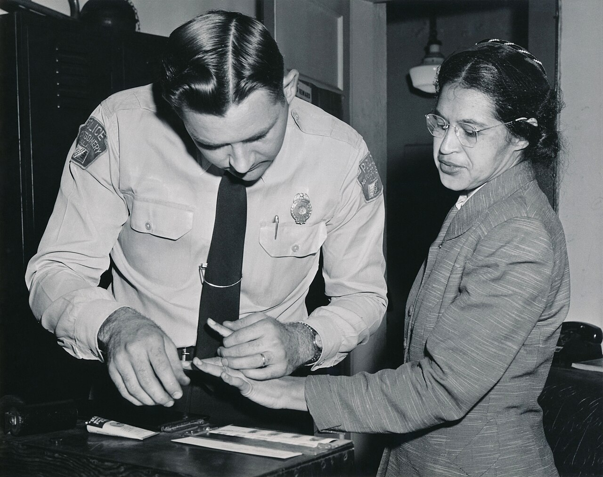
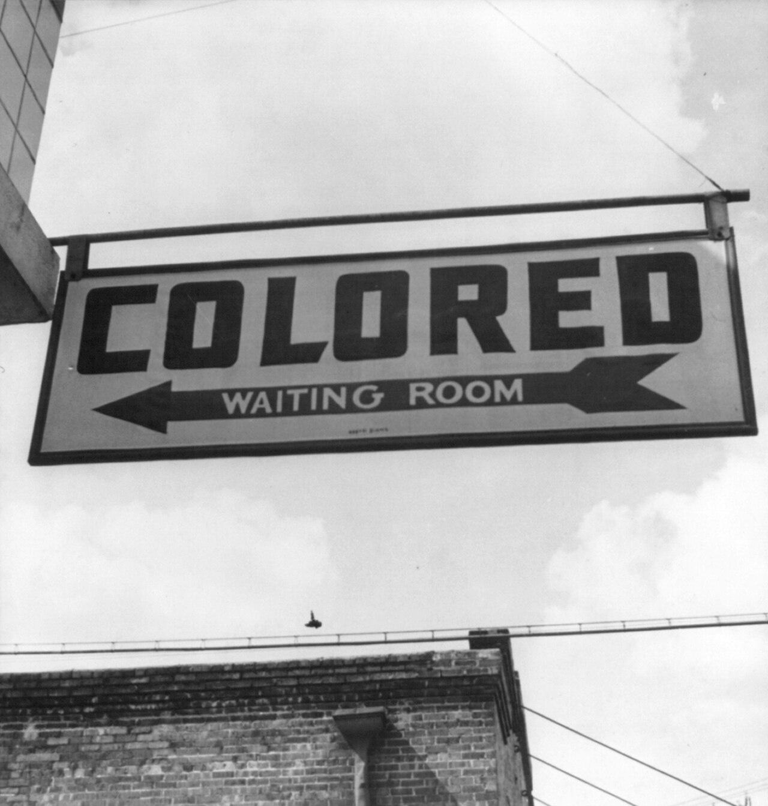
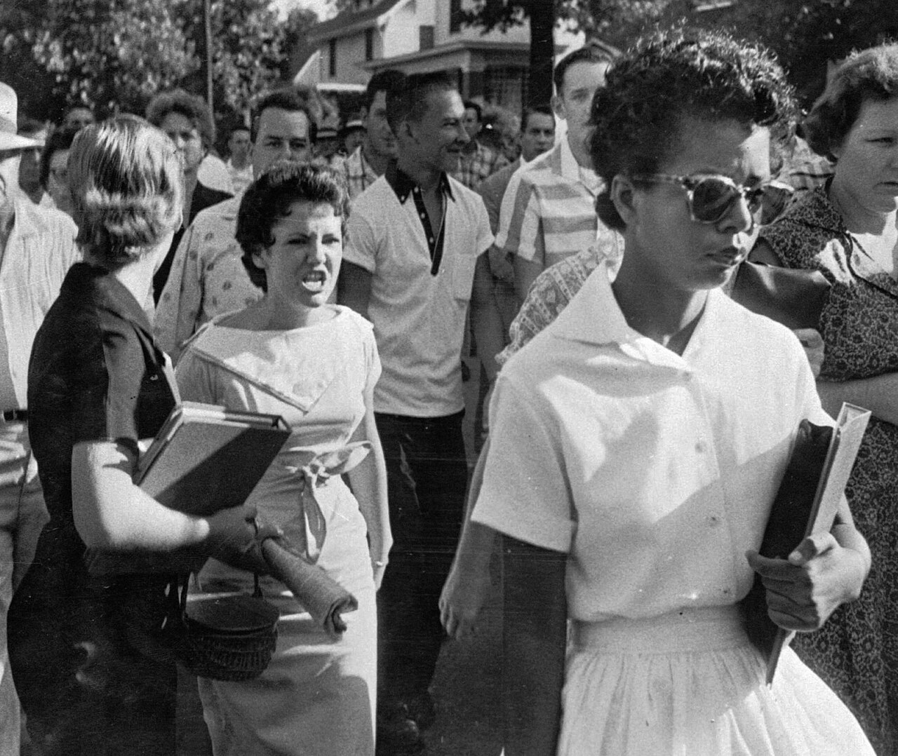
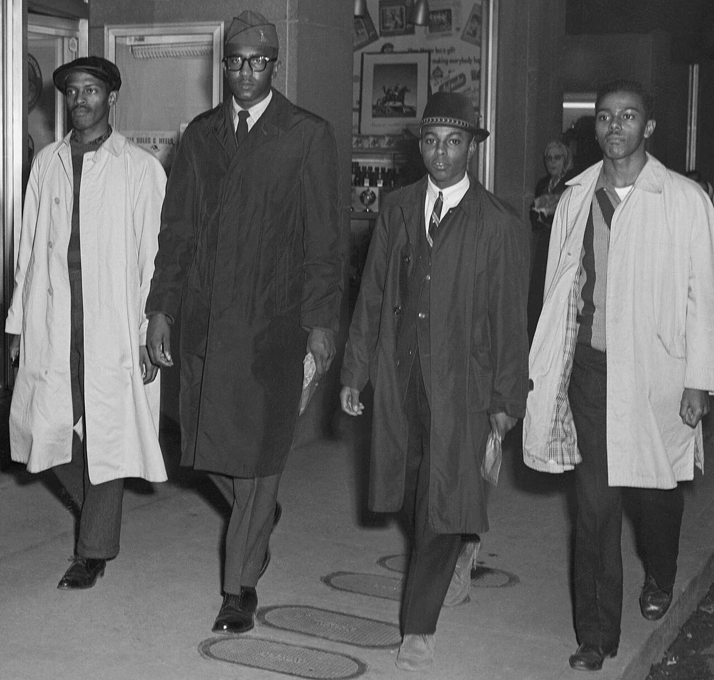
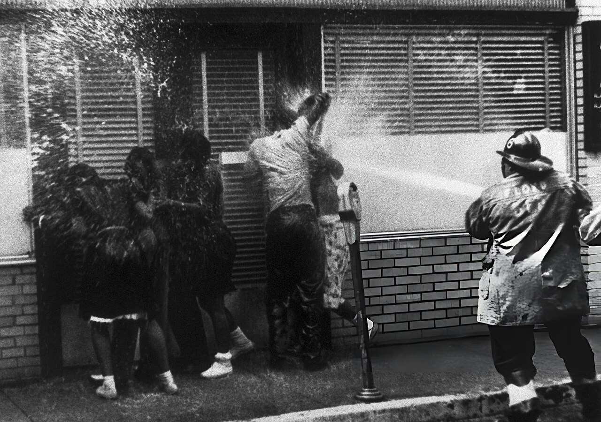
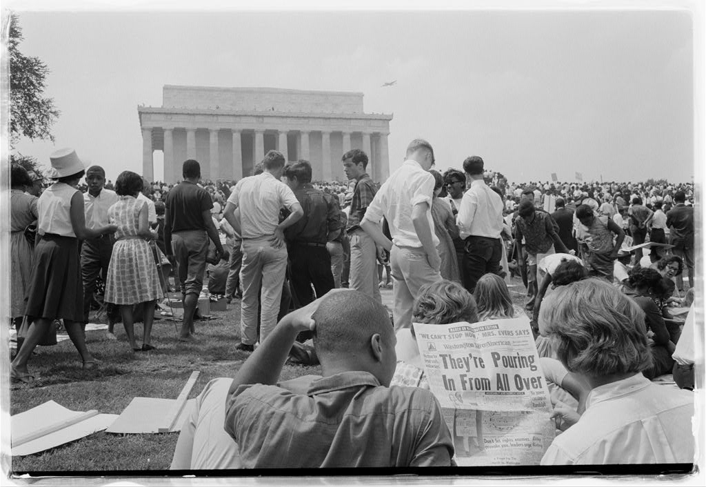
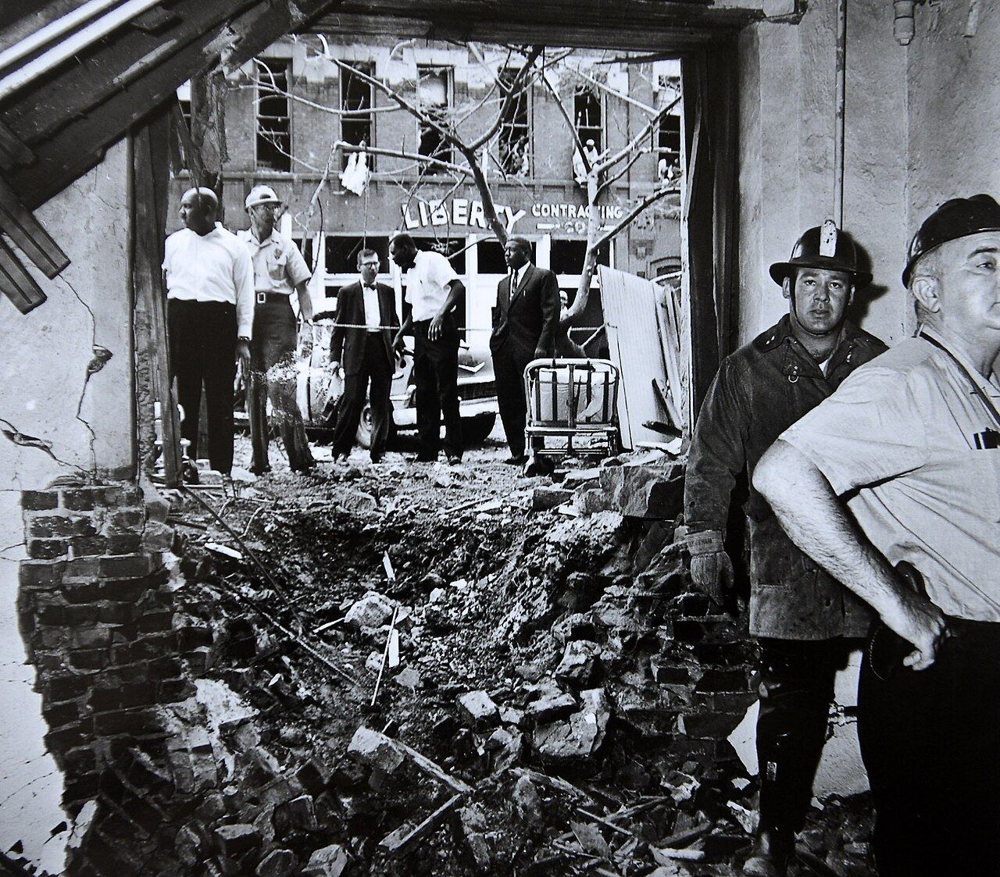
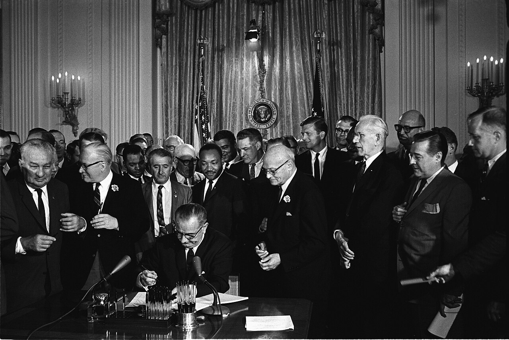
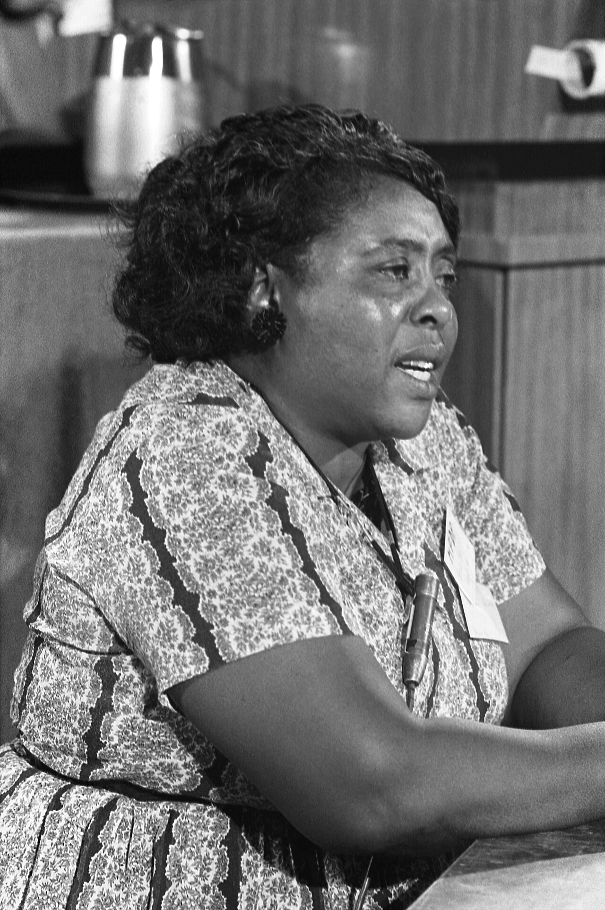
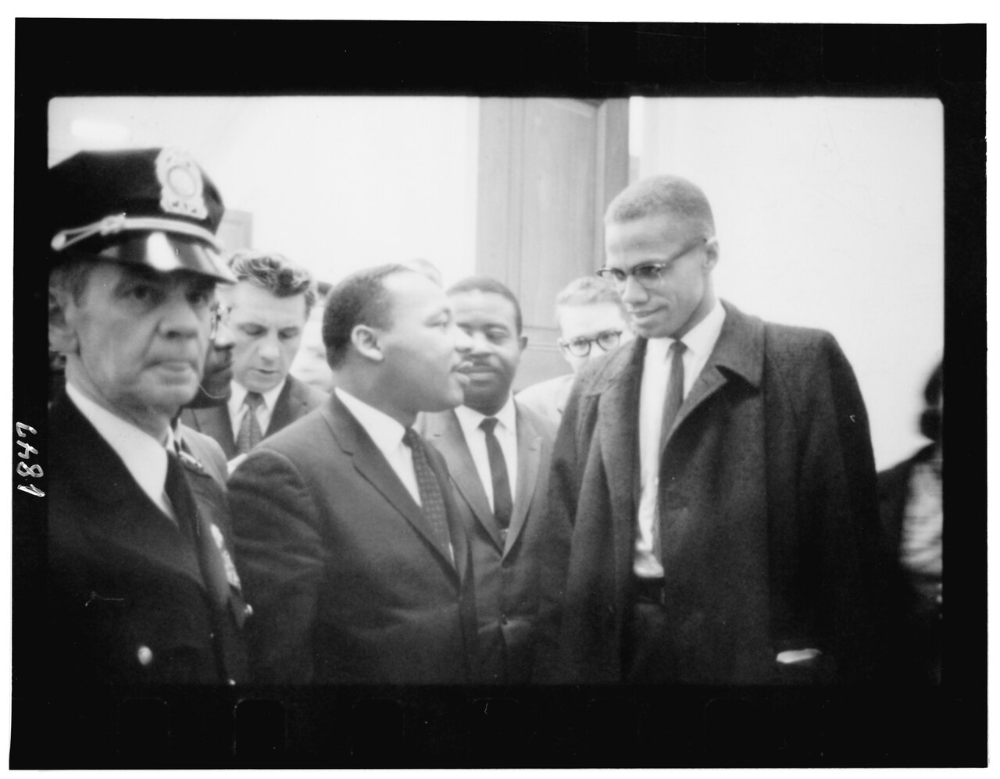

# 95. How did Black Americans win their civil rights?

*The United States, from 1954 to 1968*

They won them by organising. For ten years, ordinary people in the American South broke unjust laws in the open, refused to hit back when they were attacked, and did so in front of television cameras. A government in Washington that was competing with the Soviet Union for the good opinion of the world could not live with the pictures, and in 1964 and 1965 it passed laws that struck down segregation and made the right of Black southerners to vote a reality.

On the evening of 1 December 1955, in Montgomery, the capital of the state of Alabama, a woman of forty-two finished her day's work altering clothes in a department store and boarded a city bus for home. The rules on the bus were strict. The first ten seats were reserved for white passengers. Rosa Parks took a seat just behind them.

A few stops later the white section filled, and the driver told the four Black passengers in her row to stand so that one white man could sit. Three of them got up. She did not. The driver said that he would have her arrested. You may do that, she said.

The story was told for years as that of a tired seamstress who had simply had enough. She said herself that the only tired she was, was tired of giving in.

Her refusal, in fact, came from long preparation. She had been the secretary of the local branch of the main Black civil rights organisation for twelve years, and that summer she had attended a training school for activists. Nor was hers the first such arrest. A schoolgirl of fifteen had been arrested for the same offence on the same bus line nine months before, and the city's Black leaders had been waiting for the right case.

*Rosa Parks being fingerprinted in Montgomery on 22 February 1956, during the bus boycott. Photo: Gene Herrick, Associated Press, restored by Adam Cuerden, public domain.*

They were ready. That night a professor at the local Black college, who led a council of professional women, let herself into her office and ran off tens of thousands of leaflets on a duplicating machine. They called on every Black person in the city to stay off the buses the following Monday. She and two of her students spent the next day delivering them.

## Separate

One seat on a bus mattered so much because of the world that it belonged to. Ninety years earlier a civil war had ended slavery, and the constitution had been amended to make the freed people citizens with equal protection of the law and the vote. In the South those promises had held for about a decade. Then the federal troops went home, and white southerners took back control.

What they made in the years that followed was meant to last. By 1900 they had built a complete system. Laws required separate schools, hospitals, railway carriages, waiting rooms, drinking fountains and cemeteries.

The courts gave the system their blessing. In 1896 the highest court in the country had approved this, on the theory that separate facilities could be equal. They never were. A Black child's school got a fraction of the money and the white school's cast-off books.

*A sign for the Black waiting room at a bus station in Rome, Georgia, in 1943. Photo: Esther Bubley, Library of Congress, public domain.*

The vote was harder to take away, because the constitution now protected it. It was removed, therefore, without mentioning race. A would-be voter had to pay a tax, and to pass a test set by a white official. The official could make the test as hard as he liked. He might ask a Black teacher to explain a clause of the state constitution to his satisfaction, or to say how many bubbles there are in a bar of soap.

The results show how well the trick worked. In the state of Mississippi, where nearly half the population was Black, about one Black adult in fifteen was registered to vote.

Behind the law stood the rope. Between the 1870s and 1950, more than four thousand Black people were murdered by mobs, often in public, before crowds, for offences that ranged from a rumour of assault to failing to step off the pavement. The killings were a warning to everyone else about what happened to those who stepped out of line.

Slowly, however, the ground under the system began to shift. Between 1910 and 1970 six million Black southerners left for the cities of the North and West, where they could vote and where the factories were hiring.

War pushed things further. In the middle of those years came a war against a regime founded on a theory of racial superiority. A million Black Americans served in it, in segregated units, and returned to towns where they could not sit at a lunch counter. The contradiction was hard to miss. In 1948 the president ordered the armed forces to integrate.

Finally, segregation became an embarrassment abroad. In the new contest with the Soviet Union, lynchings were reported at length by Moscow radio to the peoples of Africa and Asia. Each one was a gift to the other side.

## A doll

The first breach was made by lawyers. For twenty years the legal staff of the same civil rights organisation, led by a tall, joking Black attorney named Thurgood Marshall, had been bringing carefully chosen cases against segregated education, starting with universities and working downwards. Each victory higher up made the next case lower down easier to win.

In 1954 they reached the heart of it. Their task was to show that separation itself did harm, however equal the buildings. Among their evidence was an experiment by two Black psychologists, a husband and wife, who had shown Black children a brown doll and a white one and asked which was the nice doll and which was the bad one. Most of the children preferred the white doll. Asked which doll was like them, some burst into tears.

On 17 May the Supreme Court ruled, with all nine judges agreeing, that separate schools were inherently unequal and violated the constitution. That was a victory in principle. In practice, the next step undid much of it.

A year later the court added that the schools should be integrated "with all deliberate speed". The phrase pulled two ways at once. Southern politicians took the word deliberate as their text, and moved as slowly as they could. They announced a policy of massive resistance, and ten years later ninety-eight Black children in a hundred in the South were still in all-Black schools.

*Elizabeth Eckford, a Black student, walking through a jeering crowd as she tries to enter Central High School in Little Rock, Arkansas, on 4 September 1957. Photo: Will Counts, Associated Press, public domain.*

A court ruling did nothing to soften the violence. In August 1955 a fourteen-year-old boy from Chicago named Emmett Till went to stay with his great-uncle in Mississippi. He was accused of whistling at a white woman in a shop. Her husband and his half-brother took him from his bed at night, beat him until his face was unrecognisable, shot him, and threw him into a river with a heavy fan tied to his neck with barbed wire.

His mother refused to let the killing be hidden. She had the body brought home and insisted that the coffin be left open. Let the people see what I have seen, she said. Tens of thousands filed past, and a Black magazine printed the photograph.

The trial that followed showed how little a Black life counted in a Mississippi court. A jury of twelve white men acquitted the two killers in sixty-seven minutes. A few months later, safe from a second trial, they sold their confession to a magazine.

The killing reached far beyond Mississippi. Rosa Parks said that she had thought of Emmett Till when she stayed in her seat.

## Three hundred and eighty-one days

The boycott in Montgomery had been planned for a single day. On that Monday morning the buses rolled through the Black districts empty. The one day had worked so well that at a mass meeting that night it was voted to go on.

A long boycott needed a leader. To lead it, the ministers chose the newest among them, who had been in the city a little over a year and had as yet no enemies. Martin Luther King was twenty-six, the son and grandson of preachers, with a doctorate in theology and a deep, rolling voice. There comes a time, he told the meeting, when people get tired of being trampled over by the iron feet of oppression.

Forty thousand people stayed off the buses for more than a year. They walked, some of them ten miles a day.

Walking alone could not carry a whole city, so the boycott was organised like a business. The churches bought station wagons and ran a car pool of three hundred vehicles, with pick-up points and dispatchers.

The city fought back. It indicted the leaders under an old law against boycotts. Others turned to violence. King's house was bombed with his wife and baby inside, and he stood on the wrecked porch and told an armed and furious crowd to put away their guns and go home.

In the end the decisive blow came from a courtroom. While the boycott went on, four Black women who had been mistreated on the buses had sued the city. In November 1956 the Supreme Court ruled in their favour, and segregated buses were illegal. On 21 December King boarded a bus and sat down in the front row.

## Workshops

Montgomery had shown a method, and its leaders knew exactly where it came from. King had read Gandhi as a student, and in 1959 he travelled to India to meet the people who had worked with him.

The principle was the same in both countries. Break an unjust law openly. Accept the punishment without striking back. The opponent's violence then becomes the whole story, in front of an audience that he needs. The method, in other words, turns the opponent's strength against him.

None of this came naturally. It had to be learned. In the city of Nashville, a young Black minister who had spent three years in India ran evening workshops in a church basement.

The training was rough because the real thing would be rougher. Students took turns sitting at a row of chairs while others played the part of a white mob. They shouted insults, blew cigarette smoke in faces, pulled people to the floor and kicked them. The students practised curling up to protect their heads, and looking their attackers in the eye.

The method was soon put to work by students elsewhere. On 1 February 1960, in the town of Greensboro in North Carolina, four Black first-year students sat down at the lunch counter of a Woolworth's store and asked for coffee. They were refused, and stayed until the store closed. The next day they came back with twenty more.

After that the idea spread quickly. Within two months there were sit-ins in more than fifty cities, and by the end of the year seventy thousand people had taken part. They were punched, burned with cigarettes and had ketchup poured over their heads, and thousands went to jail. Store after store gave in.

*The four students who began the Greensboro sit-in: David Richmond, Franklin McCain, Ezell Blair Jr. and Joseph McNeil, in February 1960. Photo: Jack Moebes, Greensboro Daily News, public domain.*

The next year the method moved onto the highways. Small groups of Black and white volunteers set out to ride long-distance buses through the South, sitting together, to test a court ruling that the bus stations must be integrated. The law was on their side, but the law was not what met them.

In Alabama a mob set one bus on fire and held the doors shut. At the next two cities the riders were beaten with iron pipes while the police stayed away by arrangement. The pictures went round the world, and that was what forced the issue. The government in Washington, which had hoped to avoid the whole subject, had to send federal marshals.

![Map of the south-eastern United States, with the states named in grey: Mississippi, Alabama, Georgia, Tennessee, the Carolinas and Virginia. Marked are Montgomery, Selma, Birmingham, Anniston, Atlanta, Albany, Nashville, Memphis, Jackson, Greensboro and Washington. A dashed red line traces the bus rides of 1961 from Washington through Virginia and the Carolinas to Atlanta, then to Anniston, where a bus was burned, Birmingham, Montgomery and Jackson. A short blue arrow marks the march of 1965 from Selma towards Montgomery](images/map_south.png)
*The South of the campaign, 1955 to 1968, with the route of the bus rides of 1961, roughly, and the march from Selma in 1965. Map: drawn for this book; coastlines and rivers from Natural Earth, public domain.*

## Children

The method counted on the other side behaving badly in public. That was its weakness, which a campaign in the Georgia town of Albany exposed. The police chief there had also read about Gandhi.

He used what he had learned to take the drama away. He arrested demonstrators politely, by the hundred, kept his men from using their clubs in view of the press, and sent the prisoners to jails in other counties. As a result, there were no pictures, and the campaign failed.

King and his colleagues therefore chose the next city with care. Birmingham, in Alabama, was the most rigidly segregated large city in the country. Just as important, its police commissioner was a man who could be counted on to lose his temper.

The campaign began in April 1963. King was arrested and put in a cell alone. While he was there, he found a new way to make his case. A group of white clergymen had published a statement calling the protests unwise and untimely, and he answered them in the margins of the newspaper and on scraps of paper smuggled out by his lawyers. For years, he wrote, he had heard the word "wait", and it had almost always meant "never". Justice too long delayed is justice denied.

The adults of Birmingham were running out of volunteers willing to lose their jobs. Schoolchildren did not have jobs at stake, so the organisers turned to the schools.

On 2 May more than a thousand children, some as young as eight, walked out of a church in ranks, singing, and hundreds were arrested. The next day a thousand more came. By then the jails were full, and the commissioner ordered his men to stop them by other means. Firemen turned on hoses powerful enough to strip the bark from trees, and rolled teenagers along the pavement. Policemen set dogs on them.

This time the cameras were there, and the commissioner had given them exactly what the movement needed. The footage led the television news across America that night. The president said that the pictures made him sick.

The pictures moved him to act. In June he went on television and called civil rights a moral issue, as old as the scriptures and as clear as the constitution, and asked Congress for a law to end segregation.

The same night brought a reminder of what the movement was up against. A few hours after that speech, the leader of the movement in Mississippi was shot in the back in his own driveway, with his children inside the house, and died within the hour.

*Young demonstrators huddled in a doorway against a fire hose in Birmingham, Alabama, on 3 May 1963. Photo: United Press International, public domain.*

## The dream

The bill now needed pressure behind it, and the movement brought that pressure to the capital itself. On 28 August 1963 a quarter of a million people came to Washington by bus, train and car, and stood along the reflecting pool in front of the memorial to the president who had freed the slaves. The march had been organised in eight weeks by a brilliant tactician who had been kept out of the limelight because he was a former communist and a homosexual.

*The crowd in front of the Lincoln Memorial at the March on Washington, 28 August 1963. Photo: Warren K. Leffler, Library of Congress, public domain.*

King spoke last. He was near the end of his prepared text, which was not going especially well, when a gospel singer on the platform behind him called out: Tell them about the dream, Martin.

He put the pages aside. I have a dream, he said, that my four little children will one day live in a nation where they will not be judged by the colour of their skin but by the content of their character.

The hope of that afternoon did not last long. Eighteen days later, on a Sunday morning, a bomb planted by members of the Ku Klux Klan went off under the steps of the Black church in Birmingham from which the children had marched. It killed four girls who were changing into their choir robes. Three were fourteen, and one was eleven.

*The hole blown in the wall of the 16th Street Baptist Church in Birmingham by the bomb of 15 September 1963. Photo: Tom Self, The Birmingham News, public domain.*

## Two laws

The president was murdered that November. His death, strangely, helped his bill. His successor, Lyndon Johnson, was a southerner who knew the Senate better than any man living, and he told Congress that no memorial could honour the dead president more than the passage of his bill.

The bill's opponents turned to talk. Southern senators talked for two months to prevent a vote. In the end the Senate voted to cut the talking short, and in July 1964 the Civil Rights Act became law.

It banned segregation in hotels, restaurants, theatres and other places open to the public, and discrimination in employment on grounds of race, religion or sex. Johnson understood what it would cost him. He remarked to an aide that evening that his party had lost the South for a generation.

*President Johnson signing the Civil Rights Act on 2 July 1964, with Martin Luther King Jr. among those standing behind him. Photo: Cecil Stoughton, White House, public domain.*

In law, at least, the lunch counters were open. The vote remained. That summer a thousand students, most of them white and from northern universities, went to Mississippi to help Black residents register.

The danger began almost at once. Three young men, two white and one Black, disappeared in the first days. Their bodies were found six weeks later, buried in an earth dam. They had been handed to the Klan by a deputy sheriff. The killers, in other words, included the law itself.

One of the Mississippians who had tried to register was Fannie Lou Hamer, the twentieth child of a family of cotton pickers. She had been thrown off the plantation where she had worked for eighteen years, and beaten in a jail cell until she was permanently injured.

She then took her case to the whole country. That August she told her story on national television, at a hearing of the president's own party, which she was asking to unseat the all-white delegation that Mississippi had sent to its convention. Is this America, she asked, the land of the free and the home of the brave?

*Fannie Lou Hamer at the Democratic National Convention in Atlantic City, August 1964. Photo: Library of Congress, restored by Adam Cuerden, public domain.*

The campaign for the vote came to a head in a single town. In the Alabama town of Selma, half the people were Black, and one in fifty of them was registered. On Sunday, 7 March 1965, six hundred people set out from a church there to walk to the state capital.

They did not get far. At the far end of the bridge over the river, state troopers in gas masks were waiting, with a posse on horseback. They gave the marchers two minutes, and then charged with clubs, whips and tear gas. The young man at the head of the column, John Lewis, had his skull fractured.

Once again, the cameras decided what happened next. That evening a television network broke into its Sunday film, which happened to be about the trial of Nazi judges, to show fifteen minutes of footage from the bridge. Forty-eight million people were watching.

Washington moved quickly this time. Eight days later Johnson addressed Congress and asked for a law to protect the right to vote. He took up the words of the movement's own anthem. We shall overcome, he said.

The Voting Rights Act was signed in August. It suspended the tests across the Deep South and sent federal officials to register voters where local ones would not. To stop the old tricks coming back in new forms, those states could no longer change their voting rules without the approval of Washington.

The effect was swift. In Mississippi the share of Black adults on the rolls rose from seven per cent to sixty per cent in three years.

## By any means necessary

Not everyone had been willing to offer the other cheek. The most eloquent critic was a former convict who had taken the name Malcolm X, since his family's real name had been lost in slavery.

His method was the opposite of King's. He preached in the northern ghettos that white America would never yield to appeals to its conscience. Black people, he said, should take pride in themselves, build their own institutions, and defend themselves by any means necessary. He mocked the great march as a picnic. He was shot dead in 1965 by members of the religious sect that he had left.

*Martin Luther King Jr. and Malcolm X at the Capitol in Washington on 26 March 1964, after King spoke to the press about the Senate debate on the Civil Rights Act. Photo: Marion S. Trikosko, Library of Congress, public domain.*

His arguments spread, because the victories in the South had changed little in the North. There the barriers were not posted on signs. Instead, they lay in where a bank would lend, where an estate agent would show a house, which union would take an apprentice, and how the police behaved.

The anger came out in other ways. Five days after the Voting Rights Act was signed, a traffic arrest in the Black district of Los Angeles set off six days of rioting in which thirty-four people died. Detroit and a hundred other cities followed in the next three summers. A commission appointed by the president reported that the nation was moving towards two societies, one Black and one white, separate and unequal.

King tried to carry the old method north. He took his campaign to Chicago in 1966, to march for open housing through white working-class suburbs. He was hit on the head by a rock, and said that he had never seen such hatred, even in Mississippi.

Meanwhile, some in the movement were losing patience with that method. Younger activists raised the slogan of Black Power, by which they meant pride, control of their own communities, and for some of them an end to turning the other cheek.

King had enemies in Washington, too. All this time the director of the Federal Bureau of Investigation, the national detective force, had been treating King as an enemy of the state. His telephones were tapped and his hotel rooms were bugged. In 1964, shortly before he was to receive the Nobel peace prize, the bureau posted him a tape recording and an anonymous letter that advised him to kill himself.

## Memphis

In his last years King's view widened. He concluded that the right to sit at a lunch counter meant little to a man who could not afford the meal. He came out against the war in Vietnam, which cost him the friendship of the president. He began to plan a march of the poor of every colour.

That concern for the poor took him to his last campaign. In the spring of 1968 he went to Memphis, in Tennessee, to support the city's Black rubbish collectors, who were on strike after two of them had been crushed to death in the back of a faulty truck. They marched carrying placards that read "I am a man".

On the night of 3 April he told a rally that he had been to the mountain top and seen the promised land. I may not get there with you, he said.

He did not. The next evening, as he stood on the balcony of his motel, he was killed by a single rifle shot. He was thirty-nine. Riots broke out in more than a hundred cities.

## Six times

Measured against where it started, the movement's achievement was enormous. It destroyed a legal order that had stood for seventy years, and it did so with very little bloodshed on its own account. Within a decade there were more than fifteen hundred Black elected officials in the South, where there had been fewer than a hundred. The signs came down. A Black middle class grew up. In 2008 the country elected a Black president.

Laws, however, could only reach so far. The movement did not close the gap in wealth, which is the legacy of three centuries. In 2022 the typical white family in America owned about six times as much as the typical Black one. Schools in many cities are as segregated as they were in 1970.

Even the voting law has been weakened. In 2013 the Supreme Court struck down the rule that had made the southern states seek approval for changes to their voting laws, on the ground that the list of states was out of date.

The method, it turned out, had limits. It worked best where an injustice was written into a law that could be publicly broken, where the opponent answered with violence that everyone could see, and where a higher authority could be shamed into acting. Where one of those was missing, as in Albany or in Chicago, it won little.

Even so, others were watching, and they saw what had worked. The women's movement, the farm workers of California, homosexual men and women, the disabled, the Catholics of Northern Ireland and the opponents of apartheid in South Africa all borrowed its tactics and its songs.

In March 2015, on the fiftieth anniversary, John Lewis walked across the bridge at Selma again. He was seventy-five and had been a member of Congress for twenty-eight years. He held the hand of the president of the United States, who was Black. The bridge still bears the name that it had in 1965. Edmund Pettus was a general in the army of the slave states, and afterwards the head of the Ku Klux Klan in Alabama.
