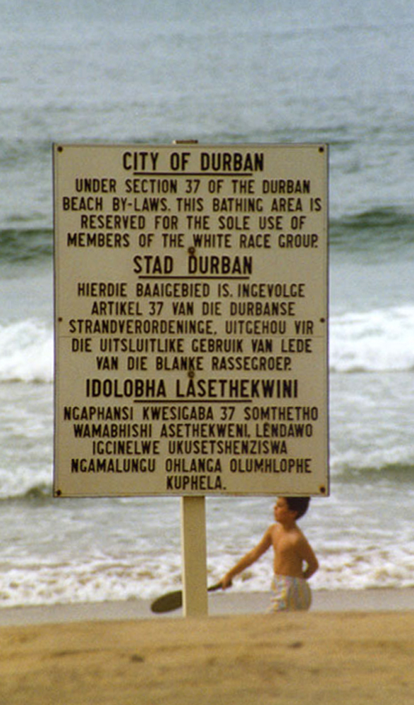
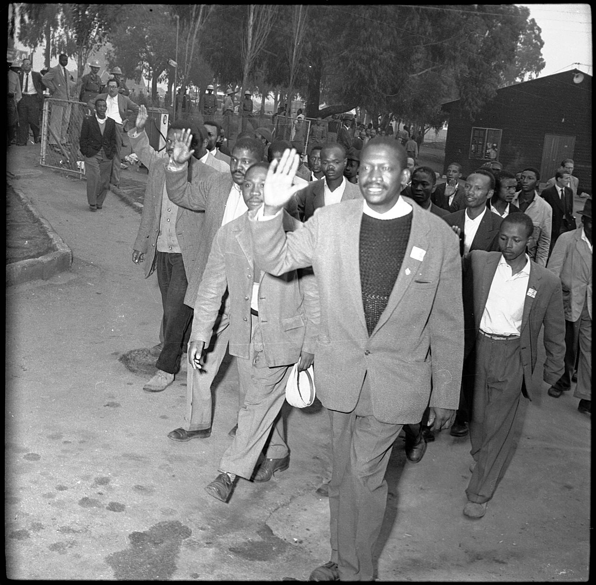
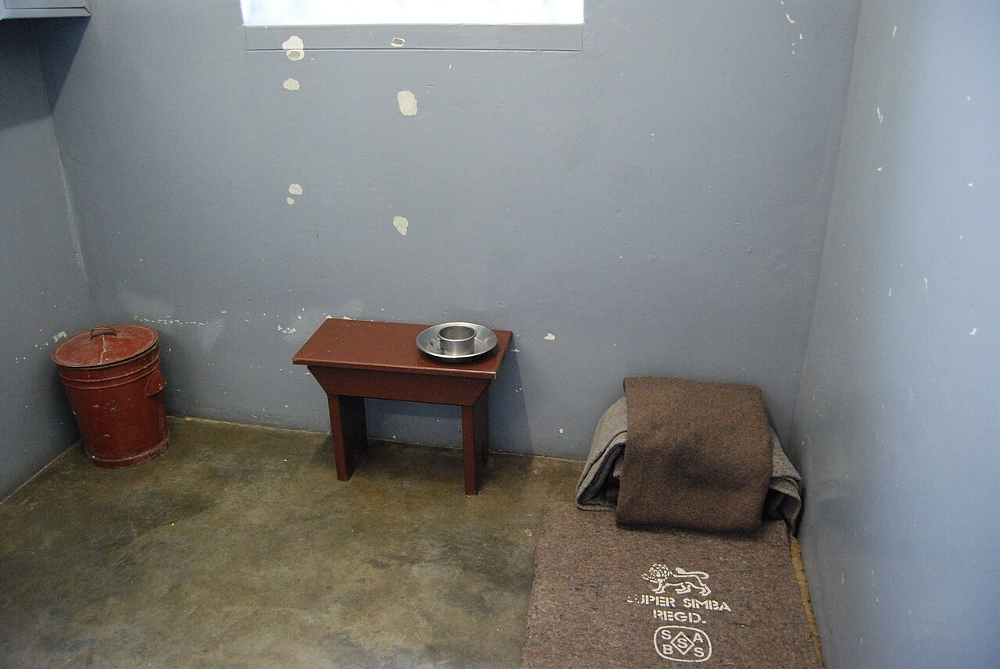
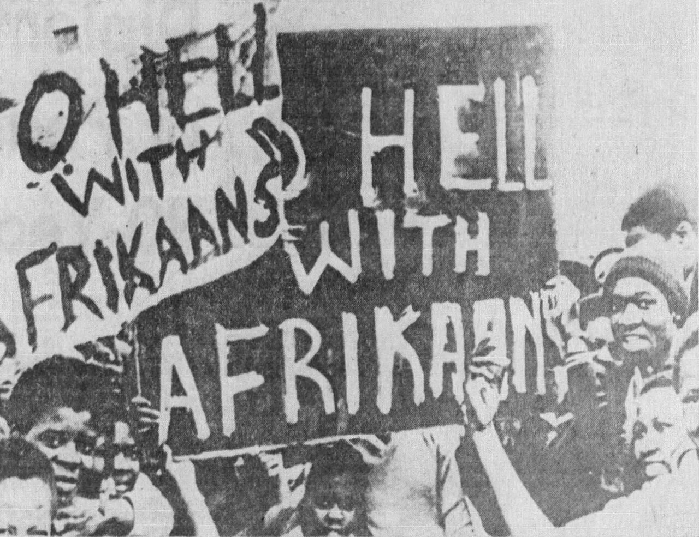
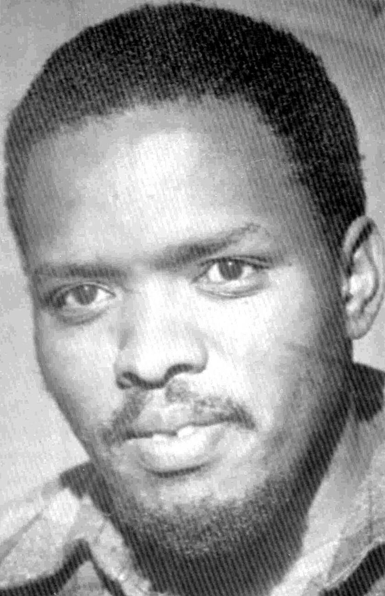
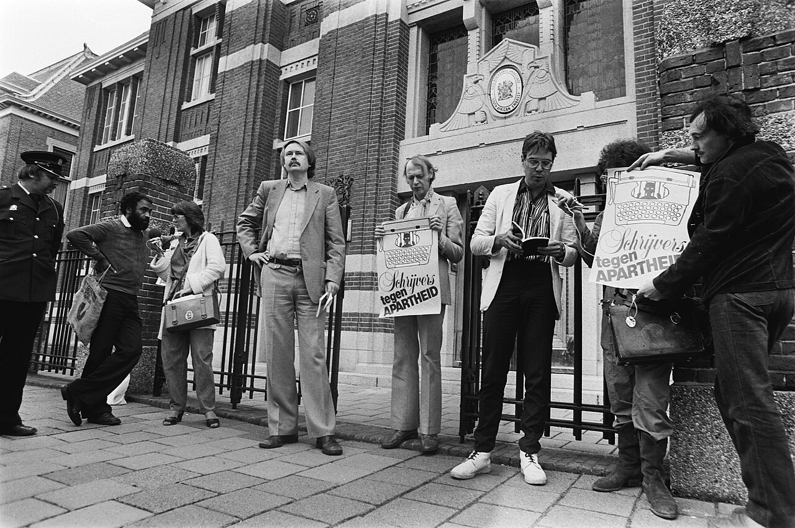
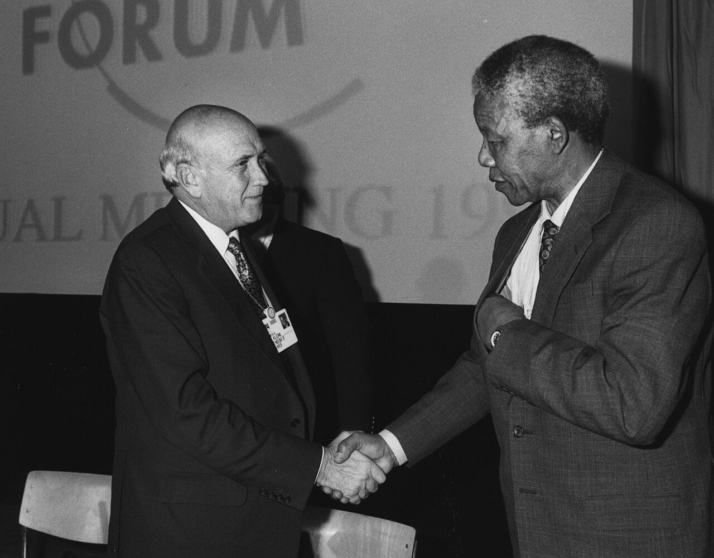
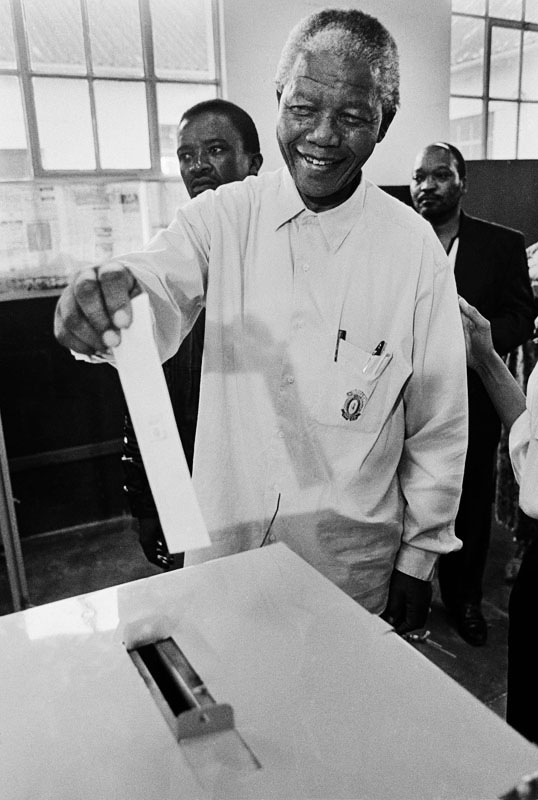
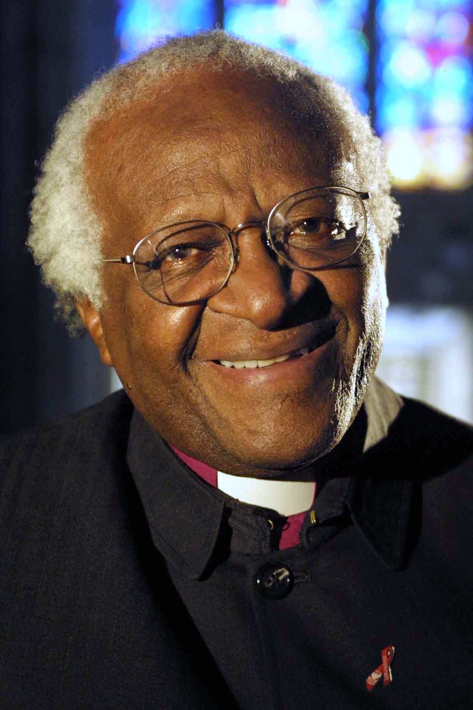

# 96. How did apartheid end?

*South Africa, from 1948 to 1994*

Apartheid ended because the people it was built to control made the country impossible to govern, because the rest of the world stopped lending it money, and because, when the Cold War ended, a prisoner and a president decided to bargain. In April 1994 South Africans of every colour voted together for the first time, and the prisoner became the president.

At a quarter past four on the afternoon of 11 February 1990, a tall, grey-haired man in a dark suit walked down a tree-lined road towards the gate of a prison farm in the wine country near Cape Town. He was holding his wife's hand. Beyond the gate were several thousand people and the television cameras of the world.

Nelson Mandela was seventy-one, and he had been in prison for twenty-seven years. For most of that time it had been a crime in South Africa to publish his photograph or to quote anything that he had said. The last picture that most of the crowd had seen of him showed a heavy-set man in his forties with a boxer's shoulders and a parting in his hair. Nobody was sure what he now looked like.

He stopped just short of the gate, as if surprised by the noise. Then he raised his right fist, and the crowd roared. He told an American president years later that as he walked towards the gate he knew that if he did not leave his bitterness behind, he would still be in prison.

## A corner of Africa

South Africa was the one place on the continent where Europeans had settled in large numbers and stayed for centuries. The first were Dutch, who planted a supply station at the Cape in 1652. Their descendants were farmers who had developed their own language, Afrikaans, and their own stern Protestant faith, and who believed that God had given them the land as he had given Canaan to Israel. They called themselves Afrikaners, the people of Africa.

The British took the Cape in 1806, and then the rest, after gold and diamonds were found in the interior. They defeated the Afrikaners in a hard war at the end of the century. In 1910 the two white peoples were joined in one self-governing country, in which, with small exceptions, only white men could vote. Whites were about a fifth of the population.

The foundation of everything that followed was laid three years later. A law of 1913 forbade Africans, who were two thirds of the people, to buy or rent land outside reserves that made up seven per cent of the country. The rest was kept for the whites. An African writer of the time put it in one sentence: the South African native awoke one Friday morning to find himself a pariah in the land of his birth. Africans went to work in the white men's mines and kitchens, because there was nowhere else to go.

## Apartness

In 1948 the white voters elected a party of Afrikaner nationalists that promised something more thorough. Its word for it was apartheid, which means apartness. The races would live apart, in law, for ever, and Black South Africans would enter the white areas only to work.

The first step was to decide who was what. Every person in the country was entered in a register as White, Coloured, which meant of mixed descent, Indian, or African. Officials settled the doubtful cases by looking at fingernails and eyelids, and by pushing a pencil into the person's hair. If it fell out, the person was white. If it stayed, he was not. Families were split by these rulings, with brothers and sisters placed in different races.

On that register the whole structure was built. Marriage and sex across the colour line became crimes. Every town was divided into zones, and each race could live only in its own. Buses, benches, beaches, post office counters and hospital entrances were marked with signs. An African over sixteen had to carry a booklet stamped with permission to be in a white area, and to show it to any policeman who asked. A quarter of a million people a year were arrested for not having it in order.

*A sign on a beach in Durban, 1989, in English, Afrikaans and Zulu, reserving the bathing area for the white race group. Photo: Guinnog, CC BY-SA 3.0.*

The schools were remade to fit. The minister responsible, who later became prime minister, explained that there was no place for the African in white society above the level of certain forms of labour. What is the use, he asked, of teaching a Bantu child mathematics when it cannot use it in practice? The state spent ten times as much on a white pupil as on a Black one.

The last step was to make Africans foreigners. The old reserves, now about thirteen per cent of the land, were declared to be ten separate "homelands", one for each African people. Every African was assigned to one of them, whether or not he had ever seen it, and when a homeland was pronounced independent its people lost their South African citizenship. They could then be treated as migrant workers in their own country. Between 1960 and 1983 three and a half million people were moved by force. Police arrived with trucks, loaded the families and their furniture, and flattened the houses with bulldozers. In the middle of Cape Town a lively mixed district of sixty thousand people was declared white and demolished. Much of the ground stayed empty for decades, because few developers cared to build on it.

![Map of South Africa with the ten homelands shaded brown, most of them broken into many scattered pieces: Transkei and Ciskei in the south-east, KwaZulu in many fragments across Natal, QwaQwa beside Lesotho, Bophuthatswana in several pieces along the border with Botswana, and Lebowa, Gazankulu, Venda, KaNgwane and KwaNdebele in the north-east. Cape Town and Robben Island, just offshore, are in the south-west, and Durban on the east coast. Lesotho and Swaziland are separate countries. An inset shows the country round Johannesburg, with Pretoria, Soweto and Sharpeville](images/map_homelands.png)
*South Africa under apartheid, with the ten homelands, roughly; inset, Johannesburg, with Soweto, Sharpeville and Pretoria. Map: drawn for this book; coastlines and rivers from Natural Earth, public domain.*

## Fifty years of petitions

Africans had organised early. The African National Congress was founded in 1912 by lawyers, clergymen and chiefs, and for nearly forty years it sent deputations, signed petitions and passed resolutions. They were ignored.

There was another tradition to draw on. An Indian lawyer named Gandhi had worked out his method of resistance in South Africa in the years before 1914. In 1952 the Congress adopted it. Eight thousand volunteers walked through "Europeans only" entrances, sat on the wrong benches, and stayed out after curfew, and went to jail. In 1955 three thousand delegates of every race met in a field near Johannesburg and adopted a charter. It began: South Africa belongs to all who live in it, black and white.

On 21 March 1960, at the call of a rival movement that had broken away from the Congress, several thousand people gathered outside the police station in the township of Sharpeville, without their pass books, and offered themselves for arrest. The police opened fire. They killed sixty-nine people, and most of the dead were shot in the back as they ran. The government declared an emergency, arrested eighteen thousand people, and banned both movements outright. To belong to it was now a crime.

*Robert Sobukwe, who led the movement that called the Sharpeville protest, at the head of a march in 1960 or shortly before. Photo: unknown, public domain.*

## The spear

Mandela was then forty-one. He came from a royal family of the Thembu people in the rural east, had run away to Johannesburg to escape an arranged marriage, and with a partner had opened a law practice that defended Black clients against the pass laws. He was a commanding, good-humoured man who liked fine suits and had boxed as an amateur.

After Sharpeville he and his colleagues concluded that fifty years of non-violence had brought nothing but more repressive laws. He said later that it is the oppressor who decides the form of the struggle. If the oppressor uses violence, the oppressed have no choice but to answer in kind. In December 1961 a new organisation, called the Spear of the Nation, set off its first bombs. It attacked power lines, government offices and pass bureaux, at night, when they were empty. The aim was to frighten away investment and to bring the government to the table without killing anyone.

He was caught in 1962, after seventeen months on the run. The following year the police raided a farm outside Johannesburg and seized the rest of the leadership, together with documents that could hang them all. At the trial he chose not to give evidence in his own defence. He read a statement from the dock that lasted three hours and admitted what he had done. He had cherished the ideal of a democratic and free society in which all persons live together in harmony and with equal opportunities. It was an ideal for which he hoped to live. But if needs be, he said, it is an ideal for which I am prepared to die.

The judge gave him life. He was sent to Robben Island, a windy scrap of rock within sight of Cape Town. His cell was about two metres square. For thirteen years he broke stones and dug lime in a quarry whose white glare permanently damaged his eyes. At first he was allowed one letter and one visitor every six months. The prisoners turned the island into a school, in which the graduates taught the others, and the younger men who arrived later called it the university.

*The cell on Robben Island where Nelson Mandela was held, photographed in 2007: a stool, a bucket and a mat and blankets on the floor. Photo: Paul Mannix, CC BY-SA 2.0.*

## Children

For a decade the country was quiet, and it boomed. Foreign money poured in, and white South Africans enjoyed one of the highest standards of living in the world.

Black workers began to strike again in 1973. Then the quiet was broken for good, by schoolchildren. On the morning of 16 June 1976 about twenty thousand pupils in Soweto, the vast Black township outside Johannesburg, marched in their uniforms to protest at an order that half their lessons be taught in Afrikaans, which to them was the language of the police. The police fired into them. One of the first to die was a boy of twelve, and a photograph of a weeping teenager carrying his body, with the boy's sister running alongside, was printed around the world. The townships rose. In the following months several hundred young people were killed, and thousands slipped over the border to join the exiled Congress.

*Pupils in Soweto carrying placards that read 'To hell with Afrikaans', June 1976, from a newspaper printed the next day. Photo: unknown, public domain.*

The young had a hero of their own. Steve Biko, a former medical student, taught that Black people must first free their own minds from the belief that they were inferior. In 1977 he was arrested and beaten into a coma. The police drove him, naked and chained, more than a thousand kilometres in the back of a truck to a prison hospital, where he died. The minister of justice told a party meeting that the death left him cold.

*Steve Biko, in a newspaper photograph of about 1977, the year he died in police custody. Photo: Cape Argus, public domain.*

## Ungovernable

In the 1980s the government lost control of the places where most of its people lived.

It tried to adapt. The prime minister of the day told white voters that they must adapt or die. He legalised Black trade unions, scrapped the ban on mixed marriages, and offered Coloured and Indian South Africans, but not Africans, their own chambers of parliament. The offer set off the largest wave of protest yet. Hundreds of church groups, student bodies and residents' associations joined in a single front. Township residents stopped paying rent. Children boycotted the schools. The unions, now with over a million members, called strikes that shut down whole industries. Black councillors and policemen were driven from their homes, and people suspected of informing were killed with a burning tyre around the neck. The exiled Congress called on its followers to make the country ungovernable, and they did.

The government sent the army into the townships and declared a state of emergency, under which tens of thousands were detained without trial, many of them children. The funerals of the dead became rallies, and at many of them the police opened fire, which produced more funerals.

In August 1985 the president announced that he would make a major speech, and the world expected him to free Mandela. He wagged his finger at the camera and said that he would not lead white South Africans on a road to abdication and suicide. A large American bank had just declined to renew its loans, and now the others followed. South African firms had borrowed heavily for short periods, and were suddenly asked to repay it all. The currency lost a third of its value, and the stock exchange closed.

The pressure from outside had been building for years. Students abroad forced their universities to sell shares in companies that did business in South Africa. Customers boycotted its fruit and its banks. In 1986 the American Congress banned new investment and many imports, overriding the veto of a president who regarded the African National Congress as terrorists. White South Africans, who loved sport above almost everything, had been shut out of world cricket and rugby and the Olympic Games. In 1988 a rock concert in London for Mandela's seventieth birthday was broadcast to more than sixty countries.

*Dutch writers outside the South African embassy in The Hague, 18 June 1980, reading poems against apartheid during a boycott of South African oranges. Photo: Rob Croes, Nationaal Archief, CC0.*

## Tea with the president

The man at the centre of all this had been talking to his jailers for some time. In 1985 Mandela, by then in a prison on the mainland, was taken to hospital for an operation, and the minister of justice came to see him. Mandela decided, without consulting his comrades, that someone had to take the first step. Over four years he held dozens of secret meetings with a small committee of officials. In 1989 he was driven to the president's office, where the old man who had refused to free him poured him a cup of tea.

That president had already suffered a stroke, and a few weeks later he was replaced by a cautious lawyer from the conservative wing of the party, F. W. de Klerk. Nobody expected much from him. Two months later the Berlin Wall came down. For forty years the government had told its voters, and its friends in Washington and London, that it was holding the line against communism. That argument was now dead, and the Soviet support on which the exiled Congress had lived was drying up.

On 2 February 1990 de Klerk rose in parliament and announced, in half an hour, that the bans on the African National Congress and the Communist Party were lifted and that Mandela would be released without conditions. His own party sat stunned. Nine days later Mandela walked to the gate.

## The worst years

The four years that followed were the bloodiest of the whole era. About fourteen thousand people died in political violence.

Much of the killing was between Black South Africans. A Zulu nationalist movement, whose leader ran one of the homelands and feared what a Congress government would mean for him, fought the Congress for control of the townships and the hills of Natal. Men with spears and automatic rifles attacked trains and funerals. It emerged that elements in the police and army were arming and training them, in order to weaken the Congress at the table. On the white side, armed extremists threatened a war to keep a state of their own. In March 1992 de Klerk asked the white electorate whether he should go on, and more than two thirds said yes.

The most dangerous day came at Easter in 1993. Chris Hani, the leader of the Communist Party and the idol of the township youth, was shot dead in his driveway by a white immigrant. The country was a spark away from a race war. Three days later it was Mandela, who held no office in the state, who went on state television to speak to the nation. A white man full of hatred, he said, had committed a deed so foul that the whole nation teetered on the brink of disaster. A white woman, of Afrikaner origin, had risked her life so that the killer could be brought to justice. Hani's neighbour had written down the number of the car.

The bargain that was finally struck gave each side its minimum. There would be one person, one vote, in an undivided country. For the first five years the parties would share power in a single cabinet. White civil servants and soldiers would keep their jobs and pensions, and property would not be seized.

*Nelson Mandela and F. W. de Klerk shaking hands at the World Economic Forum in Davos, Switzerland, January 1992. Photo: World Economic Forum, CC BY-SA 2.0.*

## The queue

The election was held over four days at the end of April 1994. Nearly twenty million people voted. They stood in lines that wound for kilometres across the hillsides and through the streets, old women in their church clothes, farm workers, servants beside their employers, and many waited all day and came back the next. There was almost no violence. The Congress won sixty-three per cent.

*Nelson Mandela casting his vote at Ohlange School near Durban, April 1994, the first time he had ever voted. Photo: Paul Weinberg, CC BY-SA 3.0.*

Mandela was sworn in on 10 May, in front of the buildings from which apartheid had been run, and the generals who had hunted him saluted. Among his invited guests was one of his former warders.

He spent his presidency persuading white South Africans that they had a place in the new country. In 1995 South Africa hosted the world championship of rugby, the Afrikaners' game, whose green jersey most Black South Africans detested as the badge of the oppressor. On the day of the final he walked onto the field wearing the green jersey and cap of the national team. The crowd, nearly all white, was silent for a moment and then began to chant his name.

## Truth

There remained the question of the past. A defeated regime can be put on trial, but this one had not been defeated. It had negotiated its own departure, and its police and army were still in place.

The answer was a commission, chaired by the Anglican archbishop Desmond Tutu, which sat for more than two years. It offered a trade. Anyone who had committed a political crime, on any side, could apply for amnesty. To receive it, he had to tell the whole truth, and for the worst crimes to tell it at a public hearing. Twenty-one thousand victims gave statements. Mothers learned in the hearing room how their sons had been killed and where the bodies had been burned or buried. Policemen demonstrated their methods of torture on volunteers. The archbishop at one point put his head on the table and wept. Of some seven thousand people who applied for amnesty, about one in eight received it.

*Archbishop Desmond Tutu, who chaired the Truth and Reconciliation Commission, photographed about 2004. Photo: Benny Gool, public domain.*

Many victims felt cheated of justice, and hardly any of those who were refused amnesty, or never applied, were prosecuted. The country did learn what had been done, from the mouths of those who did it, which few nations in such a case have managed.

## Afterwards

Mandela served a single term and stepped down in 1999, at eighty. On a continent where presidents commonly stayed until they died or were overthrown, that was as important as anything else he did. He died in 2013.

South Africa has remained a democracy, with a free press and courts that have ruled against presidents. The laws of apartheid are gone. The world that they built has proved harder to move. It is the most unequal country on Earth for which figures exist. A third of its workers have no job. Most of the farmland and much of the wealth are still owned by the white minority, now seven per cent of the people. The Congress governed for thirty years, with increasing corruption, and lost its majority in 2024.

On 27 April 1994 Mandela cast his own vote at a school in the green hills of Natal. He had chosen the place with care. In its grounds is the grave of the first president of the African National Congress, a schoolmaster who had founded the movement in 1912 and died in 1946 without ever having been allowed to vote. After he had put his paper in the box, Mandela walked over to the grave and laid a wreath. Mr President, he said, I have come to report to you that South Africa is free today.
