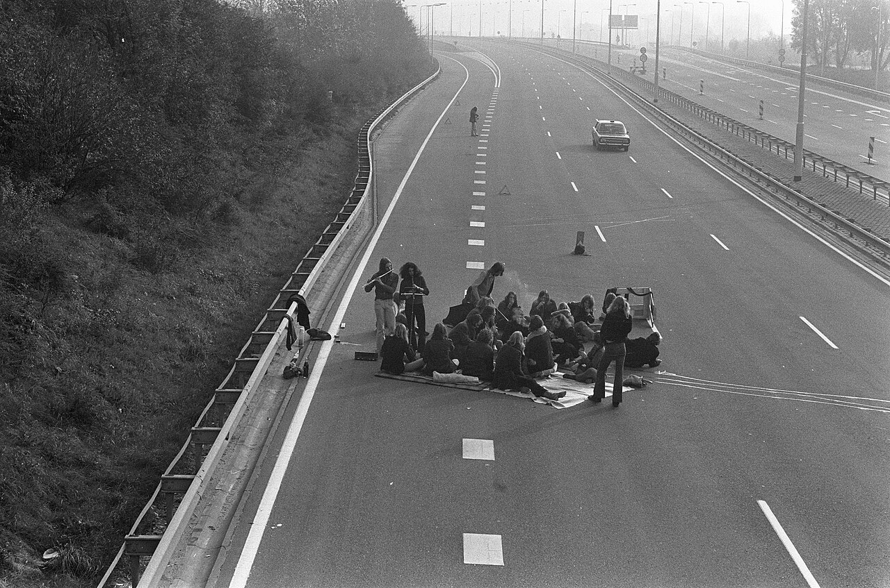
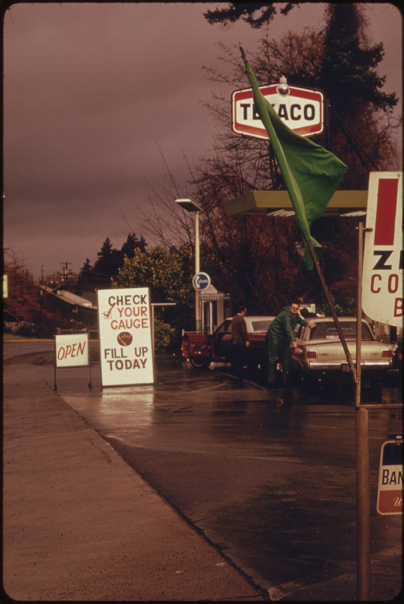
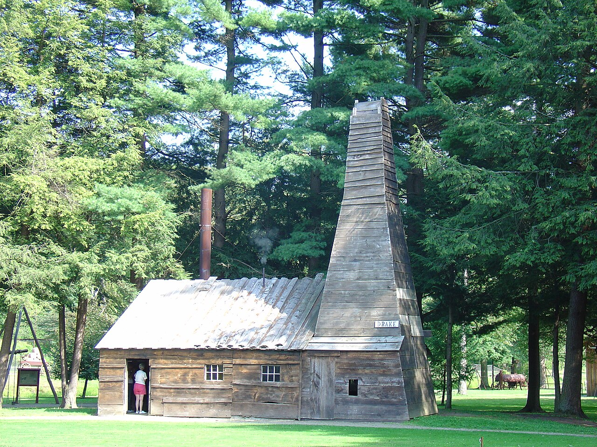
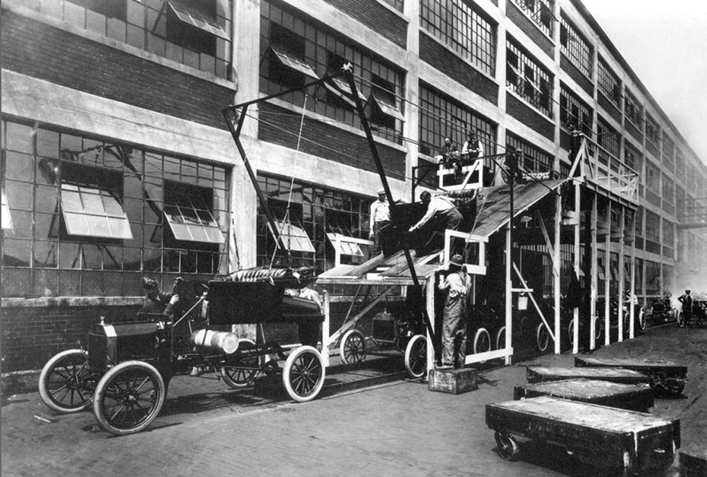
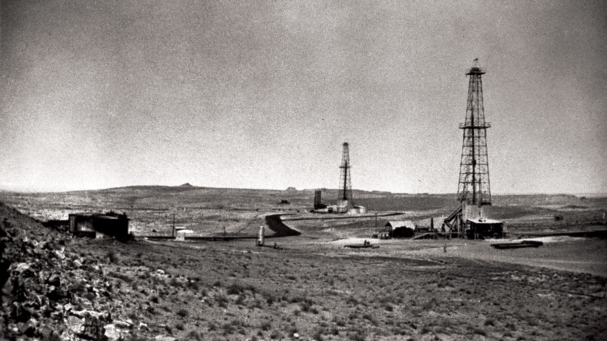
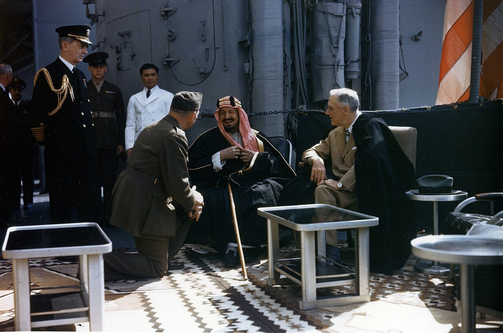
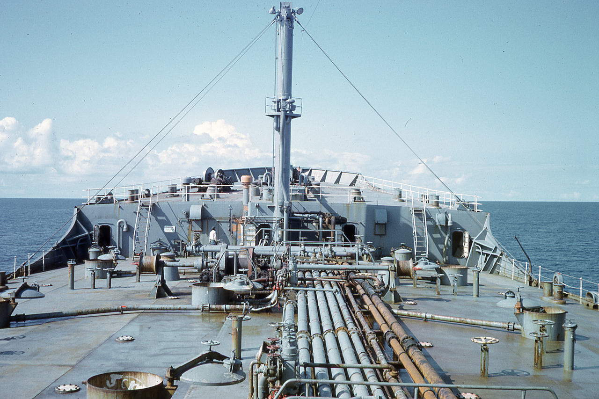
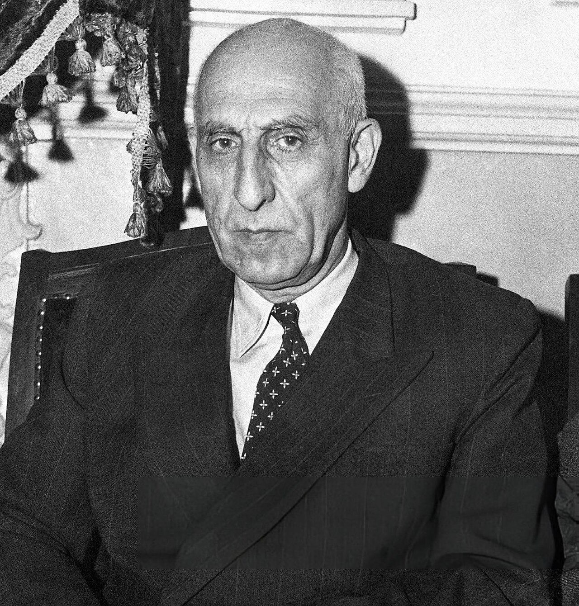
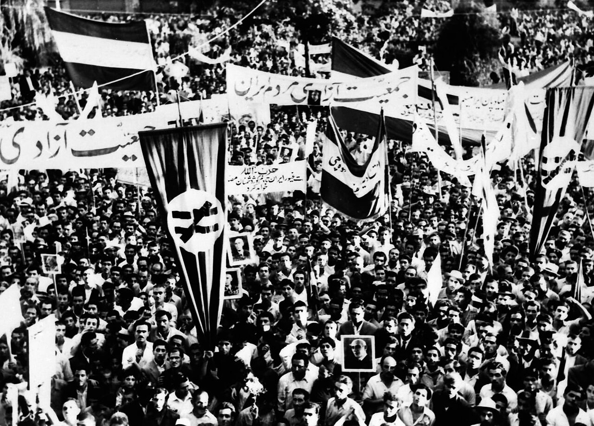
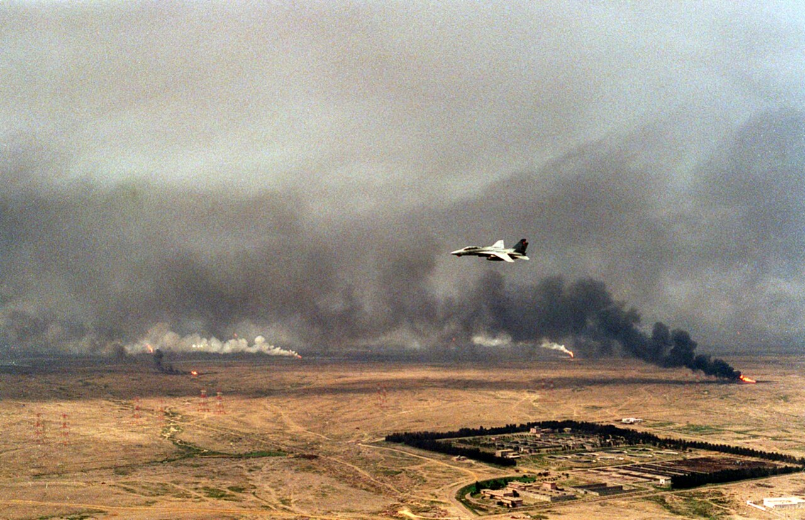

# 97. Why does the world fight over oil?

*The Persian Gulf and the world, from 1908 to 1991*

The world fights over oil because in the twentieth century it rebuilt its whole way of life around one liquid, and the largest and cheapest pools of that liquid lie under a few countries around the Persian Gulf. For fifty years Western companies pumped it on terms fixed in the age of empire. In the 1970s the countries that owned the ground took control, and showed in a single winter that they could bring the richest nations on Earth to a halt.

On Sunday, 4 November 1973, the motorways of the Netherlands were empty. The government had forbidden all private driving for the day. Families walked down the middle of six-lane highways. Children roller-skated on them, and people rode out on horses and picnicked on the central strip. The next Sunday it was the same, and the Sunday after that, and Belgium, Switzerland and West Germany did likewise. Nothing was wrong with the roads or the cars. The ban was there to save fuel.

*People picnicking on an empty motorway in the Netherlands on the first car-free Sunday, 4 November 1973. Photo: Rob Mieremet, Nationaal Archief, CC0.*

Across the Atlantic, Americans were queuing for an hour or more to buy petrol, where they could find it. Filling stations hung out flags: green if they had fuel, red if they had none. Drivers whose number plates ended in an odd figure could buy on odd days of the month, and the rest on even days. Fights broke out in the queues. Within weeks the fastest roads in the country had a speed limit of fifty-five miles an hour.

*A petrol station in Portland, Oregon, January 1974. The green flag meant that petrol was on sale to everyone; yellow meant commercial vehicles only, and red meant none for anyone. Photo: David Falconer, US National Archives, public domain.*

Three weeks earlier, the oil ministers of the Arab countries had met in a hotel in Kuwait and decided to reduce the amount of oil they pumped by a twentieth each month. Within days they had also resolved to sell none at all to the United States and the Netherlands. They were punishing the friends of Israel in a war that was then being fought. By Christmas the price of a barrel of oil was four times what it had been in the summer. A few ministers in a hotel room had reached into every filling station in the West. They could do it because they owned something the West could no longer live without.

## Rock oil

Oil had been a curiosity for most of history, skimmed from pools where it seeped out of the ground and used to caulk boats and treat sores. In 1859 a former railway conductor drilling in a valley in Pennsylvania struck it twenty metres down, and it began to be sold in quantity, for lamps. Lamp oil was the product, and much of the rest was waste. Within twenty years one American company, built by a quiet and ruthless bookkeeper named Rockefeller, refined nine tenths of the country's supply. The part of the crude that was too volatile for lamps, a thin liquid called gasoline, was mostly poured away. That waste was about to become the most valuable part of the barrel.

*A replica of the wooden derrick and engine house of Edwin Drake's well of 1859, at the Drake Well Museum in Titusville, Pennsylvania, photographed in 2006. Photo: Zamoose, CC BY-SA 2.5.*

Then the electric light arrived and began to kill the market for lamp oil. The industry was saved by the engine that burns its fuel inside the cylinder. The weight of the fuel matters, because a vehicle has to carry its fuel with it, and no other fuel packs so much energy into so small and light a tank. That engine ran best on the liquid that the refiners had been throwing in the river.

## Five dollars a day

The early motor car was a rich man's toy, built one at a time by craftsmen. In 1908 a farmer's son from Michigan, Henry Ford, brought out a plain, tough car meant for farmers like his father. It cost eight hundred and fifty dollars, which was more than a year's wages for a worker. The men who built it could not yet afford it.

His real invention came five years later. Until then a team of men had built each car where it stood, fetching the parts. Ford had the car dragged past the men on a chain. Each worker stayed in one spot and performed a single task, tightening the same two nuts or fitting the same wheel, as the frames went by. The time needed to assemble a car fell from twelve and a half hours to an hour and a half.

The savings came at a cost to the men on the line. The work was so deadening that men walked out after a few weeks, and so in 1914 Ford doubled the wage to five dollars a day. He reasoned that men paid that well would stay, and would also be able to buy what they made. Mass production needed mass buyers, and Ford set out to make his own.

*The Ford assembly line in 1913, with a car body being lowered onto a Model T chassis. Photo: Ford Motor Company, public domain.*

By the 1920s his car cost under three hundred dollars, and he had sold fifteen million of them. By 1929 there was a car for every five Americans. The country rebuilt itself to fit, and the change could be seen on the ground. Families moved out of the cities to houses with garages, on streets with no shops, from which every errand required a drive. Each of those drives burned petrol. After 1956 the government laid forty thousand miles of motorway across the continent. A country built that way could not easily go back.

Western Europe and Japan followed after the war, and they went further. They had run on their own coal. In the 1950s and 1960s they converted their power stations, factories, ships and furnaces to imported oil, because it was cheaper, cleaner and easier to move. That was a bigger step than it looked. It meant that their factories and power stations now depended on fuel that came out of other people's ground.

Meanwhile oil crept into things that were not fuel at all. Oil and the natural gas found with it also became the raw material of plastics, synthetic cloth, paint, and the nitrogen fertiliser that fed the world's fast-growing population. Between 1950 and 1973 the world's consumption of oil rose fivefold. Through the 1960s a barrel of Gulf oil, which is a hundred and fifty-nine litres, cost less than two dollars. It was cheaper than bottled water. At that price, few people had much reason to use less.

## Sixteen per cent

Almost nobody asked where it came from, or on what terms. The terms, in fact, had been set long before, in a very different world.

In 1901 an English speculator who had made a fortune in Australian gold bought from the shah of Persia the right to look for oil across most of that country, an area larger than France and Germany, for sixty years. A deal of this kind was called a concession: a ruler granted a foreigner the right to dig in his territory in return for a payment and a share. The speculator paid twenty thousand pounds in cash, the same again in shares, and promised sixteen per cent of any profits. For years it looked like a bad bet. His drillers worked for seven years in the mountains of the south-west, in heat that killed several of them. They had been ordered by telegram to give up when, in May 1908, a well blew out a jet of oil fifteen metres high.

It was the first great oilfield found in the Middle East. A few years later the minister in charge of the British navy, a young man named Winston Churchill, decided to convert the fleet from coal to oil, which would make the ships faster and let them refuel at sea. Britain had plenty of coal and no oil. In 1914, to make its supply certain, the British government bought a controlling share of the company that held the Persian concession. From then on the oil of Persia was a matter of British national security. Oil was no longer only a business. It had become part of how a great power defended itself.

## Thirty-five thousand gold coins

Across the Gulf, the Arabian peninsula was one of the poorest places on Earth, a desert of herdsmen and oasis farmers. In 1932 a tall warrior chief named Ibn Saud, who had spent thirty years conquering it tribe by tribe, declared it a kingdom and named it after his own family. His main income was a tax on pilgrims to Mecca, and the Depression had cut their numbers. He was close to bankruptcy.

In 1933 he sold a Californian oil company the right to explore the eastern part of his kingdom, for a down payment of thirty-five thousand British gold coins. They were shipped out in seven boxes and counted one by one on a table in front of his finance minister. The king is said to have remarked afterwards that he would have been happier if they had been looking for water.

*Drilling rigs at Dammam, Saudi Arabia, in 1938, the year the seventh well there struck oil. Photo: unknown, public domain.*

Success was slow in coming. The Americans drilled six dry or disappointing wells. The seventh, in March 1938, struck oil in enormous quantity, and it flowed for the next forty-four years. Ten years later the same company found, a little way inland, a single field two hundred and eighty kilometres long that turned out to be the largest pool of oil on the planet. Saudi Arabia held a quarter of all the oil then known in the world. A kingdom that had been nearly bankrupt now sat on the greatest prize in the oil business.

![Map of the Persian Gulf and the states around it: Iran, Iraq, Kuwait, Saudi Arabia, Bahrain, Qatar, the United Arab Emirates and Oman. Brown areas mark oilfields: Kirkuk in northern Iraq, Rumaila near the head of the Gulf, Burgan in Kuwait, and Ghawar, a long narrow field inland in eastern Saudi Arabia, marked as the largest. A star marks Masjed Soleyman in the mountains of south-western Iran, where oil was first found in 1908. Abadan, with its refinery, is at the head of the Gulf, Dhahran, where oil was found in 1938, on the Saudi coast, and Baghdad, where OPEC was founded in 1960, and Tehran are marked. The Strait of Hormuz is at the mouth of the Gulf](images/map_gulf.png)
*The Persian Gulf, with the main oilfields, roughly, the first well in Persia, of 1908, and the first in Saudi Arabia, of 1938. Map: drawn for this book; coastlines and rivers from Natural Earth, public domain.*

In February 1945, on his way home from meeting Stalin and Churchill, the American president received Ibn Saud aboard a warship anchored in the Suez Canal. The king had come up the Red Sea in an American destroyer with his household, sleeping in a tent on the deck, with a flock of sheep penned at the stern for his table. The two men got on well. No treaty was signed. Out of that friendship grew the arrangement that held for the rest of the century. American companies would have the oil, and the United States would protect the kingdom and its ruling family.

*President Franklin D. Roosevelt and King Ibn Saud of Saudi Arabia talking on board the American warship USS Quincy in the Great Bitter Lake, Egypt, 14 February 1945. Photo: US Army Signal Corps, public domain.*

## Sisters

By the 1950s the oil trade outside the communist world was in the hands of seven very large companies, five American, one British and one Anglo-Dutch. Between them they owned the concessions, the pipelines, the tankers, the refineries and the petrol stations. In effect, they controlled every step from the well to the pump. They decided how much each country should pump, so as to keep the market steady, and they set the price on which the producing governments' share was calculated.

*Looking along the deck of an oil tanker at sea in 1972, with the cargo pipes in the foreground. Photo: Roger Vreeland, CC0.*

That share had improved since 1901. The government of Venezuela, then the largest exporter, had forced the companies to split the profits half and half in 1948, and the Arab states had won the same within a few years.

Even so, the arrangement left the real power where it had been. It was still the companies that kept the books, and the governments had no way to check them. Nor could the owners of the oil say how fast it should be pumped or what it should sell for.

## An old man in pyjamas

Mexico had thrown the foreign oil companies out in 1938. The first country in the Middle East that tried to do the same was the one in which the oil had first been found.

By 1950 the British company in Iran, as Persia was now called, ran the largest refinery in the world, on an island at the head of the Gulf. Its British staff lived in bungalows with lawns and a club, and its Iranian workers in a slum built of flattened oil drums. The company paid more in taxes to the British government than it paid in royalties to Iran.

In 1951 the Iranian parliament voted to take the oil industry into national ownership, and chose as prime minister the man who had led the campaign. Mohammad Mossadegh was a frail aristocrat of nearly seventy, a lawyer educated in Switzerland, who received visitors in bed in his pyjamas and was given to weeping in public. Iranians adored him.

Britain's answer was a blockade. It withdrew its technicians, and its navy turned back any tanker that tried to load Iranian oil. The other great companies refused to buy any. For two years Iran sold almost nothing. Owning the oil, it turned out, was of little use if nobody would buy it.

*Mohammad Mossadegh, prime minister of Iran, in a press photograph of 1951. Photo: International News Photos, public domain.*

Britain could not shift him and asked the Americans for help, with the argument that chaos in Iran would open the door to the communists. The argument was chosen to suit Washington.

In the summer of 1953 an officer of American intelligence, a grandson of a former president, arrived in Tehran with suitcases of banknotes. He bribed newspaper editors, preachers and army officers, and hired crowds from the bazaar and the gymnasiums to riot. After four days of street fighting, in which about three hundred people were killed, Mossadegh was arrested. The shah, who had fled to Rome, flew home to rule as an absolute monarch with American support. The oil went back to a group of Western companies, in which the Americans now held two fifths. In practice, foreign companies were back in charge of Iran's oil.

*A crowd with banners and portraits at a rally in Tehran, 16 August 1953, in the days of the coup that overthrew Mossadegh. Photo: William Arthur Cram, public domain.*

The governments of the other producing countries drew the lesson. A Gulf state acting alone could not stand against the companies and the powers behind them.

## Baghdad, 1960

In 1959 and again in 1960, with oil plentiful, the companies cut the official price on which the governments' share was reckoned, without consulting anyone. That price was the companies' alone to set, and the governments could only watch. Each cut took tens of millions of dollars from the budgets of the producing states.

That September the oil ministers of Venezuela, Saudi Arabia, Iran, Iraq and Kuwait met in Baghdad and founded the Organisation of the Petroleum Exporting Countries, OPEC, to defend their interests. For ten years it achieved little, and the companies did not trouble to learn its initials. There was too much oil. If one country held back, another would sell more, and the United States, which could still pump extra from its own wells whenever it chose, could make up any shortfall.

By 1970 that had changed. The world's thirst had caught up with the supply. American wells were producing flat out. Their output passed its peak that year, and the United States was importing more each year. Outside the Middle East, no country any longer had idle wells that could be turned on in an emergency. Those spare American wells had been the West's safety net, and now the net was gone.

The first to see what this meant was a young army colonel who had seized power in Libya, on the Mediterranean coast. He picked on the smallest of the companies working there, which had no other source of oil and so could least afford to lose it, and ordered it to cut its production until it agreed to pay more. It held out for a few months and gave in. The others had to match the terms. Then the Gulf states demanded as much, and Libya asked for more again. Power was moving from the buyers of oil to the sellers.

## The weapon

On 6 October 1973, on the holiest day of the Jewish year, the armies of Egypt and Syria attacked Israel, to recover land that they had lost six years before. In the first days Israel was driven back and ran short of shells and aircraft. The United States flew in replacements, in giant transport planes that landed in Tel Aviv day after day. To the Arab oil states, that airlift made the United States a party to the war.

The Arab oil states had been warning for months that they would use what they called the oil weapon. On 16 October the Gulf producers raised their price by seventy per cent, on their own authority, without negotiating with any company. This time the producers set the price alone. The next day came the cuts, and within the week the embargo. In December the shah of Iran, who was not an Arab and had not joined the embargo, persuaded the others to more than double the price again. It had been about three dollars a barrel in September. It was now nearly twelve.

The embargo was lifted in March 1974. The price stayed.

![Line chart of the price of a barrel of crude oil from 1950 to 1991, in dollars of 2025. The line is flat at about twenty dollars through the 1950s and drifts down to fifteen in 1970. It jumps from about twenty-four in 1973 to seventy-six in 1974, and from about seventy in 1978 to a hundred and forty-four in 1980, then falls to forty-three in 1986, with a smaller rise in 1990. Marked are the Iranian takeover of 1951, the founding of OPEC in 1960, the war and embargo of 1973, the revolution in Iran in 1979 and the invasion of Kuwait in 1990](images/chart_oil_price.png)
*The price of a barrel of crude oil each year, 1950 to 1991, in dollars of 2025. Chart: drawn for this book; data from the Energy Institute, Statistical Review of World Energy, as reproduced by Our World in Data.*

For the rich countries, the long boom that had begun after the war ended that winter. Their economies had been built on fuel that cost almost nothing, and the bill for it had quadrupled overnight. Prices rose across the board, factories laid off workers, and the two happened together, which most governments had been taught could not occur. As a result, they had no ready remedy for it.

Instead, they looked for ways not to be caught again. They hurried to build nuclear power stations, to bring in the new fields under the North Sea and in Alaska, to store oil against the next emergency, and to require cars that used less. Meanwhile the Japanese, who made small cars, found the American market open to them.

The poorest countries were hit hardest. They had no oil and no dollars, and they now paid four times as much for fuel and fertiliser.

## Money from the ground

It was an enormous transfer of wealth, made without a shot. The income of the oil-exporting states rose from twenty-three billion dollars in 1972 to a hundred and forty billion five years later.

They used their new strength first to finish what Mossadegh had begun. By 1980 the governments of the Gulf had taken control of the concessions, and Saudi Arabia owned the whole of the company that American geologists had founded. The seven great firms went on refining and selling the oil. They no longer decided how much was pumped or what it cost. The companies had become the customers and contractors of the countries whose oil they had once controlled.

Countries with a few million people could not spend such sums at home, so a great deal went abroad. Much of the money was deposited in the banks of New York and London, which lent it on to the governments of Latin America and Africa, with results that would be felt ten years later. Much of it bought weapons, mostly American.

Saudi money also tied the kingdom to the United States in a different way. In 1974 the Saudi government agreed with Washington that it would invest its surplus in American government debt, and it went on selling its oil for dollars. The dollar had lost its link to gold three years earlier, so it was no longer backed by a promise of metal. Every country that needed oil now needed dollars to buy it.

The desert kingdoms were transformed in a generation. Fishing villages became cities of glass towers, built and served by millions of labourers brought from India, Pakistan and the Philippines. Their citizens paid almost no taxes and received free schooling and medicine and cheap houses.

The money carried ideas abroad as well. The Saudi royal family, which owed its throne to an old alliance with a severe school of Muslim preachers, also spent billions building mosques and religious schools from Indonesia to West Africa to spread that teaching.

Riches on that scale raise a puzzle, because they do not always make a country better off. Wealth that comes out of the ground has a peculiar effect on the country that receives it. A government that lives on oil does not need to tax its people, and so does not need their consent. Rulers can buy off or crush their critics. Other industries wither, since it is easier to import everything. When the price falls, there is little else.

Much depends, therefore, on the country that finds the oil. Nigeria earned hundreds of billions from oil in thirty years, and at the end of them more of its people were poor than at the beginning. Norway, by contrast, which found oil under the North Sea in 1969 and was already a settled democracy, has since 1996 put its earnings into a fund for future generations that is now worth more than a quarter of a million dollars for each Norwegian.

## A doctrine

The embargo had shown how much the West depended on the Gulf. The next crisis showed how unsteady the Gulf itself could be. In 1979 a revolution in Iran overthrew the shah and took most of that country's oil off the market for a time. The price doubled again. That December the Soviet army marched into Afghanistan, which put it within reach of the Gulf. The Gulf now looked dangerous from two directions at once.

A month later the American president told Congress that any attempt by an outside force to gain control of the Persian Gulf region would be regarded as an assault on the vital interests of the United States, and would be repelled by any means necessary, including military force. The United States would fight for the Gulf. It had taken over the role that Britain had played there since Churchill's day.

The pledge was called in eleven years later, against a local power, not the Soviet one. In August 1990 the army of Iraq overran its small neighbour Kuwait in a single day. Its ruler would then have controlled a fifth of the world's known oil, and his tanks stood on the Saudi border.

The United States assembled a coalition of thirty-five countries and about three quarters of a million soldiers, and in five weeks of bombing and four days of fighting on the ground drove the Iraqis out. As they retreated they set fire to more than six hundred oil wells. The smoke turned day into night across the northern Gulf, and the last fire was not put out for eight months.

*Burning oil wells in Kuwait with an American F-14 jet flying past, March 1991. Photo: Lt. Parsons, US Navy, public domain.*

One of the men behind the oil weapon saw a longer danger for the producers themselves. The Saudi oil minister through most of these events was a suave, Harvard-trained lawyer who had carried out the embargo of 1973. He spent his later years warning his fellow producers not to push the price too high, in case the customers learned to do without. The Stone Age, he liked to say, did not end because the world ran out of stone, and the oil age will end long before the world runs out of oil.
