# 98. Why can't Israelis and Palestinians make peace?

*Israel and the Palestinian territories, from 1967 to 2007*

They cannot make peace because both peoples claim the same small country, and since 1967 one of them has ruled all of it. Israel has been able to settle with neighbouring states by giving back land in return for recognition. It has not been able to settle with the Palestinians, who live on the land itself, who want the same hills and the same city, and who have no state to bargain with. More than once, when the two sides came close, men who rejected any compromise answered with murder.

In the last week of May 1967, the people of Israel believed that they were about to be destroyed. The president of Egypt had ordered United Nations peacekeepers out of the desert between the two countries, moved a hundred thousand soldiers up to the border, and closed the sea passage to Israel's southern port. Syria was his ally, and Jordan placed its army under his command. Cairo radio promised that the Jews would be driven into the sea. In Tel Aviv, rabbis consecrated public parks as cemeteries, and thousands of graves were dug in advance. A country that small, with enemies on three sides, had no room to retreat.

Early on the morning of 5 June, almost the entire Israeli air force took off, flew out over the Mediterranean below the reach of radar, and turned south. The first planes struck at a quarter to eight, when Egyptian pilots were at breakfast. In under three hours more than three hundred Egyptian aircraft were burning on their runways. The air forces of Syria and Jordan were crippled that afternoon. With their air cover crippled, the Arab armies on the ground were exposed from the first days.

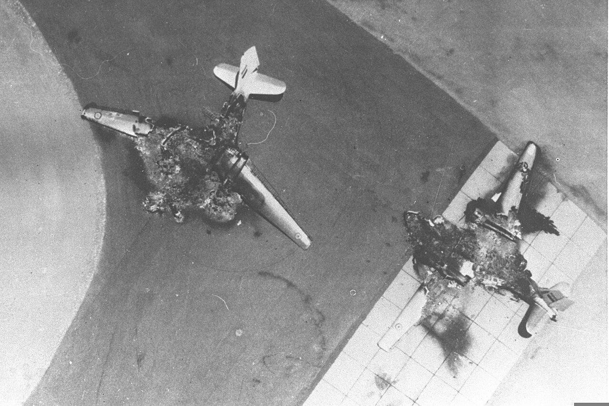
*Egyptian aircraft destroyed on the ground by the Israeli air force, photographed from above on 5 June 1967. Photo: unknown, Israel Government Press Office, CC BY-SA 4.0.*

The rest took six days, and by the end of them the map had changed. Israeli tanks took the Gaza strip from Egypt and crossed the Sinai desert to the Suez Canal. In the east they took from Jordan the hill country west of the river, which is called the West Bank, and the old walled city of Jerusalem. In the north they took the Golan heights, from which Syrian guns had shelled the farms of Galilee.

Of all the conquests, one carried a meaning far beyond strategy. On the third morning Israeli paratroopers fought their way through a gate in the wall of the Old City and came out in front of a stretch of ancient masonry that no Jew had been allowed to approach for nineteen years. It was part of the great wall that had held up the platform of the Temple, which the Romans had destroyed. Hardened soldiers leaned against the stones and wept. Their commander sent a short radio message: the Temple Mount is in our hands.

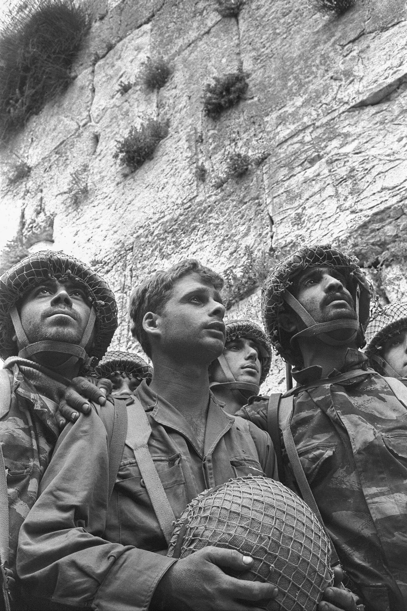
*Israeli paratroopers in front of the Western Wall in Jerusalem, 7 June 1967. Photo: David Rubinger, public domain.*

When it ended, Israel held four times as much land as it had a week earlier. It also held about a million Palestinian Arabs, who had no vote in the state that now ruled them. The victory had solved one problem and created another, and the second would last far longer than the war.

## Land for peace

At first the new land looked like a bargaining chip. The Israeli cabinet expected to trade. Within days it resolved, in secret, that it would give back the desert and the heights in return for peace treaties with Egypt and Syria. It was waiting, the defence minister said, for a telephone call from the Arabs.

The call did not come. The leaders of the Arab states met that summer in the capital of Sudan, humiliated, and agreed on three refusals: no peace with Israel, no recognition of Israel, no negotiations with it. With no peace on offer, Israel kept what it held.

In November the United Nations adopted a resolution that has been the basis of every peace effort since. It called for Israel to withdraw from territories occupied in the war, and for every state in the region to be allowed to live in peace within secure and recognised borders. The formula was land for peace: Israel would give up territory, and in return its neighbours would accept it.

The wording, however, left room for argument. Its English text spoke of withdrawal "from territories", without the word "the". Israel has always read that to mean some of them. The Arab states read it to mean all.

The resolution had little to say about the Palestinians, who appeared in it only as a refugee problem. It was a deal between states, and the Palestinians had no state. That gap would matter more with every passing year.

## A hotel at Passover

The West Bank and the strip of coast around Gaza were placed under military government, which was expected to be brief. In practice it reached into every corner of ordinary life. A Palestinian there needed a permit from an Israeli officer to build a house, dig a well, travel abroad or open a business. He could be held without trial.

At the same time, the occupation opened a door. He could find work in Israel, and tens of thousands did, on building sites and in kitchens, which raised incomes. As a result, the territories came to depend on the Israeli economy.

Meanwhile some Israelis began to move in. Their reasons were as much about faith as about security. For the religious, the war had been a miracle. God had delivered into Jewish hands the heartland of the Bible: Hebron, where Abraham is buried, and the hills where the prophets walked. Tel Aviv and the coastal plain, where most Israelis lived, had been the country of the Philistines. The West Bank was the Israel of the Bible.

At Passover in 1968 a rabbi and a group of followers rented rooms in an Arab hotel in Hebron for the holiday, saying that they were tourists, and then announced that they would not leave. The government, unwilling to drag Jews out of the city of the patriarchs, let them stay in an army base and later built them a town on the hill above.

That set the pattern. The settlers acted first, and the government, reluctant to use force against them, gave way afterwards. A movement of young religious nationalists would park caravans on a hilltop without permission and dare the government to remove them.

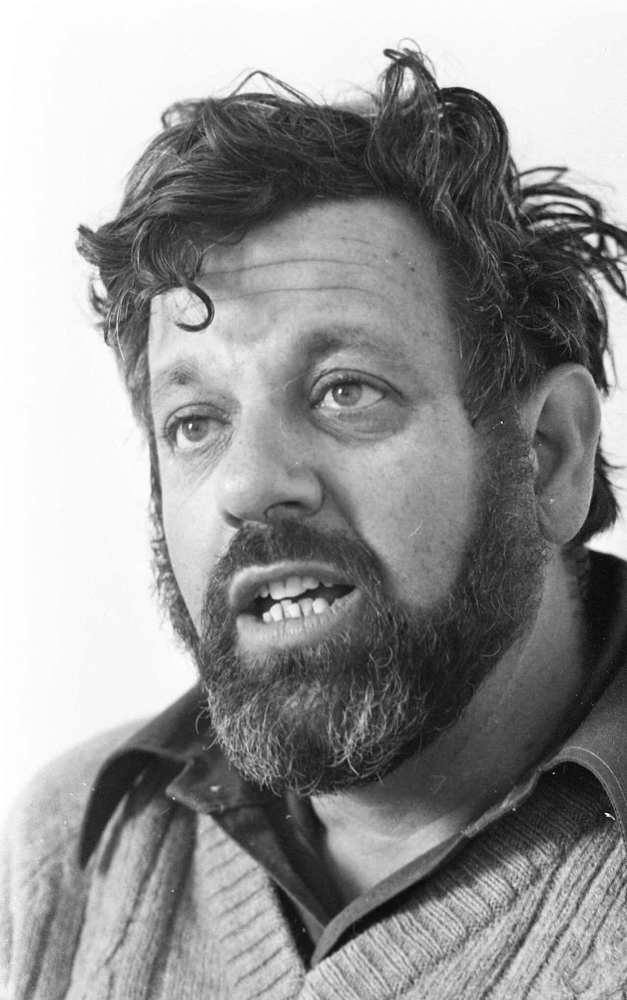
*A new settler at Kiryat Arba, the settlement built beside Hebron, 16 May 1973. Photo: Dan Hadani collection, National Library of Israel, CC BY 4.0.*

The governments of the first ten years, which were of the left, built settlements chiefly along the river and around Jerusalem, for reasons of defence.

That changed with a change of government. In 1977 the right won power for the first time, under a prime minister who believed that the whole land belonged to the Jewish people by right, and settlement was pushed into the middle of the Palestinian population.

There were fewer than five thousand settlers in the West Bank that year. There were more than a hundred thousand by 1993, and a quarter of a million by 2005, with nearly two hundred thousand more in the annexed eastern half of Jerusalem. Most of them, however, were not zealots. They were families drawn by cheap houses and good roads a short drive from the cities.

![Two maps side by side. Left, Israel in 1967, shaded blue, with the territories it took in June shaded red: the Gaza strip, the West Bank with East Jerusalem, and the Golan heights; Sinai, as far as the Suez Canal, is hatched and marked as taken in 1967 and returned to Egypt under the treaty of 1979. Right, the West Bank about 2005: a thick black line marks the armistice line of 1949; the Palestinian cities of Jenin, Nablus, Tulkarm, Qalqilya, Ramallah, Jericho, Bethlehem and Hebron are marked with dots, Jerusalem on the line, and red squares mark the Israeli settlements of Ariel, Modi'in Illit, Ma'ale Adumim, Beitar Illit and Kiryat Arba. A dashed brown line, drawn roughly, shows the barrier, which follows the armistice line in places and loops inside the West Bank in others, round Qalqilya and Jerusalem](images/map_occupation.png)
*Left, Israel and the territories it took in 1967; Sinai was returned to Egypt under the treaty of 1979. Right, the West Bank about 2005, with the armistice line of 1949, the Palestinian cities, the larger settlements and the route of the barrier, roughly. West Bank, Gaza strip and barrier after OpenStreetMap contributors. Map: drawn for this book; coastlines and rivers from Natural Earth, public domain.*

Nearly every other government in the world regards the settlements as illegal, since the law of war forbids an occupying power to move its own civilians into occupied territory. Israel replies that the land was not the lawful territory of any state when it was taken. The two sides, in other words, disagree about what the land even was. Whatever the law, each new red-roofed town on a hilltop, with its fence, its army post and its road, made it harder to imagine drawing a border.

## The gun and the olive branch

The defeat of the Arab armies convinced Palestinians that nobody would win their country back for them. Leadership of their national body, the Palestine Liberation Organisation, passed in 1969 to the head of its largest guerrilla group, Fatah. He was a short, unshaven engineer in a checked headscarf named Yasser Arafat. His organisation's aims were total. Its charter called for an end to the Jewish state and its replacement by a single country in the whole of Palestine.

Its means were far weaker than its aims. It could not fight an army, and so it sought attention. Its factions hijacked airliners and blew them up on desert airstrips.

The guerrillas also wore out their welcome among their own hosts. In 1970 the king of Jordan, whose country the guerrillas had begun to treat as their own, drove them out in a short civil war.

The most notorious attack came two years later. At the Olympic Games in Munich in 1972, a Palestinian squad took members of the Israeli team hostage, and eleven athletes and coaches were killed. The world was horrified, and it also learned the word Palestinian. Terror had made a people impossible to ignore.

Arafat then tried to turn that attention into standing. In 1974 he was invited to address the United Nations, and came to the rostrum with a holster on his hip. I have come bearing an olive branch and a freedom fighter's gun, he said. Do not let the olive branch fall from my hand. The message was that he could make peace or war, and the choice depended on what he was offered.

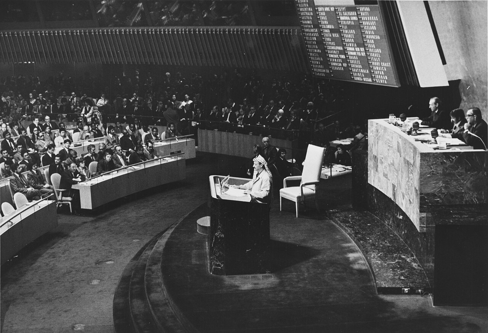
*Yasser Arafat addressing the United Nations General Assembly in New York, 1974. Photo: Bernard Gotfryd, public domain.*

By then his fighters had made a new base in Lebanon, from which they raided and shelled northern Israel. Israel's answer, when it came, was on a large scale. In 1982 Israel invaded, besieged Beirut for two months, and forced Arafat and his men to sail away to Tunisia.

What followed was worse. Two weeks later the newly elected president of Lebanon, a Christian and an ally of Israel, was blown up, and Israeli troops moved into the city. With the Israeli army ringing the area and lighting it with flares, a Lebanese Christian militia allied to Israel entered two Palestinian refugee camps on the edge of the city. Over two days it killed between eight hundred and three and a half thousand people, most of them women, children and old men.

The killings were done by Lebanese hands, but Israelis knew whose army had stood around the camps. In Tel Aviv four hundred thousand Israelis, one in ten of the population, filled the main square to demand an inquiry. It found that the minister of defence, a former general named Ariel Sharon, bore personal responsibility for failing to prevent the slaughter, and he was made to give up the ministry.

## A flight to Jerusalem

One Arab leader had drawn a different conclusion from all this. Anwar Sadat, who became president of Egypt in 1970, wanted the Sinai back and wanted to move his country from the Soviet camp to the American one. He went to war in 1973 to prove that Israel could be hurt, and his army's crossing of the canal restored Egyptian pride. Having shown that he could fight, he could now afford to talk.

In November 1977 he told his parliament that he was ready to go to the ends of the earth for peace, even to the Israeli parliament itself. Ten days later his aircraft landed at Tel Aviv. Israelis who had fought Egypt in four wars stood on the tarmac in tears, unable to believe that the door of the plane would open. He told their parliament that he accepted Israel as a fact, and asked for the land in return. It was the telephone call that the Israeli cabinet had waited for ten years earlier, made at last in person.

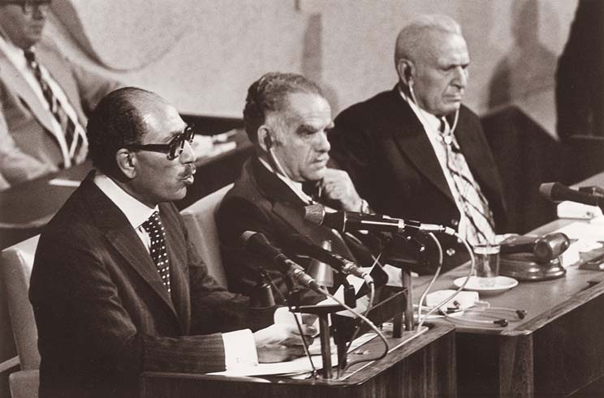
*President Anwar Sadat of Egypt speaking to the Israeli parliament in Jerusalem, 20 November 1977. Photo: unknown, public domain.*

The bargaining took sixteen months and needed an American president, who shut the two leaders up for thirteen days at a retreat in the hills of Maryland. Under the treaty of 1979, Israel gave back the whole of Sinai, pulled out its settlers by force, and received full recognition and an embassy in Cairo. That peace has held ever since.

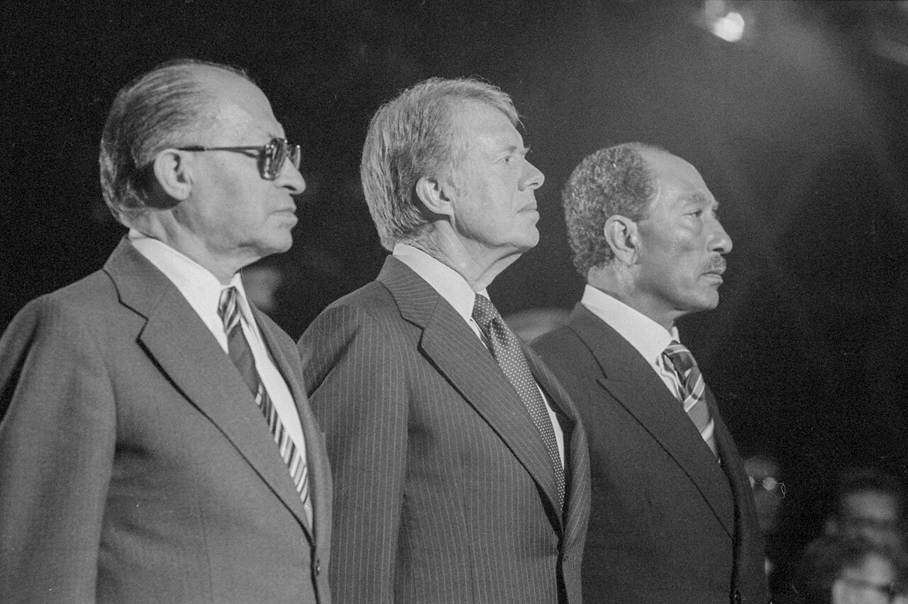
*Menachem Begin, Jimmy Carter and Anwar Sadat at Camp David, 7 September 1978. Photo: Bill Fitz-Patrick, White House, public domain.*

It was the formula of land for peace, and it worked because both sides had something to give and a government able to give it. Sadat paid with his life. The other Arab states expelled Egypt from their league. In October 1981, as he took the salute at a military parade, a group of soldiers who belonged to a secret religious society jumped from a truck and shot him dead.

## Stones

The Palestinians had been left out of that bargain. For twenty years those under occupation had been fairly quiet. On 8 December 1987 an Israeli army truck crashed into a queue of cars in Gaza and killed four labourers. Rumour said that it was deliberate. The anger behind the rising had been building for two decades. Within days the whole of Gaza and the West Bank had risen.

It was not a war of guerrillas from abroad. It was a revolt of teenagers. They built barricades of burning tyres and threw stones at soldiers. Shopkeepers closed their shutters in general strikes, and people stopped paying Israeli taxes and buying Israeli goods.

The Israeli army had no good answer to children with stones. The army had been trained to fight tanks. The defence minister told it to use force, might and beatings, and television showed soldiers breaking the arms of boys with rocks. Over six years about a thousand Palestinians were killed by Israeli forces, and about a hundred and fifty Israelis were killed.

The uprising changed minds on both sides. It persuaded many Israelis that they could not rule another people for ever, and it persuaded the exiled leadership that it had to catch up with its own young. The revolt had started in the territories, without orders from Tunis. In 1988 Arafat declared that his movement accepted the United Nations resolution and with it a state beside Israel, and not in place of it.

Not every Palestinian followed. The uprising also produced a rival. In Gaza, a paralysed schoolteacher who ran a network of Muslim charities founded an armed movement called Hamas. Its charter said that the whole of Palestine was a religious trust that no one had the right to give away, and that there was no solution except holy war.

## A handshake

In 1992 Israel elected a government of the left under Yitzhak Rabin, a gruff, chain-smoking former general who had commanded the army in 1967. That winter two Israeli academics and three of Arafat's officials began meeting in secret at a country house in Norway, as the guests of a Norwegian research institute. Away from the cameras, the two sides could test ideas that neither could yet say in public.

On 13 September 1993, on the lawn of the White House, the result was signed in front of Rabin and Arafat. The American president stood between them, and with a hand on each man's back steered them towards each other. Rabin hesitated, visibly, and took Arafat's hand. We who have fought against you, the Palestinians, he said, say to you today in a loud and clear voice: enough of blood and tears. Enough.

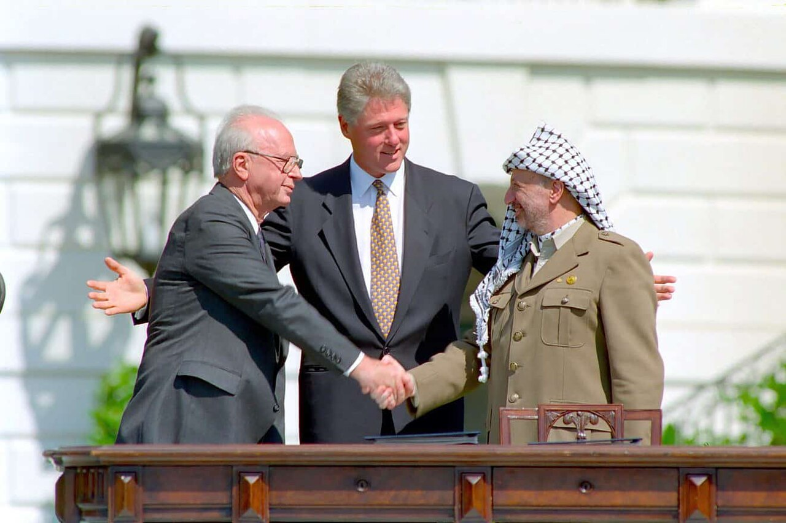
*Yitzhak Rabin and Yasser Arafat shake hands on the White House lawn, with President Bill Clinton between them, 13 September 1993. Photo: Vince Musi, White House, public domain.*

Israel recognised Arafat's organisation as the representative of the Palestinian people, and the organisation recognised Israel's right to exist. A Palestinian authority was set up to govern Gaza and the towns of the West Bank, with its own police. What the agreement did not settle was larger than what it did. Everything difficult was put off, to be settled within five years: the borders, the settlements, Jerusalem and the refugees. The hope was that trust would grow in the meantime.

The weakness of the plan was the waiting. It was exactly that interval which the enemies of the agreement used. In February 1994 a settler, a doctor born in New York, walked into the mosque at the tomb of Abraham in Hebron during the dawn prayer with an army rifle and killed twenty-nine worshippers. Six weeks later a Hamas suicide bomber drove a car full of explosives into an Israeli bus. Dozens of such attacks followed, in buses, markets and cafés.

The damage worked on both leaders at once. Each attack cost the Israeli government support. Each closure of the territories that followed, and each new settlement, did the same for Arafat. The number of settlers nearly doubled in the years of the peace process. To Palestinians, that was proof that the land was being taken while they talked.

Inside Israel the anger turned on Rabin himself. The Israeli right held rallies at which Rabin was shown in the uniform of a Nazi officer, and some rabbis ruled that a man who handed over the land of Israel deserved death. On the evening of 4 November 1995 Rabin spoke at a peace rally of a hundred thousand people in Tel Aviv, and joined, awkwardly, in the singing of a song for peace. As he walked to his car, a religious law student shot him twice in the back. The song sheet was found folded in his breast pocket, soaked in blood. Six months later, after a string of bus bombings, Israelis elected the leader of the right. Within a year, the peace camp had lost both its leader and its power.

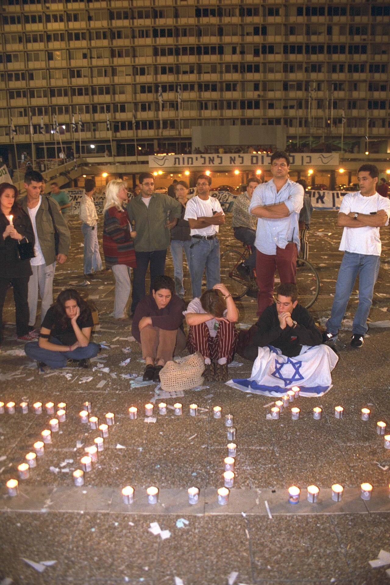
*Young people lighting memorial candles in the square in Tel Aviv on the night Yitzhak Rabin was shot, 4 November 1995. Photo: Tsvika Israeli, Israel Government Press Office, CC BY-SA 3.0.*

## Two accounts of a summer

Even so, the talks were not dead. The most ambitious attempt was made in July 2000, when another American president brought an Israeli prime minister and Arafat to the same retreat in Maryland for two weeks. It failed, and the two sides have never agreed on why.

In the Israeli and American account, the prime minister offered more than any Israeli leader had before: a Palestinian state in Gaza and more than nine tenths of the West Bank, with a capital in the Arab districts of Jerusalem. Arafat said no and made no proposal of his own.

In the Palestinian account, the state on offer was cut into pieces by blocs of settlements and Israeli roads, with Israel in control of its borders, its water and its airspace, with no real sovereignty over the holy places and nothing for the refugees. The two accounts could both be told because nothing had been put in writing. The talks limped on for six months more and ran out of time. Each side came away convinced that the other had never meant it.

Two months after the summit the leader of the Israeli opposition, Ariel Sharon, walked onto the mosque compound in Jerusalem with a thousand policemen. To Palestinians it looked like a claim of ownership. Riots began the next day and became a second uprising, far bloodier than the first. Palestinian bombers blew themselves up in pizza restaurants, discotheques and, on the first night of Passover in 2002, a hotel dining room where thirty people died at the table.

Israel answered with its army. It sent its tanks back into the Palestinian cities, killed militant leaders with missiles fired from helicopters, and penned Arafat inside the ruins of his headquarters. In five years about a thousand Israelis and more than three thousand Palestinians died.

The Israelis who had marched for peace largely stopped believing in it. If there was no one to make peace with, the next best thing seemed to be a wall. Israel began to build a barrier planned to run for seven hundred kilometres, of fence and in the towns of concrete slabs eight metres high. The bombings all but stopped. The price was paid by others. The barrier runs for most of its length inside the West Bank, and it cut Palestinian villages off from their fields.

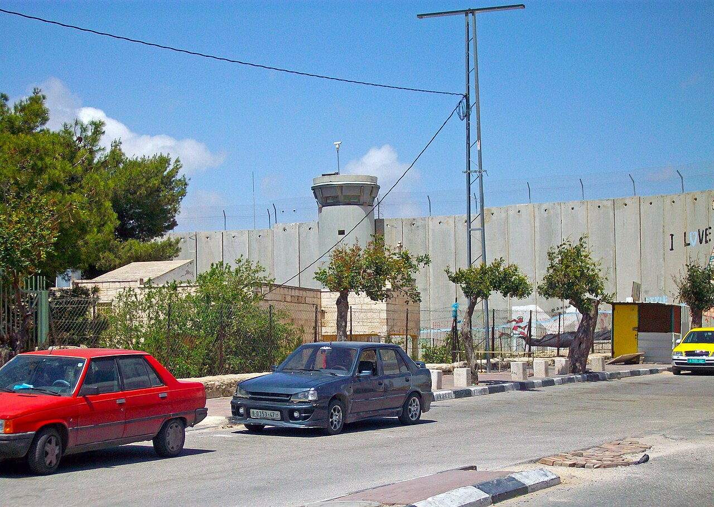
*The barrier at Bethlehem in 2009: a concrete wall with a watchtower, seen from a street on the Palestinian side. Photo: Daniel Case, CC BY-SA 3.0.*

## Gaza

With the talks dead, Israel began to act alone. Arafat died in 2004. The next year Sharon, who was now prime minister, did what nobody had expected of him. The man who had walked onto the mosque compound now ordered a retreat. He pulled every Israeli soldier and settler out of Gaza, eight thousand people, dragging some from their houses, without an agreement and without asking anything in return. Israel kept control of Gaza's coast, its sky and all but one of its border crossings. Gaza was free of settlers, but it was not free.

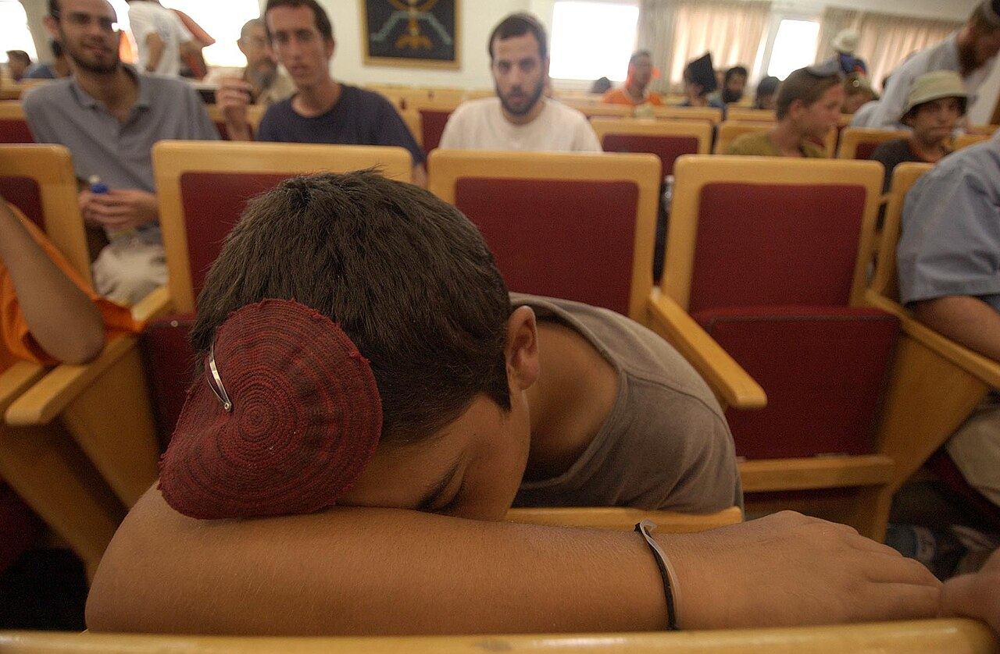
*A boy in a hall at Neve Dekalim, an Israeli settlement in Gaza, during its evacuation on 18 August 2005. Photo: Israel Defense Forces, CC BY-SA 2.0.*

The Palestinians, meanwhile, were splitting apart. In January 2006 the Palestinians held an election. Fatah, which ran the authority, had become known for corruption, and voters gave a majority of the seats to Hamas. The United States and the European governments refused to deal with a party that would not recognise Israel or give up violence. In June 2007, after months of street fighting between the two Palestinian factions, Hamas seized the whole of Gaza by force.

Since then the Palestinians have had two governments, one in the West Bank that talks to Israel and one in Gaza that fires rockets at it. Gaza, a strip forty kilometres long with a million and a half people, was sealed off by Israel and Egypt. Israelis say that they left Gaza and got rockets in return. Palestinians say that they were offered a cage.

## Four questions

Negotiators on both sides have known for thirty years what an agreement would have to settle.

The first question is where the border would run, and what would become of half a million settlers on the far side of it.

The second is the refugees of 1948 and their descendants, now nearly six million, who claim the right to return to homes inside Israel. For Palestinians that right is the heart of their cause. For Israelis it would mean the end of a state with a Jewish majority. Each side, in other words, sees in the same demand either justice or its own destruction.

The third is security, for a country that at its waist is fifteen kilometres wide. That is less than the distance many people drive to work each day.

The fourth is Jerusalem. On a platform of thirty-seven acres in its south-eastern corner stand a golden dome and a great mosque, on the spot from which Muslims believe that Muhammad rose to heaven. It is the third holiest place in Islam. The same platform is where the Jewish Temple stood, and the retaining wall beneath it is where Jews have prayed for two thousand years. Neither people will sign away its claim. Here, more than anywhere, the two stories sit on top of each other.

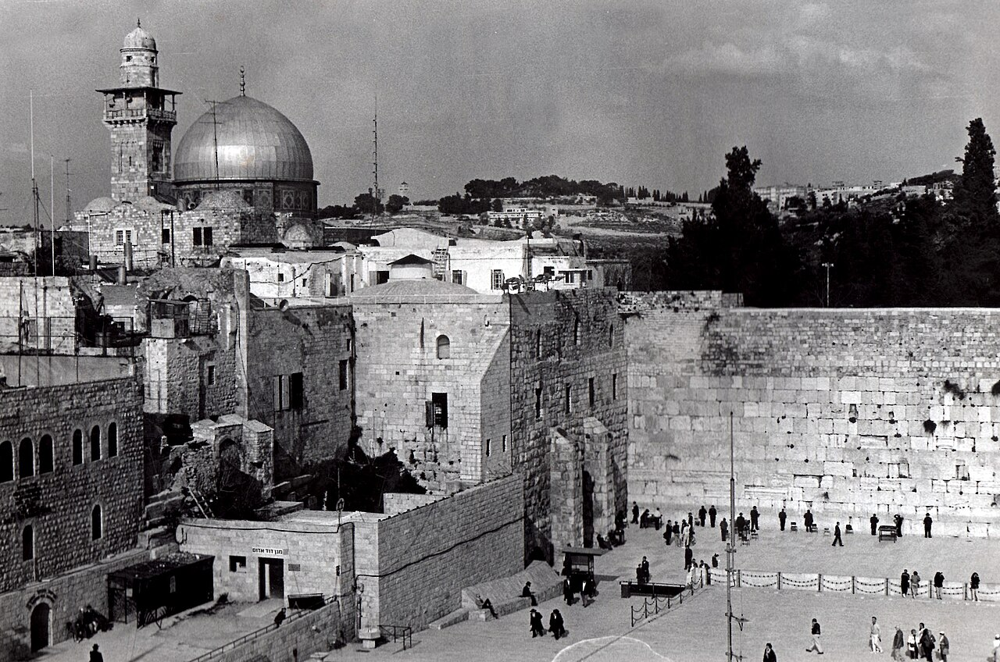
*The Dome of the Rock above the Western Wall in Jerusalem, photographed in 1992. Photo: Duncan Harris, CC BY 2.0.*

The uneasy rule for that platform goes back to the days just after the war. On the morning in June 1967 when the paratroopers took the Old City, one of them climbed the golden dome and hoisted an Israeli flag. The defence minister, watching through binoculars from a hill across the valley, ordered it taken down at once. Ten days later he sat on the carpet of the mosque with its Muslim guardians and told them that they would go on running the platform as before. Jews could visit, and would pray at the wall below. That arrangement, made in an afternoon, has been strained many times and has never been replaced. Each side fears what would happen if the other tried to change it.
