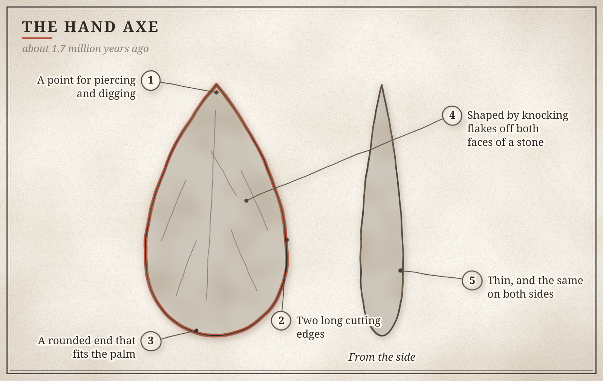
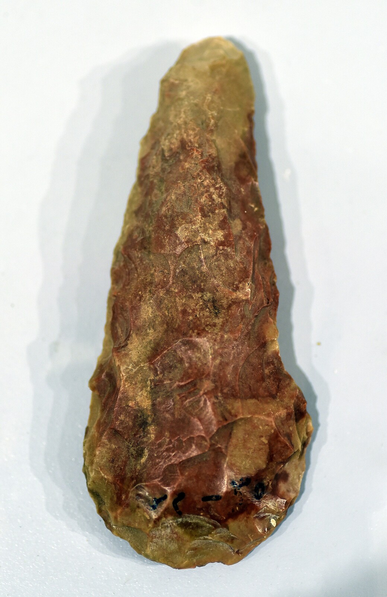

# The hand axe

| | |
|---|---|
| **First made** | About 1.7 million years ago, in East Africa |
| **Made of** | One piece of stone |
| **What it does** | Cuts, chops, scrapes and digs |
| **Before it** | A sharp flake knocked off a cobble |
| **After it** | Every tool that is made to a plan |

## Why it mattered

The oldest stone tools were flakes. The striking took skill, but the shape of the piece did not matter, so long as it had an edge.

A hand axe is different in kind. Its shape is not in the stone to begin with. The maker has to work both faces toward the same outline, in the right order, over dozens of blows. It is the oldest tool we know of whose shape was forced on the stone, and it is the same shape again and again. Hand axes were made in much the same shape, across Africa, Europe and Asia, for more than a million years. For fifty thousand generations, each learned the pattern from the last and passed it on almost unchanged.

## The real thing

*A hand axe from Barda Balka in Iraq, about 250,000 years old. Photo: Osama Shukir Muhammed Amin, CC BY-SA 4.0.*
