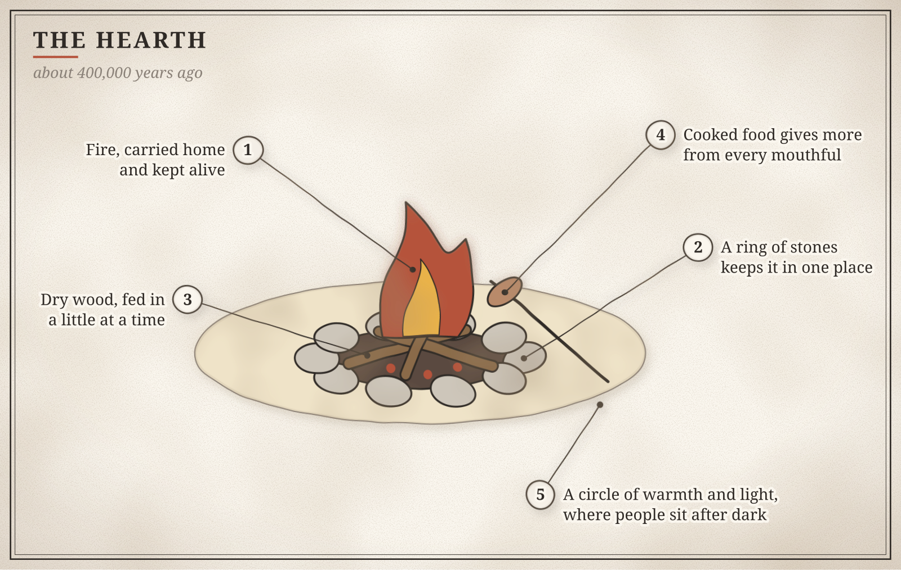
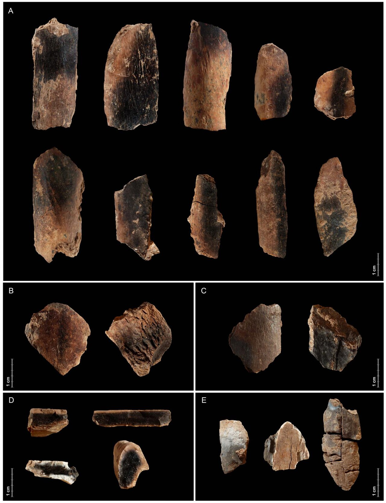

# The hearth

| | |
|---|---|
| **First made** | Common by 400,000 years ago; the oldest traces are far older |
| **Made of** | Fire, dry wood, and later a ring of stones |
| **What it does** | Keeps a fire in one place, night after night |
| **Before it** | Wild fire, set by lightning and soon gone |
| **After it** | The oven, the kiln, the furnace and the engine |

## Why it mattered

Wild fire was always there, set by lightning and creeping through dry grass. At some point our ancestors stopped running from it and started carrying it home. A fire keeps the cold off, and that made it far easier for a tropical ape to live in places with winters. It keeps lions and hyenas back at night. It gives light, so the day no longer ends at sunset.

Fire was also the first fuel that any animal put to work. Every engine and power station that burns something has done the same thing with more of it.

## The real thing

*Animal bones burnt in the hearths of Qesem Cave in Israel, about 400,000 years ago. Photo: Ruth Blasco, CC BY 4.0.*
