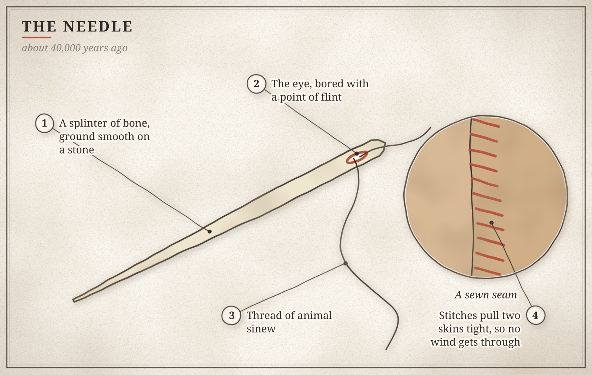
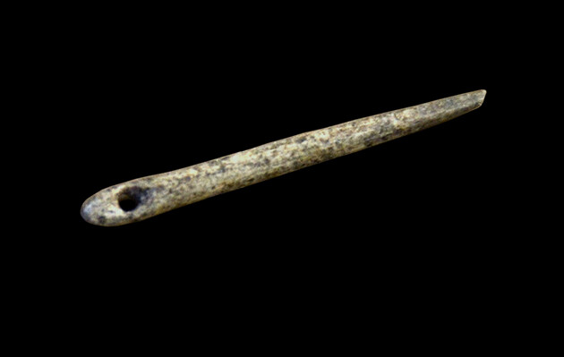

# The needle

| | |
|---|---|
| **First made** | About 40,000 years ago, in Siberia |
| **Made of** | Bone, with thread of animal sinew |
| **What it does** | Pulls a thread through a hole, again and again, without letting go of it |
| **Before it** | Skins draped over the body, or laced through holes punched with a spike |
| **After it** | The steel needle, the sewing machine, the surgeon's stitch |

## Why it mattered

A spike can punch a hole in a hide, and a thong can be pushed through afterwards. That is slow, and the holes are large. With an eye, the thread follows the point through the skin in a single movement, so the holes can be tiny and close together.

Tiny, close stitches are what make fitted clothing windproof: sleeves, trousers, hoods, mittens and boots, cut to the body and worn in layers. Fitted clothes trap a layer of warm air against the whole body, and that is what keeps a person alive at forty degrees below freezing. With that, a hairless animal from the tropics could live on the frozen plains of Siberia, and walk from there into the Americas.

## The real thing

*A bone needle from the Dordogne in France, made in the last ice age. Its eye is still open. Photo: Vassil, CC0.*
