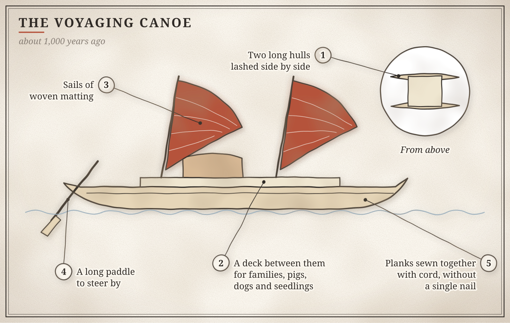
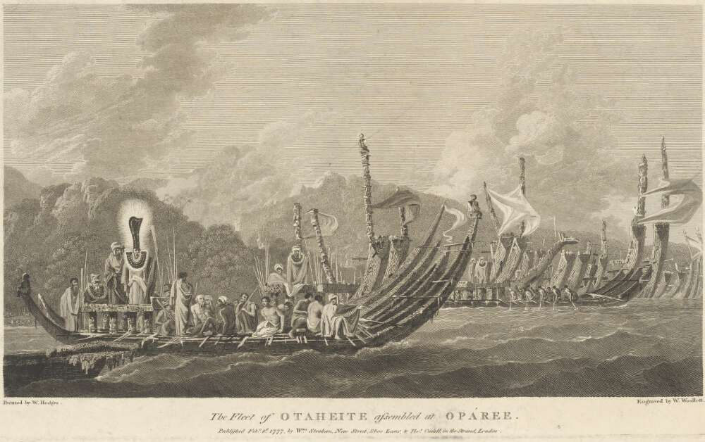

# The voyaging canoe

| | |
|---|---|
| **First made** | More than 1,000 years ago, in the islands of Polynesia |
| **Made of** | Wood, cord and woven matting |
| **What it does** | Carries a whole village across open ocean |
| **Before it** | Rafts and single-hulled canoes |
| **After it** | The modern sailing catamaran |

## Why it mattered

A single narrow hull is fast and tips over easily. Two of them lashed together, with a deck between, will stand up to an ocean swell and carry a heavy load. The canoes that settled the Pacific were large enough for several families along with pigs, dogs, chickens and the seedlings of the plants they meant to grow.

On these voyages the people aboard were settlers, bringing a whole way of life with them. They found Hawaii, nearly four thousand kilometres from the nearest islands that had people. They found Easter Island. About seven hundred years ago they reached New Zealand, the last large land on Earth to be settled, and the journey that began with a walk out of Africa was all but over.

## The real thing

*Double canoes gathered in Tahiti in 1774, engraved from a drawing made on Captain Cook's second voyage. Drawing: William Hodges, public domain.*
