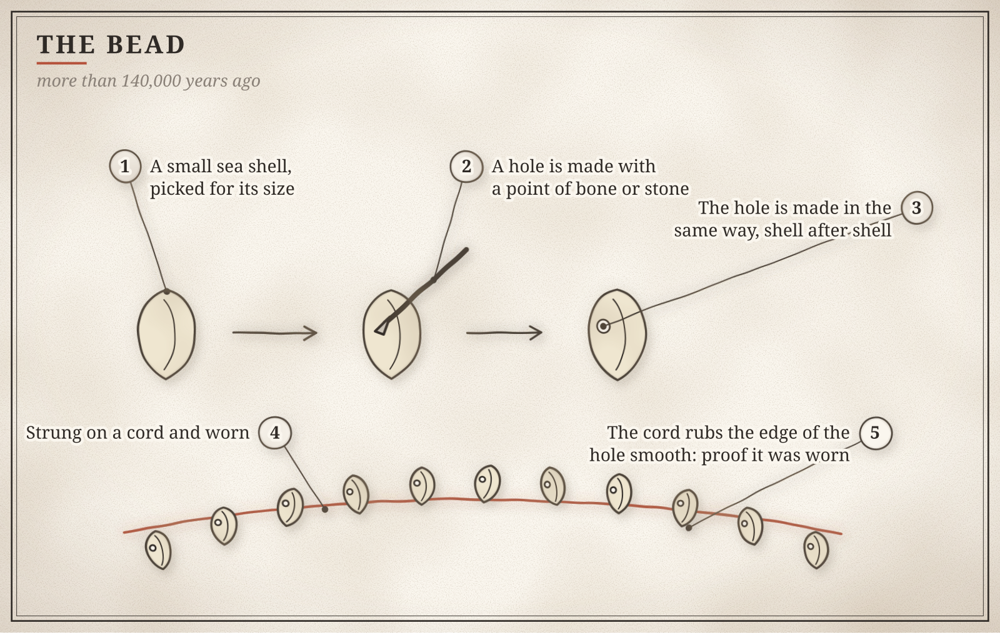
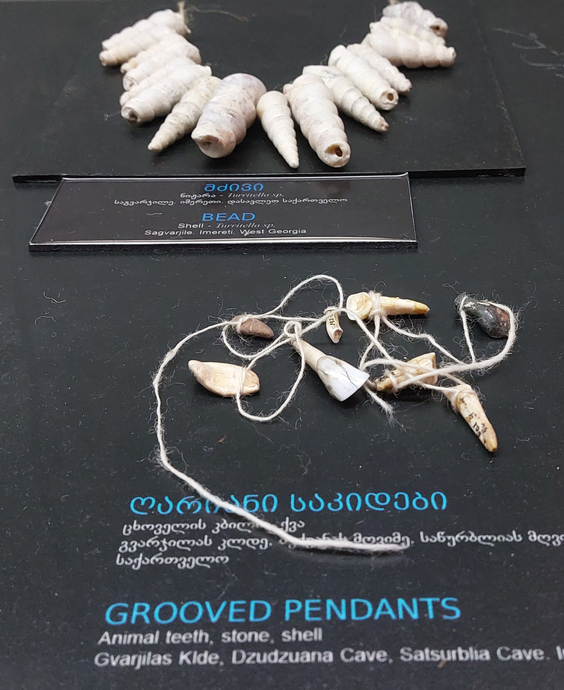

# The bead

| | |
|---|---|
| **First made** | More than 140,000 years ago, in North Africa |
| **Made of** | Sea shells, and later ivory, bone, teeth and stone |
| **What it does** | Says something about its wearer before a word is spoken |
| **Before it** | Nothing that survives |
| **After it** | The jewel, the medal, the uniform and the wedding ring |

## Why it mattered

A bead does no work. It cannot cut, dig or keep anybody warm. Its whole use is to be seen by other people, and to mean something to them: this person is one of us, or has a certain place among us.

That is why beads matter so much to anyone trying to find out when people began to think as we do. A bead works only if the people who see it understand what it stands for. People took great trouble over them. At one burial ground in Russia, three people were buried with about thirteen thousand beads of mammoth ivory sewn onto their clothes. Each bead took most of an hour to make.

## The real thing

*Shell beads and tooth pendants made by ice-age hunters in Georgia, restrung on modern thread. Photo: Kober, CC0.*
