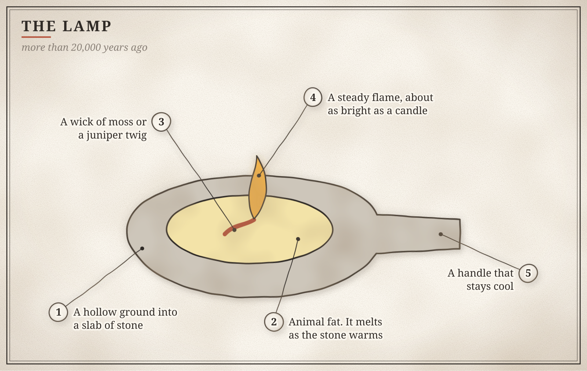
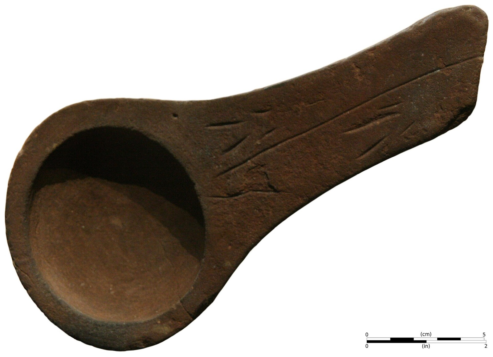

# The lamp

| | |
|---|---|
| **First made** | More than 20,000 years ago, in ice-age Europe |
| **Made of** | Stone, animal fat, and a wick of moss or twig |
| **What it does** | Gives a small, steady light that can be carried and set down |
| **Before it** | The campfire and the burning stick |
| **After it** | The oil lamp, the candle, and every light that burns a fuel |

## Why it mattered

A torch gives more light than a lamp, but it has to be held or propped, it smokes, and it burns out in about an hour. A lamp gives about as much light as a candle. In exchange, it burns for hours, hardly smokes, and leaves both hands free.

That made a new kind of place usable. The painted caves of France and Spain run hundreds of metres into the rock, beyond the last trace of daylight. Stone lamps have been found on their floors, and the painters worked by their light, a small circle of it at a time. The lamp also stretched the day. Beside one, somebody can sew, or carve, or mend a net, long after dark.

## The real thing

*The lamp found on the floor of Lascaux cave in France, about 17,000 years old. The bowl held the fat, and the handle is carved with marks. Photo: Semhur, CC BY-SA 4.0.*
