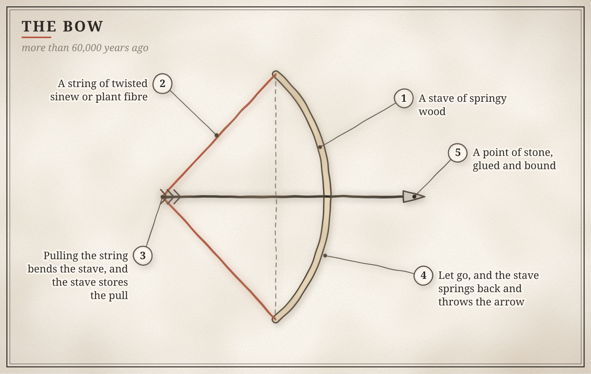
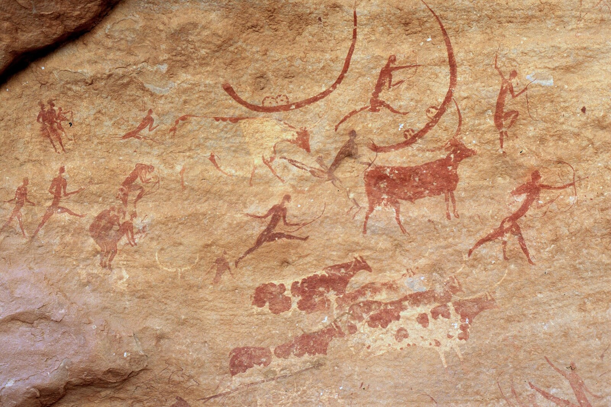

# The bow

| | |
|---|---|
| **First made** | Probably more than 60,000 years ago, in southern Africa |
| **Made of** | A wooden stave and a string of sinew or plant fibre |
| **What it does** | Stores the pull of an arm and lets it go all at once |
| **Before it** | The thrown spear and the spear-thrower |
| **After it** | The crossbow, the catapult, and every weapon that kills from out of reach |

## Why it mattered

A thrown spear gets only what the body can give it in the instant of the throw. A bow separates the two steps. The archer puts the effort in slowly, and the bow lets it out quickly. The result outreaches any thrown spear, needs no run-up, and can be shot from a crouch or from cover.

It changed hunting, and it changed fighting between people. With a spear, a man had to come close enough to be hurt himself. With a bow, he could kill from beyond the reach of the other man's spear. At Jebel Sahaba on the Nile, where some of the oldest known victims of war are buried, the small stone points of arrows and light spears lie among the bones.

## The real thing

*Archers painted on rock at Jabbaren in the Sahara, in what is now Algeria, when the desert was still grassland. Photo: Gruban, CC BY-SA 2.0.*
